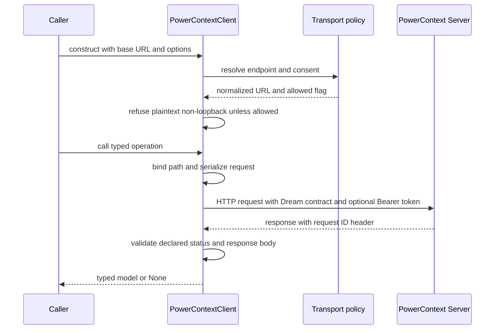

# Python Client, CLI and Transports

This page explains the client side of PowerContext: the `powercontext` command-line entry point and its command groups, the asynchronous `PowerContextClient` facade, the shared transport policy that decides which Server endpoint and whether plaintext HTTP is allowed, the host-specific native transport resolution used by diagnostics, the setup-time endpoint choice, and the opt-in Codex session import. The HTTP operations that the client calls are described in [HTTP and MCP API](http-and-mcp-api.md); the setting catalogue is described in [Configuration Settings](../concepts/configuration-settings.md).

## Layers at a glance

The client side has five cooperating layers. Each one resolves the endpoint in the same way, so a reader can reason about one policy rather than per-command rules.

| Layer | Owner | Responsibility |
| --- | --- | --- |
| Console entry point | `powercontext.cli.app` | Builds the Typer root, root options and the set of command providers. |
| Content commands | `powercontext.client.cli` | Server-backed command groups; each command builds a fresh `PowerContextClient`. |
| Python facade | `powercontext.client.client` | Async HTTP operations, request preparation, response validation and error mapping. |
| Transport policy | `powercontext.client.transport_policy`, `powercontext.transport` | Endpoint and plaintext-consent resolution, shared loopback classification. |
| Host and setup transport | `powercontext.cli.native_transport`, `powercontext.cli.transport` | Reads host-native configuration for diagnostics and chooses the endpoint that setup installs. |

Session import (`powercontext.client.session_import`) is a consumer of the Python client and of the redaction helpers in `powercontext.client.capture`.

## Entry point and command assembly

The package declares two console scripts. `powercontext` is the product CLI and resolves to `powercontext.cli.app:main`; `powercontext-ops` is a separate operations entry point that this page does not cover. [pyproject.toml](repo://pyproject.toml#L118-L121)

The product CLI is not a single module. `create_cli` builds a Typer root with `no_args_is_help`, then attaches three sources of commands in order:

1. Content command groups registered by `powercontext.client.cli.register_commands` and the source-management registration. [app.py](repo://src/powercontext/cli/app.py#L98-L125) [client/cli.py](repo://src/powercontext/client/cli.py#L2320-L2354)
2. Command providers discovered through the `powercontext.cli` entry-point group, sorted by name. [pyproject.toml](repo://pyproject.toml#L122-L130) [app.py](repo://src/powercontext/cli/app.py#L69-L96)
3. Duplicate names are rejected: a provider whose name is already registered raises a `ValueError`, so each root command name has exactly one owner. [app.py](repo://src/powercontext/cli/app.py#L125-L170)

The entry-point group currently provides `code`, `config`, `doctor`, `observability`, `service`, `server`, `setup` and `archive`. `doctor` and `setup` are Typer apps from `powercontext.cli.system`; `code`, `server` and `service` are optional roles, described next.

### Optional role gating

Three providers are optional: `powercontext.builtin.code.cli:app` is gated by the `builtin` role, and `powercontext.server.cli:app` and `powercontext.service.cli:app` are gated by the `server` role. Before loading one, the CLI checks that the role's declared requirements are installed at compatible versions. The check follows self-references to other `powercontext[...]` extras recursively and ignores requirements whose marker does not match the role. A missing requirement makes the role unavailable, and its provider is skipped silently rather than failing the whole CLI. [app.py](repo://src/powercontext/cli/app.py#L30-L61)

Two failure modes are not silent. If an enabled provider's module is missing, the loader raises a `RuntimeError` that asks the operator to repair that provider's installation. If an entry point does not load a Typer application, the loader raises a `TypeError`. [app.py](repo://src/powercontext/cli/app.py#L69-L96)

### Root options and lazy client construction

The root callback accepts `--server-url`, `--allow-insecure-http/--no-allow-insecure-http`, `--timeout` (minimum 0.1 seconds) and `--json`, plus `--version`. The callback does not build a client. It stores the values in the Click context metadata through `configure_client`, and each content command later merges them with environment and saved settings when it runs. [app.py](repo://src/powercontext/cli/app.py#L108-L170) [client/cli.py](repo://src/powercontext/client/cli.py#L576-L590)

When a content command runs, `_options` constructs `ClientSettings` from the root overrides and lets environment and saved configuration fill the gaps. Root flags therefore have the highest precedence, followed by the `POWERCONTEXT_CLIENT_*` environment, then the shared Client configuration file, then the built-in default. [client/cli.py](repo://src/powercontext/client/cli.py#L1717-L1732)

### Command groups

The content commands registered by `register_commands` are grouped as follows. The source-management registration adds further groups to the same root.

- Health and inventory: `live`, `ready`, `capabilities`, `stats`.
- Ingestion: `import-sessions` (see the session import section), `topic-memory` for status, block inspection and explicit retry of blocked processing.
- Review and artifacts: `candidate` (`list`, `show`, `approve`, `reject`, and `revise` with `json`), `experience`, `skill`, `dream` (`run`, `show`, `list`).
- Scope governance: `scope` with a nested `binding` group for external integration identities.
- Agent-native skills: `external-skill`.

Read commands print a human summary unless `--json` is set. `--json` writes the full model JSON for the response types that the renderer supports. [client/cli.py](repo://src/powercontext/client/cli.py#L1990-L2030)

Exit codes are fixed per failure class. A `ClientError` from a content command is printed and exits with code 1. A `SessionImportError` from `import-sessions` exits with code 2. [client/cli.py](repo://src/powercontext/client/cli.py#L1771-L1825)

## Transport policy: one endpoint and one consent rule

Every surface that opens a connection to a Server is meant to follow the rule stated in the shared policy module: plaintext HTTP is accepted on loopback by default; a client may opt into plaintext for another address; this does not disable TLS verification; and an unauthenticated Server must not bind a routable address without a separate opt-in. [transport_policy.py](repo://src/powercontext/client/transport_policy.py#L1-L20)

### Loopback classification

`is_loopback_host` accepts `localhost`, `127.0.0.1`, `::1`, bracketed IPv6 loopback literals, and every IPv4 address in `127.0.0.0/8`. `is_plaintext_non_loopback` is true only for an `http` URL whose host is not loopback. Classification never performs DNS resolution or a network request. [transport.py](repo://src/powercontext/transport.py#L1-L57)

### URL normalization

`normalize_client_url` requires a valid HTTP or HTTPS URL and rejects embedded credentials, query strings and fragments. Trailing slashes are removed. `/mcp` suffixes are removed by the endpoint helpers that setup and native resolution call, so that an MCP URL and a REST base URL map to the same Server endpoint. [transport_policy.py](repo://src/powercontext/client/transport_policy.py#L40-L70)

### Endpoint selection

`resolve_client_transport` is the common resolver for the `client` host and for host adapters. When no explicit URL is supplied, it reads the first non-empty value of `POWERCONTEXT_CLIENT_BASE_URL` and `POWERCONTEXT_CLIENT_SERVER_URL`. If neither is set, it uses the saved endpoint for the host in the shared Client configuration file, and otherwise the default `http://127.0.0.1:8000`. [transport_policy.py](repo://src/powercontext/client/transport_policy.py#L129-L171)

### Consent selection

Consent is resolved in this order:

1. An explicit `allow_insecure_http` argument.
2. The host-specific environment variable `POWERCONTEXT_<HOST>_ALLOW_INSECURE_HTTP`, then the common `POWERCONTEXT_CLIENT_ALLOW_INSECURE_HTTP`.
3. The saved consent for the host, but only when the endpoint being resolved equals the saved endpoint.
4. Otherwise, consent is false.

The third step is the important safety property. Saved consent is bound to the endpoint that was approved. A different URL, such as one supplied for a single invocation, does not inherit it. [transport_policy.py](repo://src/powercontext/client/transport_policy.py#L122-L171) [transport_policy.py](repo://src/powercontext/client/transport_policy.py#L198-L225)

### Shared Client configuration file

Non-secret per-host connection settings live in one JSON document, `clients.json`, at `~/.config/powercontext/clients.json` unless `POWERCONTEXT_CLIENT_CONFIG_FILE` names another path. The document must have `version` 1 and a `hosts` object. Each host entry may hold `server_url`, `allow_insecure_http` (a JSON boolean), and host target fields such as the DSH profile or MiniMax paths. Credentials are not read from or written to this file. [transport_policy.py](repo://src/powercontext/client/transport_policy.py#L33-L38) [transport_policy.py](repo://src/powercontext/client/transport_policy.py#L72-L115) [cli/transport.py](repo://src/powercontext/cli/transport.py#L299-L317)

### Python client settings

`ClientSettings` reads the `POWERCONTEXT_CLIENT_` prefix. Its fields are:

- `POWERCONTEXT_CLIENT_SERVER_URL`, default `http://127.0.0.1:8000`, validated by `normalize_server_url`.
- `POWERCONTEXT_CLIENT_API_TOKEN`, default unset, stored as a secret and excluded from `repr`. It is sent as a Bearer token.
- `POWERCONTEXT_CLIENT_TIMEOUT`, default `10.0` seconds, which must be greater than zero.
- `POWERCONTEXT_CLIENT_ALLOW_INSECURE_HTTP`, default `false`, the common plaintext consent.

After the endpoint and consent are resolved, `ClientSettings` rejects a non-loopback plaintext URL unless consent is true. [settings.py](repo://src/powercontext/client/settings.py#L25-L57) [transport_policy.py](repo://src/powercontext/client/transport_policy.py#L164-L210)

## The Python client

`PowerContextClient` is an async facade over the public HTTP contract. It is constructed with an optional base URL, token, timeout, an optional caller-supplied `httpx.AsyncClient`, `trust_transport_security`, and `allow_insecure_http`. It does not own a separate endpoint policy; it calls `resolve_client_transport` with the name `client`. [client.py](repo://src/powercontext/client/client.py#L362-L390)

### Plaintext guard

The constructor refuses to send requests over non-loopback plaintext HTTP with a `ValueError`. The guard applies to every request, not only authenticated ones, because request bodies carry Memory content. The only exemption is a caller-supplied `http_client` combined with `trust_transport_security=True`, which states that the caller's transport is secure, such as an in-process application or a TLS-terminating proxy. Supplying a client is not by itself evidence of safety. `allow_insecure_http` is a separate cleartext opt-in and does not claim that the transport is secure. [client.py](repo://src/powercontext/client/client.py#L362-L400)

### HTTP client ownership and proxy behavior

When the facade creates its own `httpx.AsyncClient`, loopback targets use an explicit `AsyncHTTPTransport`. That bypasses environment and OS proxy discovery so that loopback traffic stays on the machine, while HTTPX's certificate-file handling is preserved. Remote targets keep normal proxy behavior. `aclose` closes only a client the facade created. [client.py](repo://src/powercontext/client/client.py#L386-L402) [client.py](repo://src/powercontext/client/client.py#L403-L420)

### Request lifecycle

The sequence below shows one operation from a caller to the Server and back.

The sequence is the `_request` path. Each facade method names one generated operation. `_request` binds path parameters, serializes the request body or query string with `_prepare_request`, creates a tracing span, injects tracing headers, and sends the request. [client.py](repo://src/powercontext/client/client.py#L1349-L1400)

Requests always carry the `X-PowerContext-Dream-Contract: 2` header. A Bearer `Authorization` header is added only when a token is configured. The response `X-PowerContext-Request-ID` is preserved on errors. [client.py](repo://src/powercontext/client/client.py#L362-L390) [client.py](repo://src/powercontext/client/client.py#L1349-L1400)

### Request preparation and compatibility

`_prepare_request` serializes requests with `exclude_unset` except for `PREPARE_CONTEXT`. For that operation it deliberately drops fields whose absence is equivalent to their default when an older Server might reject them: `assembly` when it was not set, `include_receipt` when false, and `include_reuse` when false. This lets a newer client talk to an older Server without volunteering unknown flags. [client.py](repo://src/powercontext/client/client.py#L1418-L1470)

### Error mapping

The facade maps failures into three classes:

- An `httpx.HTTPError` becomes a `TransportError` for the request path.
- A status code that is not declared by the operation becomes a `ServerResponseError` built from the Server's error body and request ID. A declared 2xx status or a declared 304 is success.
- A success whose body fails validation becomes an `InvalidResponseError`.

A 204 response, a 304 response, or an operation without a response type returns `None`. [client.py](repo://src/powercontext/client/client.py#L1385-L1420)

## Host native transport resolution

`powercontext.cli.native_transport.resolve_host_transport` answers one question for a named Agent host: which Server endpoint does the host's installed integration use, and is plaintext consent present for that endpoint? It is used by `doctor` to verify what an installed host would connect to. It is a read-only diagnostic and is not an HTTP guard. [cli/hosts.py](repo://src/powercontext/cli/hosts.py#L108-L140) [native_transport.py](repo://src/powercontext/cli/native_transport.py#L192-L204)

### Failure rule

Native configuration is read only in forms the resolver understands. Unsupported, unreadable, or `$include`-based configuration raises a `ValueError` with a fixed message; the resolver does not guess an endpoint. Unset or missing native files are not failures: they contribute no native value and resolution continues to the next source. [native_transport.py](repo://src/powercontext/cli/native_transport.py#L43-L60) [native_transport.py](repo://src/powercontext/cli/native_transport.py#L62-L70)

### Branches

The resolver takes four distinct branches.

1. **MiniMax.** The native MiniMax MCP endpoint is required. If it is absent, resolution fails with an explicit error; otherwise the endpoint is resolved through the shared policy.
2. **ZCode.** The endpoint comes from the ZCode plugin settings and the selection rules for ZCode. If the ZCode Hook and MCP URLs differ, resolution fails rather than choosing one. Native consent, when present, must be a boolean and applies only when the native URL equals the chosen endpoint.
3. **Native-backed hosts.** For `dsh`, `kimi-code`, `claude-code`, `hermes`, `openclaw` and other hosts, the native settings are read from the host's own file or environment. The native URL key differs by host (for example `baseUrl`, `server_url`, `base_url`, `endpoint`). For WorkBuddy, a divergent Hook and MCP URL pair fails.
4. **Hosts without native settings.** Any other host reads no native settings and uses the generic selection rule.

After the endpoint is selected, the shared policy supplies the first consent decision. Native consent then overrides it only when the host has no environment consent override and the native consent value applies to the same endpoint; OpenClaw and DSH require the native consent value to be a boolean. [native_transport.py](repo://src/powercontext/cli/native_transport.py#L94-L141) [native_transport.py](repo://src/powercontext/cli/native_transport.py#L192-L241)

### Endpoint precedence and fallback

`_selected_url` chooses the endpoint for each host. The table lists the precedence, and the fallback when the preferred source is absent.

| Host | Precedence used | Fallback when the preferred source is unavailable |
| --- | --- | --- |
| `codex` | Installed Codex plugin MCP URL from the plugin cache | Saved Client endpoint, then the default `http://127.0.0.1:8000`. |
| `claude-code` | `POWERCONTEXT_CLAUDE_SERVER_URL`, then native plugin option, then common URL | Saved endpoint, then the default. |
| `hermes` | `POWERCONTEXT_HERMES_BASE_URL`, then native config, then common URL | Saved endpoint, then the default. |
| `workbuddy` | `POWERCONTEXT_WORKBUDDY_SERVER_URL`, then common URL | Saved endpoint, then the default. |
| `zcode`, `kimi-code` | Native URL, then host server-URL variable | The default `http://127.0.0.1:8000`; a saved endpoint is not consulted. |
| `openclaw` | Host endpoint variable, common URL, native config, then saved endpoint | Raises `PowerContext endpoint is not configured in OpenClaw` when none is set. |
| Other hosts | Host-prefixed environment, common URL, native config, then saved endpoint | Saved endpoint, then the default. |

Codex and other plugin-backed hosts report no native URL when the plugin cache directory or the installed plugin is absent. In that case the resolver falls through to the saved or default endpoint. [native_transport.py](repo://src/powercontext/cli/native_transport.py#L75-L92) [native_transport.py](repo://src/powercontext/cli/native_transport.py#L155-L173) [system.py](repo://src/powercontext/cli/system.py#L1240-L1250)

### Native endpoint for setup conflicts

`configured_native_endpoint` reads only explicitly configured native endpoints. Setup uses it to detect conflicts, so it does not guess a value from a host that has no configuration. [native_transport.py](repo://src/powercontext/cli/native_transport.py#L175-L190)

## Setup-time endpoint selection

Setup chooses the endpoint that an installed host will use, before any installation side effect. This is a different question from runtime resolution: setup decides what to write, while the runtime resolver decides what a process will use. [cli/transport.py](repo://src/powercontext/cli/transport.py#L68-L100)

The setup endpoint is selected in this order:

1. An explicit `--server-url` wins. Environment overrides that name a different endpoint cause a `ValueError` that asks the operator to unset them or align them first. [cli/transport.py](repo://src/powercontext/cli/transport.py#L190-L204)
2. Without `--server-url`, the setup environment file (`.env` in the working directory, or an explicit path) and the process environment are checked for `POWERCONTEXT_<HOST>_BASE_URL`, `_SERVER_URL`, `_ENDPOINT` and `POWERCONTEXT_CLIENT_SERVER_URL`. If they name more than one endpoint, setup fails and asks the operator to choose one. [cli/transport.py](repo://src/powercontext/cli/transport.py#L178-L188) [cli/transport.py](repo://src/powercontext/cli/transport.py#L218-L264)
3. If no such variable is set, saved Client settings and the host's native endpoint are the candidates. Several disagreeing candidates again require an explicit choice.
4. Without any candidate, `POWERCONTEXT_SERVER_PUBLIC_URL` is used when present. Otherwise the Server listener configuration supplies a loopback URL when a TCP port was declared. A UDS-only listener is rejected because it has no TCP endpoint for an agent. If no port was declared, the default `http://127.0.0.1:8000` is used. [cli/transport.py](repo://src/powercontext/cli/transport.py#L218-L264)

### Setup consent

Setup consent is resolved from the explicit flag, then the setup environment file, then environment overrides, then saved consent that matches the endpoint. For a remote plaintext endpoint without consent, setup asks interactively only when standard input is a TTY and the output is not JSON; the default answer is no. Otherwise it fails before installation with a message that asks for HTTPS, an SSH tunnel, or `--allow-insecure-http`. An accepted remote plaintext endpoint still prints a warning that TLS verification and Server authentication are unchanged. [cli/transport.py](repo://src/powercontext/cli/transport.py#L68-L157) [cli/transport.py](repo://src/powercontext/cli/transport.py#L159-L176)

### Publication

Setup writes the non-secret host connection (`server_url`, `allow_insecure_http`, and DSH profile and command when relevant) into `clients.json`, preserving the other hosts and the `version` 1 schema. Credentials are published separately by the authorization updates, so the shared file never contains secrets. [cli/transport.py](repo://src/powercontext/cli/transport.py#L287-L317)

## Codex session import

`powercontext import-sessions` imports pre-install user prompts from one supported host as ordinary Content Sources. The only supported host is `codex`; the command requires `--host`. It is an explicit, opt-in import, not a live hook. [client/cli.py](repo://src/powercontext/client/cli.py#L1734-L1768) [session_import.py](repo://src/powercontext/client/session_import.py#L181-L200)

### Prompt discovery

`read_codex_prompts` scans every `*.jsonl` file under `CODEX_HOME/sessions` (default `~/.codex`) in sorted order. A file that cannot be opened, is not UTF-8, or contains malformed JSON is counted as a failed file and skipped; the scan continues. [session_import.py](repo://src/powercontext/client/session_import.py#L329-L347) [session_import.py](repo://src/powercontext/client/session_import.py#L350-L402)

Only `response_item` records of type `message` with role `user` become prompts. Text is taken from `input_text` or `text` parts. Host-generated user messages are excluded: environment-context blocks, AGENTS.md instructions, turn-aborted and internal-context markers, the external apps-open-page context, and messages tagged with that content kind. A prompt requires a working directory, which comes from session metadata, turn context, or an environment-context block. [session_import.py](repo://src/powercontext/client/session_import.py#L416-L446) [session_import.py](repo://src/powercontext/client/session_import.py#L643-L690)

### Scope resolution

Unless `--scope-id` is supplied, each prompt's scope is resolved through `resolve_scope_binding` with `allow_default` set to false. The binding keys are the Codex session identity first (`codex` with kind `session`) and the workspace identity second (`codex` with kind `workspace`, whose external ID is a SHA-256 of the Git top-level path, or of the working directory when Git is unavailable). The import never falls back to the host's default Scope. A 404 or 422 from the Server marks the prompt as skipped with reason `unresolved_scope`; other Server errors propagate. [session_import.py](repo://src/powercontext/client/session_import.py#L448-L465) [session_import.py](repo://src/powercontext/client/session_import.py#L561-L576)

### Redaction, size and source identity

Before capture, prompt text is passed through `redact_known_secrets`. That function replaces values of environment variables whose names look sensitive and that are at least eight characters long, and the string values of sensitive keys in the Codex `auth.json` file. A prompt that becomes empty after redaction is skipped with `empty_after_redaction`. A prompt longer than 200,000 characters after redaction is skipped with `too_large`. [session_import.py](repo://src/powercontext/client/session_import.py#L240-L270) [capture.py](repo://src/powercontext/client/capture.py#L140-L170)

Each captured prompt uses a deterministic Source ID, `codex-user-prompt:` followed by a SHA-256 of the scope ID, session ID, turn ID and original content. Rerunning the import therefore addresses the same Source rather than creating a duplicate. [session_import.py](repo://src/powercontext/client/session_import.py#L92-L96)

### Capture outcomes

- A successful capture is `accepted` and records the returned position.
- A 409 `source_conflict` whose content was altered by redaction is `skipped` with reason `redaction_conflict`. This means a live capture already stored the unredacted version of the same prompt.
- Any other capture error is `failed` with reason `capture_failed`.

Accepted, redaction-conflict and failed outcomes are written to the checkpoint and the checkpoint is saved after each one. [session_import.py](repo://src/powercontext/client/session_import.py#L268-L318)

### Checkpoint

The checkpoint defaults to `CODEX_HOME/.powercontext/session-import/codex.json`, or to the path given by `--checkpoint-file`. It records `schema` `powercontext.session-import.codex.v2`, the `destination_id` (the Server URL for the CLI), and an `items` map keyed by Source ID. A checkpoint with another schema or destination is ignored, so a second Server never inherits the first Server's history. A corrupt or unreadable checkpoint is treated as empty. Saves go through a temporary file that replaces the checkpoint atomically. [session_import.py](repo://src/powercontext/client/session_import.py#L490-L527)

A prompt whose checkpoint status is `accepted` is skipped with reason `checkpoint_accepted`. A prompt whose status is `failed` is attempted again, so a transient capture failure is retried without writing a duplicate. [session_import.py](repo://src/powercontext/client/session_import.py#L256-L268) [session_import.py](repo://src/powercontext/client/session_import.py#L528-L560)

### Dry run

`--dry-run` runs discovery, redaction, size and scope checks, and checkpoint lookup. It reports would-be accepted prompts with a resolved scope and source ID, but it performs no capture and writes no checkpoint. The summary's `checkpoint_file` is null in that mode. [session_import.py](repo://src/powercontext/client/session_import.py#L181-L237) [session_import.py](repo://src/powercontext/client/session_import.py#L258-L268)

## Key invariants and failure behavior

- **One resolver per class of decision.** Endpoint and consent for Client and host adapters come from the shared policy module; host native configuration is only an input to that policy, never a parallel authority. [transport_policy.py](repo://src/powercontext/client/transport_policy.py#L129-L171)
- **Saved consent does not travel.** A saved plaintext approval applies only to its saved endpoint. [transport_policy.py](repo://src/powercontext/client/transport_policy.py#L164-L237)
- **Ambiguity fails rather than guesses.** Divergent endpoints in setup or native resolution, unsupported native configuration, and a UDS-only setup target all raise errors instead of choosing a value. [native_transport.py](repo://src/powercontext/cli/native_transport.py#L192-L241) [cli/transport.py](repo://src/powercontext/cli/transport.py#L218-L264)
- **Missing optional capability degrades quietly.** An optional command provider whose role is not installed is absent from the CLI; a native-backed host whose plugin is missing falls back to saved or default endpoints. [app.py](repo://src/powercontext/cli/app.py#L30-L61) [native_transport.py](repo://src/powercontext/cli/native_transport.py#L75-L92)
- **Plaintext is refused by default at each surface.** The Python client, the CLI settings and setup all refuse non-loopback plaintext without explicit consent. [client.py](repo://src/powercontext/client/client.py#L362-L400) [settings.py](repo://src/powercontext/client/settings.py#L25-L34) [cli/transport.py](repo://src/powercontext/cli/transport.py#L68-L120)
- **Session import never falls back to the default Scope.** A prompt without a resolvable binding is skipped, not written to a default Scope. [session_import.py](repo://src/powercontext/client/session_import.py#L448-L465)

## Extension points

- **New command provider.** Add a Typer app under the `powercontext.cli` entry-point group. Its name must be unique, and if it depends on an optional extra that extra should be listed in the optional role map so that a missing dependency hides it cleanly. [app.py](repo://src/powercontext/cli/app.py#L30-L37)
- **New host transport.** Add the host's native-setting reader to `_native_settings`, its endpoint precedence to `_selected_url`, and its consent key to `resolve_host_transport`. Each new branch must keep the rule that an unreadable native configuration raises instead of guessing. [native_transport.py](repo://src/powercontext/cli/native_transport.py#L94-L141) [native_transport.py](repo://src/powercontext/cli/native_transport.py#L155-L241)
- **New settings-backed client.** Subclass `ClientTransportSettings` and set `transport_host` and `transport_url_field`. The subclass inherits endpoint-bound saved consent and the `POWERCONTEXT_<HOST>_` environment rule. [transport_policy.py](repo://src/powercontext/client/transport_policy.py#L164-L225)
- **New import host.** Session import dispatches on `host` and supports only `codex` today; a new host needs its own reader, binding keys and checkpoint schema. [session_import.py](repo://src/powercontext/client/session_import.py#L181-L200) [session_import.py](repo://src/powercontext/client/session_import.py#L36-L40)

## Focused tests

These tests exercise the behavior above and are the best starting points before changing a branch.

- `tests/test_client_transport_policy.py` covers common versus host consent precedence, saved consent bound to its endpoint, invalid boolean values, and HTTPS certificate verification staying on with HTTP consent. [test_client_transport_policy.py](repo://tests/test_client_transport_policy.py#L42-L140)
- `tests/test_transport.py` covers loopback classification, client refusal of plaintext non-loopback requests (including bearer tokens and untrusted transports), proxy bypass for loopback, and Server bind rules. [test_transport.py](repo://tests/test_transport.py#L120-L215)
- `tests/test_native_transport_diagnostics.py` covers native precedence per host, WorkBuddy Hook and MCP mismatch, and reporting of unsupported native configuration without leaking content. [test_native_transport_diagnostics.py](repo://tests/test_native_transport_diagnostics.py#L55-L200)
- `tests/test_setup_transport.py` covers remote HTTP refusal before installation, conflicting endpoints requiring an explicit choice, saved versus new endpoints, and setup persistence of only non-secret fields. [test_setup_transport.py](repo://tests/test_setup_transport.py#L43-L200)
- `tests/test_session_import.py` covers Codex prompt filtering, unresolved-scope skipping without default fallback, redaction and redaction conflicts, dry runs, checkpoint isolation by destination, retry of failed items, and the CLI JSON summary. [test_session_import.py](repo://tests/test_session_import.py#L42-L140) [test_session_import.py](repo://tests/test_session_import.py#L600-L800) [test_session_import.py](repo://tests/test_session_import.py#L895-L940)
