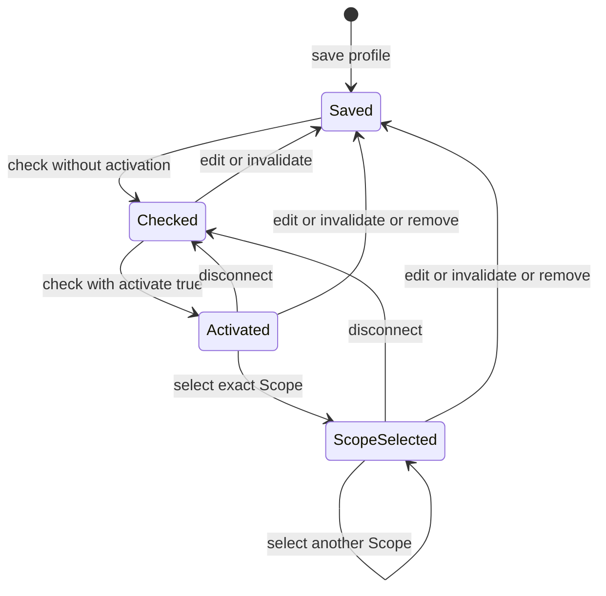
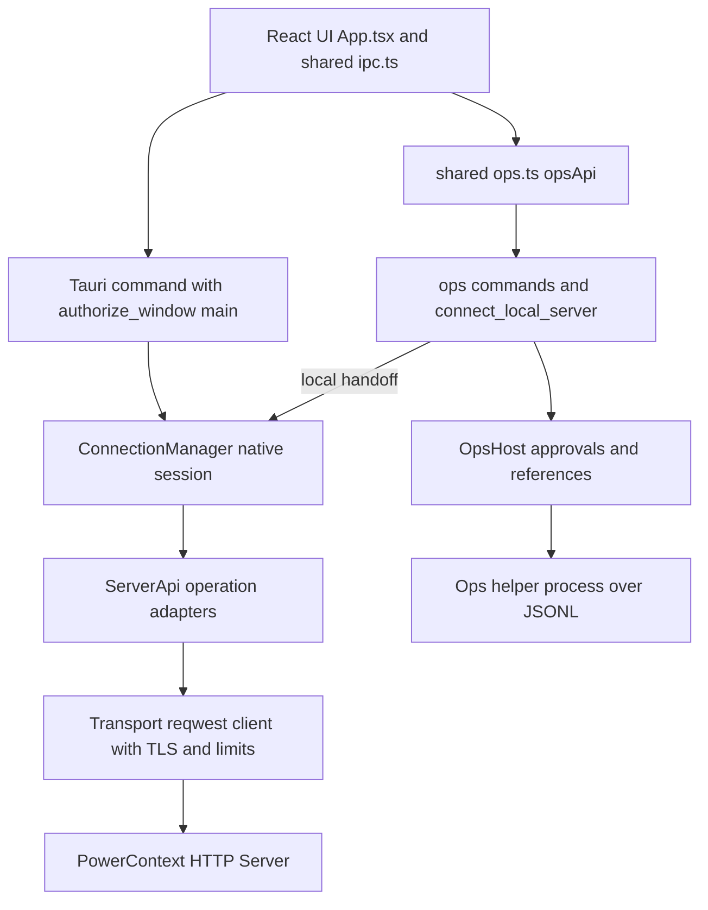

# Desktop App (Tauri Preview)

The Desktop app is an internal Tauri 2 shell named **PowerContext Desktop Preview** (`productName` in `desktop/src-tauri/tauri.conf.json`). It lets a person save connection profiles, check and activate an existing PowerContext Server, choose an exact Scope, save, search and read Memory notes, inspect runtime and session observations, and manage a local Server through a constrained Ops bridge. All remote traffic is made by the native Rust host. The React UI only sends typed IPC requests and renders the replies.

> **Status: internal preview.** The Desktop is an internal Windows and macOS preview. Its packages are unsigned and are not a supported or signed release. The README states that it does not close issue #1654 or #1428. Signed packages, published qualified resources and clean-machine installed acceptance remain release work under #2108, #2109 and #2112 ([desktop/README.md](../../desktop/README.md#L1-L5), [desktop/README.md](../../desktop/README.md#L66-L66)). Treat every behavior on this page as preview behavior.

## Layers and ownership

| Layer | Responsibility | Main sources |
| --- | --- | --- |
| Native host | Owns profiles, the active context, credentials, HTTP transport, Ops approvals, diagnostics and the session observation window. | `desktop/src-tauri/src/lib.rs`, `commands.rs`, `connections/`, `transport/`, `credentials.rs`, `ops_bridge.rs`, `diagnostics.rs`, `session_observations.rs` |
| IPC boundary | Tauri commands, the `main` capability, the window label check, navigation and CSP rules. | `desktop/src-tauri/capabilities/main.json`, `desktop/src-tauri/src/ipc.rs`, `desktop/src-tauri/tauri.conf.json` |
| React UI | Pages, drafts, confirmations and rendering. It never receives a secret or a Server body it did not request. | `desktop/ui/src/app/`, `desktop/ui/src/shared/ipc.ts`, `desktop/ui/src/shared/ops.ts` |
| Generated contract | TypeScript and Rust wire models, the operation manifest, and IPC types. Generated, not hand-edited. | `desktop/ui/src/generated/`, `desktop/src-tauri/src/transport/wire.rs`, `desktop/src-tauri/src/transport/operations.json` |
| Ops helper | Independent local Server installation and service management, reached only through the native bridge. | `desktop/src-tauri/src/ops_bridge/`, [Local Server Ops](../../docs/en/docs/operate/local-server-ops.md) |

The Server side of the contract is described in [HTTP and MCP API](http-and-mcp-api.md) and [System Overview](system-overview.md). This page covers only the Desktop client.

## Native host composition

`run()` in `desktop/src-tauri/src/lib.rs` builds the Tauri application. It registers the single-instance plugin, which only shows and focuses the existing `main` window and never replaces its context ([lib.rs](../../desktop/src-tauri/src/lib.rs#L27-L36)). Its setup hook is the composition root:

1. It opens `profiles.json` under the app data directory with `ProfileRepository::open` and the native `NativeVault`. A `Busy` result from another process that owns the same profile storage makes setup fail closed ([lib.rs](../../desktop/src-tauri/src/lib.rs#L83-L101)).
2. It creates the `ConnectionManager` and exposes its observation collector. It then manages `HostState`, a `DiagnosticHost` and an `OpsHost`. The Ops host receives the bundled resource directory, the trusted local data directory and the home directory ([lib.rs](../../desktop/src-tauri/src/lib.rs#L101-L115)).
3. It builds the single `main` window from `tauri.conf.json` with `create: false`, and attaches `ipc::allowed_navigation` as its navigation callback ([lib.rs](../../desktop/src-tauri/src/lib.rs#L116-L121), [tauri.conf.json](../../desktop/src-tauri/tauri.conf.json#L10-L21)).

On process exit, the run loop calls `shutdown()` on the diagnostics host and on the Ops host. Diagnostics stop admitting work and clean up helpers. Ops stops admitting new IPC but never signals a service-manager process ([lib.rs](../../desktop/src-tauri/src/lib.rs#L127-L141)).

## Trusted IPC boundary

The IPC surface is deliberately narrow.

- **Capability.** `capabilities/main.json` binds one capability, `main`, to the `main` window only. It enumerates every typed command (connection, Scope, Memory, runtime, statistics, session, local diagnostics, `connect_local_server`, and the Ops commands) and allows only the `ops-progress` event listener. No generic fetch, shell, filesystem, database, notification, opener or credential-read permission is granted ([capabilities/main.json](../../desktop/src-tauri/capabilities/main.json#L1-L48)).
- **Handler registration.** The commands are registered in one `generate_handler!` list in `lib.rs` ([lib.rs](../../desktop/src-tauri/src/lib.rs#L44-L81)).
- **Window label check.** Every command also calls `authorize_window`, which accepts only the label `main` ([ipc.rs](../../desktop/src-tauri/src/ipc.rs#L31-L37)). The connection commands do this through the `manager()` helper ([commands.rs](../../desktop/src-tauri/src/commands.rs#L60-L65)). The Ops commands map a rejected label to `Forbidden` ([commands.rs](../../desktop/src-tauri/src/commands.rs#L319-L340)).
- **Navigation and CSP.** `allowed_navigation` accepts only the packaged origin (`tauri.localhost` on Windows, `tauri://localhost` on Linux and macOS), plus the exact Vite origin `http://127.0.0.1:1420` in debug builds. Userinfo is rejected ([ipc.rs](../../desktop/src-tauri/src/ipc.rs#L91-L98)). The production CSP sets `connect-src` to `ipc:` and `http://ipc.localhost`, with `frame-src 'none'` and `form-action 'none'` ([tauri.conf.json](../../desktop/src-tauri/tauri.conf.json#L30-L30)).
- **Progress events.** Ops progress is emitted only to the `main` webview with `emit_to`, using the `ops-progress` event name ([commands.rs](../../desktop/src-tauri/src/commands.rs#L364-L404)).

The renderer cannot supply a URL, HTTP method, header, executable, binding path or service name. Typed Rust adapters choose the route, and the Ops inputs are typed operation and option values or native-issued approval and reference IDs ([desktop/SECURITY.md](../../desktop/SECURITY.md#L3-L8)).

## Connection profile lifecycle

A profile moves through four states. The native `ConnectionManager` in `connections/session.rs` owns them. The UI only displays what the host returns.

Caption: the four Desktop connection states. Saved means the profile exists without a stored check report. Checked means a report exists but the profile is not the active context. Activated means an active context exists with no Scope. ScopeSelected means the active context carries an exact Scope.

What each transition does in the code:

- **Saved.** `save_profile` clears the active context when the edited profile is active, removes any stored report for that profile and advances the generation ([session.rs](../../desktop/src-tauri/src/connections/session.rs#L324-L342)). Saving never checks or activates a connection. `remove_profile` removes the profile and its active context and report ([session.rs](../../desktop/src-tauri/src/connections/session.rs#L343-L357)).
- **Checked.** `check_connection` with `activate` false runs `check_expected`. It takes the probe permit, removes the stored report first so a failed recheck cannot show an old verification, and produces a new `CheckReport` ([session.rs](../../desktop/src-tauri/src/connections/session.rs#L443-L500)). If the same profile is already active, the check keeps it active and retains its Scope only when the identity still matches ([session.rs](../../desktop/src-tauri/src/connections/session.rs#L443-L500)).
- **Activated.** `check_expected` with `activate` true clears the previous active context, advances the generation, and publishes a new `Active` only after the check has succeeded ([session.rs](../../desktop/src-tauri/src/connections/session.rs#L760-L781)). The active context has no Scope yet.
- **ScopeSelected.** `select_scope` calls `get_scope` on the active snapshot, verifies identity around the call, then advances the generation and stores the returned descriptor ([session.rs](../../desktop/src-tauri/src/connections/session.rs#L994-L1030)). Memory and statistics operations require a selected Scope and fail with `ScopeRequired` otherwise ([session.rs](../../desktop/src-tauri/src/connections/session.rs#L1032-L1066)).
- **Disconnect and invalidation.** `disconnect` clears the active context and advances the generation. The stored report is kept, so the profile returns to Checked ([session.rs](../../desktop/src-tauri/src/connections/session.rs#L358-L364)). `invalidate_profile` removes the report and, if active, the active context ([session.rs](../../desktop/src-tauri/src/connections/session.rs#L365-L378)).

### Local setup handoff

`connect_local_server` is a separate entry into the same lifecycle. It rejects a stale generation. It asks the native Ops bridge for the owned endpoint and the qualification, and it does not accept an endpoint from the renderer ([commands.rs](../../desktop/src-tauri/src/commands.rs#L429-L465)). `ConnectionManager::connect_local` validates the endpoint, requires a bundled qualification whose contract digest matches the current operation manifest, and then saves or reuses an unauthenticated loopback profile ([session.rs](../../desktop/src-tauri/src/connections/session.rs#L383-L441)).

The local path publishes an active context only after the discovery package version matches, the required Memory operations are supported, and the exact public default Scope has been resolved and revalidated. Those operations are `get_default_scope`, `get_scope`, `remember_memory`, `search_memory` and `get_artifact_revision` ([session.rs](../../desktop/src-tauri/src/connections/session.rs#L635-L690)). The active context is then published with that Scope ([session.rs](../../desktop/src-tauri/src/connections/session.rs#L760-L781)). Opening Desktop or the Local Server page never runs this handoff.

## Request flow: UI to native to Server, and Ops

Caption: the Desktop request path. Connection, Scope, Memory, runtime and statistics commands go through the native session to the HTTP Server. Local setup goes through the Ops bridge and then hands its endpoint back to the same session.

The steps for a Memory search are:

1. The UI calls `desktopApi.search` in `ui/src/shared/ipc.ts`, which invokes `search_memory` with `generation` and `query`.
2. The command checks the window label and forwards to `ConnectionManager::search_memory` ([commands.rs](../../desktop/src-tauri/src/commands.rs#L285-L296)).
3. `memory_snapshot` checks that the generation is current, that the active context supports `search_memory`, and that a Scope is selected. It then builds the endpoint and Principal context ([session.rs](../../desktop/src-tauri/src/connections/session.rs#L1032-L1066)).
4. The operation is wrapped in an observation and in a cancellation watch channel. It verifies identity, calls the adapter, and verifies identity again ([session.rs](../../desktop/src-tauri/src/connections/session.rs#L1132-L1162)).
5. The adapter takes a transport permit, reads the operation path from the generated `operations.json` manifest, and substitutes the Scope through URL path-segment encoding ([api.rs](../../desktop/src-tauri/src/transport/api.rs#L203-L262)).

## Gating: a healthy Server does not grant operations

Discovery, liveness, readiness, identity and capabilities are separate facts. A healthy Server does not grant operation permissions.

- `check_expected` builds the `CheckReport` from separate `Fact` values for liveness, readiness, identity, connection identity and capabilities. Readiness is not part of the compatibility verdict. `compatibility_verified` is true only when `supported_operations` is non-empty, and that list comes from the discovery assessment against a bundled qualification ([session.rs](../../desktop/src-tauri/src/connections/session.rs#L510-L530), [session.rs](../../desktop/src-tauri/src/connections/session.rs#L628-L628)).
- Discovery is classified by `DiscoveryResult::assess`, which returns `Supported`, `Missing`, `Denied`, `Unavailable`, `Invalid` or `Incompatible`, and marks each operation `qualified`, `unsupported` or `unverified` ([discovery.rs](../../desktop/src-tauri/src/connections/discovery.rs#L18-L60)). A profile is compatible only when its qualification ID matches a bundled record and the contract digest matches, or an authenticated-client qualification applies ([session.rs](../../desktop/src-tauri/src/connections/session.rs#L510-L530)).
- `snapshot` refuses any operation whose name is not in the report's `supported_operations`, and returns `CompatibilityUnverified` when `compatibility_verified` is false ([session.rs](../../desktop/src-tauri/src/connections/session.rs#L847-L869)).
- The Server still decides authorization at request time. The adapter maps HTTP `401` to `Unauthorized`, `403` to `Forbidden`, `404` to `NotFound`, `409` to `Conflict` and `410` to `CursorExpired`. Other statuses map to `Server`, `InvalidResponse`, or `Redirect` ([api.rs](../../desktop/src-tauri/src/transport/api.rs#L308-L322)).

Identity is verified around every business read. `NativeIdentity` stores either the Principal from `get_access_principal` or the `ConnectionIdentity` from `get_connection_identity` ([session.rs](../../desktop/src-tauri/src/connections/session.rs#L182-L214)). `identity_unchanged` re-verifies that identity and the deployment ID. On a change, it clears the active context and its report, advances the generation, and returns the error ([session.rs](../../desktop/src-tauri/src/connections/session.rs#L895-L919)). Old Scope cursors, selections and pending reads become invalid with the generation.

## Writes are never replayed

Memory save is the only mutating business operation. Its behavior is intentionally conservative.

- `remember` takes a single write permit and validates the text with `validate_text` (8192 bytes) before it reads the snapshot ([session.rs](../../desktop/src-tauri/src/connections/session.rs#L1196-L1210), [api.rs](../../desktop/src-tauri/src/transport/api.rs#L650-L656)).
- It records a `Pending` `WriteRecord` with an operation ID and the immutable context (endpoint, deployment, Principal, Scope and generation), then dispatches exactly one `api.remember` call. After dispatch, a context change no longer cancels the write ([session.rs](../../desktop/src-tauri/src/connections/session.rs#L1222-L1240)).
- A `WriteGuard` marks the record `Unknown` if the future is dropped while still armed ([session.rs](../../desktop/src-tauri/src/connections/session.rs#L161-L175)).
- A dispatched error becomes `Unknown` unless it is one of the codes known to be pre-write rejections, such as `Unauthorized`, `Forbidden`, `InvalidInput`, `NotFound`, `Conflict`, `AuthenticationUnavailable`, `RuntimeNotReady` or `Redirect`. Those become `Failed` ([session.rs](../../desktop/src-tauri/src/connections/session.rs#L1262-L1280)).
- A successful HTTP reply is treated as `Unknown` when the post-write identity check fails, and the private body is withheld ([session.rs](../../desktop/src-tauri/src/connections/session.rs#L1244-L1262)).

Nothing in the native host retries a write, and there is no persistent queue. The UI keeps the submitted text in window memory as a read-only recovery draft until it is explicitly discarded or the record succeeds. `beginSubmission` in `App.tsx` implements this, and a successful receipt removes its own copy ([App.tsx](../../desktop/ui/src/app/App.tsx#L84-L106)). Closing the window loses these drafts. Their contents are not persisted or replayed.

## Transport and endpoint rules

`Transport` in `transport/mod.rs` is the only HTTP client:

- Proxy inheritance and redirects are disabled, retries are disabled, and `Referer` is off. The connect timeout is 5 seconds and the total request timeout is 15 seconds ([transport/mod.rs](../../desktop/src-tauri/src/transport/mod.rs#L127-L146)).
- A response body is capped at 1 MiB, checked against the declared size and again while streaming ([transport/mod.rs](../../desktop/src-tauri/src/transport/mod.rs#L35-L40), [transport/api.rs](../../desktop/src-tauri/src/transport/api.rs#L290-L330)). The concurrent read limit is 4 per client. When no slot is free, the call fails with `Busy` ([transport/api.rs](../../desktop/src-tauri/src/transport/api.rs#L203-L215)).
- An optional PEM CA (at most 64 KiB, with no private key) augments system trust. It does not disable hostname or certificate validation ([transport/mod.rs](../../desktop/src-tauri/src/transport/mod.rs#L127-L146)).
- `Endpoint::parse` rejects input longer than 2048 bytes, leading or trailing whitespace, backslashes, query strings, fragments, control characters, userinfo and unsafe path segments before URL normalization. `http` is accepted only for a literal loopback host. Any other `http` endpoint fails with `InsecureTransport` ([transport/mod.rs](../../desktop/src-tauri/src/transport/mod.rs#L44-L97)).

Native error responses are enum codes. Transport error text, endpoint URLs, bodies and credentials are not returned to the UI ([desktop/SECURITY.md](../../desktop/SECURITY.md#L31-L53)).

## Profiles and credentials

- `profiles.json` is a secret-free document with schema version 1. `ProfileRepository::open` takes an exclusive lock on a sidecar file. It rejects documents larger than 1 MiB, more than 20 profiles or more than 100 pending deletions, and it validates IDs, names, endpoints and credential references ([profiles.rs](../../desktop/src-tauri/src/connections/profiles.rs#L107-L138)).
- `views()` derives each profile's `CredentialState`. Unauthenticated loopback profiles are `NotRequired`. Bearer profiles are `Stored` when a vault reference exists, `SessionOnly` when a session-only secret is held in memory, and `Missing` otherwise ([profiles.rs](../../desktop/src-tauri/src/connections/profiles.rs#L179-L201)).
- Bearer secrets live in the native vault under the `com.powercontext.desktop.preview` namespace. Windows uses Credential Manager and macOS uses Keychain. Session-only storage is available only when the user explicitly picks it. A failed persistent write produces no receipt and no fallback, and the secret is never written to profile JSON ([desktop/SECURITY.md](../../desktop/SECURITY.md#L9-L30)).
- Editing an address or trust setting invalidates the active context and prevents an old credential from being retained ([desktop/SECURITY.md](../../desktop/SECURITY.md#L9-L30)).

## Session observation window

`session_observations.rs` keeps an in-memory window of content-free observations. It is not an audit log or a persistence layer.

- `SESSION_OBSERVATION_LIMIT` is 512 ([session_observations.rs](../../desktop/src-tauri/src/session_observations.rs#L35-L35)). Each terminal record is one HTTP request or one user operation, shared across HTTP calls and native Memory and Scope actions.
- `record` runs without blocking the owning operation. It uses `try_lock`. When the window is full, the oldest record is removed and the `evicted` count increases. If the lock is contended, or the record belongs to a pre-reset generation, the process-lifetime `dropped_since_start` count increases instead ([session_observations.rs](../../desktop/src-tauri/src/session_observations.rs#L222-L243)).
- `reset` clears the records and the window eviction count and advances the generation. It does not clear `dropped_since_start` ([session_observations.rs](../../desktop/src-tauri/src/session_observations.rs#L244-L257)).
- Each record carries only a unit, an operation identifier from a fixed set, an outcome, a timestamp, a duration, an optional HTTP status and an optional safe error code. Content, queries, credentials, endpoints, paths and target identities never enter the collector ([session_observations.rs](../../desktop/src-tauri/src/session_observations.rs#L60-L110)).
- The summary's coverage marks `desktop_session_only` as true and `persistence_evidence` as false ([session_observations.rs](../../desktop/src-tauri/src/session_observations.rs#L258-L300)).
- Installer and Ops calls have a separate bounded projection in the same collector. It reuses fixed enums and operation IDs and contributes no HTTP latency to Memory or Scope actions ([session_observations.rs](../../desktop/src-tauri/src/session_observations.rs#L258-L300)).

## Ops bridge for local setup

The Ops bridge (`ops_bridge.rs`, `ops_bridge/`) is the only native path to a local Server installation. It exposes seven fixed commands and one reader:

| Command | Behavior |
| --- | --- |
| `ops_inspect` | Read-only inspection of the registered service. |
| `ops_config_validate` | Validates the local configuration. |
| `ops_preflight` | Produces a plan and a native approval. |
| `ops_apply` | Executes a previously approved plan once. |
| `ops_operation_status` | Queries a retained operation reference. |
| `ops_cancel` | Requests cancellation. It does not imply rollback. |
| `ops_resume` | Resumes an interrupted operation with a new approval and the retained action and options. |
| `ops_references` | Lists retained native operation references. |

The command wrappers are in `commands.rs` ([commands.rs](../../desktop/src-tauri/src/commands.rs#L317-L430)), and the state owner is `OpsHost` ([ops_bridge.rs](../../desktop/src-tauri/src/ops_bridge.rs#L109-L131)).

- **Approval.** `preflight` validates the input, verifies the binding and the plan, and stores the exact plan under a random approval ID. Approvals expire after 600 seconds (`APPROVAL_TTL`). At most 32 approvals are kept ([ops_bridge.rs](../../desktop/src-tauri/src/ops_bridge.rs#L273-L380), [ops_bridge.rs](../../desktop/src-tauri/src/ops_bridge.rs#L38-L39)).
- **Single use.** `approved` removes the approval before it runs. It rejects an approval older than the TTL, a binding that has changed, a different `plan_id` or a resume mismatch with `StaleApproval` ([ops_bridge.rs](../../desktop/src-tauri/src/ops_bridge.rs#L396-L453)).
- **Concurrency and deadlines.** Ordinary calls share 4 slots, and status and cancel share 2 reserved slots. A closing host returns `ShuttingDown` ([ops_bridge.rs](../../desktop/src-tauri/src/ops_bridge.rs#L144-L166)). Apply and resume get 1800 seconds, preflight gets 180 seconds, and other actions get 30 seconds ([ops_bridge.rs](../../desktop/src-tauri/src/ops_bridge.rs#L532-L551)).
- **Shutdown.** Shutdown closes admission and waits at most 2 seconds for active calls. It does not signal Ops, Server or manager processes ([ops_bridge.rs](../../desktop/src-tauri/src/ops_bridge.rs#L132-L143)).
- **References.** The native reference file stores operation IDs, binding fingerprints and the approved action and options. It stores no outcome, raw plan, endpoint or credential. Ops journals remain the recovery authority ([desktop/SECURITY.md](../../desktop/SECURITY.md#L54-L89)).
- **Trust.** Packaged `ops-provision.json` pins the bundle manifest. Every invocation verifies the bundle inventory and contents first. Missing provision leaves local controls unavailable, and system or Server Python is never a fallback ([desktop/SECURITY.md](../../desktop/SECURITY.md#L54-L89)).

The UI reads these commands through `ui/src/shared/ops.ts` and `useLocalServer.ts`. It keeps long operations in the app-level controller across page changes ([docs/en/development/desktop-local-server.md](../../docs/en/development/desktop-local-server.md#L1-L12)).

## Local CLI diagnostics

`DiagnosticHost` in `diagnostics.rs` runs two fixed diagnostics. `Service` runs `service status --json`, and `Integrations` runs `doctor` with the eleven fixed integration names and `--json` ([diagnostics.rs](../../desktop/src-tauri/src/diagnostics.rs#L24-L43)).

- The registration file `diagnostic-cli.json` names an absolute executable and its SHA-256. The native adapter verifies that digest before it runs anything. The renderer cannot supply an executable or arguments ([diagnostics.rs](../../desktop/src-tauri/src/diagnostics.rs#L288-L300)).
- Combined stdout and stderr are limited to 256 KiB per call. Windows helpers run in an owned kill-on-close Job. macOS and Linux helpers run in a private process group. Completion, timeout and cancellation clean up the helper and its descendants ([desktop/README.md](../../desktop/README.md#L232-L232)).
- Only allowlisted status fields are projected to the UI. Raw output never crosses IPC ([diagnostics.rs](../../desktop/src-tauri/src/diagnostics.rs#L77-L110)).
- A local CLI pin is not a publisher signature check, and it does not freeze the Python dependencies ([desktop/SECURITY.md](../../desktop/SECURITY.md#L31-L53)).

## Generated files and the generator

Do not hand-edit anything under `desktop/ui/src/generated/` or the generated Rust wire module. Change the contract or the generator, then regenerate.

| Output | Produced by | Notes |
| --- | --- | --- |
| `desktop/src-tauri/src/transport/wire.rs` | `pnpm --dir desktop generate` (`scripts/generate.mjs`) | Rust wire models produced by the OpenAPI Generator Rust template in `desktop/scripts/openapi-generator/rust/`. |
| `desktop/ui/src/generated/api.d.ts` | `generate.mjs` with `openapi-typescript` | TypeScript schemas from `openapi/powercontext.yaml`. |
| `desktop/ui/src/generated/operations.ts` | `generate.mjs` | Contract SHA-256 and the thirteen reviewed operation descriptors. |
| `desktop/src-tauri/src/transport/operations.json` | `generate.mjs` | The operation manifest and discovery feature contracts that the native adapters read at run time. |
| `desktop/ui/src/generated/ipc.ts` | `cargo run --example export_ipc` | TypeScript IPC request, receipt and error types derived from Rust with `ts-rs`. |

`generate.mjs` reads the contract and selects exactly the thirteen public operations: `get_connection_identity`, `get_server_info`, liveness, readiness, capabilities, Principal, the three Scope operations, Memory save, search and exact read, and `get_stats`. It throws if an operation is missing or duplicated ([generate.mjs](../../desktop/scripts/generate.mjs#L31-L58)). It then writes the four outputs. In `--check` mode it fails with a contract-drift error instead of writing ([generate.mjs](../../desktop/scripts/generate.mjs#L273-L300)).

Regeneration is driven by `desktop/package.json`: `generate`, `generate:check` (part of `lint` and `build`), and `ipc:check`, which runs `export_ipc -- --check` ([package.json](../../desktop/package.json#L11-L22)). The generator needs Java and the OpenAPI Generator JAR pinned in `openapitools.json` and `openapi-generator-checksum.json` ([desktop/README.md](../../desktop/README.md#L84-L88)).

The `ipc.ts` header declares its generated status ([ipc.ts](../../desktop/ui/src/generated/ipc.ts#L16-L16)). The manifest is not an IPC permission grant. Every command still needs its own `allow-` entry in the capability and its own `authorize_window` check ([desktop/README.md](../../desktop/README.md#L186-L193)).

## UI structure

`App.tsx` is the single page shell. Its pages are `home`, `connections`, `memories`, `observation` and `settings`. It holds the state for the active context, the pending operation counters, the submitted-draft recovery list and the unsaved-editor guard ([App.tsx](../../desktop/ui/src/app/App.tsx#L40-L82)). Other modules implement the pages: `Connections.tsx`, `Scopes.tsx`, `MemoryWorkspace.tsx`, `Observation.tsx`, `Runtime.tsx`, `Statistics.tsx`, `SessionView.tsx`, `LocalServerSettings.tsx` and `Diagnostics.tsx`. The React code renders text only and does not use `dangerouslySetInnerHTML` ([desktop/SECURITY.md](../../desktop/SECURITY.md#L3-L8)).

The UI never bypasses the native host. `shared/ipc.ts` is a thin `invoke` wrapper, and `shared/ops.ts` does the same for the Ops commands. Renderer state (generation, Scope, drafts) is always checked against native state before a result is shown.

## Tests and validation

- Native tests cover actual TLS fixtures, adversarial HTTP responses, the shared loopback policy, mocked Tauri permission resolution with the real capability file, navigation rejection and the vault fallback ([desktop/SECURITY.md](../../desktop/SECURITY.md#L31-L53)). The origin and window-label tests are in `ipc.rs` ([ipc.rs](../../desktop/src-tauri/src/ipc.rs#L99-L128)).
- The session observation tests cover collector contention and poisoned collector cancellation ([session_observations.rs](../../desktop/src-tauri/src/session_observations.rs#L431-L480)).
- Ops bridge tests use disposable helper processes and private reference stores. They are compiled only on macOS and Linux ([ops_bridge.rs](../../desktop/src-tauri/src/ops_bridge.rs#L558-L560)).
- Server qualification is run through `desktop/tests/real_server.py` against isolated real Server processes. The qualification records are bundled in `desktop/src-tauri/src/connections/compatibility.json`, and their evidence is listed in [VALIDATION.md](../../desktop/VALIDATION.md). Those checks establish protocol behavior only. They are not installed GUI, system vault, clean-machine, signing or service acceptance ([desktop/README.md](../../desktop/README.md#L236-L253)).

For the wider test map, see [Test Map](../testing/test-map.md).

## Operations and troubleshooting notes

- Development: `pnpm --dir desktop desktop:dev` on Windows, with the pinned MSVC Rust host, or `pnpm --dir desktop desktop:build` for the packaged preview ([desktop/README.md](../../desktop/README.md#L80-L117)).
- Installed preview: the Windows NSIS installer is unsigned and internal. Launch it with no connection active, then explicitly connect to an existing Server and choose a Scope. Uninstalling Desktop does not remove the independent Server, its data or Agent configuration ([desktop/README.md](../../desktop/README.md#L70-L76)).
- A missing or unavailable local service does not disable remote connections. A failed local diagnostic does not indicate remote unavailability ([desktop/README.md](../../desktop/README.md#L204-L235)).
- Connection failures appear as separate facts: discovery status, liveness, readiness, identity, capabilities and compatibility. Use these facts to decide the next step, and do not treat one of them as the others. For Server-side causes, see [Troubleshooting](../operations/troubleshooting.md) and [Deployment](../operations/deployment.md).

## Related pages

- [HTTP and MCP API](http-and-mcp-api.md) describes the Server routes that the Desktop's thirteen operations call.
- [System Overview](system-overview.md) and [Source Map](source-map.md) place the Desktop in the wider repository.
- [Deployment](../operations/deployment.md) and [Troubleshooting](../operations/troubleshooting.md) cover Server operations.
- [Test Map](../testing/test-map.md) lists the wider test suites.
- Local setup contract: [docs/en/development/desktop-local-server.md](../../docs/en/development/desktop-local-server.md). Candidate assembly: [docs/en/development/desktop-candidate-assembly.md](../../docs/en/development/desktop-candidate-assembly.md). Product packaging helper: [scripts/prepare_desktop_product.py](../../scripts/prepare_desktop_product.py).
