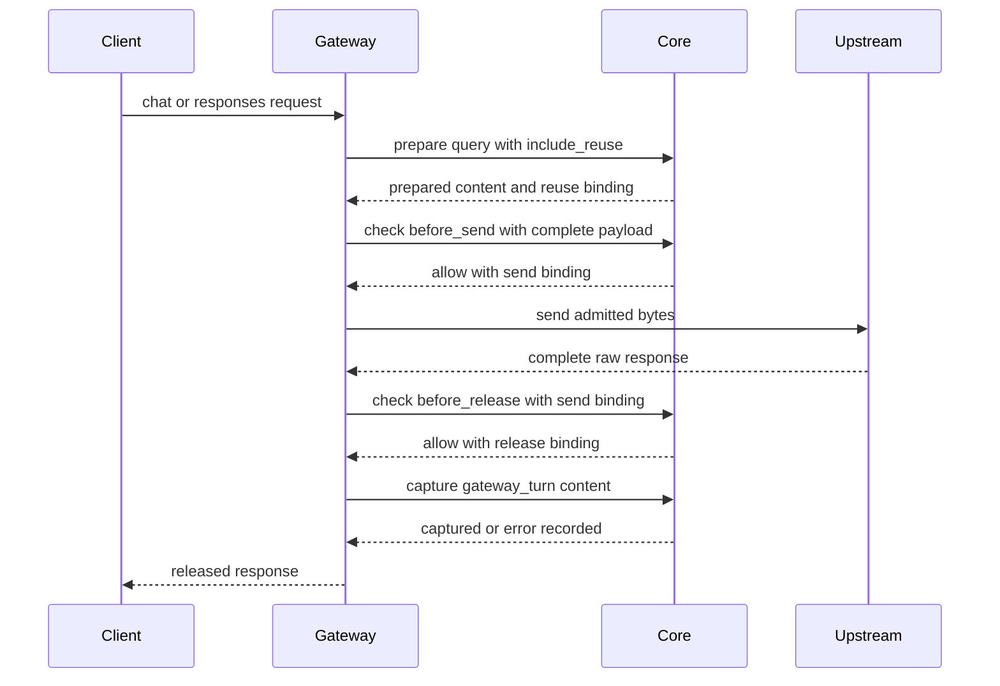

# Rust Gateway (Model Traffic Boundary)

The Rust gateway is an optional executor that sits on the model traffic path between a client and an upstream model provider. It does not decide anything about privacy or memory. Every allow, block, and withhold verdict comes from PowerContext Core through the `/v1/context/check` contract, and the gateway only executes those verdicts in order. The gateway README states this design as "no policy in the gateway" ([gateway README](../../gateway/README.md)).

> **Status: working prototype.** The README describes the gateway as a working prototype, verified end to end against a PowerContext Server branch (PR #2264) with real upstream providers. It depends on the `/v1/context/check` contract and on `include_reuse` from #2264 ([gateway README](../../gateway/README.md#L5)). Treat the behavior below as the prototype's current contract, not a stable public API.

## Responsibilities

The gateway owns the model traffic boundary:

- **Ingress.** It serves OpenAI-compatible routes at `/gateway/v1/chat/completions` and `/gateway/v1/responses`, authenticated by a gateway key that replaces provider keys ([gateway README](../../gateway/README.md)).
- **Context preparation.** It asks Core to prepare recalled memory and injects the result into the current user message when injection applies.
- **Two-phase gating.** It submits the complete outgoing bytes to Core before send, sends only admitted bytes, and submits the complete upstream response to Core before release.
- **Capture.** After a terminal response is released, it asks Core to record the turn as a content source.
- **Failure handling.** It maps each Core verdict and transport outcome to a client-visible status, and it applies the degradation and retry rules described below.

Crate roles, in brief ([gateway README](../../gateway/README.md)):

| Crate | Role |
| --- | --- |
| `pc-gateway-app` | Binary: ingress, proxy to Core over a Unix socket, middleware chain |
| `pc-gateway-core` | Executor state machine and the `GateClient` for Core calls |
| `pc-gateway-types` | Contract DTOs for check, prepare, and capabilities |
| `pc-gateway-protocol` | Canonical request and Chat or Responses renderers |
| `pc-gateway-transport` | Upstream HTTP transport, retry classification, response buffering |
| `pc-gateway-evidence` | Body-free evidence for attempts and not-sent reasons |

## The gate call sequence

For one chat request with injection and capture enabled, the gateway calls Core and the upstream in this order.

Caption: one chat request through the gateway, showing the prepare, before_send gate, upstream send, before_release gate, and capture calls to Core.

The same order is encoded in the executor. `Executor::run` starts an execution record and calls `execute`, which runs the phases in sequence ([executor](../../gateway/crates/pc-gateway-core/src/executor.rs#L144-L158)):

1. **Snapshot and enrich.** The original request is snapshotted before any injection, so degraded and transcript paths never see recalled memory ([executor](../../gateway/crates/pc-gateway-core/src/executor.rs#L164-L175)). When injection applies, the gateway prepares context and injects it ([executor](../../gateway/crates/pc-gateway-core/src/executor.rs#L176-L184)).
2. **Size check.** The fully rendered body is measured against the input limit. A body over the limit returns `request_payload_too_large` as a block, before any Core check ([executor](../../gateway/crates/pc-gateway-core/src/executor.rs#L186-L205)).
3. **Check before_send.** The rendered body and its declared prepared-context locations go to Core. Only an allow with a valid binding moves to send ([executor](../../gateway/crates/pc-gateway-core/src/executor.rs#L206-L290)).
4. **Send.** Each attempt is checked against the admission deadline first. Only then is the admitted payload handed to the transport ([executor](../../gateway/crates/pc-gateway-core/src/executor.rs#L290-L345)).
5. **Check before_release.** The complete raw upstream response goes to Core with the send-phase binding as `request_binding`. Only an allow for this phase releases content ([executor](../../gateway/crates/pc-gateway-core/src/executor.rs#L377-L405)).
6. **Capture and release.** After release, a terminal turn is captured if sedimentation is on ([executor](../../gateway/crates/pc-gateway-core/src/executor.rs#L420-L460)).

The README's shorter version of the flow is in its "PC call sequence over UDS" section ([gateway README](../../gateway/README.md#L34)).

### Two-phase rules

- **HTTP success is not approval.** A Core result counts only when it has the expected schema, the expected phase, complete coverage, and a non-empty binding. Any other allow is treated as a malformed verdict and pauses the gate ([executor](../../gateway/crates/pc-gateway-core/src/executor.rs#L701-L735)).
- **The send binding must be reused for release.** The binding Core returns at before_send is the same value passed as `request_binding` at before_release. The release check cannot be made against a different binding ([executor](../../gateway/crates/pc-gateway-core/src/executor.rs#L377-L384)).
- **Admission has a deadline.** Each send attempt compares the current time with the admission's `valid_until`. A deadline that has passed returns `admission_expired` with nothing sent. A `valid_until` that cannot be parsed counts as already expired, so the gateway fails closed. The release verdict's deadline is checked the same way, and again after capture ([executor](../../gateway/crates/pc-gateway-core/src/executor.rs#L290-L296), [executor](../../gateway/crates/pc-gateway-core/src/executor.rs#L393-L402), [executor](../../gateway/crates/pc-gateway-core/src/executor.rs#L436-L441)).
- **Local execution state is observable but not authoritative.** The execution record tracks the model send state (`NoSend`, `DefinitelyNotSent`, `PossiblySent`, `ResponseReceived`) and a terminal outcome. Signaling cancellation does not stop execution by itself ([lifecycle](../../gateway/crates/pc-gateway-core/src/lifecycle.rs#L10-L38)).

Core is the authority for each verdict. On the Core side, `check_context` builds the allow or withhold result and seals the binding. An allow for before_send carries a 60-second send validity and is capped by the expiry of any reuse dependency it relies on ([context check](../../src/powercontext/builtin/runtime/context_check.py#L43-L44), [context check](../../src/powercontext/builtin/runtime/context_check.py#L340-L362)).

## Verdict and outcome mapping

Each outcome becomes one client-visible status ([ingress](../../gateway/crates/pc-gateway-app/src/ingress.rs#L624-L700)):

| Outcome | When it happens | Client status and effect |
| --- | --- | --- |
| Released | Release-phase allow | Upstream status and content type passed through |
| Blocked | Core `block` at either phase, or payload too large | 403, nothing released |
| Withheld | Core `withhold`, response buffer overflow | 409, nothing released |
| SendIndeterminate | Failure after the request may have reached the provider | 502 `send_indeterminate` |
| NotSent | Every attempt was confirmed unsent | 502 `not_sent` |
| AdmissionExpired | Deadline passed before send or release | 409 `admission_expired` |
| GatePaused | Core unavailable without passthrough, or a malformed verdict | 503 `gate_paused` |
| Degraded | Passthrough after Core was unreachable | Upstream response, marked `x-pc-degraded` |

Release-phase `block` also cancels the upstream request ([executor](../../gateway/crates/pc-gateway-core/src/executor.rs#L445-L465)). Upstream status codes are passed through, so a provider error is never reported as 200 ([gateway README](../../gateway/README.md)).

## Degradation policy

Degradation is narrow by design. The gateway degrades only when Core cannot be reached and the operator has allowed it.

| Condition | Default behavior | With `PC_GATEWAY_DEGRADE=passthrough` |
| --- | --- | --- |
| Core unreachable (`GateUnavailable`) | Pause: 503 `gate_paused` | Send the pristine request without memory, mark the response `x-pc-degraded` |
| Core reachable but reply malformed | Pause | Pause |
| Core reachable and says `block` | Block: 403 | Block: 403 |
| Core reachable and says `withhold` | Withhold: 409 | Withhold: 409 |

Points that matter for operations:

- **Passthrough needs a non-enforcing Core.** At startup the gateway queries capabilities. Degradation is allowed only when the Core reports `enforcing=false`. A failed or invalid capabilities query leaves degradation disabled ([main](../../gateway/crates/pc-gateway-app/src/main.rs#L118-L129), [ingress](../../gateway/crates/pc-gateway-app/src/ingress.rs#L265-L269)). Core computes that flag as `mode == "enforcing"` ([server factory](../../src/powercontext/server/factory.py#L927)).
- **Degraded sends use the pristine request.** Recalled memory is dropped, and the degraded body is re-rendered from the request as received. The degraded path also skips capture ([executor](../../gateway/crates/pc-gateway-core/src/executor.rs#L220-L240), [executor](../../gateway/crates/pc-gateway-core/src/executor.rs#L632-L652)).
- **Blocked verdicts never degrade.** A block is a successful Core reply, so it returns before the degradation branch, which only handles unreachable Core ([executor](../../gateway/crates/pc-gateway-core/src/executor.rs#L216-L256)).
- **A reachable non-enforcing Core withholds.** Core's `check_context` returns `withhold` with `enforcement-not-configured` when its mode is not enforcing ([context check](../../src/powercontext/builtin/runtime/context_check.py#L359-L360)). The gateway maps that to 409, so in practice passthrough engages only when Core is actually unreachable.

Passthrough is opt-in. `PC_GATEWAY_DEGRADE` defaults to pause, and any value other than `passthrough` is treated as pause ([main](../../gateway/crates/pc-gateway-app/src/main.rs#L100-L104)).

## Retry and send-safety policy

The gateway retries only what it can prove was never sent.

- **What counts as not sent.** The reqwest transport reports `NotSent` only for connect failures and request-builder failures. Every other request failure, including timeouts and failures after the body is handed off, is `Indeterminate` ([reqwest transport](../../gateway/crates/pc-gateway-transport/src/reqwest_transport.rs#L75-L97)).
- **How retry runs.** On `NotSent`, the executor records the attempt, and if attempts remain it calls before_send again to obtain a fresh admission. A revoked or changed admission is seen at that point ([executor](../../gateway/crates/pc-gateway-core/src/executor.rs#L318-L345)). The attempt limit is `PC_GATEWAY_MAX_ATTEMPTS`, defaulting to 2 ([main](../../gateway/crates/pc-gateway-app/src/main.rs#L86-L92)).
- **Indeterminate is never retried.** A connection lost after handoff, a timeout, or a buffer overflow returns immediately. The request may have been billed, so the gateway does not resend it ([executor](../../gateway/crates/pc-gateway-core/src/executor.rs#L310-L322)). The transport test for this case asserts that an upstream that closes after a full body receives the body exactly once ([no duplicate send test](../../gateway/crates/pc-gateway-transport/tests/no_duplicate_send.rs)).
- **Buffer overflow withholds.** Upstream responses are buffered up to a byte cap. Exceeding it returns `withheld` with `response_buffer_limit_exceeded`, and the response is never released or resent ([reqwest transport](../../gateway/crates/pc-gateway-transport/src/reqwest_transport.rs#L123-L129), [executor](../../gateway/crates/pc-gateway-core/src/executor.rs#L310-L316)).

`BoundedRetry` in the transport crate implements the same classification as a standalone helper. The executor does not use it. Its own loop carries the production retry behavior, and `BoundedRetry` is exercised only by the no-duplicate-send test ([retry](../../gateway/crates/pc-gateway-transport/src/retry.rs#L46-L70)).

The gateway's own Core-facing UDS client has a separate, narrower retry. It retries a request only when the failure happened before any response bytes arrived, which covers a stale pooled connection. It never retries a rejection or a timeout ([UDS client](../../gateway/crates/pc-gateway-core/src/uds_gate_client.rs#L341-L352)).

## Context preparation, injection, and replay

The gateway injects memory only through Core's prepare contract.

- **What gets prepared.** For a request that qualifies, the gateway calls `/v1/context/prepare` with the last user message as the query, `include_reuse` set to true, and the assembly limited to memory ([executor](../../gateway/crates/pc-gateway-core/src/executor.rs#L520-L553), [HTTP client](../../gateway/crates/pc-gateway-core/src/http_gate_client.rs#L107-L109)).
- **Failure never blocks.** An empty or failed prepare injects nothing and does not block the request. A failed prepare is not cached, so the next request tries again ([executor](../../gateway/crates/pc-gateway-core/src/executor.rs#L520-L545)).
- **Injection is verbatim and tail-only.** The block goes into the last user message, and the exact UTF-8 byte range is recorded in `prepared_contexts`. Core recomputes the digest of that range against the reuse binding and rejects any mismatch ([executor](../../gateway/crates/pc-gateway-core/src/executor.rs#L559-L620), [context check](../../src/powercontext/builtin/runtime/context_check.py#L278-L310)).
- **Replay requires a conversation.** Replay happens only when the request carries a conversation ID. The same message anchor returns the exact prepared content and binding, so a tool continuation does not trigger another retrieval. Without a conversation ID, each request prepares on its own and inherits nothing ([executor](../../gateway/crates/pc-gateway-core/src/executor.rs#L475-L515)).
- **Conversation identity.** The ingress takes the conversation from `X-PowerContext-Conversation-ID` first, then from the Claude Code, OpenCode, or Codex session headers. Each source gets its own prefix so values cannot collide ([ingress](../../gateway/crates/pc-gateway-app/src/ingress.rs#L465-L488)).
- **Refresh on dependency change.** If Core withholds with `context-refresh-required`, the gateway clears that conversation's replay entry and re-prepares once from the pristine request. Core emits this reason when a reuse binding can no longer be validated ([executor](../../gateway/crates/pc-gateway-core/src/executor.rs#L255-L276), [context check](../../src/powercontext/builtin/runtime/context_check.py#L389-L391)).

Injection scope is set at startup. In a combined deployment, the default is `ConversationsOnly`, so only requests with a conversation ID are injected. In a standalone deployment, the default is off. `on` and `off` are explicit, and any other value disables injection ([main](../../gateway/crates/pc-gateway-app/src/main.rs#L264-L280)). Injection also applies to the Responses route only when `PC_GATEWAY_INJECTION_RESPONSES` is not set to `off` ([ingress](../../gateway/crates/pc-gateway-app/src/ingress.rs#L444-L451)).

## Capture (sedimentation)

When `PC_GATEWAY_SEDIMENT=on`, each user turn is captured once, after its terminal response has passed the release gate.

- **Only terminal turns.** Intermediate tool-calling responses are not captured. A turn stays open while the client still has to execute a tool.
- **Normalized from the pre-injection request.** The transcript is built from the request before injection and from the released response, so recalled memory is never recorded as new user evidence ([executor](../../gateway/crates/pc-gateway-core/src/executor.rs#L420-L436)).
- **Deterministic source ID.** The source ID is a digest of the scope, the conversation ID, and the messages up to the last user message. A retried or concurrent terminal request writes the same source. Core answers a conflicting duplicate with 409, which the gateway records as `sediment_duplicate` ([executor](../../gateway/crates/pc-gateway-core/src/executor.rs#L785-L800), [executor](../../gateway/crates/pc-gateway-core/src/executor.rs#L431-L441)).
- **Failure does not block release.** A failed capture is recorded as evidence. The response is still released ([executor](../../gateway/crates/pc-gateway-core/src/executor.rs#L431-L441)).
- **Blocked and degraded turns are never captured.** Neither path reaches the capture call ([executor](../../gateway/crates/pc-gateway-core/src/executor.rs#L632-L652)).

## Streaming behavior

The upstream request is always non-streaming. The ingress notes that the send-phase check currently supports streaming only for the Chat protocol, so Responses streaming requests would be withheld. The gateway therefore buffers the full response, runs the release gate, and only then replays a streamed client response as Responses SSE events ([ingress](../../gateway/crates/pc-gateway-app/src/ingress.rs#L600-L615), [ingress](../../gateway/crates/pc-gateway-app/src/ingress.rs#L295-L320)). Error statuses are returned as plain JSON, not wrapped as a stream. A degraded passthrough stream keeps the `x-pc-degraded` header.

## Deployment forms

The same binary runs in two forms, selected by environment variables.

| Form | Selector | Public port | Core link | Non-gateway routes |
| --- | --- | --- | --- | --- |
| Combined | `PC_GATEWAY_CORE_UDS` set | Gateway owns the TCP port | Unix domain socket | Reverse-proxied to Core over the socket |
| Standalone | `PC_GATEWAY_CORE_UDS` unset | Gateway serves only `/gateway/v1/*` and `/healthz` | HTTP to `PC_GATEWAY_CORE_BASE` | Return 404 |

([link](../../gateway/crates/pc-gateway-app/src/link.rs#L30-L40), [proxy](../../gateway/crates/pc-gateway-app/src/proxy.rs#L44-L75), [proxy](../../gateway/crates/pc-gateway-app/src/proxy.rs#L100-L115), [main router](../../gateway/crates/pc-gateway-app/src/main.rs#L205-L214))

Both forms implement the same `GateClient` trait with the same check, prepare, capabilities, and capture operations ([gate client](../../gateway/crates/pc-gateway-core/src/gate_client.rs#L20-L58)). The HTTP client posts to `/v1/context/check`, `/v1/context/prepare`, and `/v1/sources/content` ([HTTP client](../../gateway/crates/pc-gateway-core/src/http_gate_client.rs#L80-L116)). The UDS client keeps a bounded pool of keep-alive connections over the socket ([UDS client](../../gateway/crates/pc-gateway-core/src/uds_gate_client.rs#L88-L120)).

## Startup and capacity

At startup the gateway queries Core's capabilities and derives the model input limit as the minimum of three values: the Core payload limit, the 1 MiB Core parser ceiling, and `PC_GATEWAY_MAX_BODY_BYTES` ([main](../../gateway/crates/pc-gateway-app/src/main.rs#L118-L128), [check types](../../gateway/crates/pc-gateway-types/src/check.rs#L17-L23)).

If the capabilities query times out, fails, or returns an incompatible contract, model routes pause until the gateway is restarted. A missing capacity is never treated as permission to send ([main](../../gateway/crates/pc-gateway-app/src/main.rs#L221-L243)). A zero input limit also pauses model routes.

Middleware runs before the executor. It rejects oversized model bodies with 413 when `Content-Length` declares them, and it applies a non-queuing concurrency limit that returns 503 when full. The health probe is exempt ([resource limits](../../gateway/crates/pc-gateway-app/src/middleware/resource_limits.rs#L60-L110)).

## Credentials and evidence

Upstream and Core credentials come only from server-side environment variables. They are never read from request fields. The header set sent to Core strips `authorization`, `x-api-key`, and `cookie`, so provider credentials never enter check payloads ([executor](../../gateway/crates/pc-gateway-core/src/executor.rs#L685-L697), [gateway README](../../gateway/README.md)).

The evidence sink records body-free facts only: attempt counts, not-sent reasons, usage completeness, cache tokens, and time to first token. It never records request or response bodies ([gateway README](../../gateway/README.md#L32)).

## Extension points

- **Core client.** A new Core transport implements `GateClient`. The executor depends only on that trait ([gate client](../../gateway/crates/pc-gateway-core/src/gate_client.rs#L20-L58)).
- **Upstream transport.** The `Transport` trait is the only path to the provider, and it receives only `AdmittedSend` values that carry the binding ([sender](../../gateway/crates/pc-gateway-transport/src/sender.rs#L36-L83)).
- **Middleware.** `GatewayMiddleware` is composed into a chain in `main`. The README describes adding a feature as implementing the trait and adding one line to the chain ([main](../../gateway/crates/pc-gateway-app/src/main.rs#L176-L192)).

## Focused tests

These tests cover the behavior that matters most for this page. They are not fixture data.

- `executor_semantics.rs` drives the executor state machine with scripted Core and transport doubles and covers the failure-semantics table ([executor semantics test](../../gateway/crates/pc-gateway-core/tests/executor_semantics.rs)).
- `no_duplicate_send.rs` asserts that an upstream closing after a full body is treated as indeterminate and the body is received once ([no duplicate send test](../../gateway/crates/pc-gateway-transport/tests/no_duplicate_send.rs)).
- The injection-default tests in `main.rs` and `ingress.rs` cover the combined and standalone defaults, and the rule that unknown values never enable injection ([main](../../gateway/crates/pc-gateway-app/src/main.rs#L281-L305)).

## Related pages

- [System overview](system-overview.md) places the gateway in the wider runtime.
- [Context protection](../concepts/context-protection.md) explains the check contract the gateway executes.
- [Deployment](../operations/deployment.md) covers running the combined and standalone forms.
- [Prepare and recall](../workflows/prepare-and-recall.md) covers the prepare path that the gateway calls.
