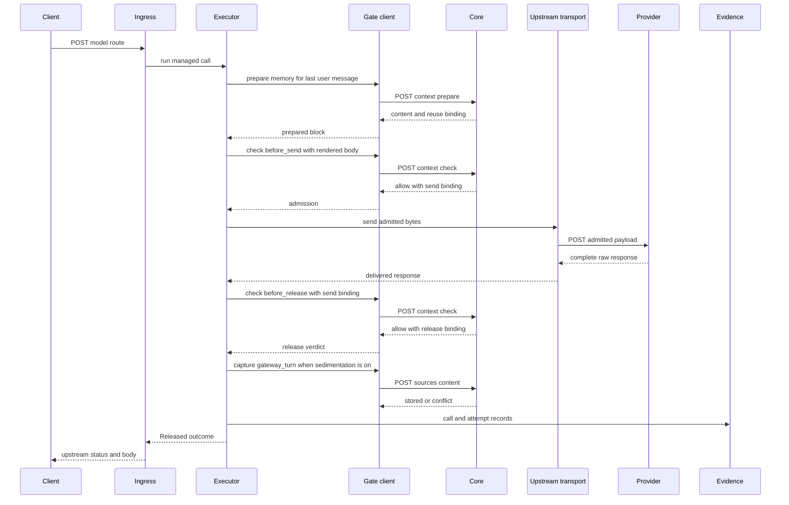
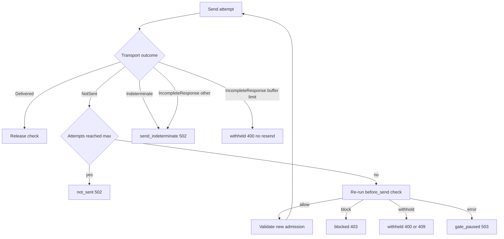

# Inference Gateway (pc-gateway)

The `pc-gateway` Rust workspace is an optional executor on the model traffic path between a client and an upstream model provider. It makes no privacy or memory decisions of its own. Every allow, block, and withhold verdict comes from PowerContext Core through the `/v1/context/check` contract, and the gateway executes those verdicts in order ([gateway README](../../gateway/README.md#L1-L3)).

> **Status: working prototype.** The README describes the gateway as verified end to end against a PowerContext Server branch (PR #2264) and depends on `/v1/context/check` and `include_reuse` from that branch ([gateway README](../../gateway/README.md#L5-L5)). Treat the behavior below as the prototype's current contract, not a stable public API.

## Crates

| Crate | Role |
| --- | --- |
| `pc-gateway-app` | Binary: environment parsing, OpenAI-compatible ingress, reverse proxy to Core over a Unix socket, middleware chain, process shutdown ([main](../../gateway/crates/pc-gateway-app/src/main.rs#L1-L25)) |
| `pc-gateway-core` | `Executor` state machine, the `GateClient` trait, HTTP and UDS Core clients, lifecycle, and the evidence recorder |
| `pc-gateway-types` | Contract DTOs for check, prepare, and capabilities, including the 1 MiB parser ceiling `CONTEXT_CHECK_BODY_LIMIT` ([check types](../../gateway/crates/pc-gateway-types/src/check.rs#L32-L32)) |
| `pc-gateway-protocol` | Canonical request and Chat or Responses wire renderers |
| `pc-gateway-transport` | `Transport` trait and the reqwest upstream implementation, with response buffering |
| `pc-gateway-evidence` | Body-free evidence records and the bounded JSONL sink |

The README layout table lists the same roles ([gateway README](../../gateway/README.md#L68-L78)).

## Request execution path

The sequence below shows one chat request with injection and sedimentation enabled. The participants are the gateway parts that run in one request, plus Core and the upstream provider.

Caption: one chat request through the gateway, showing the prepare call, the before_send check, the single upstream send, the before_release check, the capture call, and the evidence records.

### Phases in execution order

The ingress builds a `ManagedCall`, and `Executor::run` drives it. `run` creates the `CallRecorder`, starts the execution, and runs `execute` inside the lifecycle. Any lifecycle stop becomes `ManagedOutcome::Stopped`. The recorder then emits the terminal evidence ([executor](../../gateway/crates/pc-gateway-core/src/executor.rs#L280-L313)).

1. **Ingress checks, in order.** If `PC_GATEWAY_API_KEY` is set, a missing or non-matching Bearer credential returns 401 `invalid_gateway_key` ([ingress](../../gateway/crates/pc-gateway-app/src/ingress.rs#L209-L219)). The body is read up to `max_body_bytes`. Overflow returns 413 `request_body_too_large`, and other read errors return 400 `invalid_body` ([ingress](../../gateway/crates/pc-gateway-app/src/ingress.rs#L233-L252)). A lifecycle stop at this point returns the mapped stop status ([ingress](../../gateway/crates/pc-gateway-app/src/ingress.rs#L254-L264)). The Chat and Responses bodies are parsed. Parse errors return 400 `invalid_openai_body` or `invalid_responses_body`, and unsupported roles, content types, or fields return 400 `unsupported_field` ([ingress](../../gateway/crates/pc-gateway-app/src/ingress.rs#L265-L316)). On `/gateway/v1/responses`, an empty `PC_GATEWAY_UPSTREAM_URL_RESPONSES` returns 501 `responses_route_disabled` ([ingress](../../gateway/crates/pc-gateway-app/src/ingress.rs#L318-L327)).
2. **Call construction.** The degradation policy is `Passthrough` only when startup allowed degradation, and `Pause` otherwise ([ingress](../../gateway/crates/pc-gateway-app/src/ingress.rs#L348-L353)). Injection, the conversation ID, sedimentation, and the upstream URL and credential are set on the call ([ingress](../../gateway/crates/pc-gateway-app/src/ingress.rs#L335-L381)).
3. **Snapshot and enrich.** `execute` first checks the attempt checkpoint. If admission is closed by shutdown, it cancels with `GatewayShutdown` and returns `Stopped`. The pristine request is cloned before any injection, so degraded sends never carry recalled memory ([executor](../../gateway/crates/pc-gateway-core/src/executor.rs#L315-L335)). When injection applies, `enrich` runs ([executor](../../gateway/crates/pc-gateway-core/src/executor.rs#L336-L346)).
4. **Render and size check.** The request is rendered. A render error returns `Blocked` with `render_failed`. A body over `max_input_bytes` returns `Blocked` with `request_payload_too_large` and makes no Core call. A non-UTF-8 body returns `Blocked` with `invalid_payload_encoding` ([executor](../../gateway/crates/pc-gateway-core/src/executor.rs#L348-L376)).
5. **Check before_send.** The rendered body and its `prepared_contexts` are sent to Core through `GateClient::check` ([executor](../../gateway/crates/pc-gateway-core/src/executor.rs#L377-L396)). The branches are described in the verdict section below.
6. **Send attempts.** Each attempt is checked against `valid_until` and then handed to the transport. The outcome is classified as described in the retry section ([executor](../../gateway/crates/pc-gateway-core/src/executor.rs#L478-L530)).
7. **Check before_release.** The complete raw upstream response is sent to Core with `request_binding` set to the send-phase binding. Only an allow for this phase releases content ([executor](../../gateway/crates/pc-gateway-core/src/executor.rs#L574-L609)).
8. **Capture and release.** For a released turn with sedimentation on, a transcript is captured. The deadline is rechecked before and after capture, and then the body is released ([executor](../../gateway/crates/pc-gateway-core/src/executor.rs#L609-L683)).

### Two-phase verdict rules

`validate_allow` accepts an allow only when all of the following hold. Each failure returns `GatePaused` with a `malformed_verdict` detail, which maps to 503 ([executor](../../gateway/crates/pc-gateway-core/src/executor.rs#L967-L1004)):

- The schema equals `CONTEXT_CHECK_SCHEMA`.
- The phase equals the phase the gateway requested.
- When Core advertises enforcing, `coverage.complete` is true. A non-enforcing Core is allowed to return incomplete coverage.
- The binding is non-empty.
- `valid_until` parses as RFC 3339. A value that does not parse becomes 0, which is already expired.

HTTP success alone is never approval, and a result that is not an allow never releases content.

The binding returned at before_send is the one passed as `request_binding` at before_release. The release verdict therefore binds to the exact send admission ([executor](../../gateway/crates/pc-gateway-core/src/executor.rs#L498-L508), [executor](../../gateway/crates/pc-gateway-core/src/executor.rs#L586-L596)).

The send-phase check also re-runs after a `NotSent` attempt, and the release check is always a fresh call. Core issues the binding and the deadline. Core's `check_context` seals a send binding with a 60-second validity, capped by the expiry of any reuse dependency it relies on ([context check](../../src/powercontext/builtin/runtime/context_check.py#L43-L44), [context check](../../src/powercontext/builtin/runtime/context_check.py#L369-L402)).

## Retry and no-duplicate-send

The executor is the only model retry owner. A retry is allowed only when the transport proves that no bytes reached the provider. Every other outcome stops the call.

Caption: the send loop. Only the NotSent branch loops back to a send, and it does so only after a fresh before_send admission.

The branches, exactly as the code takes them:

- **Expiry before each attempt.** Before every attempt the executor checks `now_ms() >= valid_until_ms`. If the deadline has passed, it returns `AdmissionExpired` with nothing sent ([executor](../../gateway/crates/pc-gateway-core/src/executor.rs#L484-L490)).
- **Delivered.** The raw response is recorded, the model send state becomes `ResponseReceived`, and the loop breaks to the release phase. An upstream 4xx or 5xx is still delivered and checked by the release gate ([executor](../../gateway/crates/pc-gateway-core/src/executor.rs#L504-L508)).
- **IncompleteResponse.** Headers or part of the body were seen, but the response was not completed. The outcome goes through `indeterminate_outcome`. A `BufferLimitExceeded` reason becomes `Withheld` with `response_buffer_limit_exceeded` and `retryable: false`, which is HTTP 400. Any other reason becomes `SendIndeterminate` ([executor](../../gateway/crates/pc-gateway-core/src/executor.rs#L509-L516), [executor](../../gateway/crates/pc-gateway-core/src/executor.rs#L942-L951)).
- **Indeterminate.** A timeout waiting for headers, or a connection lost after handoff, returns `SendIndeterminate` immediately with no resend ([executor](../../gateway/crates/pc-gateway-core/src/executor.rs#L517-L520)).
- **NotSent, final attempt.** The attempt is recorded as `DefinitelyNotSent`. If `attempt >= max_attempts`, the call returns `NotSent { attempts }`, which is HTTP 502 `not_sent` ([executor](../../gateway/crates/pc-gateway-core/src/executor.rs#L521-L527)).
- **NotSent, retry.** The executor checks the lifecycle and admission again. If shutdown has closed admission, the call stops with `GatewayShutdown`. Otherwise it calls `GateClient::check` with the same body and `prepared_contexts`. An allow is validated into a new binding and deadline, and the loop sends again. A block returns `Blocked`. Any other withhold returns `withheld` with its reasons, without a refresh. A gate error returns `GatePaused` ([executor](../../gateway/crates/pc-gateway-core/src/executor.rs#L528-L569)).

`PC_GATEWAY_MAX_ATTEMPTS` is the total number of send attempts, including the first. Its default is 2 ([main](../../gateway/crates/pc-gateway-app/src/main.rs#L97-L99)).

Classification is done by the reqwest transport. `NotSent` is reported only for a connect failure (`ConnectRefused`) or a request-builder failure (`RejectedLocally`). A timeout is `Indeterminate` with `TimeoutAwaitingResponse`, and every other request failure is `Indeterminate` with `LostAfterHandoff` ([reqwest transport](../../gateway/crates/pc-gateway-transport/src/reqwest_transport.rs#L82-L97)).

The no-duplicate-send guarantee is tested by `upstream_closing_after_full_body_is_indeterminate_and_not_resent`, which asserts that an upstream closing after a full body is indeterminate and receives the body once ([no duplicate send test](../../gateway/crates/pc-gateway-transport/tests/no_duplicate_send.rs#L29-L29)).

The `BoundedRetry` helper from earlier versions is no longer exported by the transport. Model retries must go through `Executor`, as the README states ([gateway README](../../gateway/README.md#L170-L170)).

## Release phase

- **Invalid response encoding.** A raw body that is not UTF-8 returns `Withheld` with `invalid_response_encoding` and `retryable: false`, which is HTTP 400 ([executor](../../gateway/crates/pc-gateway-core/src/executor.rs#L578-L586)).
- **Check result.** `GateClient::check` runs with `ContextCheckRequest::BeforeRelease`. A gate error returns `GatePaused`.
- **Allow.** The release verdict is validated for the release phase. The release `valid_until` is parsed, and an expired or unparseable value returns `AdmissionExpired` before any capture. If sedimentation is on and a transcript exists, the capture runs. The deadline is checked again after capture, and an expiry there also returns `AdmissionExpired` ([executor](../../gateway/crates/pc-gateway-core/src/executor.rs#L609-L676)). Otherwise the outcome is `Released` with the upstream status and content type.
- **Block.** The executor calls `Transport::cancel` and returns `Blocked`, so no upstream content is released ([executor](../../gateway/crates/pc-gateway-core/src/executor.rs#L685-L697)). The reqwest `cancel` is a no-op, because the response is already fully buffered when the release check runs ([reqwest transport](../../gateway/crates/pc-gateway-transport/src/reqwest_transport.rs#L155-L158)).
- **Withhold.** The outcome is `withheld` with the returned reasons ([executor](../../gateway/crates/pc-gateway-core/src/executor.rs#L699-L699)).

## Degradation

Degradation is narrow by design. It applies only when Core cannot be reached and the operator has enabled it.

| Condition | Default (`PC_GATEWAY_DEGRADE` unset or not `passthrough`) | With `PC_GATEWAY_DEGRADE=passthrough` and startup allowing it |
| --- | --- | --- |
| Core unreachable (`GateUnavailable`) at before_send | 503 `gate_paused`, detail `gate_unavailable` | Passthrough: pristine request sent, response marked `x-pc-degraded` |
| Core reply malformed or rejected (`Malformed`, `GateRejected`) | 503 `gate_paused` | 503 `gate_paused` |
| Core says `block` | 403 | 403 |
| Core says `withhold` | 400 or 409 | 400 or 409 |

The branch lives in the before_send error arm. Only `GateUnavailable` with `DegradePolicy::PassthroughWithoutMemory` takes the degraded branch. Every other error falls through to `GatePaused` ([executor](../../gateway/crates/pc-gateway-core/src/executor.rs#L397-L431)). A `block` reply is a successful reply and returns before the error arm ([executor](../../gateway/crates/pc-gateway-core/src/executor.rs#L444-L449)).

Points that matter for operations:

- **Startup decides eligibility.** `PC_GATEWAY_DEGRADE` is only an operator request. `degradation_allowed` is true only when the capabilities query succeeded and reported `enforcing=false`. Core computes that flag as `mode == "enforcing"` ([main](../../gateway/crates/pc-gateway-app/src/main.rs#L110-L113), [main](../../gateway/crates/pc-gateway-app/src/main.rs#L171-L171), [server factory](../../src/powercontext/server/factory.py#L843-L843)). The ingress uses `Pause` whenever eligibility is false ([ingress](../../gateway/crates/pc-gateway-app/src/ingress.rs#L348-L353)).
- **A degraded send is not checked.** The degraded path re-renders the pristine request, sets `inject_context` and `sediment` to false, and calls `degraded_send`. That function sends once and does not call before_release or capture. Its evidence records `degraded_passthrough`. A NotSent outcome returns `NotSent { attempts: 1 }` without retry ([executor](../../gateway/crates/pc-gateway-core/src/executor.rs#L400-L428), [executor](../../gateway/crates/pc-gateway-core/src/executor.rs#L873-L939)). The response carries `x-pc-degraded: passthrough_without_memory` ([ingress](../../gateway/crates/pc-gateway-app/src/ingress.rs#L872-L889)).
- **A non-enforcing Core does not withhold.** Core's `check_context` still inspects before_send. It skips inspection of before_release and returns `allow` with `coverage.complete=false`. The gateway accepts that allow only because startup set `require_privacy_coverage` to false ([context check](../../src/powercontext/builtin/runtime/context_check.py#L369-L375), [context check](../../src/powercontext/builtin/runtime/context_check.py#L434-L434), [main](../../gateway/crates/pc-gateway-app/src/main.rs#L181-L181)).

## Context preparation, injection, and replay

The gateway injects memory only through Core's prepare contract.

- **Query.** When injection applies, `prepare_turn` sends the last user message as the query, with `max_bytes: 8192`, `include_reuse: true`, `include_code` from `PC_GATEWAY_INJECTION_CODE`, and the memory-only assembly. A request with no user text skips preparation ([executor](../../gateway/crates/pc-gateway-core/src/executor.rs#L754-L799)).
- **Failure never blocks.** A failed prepare records `prepare_failed`, logs a warning, returns no block, and is not cached, so the next request prepares again. An empty result is a valid result that injects nothing ([executor](../../gateway/crates/pc-gateway-core/src/executor.rs#L777-L799)).
- **Placement.** The block is prepended to the last user message, followed by a blank line. For a string content, the whole message is replaced. For typed parts, only the first text part is changed. For Responses input, the string is first normalized to an `input_text` part. The exact byte range is recorded in `prepared_contexts` with the reuse binding ([executor](../../gateway/crates/pc-gateway-core/src/executor.rs#L800-L872)).
- **Core verifies the range.** Core parses the final body, locates the declared bytes, compares their length and SHA-256 digest with the verified reuse, and requires the trust level `historical-data`. A mismatch raises `context-location-content`, so the check is rejected ([context check](../../src/powercontext/builtin/runtime/context_check.py#L280-L315)).
- **Replay requires a conversation ID.** When a conversation ID exists, `enrich` looks up the replay cache by scope, conversation, and message anchor. A hit reuses the stored block and binding. A miss prepares once and stores the result, including an empty result. The stored entry expires at the earlier of the reuse expiry and five minutes ([executor](../../gateway/crates/pc-gateway-core/src/executor.rs#L705-L753), [replay cache](../../gateway/crates/pc-gateway-core/src/replay_cache.rs#L32-L32)). Without a conversation ID, every request prepares independently and inherits nothing.
- **Conversation identity.** The ingress reads `X-PowerContext-Conversation-ID` first. It then reads the Claude Code session and agent headers, the OpenCode session header, and, on Responses only, the Codex `thread-id`. Each source has its own prefix. Values must be 1 to 256 visible ASCII characters ([ingress](../../gateway/crates/pc-gateway-app/src/ingress.rs#L663-L696)).
- **Refresh on dependency change.** If Core withholds with `context-refresh-required` and the request has prepared contexts, the gateway forgets that conversation's replay entry, restores the pristine request, clears `prepared_contexts`, and repeats enrich and check once. The `refreshed` flag prevents a second refresh ([executor](../../gateway/crates/pc-gateway-core/src/executor.rs#L451-L468), [context check](../../src/powercontext/builtin/runtime/context_check.py#L400-L401)).

Injection scope is set at startup. With `PC_GATEWAY_INJECTION` unset, a combined deployment (`PC_GATEWAY_CORE_UDS` set) injects only requests that have a conversation ID, and a standalone deployment does not inject. `on` injects all requests, `off` disables injection, and any other value disables injection with a warning ([main](../../gateway/crates/pc-gateway-app/src/main.rs#L298-L312)). `PC_GATEWAY_INJECTION_RESPONSES=off` disables injection only on the Responses route ([ingress](../../gateway/crates/pc-gateway-app/src/ingress.rs#L642-L649)).

## Capture (sedimentation)

When `PC_GATEWAY_SEDIMENT=on`, a released turn is captured after its release verdict passes.

- **Transcript source.** The transcript is built from the pristine request and the released response by `turn_transcript`. If that function returns no transcript, no capture call is made ([executor](../../gateway/crates/pc-gateway-core/src/executor.rs#L609-L636)). Recalled memory is never part of the transcript.
- **Source ID.** With a conversation ID, the source ID is `gw-turn-` plus a 64-bit FNV-1a digest of the scope, the conversation ID, and the pre-injection messages up to the last user message. A retry of the same turn therefore produces the same source ID. Without a conversation ID, the digest falls back to the release binding or the release body ([executor](../../gateway/crates/pc-gateway-core/src/executor.rs#L1054-L1068)).
- **Capture outcomes.** Success does nothing further. A `GateRejected(409)` conflict is reported through the legacy `record_not_sent` hook as `sediment_duplicate`. Any other error is reported as `sediment_failed:gate_error`. Neither outcome blocks the release ([executor](../../gateway/crates/pc-gateway-core/src/executor.rs#L655-L668)).
- **Blocked and degraded turns are never captured.** A block returns before the capture code, and the degraded call sets `sediment` to false.

## Streaming

- **Upstream.** On the Responses route the upstream request is always non-streaming. `to_canonical_responses` sets `stream: false` ([ingress](../../gateway/crates/pc-gateway-app/src/ingress.rs#L813-L813)). On the Chat route the upstream `stream` flag follows the client ([ingress](../../gateway/crates/pc-gateway-app/src/ingress.rs#L742-L742)). In both cases the transport buffers the complete body before the release check.
- **Responses clients.** A client that asks for `stream` gets the released 200 response replayed as Responses SSE events. Replay happens only after the release gate passes. Non-200 outcomes, including errors, are returned as plain JSON ([ingress](../../gateway/crates/pc-gateway-app/src/ingress.rs#L382-L384), [ingress](../../gateway/crates/pc-gateway-app/src/ingress.rs#L397-L413)). A degraded 200 keeps the `x-pc-degraded` header ([ingress](../../gateway/crates/pc-gateway-app/src/ingress.rs#L425-L427)).
- **Chat clients.** A Chat response is returned as the buffered upstream body, with the upstream content type. No SSE replay is performed.

## Outcome to HTTP status

`respond` maps each `ManagedOutcome` to a client status ([ingress](../../gateway/crates/pc-gateway-app/src/ingress.rs#L826-L950)).

| Outcome | Condition | Status and body |
| --- | --- | --- |
| `Released` | Release-phase allow | Upstream status and content type, with the model content marker. A status outside the valid range becomes 502 |
| `Degraded` | Passthrough after Core was unreachable | Upstream status and content type, plus `x-pc-degraded` |
| `Blocked` | Core block at either phase, render failure, oversized body, invalid UTF-8 request body | 403 `{"decision":"block"}` |
| `Withheld` | Core withhold, buffer overflow, invalid response encoding | 409 only when every reason is `context-refresh-required`, otherwise 400 `{"decision":"withhold"}` |
| `SendIndeterminate` | Connection lost after handoff, timeout, or a mid-body failure | 502 `send_indeterminate` |
| `NotSent` | Every attempt confirmed unsent | 502 `not_sent` with `attempts` |
| `AdmissionExpired` | Deadline passed before send, before release, or after capture | 409 `admission_expired` |
| `GatePaused` | Core unavailable without degradation, rejected or malformed Core reply, malformed verdict, capacity unconfirmed | 503 `gate_paused` with a `detail` |
| `Stopped` with `DeadlineExceeded` | The 180-second request deadline elapsed | 504 with `decision` and `model_send` |
| `Stopped` with `GatewayShutdown` or `RequestCancelled` | Shutdown closed admission, or local cancellation | 503 with `decision` and `model_send` |

The `Withheld` split is deliberate. A deterministic refusal must not look retryable to a client such as Codex, which retries generic 403 and 409 errors as stream failures. Only a context refresh is a recoverable withhold.

## Failure paths

- **Gate unreachable, default policy.** The `GateUnavailable` error at before_send returns `GatePaused("gate_unavailable")`, which is 503 `gate_paused`. Nothing is sent. Passthrough is not taken unless startup eligibility is true.
- **Gate unreachable, passthrough eligible.** The request is sent without injected memory and the response is marked `x-pc-degraded`. No release check and no capture run.
- **Gate fails at release.** An error from the release check returns `GatePaused` with the upstream response not released. The response was already fully generated, so the provider call cannot be undone.
- **Buffer limit exceeded.** The reqwest transport caps the buffered body at 1 MiB by default. When the next chunk would exceed the cap, it returns `IncompleteResponse` with `BufferLimitExceeded`. The executor returns `Withheld` with `response_buffer_limit_exceeded` and HTTP 400. It does not release content and does not resend ([reqwest transport](../../gateway/crates/pc-gateway-transport/src/reqwest_transport.rs#L46-L51), [reqwest transport](../../gateway/crates/pc-gateway-transport/src/reqwest_transport.rs#L128-L136)).
- **Shutdown during a call.** When a signal closes model admission, `attempt_checkpoint` and the handoff recheck in `send_attempt` cancel with `GatewayShutdown` before any new attempt. Calls already handed off run to their own outcome. The caller receives 503 with the stop reason ([executor](../../gateway/crates/pc-gateway-core/src/executor.rs#L225-L235), [executor](../../gateway/crates/pc-gateway-core/src/executor.rs#L237-L266)).
- **Deadline.** The lifecycle checkpoint returns `DeadlineExceeded` when the deadline has passed, and the ingress maps it to 504 ([lifecycle](../../gateway/crates/pc-gateway-core/src/lifecycle.rs#L157-L172)).

## Core gate clients

The executor depends only on the `GateClient` trait, with four operations: `check`, `capabilities`, `prepare`, and `capture` ([gate client](../../gateway/crates/pc-gateway-core/src/gate_client.rs#L27-L58)). `CoreLink` selects one implementation at startup ([link](../../gateway/crates/pc-gateway-app/src/link.rs#L29-L40)).

| Operation | HTTP path | UDS path | Replay-safe |
| --- | --- | --- | --- |
| `check` | `POST /v1/context/check` | `POST /v1/context/check` | Yes |
| `capabilities` | `GET /v1/capabilities` | `GET /v1/capabilities` | Yes |
| `prepare` | `POST /v1/context/prepare` | `POST /v1/context/prepare` | No |
| `capture` | `POST /v1/sources/content` | `POST /v1/sources/content` | Yes |

The HTTP client builds a reqwest client with redirects disabled, HTTP/1 only, no pooled idle connections, a 3-second connect timeout, and a 10-second request timeout. The bearer token comes from `PC_GATEWAY_CORE_TOKEN` ([HTTP client](../../gateway/crates/pc-gateway-core/src/http_gate_client.rs#L34-L52)). Each operation has a 10-second budget that covers both attempts ([HTTP client](../../gateway/crates/pc-gateway-core/src/http_gate_client.rs#L57-L122)).

HTTP retry rules, in the order the code applies them:

- A send error that the HTTP parser classifies as malformed returns `Malformed`.
- On the first attempt, a send error that is not a builder error is retried when the operation is replay-safe or the error is a connect failure.
- Any other send error returns `GateUnavailable`.
- A non-2xx status returns `GateRejected(status)` with no retry.
- A body read error is retried once only when the operation is replay-safe. A malformed body returns `Malformed`.
- A response body that does not decode returns `Malformed` ([HTTP client](../../gateway/crates/pc-gateway-core/src/http_gate_client.rs#L57-L122), [HTTP client](../../gateway/crates/pc-gateway-core/src/http_gate_client.rs#L125-L165)).

The UDS client speaks hand-written HTTP/1.1 over the Unix socket and keeps an idle pool ([UDS client](../../gateway/crates/pc-gateway-core/src/uds_gate_client.rs#L36-L36), [UDS client](../../gateway/crates/pc-gateway-core/src/uds_gate_client.rs#L85-L116)). Its retry rule has two parts:

- A failure is retried at most once, on the first attempt, and only when it is a `GateUnavailable` error and either the operation is replay-safe or no request bytes were handed off.
- A failure after a successful write, including a read timeout, counts as handed off. It is therefore retried only for replay-safe operations.

The first attempt may reuse an idle pooled connection. The retry always opens a fresh connection ([UDS client](../../gateway/crates/pc-gateway-core/src/uds_gate_client.rs#L118-L183), [UDS client](../../gateway/crates/pc-gateway-core/src/uds_gate_client.rs#L192-L207)). A non-2xx response is returned as `GateRejected` and is not retried. The whole UDS operation is bounded by a 30-second timeout.

The upstream model call has no retry at the Core client layer. It is governed only by the executor's send loop.

## Deployment forms

The same binary runs in two forms, selected by environment variables ([main](../../gateway/crates/pc-gateway-app/src/main.rs#L17-L25)).

| Form | Selector | Public port | Core link | Non-gateway routes |
| --- | --- | --- | --- | --- |
| Combined | `PC_GATEWAY_CORE_UDS` set | Gateway owns the listener | Unix domain socket | Reverse-proxied to Core over the socket |
| Standalone | `PC_GATEWAY_CORE_UDS` unset | Gateway serves only `/gateway/v1/*` and `/healthz` | HTTP to `PC_GATEWAY_CORE_BASE` | Return 404 `not_found` |

The router registers `/healthz`, `/gateway/v1/chat/completions`, and `/gateway/v1/responses`, and uses the proxy as the fallback ([main](../../gateway/crates/pc-gateway-app/src/main.rs#L244-L252)). The proxy has no upstream socket in standalone mode and returns 404 ([proxy](../../gateway/crates/pc-gateway-app/src/proxy.rs#L53-L75), [proxy](../../gateway/crates/pc-gateway-app/src/proxy.rs#L103-L115)). The default listen address is `127.0.0.1:8787` from `PC_GATEWAY_LISTEN`. A non-loopback listener refuses to start without `PC_GATEWAY_API_KEY` ([authentication](../../gateway/crates/pc-gateway-app/src/authentication.rs#L22-L44)).

## Startup capacity and middleware

At startup, `main` asks Core for capabilities with a 10-second timeout. The response must carry a `context_protection` object with a positive payload limit and compatible check and payload versions ([main](../../gateway/crates/pc-gateway-app/src/main.rs#L258-L280)).

- **Input limit.** The model input limit is the minimum of the Core payload limit, the 1 MiB parser ceiling, and `PC_GATEWAY_MAX_BODY_BYTES` (default 16 MiB). If capabilities fail, the limit is 0 and model routes are paused until restart ([main](../../gateway/crates/pc-gateway-app/src/main.rs#L97-L113), [main](../../gateway/crates/pc-gateway-app/src/main.rs#L166-L170), [check types](../../gateway/crates/pc-gateway-types/src/check.rs#L159-L177)).
- **Middleware.** `ResourceLimits` is the outermost layer, and `RequestId` is inside it. Model routes with a zero `PC_GATEWAY_MAX_BODY_BYTES` return 503 `input_capacity_disabled`, and a zero input limit returns 503 `input_capacity_unconfirmed`. A `Content-Length` above the limit returns 413 `request_body_too_large`. A full concurrency budget returns 503 `concurrency_limit` immediately, with no queue. `/healthz` skips the concurrency limit ([resource limits](../../gateway/crates/pc-gateway-app/src/middleware/resource_limits.rs#L72-L121)). `PC_GATEWAY_MAX_CONCURRENT` defaults to 64 ([main](../../gateway/crates/pc-gateway-app/src/main.rs#L105-L109)).

## Shutdown

On Unix, SIGINT and SIGTERM are registered to a handler that records the first signal time and closes model admission ([shutdown](../../gateway/crates/pc-gateway-app/src/shutdown.rs#L119-L127), [shutdown](../../gateway/crates/pc-gateway-app/src/shutdown.rs#L140-L178)).

- **Drain budget.** The drain deadline is 25 seconds after the first signal, and the exit deadline is 30 seconds ([shutdown](../../gateway/crates/pc-gateway-app/src/shutdown.rs#L16-L17)).
- **Admission.** Closed admission is checked before each attempt and again when an attempt commits its handoff. A call that has not yet handed off stops with `GatewayShutdown`. A handed-off call finishes under its original lifecycle ([executor](../../gateway/crates/pc-gateway-core/src/executor.rs#L225-L266), [main](../../gateway/crates/pc-gateway-app/src/main.rs#L233-L238)).
- **Watchdog.** A separate native thread, independent of the Tokio runtime, calls `libc::_exit(1)` when the exit deadline passes ([shutdown](../../gateway/crates/pc-gateway-app/src/shutdown.rs#L140-L178)).

## Evidence output

The evidence sink records body-free facts only. It never records request or response bodies ([gateway README](../../gateway/README.md#L34-L34)).

- **Records.** Each call produces one `CallEvidence`, emitted when the `CallRecorder` is dropped. Each attempt produces one `AttemptEvidence` when the attempt finishes. The fields include the attempt count, the send state, the terminal, the upstream status, usage completeness and cache reads, first-byte and release timings, and the interruption reason ([core evidence](../../gateway/crates/pc-gateway-core/src/evidence.rs#L56-L67), [core evidence](../../gateway/crates/pc-gateway-core/src/evidence.rs#L92-L101), [core evidence](../../gateway/crates/pc-gateway-core/src/evidence.rs#L150-L170), [evidence crate](../../gateway/crates/pc-gateway-evidence/src/lib.rs#L104-L125)). The `upstream_ttft_ms` field is not measured as model time to first token. The first-byte timing measures the first non-empty HTTP body chunk.
- **Sink.** `PC_GATEWAY_EVIDENCE=off` replaces the sink with a no-op. Otherwise the JSON sink writes to stdout through a bounded channel of 1024 records. Submission uses `try_send`. When the queue is full, or a record has an invalid ID, the record is dropped and counted as `dropped`. Dropped records are not retried, and the request is not affected ([main](../../gateway/crates/pc-gateway-app/src/main.rs#L124-L152), [evidence output](../../gateway/crates/pc-gateway-evidence/src/output.rs#L94-L131), [evidence output](../../gateway/crates/pc-gateway-evidence/src/output.rs#L162-L180)).
- **Envelope.** Each line has the schema `powercontext.gateway-evidence.v1`, the operation `gateway.model_call`, a unit of `call`, `attempt`, or `delivery`, and the loss counters. A line of 4096 bytes or more is not written and counts as a write failure ([evidence output](../../gateway/crates/pc-gateway-evidence/src/output.rs#L94-L131)).
- **Legacy hooks.** The `EvidenceSink` trait has `record_attempt` and `record_not_sent` as default no-ops. The production JSON sink does not override them, so the executor's notes such as `sediment_duplicate`, `prepare_failed`, and `degraded_passthrough` appear only in test or demo collectors. Operators see the outcome through the call and attempt records instead ([evidence crate](../../gateway/crates/pc-gateway-evidence/src/lib.rs#L187-L196), [evidence output](../../gateway/crates/pc-gateway-evidence/src/output.rs#L182-L190)).

## Credentials

Upstream and Core credentials come only from server-side environment variables. They are never accepted from request fields. The ingress builds the upstream `authorization` header from state ([ingress](../../gateway/crates/pc-gateway-app/src/ingress.rs#L343-L347)). The header set sent in check payloads strips `authorization`, `x-api-key`, and `cookie` ([executor](../../gateway/crates/pc-gateway-core/src/executor.rs#L953-L965)). The gateway key authenticates only the model routes, and it is compared in constant time against a single Bearer credential ([authentication](../../gateway/crates/pc-gateway-app/src/authentication.rs#L47-L65)). The README states that credentials live only in server-side environment variables ([gateway README](../../gateway/README.md#L106-L106)).

## Configuration reference

The names and defaults below come from the startup code.

| Variable | Default when unset | Effect |
| --- | --- | --- |
| `PC_GATEWAY_LISTEN` | `127.0.0.1:8787` | Listen address |
| `PC_GATEWAY_API_KEY` | none | Gateway key for model routes. Required for non-loopback listeners |
| `PC_GATEWAY_CORE_UDS` | unset (standalone) | Selects the combined form and the Unix socket to Core |
| `PC_GATEWAY_CORE_BASE` | `http://127.0.0.1:8000` | Core base URL in standalone form |
| `PC_GATEWAY_CORE_TOKEN` | none | Bearer token for the HTTP Core client |
| `PC_GATEWAY_UPSTREAM_URL_CHAT` | `http://127.0.0.1:9000/v1/chat/completions` | Chat upstream. Falls back to `PC_GATEWAY_UPSTREAM_URL` |
| `PC_GATEWAY_UPSTREAM_URL_RESPONSES` | empty, route disabled | Responses upstream |
| `PC_GATEWAY_UPSTREAM_API_KEY_CHAT` and `_RESPONSES` | fall back to `PC_GATEWAY_UPSTREAM_API_KEY` | Provider credentials |
| `PC_GATEWAY_UPSTREAM_PROFILE` | `default` | Target profile sent to Core |
| `PC_GATEWAY_DEFAULT_SCOPE` | `gateway:default` | Scope for every managed call |
| `PC_GATEWAY_MAX_ATTEMPTS` | 2 | Total send attempts, including the first |
| `PC_GATEWAY_MAX_BODY_BYTES` | 16 MiB | Body limit, intersected with the Core capacity |
| `PC_GATEWAY_MAX_CONCURRENT` | 64 | Model and fallback concurrency budgets |
| `PC_GATEWAY_DEGRADE` | pause | `passthrough` enables degradation when eligible |
| `PC_GATEWAY_INJECTION` | conversations only in combined form, off in standalone | `on`, `off`, or any other value, which disables injection |
| `PC_GATEWAY_INJECTION_RESPONSES` | on | `off` disables injection on the Responses route only |
| `PC_GATEWAY_INJECTION_CODE` | off | `on` requests code evidence with injection |
| `PC_GATEWAY_SEDIMENT` | off | `on` captures released turns |
| `PC_GATEWAY_STEERING_FILE` | none | Fixed instruction file added to Responses requests. An invalid file stops startup |
| `PC_GATEWAY_EVIDENCE` | on | `off` disables evidence output |

## Extension points

- **Core client.** A new Core transport implements `GateClient`. The executor depends only on that trait ([gate client](../../gateway/crates/pc-gateway-core/src/gate_client.rs#L27-L58)).
- **Upstream transport.** The `Transport` trait is the only path to the provider. Its `send` method accepts an `AdmittedSend`, which carries the binding that Core issued ([sender](../../gateway/crates/pc-gateway-transport/src/sender.rs#L18-L32), [sender](../../gateway/crates/pc-gateway-transport/src/sender.rs#L84-L92)).
- **Middleware.** Middleware implements `GatewayMiddleware` and is added to the chain in `main`. The chain currently holds `ResourceLimits` and `RequestId` ([main](../../gateway/crates/pc-gateway-app/src/main.rs#L223-L231)).

## Focused tests

These tests cover the behavior that matters most on this page.

- `executor_semantics.rs` drives the executor with scripted Core and transport doubles. It covers bounded NotSent retry with a fresh admission ([test](../../gateway/crates/pc-gateway-core/tests/executor_semantics.rs#L1220-L1220)), indeterminate sends never resent ([test](../../gateway/crates/pc-gateway-core/tests/executor_semantics.rs#L1246-L1246)), degradation only for unreachable Core ([test](../../gateway/crates/pc-gateway-core/tests/executor_semantics.rs#L1176-L1176)), malformed gate replies never degrading ([test](../../gateway/crates/pc-gateway-core/tests/executor_semantics.rs#L1667-L1667)), expired or unparseable admissions never sending ([test](../../gateway/crates/pc-gateway-core/tests/executor_semantics.rs#L1779-L1779)), and non-enforcing Core admission ([test](../../gateway/crates/pc-gateway-core/tests/executor_semantics.rs#L2040-L2040)).
- `no_duplicate_send.rs` asserts that an upstream closing after a full body is indeterminate and not resent ([test](../../gateway/crates/pc-gateway-transport/tests/no_duplicate_send.rs#L29-L29)).
- The injection default tests in `main.rs` cover the combined and standalone defaults and show that unknown values never enable injection ([main tests](../../gateway/crates/pc-gateway-app/src/main.rs#L313-L337)).

## Related pages

- [System overview](system-overview.md) places the gateway in the wider runtime.
- [Context protection](../concepts/context-protection.md) explains the check contract the gateway executes.
- [Prepare and recall](../workflows/prepare-and-recall.md) covers the prepare path the gateway calls.
- [Deployment](../operations/deployment.md) covers running the combined and standalone forms.
- [Observability](../operations/observability.md) and [Troubleshooting](../operations/troubleshooting.md) cover evidence reading and failure triage.
- [Test map](../testing/test-map.md) lists the test suites.
