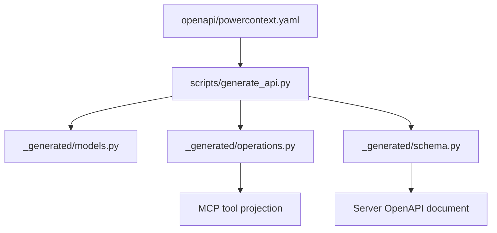
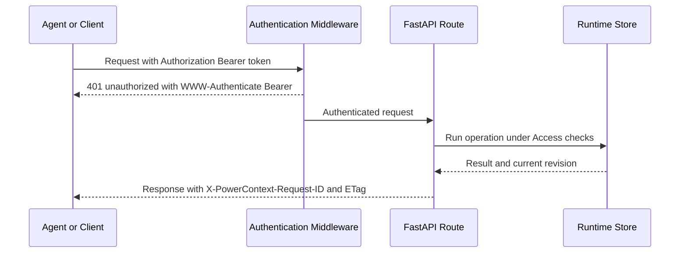
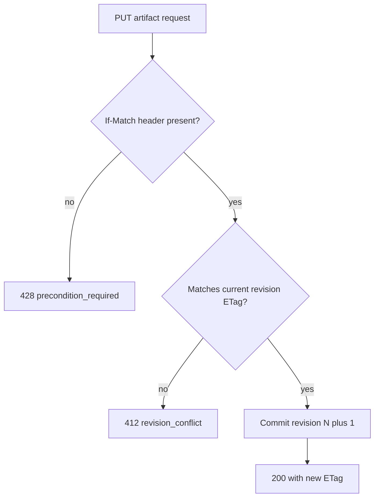

# HTTP and MCP API Surface

The PowerContext Server exposes one application contract through two wire surfaces: a versioned HTTP API under `/v1` and a
Streamable HTTP MCP endpoint (default `/mcp`) that projects a curated subset of the same operations as tools. Both surfaces
run in the same FastAPI application. HTTP is the complete contract; MCP is an Agent-facing view of it. For the surrounding
client and transport choices see [Client, CLI, and Transports](client-cli-and-transports.md). For the authorization model
behind the `Access` checks described below see [Scopes and Access](../concepts/scopes-and-access.md), and for the
Artifact families referenced by routes see [Artifact Families](../concepts/artifact-families.md).

## Contract ownership and generation

The checked-in contract is `openapi/powercontext.yaml` (OpenAPI `3.0.3`, API version `1.5.2`). It is the source of truth for
every path, schema, header, and status code. Two downstream artifacts are generated from it and must not be edited by hand:

- `src/powercontext/http/_generated/` (`models.py`, `operations.py`, `schema.py`), produced by `scripts/generate_api.py`.
  Each generated module starts with the comment `generated from openapi/powercontext.yaml; do not edit.`
- The runtime OpenAPI document served by the Server, which is built from the generated `OPENAPI_SCHEMA`.

Agents must not hand-edit the generated files: a manual change is overwritten by the next generation and fails
`make api-generate-check`. The generator reads the YAML, validates it, and writes the three generated modules. `make api-generate`
writes them and `make api-generate-check` (run by `make contract-test`) fails when the checked-in code has drifted from the YAML.
A change to a route therefore starts in the YAML, followed by `make api-generate`, then review of the regenerated code.



Caption: the YAML contract feeds the generated Python models, operation metadata, and the runtime OpenAPI document, and the same operation metadata drives MCP tool selection.

## Discovery endpoints

| Path | Purpose | Authentication |
| --- | --- | --- |
| `/docs` | Public Scalar API reference that renders the runtime OpenAPI document | Public; calls it makes still require authentication |
| `/openapi.json` | Canonical OpenAPI document of the running Server | Bearer token required |
| `/health/live`, `/health/ready` | Liveness and readiness probes | Public |
| `/v1/capabilities` | Enabled runtime behavior (source types, families, search modes) | Protected |
| `/v1/connection/identity` | Current request identity without readiness probes | Protected, `access.self` |

`/openapi.json` is omitted entirely when the application is built as infrastructure-only. The `/v1/handoff-reports/*` paths
are removed from the served document unless the Handoff Report feature is enabled, so the document always describes the
routes the process actually serves.

## Authentication

Authentication is enforced by one middleware for every external HTTP request that is not on the public allowlist. The
allowlist contains `/`, `/docs`, `/health/live`, `/health/ready`, and the four remote Skill target routes that carry their
own credential: `/v1/skill/remote/target/enroll` is open to enrollment, while `/v1/skill/remote/reconcile`,
`/v1/skill/remote/package/download`, and `/v1/skill/remote/receipt` use `TargetBearerAuth` rather than a user Principal.

Agents send the user credential as:

```http
Authorization: Bearer <token>
```

A rejected credential returns `401` with the code `unauthorized`, the message `A valid credential is required.`, and a
`WWW-Authenticate: Bearer` challenge. When the authentication provider raises `AuthenticationUnavailableError`, or raises any
other exception, the middleware returns `503` with the code `authentication_unavailable` and no challenge header. Both use
the standard error envelope `{"error": {"code", "message", "details"}}`, with `details` set to `null`. Requests that reach the
Server through the MCP internal bridge skip this middleware, because the outer `/mcp` request was already authenticated. The
contract declares `BearerAuth` as the default security requirement, with an empty alternative that marks the public operations.

The connection identity operation is the supported way to verify which Principal the deployment established. It reports
`authentication` as `disabled` or `authenticated` and never grants resource permissions. A `401`, `403`, or `503` is an
error, never evidence of anonymous mode.



Caption: an unauthenticated protected request stops at the middleware; an authenticated request reaches the route, which runs
its Access check before touching the Runtime.

## Required and returned headers

| Header | Direction | Used by | Rule |
| --- | --- | --- | --- |
| `Authorization: Bearer <token>` | Request | Every protected route and MCP | Omit only when the deployment has authentication disabled |
| `If-Match` | Request | `PUT /v1/scopes/{scope_id}/artifacts/{family}/{artifact_id}`, artifact tag replacement | Required; replay the exact ETag from the last read |
| `If-None-Match` | Request | `GET` artifact and tag reads | Optional; a matching ETag returns `304` with the same ETag |
| `ETag` | Response | Artifact reads and writes, tag reads and writes | Opaque strong validator for the current head |
| `X-PowerContext-Request-ID` | Response | Every response | Record it when diagnosing a failed call |
| `X-PowerContext-Dream-Contract: 2` | Request and response | Coordinated clients and negotiated routes | Clients that understand Dream contract 2 must send it; see below |

The Artifact ETag is derived from the current revision and has the form `"revision:N"`. Clients must replay the value
verbatim and must not parse it. Atomic Memory content replacement goes through the same revision-derived validator.
Atomic lifecycle operations, such as merge, forget, and restore, instead use a `state_version` in their request bodies,
which is separate from the content ETag.

## Route groups

The operation groups below map to the paths in the contract. The contract lists the full path set, schemas, and status codes.

| Area | Representative paths |
| --- | --- |
| Scopes | `/v1/scopes`, `/v1/scopes/{scope_id}`, `/v1/scopes/default` |
| Sources and context | `/v1/sources/content`, `/v1/scopes/{scope_id}/subject-sources`, `/v1/context/prepare`, `/v1/context/check` |
| Generic Artifacts | `POST /v1/scopes/{scope_id}/artifacts`, `/v1/scopes/{scope_id}/artifacts/{family}/{artifact_id}`, `.../revisions/{revision}` |
| Atomic Memory | `/v1/atomic-memory/list`, `/v1/atomic-memory/search`, `/v1/atomic-memory/lifecycle`, `/v1/atomic-memory/merges` |
| Memory compatibility | `/v1/memory/remember`, `/v1/memory/search`, `/v1/memory/entries/get`, `/v1/memory/changes` |
| Work continuity | `/v1/work/contracts/create`, `/v1/work/handoffs/prepare-current`, `/v1/work/handoffs/acknowledge`, `/v1/work/outcomes/record` |
| Low-level Handoff | `/v1/handoff/activate`, `/v1/handoff/prepare`, `/v1/handoff/finalize`, `/v1/handoff/commit`, `/v1/handoff/continue`, `/v1/handoff/hint` |
| Review | `/v1/candidates/list`, `get`, `history`, `revise`, `approve`, `reject` (all `POST`) |
| Access Control | `/v1/access/me`, `/v1/access/check`, `/v1/access/bindings/*`, `/v1/access/audit/list` |
| Experience and Skill | `/v1/experience/*`, `/v1/skill/*`, `/v1/external-skills/*` |

Two conventions matter for integration code. Creation of any Artifact, including the Handoff singleton, goes through the
generic `POST /v1/scopes/{scope_id}/artifacts` with `family` in the body. Review writes on `/v1/candidates/*` use a
`POST` with the current `expected_version`.

## Concurrency: If-Match, ETag, and conflict branches

Artifact content writes are compare-and-swap operations on the current head. A write must present the ETag it read; the
server does not merge or retry.



Caption: the handler rejects a missing `If-Match` before any Runtime call, and the storage layer re-checks the ETag inside
the write transaction so a concurrent change also yields `412`.

The branches an agent must handle are:

- **Missing `If-Match` on a replacement: `428`** with code `precondition_required`. The request is not attempted.
- **Stale ETag: `412`** with code `revision_conflict`. The error details carry `provided_etag` and `current_etag`. Read the
  head again and decide whether to replay the change; do not drop the precondition to force the write.
- **Tag replacement with a stale tag ETag: `412`** with code `tag_precondition_failed`. A tag replacement without `If-Match`
  is rejected with `428` `precondition_required`, the same code as the Artifact replacement.
- **Handoff Create when a Handoff already exists: `409`** with code `artifact_already_exists`. The Handoff is a Scope
  singleton; the details include `use_replace: true`, and the caller must update it with `PUT` plus `If-Match`.
- **Lifecycle or merge state conflicts: `409`**, for example an idempotency conflict. These are not ETag failures; re-read
  state and its version before retrying.
- **Legacy Memory collection operations: `422`** with code `legacy_memory_operation_unsupported`. This covers legacy
  citation reads and mutations, collection capacity and changes, and non-null collection revision preconditions. The response
  lists Atomic Memory alternatives. Rebuild the request with Atomic Memory identities and their content or state
  preconditions; do not discard the collection CAS precondition and retry automatically.

The Handoff Create conflict originates in the Handoff family writer, which raises the singleton error when a latest revision
already exists, and the server maps that error to `409` with the `use_replace` flag.

## Dream contract negotiation

The `X-PowerContext-Dream-Contract: 2` header gates the extended Dream and Candidate shapes. `DreamContractMiddleware` stamps
`X-PowerContext-Dream-Contract: 2` on every HTTP response. Projection to the legacy shape applies only on a fixed set of
legacy response paths: `/v1/capabilities`; `/v1/scopes/...` paths containing `/dream` or `/artifacts`; `/v1/context/prepare`;
`/v1/profile/flush`; and the experience, skill, and external-skill import routes. On those paths, a request without the header
is projected to the legacy shape. The projection runs only for 2xx JSON responses. Error responses (status 400 and above) pass
through unchanged. When the projection finds a Dream-only type it cannot express, the server answers
`426 client_upgrade_required` with `details` `{"required_dream_contract": 2}`, instead of sending a shape the client cannot
parse. The legacy operations `refine_experience` and `derive_skill` remain compatible without the header. The Python Client,
the MCP bridge, and the dashboard API proxy send the header automatically; external integrations must send it after they
update their closed operation enums and proposal types.

## MCP surface

MCP is mounted only when `POWERCONTEXT_SERVER_MCP_ENABLED` is true (default `true`), at the path set by
`POWERCONTEXT_SERVER_MCP_PATH` (default `/mcp`; a trailing slash is stripped, and a path that is not absolute is rejected).
The transport is stateless Streamable HTTP, so it does
not issue MCP session identifiers and cross-request SSE resumption is unavailable. Each request carries its own
authenticated identity.

The MCP projection is generated from the same OpenAPI document. Only operations whose `operationId` appears in the curated
`_MCP_OPERATION_IDS` set become tools, and every other route is excluded. The tool name equals the `operationId`. For example,
`prepare_context` is an HTTP-only operation and is not in the set. Read-only tools carry `readOnlyHint`, and writes
carry destructive or idempotent hints so that hosts can apply their own confirmation policy. These hints are not an
authorization boundary, and the Server enforces the same Access checks as it does for HTTP.

MCP calls are proxied in-process. The bridge calls the same FastAPI application through an ASGI transport, marks the
request as an internal bridge, reuses the logical request identifier, and sends `X-PowerContext-Dream-Contract: 2`. Because
the call traverses the same routes and middleware, MCP results match HTTP results for the same operation. The internal flag
makes the Server skip authentication, the HTTP body limit, HTTP admission, and the HTTP access log for the bridged call, so
each logical MCP call is authenticated and logged once at the `/mcp` boundary.

Two MCP Artifact tools deviate from the raw HTTP shape:

- `get_artifact` and `replace_artifact` return `{artifact, etag, status_code}`, where `etag` is the exact HTTP content
  ETag. A conditional read that returns `304` yields `artifact: null` and the current `etag`.
- `replace_artifact` supports `family=atomic-memory` only. Other families are rejected in the MCP layer before the request
  reaches HTTP, and the caller must pass the `etag` from `get_artifact` unchanged as `If-Match`.

The MCP guidance embedded in the server tells agents to use `get_recall_manifest` for bounded inventory, to treat an empty
result as valid, and to avoid retries after a stale write. It also reminds them that `remember_memory` with a non-null
legacy collection revision precondition is unsupported.

## Errors and request identity

Every error uses the envelope `{"error": {"code", "message", "details"}}`. Common statuses are `401` for a missing or
invalid bearer token, `403` for an unauthorized Principal, `404` for missing immutable values, `409` for state conflicts,
`422` for contract violations, `503` for an unavailable Runtime or dependency, and `500` for an internal failure that
exposes no details. Readiness reports `not_ready` with `503` when the Runtime readiness probe fails or when an enforced Access or
authentication provider is not ready.

Request validation failures use the code `invalid_request` with the message `The request violates the API contract.` and
`details` `{"errors": [...]}`. The status is `422`, except that a validation error on a `/v1/scopes/` path whose location starts
with `query` returns `400`. For the context-check route, the detail list is replaced with a fixed `context_check_invalid` entry.
Any unhandled exception returns `500` with the code `internal_error` and the message `The Server failed.`, with `details` set to
`null`.

### Limits and admission

Two process-local limits run before route handlers. Both return the standard envelope, and neither applies to internal bridge
calls.

| Limit | Default | Setting | Branch when exceeded |
| --- | --- | --- | --- |
| Request body size | 16 MiB (`16777216` bytes) | `POWERCONTEXT_SERVER_HTTP_MAX_REQUEST_BODY_BYTES` | `413` with code `request_too_large`. A declared `Content-Length` above the limit is rejected before the body is read. A streamed body that exceeds the limit is rejected at the chunk that crosses it. |
| Concurrent external requests | 64 | `POWERCONTEXT_SERVER_HTTP_MAX_CONCURRENT_REQUESTS` | `503` with code `server_overloaded`, message `The Server is at HTTP capacity.`, and header `Retry-After: 1`. The slot is released when the response body completes. |

`factory.py` registers the body limit first, then authentication (when configured), so authentication runs before the body
limit. The concurrency limit is added after the application is built, so it runs before authentication, and the request-ID
middleware is added after it so that the `503 server_overloaded` response still carries `X-PowerContext-Request-ID`.

Each response carries `X-PowerContext-Request-ID`, a 16-character lowercase hexadecimal identifier. The value comes from the
bound request identifier, when the call is an internal bridge call, or else from the current tracing span. An inbound
`X-Request-ID` header is never read. The Server reuses the same identifier for the matching access-log completion record.
Access logs record one completion per external HTTP request and skip health probes, metrics, the MCP path, and internal
bridge calls. MCP requests are logged once per logical tool call.

## Tests and change safety

The focused tests that guard this surface are:

- `tests/test_api_contract.py` checks the contract's security boundaries, the public-path allowlist, ETag and `If-Match`
  declarations, and that the served document equals the checked-in YAML (`test_server_publishes_the_canonical_openapi_schema`).
  `test_contract_uses_the_namespaced_request_id_header` asserts that the contract uses `X-PowerContext-Request-ID` and not
  `X-Request-ID`.
- `tests/test_mcp.py` pins the exact MCP tool set, the read-only and destructive annotations, the Artifact envelope, and the
  internal bridge request identity.
- `tests/test_dream_review_transport.py` exercises the Dream contract header on capability, Candidate, and Artifact reads.

When extending the surface, edit the YAML first, regenerate with `make api-generate`, and add the route in `app.py`. A new
operation that should be available to agents also needs an entry in the MCP operation set, and the MCP tool-set test must
be updated in the same change. Do not add a route to the MCP set without an Access check on the route, because MCP
visibility is not permission.
