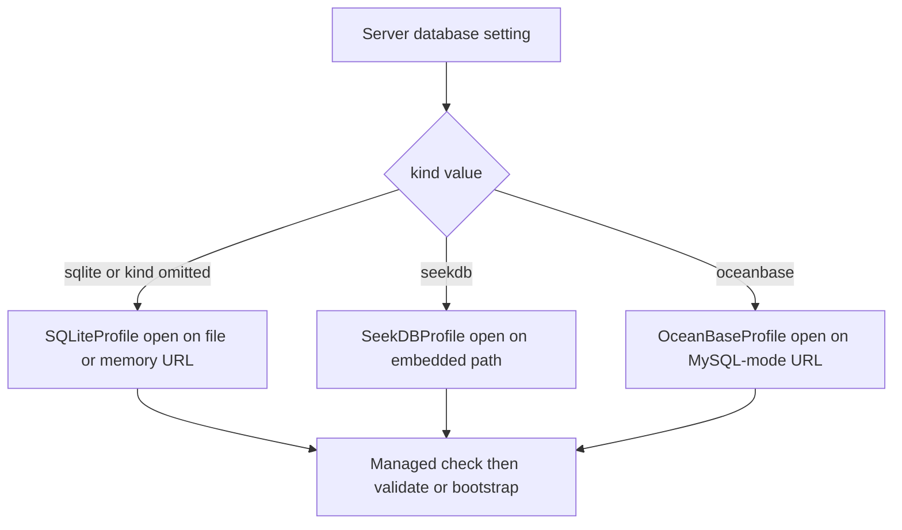
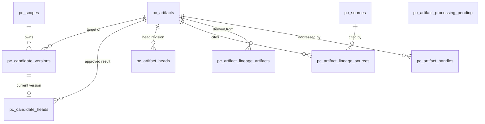

# Persistence and Storage Backends

PowerContext keeps all durable Server state in one relational database. Three backends are supported: a SQLite file (the default), an embedded seekDB instance, and an OceanBase MySQL-mode server. The persistence package under `src/powercontext/builtin/persistence/` contains one profile per backend, shared table metadata, the repositories that read and write the tables, and a versioned migration layer. Schema changes reach a managed database only through explicit maintenance, never through ordinary Server startup.

This page covers the storage layer. For the process that consumes it, see [Server runtime](server-runtime.md). For the meaning of Artifacts and Candidates, see [Artifact families](../concepts/artifact-families.md) and [Sources and processing](../concepts/sources-and-processing.md). For operator procedures, see [Migrations and archives](../operations/migrations-and-archives.md).

## Responsibilities and entrypoints

| Concern | Owner |
| --- | --- |
| Backend configuration models (`SQLiteConfig`, `SeekDBConfig`, `OceanBaseConfig`) | `sqlite/profile.py`, `seekdb/profile.py`, `oceanbase/profile.py` |
| Default storage locations | `src/powercontext/paths.py` |
| Server database selection and default | `src/powercontext/server/settings.py` |
| Runtime composition: open, validate, or bootstrap storage | `src/powercontext/builtin/runtime/composition.py` (`open_builtin_contexts`) |
| Transaction and engine ownership | `src/powercontext/builtin/persistence/database.py` (`AsyncDatabase`) |
| Shared table metadata | `src/powercontext/builtin/persistence/tables.py` |
| Unmanaged table creation | `src/powercontext/builtin/persistence/schema.py` (`create_tables`) |
| Versioned migration bundles, runners, and plans | `src/powercontext/builtin/persistence/migrations/` |
| Maintenance CLI (`status`, `plan`, `apply`, `verify`) | `src/powercontext/server/database_migration.py` |
| Private snapshot admission for managed Ops | `src/powercontext/server/database_admission.py` |

## Backend selection

The Server settings object holds one `database` field whose type is the discriminated union `DatabaseConfig = SQLiteConfig | OceanBaseConfig | SeekDBConfig`, discriminated by `kind` ([runtime config](repo://src/powercontext/builtin/runtime/config.py#L503-L503), [Server settings](repo://src/powercontext/server/settings.py#L271-L271)). The Server reads its settings with environment prefix `POWERCONTEXT_SERVER_` and nested delimiter `_` ([ServerSettings](repo://src/powercontext/server/settings.py#L239-L250)).

Selection then follows one of three branches in the runtime composition:

Caption: the three backend branches converge on the same managed-or-unmanaged initialization decision.

- **SQLite branch.** `open_builtin_contexts` builds the SQLite Topic, Atomic Memory, and Experience indexes, then calls `SQLiteProfile.open` with the combined table tuple ([composition](repo://src/powercontext/builtin/runtime/composition.py#L1240-L1262)). The Topic FTS index is always attached on this path, and vector indexes are attached only when an embedding model is configured.
- **seekDB and OceanBase branch.** The same function builds OceanBase FTS and vector indexes, then opens `OceanBaseProfile` for an OceanBase config or `SeekDBProfile` for a seekDB config ([composition](repo://src/powercontext/builtin/runtime/composition.py#L1349-L1352)). Any other config raises `BuiltinConfigurationError` ([composition](repo://src/powercontext/builtin/runtime/composition.py#L1353-L1354)).
- **Environment and CLI.** The CLI writes `POWERCONTEXT_SERVER_DATABASE_URL` and `POWERCONTEXT_SERVER_DATABASE_PATH` as optional managed names and rejects unsupported kinds other than `sqlite`, `oceanbase`, and `seekdb` ([CLI configuration](repo://src/powercontext/cli/config.py#L216-L240), [validation](repo://src/powercontext/cli/config.py#L636-L650)).

### When the database URL is unset

If no database is configured, the Server default factory returns a `SQLiteConfig` whose URL is `sqlite_url(default_database_path())` ([default factory](repo://src/powercontext/server/settings.py#L77-L78)). A config dictionary without a `kind` is also normalized to SQLite with that default URL, so explicit fields override only the URL and other options ([kind defaulting](repo://src/powercontext/server/settings.py#L376-L380)).

`default_database_path()` returns `powercontext.db` inside `powercontext_data_dir()`. That directory is the resolved `POWERCONTEXT_HOME` when the variable is set, otherwise the platform user-data path for `powercontext` ([paths](repo://src/powercontext/paths.py#L24-L40)). The default seekDB location is a `seekdb` directory in the same data directory ([paths](repo://src/powercontext/paths.py#L36-L50)).

Two different SQLite defaults exist. The `SQLiteConfig` model's own URL default is `sqlite+aiosqlite:///:memory:` ([SQLiteConfig](repo://src/powercontext/builtin/persistence/sqlite/profile.py#L50-L65)), which is in-memory transient storage. The Server settings default is the persistent file above. Only the Server default is durable across restarts.

Backend choice also constrains background processing. The Server rejects `runtime.artifact_processing_role` values other than `all` for any backend other than OceanBase ([settings](repo://src/powercontext/server/settings.py#L416-L422)), so a background processing role requires OceanBase.

## Backend profiles

Each profile owns one async engine and exposes an `AsyncDatabase` plus the tables it initialized.

| Aspect | SQLite | Embedded seekDB | OceanBase |
| --- | --- | --- | --- |
| Config model | `SQLiteConfig`: `url`, `busy_timeout_ms` (default 5000), `journal_mode` (default WAL), `foreign_keys` | `SeekDBConfig`: `path`, `database` (default `powercontext`) | `OceanBaseConfig`: `url` (secret) |
| URL or path rule | Must use driver `sqlite+aiosqlite` ([check](repo://src/powercontext/builtin/persistence/sqlite/profile.py#L66-L72)) | Native directory; path must be non-empty ([config](repo://src/powercontext/builtin/persistence/seekdb/profile.py#L85-L110)) | Must use `mysql+aoceanbase`, with username, host, explicit port, and `charset=utf8mb4` ([validator](repo://src/powercontext/builtin/persistence/oceanbase/profile.py#L291-L312)) |
| Engine | Persistent files use the default pool. In-memory URLs use `StaticPool` ([engine](repo://src/powercontext/builtin/persistence/sqlite/profile.py#L108-L114)) | Starts the native instance with `pylibseekdb` and connects through a MySQL-dialect async socket ([open instance](repo://src/powercontext/builtin/persistence/seekdb/profile.py#L233-L240)) | Official async dialect via `pyobvector`, with `autocommit` disabled on connect ([engine](repo://src/powercontext/builtin/persistence/oceanbase/profile.py#L207-L220)) |
| Creation | Creates the parent directory for persistent files ([directory](repo://src/powercontext/builtin/persistence/sqlite/profile.py#L187-L193)) | Creates the parent of the seekDB path; creates the named database if missing ([connect](repo://src/powercontext/builtin/persistence/seekdb/profile.py#L155-L200)) | Creates the named database when missing; read-only inspection requires it to exist |
| Read-only inspection | `SQLiteProfile.open_readonly` opens the file with `mode=ro` ([read-only](repo://src/powercontext/builtin/persistence/sqlite/profile.py#L132-L160)) | Requires an existing native store; a missing or empty path is an error and nothing is created ([inspection](repo://src/powercontext/builtin/persistence/seekdb/profile.py#L211-L232)) | Uses `open_existing` without creating the database |
| Journal and concurrency | Sets the journal mode during warm-up under a per-file lock ([warm-up](repo://src/powercontext/builtin/persistence/sqlite/profile.py#L328-L345)). WAL is the default | Same MySQL-family transactional rules | Tenant must report MySQL mode ([tenant check](repo://src/powercontext/builtin/persistence/oceanbase/profile.py#L239-L252)); standalone seekDB 1.4 is accepted when its version string identifies it |
| Identity collation | `String` columns with binary comparison | MySQL-family `utf8mb4_bin` for identity columns | Rejects an existing schema whose identity columns do not use `utf8mb4_bin` ([collation check](repo://src/powercontext/builtin/persistence/oceanbase/profile.py#L255-L283)) |

Identity columns, such as `scope_id` and `source_id`, are declared through `identity_string`, which keeps SQLite byte-exact and forces `utf8mb4_bin` on MySQL-family backends so case or accent variants cannot collapse into one key ([identity type](repo://src/powercontext/builtin/persistence/tables.py#L67-L80)). `create_all(checkfirst=True)` does not rewrite existing collations, so the OceanBase profile fails fast on incompatible legacy schemas instead of silently mixing semantics.

Embedded seekDB has an additional guard. When the database name was not explicitly set and the legacy `test` database holds PowerContext tables, the profile stops with an explicit-choice error and does not move or delete data ([legacy guard](repo://src/powercontext/builtin/persistence/seekdb/profile.py#L255-L282)). The default name is `powercontext` ([bootstrap](repo://src/powercontext/builtin/persistence/bootstrap.py#L28-L28)).

## Startup: managed versus unmanaged storage

After a profile opens, composition checks for the `pc_schema_revision` control table to decide whether the database is managed by the revision chain ([composition](repo://src/powercontext/builtin/runtime/composition.py#L1252-L1266)).

- **Managed.** Startup takes a read snapshot, validates the processing schema, validates the current Atomic Memory projection, and initializes Topic Memory with `validate_only=True`. It does not create tables or repair projections ([managed branch](repo://src/powercontext/builtin/runtime/composition.py#L1254-L1262)).
- **Unmanaged.** For SQLite, bootstrap takes `BEGIN IMMEDIATE`, rechecks the control table, and then creates or initializes storage: artifact plugin schema, processing schema, skill distribution, Topic tags, Scope search, revision metadata, portable timestamp precision, Atomic Memory authority and indexes, and Experience indexes ([unmanaged branch](repo://src/powercontext/builtin/runtime/composition.py#L1263-L1282)). The seekDB and OceanBase branches follow the same sequence ([unmanaged](repo://src/powercontext/builtin/runtime/composition.py#L1359-L1380)).
- **Table creation.** `create_tables` is the single creation helper. When `pc_schema_revision` exists, it returns without DDL, or raises `unsupported_configuration` if the requested feature tables are missing ([create_tables](repo://src/powercontext/builtin/persistence/schema.py#L32-L60)). Otherwise it creates missing tables only, applying the registered Atomic Memory evidence migration first for evidence tables and `pc_sources`. The generic artifact vector table is included only for SQLite; MySQL-family backends provision vector spaces natively ([schema](repo://src/powercontext/builtin/persistence/schema.py#L32-L60)).
- **Timestamp precision.** `ensure_portable_timestamp_precision` widens selected MySQL-family `DATETIME` columns to microsecond precision. The unmanaged branch calls it; the managed branch does not ([precision](repo://src/powercontext/builtin/persistence/schema.py#L150-L170)).

Operators are told that ordinary startup checks readiness without repairing managed storage, and that empty local SQLite and seekDB storage initializes through the same revision chain while OceanBase requires an explicit maintenance job first ([operator docs](repo://docs/en/docs/operate/database-migrations.md#L113-L117)).

## Entity model

The erDiagram below shows only relationships that the table definitions declare as foreign keys. Other shared keys, such as `scope_id` on `pc_artifacts` or `pc_sources`, are documented in prose because the repository does not declare a foreign key for them.

Caption: declared foreign-key relationships among Scope, Candidate, Artifact revision, Source, and Artifact head tables. The processing pending table is keyed by binding name and Scope but declares no foreign key.

### Core state and where it lives

- **Scope.** `pc_scopes` holds the Scope with a nullable self-referencing `parent_scope_id` restricted from deletion and a positive `version` check ([pc_scopes](repo://src/powercontext/builtin/persistence/tables.py#L94-L111)). Scope-scoped side tables such as `pc_scope_settings` and `pc_scope_bindings` cascade or restrict against `pc_scopes` ([side tables](repo://src/powercontext/builtin/persistence/tables.py#L113-L166)).
- **Source.** `pc_sources` is keyed by `(scope_id, source_type, source_id)` and stores the canonical payload and a `journal_position`, unique per Scope ([pc_sources](repo://src/powercontext/builtin/persistence/tables.py#L175-L184)). `pc_source_journal_heads` records the latest position per Scope ([heads](repo://src/powercontext/builtin/persistence/tables.py#L186-L192)).
- **Artifact revision.** `pc_artifacts` is keyed by `(scope_id, family, artifact_id, revision)` and stores the immutable content and provenance columns such as `created_by` and `restored_from_revision` ([pc_artifacts](repo://src/powercontext/builtin/persistence/tables.py#L194-L206)). `pc_artifact_heads` points at one revision through a composite foreign key and carries lifecycle state, replacement and merge pointers, and a governance generation ([pc_artifact_heads](repo://src/powercontext/builtin/persistence/tables.py#L229-L269)). Revision rows are written through `ArtifactRepository` with optimistic revision checks ([artifacts](repo://src/powercontext/builtin/persistence/artifacts.py#L15-L80)).
- **Lineage and publication.** `pc_artifact_lineage_sources` links an Artifact revision to Sources, and `pc_artifact_lineage_artifacts` links it to upstream Artifact revisions ([lineage](repo://src/powercontext/builtin/persistence/tables.py#L271-L330)). `pc_artifact_publications` records cross-Scope publications keyed by target revision and idempotency key ([publications](repo://src/powercontext/builtin/persistence/tables.py#L332-L366)).
- **Candidate.** `pc_candidate_versions` stores immutable Candidate versions with proposal, source and artifact references, and an optional target revision ([versions](repo://src/powercontext/builtin/persistence/tables.py#L369-L400)). `pc_candidate_heads` is the mutable head with `status` in pending, approved, or rejected. A database check constrains which result columns each status may populate ([heads](repo://src/powercontext/builtin/persistence/tables.py#L402-L453)). Candidate persistence keeps versions append-only and moves only the head ([candidates](repo://src/powercontext/builtin/persistence/candidates.py#L15-L44)).
- **Handoff.** No dedicated Handoff table exists. `RelationalHandoffBackend` stores one Handoff lifecycle in the shared Artifact tables and resolves its evidence through `ArtifactRepository` and generation-source access ([handoff](repo://src/powercontext/builtin/persistence/handoff.py#L27-L60)).
- **Processing state.** Processing is persisted as dirty-set and ownership tables keyed by `binding_name` and `scope_id`: `pc_artifact_processing_pending` (source watermark and flush generations, [pending](repo://src/powercontext/builtin/persistence/tables.py#L517-L535)), `pc_artifact_processing_intents` (dirty, clean, and requested generations, [intents](repo://src/powercontext/builtin/persistence/tables.py#L599-L622)), `pc_artifact_processing_leases` (supervisor fence, [leases](repo://src/powercontext/builtin/persistence/tables.py#L551-L562)), and `pc_artifact_processing_schema` (singleton migration receipt, [schema](repo://src/powercontext/builtin/persistence/tables.py#L642-L652)). These tables declare no foreign key to `pc_scopes`.

Other persisted families, including Topic Memory (`pc_topic_memory_*`), Skills (`pc_skill_packages`, `pc_agent_skill_targets`), and usage counters (`pc_model_usage_daily`), are defined in [tables.py](repo://src/powercontext/builtin/persistence/tables.py#L666-L1464). Atomic Memory evidence and access-control tables are defined in their owning `*_schema.py` modules and in the managed revision resources.

## Transactions and engine ownership

`AsyncDatabase` owns or attaches to one SQLAlchemy async engine. Repositories receive a connection from it and never own the engine ([AsyncDatabase](repo://src/powercontext/builtin/persistence/database.py#L80-L120)).

- `transaction()` opens an explicit transaction. Nested lookups on an in-memory SQLite connection join the caller's transaction, and MySQL-family transactions start explicitly even when the server session uses autocommit ([transaction](repo://src/powercontext/builtin/persistence/database.py#L120-L165)).
- Close drains active transactions before disposing an owned engine. An attached engine is left open for its caller ([close](repo://src/powercontext/builtin/persistence/database.py#L283-L315)).
- Statistics writes run in a bounded transaction that is never joined to a business transaction ([statistics](repo://src/powercontext/builtin/persistence/database.py#L220-L240)).
- `is_transaction_contention` treats only SQLite busy or locked codes and MySQL-family deadlock and lock-wait codes as rollback-safe retry signals ([contention](repo://src/powercontext/builtin/persistence/database.py#L511-L517)).

## Migration layer

Managed schema lives in versioned bundles under `migrations/server_resources/`. The revision files form a linear chain, each setting `down_revision` to the previous one: `s1300` baseline, `s1400` full Server transition, `s1401` memory archive, `s1402` portable storage, `v1_4_1_004` owner recovery, `v1_4_1_005` Atomic Memory description, `v1_4_1_006` source write plugins, `v1_5_0_001` Artifact storage, `v1_5_0_002` Atomic Memory evidence, and `v1_5_0_003` evidence projection ([versions](repo://src/powercontext/builtin/persistence/migrations/server_resources/versions/s1400_full_server.py#L17-L30), [v1_5_0_001](repo://src/powercontext/builtin/persistence/migrations/server_resources/versions/v1_5_0_001_artifact_storage.py#L15-L29)). The manifest lists each revision's resource files, SQLite and MySQL fingerprints, and affected objects ([manifest](repo://src/powercontext/builtin/persistence/migrations/server_resources/manifest.json#L1-L60)).

Alembic runs each revision on a pinned connection supplied by the executor. The version table is `pc_schema_revision`, and transactional DDL is enabled only for SQLite ([env](repo://src/powercontext/builtin/persistence/migrations/server_resources/env.py#L14-L26)).

Revision names follow `v<major>_<minor>_<patch>_<sequence>`. Legacy IDs `s1300`, `r1400`, `s1400`, `s1401`, and `s1402` remain stored IDs and are presented only as display aliases; they are not additional executable revisions ([revision names](repo://src/powercontext/builtin/persistence/migrations/revision_names.py#L18-L55)). Operators see `source_migration`, `target_migration`, and `pending_migrations` in plans, and each descriptor carries `name`, `software_version`, `sequence`, and `revision` ([payload](repo://src/powercontext/server/database_migration.py#L280-L297)).

### The 1.4.0 upgrade path

The `s1400` revision is the most complex single step. It rebuilds seven tables by copying rows into temporary tables with explicit column lists, so existing values survive and new provenance stays unknown rather than synthesized. It then adds four tables and their indexes, and revokes the old processing lease by bumping `supervisor_generation`, setting a holder, and expiring the lease ([s1400](repo://src/powercontext/builtin/persistence/migrations/server_resources/versions/s1400_full_server.py#L17-L74)). Revisions after `s1400` are additive, each applying frozen statements from a versioned schema resource.

### Plan, apply, and verify

`deployment_runner` selects the adapter for a bundle and backend without opening business profiles ([deployment](repo://src/powercontext/builtin/persistence/migrations/deployment.py#L117-L232)).

- **Bundles.** `server` is the full chain. `artifacts` is a partial prototype chain that reports `server_ready=false`. `topic-memory-recovery` covers only its registered Topic layouts. `processing` and `atomic-projection` are offline maintenance operations.
- **SQLite.** The target must be a regular file URL without credentials, host, port, query, or in-memory option. Anything else raises `unsupported_target` ([SQLite target](repo://src/powercontext/builtin/persistence/migrations/deployment.py#L200-L232)).
- **seekDB and OceanBase.** Both require an evidence directory. OceanBase additionally requires `--lock-coordination single-host` and rejects unsupported acknowledgments for other backends ([coordination](repo://src/powercontext/builtin/persistence/migrations/deployment.py#L160-L185)).
- **Plan** is read-only and returns the target, pending revisions, schema fingerprint, backup availability, and compatibility steps. A new database produces an `uninitialized` plan ([SQLite runner](repo://src/powercontext/builtin/persistence/migrations/sqlite.py#L139-L190)).
- **Apply** takes a local OS file lock, rechecks that the plan has not changed, requires the accepted plan ID, maintenance confirmation, and backup declarations, then runs historical conversion, domain preflight, and the Alembic chain before writing completion evidence ([apply](repo://src/powercontext/builtin/persistence/migrations/sqlite.py#L241-L300)).
- **Locking.** The local lock is a native file lock, and its inode is retained after release so waiters on the old and new inodes cannot run concurrently ([locking](repo://src/powercontext/builtin/persistence/migrations/locking.py#L27-L50)).
- **Operator entrypoints.** `status` never creates a database or control table. `verify` checks readiness without asserting cluster readiness. `apply` requires a reviewed plan and explicit confirmation or interactive acceptance ([CLI commands](repo://src/powercontext/server/database_migration.py#L70-L146)).

For the release-by-release revision table, the Processing, Atomic Memory projection, Topic Memory recovery, and CI upgrade acceptance boundaries, see [Migrations and archives](../operations/migrations-and-archives.md) and the operator documentation at [database migrations](repo://docs/en/docs/operate/database-migrations.md#L149-L165).

## Admission of a private snapshot

Managed Ops can admit a SQLite database without starting the Server. `database_admission.main` reads one bounded JSON request from stdin, rejects unknown protocol versions and oversized input, and writes only a safe reason code ([admission entry](repo://src/powercontext/server/database_admission.py#L122-L141)).

`_admit` checks the target package version and the protected configuration identity. It requires the snapshot path to differ from the database path and to be absolute. It accepts only a `SQLiteMigrationRunner` whose database equals the requested target ([admit](repo://src/powercontext/server/database_admission.py#L79-L120)). The recovery fingerprint over the original-path maintenance journals is taken before and after the snapshot check, and any change rejects admission with `recovery_required` ([fingerprint](repo://src/powercontext/server/database_admission.py#L35-L75)). `SQLiteMigrationRunner.admit_snapshot` opens only the snapshot read-only, compares the stored embedding profile, and requires a ready plan. It never initializes, migrates, or recovers data ([admit snapshot](repo://src/powercontext/builtin/persistence/migrations/sqlite.py#L209-L238)).

## Invariants and failure behavior

- **Managed databases are not altered by startup.** A database containing `pc_schema_revision` is validated, not repaired. Missing managed structures require maintenance ([composition](repo://src/powercontext/builtin/runtime/composition.py#L1254-L1262), [docs](repo://docs/en/docs/operate/database-migrations.md#L113-L117)).
- **Revision checksums are immutable.** Earlier revision resources keep their checksums when later revisions are appended. The chain follows registered `down_revision` links, not lexical order ([docs](repo://docs/en/docs/operate/database-migrations.md#L149-L165)).
- **Interrupted maintenance is resumable and rolled back.** SQLite rolls back an unsuccessful normalization. OceanBase requires previous-run acknowledgment before continuing. Maintenance evidence and the original backup must be reused for resume ([sqlite apply](repo://src/powercontext/builtin/persistence/migrations/sqlite.py#L241-L300)).
- **Rollback-safe retries are narrow.** Only SQLite busy or locked codes and MySQL-family lock conflicts are classified as contention. Ambiguous commit outcomes are not retried ([contention](repo://src/powercontext/builtin/persistence/database.py#L511-L517)).
- **Sensitive values stay out of diagnostics.** Admission and maintenance emit codes and digests rather than configuration, database contents, or provider messages ([admission](repo://src/powercontext/server/database_admission.py#L122-L141)).

## Extension points and change guidance

- To add a table, declare it in `tables.py` with `identity_string` for identity columns, add it to the owning builtin table tuple, and provide a registered revision under `server_resources/versions/` with its SQLite and MySQL schema resources. Do not rely on startup DDL for managed storage.
- To change a managed object, add a new revision whose `down_revision` is the current head. Keep existing revision IDs, resources, and checksums unchanged. Historical conversion belongs in `migrations/historical.py` or a domain step, not in startup helpers.
- To add a backend, implement a config model with a `kind` literal, a profile with `open` and `open_existing`, an `AsyncDatabase`, and a branch in `open_builtin_contexts` and `deployment_runner`. The discriminated union in `runtime/config.py` must include the new config.

## Tests that matter

- `tests/builtin/persistence/test_database_migrations.py` covers read-only commands that do not create databases, empty initialization, interruption at each revision boundary, checksum-conflict rejection, backup-before-write ordering, and retained tables ([tests](repo://tests/builtin/persistence/test_database_migrations.py#L89-L130)).
- `tests/builtin/persistence/test_database_bootstrap.py` covers database-name validation, creation permissions, the OceanBase tenant check before creation, and the legacy seekDB explicit-choice rule ([tests](repo://tests/builtin/persistence/test_database_bootstrap.py#L107-L140)).
- `tests/test_ops_database_admission.py` covers the absent-database rule, snapshot budget, source change during copy, and the vector profile comparison ([tests](repo://tests/test_ops_database_admission.py#L49-L80)).
- `tests/builtin/persistence/test_full_server_migrations.py` and `test_release140_server_migrations.py` exercise the full Server chain from historical layouts.

These are the tests to run after touching schema, migrations, transaction ownership, or admission. Fixture data under `tests/fixtures` is historical evidence and is not documented here.
