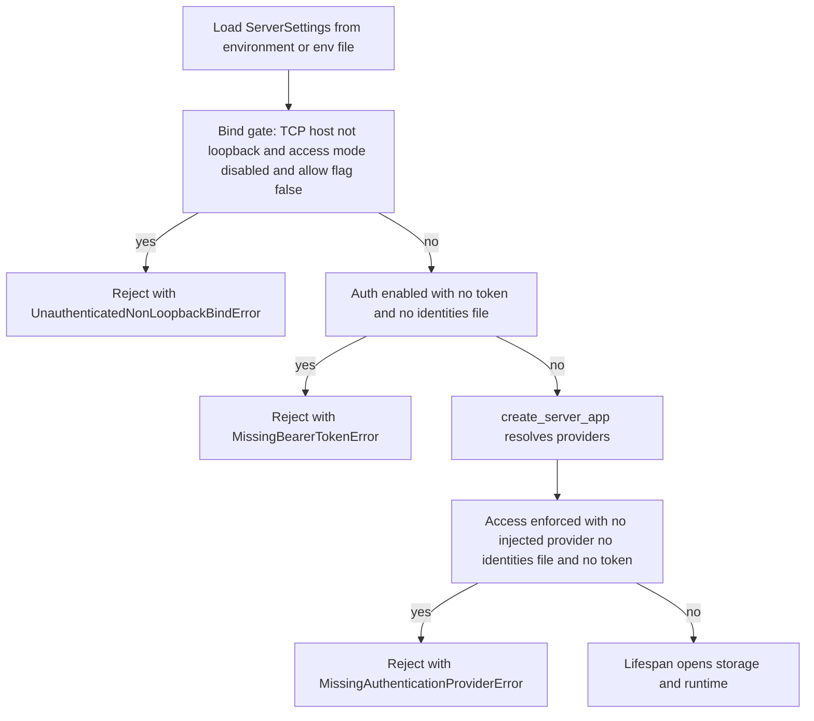
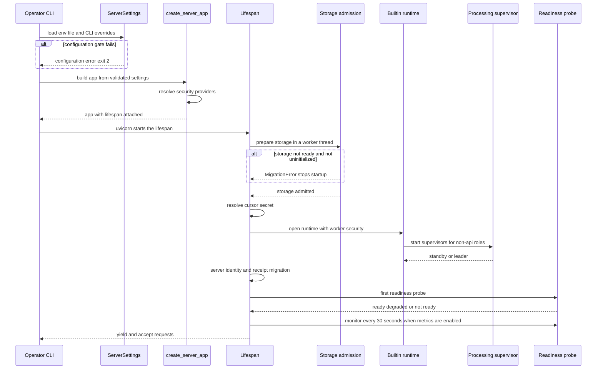
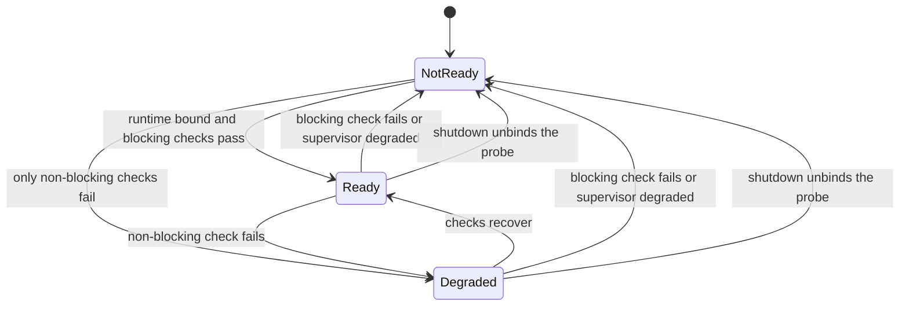
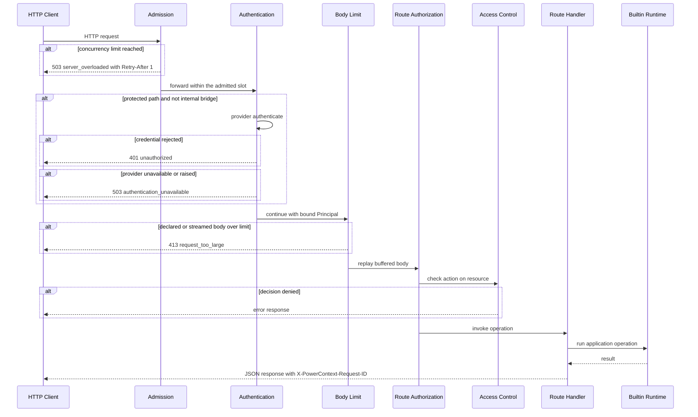
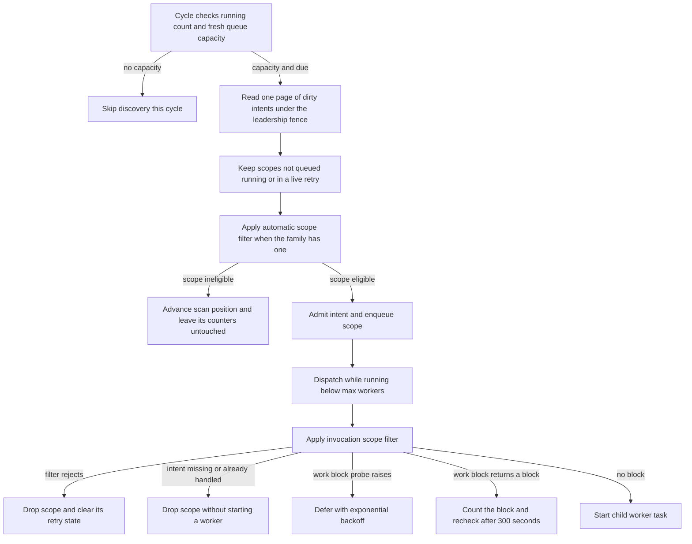

# PowerContext Server Runtime

The PowerContext Server is the long-running process that exposes the built-in runtime over HTTP (and optionally MCP and a dashboard), and that can also run as a background-only worker. This page explains how that process is assembled, what it checks before it accepts traffic, how a request flows through the admission, authentication, and authorization layers into the runtime, how automatic background processing is scheduled and admitted, and what happens during startup and shutdown. Persistence details live in [Persistence and Storage](persistence-and-storage.md); the overall component map is in [System Overview](system-overview.md).

Citations point at repository commit `b8b18909`. Line ranges are bounded to the code that establishes each statement.

## Responsibilities at a glance

| Concern | Owning module |
| --- | --- |
| Typed, environment-backed settings and their validation | [settings.py](../../src/powercontext/server/settings.py) |
| Loading `.env` files and building one settings object per operation | [configuration.py](../../src/powercontext/server/configuration.py) |
| CLI entry points (`run`, migrations, identity reset) and process launch | [cli.py](../../src/powercontext/server/cli.py) |
| FastAPI application construction, lifespan, provider selection, middleware order | [factory.py](../../src/powercontext/server/factory.py) |
| HTTP route table, error mapping, per-route authorization | [app.py](../../src/powercontext/server/app.py) |
| Credential-to-Principal authentication | [authentication.py](../../src/powercontext/server/authentication.py), [middleware.py](../../src/powercontext/server/middleware.py) |
| Body-size and concurrency admission | [http_limits.py](../../src/powercontext/server/http_limits.py) |
| Request identity (`X-PowerContext-Request-ID`) | [request_id.py](../../src/powercontext/server/request_id.py) |
| Owned Unix domain socket listener | [uds.py](../../src/powercontext/server/uds.py) |
| Storage admission before the lifespan opens the runtime | [server_readiness.py](../../src/powercontext/builtin/persistence/migrations/server_readiness.py) |
| Built-in runtime lifecycle, readiness aggregate, close | [application.py](../../src/powercontext/builtin/runtime/application.py), [readiness.py](../../src/powercontext/builtin/runtime/readiness.py) |
| Automatic background processing: discovery, admission, leases, worker lifecycle | [artifact_processing.py](../../src/powercontext/builtin/runtime/artifact_processing.py) |
| Which families are scheduled and how their bindings are built | [composition.py](../../src/powercontext/builtin/runtime/composition.py), [config.py](../../src/powercontext/builtin/runtime/config.py) |

## Assembly: from configuration to a running app

The Server is assembled in layers. Each layer owns one decision, and the later layers consume only validated objects from the earlier ones.

1. **Configuration load.** `ServerSettings` is a pydantic `BaseSettings` with the environment prefix `POWERCONTEXT_SERVER_` and `_` as the nested delimiter, so `POWERCONTEXT_SERVER_HTTP_PORT` maps to `http.port` ([settings.py](../../src/powercontext/server/settings.py#L239-L251)). Nested groups such as `http`, `auth`, `access`, `logging`, `metrics`, and `runtime` are typed models with their own defaults.
2. **Operation-scoped context.** The CLI wraps loading in `server_settings_context`. An explicit `--env-file`, or a `.env` discovered in the working directory for `run`, is selected by `resolve_server_environment_file` ([configuration.py](../../src/powercontext/server/configuration.py#L136-L151)); `--no-env-file` disables discovery. `run` opts into process-environment precedence, while service and maintenance entry points keep the file as the authority ([configuration.py](../../src/powercontext/server/configuration.py#L166-L212), and the `run` command in [cli.py](../../src/powercontext/server/cli.py#L830-L900)). CLI flags `--host`, `--port`, and `--uds` override the `http` group, and combining `--host` or `--port` with a UDS path is rejected ([configuration.py](../../src/powercontext/server/configuration.py#L214-L231)).
3. **Mode dispatch.** `_run_configured_server` configures logging and tracing, then sends the `background` role to the background runner. Other roles build the FastAPI app with `create_server_app`, then serve it either over TCP with uvicorn or over a Unix socket ([cli.py](../../src/powercontext/server/cli.py#L902-L938)).
4. **Factory.** `create_server_app` resolves security providers, builds the `BuiltinConfig`, creates metrics and tracing objects, and defines the lifespan ([factory.py](../../src/powercontext/server/factory.py#L147-L216)). It returns a `_ServerApp` (a FastAPI subclass) whose routes are added by `create_app` in [app.py](../../src/powercontext/server/app.py#L1460-L1520) and whose middleware stack is assembled after that ([factory.py](../../src/powercontext/server/factory.py#L451-L523)).

The factory rejects a `background` artifact processing role outright, so a background-only process cannot accidentally expose HTTP or MCP ([factory.py](../../src/powercontext/server/factory.py#L181-L184)).

## Configuration and startup gates

Validation happens at several points, and each gate that can refuse a launch is listed below. Each one names the branch taken when a setting is unset.

Caption: Startup gates evaluated in order; any rejection stops the process before the lifespan opens the database or the runtime.

### Non-loopback bind gate

`ServerSettings` refuses a TCP bind to a non-loopback host unless authentication is on or the operator explicitly opts out. The validator raises `UnauthenticatedNonLoopbackBindError` when all of these hold: no UDS path is configured, the process is not a background-only process without metrics, the host is not loopback, `access.mode` is `disabled` (which is what "authentication not enabled" means here), and `allow_unauthenticated_non_loopback` is false ([settings.py](../../src/powercontext/server/settings.py#L389-L421)). The loopback definition covers `localhost`, IPv4 addresses in `127.0.0.0/8`, and IPv6 `::1` ([transport.py](../../src/powercontext/transport.py#L31-L50)). The CLI translates the error into a message that names the three levers: authenticate, stay on loopback, or set `POWERCONTEXT_SERVER_ALLOW_UNAUTHENTICATED_NON_LOOPBACK=true` ([cli.py](../../src/powercontext/server/cli.py#L940-L957)).

Fallback: the default host is `127.0.0.1` and the default port is `8000` ([settings.py](../../src/powercontext/server/settings.py#L117-L137)). With those defaults the gate is not reached, so the default launch is loopback-only and unauthenticated.

### Missing bearer token gate

When `POWERCONTEXT_SERVER_AUTH_ENABLED` is true and no identity map file is configured, the static bearer configuration must contain a non-empty `POWERCONTEXT_SERVER_AUTH_TOKEN`; otherwise `MissingBearerTokenError` is raised ([settings.py](../../src/powercontext/server/settings.py#L155-L172)). The CLI reports this with the message to set `POWERCONTEXT_SERVER_AUTH_TOKEN` or to disable access control with `POWERCONTEXT_SERVER_ACCESS_MODE=disabled` ([cli.py](../../src/powercontext/server/cli.py#L940-L957)).

Fallback: when `POWERCONTEXT_SERVER_AUTH_IDENTITIES_FILE` is set, the token requirement is skipped entirely because the validator only enforces the token when the identity file is absent. When authentication is not enabled, the gate does not apply.

### Missing authentication provider gate

Provider selection happens in `_resolve_security_providers`, in this order ([factory.py](../../src/powercontext/server/factory.py#L559-L588)):

1. Access mode `disabled`: no authentication or authorization provider is loaded. An injected provider in this mode is itself an error.
2. Access mode `enforced` with an injected `authentication_provider`: that provider is used.
3. Access mode `enforced` with `AUTH_IDENTITIES_FILE`: a `MultiBearerAuthenticationProvider` reads the identity map.
4. Access mode `enforced` with no token: `MissingAuthenticationProviderError` is raised.
5. Access mode `enforced` with a token: a `StaticBearerAuthenticationProvider` maps the token to a fixed service Principal.

The CLI maps `MissingAuthenticationProviderError` to a bad-parameter error ([cli.py](../../src/powercontext/server/cli.py#L898-L899)).

### Other validation rules

- **Authentication implies enforcement.** Setting `POWERCONTEXT_SERVER_AUTH_ENABLED=true` forces `access.mode` to `enforced`. An identity map or a source-management manager subject also requires `enforced` mode ([settings.py](../../src/powercontext/server/settings.py#L389-L402)).
- **Legacy token without authentication is refused.** `AUTH_TOKEN` with access mode `disabled` is rejected, and so is a background Principal configured in disabled mode ([settings.py](../../src/powercontext/server/settings.py#L403-L409)).
- **Dashboard needs a token under enforcement.** `DASHBOARD_ENABLED=true` with `ACCESS_MODE=enforced` requires `AUTH_TOKEN`, and the dashboard refuses an injected authentication or access provider ([settings.py](../../src/powercontext/server/settings.py#L395-L402), [factory.py](../../src/powercontext/server/factory.py#L160-L176)).
- **Background Principal description.** `ACCESS_BACKGROUND_PRINCIPAL_DESCRIPTION` requires `ACCESS_BACKGROUND_PRINCIPAL_ID` ([settings.py](../../src/powercontext/server/settings.py#L392-L394)).
- **Public URL.** `POWERCONTEXT_SERVER_PUBLIC_URL` must be an absolute HTTP(S) URL without credentials, query, or fragment. A non-HTTPS public URL is accepted only for loopback hosts unless `POWERCONTEXT_SERVER_ALLOW_INSECURE_HTTP` is true ([settings.py](../../src/powercontext/server/settings.py#L332-L369)). Fallback: with no public URL, the check is not applied.
- **UDS restrictions.** A UDS listener is not allowed for the `background` role, and `HTTP_UDS_EXTERNAL_SCHEME` requires a UDS path ([settings.py](../../src/powercontext/server/settings.py#L389-L392), [settings.py](../../src/powercontext/server/settings.py#L126-L137)).
- **Storage role.** A non-OceanBase database requires `runtime.artifact_processing_role` to be `all` ([settings.py](../../src/powercontext/server/settings.py#L418-L421)).
- **Secret length.** An explicit cursor signing secret must be at least 32 bytes, and so must each handoff verification secret ([settings.py](../../src/powercontext/server/settings.py#L304-L316)).

### Fallbacks for unset settings

Every fallback below is the branch taken when the named setting is not present in the environment or env file. Names are the full environment variable names.

| Setting | Default | Branch taken when unset |
| --- | --- | --- |
| `POWERCONTEXT_SERVER_HTTP_HOST` / `POWERCONTEXT_SERVER_HTTP_PORT` | `127.0.0.1` / `8000` | Loopback TCP listener; the bind gate is not reached |
| `POWERCONTEXT_SERVER_HTTP_UDS` | none | TCP listener is used instead of a Unix socket |
| `POWERCONTEXT_SERVER_HTTP_UDS_EXTERNAL_SCHEME` | none (`http` or `https` when set) | Unix socket app is served without an external-scheme wrapper; requires `HTTP_UDS` |
| `POWERCONTEXT_SERVER_HTTP_MAX_REQUEST_BODY_BYTES` | 16 MiB (16777216) | Body limit of 16 MiB applies to non-plugin routes |
| `POWERCONTEXT_SERVER_HTTP_MAX_CONCURRENT_REQUESTS` | 64 | Admission allows 64 concurrent external responses |
| `POWERCONTEXT_SERVER_PLUGIN_API_MAX_BODY_BYTES` | 32 MiB (33554432) | Ceiling for plugin API routes; a route may declare a lower limit |
| `POWERCONTEXT_SERVER_PUBLIC_URL` | none | Public URL scheme check is not applied |
| `POWERCONTEXT_SERVER_ALLOW_INSECURE_HTTP` | `false` | Non-HTTPS public URLs are accepted only for loopback hosts; the cleartext remote Skill Receiver opt-in is off |
| `POWERCONTEXT_SERVER_ALLOW_UNAUTHENTICATED_NON_LOOPBACK` | `false` | Non-loopback TCP binds without authentication are refused at settings validation |
| `POWERCONTEXT_SERVER_ACCESS_MODE` | `disabled` | No authorization provider, no authentication provider, every route open to the process |
| `POWERCONTEXT_SERVER_ACCESS_DEPLOYMENT_ID` | `powercontext` | Used as the authorization deployment identity |
| `POWERCONTEXT_SERVER_ACCESS_BACKGROUND_PRINCIPAL_ID` | none | Scheduled work uses the legacy static token Principal when a token exists; otherwise scheduled processing in enforced mode fails |
| `POWERCONTEXT_SERVER_ACCESS_BACKGROUND_PRINCIPAL_DESCRIPTION` | none | Principal has no description; requires the background Principal ID |
| `POWERCONTEXT_SERVER_AUTH_ENABLED` | `false` | No bearer provider is built |
| `POWERCONTEXT_SERVER_AUTH_TOKEN` | none | Provider selection falls through to the missing-provider gate when access is enforced |
| `POWERCONTEXT_SERVER_AUTH_IDENTITIES_FILE` | none | The static token provider is used instead, if a token exists |
| `POWERCONTEXT_SERVER_CURSOR_SIGNING_SECRET` | none | Secret is loaded or created from a local key file (see Lifecycle) |
| `POWERCONTEXT_SERVER_WORKSPACE` | current working directory | Resolved and required to be an existing directory |
| `POWERCONTEXT_SERVER_DATABASE` | SQLite at the default database path | SQLite with a file URL under the data directory |
| `POWERCONTEXT_SERVER_MCP_ENABLED` / `POWERCONTEXT_SERVER_MCP_PATH` | `true` / `/mcp` | MCP is mounted at `/mcp` |
| `POWERCONTEXT_SERVER_DASHBOARD_ENABLED` | `false` | Dashboard is not mounted |
| `POWERCONTEXT_SERVER_METRICS_ENABLED` / `POWERCONTEXT_SERVER_METRICS_BACKGROUND_PORT` | `true` / `8001` | Metrics are collected and served; the background-only metrics listener uses port 8001 |
| `POWERCONTEXT_SERVER_TRACING_ENABLED` | `false` | Context-only tracing is used |
| `POWERCONTEXT_SERVER_LOGGING_LEVEL` / `POWERCONTEXT_SERVER_LOGGING_FORMAT` / `POWERCONTEXT_SERVER_LOGGING_ACCESS` | `INFO` / `console` / `true` | Console logs with HTTP access logs |
| `POWERCONTEXT_SERVER_RUNTIME_ARTIFACT_PROCESSING_ROLE` | `all` | HTTP and background processing run in one process |
| `POWERCONTEXT_SERVER_RUNTIME_ARTIFACT_PROCESSING_SUPERVISOR_MODE` | `global` | One supervisor owns every automatic family |
| `POWERCONTEXT_SERVER_RUNTIME_SCHEDULE_SECONDS` | none (alias of the memory interval key) | The memory family has no automatic interval; explicit requests still process |
| `POWERCONTEXT_SERVER_RUNTIME_EXPERIENCE_SCHEDULE_SECONDS` | none | The experience family has no automatic interval |
| `POWERCONTEXT_SERVER_RUNTIME_TOPIC_MEMORY_SCHEDULE_SECONDS` | none | The topic-memory family has no automatic interval |
| `POWERCONTEXT_SERVER_RUNTIME_PROFILE_SCHEDULE_ENABLED` | `false` | The profile family has no cron binding |
| `POWERCONTEXT_SERVER_RUNTIME_PROFILE_CRON` / `POWERCONTEXT_SERVER_RUNTIME_PROFILE_TIMEZONE` | `0 2 * * *` / `Asia/Shanghai` | Used only when profile scheduling is enabled |
| `POWERCONTEXT_SERVER_RUNTIME_ARTIFACT_PROCESSING_MAX_WORKERS` | 10 (alias of the topic-memory worker quota) | Topic-memory family runs up to 10 concurrent workers |
| `POWERCONTEXT_SERVER_RUNTIME_ARTIFACT_PROCESSING_WORKER_TIMEOUT_SECONDS` | 600 | Worker timeout of 600 seconds |

The `POWERCONTEXT_SERVER_SCHEDULER_PATH` setting does not exist. The `scheduler_path` argument of `create_server_app` is deprecated and ignored, and a warning says that automatic processing is scheduled by the artifact processing supervisor ([factory.py](../../src/powercontext/server/factory.py#L165-L177)).

The default `ServerSettings` values are declared as fields in [settings.py](../../src/powercontext/server/settings.py#L239-L283). The `external_skills` default is replaced by local project targets only when that field was not set ([settings.py](../../src/powercontext/server/settings.py#L325-L330)). Runtime defaults for the processing settings are declared in [config.py](../../src/powercontext/builtin/runtime/config.py#L195-L275).

## Lifecycle

### Startup

Caption: Server start, from settings load through the storage gate, runtime and processing supervisor start, and the first readiness probe before the app accepts traffic.

The FastAPI lifespan defined in the factory is the single place where runtime resources are opened ([factory.py](../../src/powercontext/server/factory.py#L217-L421)). In order, it:

1. Logs `server.starting` and emits warnings for cleartext remote Skill Receiver opt-in and for an in-memory SQLite database ([factory.py](../../src/powercontext/server/factory.py#L217-L224)).
2. Runs `prepare_server_storage` in a worker thread ([factory.py](../../src/powercontext/server/factory.py#L225-L231)). Its behavior by database kind is described in the storage gate below ([server_readiness.py](../../src/powercontext/builtin/persistence/migrations/server_readiness.py#L123-L160)).
3. Resolves the cursor signing secret. An explicit `CURSOR_SIGNING_SECRET` is used as is. Otherwise, a persistent SQLite database gets a hidden sidecar key file next to it, other persistent databases get a key in the data directory, and in-memory SQLite gets no secret ([cursor_secret.py](../../src/powercontext/server/cursor_secret.py#L39-L53)). Key creation is serialized by a lock and published atomically.
4. Opens a worker logging bootstrap and, when access is enforced and no provider was injected, the built-in access-control service, in an async exit stack ([factory.py](../../src/powercontext/server/factory.py#L236-L261)).
5. Builds the dream access adapter and the worker security specification, then opens the built-in runtime with the scheduled profile runner, the cursor secret, and handoff verification keys ([factory.py](../../src/powercontext/server/factory.py#L262-L313)). When the access control cannot run write transactions on the owner-write database, an owner recovery monitor is opened ([factory.py](../../src/powercontext/server/factory.py#L314-L323)).
6. Initializes the durable Server identity and binds the context-binding codec when a cursor secret exists, then binds evidence access ([factory.py](../../src/powercontext/server/factory.py#L332-L338)).
7. Starts the plugin manager. In global supervisor mode for a non-API role it dispatches plugin processing through the supervisor ([factory.py](../../src/powercontext/server/factory.py#L339-L377)).
8. When an access control service is active, migrates handoff receipts and removes legacy Topic Memory owner rows ([factory.py](../../src/powercontext/server/factory.py#L378-L384)).
9. Binds the readiness probe to the runtime, opens the source gateway, and publishes the application, access control, and authentication provider on `app.state`, followed by capabilities and server info ([factory.py](../../src/powercontext/server/factory.py#L385-L412)).
10. Runs the first readiness probe, starts an optional `DeploymentCoordinator` task when a source plugins directory is configured or source management autostart is enabled, and starts the 30-second readiness monitor when metrics are enabled, before yielding ([factory.py](../../src/powercontext/server/factory.py#L413-L421)).

#### Storage gate

`prepare_server_storage` branches on the database kind ([server_readiness.py](../../src/powercontext/builtin/persistence/migrations/server_readiness.py#L123-L160)):

- **In-memory SQLite** returns immediately and no check runs.
- **Persistent SQLite** asserts that no local migration is in progress, plans the deployment runner, and applies the migration automatically only when the plan state is `uninitialized`. Any other non-`ready` plan raises a `MigrationError` that asks the operator to stop writers and run `powercontext server db-migrate apply` before startup.
- **Embedded SeekDB** follows the same plan-and-apply rule as persistent SQLite.
- **OceanBase** does not plan a migration. It opens a maintenance connection, requires the `pc_schema_revision` table (otherwise `migration_required`), verifies the managed layout and the embedding profile, and runs the schema check. A missing table is an explicit `db-migrate` job, not a startup action.

### Readiness states

The factory probe and the runtime aggregate together determine what `/health/ready` reports ([factory.py](../../src/powercontext/server/factory.py#L675-L777), [application.py](../../src/powercontext/builtin/runtime/application.py#L4462-L4483)).

Caption: Readiness states of the Server probe. The initial state and the state after shutdown are both not ready, because the probe has no bound runtime.

### Steady state

The process serves requests until shutdown. Readiness is reported by `/health/ready`, which returns 503 when the aggregate readiness is `not_ready` or when the authentication or access provider reports `not_ready`. A `degraded` aggregate still returns 200 with `status` set to `degraded` ([app.py](../../src/powercontext/server/app.py#L1769-L1785)). The access readiness checks are collected in `access_readiness_checks`, which reports the access mode, authentication status, and the access provider status ([app.py](../../src/powercontext/server/app.py#L1790-L1819)).

The probe is safe when the runtime is missing or fails. If no runtime is bound, the probe reports `runtime: not_ready`. If `runtime.readiness()` raises, the probe reports `runtime: unavailable`, and both cases are `NOT_READY` ([factory.py](../../src/powercontext/server/factory.py#L701-L763)). When metrics are enabled, the probe publishes the aggregate every 30 seconds, and an access or authentication check of `not_ready` forces the published status to `NOT_READY` ([factory.py](../../src/powercontext/server/factory.py#L714-L749)).

The runtime aggregate combines its dependency probes. A failed blocking probe makes the runtime `NOT_READY`, a failed non-blocking probe makes it `DEGRADED`, and a degraded artifact processing supervisor forces `NOT_READY` ([readiness.py](../../src/powercontext/builtin/runtime/readiness.py#L177-L195), [application.py](../../src/powercontext/builtin/runtime/application.py#L4462-L4483)).

### Shutdown

On shutdown the lifespan's `finally` block runs in this order ([factory.py](../../src/powercontext/server/factory.py#L421-L449)):

1. Cancels and awaits the deployment task if one was started.
2. Logs `server.stopping`, unbinds the readiness probe so readiness reports not ready, and clears the runtime-facing references on `app.state`.
3. Restores the configured access and authentication providers on `app.state`, and resets capabilities to an empty set.
4. Exits the async exit stack, which closes the runtime in reverse order of opening.

`BuiltinRuntime.close` is idempotent. It sets a closing flag so new top-level operations are refused, waits until no operations are active, closes the artifact processing supervisor, clears the scope cache, and marks the runtime closed. It does not close the model provider ([application.py](../../src/powercontext/builtin/runtime/application.py#L4517-L4530)). Uvicorn is responsible for draining in-flight HTTP requests before the lifespan finishes. For the Unix socket path, cleanup of the socket and its lock is registered on the uvicorn signal capture so the socket is released before a replayed SIGTERM can terminate the process ([cli.py](../../src/powercontext/server/cli.py#L965-L984)).

## Request handling

HTTP requests pass through a fixed stack of ASGI middleware before reaching a route. Starlette runs the first middleware in the list as the outermost layer, and the factory adds its admission, identity, metrics, access log, and tracing layers after `create_app`, which places them outside the authentication layer ([factory.py](../../src/powercontext/server/factory.py#L451-L523)). The request body limit is inserted inside the authentication layer.

Caption: Request flow from concurrency admission through authentication, body limit, and per-route authorization into the built-in runtime.

### HTTP admission

`HttpAdmissionMiddleware` is the outermost of the protective layers. It bypasses non-HTTP scopes and the trusted in-process MCP bridge. Otherwise it rejects a request with 503 `server_overloaded` and `Retry-After: 1` when the number of active external responses has reached `max_concurrent_requests`. It reserves a slot without an intervening await ([http_limits.py](../../src/powercontext/server/http_limits.py#L29-L82)).

`HttpRequestBodyLimitMiddleware` runs after authentication. It bypasses non-HTTP scopes and the internal bridge. Plugin API paths use the plugin ceiling, and every other path uses `max_request_body_bytes`. It rejects with 413 `request_too_large` when the declared `Content-Length` exceeds the limit or when streamed chunks exceed the remaining budget, and it replays the buffered body to the downstream application. If the client disconnects before the body arrives, the request ends without a response ([http_limits.py](../../src/powercontext/server/http_limits.py#L88-L166)).

The concurrency slot is held until the final response body or trailers message is sent through the wrapped send, or until the downstream application returns if that happens first ([http_limits.py](../../src/powercontext/server/http_limits.py#L31-L82)). A slow client therefore holds capacity until its response has been sent. An unauthenticated request whose body stalls is answered 401 before any body is read, so it does not hold a body-read slot ([test_server_http_limits.py](../../tests/test_server_http_limits.py#L135-L190)).

### Authentication

`AuthenticationMiddleware` is inserted at the front of the configured middleware list only when a provider is configured ([factory.py](../../src/powercontext/server/factory.py#L459-L466)). For each request it skips authentication when the request is part of the internal bridge, when the scope is not HTTP, or when the path is public. Public paths are the root, `/docs`, `/health/live`, `/health/ready`, the remote Skill enroll, reconcile, package download, and receipt routes, dashboard session and static assets, and plugin client and UI asset files ([middleware.py](../../src/powercontext/server/middleware.py#L37-L45), [middleware.py](../../src/powercontext/server/middleware.py#L60-L70), [middleware.py](../../src/powercontext/server/middleware.py#L120-L127)).

For protected paths the provider's `authenticate` is called with the transport, the headers, and the client host. Outcomes are:

- `AuthenticationRejectedError` or a missing authorization header: 401 `unauthorized` with `WWW-Authenticate: Bearer`.
- `AuthenticationUnavailableError` or any other exception from the provider: 503 `authentication_unavailable`.
- Success: the immutable `AuthenticationResult` is bound to request-local context for the rest of the request, which sets the current Principal ([middleware.py](../../src/powercontext/server/middleware.py#L76-L104), [context.py](../../src/powercontext/server/context.py#L54-L62)).

Dashboard paths return the dashboard login response instead of the JSON error body when the dashboard is enabled ([middleware.py](../../src/powercontext/server/middleware.py#L131-L153)).

The static bearer provider compares the credential with `compare_digest` against one token and maps it to one fixed service Principal ([authentication.py](../../src/powercontext/server/authentication.py#L94-L130)). The multi-identity provider reads a protected JSON identity file (mode 600, no symlinks) on each request and hashes the presented token with SHA-256 before comparing it with the stored digests, so rotation takes effect on the next request ([authentication.py](../../src/powercontext/server/authentication.py#L132-L198)). A malformed identity file makes the provider report unavailable rather than silently accepting or rejecting.

### Authorization

Authorization is attached per route rather than in middleware. `_add_route` appends a dependency built by `_authorization_dependency` whenever an operation declares an access requirement ([app.py](../../src/powercontext/server/app.py#L5829-L5851)). The dependency calls `access_control_for_mode`, which returns the service unchanged in disabled mode, so the dependency does nothing when access is disabled ([app.py](../../src/powercontext/server/app.py#L5853-L5870), [authz/service.py](../../src/powercontext/builtin/authz/service.py#L1785-L1793)). In enforced mode it:

1. Builds the authorization payload from path parameters, query parameters, or the validated request body ([app.py](../../src/powercontext/server/app.py#L5907-L5926)).
2. Resolves the operation's requirement into one or more `(action, resource)` checks.
3. Calls `check` for one check or `check_batch` for several, then, for any denial, either bootstraps the static scope and requires the checks again or raises ([app.py](../../src/powercontext/server/app.py#L5873-L5904)).

For a denial with reason `no-matching-binding` or `no-matching-policy` on a scope the caller may bootstrap, the scope is bootstrapped for the Principal and the checks are required again. Any other denial raises through `_require_allowed`, which maps `artifact-owner-pending` to an access-unavailable error and every other denial to an access-denied error ([app.py](../../src/powercontext/server/app.py#L5888-L5904), [authz/service.py](../../src/powercontext/builtin/authz/service.py#L626-L631), [authz/service.py](../../src/powercontext/builtin/authz/service.py#L1893)).

`access_control_for_mode` fails closed: an unknown mode, or enforced mode without an access control service, raises an access-unavailable error ([authz/service.py](../../src/powercontext/builtin/authz/service.py#L1785-L1793)).

### Errors and request identity

`HttpRequestIdMiddleware` binds one request identity for the request. It reuses the bound request identity when the outer layer set one, and otherwise takes the identity from the active span. It stores it on `scope["state"]` and writes the `X-PowerContext-Request-ID` response header on the outward start message ([request_id.py](../../src/powercontext/server/request_id.py#L28-L52), [app.py](../../src/powercontext/server/app.py#L1518)). Validation errors return 422 `invalid_request` with no caller-controlled text, or 400 for scoped resource query syntax errors ([app.py](../../src/powercontext/server/app.py#L1523-L1545)). Known application errors are mapped through `_map_error`. Any unexpected exception returns 500 `internal_error` and carries the request identity from `request.state` ([app.py](../../src/powercontext/server/app.py#L1563-L1574)).

### MCP and internal bridge

When MCP is enabled, `mount_mcp` mounts the projection at the configured path. Its internal transport propagates the current request identity and marks the call as an internal bridge, so the outer authentication and admission layers do not re-admit it ([mcp.py](../../src/powercontext/server/mcp.py#L580-L596)). MCP's own authentication is covered by an end-to-end test (see Focused tests).

## Background processing and admission

Automatic background processing, which the older documentation called the background scheduler, is no longer an APScheduler job store. It is owned by one `ArtifactProcessingSupervisor` per processing group. A group is the whole server in `global` supervisor mode and one family in `dedicated` mode. The runtime starts these supervisors for every non-API role when at least one binding exists ([composition.py](../../src/powercontext/builtin/runtime/composition.py#L1149-L1180), [artifact_processing.py](../../src/powercontext/builtin/runtime/artifact_processing.py#L528-L560)). Each family is a `ArtifactProcessingBinding` that carries its launcher, its worker quota, and an optional interval or cron ([artifact_processing.py](../../src/powercontext/builtin/runtime/artifact_processing.py#L128-L150)).

### Which families are scheduled

Automatic schedules come from runtime settings ([config.py](../../src/powercontext/builtin/runtime/config.py#L195-L212), [config.py](../../src/powercontext/builtin/runtime/config.py#L252-L275)):

- `RUNTIME_SCHEDULE_SECONDS` (an alias of the memory interval key), `RUNTIME_EXPERIENCE_SCHEDULE_SECONDS`, and `RUNTIME_TOPIC_MEMORY_SCHEDULE_SECONDS` give a positive interval in seconds. Each one must be greater than zero.
- `RUNTIME_PROFILE_SCHEDULE_ENABLED` enables the profile family, which uses `RUNTIME_PROFILE_CRON` and `RUNTIME_PROFILE_TIMEZONE`. The cron expression and timezone are validated when the settings are built, so an invalid timezone or crontab fails configuration rather than startup ([config.py](../../src/powercontext/builtin/runtime/config.py#L202-L212)).
- A configured schedule for a family that is neither declared as a processing capability nor registered raises `BuiltinConfigurationError` ([composition.py](../../src/powercontext/builtin/runtime/composition.py#L1027-L1050)).
- `RUNTIME_SCHEDULE_SECONDS` and `RUNTIME_EXPERIENCE_SCHEDULE_SECONDS` require a generation model when set ([composition.py](../../src/powercontext/builtin/runtime/composition.py#L2036-L2039)).

Each family without a schedule still runs when a request is explicitly accepted. The work-block check applies to every invocation, including explicit requests and retries ([artifact_processing.py](../../src/powercontext/builtin/runtime/artifact_processing.py#L141-L150)). The per-family worker quotas are `RUNTIME_MEMORY_MAX_WORKERS` (1), `RUNTIME_TOPIC_MEMORY_MAX_WORKERS` (10), `RUNTIME_EXPERIENCE_MAX_WORKERS` (1), `RUNTIME_SKILL_MAX_WORKERS` (1), `RUNTIME_HANDOFF_MAX_WORKERS` (1), `RUNTIME_PROMPT_MAX_WORKERS` (1), and `RUNTIME_PROFILE_MAX_WORKERS` (4) ([config.py](../../src/powercontext/builtin/runtime/config.py#L256-L275)).

### Deadlines and durable checkpoints

`_schedule_deadline` decides whether a family is due and when it is next due ([artifact_processing.py](../../src/powercontext/builtin/runtime/artifact_processing.py#L1869-L1905)):

- **No checkpoint yet.** The family is due immediately, so a fresh deployment processes its existing work at startup.
- **Interval.** The next time is the last checkpoint plus the interval. The family is due when now has reached it.
- **Cron.** The first fire after the checkpoint is computed. If it is still in the future, the family is not due. Otherwise a bounded binary search finds the latest missed fire time, so one catch-up run replaces an unbounded replay of every missed window, and the next fire time is recorded.

The checkpoint and scan progress are stored per binding in the durable binding state. Discovery starts a scan with a due time, pages through dirty intents, and finishes the scan with a new checkpoint, so a restart resumes an unfinished scan without admitting a scope twice ([artifact_processing.py](../../src/powercontext/builtin/runtime/artifact_processing.py#L1003-L1066), [test_processing_scheduler.py](../../tests/builtin/runtime/test_processing_scheduler.py#L348-L378), [test_processing_scheduler.py](../../tests/builtin/runtime/test_processing_scheduler.py#L432-L477)).

### Admission path

Caption: Automatic admission from discovery to worker start, with every branch that keeps a scope from starting a worker.

`_cycle` runs discovery for a family only when the family has fewer running workers than its quota, has fresh queue capacity, and is past its next discovery time ([artifact_processing.py](../../src/powercontext/builtin/runtime/artifact_processing.py#L873-L900)). Discovery is bounded to 2 seconds and reads at most `min(fresh capacity, 100)` dirty intents per page. A page that is full keeps the scan open and schedules the next page 10 milliseconds later ([artifact_processing.py](../../src/powercontext/builtin/runtime/artifact_processing.py#L96-L110), [artifact_processing.py](../../src/powercontext/builtin/runtime/artifact_processing.py#L1003-L1066)).

Scopes that pass the automatic filter are admitted through the intent repository and enqueued. The ready queue holds at most 50 channel entries, half of the 100-row page budget, and retries have their own channel. Retries are activated only when their deadline has passed and they are not already queued or running ([artifact_processing.py](../../src/powercontext/builtin/runtime/artifact_processing.py#L1093-L1113), [artifact_processing.py](../../src/powercontext/builtin/runtime/artifact_processing.py#L1115-L1137)).

`_dispatch` starts workers while the family is below its quota, for up to 2 seconds per cycle. For each queued scope it does the following ([artifact_processing.py](../../src/powercontext/builtin/runtime/artifact_processing.py#L1218-L1285)):

- If the invocation scope filter rejects the scope, the scope is dropped and its retry state is removed. No worker is started and no failure is recorded.
- If the intent row is missing or its requested generation is not newer than the handled generation, the scope is dropped with its pending observation.
- If the optional work-block probe raises, the scope is deferred through `_defer_admission_error`.
- If the work-block probe returns a block, the block counter increases and the scope waits through `_wait_for_block`.
- Otherwise a `_RunningWorker` is created and its task is started through `_execute`. The worker's queue wait time is recorded.

### What happens when work is not admitted

- **Probe error.** The scope is deferred with `failures` incremented and a delay from `_retry_delay`. The delay is `min(1800, 30 * 2^(failures - 1) * jitter)`, where the jitter is a random factor between 0.8 and 1.2 ([artifact_processing.py](../../src/powercontext/builtin/runtime/artifact_processing.py#L1386-L1388), [artifact_processing.py](../../src/powercontext/builtin/runtime/artifact_processing.py#L96-L101)). A failure is logged with the stage `work_admission`.
- **Block.** The scope is not started. The block is logged once per distinct block, counted in `admission_blocks`, and rechecked after `_BLOCKED_CHECK_SECONDS` (300 seconds), or earlier when an explicit wake arrives ([artifact_processing.py](../../src/powercontext/builtin/runtime/artifact_processing.py#L1328-L1384)).
- **Recheck probe error while blocked.** The last observed block is retained, and the recheck is retried after the same 300 seconds. A changed probe error is logged once ([artifact_processing.py](../../src/powercontext/builtin/runtime/artifact_processing.py#L1286-L1326)).
- **Retry state full.** Retry state is capped at 1000 entries. When the cap is reached, expired or blocked entries that are not queued or running are evicted to make room ([artifact_processing.py](../../src/powercontext/builtin/runtime/artifact_processing.py#L1139-L1160)).
- **Dropped scope.** A rejected or already handled scope generates no worker and no failure count, so a later write re-queues it through discovery.

### Leadership and worker lifecycle

Only the supervisor that holds the lease fence discovers and dispatches work. On OceanBase the supervisor acquires a 15-second lease through the lease repository, and single-process mode starts a single-process term. A supervisor that acquires nothing stays `standby` ([artifact_processing.py](../../src/powercontext/builtin/runtime/artifact_processing.py#L96-L101), [artifact_processing.py](../../src/powercontext/builtin/runtime/artifact_processing.py#L830-L852), [supervision.py](../../src/powercontext/builtin/persistence/supervision.py#L149)). A failure in the control loop marks the supervisor degraded, drops leadership, and logs the failure. Worker processes are spawned with a worker security specification built from the same access settings ([processing_security.py](../../src/powercontext/server/processing_security.py#L29-L56)).

### Enforced-mode identity for scheduled work

With access disabled, `build_worker_security` returns no worker security. With enforced access, child workers receive a specification whose Principal is `ACCESS_BACKGROUND_PRINCIPAL_ID` when set, the legacy static token Principal otherwise, and a `ValueError` is raised when neither exists ([processing_security.py](../../src/powercontext/server/processing_security.py#L29-L56), [factory.py](../../src/powercontext/server/factory.py#L659-L671)). The scheduled profile flush is the one job that runs inside the server process. It is created only when access is enforced, profile scheduling is enabled, and either a profile generator or a generation model is configured ([factory.py](../../src/powercontext/server/factory.py#L605-L611)).

The profile runner bootstraps the scope for the background Principal, requires `SCOPE_CONTRIBUTE` on it, requires `ARTIFACT_WRITE` before replacing an existing profile snapshot, and records artifact and candidate owner rows through owner-write access before the flush completes ([factory.py](../../src/powercontext/server/factory.py#L612-L656)).

### Dedicated background role

Setting `RUNTIME_ARTIFACT_PROCESSING_ROLE=background` (or `run --role background`) runs the process without HTTP. The CLI runs `_run_background_async`, which prepares storage, installs `SIGINT` and `SIGTERM` handlers that set a stop event, opens access control and the runtime, and then either waits for the stop event or serves the background metrics app until it is set. The background metrics probe uses the same readiness aggregate and a 30-second monitor ([cli.py](../../src/powercontext/server/cli.py#L992-L1080), [background_metrics.py](../../src/powercontext/server/background_metrics.py#L55-L70)). The background role is refused for a UDS listener, because a UDS is an API listener ([settings.py](../../src/powercontext/server/settings.py#L389-L392)).

## Unix domain socket listener

When `HTTP_UDS` is set, the process listens on a Unix socket instead of TCP ([cli.py](../../src/powercontext/server/cli.py#L930-L938)). `validate_socket_path` checks the path before any filesystem change: the platform must be Linux or macOS, the path must be absolute with no `..` or NUL, and it must fit in 103 filesystem-encoded bytes ([uds.py](../../src/powercontext/server/uds.py#L54-L69)).

`unix_socket_listener` then acquires ownership ([uds.py](../../src/powercontext/server/uds.py#L139-L200)):

- The parent directory must be a real directory owned by the current user with no group or other permissions; it is created with mode 700 when missing.
- A private `<name>.lock` file must be an owned regular file with a single link. It is locked exclusively and non-blockingly, so a second listener fails with "already running or starting".
- A stale socket is removed only when its identity matches the recorded lock record and a connection attempt is refused. A socket that accepts connections, or any unrecognized file, is never removed.
- After binding, the socket is chmod 600 and its device, inode, and change time are recorded in the lock file.

On shutdown the socket is removed only if it is still the same identity and no live listener answers, so an operator's replacement socket survives ([uds.py](../../src/powercontext/server/uds.py#L111-L138)). The lock file is kept after shutdown deliberately, so a competing process cannot lock a different inode while another still holds the old lock.

## Managed-operations admission

[database_admission.py](../../src/powercontext/server/database_admission.py) is a private entry point that admits a prepared SQLite snapshot without starting the Server. It reads one bounded JSON request from standard input, verifies the protected configuration file and the target package version, checks that the snapshot is separate from the live database, and returns only a short reason code on failure. It is part of the managed upgrade procedure described in the operations material rather than a runtime path ([database_admission.py](../../src/powercontext/server/database_admission.py#L79-L140)).

## Failure modes and invariants

- **A configuration error never reaches the database.** Every settings gate runs during `ServerSettings` construction, before the lifespan. The CLI maps these to exit code 2 for configuration problems or to a bad-parameter error for the specific policy failures ([cli.py](../../src/powercontext/server/cli.py#L830-L900)).
- **Enforced mode without a provider fails closed.** The factory refuses to construct the app, and the readiness probe reports `authentication_provider` or `access_provider` as `not_ready`, which makes `/health/ready` return 503.
- **Authorization never runs ahead of authentication.** Protected routes are reached only through the authentication middleware, which binds the Principal used by the route dependency.
- **Admission rejects before parsing.** Concurrency is checked before authentication, and oversized bodies are rejected before any route code runs. Capacity is held for the full response lifetime.
- **Scheduled work is never silently anonymous.** Enforced mode requires a background Principal for worker security, and the profile flush re-checks `SCOPE_CONTRIBUTE` and `ARTIFACT_WRITE` for that Principal.
- **Runtime operations fail after close begins.** Once `close` sets the closing flag, a new top-level operation raises a closed-state error, so late dispatches fail instead of starting new work ([application.py](../../src/powercontext/builtin/runtime/application.py#L4532-L4546)).
- **Unadmitted work leaves no failure record.** A scope refused by the invocation filter or a missing or handled intent is dropped without consuming a retry, while a probe error consumes one with exponential backoff.

## Extension points

- **Authentication Provider SPI.** `create_server_app` accepts an `authentication_provider` implementing `authenticate` and `readiness` and returns `AuthenticationResult`; the result validation rejects invalid Principals, duplicate or oversized group sets, and malformed credential identifiers ([authentication.py](../../src/powercontext/server/authentication.py#L39-L72)). An injected provider cannot be combined with the dashboard, and an injected provider in disabled mode is refused ([factory.py](../../src/powercontext/server/factory.py#L160-L176), [factory.py](../../src/powercontext/server/factory.py#L559-L572)).
- **Access control service.** An `access_control` instance can be injected. It is the policy decision point for every per-route check.
- **Middleware.** Extra Starlette middleware is accepted through the `middleware` argument and is placed inside the authentication layer.
- **Artifact plugins and processors.** Artifact plugin managers and processing families are injected through `create_server_app` arguments such as `candidate_pipeline`, `profile_generator`, and `external_skill_provider`. Each processing family becomes an `ArtifactProcessingBinding` with its own worker launcher and quota ([composition.py](../../src/powercontext/builtin/runtime/composition.py#L1050-L1110)).

## Operations

- **Start.** `powercontext server run` discovers `.env` in the working directory, applies CLI overrides, and runs in the foreground. `--no-env-file` disables discovery and `--observability` loads the local observability profile.
- **Choose a listener.** Use TCP on loopback for local use, a TCP host only with authentication enabled or an explicit opt-in, or a Unix socket with a private run directory.
- **Automatic processing.** Set `RUNTIME_SCHEDULE_SECONDS`, `RUNTIME_EXPERIENCE_SCHEDULE_SECONDS`, `RUNTIME_TOPIC_MEMORY_SCHEDULE_SECONDS`, or `RUNTIME_PROFILE_SCHEDULE_ENABLED` to create automatic bindings. Each family's worker quota caps its concurrency. Run a separate `background` role process when API and workers should be separated. The database must be OceanBase for multi-role deployments.
- **Probes.** `/health/live` reports liveness, `/health/ready` reports readiness with per-check detail, and `/metrics` is served when metrics are enabled. Metrics and access logs skip health and metrics paths. See [Observability](../operations/observability.md).

## Focused tests

- [tests/test_server_http_limits.py](../../tests/test_server_http_limits.py) covers admission and body limits: the blocked outward response that holds capacity (L101-L133), the unauthenticated stalled body rejected without reading (L135-L190), the oversized authenticated body rejected before downstream (L191-L216), and body replay at the limit (L373-L385).
- [tests/builtin/runtime/test_processing_scheduler.py](../../tests/builtin/runtime/test_processing_scheduler.py) covers supervisor admission: per-family capacity and single-flight scopes (L168-L201), retry backoff isolation (L231-L261), restart from durable requests (L348-L378), and blocked-recheck spacing (L764-L830).
- [tests/builtin/artifacts/profile/test_scheduler.py](../../tests/builtin/artifacts/profile/test_scheduler.py) covers profile cron defaults and validation (L38-L63), startup catch-up of profile evidence (L64-L110), and manual flush without automatic processing (L111 onward).
- [tests/e2e/test_server_uds.py](../../tests/e2e/test_server_uds.py) covers UDS authorization and restarts, shutdown that preserves a replacement socket with a reused inode, refusal to remove occupied paths, and startup failure releasing the socket.
- [tests/e2e/test_mcp_request_authentication.py](../../tests/e2e/test_mcp_request_authentication.py) covers authentication on the MCP projection.
- [tests/test_transport.py](../../tests/test_transport.py) covers the `allow_unauthenticated_non_loopback` setting.

## Related pages

- [System Overview](system-overview.md) places the Server in the wider component map.
- [Persistence and Storage](persistence-and-storage.md) describes the databases, migrations, and the processing lease and intent tables.
- [Configuration Settings](../concepts/configuration-settings.md) lists all settings groups.
- [Scopes and Access](../concepts/scopes-and-access.md) explains the access model used by per-route authorization.
- [Sources and Processing](../concepts/sources-and-processing.md) explains the source windows that automatic processing admits.
- [Observability](../operations/observability.md) covers logs, metrics, and tracing.
