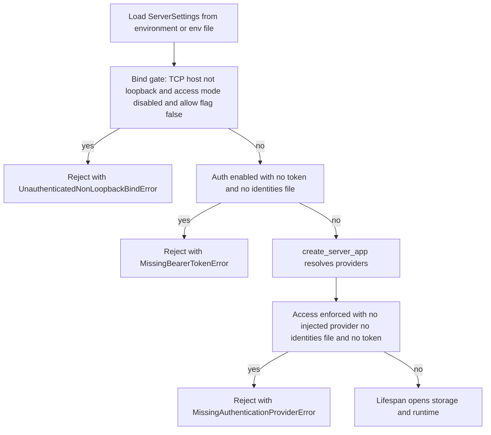
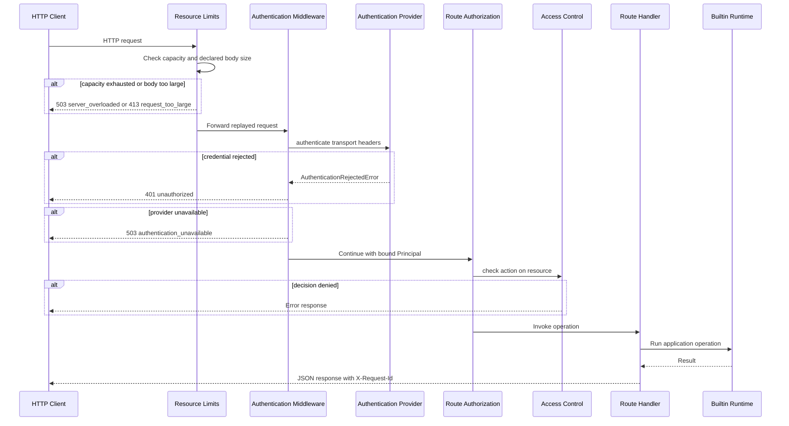

# PowerContext Server Runtime

The PowerContext Server is the long-running process that exposes the built-in runtime over HTTP (and optionally MCP and a dashboard), and that can also run as a background-only worker. This page explains how that process is assembled, what it checks before it accepts traffic, how a request flows through the middleware and security layers into the runtime, and what happens during startup and shutdown. Persistence details live in [Persistence and Storage](persistence-and-storage.md); the overall component map is in [System Overview](system-overview.md).

Citations point at repository commit `b8b18909`. Line ranges are bounded to the code that establishes each statement.

## Responsibilities at a glance

| Concern | Owning module |
| --- | --- |
| Typed, environment-backed settings and their validation | [settings.py](../../src/powercontext/server/settings.py) |
| Loading `.env` files and building one settings object per operation | [configuration.py](../../src/powercontext/server/configuration.py) |
| CLI entry points (`run`, migrations, identity reset) and process launch | [cli.py](../../src/powercontext/server/cli.py) |
| FastAPI application construction, lifespan, provider selection, middleware order | [factory.py](../../src/powercontext/server/factory.py) |
| HTTP route table, error mapping, per-route authorization | [app.py](../../src/powercontext/server/app.py) |
| Credential-to-Principal authentication | [authentication.py](../../src/powercontext/server/authentication.py), [middleware.py](../../src/powercontext/server/middleware.py) |
| Body-size and concurrency admission | [http_limits.py](../../src/powercontext/server/http_limits.py) |
| Owned Unix domain socket listener | [uds.py](../../src/powercontext/server/uds.py) |
| Persistent scheduler adapter and job registry | [scheduler.py](../../src/powercontext/builtin/runtime/scheduler.py) |
| Runtime lifecycle, scheduler start and close | [application.py](../../src/powercontext/builtin/runtime/application.py) |

## Assembly: from configuration to a running app

The Server is assembled in layers. Each layer owns one decision, and the later layers consume only validated objects from the earlier ones.

1. **Configuration load.** `ServerSettings` is a pydantic `BaseSettings` with the environment prefix `POWERCONTEXT_SERVER_` and `_` as the nested delimiter, so `POWERCONTEXT_SERVER_HTTP_PORT` maps to `http.port` ([settings.py](../../src/powercontext/server/settings.py) L239-L251). Nested groups such as `http`, `auth`, `access`, `logging`, `metrics`, and `runtime` are typed models with their own defaults.
2. **Operation-scoped context.** The CLI wraps loading in `server_settings_context`. An explicit `--env-file`, or a `.env` discovered in the working directory for `run`, is read through a strict parser; `--no-env-file` disables discovery. `run` opts into process-environment precedence, while service and maintenance entry points keep the file as the authority ([configuration.py](../../src/powercontext/server/configuration.py) L143-L213, and the `run` command in [cli.py](../../src/powercontext/server/cli.py) L830-L900). CLI flags `--host`, `--port`, and `--uds` override the `http` group, and combining `--host` or `--port` with a UDS path is rejected ([configuration.py](../../src/powercontext/server/configuration.py) L200-L213).
3. **Mode dispatch.** `_run_configured_server` configures logging and tracing, then sends the `background` role to the background runner. Other roles build the FastAPI app with `create_server_app`, then serve it either over TCP with uvicorn or over a Unix socket ([cli.py](../../src/powercontext/server/cli.py) L902-L938).
4. **Factory.** `create_server_app` resolves security providers, builds the `BuiltinConfig`, creates metrics and tracing objects, and defines the lifespan. It returns a `_ServerApp` (a FastAPI subclass) whose routes are added by `create_app` in [app.py](../../src/powercontext/server/app.py) ([factory.py](../../src/powercontext/server/factory.py) L160-L218, L458-L508).

The factory rejects a `background` artifact processing role outright, so a background-only process cannot accidentally expose HTTP or MCP ([factory.py](../../src/powercontext/server/factory.py) L183-L184).

## Configuration and startup gates

Validation happens at several points, and each gate that can refuse a launch is listed below. Each one names the branch taken when a setting is unset.

Caption: Startup gates evaluated in order; any rejection stops the process before the lifespan opens the database or the runtime.

### Non-loopback bind gate

`ServerSettings` refuses a TCP bind to a non-loopback host unless authentication is on or the operator explicitly opts out. The validator raises `UnauthenticatedNonLoopbackBindError` when all of these hold: no UDS path is configured, the process is not a background-only process without metrics, the host is not loopback, `access.mode` is `disabled` (which is what "authentication not enabled" means here), and `allow_unauthenticated_non_loopback` is false ([settings.py](../../src/powercontext/server/settings.py) L383-L417). The loopback definition covers `localhost`, IPv4 addresses in `127.0.0.0/8`, and IPv6 `::1` ([transport.py](../../src/powercontext/transport.py) L31-L50). The CLI translates the error into a message that names the three levers: authenticate, stay on loopback, or set `POWERCONTEXT_SERVER_ALLOW_UNAUTHENTICATED_NON_LOOPBACK=true` ([cli.py](../../src/powercontext/server/cli.py) L940-L951).

Fallback: the default host is `127.0.0.1` and the default port is `8000` ([settings.py](../../src/powercontext/server/settings.py) L114-L123). With those defaults the gate is not reached, so the default launch is loopback-only and unauthenticated.

### Missing bearer token gate

When `POWERCONTEXT_SERVER_AUTH_ENABLED` is true and no identity map file is configured, the static bearer configuration must contain a non-empty `POWERCONTEXT_SERVER_AUTH_TOKEN`; otherwise `MissingBearerTokenError` is raised ([settings.py](../../src/powercontext/server/settings.py) L155-L168). The CLI reports this with the message to set `POWERCONTEXT_SERVER_AUTH_TOKEN` or to disable access control with `POWERCONTEXT_SERVER_ACCESS_MODE=disabled` ([cli.py](../../src/powercontext/server/cli.py) L940-L951).

Fallback: when `POWERCONTEXT_SERVER_AUTH_IDENTITIES_FILE` is set, the token requirement is skipped entirely because the validator only enforces the token when the identity file is absent. When authentication is not enabled, the gate does not apply.

### Missing authentication provider gate

Provider selection happens in `_resolve_security_providers`, in this order ([factory.py](../../src/powercontext/server/factory.py) L560-L582):

1. Access mode `disabled`: no authentication or authorization provider is loaded. An injected provider in this mode is itself an error.
2. Access mode `enforced` with an injected `authentication_provider`: that provider is used.
3. Access mode `enforced` with `AUTH_IDENTITIES_FILE`: a `MultiBearerAuthenticationProvider` reads the identity map.
4. Access mode `enforced` with no token: `MissingAuthenticationProviderError` is raised.
5. Access mode `enforced` with a token: a `StaticBearerAuthenticationProvider` maps the token to a fixed service Principal.

The CLI maps `MissingAuthenticationProviderError` to a bad-parameter error ([cli.py](../../src/powercontext/server/cli.py) L898-L899).

### Other validation rules

- **Authentication implies enforcement.** Setting `POWERCONTEXT_SERVER_AUTH_ENABLED=true` forces `access.mode` to `enforced`. An identity map or a source-management manager subject also requires `enforced` mode ([settings.py](../../src/powercontext/server/settings.py) L383-L400).
- **Legacy token without authentication is refused.** `AUTH_TOKEN` with access mode `disabled` is rejected, and so is a background Principal configured in disabled mode ([settings.py](../../src/powercontext/server/settings.py) L401-L407).
- **Public URL.** `POWERCONTEXT_SERVER_PUBLIC_URL` must be an absolute HTTP(S) URL without credentials, query, or fragment. A non-HTTPS public URL is accepted only for loopback hosts unless `POWERCONTEXT_SERVER_ALLOW_INSECURE_HTTP` is true ([settings.py](../../src/powercontext/server/settings.py) L349-L362). Fallback: with no public URL, the check is not applied.
- **UDS restrictions.** A UDS listener is not allowed for the `background` role, and `HTTP_UDS_EXTERNAL_SCHEME` requires a UDS path ([settings.py](../../src/powercontext/server/settings.py) L383-L390, [settings.py](../../src/powercontext/server/settings.py) L114-L137).
- **Storage role.** A non-OceanBase database requires `runtime.artifact_processing_role` to be `all` ([settings.py](../../src/powercontext/server/settings.py) L418-L423).
- **Cursor secret length.** An explicit cursor signing secret must be at least 32 bytes, and so must each handoff verification secret ([settings.py](../../src/powercontext/server/settings.py) L300-L312).

### Fallbacks for unset settings

Every fallback below is the branch taken when the named setting is not present in the environment or env file.

| Setting (prefix `POWERCONTEXT_SERVER_`) | Default | Branch taken when unset |
| --- | --- | --- |
| `HTTP_HOST` / `HTTP_PORT` | `127.0.0.1` / `8000` | Loopback TCP listener; no bind gate |
| `HTTP_UDS` | none | TCP listener is used instead of a Unix socket |
| `HTTP_MAX_REQUEST_BODY_BYTES` | 16 MiB | Admission limit applied with that value |
| `HTTP_MAX_CONCURRENT_REQUESTS` | 64 | Admission limit applied with that value |
| `ACCESS_MODE` | `disabled` | No authorization provider, no authentication provider, every route open to the process |
| `AUTH_ENABLED` | `false` | No bearer provider is built |
| `AUTH_TOKEN` / `AUTH_IDENTITIES_FILE` | none | Provider selection falls through to the missing-provider gate when access is enforced |
| `ACCESS_DEPLOYMENT_ID` | `powercontext` | Used as the authorization deployment identity |
| `ACCESS_BACKGROUND_PRINCIPAL_ID` | none | Scheduled work uses the legacy static token Principal when a token exists; otherwise scheduling in enforced mode fails |
| `CURSOR_SIGNING_SECRET` | none | Secret is loaded or created from a local key file (see Lifecycle) |
| `SCHEDULER_PATH` | `scheduler.db` in the data directory | Passed as `default_scheduler_path()` |
| `WORKSPACE` | current working directory | Resolved and required to be an existing directory |
| `DATABASE` | SQLite at the default database path | SQLite with a file URL under the data directory |
| `MCP_ENABLED` / `MCP_PATH` | `true` / `/mcp` | MCP is mounted at `/mcp` |
| `DASHBOARD_ENABLED` | `false` | Dashboard is not mounted |
| `METRICS_ENABLED` / `METRICS_BACKGROUND_PORT` | `true` / `8001` | Metrics are collected and served; background metrics use port 8001 |
| `TRACING_ENABLED` | `false` | Context-only tracing is used |
| `LOGGING_LEVEL` / `LOGGING_FORMAT` / `LOGGING_ACCESS` | `INFO` / `console` / `true` | Console logs with HTTP access logs |
| `RUNTIME_ARTIFACT_PROCESSING_ROLE` | `all` | HTTP and background processing run in one process |
| `RUNTIME_SCHEDULE_SECONDS` / `RUNTIME_EXPERIENCE_SCHEDULE_SECONDS` | none | The corresponding persisted interval job is not created |

The default `ServerSettings` values are declared as fields in [settings.py](../../src/powercontext/server/settings.py) L239-L275 (for example `http` at L252 and `database` at L271). The `external_skills` default is replaced by local project targets only when the setting is absent from the model fields that were set ([settings.py](../../src/powercontext/server/settings.py) L319-L325).

## Lifecycle

### Startup

The FastAPI lifespan defined in the factory is the single place where runtime resources are opened ([factory.py](../../src/powercontext/server/factory.py) L219-L300). In order, it:

1. Logs `server.starting`, emits warnings for cleartext remote Skill Receiver opt-in and for an in-memory SQLite database ([factory.py](../../src/powercontext/server/factory.py) L219-L232).
2. Runs `prepare_server_storage` in a worker thread. For in-memory SQLite it returns immediately. For persistent SQLite it asserts no local migration is in progress, plans the migration, and applies it only when the database is uninitialized; any other non-ready state stops startup and asks the operator to run `db-migrate apply` ([server_readiness.py](../../src/powercontext/builtin/persistence/migrations/server_readiness.py) L123-L160).
3. Resolves the cursor signing secret. An explicit `CURSOR_SIGNING_SECRET` is used as is. Otherwise, a persistent SQLite database gets a hidden sidecar key file next to it, other persistent databases get a key in the data directory, and in-memory SQLite gets no secret ([cursor_secret.py](../../src/powercontext/server/cursor_secret.py) L39-L53). Key creation is serialized by a lock and published atomically.
4. Opens the access-control service in an async exit stack when access is enforced and no provider was injected ([factory.py](../../src/powercontext/server/factory.py) L233-L262).
5. Builds the background-scheduled runners, the Dream access adapter, and the worker security context, then opens the built-in runtime with `scheduler_path` defaulting to the data-directory scheduler database ([factory.py](../../src/powercontext/server/factory.py) L263-L315).
6. Initializes the durable Server identity and binds the context-binding codec when a cursor secret exists, restores artifact access families, and binds evidence access ([factory.py](../../src/powercontext/server/factory.py) L316-L349).
7. In global supervisor mode for a non-API role, starts the artifact plugin manager; under enforced access it also migrates handoff receipts and removes legacy Topic Memory owner rows ([factory.py](../../src/powercontext/server/factory.py) L350-L380).
8. Binds the readiness probe, opens the source gateway, and publishes the application, access control, and authentication provider on `app.state`, followed by capabilities and server info ([factory.py](../../src/powercontext/server/factory.py) L381-L412).
9. Starts an optional `DeploymentCoordinator` task when a source plugins directory is configured or source management autostart is enabled, runs the first readiness probe, and starts a 30-second readiness monitor when metrics are enabled ([factory.py](../../src/powercontext/server/factory.py) L412-L420).

### Steady state

The process serves requests until shutdown. Readiness is reported by `/health/ready`, which returns 503 when the runtime is not ready or when the authentication or access provider reports `not_ready` ([app.py](../../src/powercontext/server/app.py) L1751-L1770). The Access readiness checks themselves are collected in `access_readiness_checks`, which reports the access mode, authentication status, and the access provider status ([app.py](../../src/powercontext/server/app.py) L1772-L1800).

### Shutdown

On shutdown the lifespan's `finally` block runs in this order ([factory.py](../../src/powercontext/server/factory.py) L413-L446):

1. Cancels and awaits the deployment task if one was started.
2. Logs `server.stopping`, unbinds the readiness probe so readiness reports not ready, and clears the runtime-facing references on `app.state`.
3. Restores the configured access and authentication providers on `app.state`, and resets capabilities to an empty set.
4. Exits the async exit stack, which closes the runtime in reverse order of opening.

`BuiltinRuntime.close` stops accepting work, pauses the scheduler, waits until no operations are active, closes the artifact processing supervisor, shuts the scheduler down, unregisters its processors, and clears the scope cache ([application.py](../../src/powercontext/builtin/runtime/application.py) L4683-L4720). Uvicorn is responsible for draining in-flight HTTP requests before the lifespan finishes. For the Unix socket path, cleanup of the socket and its lock is registered on the uvicorn signal capture so the socket is released before a replayed SIGTERM can terminate the process ([cli.py](../../src/powercontext/server/cli.py) L965-L988).

## Request handling

HTTP requests pass through a fixed stack of ASGI middleware before reaching a route. Starlette builds the stack so that middleware added later wraps middleware added earlier; the factory adds the resource limits, request identity, metrics, access log, and tracing layers after `create_app`, so they sit outside the authentication layer ([factory.py](../../src/powercontext/server/factory.py) L458-L508). The outermost layers see the request first.

Caption: Request flow from HTTP admission through authentication and per-route authorization into the built-in runtime.

### HTTP admission

`HttpResourceLimitsMiddleware` runs before authentication. It bypasses non-HTTP scopes and the trusted in-process MCP bridge. Otherwise it rejects a request with 503 `server_overloaded` and `Retry-After: 1` when `max_concurrent_requests` is reached. It reserves a slot without an intervening await, rejects with 413 `request_too_large` when the declared `Content-Length` or the streamed body exceeds `max_request_body_bytes`, and replays the buffered body to the downstream application ([http_limits.py](../../src/powercontext/server/http_limits.py) L26-L78, L80-L95). The slot is released only when the response body is complete, not when the handler returns, so a slow client holds capacity until the response has been sent ([http_limits.py](../../src/powercontext/server/http_limits.py) L35-L78).

### Authentication

`AuthenticationMiddleware` is inserted at the front of the configured middleware list only when a provider is configured ([factory.py](../../src/powercontext/server/factory.py) L446-L456). For each request it skips authentication when the request is part of the internal bridge or the path is public. Public paths are the root, `/docs`, `/health/live`, `/health/ready`, the remote Skill enroll, reconcile, package download, and receipt routes, and dashboard session and static assets ([middleware.py](../../src/powercontext/server/middleware.py) L35-L42, L56, L115-L121).

For protected paths the provider's `authenticate` is called with the transport, the headers, and the client host. Outcomes are:

- `AuthenticationRejectedError` or a missing authorization header: 401 `unauthorized` with `WWW-Authenticate: Bearer`.
- `AuthenticationUnavailableError` or any other exception from the provider: 503 `authentication_unavailable`.
- Success: the immutable `AuthenticationResult` is bound to request-local context for the rest of the request, which sets the current Principal ([middleware.py](../../src/powercontext/server/middleware.py) L55-L113, [context.py](../../src/powercontext/server/context.py) L54-L62).

Dashboard paths return the dashboard login response instead of the JSON error body when the dashboard is enabled ([middleware.py](../../src/powercontext/server/middleware.py) L129-L149).

The static bearer provider compares the credential with `compare_digest` against one token and maps it to one fixed service Principal ([authentication.py](../../src/powercontext/server/authentication.py) L94-L130). The multi-identity provider reads a protected JSON identity file (mode 600, no symlinks) on each request and hashes the presented token with SHA-256 before comparing it with the stored digests, so rotation takes effect on the next request ([authentication.py](../../src/powercontext/server/authentication.py) L132-L198). A malformed identity file makes the provider report unavailable rather than silently accepting or rejecting.

### Authorization

Authorization is attached per route rather than in middleware. `_add_route` appends a dependency built by `_authorization_dependency` whenever an operation declares an access requirement ([app.py](../../src/powercontext/server/app.py) L5256-L5279, L5280-L5306). In disabled mode the dependency does nothing. In enforced mode it:

1. Builds the authorization payload from path parameters, query parameters, or the validated request body ([app.py](../../src/powercontext/server/app.py) L5344-L5365).
2. Resolves the operation's requirement into one or more `(action, resource)` checks.
3. Refreshes artifact access families for the families involved, then calls `check` or `check_batch` on the access control service ([app.py](../../src/powercontext/server/app.py) L5309-L5343).
4. For a denial with reason `no-matching-binding` or `no-matching-policy` on a scope the caller may bootstrap, the static scope is bootstrapped for the Principal and the check is retried. Any other denial raises through `_require_allowed` ([authz/service.py](../../src/powercontext/server/authz/service.py) L626-L640).

`access_control_for_mode` fails closed: asking for a decision in enforced mode without an access control service raises an access-unavailable error ([authz/service.py](../../src/powercontext/server/authz/service.py) L1791-L1799).

### Errors and request identity

`attach_request_id` takes the request identity from the current request context or the active span, stores it on `request.state`, and writes the `X-Request-Id` response header ([app.py](../../src/powercontext/server/app.py) L1499-L1512). Validation errors return 422 `invalid_request` with no caller-controlled text, or 400 for scoped resource query syntax errors. Known application errors are mapped through `_map_error`. Any unexpected exception returns 500 `internal_error` with the request identity preserved ([app.py](../../src/powercontext/server/app.py) L1438-L1560).

### MCP and internal bridge

When MCP is enabled, `mount_mcp` mounts the projection at the configured path. Its internal transport propagates the current request identity and marks the call as an internal bridge, so the outer authentication and admission layers do not re-admit it ([mcp.py](../../src/powercontext/server/mcp.py) L583-L598). MCP's own authentication is covered by an end-to-end test (see Focused tests).

## Background scheduler and workers

The Runtime owns an APScheduler `AsyncIOScheduler` only when `start_scheduler` is called with at least one enabled job. It refuses to start with no job, with a non-positive interval, with an interval that has no matching processor, or when a scheduler is already running ([application.py](../../src/powercontext/builtin/runtime/application.py) L4581-L4608).

The scheduler state is isolated from the main database. `create_scheduler` creates a SQLAlchemy job store in a sidecar SQLite file at `scheduler_path`, with table `powercontext_scheduler_jobs` and timezone `UTC` ([scheduler.py](../../src/powercontext/builtin/runtime/scheduler.py) L126-L142). Jobs are persisted, so their schedule survives restarts, but processors are not: a persisted job carries only the runtime key, and the live processor is looked up in a process-local registry keyed by the canonical scheduler path ([scheduler.py](../../src/powercontext/builtin/runtime/scheduler.py) L74-L93, and dispatch at L96-L124).

`start_scheduler` registers the live processors, creates the scheduler paused, configures the three job kinds, and resumes it. If any step fails it shuts the scheduler down and unregisters the processors ([application.py](../../src/powercontext/builtin/runtime/application.py) L4609-L4656). The three job kinds are:

- **Source-window interval job** for memory processing, when `RUNTIME_SCHEDULE_SECONDS` is set. Jobs use `coalesce=True`, `max_instances=1`, and no misfire grace ([scheduler.py](../../src/powercontext/builtin/runtime/scheduler.py) L145-L160, L183-L222).
- **Experience incubation interval job**, when `RUNTIME_EXPERIENCE_SCHEDULE_SECONDS` is set, with the same concurrency settings.
- **Profile cron job**, when profile scheduling is enabled. It runs once immediately to catch up missed windows and then on its cron schedule, with a one-day misfire grace ([scheduler.py](../../src/powercontext/builtin/runtime/scheduler.py) L224-L240).

Scheduled runs for the source window and experience incubation jobs are executed with the access-aware runners described below; the profile job uses its own runner built by `_scheduled_profile_runner` ([factory.py](../../src/powercontext/server/factory.py) L689-L705).

When access is enforced, the factory wraps each scheduled job in a runner that runs as the background Principal. A source window run calls `bootstrap_static_scope`, requires the `SCOPE_CONTRIBUTE` action on the scope, and then flushes atomic memory under an access-aware execution context ([factory.py](../../src/powercontext/server/factory.py) L620-L636). The background Principal is `ACCESS_BACKGROUND_PRINCIPAL_ID` when set; otherwise it is the legacy static token Principal; otherwise scheduled processing in enforced mode is refused ([factory.py](../../src/powercontext/server/factory.py) L743-L760, function `_scheduled_principal`). When access is disabled, or no scheduled job is enabled, the factory creates no scheduled runners ([factory.py](../../src/powercontext/server/factory.py) L606-L620).

### Dedicated background role

Setting `RUNTIME_ARTIFACT_PROCESSING_ROLE=background` (or `run --role background`) runs the process without HTTP. The CLI runs `_run_background_async`, which prepares storage, installs `SIGINT` and `SIGTERM` handlers that set a stop event, opens access control and the runtime, and then either waits for the stop event or serves the background metrics app until it is set ([cli.py](../../src/powercontext/server/cli.py) L992-L1060). The background role is refused for a UDS listener, because a UDS is an API listener ([settings.py](../../src/powercontext/server/settings.py) L383-L390).

## Unix domain socket listener

When `HTTP_UDS` is set, the process listens on a Unix socket instead of TCP ([cli.py](../../src/powercontext/server/cli.py) L930-L938). `validate_socket_path` checks the path before any filesystem change: the platform must be Linux or macOS, the path must be absolute with no `..` or NUL, and it must fit in 103 filesystem-encoded bytes ([uds.py](../../src/powercontext/server/uds.py) L54-L70).

`unix_socket_listener` then acquires ownership:

- The parent directory must be a real directory owned by the current user with no group or other permissions; it is created with mode 700 when missing.
- A private `<name>.lock` file must be an owned regular file with a single link. It is locked exclusively and non-blockingly, so a second listener fails with "already running or starting".
- A stale socket is removed only when its identity matches the recorded lock record and a connection attempt is refused. A socket that accepts connections, or any unrecognized file, is never removed.
- After binding, the socket is chmod 600 and its device, inode, and change time are recorded in the lock file.

On shutdown the socket is removed only if it is still the same identity and no live listener answers, so an operator's replacement socket survives ([uds.py](../../src/powercontext/server/uds.py) L89-L193). The lock file is kept after shutdown deliberately, so a competing process cannot lock a different inode while another still holds the old lock.

## Managed-operations admission

[database_admission.py](../../src/powercontext/server/database_admission.py) is a private entry point that admits a prepared SQLite snapshot without starting the Server. It reads one bounded JSON request from standard input, verifies the protected configuration file and the target package version, checks that the snapshot is separate from the live database, and returns only a short reason code on failure. It is part of the managed upgrade procedure described in the operations material rather than a runtime path ([database_admission.py](../../src/powercontext/server/database_admission.py) L79-L140).

## Failure modes and invariants

- **A configuration error never reaches the database.** Every settings gate runs during `ServerSettings` construction, before the lifespan. The CLI maps these to exit code 2 for configuration problems or to a bad-parameter error for the specific policy failures ([cli.py](../../src/powercontext/server/cli.py) L830-L900).
- **Enforced mode without a provider fails closed.** The factory refuses to construct the app, and the readiness probe reports `authentication_provider` or `access_provider` as `not_ready`, which makes `/health/ready` return 503.
- **Authorization never runs ahead of authentication.** Protected routes are reached only through the authentication middleware, which binds the Principal used by the route dependency.
- **Admission rejects before parsing.** Oversized bodies are rejected before authentication or any route code runs, and capacity is held for the full response lifetime.
- **Scheduled work is never silently anonymous.** Enforced mode requires a background Principal, and each scheduled run re-checks `SCOPE_CONTRIBUTE` for that Principal.
- **Scheduler jobs are not run after close.** `_operation` raises a closed-state error once shutdown begins, so late dispatches fail instead of starting new work ([application.py](../../src/powercontext/builtin/runtime/application.py) L4713-L4728).

## Extension points

- **Authentication Provider SPI.** `create_server_app` accepts an `authentication_provider` implementing `authenticate` and `readiness` and returns `AuthenticationResult`; the result validation rejects invalid Principals, duplicate or oversized group sets, and malformed credential identifiers ([authentication.py](../../src/powercontext/server/authentication.py) L39-L72). An injected provider cannot be combined with the dashboard, and an injected provider in disabled mode is refused ([factory.py](../../src/powercontext/server/factory.py) L160-L176, L560-L572).
- **Access control service.** An `access_control` instance can be injected. It is the policy decision point for every per-route check.
- **Middleware.** Extra Starlette middleware is accepted through the `middleware` argument and is placed inside the authentication layer.
- **Artifact plugins and processors.** Artifact plugin managers and runtime processors are injected through `create_server_app` arguments such as `candidate_pipeline`, `profile_generator`, and `external_skill_provider`.

## Operations

- **Start.** `powercontext server run` discovers `.env` in the working directory, applies CLI overrides, and runs in the foreground. `--no-env-file` disables discovery and `--observability` loads the local observability profile.
- **Choose a listener.** Use TCP on loopback for local use, a TCP host only with authentication enabled or an explicit opt-in, or a Unix socket with a private run directory.
- **Background processing.** Run a separate `background` role process when API and workers should be separated. The database must be OceanBase for multi-role deployments.
- **Probes.** `/health/live` reports liveness, `/health/ready` reports readiness with per-check detail, and `/metrics` is served when metrics are enabled. Metrics and access logs skip health and metrics paths. See [Observability](../operations/observability.md).

## Focused tests

- [tests/test_server_http_limits.py](../../tests/test_server_http_limits.py) covers body rejection before downstream execution, body replay at the limit, and holding capacity until a response completes (for example the oversized-body test at L209-L229 and the blocked-response test at L93-L127).
- [tests/e2e/test_server_uds.py](../../tests/e2e/test_server_uds.py) covers UDS authorization and restarts, shutdown that preserves a replacement socket with a reused inode (L234-L286), refusal to remove occupied paths (L287-L315), and startup failure releasing the socket (L316-L389).
- [tests/builtin/runtime/test_scheduler.py](../../tests/builtin/runtime/test_scheduler.py) and [tests/builtin/runtime/test_processing_scheduler.py](../../tests/builtin/runtime/test_processing_scheduler.py) cover persisted job configuration and processor dispatch.
- [tests/e2e/test_mcp_request_authentication.py](../../tests/e2e/test_mcp_request_authentication.py) covers authentication on the MCP projection.
- [tests/test_transport.py](../../tests/test_transport.py) covers the `allow_unauthenticated_non_loopback` setting.

## Related pages

- [System Overview](system-overview.md) places the Server in the wider component map.
- [Persistence and Storage](persistence-and-storage.md) describes the databases, migrations, and the scheduler sidecar.
- [Configuration Settings](../concepts/configuration-settings.md) lists all settings groups.
- [Scopes and Access](../concepts/scopes-and-access.md) explains the access model used by per-route authorization.
- [Sources and Processing](../concepts/sources-and-processing.md) explains the source windows that scheduled jobs process.
- [Observability](../operations/observability.md) covers logs, metrics, and tracing.
