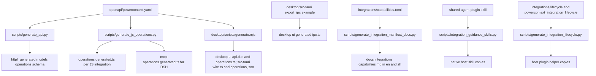

# Source Map

This page answers two questions for a contributor or agent: which directory owns a responsibility, and which files are produced by a generator and must not be edited by hand. It is organized by responsibility rather than by file inventory. Citations refer to repository commit `b8b18909`. For the runtime view, see [System Overview](system-overview.md); for the HTTP surface, see [HTTP and MCP API](http-and-mcp-api.md); for the Desktop application, see [Desktop App](desktop-app.md).

Locale documentation (`docs/en/`, `docs/zh/`), the website, `docs/en/blog/`, benchmarks, evaluation, `.github/` workflows, licenses, assets, test fixtures, and end-to-end fixture data are outside this map.

## Responsibility map

| Responsibility | Owning location | Entry point | Change rule |
| --- | --- | --- | --- |
| Python package and public exports | `src/powercontext/` | [`__init__.py`](../../src/powercontext/__init__.py) | Keep public exports here. |
| HTTP contract (source of truth) | `openapi/powercontext.yaml` | the OpenAPI document | Edit this file, then regenerate. |
| Generated HTTP Python code | `src/powercontext/http/_generated/` | `models.py`, `operations.py`, `schema.py` | Generated; do not edit. Regenerate with `make api-generate`. |
| Server (HTTP, MCP, dashboard, authentication) | `src/powercontext/server/` | [`factory.py`](../../src/powercontext/server/factory.py) `create_server_app`; [`app.py`](../../src/powercontext/server/app.py) | Route and transport changes; domain rules stay in the runtime. |
| Built-in runtime and domain services | `src/powercontext/builtin/` | [`runtime/composition.py`](../../src/powercontext/builtin/runtime/composition.py) `open_builtin_runtime` | Domain rules live here. |
| Authorization policy | `src/powercontext/builtin/authz/` | [`service.py`](../../src/powercontext/builtin/authz/service.py), [`composition.py`](../../src/powercontext/builtin/authz/composition.py) | Access rules, profiles, and repositories; the Server only mounts and enforces them. |
| Client SDK | `src/powercontext/client/` | [`client.py`](../../src/powercontext/client/client.py) | Translate calls; no separate domain behavior. |
| CLI | `src/powercontext/cli/` and plugin commands | [`cli/app.py`](../../src/powercontext/cli/app.py) | Command surface and host installers. |
| Transport safety policy | `src/powercontext/transport.py` | `is_plaintext_non_loopback` | Shared by Client, CLI, and integrations. |
| Ops (personal Server operations) | `src/powercontext/ops/` | [`__main__.py`](../../src/powercontext/ops/__main__.py) | One bounded JSON request per process. |
| Personal service launch | `src/powercontext/service/` and `src/powercontext_service_bootstrap/` | [`service_bootstrap/__main__.py`](../../src/powercontext_service_bootstrap/__main__.py) | Retry budget lives in the bootstrap module. |
| Shared integration helpers | `integrations/lifecycle/` and `src/powercontext_integration_lifecycle/` | `transport.ts`; Python helper package | Edit the source; the generator copies it into host plugins. |
| Host integrations | `integrations/<host>/` | `integrations/capabilities.toml` | Declare capabilities in the manifest first. |
| Framework adapters | `integrations/langchain/`, `langgraph/`, `pydantic-ai/`, `dify/` | each package's `src/` or `plugin/` | Adapters translate; domain behavior stays in the Server. |
| Desktop shell and UI | `desktop/` | [`desktop/README.md`](../../desktop/README.md); `src-tauri/src/lib.rs`; `ui/src/` | Native commands in `src-tauri`; UI calls them through `ui/src/shared`. |
| Runnable examples | `examples/` | per-example README | Reference code; not packaged into the wheel. |
| Rust model-traffic gateway | `gateway/crates/` | [`pc-gateway-app/src/main.rs`](../../gateway/crates/pc-gateway-app/src/main.rs) | Gate executor and transport only. |
| Container image | `docker/` | [`Dockerfile`](../../docker/Dockerfile) | Single-process image. |
| Kubernetes deployment | `deploy/helm/powercontext/` | `templates/deployments.yaml` | External OceanBase only. |
| Reference observability stack | `deploy/observability/` | [`README.md`](../../deploy/observability/README.md) | Demonstration and verification tooling. |
| Repository generators and gates | `scripts/` | `generate_api.py`, `integration_manifest.py`, `release_version.py` | Run through `make` targets. |

### Python package boundaries

`src/powercontext/` is one distribution with several layers.

- [`context.py`](../../src/powercontext/context.py) defines the `PowerContext` composition facade. It binds three component groups (`Sources`, `Artifacts`, and triggers) and does not own their lifecycle.
- `sources/`, `artifacts/`, and `triggers/` hold the protocol and model layer that the built-in runtime implements.
- `builtin/` is the default implementation. Its `runtime/` package composes the runtime, and its `artifacts/` subpackages implement each artifact family (memory, topic memory, experience, skill, handoff, profile, prompt, atomic memory). Its `authz/` package holds access control: the service, repositories, profiles, and the Casbin and AuthZen backends. Its `persistence/` package holds SQLite, OceanBase, and seekdb profiles and migrations.
- `server/` and `client/` are transports over the same operations. The server builds on the built-in runtime, mounts routes, and enforces the access service that `builtin/authz` provides; `server/authentication.py` resolves bearer identities. The client calls the HTTP surface.
- `cli/`, `observability/`, `source_management/`, and `service/` are operator-facing packages.

The project guidelines place domain rules in the runtime or Artifact service that owns them, and say that transport and host adapters should translate inputs and outputs without inventing different domain behavior ([AGENTS.md](../../AGENTS.md)). Keep that split when editing.

### Public entry points

The installed commands are declared in [`pyproject.toml`](../../pyproject.toml#L123-L134). `powercontext` maps to `powercontext.cli.app:main`, and `powercontext-ops` maps to `powercontext.ops.__main__:main`. Subcommands are registered through the `powercontext.cli` entry-point group: `code`, `config`, `doctor`, `observability`, `service`, `server`, `setup`, and `archive`.

The Docker image runs `powercontext` with the default arguments `server run` ([Dockerfile](../../docker/Dockerfile)).

## Generated and derived files

Each file below is either produced by a generator or copied from a source. Edit the source, run the named command, and review the diff. The checks fail on drift.

| Output | Status | Produced from | Regenerate | Verify |
| --- | --- | --- | --- | --- |
| `src/powercontext/http/_generated/models.py`, `operations.py`, `schema.py` | Generated; do not edit | `openapi/powercontext.yaml` via [`scripts/generate_api.py`](../../scripts/generate_api.py) | `make api-generate` | `make api-generate-check` |
| `integrations/dsh/plugins/powercontext/src/operations.generated.ts`, and the matching files under `integrations/opencode/plugins/powercontext/src/` and `integrations/pi/plugins/powercontext/src/` | Generated; do not edit | OpenAPI via [`scripts/generate_js_operations.py`](../../scripts/generate_js_operations.py) | `make js-api-generate` | `make js-api-generate-check` |
| `integrations/dsh/plugins/powercontext/src/mcp-operations.generated.ts` and `handoff/http.generated.ts` | Generated; do not edit | the Server's public MCP catalog and the OpenAPI handoff schemas via the same JS generator | `make js-api-generate` | `make js-api-generate-check` |
| `integrations/dify/plugin/powercontext_dify/contract.json` | Generated; do not edit | OpenAPI and Dify declarations via [`integrations/dify/generate_contract.py`](../../integrations/dify/generate_contract.py) | run the generator (no Make target) | `make dify-test` runs `--check` |
| `docs/{en,zh}/docs/integrations/capabilities.md` | Generated documentation | [`integrations/capabilities.toml`](../../integrations/capabilities.toml) via [`scripts/generate_integration_manifest_docs.py`](../../scripts/generate_integration_manifest_docs.py) | `make integration-manifest-docs` | `make integration-manifest-docs-check` |
| Per-host `skills/powercontext-project-context/` copies (except `references/host.md`) | Derived copies | Shared skill in `integrations/agent-plugin/powercontext/skills/` via [`scripts/integration_guidance_skills.py`](../../scripts/integration_guidance_skills.py) | `make integration-guidance` | `make integration-guidance-check` |
| Lifecycle helper copies (for example `transport.ts` in DSH, OpenClaw, OpenCode, and Pi; `prepared_context.py` and related modules in Claude Code, Codex, and WorkBuddy) | Derived copies | `integrations/lifecycle/` and `src/powercontext_integration_lifecycle/` via [`scripts/generate_integration_lifecycle.py`](../../scripts/generate_integration_lifecycle.py) | `make integration-lifecycle` | `make integration-lifecycle-check` |
| `integrations/cindy/plugins/powercontext-hooks/node/worker.cjs` | Build output; committed | Cindy TypeScript build (`make cindy-test`) | `make cindy-test` | `git diff --exit-code` inside `cindy-test` |
| `integrations/opencode/plugins/powercontext/lib/` | Build output; committed | OpenCode TypeScript build | `make opencode-test` | `git diff --exit-code` inside `opencode-test` |
| `desktop/ui/src/generated/api.d.ts`, `desktop/ui/src/generated/operations.ts`, `desktop/src-tauri/src/transport/wire.rs`, `desktop/src-tauri/src/transport/operations.json` | Generated; do not edit | `openapi/powercontext.yaml` via [`desktop/scripts/generate.mjs`](../../desktop/scripts/generate.mjs) | `pnpm --dir desktop generate` | `pnpm --dir desktop generate:check` |
| `desktop/ui/src/generated/ipc.ts` | Generated; do not edit | Rust IPC types via the `export_ipc` example in [`desktop/src-tauri/examples/export_ipc.rs`](../../desktop/src-tauri/examples/export_ipc.rs) | `cargo run --locked --manifest-path desktop/src-tauri/Cargo.toml --example export_ipc` | `pnpm --dir desktop ipc:check` |

*The diagram shows which generator produces each derived artifact. The HTTP contract, the integration manifest, the shared skill, and the lifecycle helper sources are the hand-edited inputs.*

Three rules follow from the generated headers and gates:

- `openapi/powercontext.yaml` is the HTTP contract source of truth. The generated Python carries "generated from openapi/powercontext.yaml; do not edit" headers ([operations.py](../../src/powercontext/http/_generated/operations.py#L1), [schema.py](../../src/powercontext/http/_generated/schema.py#L1)); `models.py` is produced by `datamodel-codegen` ([models.py](../../src/powercontext/http/_generated/models.py#L1-L3)). After a contract change, run `make api-generate` and `make contract-test` ([AGENTS.md](../../AGENTS.md)).
- `make check` runs `version-check`, which in turn runs `api-generate-check` and `js-api-generate-check`, so generated drift fails the main quality gate ([Makefile](../../Makefile#L21-L22)).
- Per-host skill guidance is refreshed non-destructively outside its `POWERCONTEXT-GUIDANCE` markers, and generated guidance compares canonical bytes ([guidance.py](../../src/powercontext/cli/guidance.py#L29-L31), [.gitattributes](../../.gitattributes)).

## Desktop

`desktop/` is the PowerContext Desktop preview: a Tauri 2 shell with a React UI. Its README describes it as an internal Windows and macOS preview, not a signed or supported release ([Desktop README](../../desktop/README.md)). For the user-facing behavior, see [Desktop App](desktop-app.md).

- **Native shell** (`desktop/src-tauri/`). `src/lib.rs` registers the fixed set of Tauri commands for Ops, memory, connection, Scope, diagnostics, and session observation. It stores connection profiles in `profiles.json` under the app data directory and keeps Bearer credentials in the OS vault through `keyring`, which is Windows Credential Manager, macOS Keychain, or Linux Secret Service. If another process owns the profile storage, setup fails closed; a second launch only activates the existing window ([lib.rs](../../desktop/src-tauri/src/lib.rs#L15-L104), [Cargo.toml](../../desktop/src-tauri/Cargo.toml#L30-L50)).
- **UI** (`desktop/ui/`). The React application calls the native commands through the wrappers in `ui/src/shared/` and subscribes to the `ops-progress` event. Its types come from the generated `ui/src/generated/ipc.ts` ([ops.ts](../../desktop/ui/src/shared/ops.ts#L15-L40)).
- **Build and packaging** (`desktop/package.json`, `desktop/scripts/`). `pnpm --dir desktop build` runs the generator check, `tsc`, and `vite build`; `desktop:build` runs `tauri build` ([package.json](../../desktop/package.json#L6-L22)). Product packaging reads the producer's immutable Ops bundle and Server resource catalog through [`scripts/prepare_desktop_product.py`](../../scripts/prepare_desktop_product.py#L34-L60) and publishes a staging directory only after the digests match.
- **Generated Desktop code.** Do not edit the four files written by `desktop/scripts/generate.mjs` or `ui/src/generated/ipc.ts`; see the generated-files table above. The UI and Rust sides both depend on these files, so a contract change must regenerate both.

## Integrations

`integrations/capabilities.toml` is the integration contract. Its header requires every `integrations/*/` directory to be declared or explicitly excluded. The explicit exclusions are `cindy`, `agent-plugin`, `opendal`, and `lifecycle`, each with a recorded reason ([capabilities.toml](../../integrations/capabilities.toml#L18-L22)). [`scripts/integration_manifest.py`](../../scripts/integration_manifest.py) checks coverage in both directions, checks the per-locale integration page pointers, and validates the declared tool surfaces.

Host plugins are thin clients for a running Server. They do not embed storage or start the Server. The Codex plugin, for example, uses a SessionStart hook, a UserPromptSubmit hook, and Streamable HTTP MCP ([Codex plugin README](../../integrations/codex/plugins/powercontext/README.md)).

| Directory | Kind and status in the manifest | What owns it | Entry points and gates |
| --- | --- | --- | --- |
| `integrations/dsh/` | agent host, master only | DeepSeek Harness plugin in `plugins/powercontext` (TypeScript), plus the `dsh-pet` sidebar plugin | Native MCP exposes operations as `mcp__powercontext__<operation>`; the plugin captures prompts and prepares context. Gates: `make js-test`, `make dsh-runtime-test` ([README](../../integrations/dsh/README.md)). |
| `integrations/dify/` | framework adapter, experimental | Dify SDK plugin in `plugin/` (tools `pc_*` in `powercontext_dify`), with `catalog.py` and `generate_contract.py` | `contract.json` is generated; `make dify-test` runs the contract check, ruff, ty, and pytest ([capabilities.toml](../../integrations/capabilities.toml#L1120-L1131)). |
| `integrations/workbuddy/` | agent host, master only | Thin WorkBuddy plugin: a `UserPromptSubmit` hook driver in pure Python standard library and a Streamable HTTP MCP entry at `http://127.0.0.1:8000/mcp` ([README](../../integrations/workbuddy/README.md)) | Installed by `powercontext setup workbuddy`; `powercontext doctor workbuddy` verifies it. Shared helper modules come from the lifecycle generator. |
| `integrations/kimi-code/` | agent host, experimental | Native Kimi plugin (`kimi.plugin.json`, a `UserPromptSubmit` hook, and `scripts/scope.mjs`) | Installed by `powercontext setup kimi-code` with the `minimal`, `recommended`, or `full` profile ([README](../../integrations/kimi-code/README.md)). Its Python installer is `src/powercontext/cli/kimi_code.py`. |
| `integrations/cindy/` | excluded from the manifest | Cindy hook worker, bundled with `tsdown` from the DSH toolchain and packaged as `dist/powercontext-cindy-hooks-0.1.0.cindy` by `scripts/package.py` | `make cindy-test` builds the committed `worker.cjs`. Native MCP cannot enforce Scope arguments through the Cindy Ghost ([README](../../integrations/cindy/README.md)). |
| `integrations/zcode/` | agent host, master only | ZCode plugin with prompt, SessionStart, and Stop hooks, Node Scope/status/doctor scripts, and a routing Skill | Installed by `powercontext setup zcode`; `powercontext doctor zcode` diagnoses it ([README](../../integrations/zcode/README.md)). |
| `integrations/opendal/` | excluded from the manifest | `powercontext-connector-opendal`, an independently deployed evaluation Connector worker that uses OpenDAL to read files | `make opendal-test`; it is not a complete standard Source integration ([README](../../integrations/opendal/README.md)). |
| `integrations/pydantic-ai/` | framework adapter, experimental | `powercontext_pydantic_ai` toolset built on the public async Python Client | `make workflow-actions-check` runs `ty check integrations/pydantic-ai/src` ([Makefile](../../Makefile#L47-L50)); the adapter's own README is [here](../../integrations/pydantic-ai/README.md). |

Other host directories (`claude-code`, `codex`, `hermes`, `openclaw`, `opencode`, `pi`, `minimax`, `langchain`, `langgraph`, `bub`) follow the same pattern and are declared in the manifest. The Python integration packages (`bub`, `dify`, `langchain`, `langgraph`, `pydantic-ai`, `opendal`) each have their own `pyproject.toml`.

Host-specific Skill guidance is authored once in the agent-plugin skill and fanned out. The per-host `references/host.md` file is the only native file retained per host ([integration_guidance_skills.py](../../scripts/integration_guidance_skills.py)).

## Examples

`examples/` contains runnable reference code. It is not among the wheel packages declared in [`pyproject.toml`](../../pyproject.toml#L220), which lists `src/powercontext`, `src/powercontext_service_bootstrap`, and `src/powercontext_integration_lifecycle`. Each example directory has its own entry point:

- `examples/jupyter/`: a set of 22 tutorials (`make notebooks` opens JupyterLab; `make notebooks-test` executes the provider-free tutorials in fresh kernels) ([README](../../examples/jupyter/README.md)).
- `examples/openai_sdk/`: `chat.py`, which calls `prepare_context` through `PowerContextClient` and adds the returned context to an OpenAI SDK request ([README](../../examples/openai_sdk/README.md)).
- `examples/systemone/`: an adapter that injects a `DecisionModel` into `open_builtin_runtime` for project-aware coding decisions ([README](../../examples/systemone/README.md)).
- `examples/source_plugins/`: sample Source plugins (`tickets/`, `ticket_chat/`) ([README.zh.md](../../examples/source_plugins/README.zh.md)).
- `examples/context_protection/`: `external_executor.py`, a sample external executor for context protection.

## Gateway

`gateway/` is an optional Rust workspace with seven crates ([Cargo.toml](../../gateway/Cargo.toml#L15-L24)). The gateway owns the model-traffic boundary, while PowerContext Core keeps every policy decision ([gateway README](../../gateway/README.md#L1-L5)).

| Crate | Responsibility |
| --- | --- |
| `pc-gateway-app` | Binary: ingress, port takeover, middleware ([main.rs](../../gateway/crates/pc-gateway-app/src/main.rs)) |
| `pc-gateway-core` | Two-phase gate executor state machine and Core client ([lib.rs](../../gateway/crates/pc-gateway-core/src/lib.rs)) |
| `pc-gateway-types` | Contract DTOs aligned with the Core check contract |
| `pc-gateway-protocol` | Canonical request, chat and responses renderers, SSE framing |
| `pc-gateway-transport` | Upstream transport, bounded retry, capped streaming buffer |
| `pc-gateway-evidence` | Body-free evidence such as usage and TTFT |
| `pc-gateway-embedded` | Placeholder for an in-process executor path |

The gateway runs in one of two forms. In combined form, `PC_GATEWAY_CORE_UDS` points at a Core Unix socket and non-`/gateway` traffic is reverse-proxied to Core. In standalone form, `PC_GATEWAY_CORE_BASE` points at a remote Core ([main.rs](../../gateway/crates/pc-gateway-app/src/main.rs#L15-L24), [gateway README](../../gateway/README.md#L84-L92)). Crates with tests keep them in a `tests/` directory. `pc-gateway-core` includes live tests against a Server that skip when no Server is reachable ([gateway README](../../gateway/README.md)).

## Deployment and operations

- **Docker** ([docker/Dockerfile](../../docker/Dockerfile)). A two-stage uv build installs the `cli`, `server`, and `tracing-otlp` extras from the frozen lock file. It requires the `POWERCONTEXT_VERSION` build argument, runs as a non-root `powercontext` user, uses `/data` as `POWERCONTEXT_HOME`, exposes port 8000, and health-checks `/health/ready`. The image sets an unauthenticated non-loopback opt-in, so production deployments should enable bearer auth or terminate TLS upstream ([docker/README.md](../../docker/README.md)).
- **Helm** ([deploy/helm/powercontext](../../deploy/helm/powercontext/README.md)). The chart renders two Deployments, `api` and `background`, from one image running `server run`. It targets an external OceanBase database. SQLite and embedded seekdb are unsupported in the chart, and database initialization is a separate `server db-migrate` step before first install. The chart uses a `Recreate` rollout strategy, and upgrades are coordinated offline.
- **Observability** ([deploy/observability](../../deploy/observability/README.md)). The stack is a reference demonstration with Prometheus, Tempo, Loki, Grafana, and an OpenTelemetry Collector. `init.py` generates local secrets, `run-host.py` starts a real Server, and `verify.py` queries stored traces, logs, and metrics. A receiver port or healthy container alone is not acceptance evidence.
- **Personal service bootstrap** ([service_bootstrap/__main__.py](../../src/powercontext_service_bootstrap/__main__.py#L41-L140)). Before importing the PowerContext launcher, this module records a launch attempt in a bounded retry window. The launchd adapter in [`src/powercontext/service/adapters/launchd.py`](../../src/powercontext/service/adapters/launchd.py#L336-L352) builds the invocation.
- **Release references** ([scripts/release_version.py](../../scripts/release_version.py)). `make version-bump` rewrites release references, including the OpenAPI `info.version`, then regenerates the API code. Distribution versions still come from Git tags.

## Verification entry points

- `make test` runs pytest with doctests, and `make unit-test` skips the end-to-end suite under `tests/e2e`.
- `make contract-test` runs `tests/test_api_contract.py`, `tests/test_js_operations.py`, and `tests/test_desktop_contract.py`, after the generator drift checks ([Makefile](../../Makefile#L172-L174)).
- `make integration-manifest-check` runs `tests/test_integration_manifest.py` after the capability docs check ([Makefile](../../Makefile#L328-L330)).
- Several host integrations have their own `make *-test` target, such as `opencode-test`, `pi-test`, `dify-test`, `opendal-test`, and `cindy-test`. Desktop checks run through `pnpm --dir desktop test`, `generate:check`, and `ipc:check` ([package.json](../../desktop/package.json#L6-L22)).

For the test structure, see [Test Map](../testing/test-map.md). For the capability matrix, see [Capability Matrix](../integrations/capability-matrix.md). For the DSH plugin, see [DSH Plugin](../integrations/dsh-plugin.md).

## Change routing

- **New or changed HTTP operation**: edit `openapi/powercontext.yaml`, run `make api-generate` and `make js-api-generate`, implement the server route and runtime behavior, then run `make contract-test`.
- **New Desktop command or contract field**: change the Rust command or IPC type in `desktop/src-tauri`, regenerate with `pnpm --dir desktop generate` and `ipc:check`, then update the UI wrapper in `desktop/ui/src/shared`.
- **New domain rule**: put it in the owning `builtin/` package or artifact service. Keep route handlers, the client, and host plugins as translators.
- **New access rule**: put it in `builtin/authz`; the Server mounts and enforces the service it provides.
- **New integration or capability**: declare it in `integrations/capabilities.toml`, add the host directory, then run `make integration-manifest-docs` and `make integration-manifest-check`.
- **Shared helper or Skill guidance**: edit the source (`integrations/lifecycle/`, `src/powercontext_integration_lifecycle/`, or the agent-plugin skill) and run `make integration-lifecycle` or `make integration-guidance`; do not edit the copies.
- **Example code**: change the example directory; do not move example logic into `src/`.
- **Operational logs, metrics, or spans**: follow the observability rules in [AGENTS.md](../../AGENTS.md) and the operations guide before editing.
- **Gateway behavior**: edit the owning crate; decisions stay in Core, so the gateway should not add policy.
