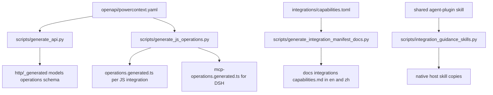

# Source Map

This page answers two questions for a contributor or agent: which directory owns a responsibility, and which files are produced by a generator and must not be edited by hand. It is organized by responsibility rather than by file inventory. Citations refer to repository commit `b8b18909`. For the runtime view, see [System Overview](system-overview.md); for the HTTP surface, see [HTTP and MCP API](http-and-mcp-api.md).

Locale documentation (`docs/en/`, `docs/zh/`), the website, benchmarks, evaluation, CI workflows, licenses, assets, test fixtures, and end-to-end fixture data are outside this map.

## Responsibility map

| Responsibility | Owning location | Entry point | Change rule |
| --- | --- | --- | --- |
| Python package and public exports | `src/powercontext/` | [`__init__.py`](../../src/powercontext/__init__.py) | Keep public exports here. |
| HTTP contract (source of truth) | `openapi/powercontext.yaml` | the OpenAPI document | Edit this file, then regenerate. |
| Generated HTTP Python code | `src/powercontext/http/_generated/` | `models.py`, `operations.py`, `schema.py` | Do not edit; regenerate. |
| Server (HTTP, MCP, dashboard, authz) | `src/powercontext/server/` | [`factory.py`](../../src/powercontext/server/factory.py) `create_server_app`; [`app.py`](../../src/powercontext/server/app.py) | Route and transport changes; domain rules stay in the runtime. |
| Built-in runtime and domain services | `src/powercontext/builtin/` | [`runtime/composition.py`](../../src/powercontext/builtin/runtime/composition.py) `open_builtin_runtime` | Domain rules live here. |
| Client SDK | `src/powercontext/client/` | [`client.py`](../../src/powercontext/client/client.py) | Translate calls; no separate domain behavior. |
| CLI | `src/powercontext/cli/` and plugin commands | [`cli/app.py`](../../src/powercontext/cli/app.py) | Command surface and host installers. |
| Transport safety policy | `src/powercontext/transport.py` | `is_plaintext_non_loopback` | Shared by Client, CLI, and integrations. |
| Ops (personal Server operations) | `src/powercontext/ops/` | [`__main__.py`](../../src/powercontext/ops/__main__.py) | One bounded JSON request per process. |
| Personal service launch | `src/powercontext/service/` and `src/powercontext_service_bootstrap/` | [`service_bootstrap/__main__.py`](../../src/powercontext_service_bootstrap/__main__.py) | Retry budget lives in the bootstrap module. |
| Host and framework integrations | `integrations/` | `integrations/capabilities.toml` | Declare capabilities in the manifest first. |
| Rust model-traffic gateway | `gateway/crates/` | [`pc-gateway-app/src/main.rs`](../../gateway/crates/pc-gateway-app/src/main.rs) | Gate executor and transport only. |
| Container image | `docker/` | [`Dockerfile`](../../docker/Dockerfile) | Single-process image. |
| Kubernetes deployment | `deploy/helm/powercontext/` | `templates/deployments.yaml` | External OceanBase only. |
| Reference observability stack | `deploy/observability/` | [`README.md`](../../deploy/observability/README.md) | Demonstration and verification tooling. |
| Repository generators and gates | `scripts/` | `generate_api.py`, `integration_manifest.py`, `release_version.py` | Run through `make` targets. |

### Python package boundaries

`src/powercontext/` is one distribution with several layers.

- [`context.py`](../../src/powercontext/context.py) defines the `PowerContext` composition facade. It binds three component groups (`Sources`, `Artifacts`, and triggers) and does not own their lifecycle.
- `sources/`, `artifacts/`, and `triggers/` hold the protocol and model layer that the built-in runtime implements.
- `builtin/` is the default implementation. Its `runtime/` package composes the runtime, and its `artifacts/` subpackages implement each artifact family (memory, topic memory, experience, skill, handoff, profile, prompt, atomic memory). Its `persistence/` package holds SQLite, OceanBase, and seekdb profiles and migrations.
- `server/` and `client/` are transports over the same operations. The server builds on the built-in runtime and mounts routes; the client calls the HTTP surface.
- `cli/`, `observability/`, `source_management/`, and `service/` are operator-facing packages.

The project guidelines place domain rules in the runtime or Artifact service that owns them, and say that transport and host adapters should translate inputs and outputs without inventing different domain behavior ([AGENTS.md](../../AGENTS.md)). Keep that split when editing.

### Public entry points

The installed commands are declared in [`pyproject.toml`](../../pyproject.toml). `powercontext` maps to `powercontext.cli.app:main`, and `powercontext-ops` maps to `powercontext.ops.__main__:main`. Subcommands are registered through the `powercontext.cli` entry-point group: `code`, `config`, `doctor`, `observability`, `service`, `server`, `setup`, and `archive`.

The Docker image runs `powercontext` with the default arguments `server run` ([Dockerfile](../../docker/Dockerfile)).

## Generated and derived files

Each file below is either produced by a generator or copied from a source. Edit the source, run the named command, and review the diff. The checks fail on drift.

| Output | Produced from | Regenerate | Verify |
| --- | --- | --- | --- |
| `src/powercontext/http/_generated/models.py`, `operations.py`, `schema.py` | `openapi/powercontext.yaml` via [`scripts/generate_api.py`](../../scripts/generate_api.py) | `make api-generate` | `make api-generate-check` |
| `integrations/dsh/plugins/powercontext/src/operations.generated.ts` and the matching files in `opencode` and `pi` | OpenAPI via [`scripts/generate_js_operations.py`](../../scripts/generate_js_operations.py) | `make js-api-generate` | `make js-api-generate-check` |
| `integrations/dsh/plugins/powercontext/src/mcp-operations.generated.ts` | OpenAPI via the same JS generator | `make js-api-generate` | `make js-api-generate-check` |
| `integrations/dify/plugin/powercontext_dify/contract.json` | OpenAPI and Dify declarations via [`integrations/dify/generate_contract.py`](../../integrations/dify/generate_contract.py) | run the generator (no Make target) | `make dify-test` runs `--check` |
| `docs/{en,zh}/docs/integrations/capabilities.md` | [`integrations/capabilities.toml`](../../integrations/capabilities.toml) via [`scripts/generate_integration_manifest_docs.py`](../../scripts/generate_integration_manifest_docs.py) | `make integration-manifest-docs` | `make integration-manifest-docs-check` |
| Per-host `skills/powercontext-project-context/` copies (except `references/host.md`) | Shared skill in `integrations/agent-plugin/powercontext/skills/` via [`scripts/integration_guidance_skills.py`](../../scripts/integration_guidance_skills.py) | `make integration-guidance` | `make integration-guidance-check` |
| `integrations/cindy/plugins/powercontext-hooks/node/worker.cjs` | Cindy TypeScript build (`make cindy-test`) | `make cindy-test` | `git diff --exit-code` inside `cindy-test` |
| `integrations/opencode/plugins/powercontext/lib/` | OpenCode TypeScript build | `make opencode-test` | `git diff --exit-code` inside `opencode-test` |

*The diagram shows which generator produces each derived artifact. The HTTP contract, the integration manifest, and the shared skill are the only hand-edited inputs.*

Three rules follow from the generated headers and gates:

- `openapi/powercontext.yaml` is the HTTP contract source of truth, and the generated Python carries "generated from openapi/powercontext.yaml; do not edit" headers ([operations.py](../../src/powercontext/http/_generated/operations.py), [schema.py](../../src/powercontext/http/_generated/schema.py)). After a contract change, run `make api-generate` and `make contract-test` ([AGENTS.md](../../AGENTS.md)).
- `make check` runs `version-check`, which in turn runs `api-generate-check` and `js-api-generate-check`, so generated drift fails the main quality gate ([Makefile](../../Makefile)).
- Per-host skill guidance is refreshed non-destructively outside its `POWERCONTEXT-GUIDANCE` markers, and generated guidance compares canonical bytes ([guidance.py](../../src/powercontext/cli/guidance.py), [.gitattributes](../../.gitattributes)).

## Integrations

`integrations/capabilities.toml` is the integration contract. Its header requires every `integrations/*/` directory to be declared or explicitly excluded. [`scripts/integration_manifest.py`](../../scripts/integration_manifest.py) checks coverage in both directions, checks the per-locale integration page pointers, and validates the declared tool surfaces. Declared exclusions are `cindy`, `agent-plugin`, and `opendal`, each with a recorded reason.

Host plugins are thin clients for a running Server. The Codex plugin, for example, does not embed storage or start the Server; it uses a SessionStart hook, a UserPromptSubmit hook, and Streamable HTTP MCP ([Codex plugin README](../../integrations/codex/plugins/powercontext/README.md)). The Python integration packages (`bub`, `dify`, `langchain`, `langgraph`, `pydantic-ai`, `opendal`) each have their own `pyproject.toml`.

Host-specific Skill guidance is authored once in the agent-plugin skill and fanned out. The per-host `references/host.md` file is the only native file retained per host ([integration_guidance_skills.py](../../scripts/integration_guidance_skills.py)).

## Gateway

`gateway/` is an optional Rust workspace with seven crates ([Cargo.toml](../../gateway/Cargo.toml)). The gateway owns the model-traffic boundary, while PowerContext Core keeps every policy decision ([gateway README](../../gateway/README.md)).

| Crate | Responsibility |
| --- | --- |
| `pc-gateway-app` | Binary: ingress, port takeover, middleware ([main.rs](../../gateway/crates/pc-gateway-app/src/main.rs)) |
| `pc-gateway-core` | Two-phase gate executor state machine and Core client ([lib.rs](../../gateway/crates/pc-gateway-core/src/lib.rs)) |
| `pc-gateway-types` | Contract DTOs aligned with the Core check contract |
| `pc-gateway-protocol` | Canonical request, chat and responses renderers, SSE framing |
| `pc-gateway-transport` | Upstream transport, bounded retry, capped streaming buffer |
| `pc-gateway-evidence` | Body-free evidence such as usage and TTFT |
| `pc-gateway-embedded` | Placeholder for an in-process executor path |

The gateway runs in one of two forms. In combined form, `PC_GATEWAY_CORE_UDS` points at a Core Unix socket and non-`/gateway` traffic is reverse-proxied to Core. In standalone form, `PC_GATEWAY_CORE_BASE` points at a remote Core. Crates with tests keep them in a `tests/` directory. `pc-gateway-core` includes live tests against a Server that skip when no Server is reachable ([gateway README](../../gateway/README.md)).

## Deployment and operations

- **Docker** ([docker/Dockerfile](../../docker/Dockerfile)). A two-stage uv build installs the `cli`, `server`, and `tracing-otlp` extras from the frozen lock file. It requires the `POWERCONTEXT_VERSION` build argument, runs as a non-root `powercontext` user, uses `/data` as `POWERCONTEXT_HOME`, exposes port 8000, and health-checks `/health/ready`. The image sets an unauthenticated non-loopback opt-in, so production deployments should enable bearer auth or terminate TLS upstream ([docker/README.md](../../docker/README.md)).
- **Helm** ([deploy/helm/powercontext](../../deploy/helm/powercontext/README.md)). The chart renders two Deployments, `api` and `background`, from one image running `server run`. It targets an external OceanBase database. SQLite and embedded seekdb are unsupported in the chart, and database initialization is a separate `server db-migrate` step before first install. The chart uses a `Recreate` rollout strategy, and upgrades are coordinated offline.
- **Observability** ([deploy/observability](../../deploy/observability/README.md)). The stack is a reference demonstration with Prometheus, Tempo, Loki, Grafana, and an OpenTelemetry Collector. `init.py` generates local secrets, `run-host.py` starts a real Server, and `verify.py` queries stored traces, logs, and metrics. A receiver port or healthy container alone is not acceptance evidence.
- **Personal service bootstrap** ([service_bootstrap/__main__.py](../../src/powercontext_service_bootstrap/__main__.py)). Before importing the PowerContext launcher, this module records a launch attempt in a bounded retry window. The launchd adapter in `src/powercontext/service/adapters/launchd.py` builds the invocation.
- **Release references** ([scripts/release_version.py](../../scripts/release_version.py)). `make version-bump` rewrites release references, including the OpenAPI `info.version`, then regenerates the API code. Distribution versions still come from Git tags.

## Verification entry points

- `make test` runs pytest with doctests, and `make unit-test` skips the end-to-end suite under `tests/e2e`.
- `make contract-test` runs `tests/test_api_contract.py`, `tests/test_js_operations.py`, and `tests/test_desktop_contract.py`, after the generator drift checks.
- `make integration-manifest-check` runs `tests/test_integration_manifest.py` after the capability docs check.
- Several host integrations have their own `make *-test` target, such as `opencode-test`, `pi-test`, and `dify-test`.

For the test structure, see [Test Map](../testing/test-map.md). For the capability matrix, see [Capability Matrix](../integrations/capability-matrix.md).

## Change routing

- **New or changed HTTP operation**: edit `openapi/powercontext.yaml`, run `make api-generate` and `make js-api-generate`, implement the server route and runtime behavior, then run `make contract-test`.
- **New domain rule**: put it in the owning `builtin/` package or artifact service. Keep route handlers, the client, and host plugins as translators.
- **New integration or capability**: declare it in `integrations/capabilities.toml`, add the host directory, then run `make integration-manifest-docs` and `make integration-manifest-check`.
- **Shared Skill guidance**: edit the agent-plugin source and run `make integration-guidance`; do not edit the per-host copies.
- **Operational logs, metrics, or spans**: follow the observability rules in [AGENTS.md](../../AGENTS.md) and the operations guide before editing.
- **Gateway behavior**: edit the owning crate; decisions stay in Core, so the gateway should not add policy.
