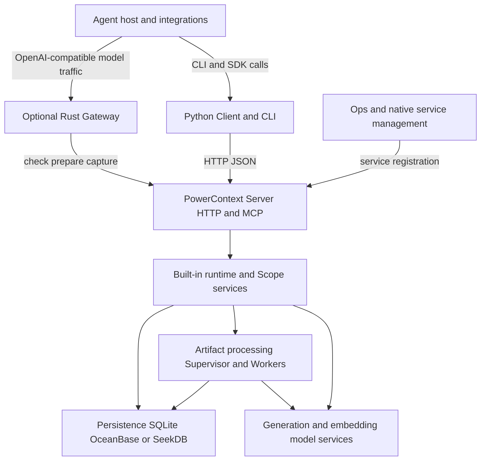

# PowerContext System Overview

PowerContext is a context-management system for agents. It stores captured evidence (Sources), derives or writes durable reusable content (Artifacts), and serves that content back to an agent as temporary `PreparedContext` for one turn. This page describes the components that own those responsibilities, how requests move between them, and the boundaries an agent must respect when changing code. It is a map: follow the linked pages for endpoint-level and procedural detail.

## Owned systems at a glance

| System | Owns | Key code |
| --- | --- | --- |
| Scope | Isolation, access policy, and the default Scope for Sources, Artifacts, Candidates, and processing state | `src/powercontext/builtin/scope/application.py` |
| Source | Captured evidence and references to external material | `src/powercontext/builtin/sources/content.py`, `src/powercontext/context.py` |
| Artifact families | Exact Revisions of Atomic Memory, Experience, Skill, Handoff, Profile, Prompt, and Topic Memory | `src/powercontext/builtin/artifacts/` |
| Review | Candidate lifecycle, approval, and rejection | `src/powercontext/builtin/review/service.py` |
| Runtime and workers | Scheduled and explicit processing of eligible Sources, plus `PreparedContext` assembly | `src/powercontext/builtin/runtime/` |
| Server | HTTP and MCP surfaces, authentication, access enforcement, and lifecycle | `src/powercontext/server/` |
| Client and CLI | Python facade over the public contract and Typer commands | `src/powercontext/client/` |
| Ops and service management | Local native service registration and operator-approved maintenance | `src/powercontext/ops/`, `src/powercontext/service/` |
| Gateway | Optional Rust model-traffic executor that calls Core for admission | `gateway/` |
| Host integrations | Per-agent installers, projections, and capture helpers | `src/powercontext/cli/`, `src/powercontext/client/projections/` |

## Component boundaries

Hosts reach PowerContext either through the Client and CLI, or through the optional Gateway that sits on the model path. The Server is the single application boundary. Background Workers are a logical responsibility that can run in the same deployment or in a separate `background` role. Model services are called only by the runtime and workers, never by the Client.

## How Sources become Artifacts

The central rule is that **capturing evidence and committing an Artifact are separate actions**. Capture stores a Source and nothing else. Commit creates an Artifact Revision and happens either through an explicit write or through a processing step that the Server schedules.

### When a Source is captured

- A caller-supplied `source_id` plus content is resolved into a built-in content Source with `materialization` set to captured. The identity is caller-stable: replaying the same `source_id` with the same content returns the existing record, and a conflicting replay raises a conflict instead of overwriting.
- `Sources.add` persists a resolved Source without deriving Artifacts. The Scope service then reads and lists Sources through the same catalog.
- Working Notes are captured through a dedicated path, marked with a session identifier and optional expiry, and are excluded from ordinary generation.

### When an Artifact is committed

- **Explicit Create or Replace.** `Artifacts.add` commits an initial Revision and `Artifacts.revise` commits a Revision against an optimistic base. The revise call rejects a draft whose family differs from the base. No semantic generation runs in this path.
- **Source processing.** Atomic Memory processes one Source window at a time: it prepares all decisions for the window, then publishes once inside a transaction that is guarded by the source cursor generation and the Source journal. A memory write gate can hold a window with a structured reason. If the gate's backend fails, it degrades to accept so an unavailable judge cannot block writes.
- **Profile policy.** A Profile written from Source evidence is committed as a Revision when the policy `activation_mode` is `automatic`. When it is `review_required`, the same generated content becomes a pending Profile Candidate instead.

### When Candidate review is required

- Experience proposals produced by incubation from eligible Sources are stored as Candidates in the same transaction that validates them. They are not committed as Artifacts directly.
- Managed Skill proposals, and Dream-origin proposals for Memory, Topic Memory, Handoff, and Prompt, are Candidates. Approval publishes them through a family-specific transactional path.
- Profile proposals require review only under the `review_required` policy described above.
- Direct Artifact Create or Replace writes skip Candidates. They commit a validated Revision under the caller's governance policy.

Reviewed Artifacts are immutable Revisions. History is append-only, so rollback is an appended Revision rather than a deletion.

## Review and approval

`ReviewService` keeps Candidate compare-and-swap and Artifact compare-and-swap inside one database transaction. Approval reads the Candidate, rejects terminal states, checks the expected version, validates lineage and evidence, locks the generic review inputs, and only then publishes. Overlapping approval retries return the stored result when the Candidate is already approved at the expected version. Rejection requires a reason and is terminal for pending Candidates.

Review authority is a separate boundary from generation. A model proposing content does not gain authority to approve it, and approval does not grant execution authority over a Skill or a Handoff.

## Runtime, background workers, and the Server

`create_server_app` composes the Server: it wires the lifespan, storage preparation, the authentication middleware when configured, access control, request-id and resource-limit middleware, tracing and metrics, the MCP mount, and the dashboard when enabled. Requests that enter through the HTTP surface resolve a Scope, pass access enforcement, and call the built-in runtime.

Background processing is a separate lifecycle:

- `runtime.artifact_processing_role` selects `all`, `api`, or `background`. SQLite and embedded SeekDB accept only `all`. The `background` role is served by a runner that does not expose HTTP.
- An `ArtifactProcessingSupervisor` runs one Lease and scheduling loop, with independent worker capacity per Family. Work is launched in spawned child processes. Failed work is retried with capped backoff and jitter. Supervisor groups can be dedicated to a single Family.
- The set of Families a deployment can process comes from `processing_capabilities`. Dream-backed Families are only declared when Dream is enabled and a supported provider is configured.

## Client, CLI, and host integrations

- `PowerContextClient` is an asynchronous facade over the public HTTP contract. It refuses to send any request over plaintext HTTP to a non-loopback host unless the caller explicitly opts in, and it closes only the HTTP client it created.
- The CLI is a Typer shell assembled from installed roles. Server and builtin command providers are loaded only when their declared requirements are installed.
- Host installers map eleven agent names to per-host installers. `select_hosts` validates every requested target before any write occurs.
- Session import currently supports only the `codex` host. Captured trajectories are sanitized and bounded: credential-like keys are redacted and oversized events are truncated.

## Gateway

The Gateway is an optional Rust executor for the model path. It owns transport and retries; every admission decision stays in PowerContext Core. Each model request goes through a two-phase check: `before_send` must allow the request before any byte is sent upstream, and `before_release` must allow the complete response before it reaches the client. Blocked content never leaves the gateway, and a degraded response is marked explicitly. Captured sedimentation writes a Source only at the terminal response. The Gateway holds no context policy of its own. See [Gateway](gateway.md) for its deployment forms and failure semantics.

## Ops and service management

Ops is a local, one-request-per-process operator surface. Its target binding and state directory come from the trusted operator or distribution layer, not from the JSON request, so a request cannot choose an executable or configuration path. Errors are reduced to fixed codes so provider or path details are not echoed. Configuration validation refuses a non-loopback bind and a Unix-socket listener for managed services. Ops and the `service` package manage the native service registration; they do not execute Artifact processing themselves.

## Ownership boundaries for code changes

- **Scope.** Resolve a Scope before every content operation. Do not add a code path that reads Sources or Artifacts across Scopes without the access layer.
- **Source.** Capturing must not derive Artifacts. Working Notes must not enter generation. Internal lineage-only Sources are only eligible at their bound Artifact target.
- **Artifact.** Revisions are immutable. Writes carry the optimistic base version. Do not add an in-place update that bypasses Revision history.
- **Candidate review.** Generated proposals that the design marks as reviewed must stay as Candidates until `approve` publishes them. Do not write a generated Experience or Skill directly to an Artifact table.
- **Runtime and workers.** Workers process eligible Sources and must not bypass Candidate review. Generated text is never an execution command.
- **Server.** The Server is the only application boundary. Authorization decisions for the agent belong to the access layer, not to the caller's recalled content.
- **Client and Gateway.** Client and Gateway code may not hold context policy. Gateway credentials live only in server-side environment variables and never appear in check payloads.
- **Persistence.** Backend differences belong to the persistence layer. Backup and recovery policy belongs to the deployment layer.

## Operational notes

- The Server refuses to start unauthenticated on a non-loopback bind unless the operator opts in.
- Background processing is disabled by default at the runtime level. Schedules must be configured explicitly.
- The data lifecycle has no generic user-level Artifact delete, retention policy, or Scope restore API. Operators back up the database or data directory and restore it through the deployment procedures.

## Related pages

- [Client, CLI, and transports](client-cli-and-transports.md)
- [Gateway](gateway.md)
- [HTTP and MCP API](http-and-mcp-api.md)
- [Persistence and storage](persistence-and-storage.md)
- [Server runtime](server-runtime.md)
- [Source map](source-map.md)
- [Artifact families](../concepts/artifact-families.md)
- [Scopes and access](../concepts/scopes-and-access.md)
- [Quickstart](../quickstart.md)
