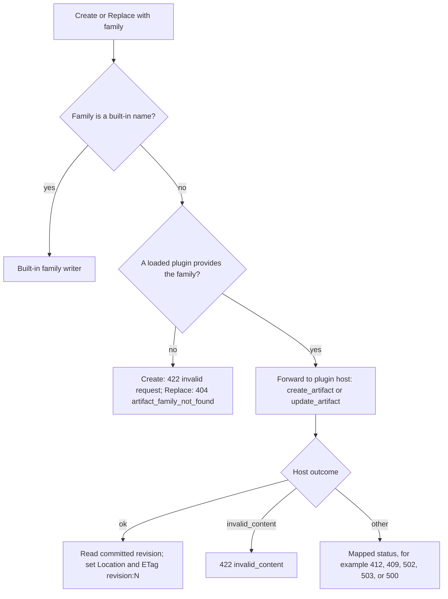
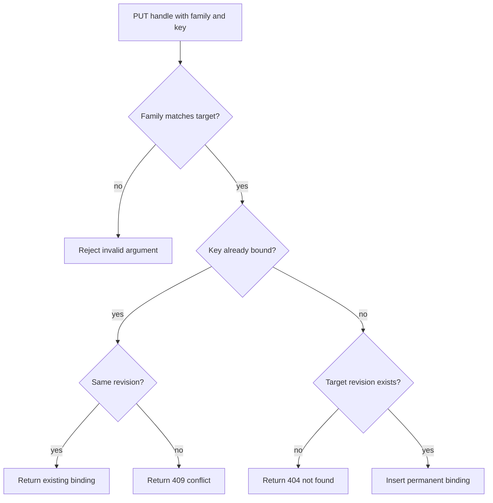
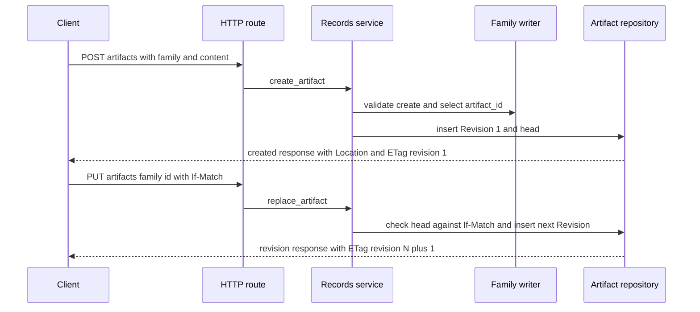

# Artifact Families

An **Artifact** is a versioned, Scope-local result. Every Artifact belongs to one **family**, has a stable `artifact_id`, and advances through immutable **Revisions**. Families share the revision storage model, identity types, and ETag discipline, but each family owns its own content schema, validation, and write workflow. Sharing the REST envelope does not make those workflows interchangeable.

Two kinds of family exist. **Built-in families** are compiled into the Server and have family-specific writers. **Plugin families** are declared by a plugin directory loaded at Server startup; their content is opaque JSON and they go through a separate branch described in [Custom plugin families](#custom-plugin-families). This page covers the shared model. Family-specific behavior is in the workflow pages linked from [Related workflows](#related-workflows).

## The built-in families

The built-in families are `atomic-memory`, `experience`, `skill`, `handoff`, `profile`, `prompt`, and `topic-memory`. Each concrete Artifact type declares its identifier as a class-level `family` value, for example `atomic-memory` in the Atomic Memory models, `topic-memory` in the Topic Memory models, and `profile` on the `Profile` class, whose `family` ClassVar is bound to `PROFILE_FAMILY` and whose `ProfileDraft` counterpart uses the same binding.[^families]

The legacy `memory` family is not a writable or referenceable Artifact family. Legacy Memory collections were archived, and their entries are cited as Atomic Memory revisions instead. The name is still a member of the built-in family enum in the generated HTTP models, so requests that name it are routed to the built-in branch and then rejected.[^legacy][^generated-enum]

| Family | Identity of the current head | Direct Create and Replace | Candidate path |
| --- | --- | --- | --- |
| `atomic-memory` | Server-generated | Routed through the Atomic Memory domain writer, which checks the current revision before preparing the write | Dream proposals for memory are reviewed separately |
| `topic-memory` | Server-generated | Complete `title`, `summary`, and `detail` are validated by Topic Memory admission | Dream proposals are reviewed through the Candidate approval path |
| `experience` | Server-generated | Validated and written through the Experience family writer, which also refreshes the Experience index | Generated proposals are Candidates; approval publishes the revision |
| `skill` | Server-generated | Canonical package content is resolved before the write, then the Skill index is refreshed | Generated proposals are Candidates; approval publishes the revision |
| `handoff` | Fixed Scope singleton, `handoff` by default | Create only when none exists; afterward Replace only | Reviewed Dream handoffs are published through the Candidate path |
| `profile` | Fixed singleton `profile` | Create and Replace coordinate the Profile policy and mark the Profile source window dirty | Generated Profile Candidates are decided through their own review step |
| `prompt` | The registered `prompt_key` | Create requires `prompt_key`; content is checked against the Prompt registry | Reviewed Prompt configuration is published through Artifact compare-and-set |

The Create branch and the Replace branch described below apply to every family. Candidate review is a separate branch that has its own `expected_version` contract.[^candidates]

Dream is not a family. A Dream run creates Candidates whose target is one of the families above; see [Dream runs are not a family](#dream-runs-are-not-a-family).

## Custom plugin families

A plugin directory can declare one additional family of its own. The Server loads it at startup, and the family then accepts the same Create, Replace, read, tag, and search routes as a built-in family, but every operation runs in the plugin's host process.[^plugin-docs]

**Declaration.** Each subdirectory of the plugin directory is one plugin, and its name is the plugin name. The directory name must match `^[a-z][a-z0-9-]{0,63}$`. Importing `plugin.py` must assign an `ArtifactPlugin` to `plugin`, and its `setup` must be an async function. The declared `family` must match `^[a-z][a-z0-9-]{0,127}$` and must not reuse a name in `BUILTIN_FAMILIES`, which lists `memory` and the seven built-in families above.[^plugin-declare]

**Startup and isolation.** At startup the Server checks each plugin directory in a child process, then registers the family in process. A plugin that fails the check, or whose family is already provided by a plugin earlier in sorted directory order, is recorded with an `error` and status `failed`; the other plugins still load. `GET /v1/plugins` reports each plugin's `status` as `loaded` or `failed`. Nothing about a plugin is persisted: the directory as it is at startup decides which plugins exist.[^plugin-load]

**Drift.** Each check records a SHA-256 fingerprint over the plugin's relative paths and contents. If the directory changes after the check, the host refuses to start with "the plugin changed after the Server checked it; restart the Server".[^plugin-load]

**Content.** Plugin content is opaque: core stores it as `PluginArtifactContent`, a JSON object under `content`, builds no index for it, and does not interpret it. The plugin itself renders each revision and optionally searches its family.[^plugin-storage]

Figure: the branch a Create or Replace request takes. Built-in names always take the built-in branch, so a plugin cannot shadow a built-in family.

**Validation failures.** The custom branch rejects a request at these points, in this order:

| Point | Condition | Result |
| --- | --- | --- |
| Create body | `family` is not a built-in name and no loaded plugin provides it | `422` `invalid_request`, with `field` set to `family` |
| Replace path | Family is neither built-in nor loaded | `404` `artifact_family_not_found` |
| Replace body | Body is not exactly `{"content": {...}}` with an object | `422` `invalid_request`, with `field` set to `content` |
| Replace `If-Match` | Missing | `428` `precondition_required` |
| Replace `If-Match` | Not of the form `revision:N` | `412` `revision_conflict` |
| Replace `If-Match` | Revision is stale when the host writes | `412` `precondition_failed` |
| Host | Plugin does not implement the method | `422` `plugin_operation_not_supported` |
| Host | Plugin rejects content, or content exceeds limits | `422` `invalid_content`, with `field` when given |
| Host | Plugin returns the wrong shape or does not complete its agreed write | `502` `plugin_contract_violation` |

Host exceptions are classified into outcomes before they reach HTTP, and each outcome maps to the status shown above. An unexpected exception becomes `500 plugin_error` and exposes only its exception type name.[^plugin-host-errors][^plugin-outcomes]

Two host-side limits bound each write. One revision's content is at most 256 KiB, and one write transaction is at most 8 MiB and 1000 writes. A generation write may cite only Sources of its invocation window, and a user change may keep only Sources already in the Artifact's lineage.[^plugin-limits]

Plugin families are also searchable and taggable. Tag routes accept every loaded plugin family alongside the built-in names, and a plugin without `search_artifacts` returns `422 plugin_operation_not_supported` from the generic search route.[^plugin-search][^tag-taggable]

## Immutable revisions and heads

Each Revision is a stored snapshot. The body row for `(scope_id, family, artifact_id, revision)` is inserted once and never changed. A separate **head** row records the current revision for each logical identity. Reads use the head to find the latest revision, or the exact revision number to load history.[^repo-insert]

`ArtifactRepository.revise` advances the head only if the caller still holds the current revision. The head row is locked and checked, the new body is inserted, and the head is moved with a compare-and-set on the previous revision. If the head moved in between, the write raises `RevisionConflictError`.[^repo-revise]

Lineage is stored per revision. A Revision records its direct source evidence, its upstream Artifact references, and, for copied Artifacts, its publication source and content digest. Lineage is loaded with the Revision and is not rewritten by later revisions.[^lineage]

The read-only `ArtifactCatalog` protocol exposes `get` for an exact revision, `latest` for the current visible revision, and `revisions` in ascending revision order. The `ArtifactStore` protocol commits only new revisions through `add` and `revise`.[^protocols]

## ArtifactRef and ArtifactAddress

`ArtifactRef` is the exact reference to one revision. It has three fields: `family`, `artifact_id`, and `revision`, where `revision` is an integer of at least 1. Validation rejects leading or trailing whitespace, empty values, and over-long values. It also rejects the legacy `memory` family with `InvalidArtifactReferenceError`.[^ref]

`ArtifactAddress` adds a `scope_id` to an `ArtifactRef`. It identifies one exact revision across Scope boundaries and is used by publication lineage.[^ref]

Citations written by clients must keep the family, Artifact ID, and exact revision. The current head can advance while a historical revision stays unchanged.[^docs-artifacts]

## StableHandle: permanent Scope-local names

A `StableHandle` gives one exact Artifact revision a human-copyable name. It has a `family` and a `key`. The key must match the pattern `^[a-z0-9]+(?:-[a-z0-9]+)*$`, meaning lowercase ASCII letters and digits separated by single hyphens, and it may be at most 128 characters.[^handle-model]

Handles are bound with `PUT /v1/scopes/{scope_id}/artifact-handles/{family}/{key}` and resolved with `GET` on the same route. The route path validates `family` and `key` before the handler runs.[^handle-route]

The binding rules are as follows.

- A binding is keyed by `(scope_id, family, handle_key)` and is permanent. The repository has `bind` and `resolve` operations only; no update, release, or delete operation exists.[^handle-repo]
- Binding a handle to the revision it already names returns that same binding. This makes repeated calls idempotent.
- Binding a handle to a different revision raises a conflict. The handler maps it to HTTP `409 Conflict` with the error code `idempotency_conflict`.
- The target revision must already exist in the Scope. Otherwise the binding fails with not found.
- The handle's family must match the target's family, or the binding is rejected as an invalid argument.
- If two binders race on the same key, the losing transaction re-reads the committed binding. It succeeds only when the committed target is the one it requested; otherwise it raises the conflict.

Figure: the decision path for a handle bind. A conflicting binding is never overwritten.

Verify the family, Artifact ID, revision, and key before binding, because a wrong binding cannot be changed. A mistaken key must be replaced by choosing a new key.[^docs-artifacts]

## Create and Replace

Both writes create an immutable Revision and return the resulting head with an `ETag`. Their behavior is defined by the server, not by the client.[^docs-artifacts]

Figure: Create issues Revision 1 under a generated or fixed identity. Replace requires the current head as its precondition and then writes the next revision.

**Create** (`POST /v1/scopes/{scope_id}/artifacts`) takes the `family` discriminator and `content`. The request union is discriminated by `family`: a name in the built-in list selects the built-in branch, and any other name selects the plugin branch. Content from one family cannot be submitted to another. For built-in families the server chooses the Artifact ID except in two cases: Prompt uses the required `prompt_key` as its ID, and Handoff uses the Scope's fixed singleton ID. Plugin families receive a server-generated hexadecimal ID.[^create-route][^create-records]

Create of the legacy `family=memory` collection is rejected before any write. The request is reported as `422 legacy_memory_operation_unsupported`, and the response names the Atomic Memory alternatives.[^legacy-error]

**Replace** (`PUT /v1/scopes/{scope_id}/artifacts/{family}/{artifact_id}`) requires an `If-Match` header. A missing header returns `428 precondition_required`. The value must equal the current head's ETag, which has the form `"revision:N"`. A stale value returns `412` with the error code `revision_conflict`. The service checks the head again inside the write transaction, so a late concurrent update also yields `412`.[^replace-route][^etag][^replace-records][^error-map]

Replace of the `memory` collection family is rejected with `BaseOperationNotSupportedError` before any write.[^replace-route]

### Handoff singleton behavior

Handoff is a Scope singleton. Its Create uses the configured Handoff artifact ID, which defaults to `handoff`. Create returns `409 artifact_already_exists` when that Artifact already exists. The error payload sets `use_replace` to true, so clients switch to Replace.[^handoff-create][^handoff-default][^already-exists]

Handoff Replace requires the target to be the Scope's configured singleton. Any other identity is rejected as an invalid request.[^handoff-replace]

## Write versus candidate rules

The family writers decide what a direct write means. The rules differ by family.

- **Direct writers**: Atomic Memory, Topic Memory, Prompt, Profile, Experience, Skill, and Handoff are each registered in a family writer registry. The registry resolves the writer for each family and rejects families without one.[^registry]
- **Candidate-first generation**: Experience and Skill generation produces Candidates. An operator reviews a Candidate and approves it. Approval publishes a revision: without a target it creates a new Artifact under a generated ID, and with a target it revises that Artifact. Approval checks the Candidate's `expected_version` before publishing.[^candidate-approve][^candidate-publish]
- **Review requires its own precondition**: Candidate review uses `expected_version`, not an Artifact `ETag`. Access checks still apply to the selected target in both cases.[^docs-artifacts]
- **Plugin families** write through their own `create_artifact` and `update_artifact` methods, inside the host's write transaction, and bypass the built-in writer registry.[^plugin-route-write]

Operators who want to publish reviewed content should use the family's own review path. Direct REST writes are for families whose workflow permits them. Prompt and Profile are examples of direct-write families with extra validation: Prompt checks its content against the registry, and Profile coordinates its policy row when written.[^prompt-writer][^profile-writer]

Topic Memory content is submitted as complete text. Topic Memory admission inspects that content: it rejects recognizable placeholder output and coordination-only text, and it expects supplied content to be supported by the cited evidence or the prior history it revises.[^topic-admission]

## Dream runs are not a family

Dream is a run workflow. A run selects exact evidence and produces a pending Candidate; generation does not approve, install, execute, or publish anything.[^dream-docs]

The run operation is one of nine values: `refine_experience`, `derive_skill`, `revise_skill`, `revise_profile`, `revise_memory`, `revise_topic_memory`, `refresh_handoff`, `revise_prompt`, and `revise_tags`. Each operation accepts only certain families for its target and evidence, for example `revise_prompt` targets the `prompt` family and `revise_memory` targets `atomic-memory`. The Candidate it proposes is reviewed like any other Candidate.[^dream-operations]

## Tags on logical Artifacts

Tags attach to the logical identity `(family, artifact_id)`, not to a revision. Creating or replacing an Artifact does not change its tags, and tags survive Server restarts.[^tags-docs]

Tag normalization accepts 1 to 64 Unicode code points per label, with no outer whitespace and no control, surrogate, or unassigned characters. Matching uses NFC normalization followed by case folding. A target holds at most 32 labels, and a filter accepts 1 to 16 labels. Duplicates after normalization are rejected atomically.[^tag-normalize]

Tag queries (`POST /v1/scopes/{scope_id}/artifact-tags/query`) match a `TagFilter` with `match` set to `all` by default or `any`. Their `families` default to every taggable family, which means the built-in names plus the loaded plugin families, and their `target_types` default to `artifact`.[^tag-query]

The tag ETag is independent of the revision ETag. A tag replacement sends the tag ETag in `If-Match`, and a missing value returns `428`.[^tags-docs]

Tags are discovery metadata, not permissions or model instructions. They are not added to prompts, Skill packages, or publication payloads.[^tags-docs]

## Lifecycle states

Artifact governance is separate from Revisions. A logical Artifact's working-set state is one of `active`, `deprecated`, or `retired`.[^lifecycle]

A plugin's `forget_artifact` change is agreed to complete a `deprecate` write, and its `restore_artifact` change to complete a `revert` or `activate` write.[^plugin-lifecycle]

## Invariants and failure semantics

- A revision number is never reused for a given identity, and body rows are not updated after insert.
- Heads advance only through compare-and-set on the previous revision. A race yields `RevisionConflictError`, which the Replace path reports as `412`.
- A handle binding, once committed, is never changed. Re-binding the same target is safe; binding a different target returns `409`.
- Legacy `memory` is rejected at the reference layer, at Create and Replace, and in collection reads.
- Create does not accept a client-chosen Artifact ID. The ID is server-generated, except that Prompt uses its registered `prompt_key`, the Handoff and Profile singletons use their fixed identities, and a plugin family's ID is generated by core as well.
- A plugin family cannot reuse a built-in name, and a plugin that fails its check does not make other plugins fail.

## Related workflows

- [Atomic Memory](../workflows/atomic-memory.md) covers its create, replace, forget, merge, and restore flows.
- [Experience and Skill lifecycle](../workflows/experience-and-skill-lifecycle.md) covers Candidate generation and approval.
- [Memory and Handoff](../workflows/memory-and-handoff.md) covers the Handoff singleton and its commit flow.
- [Topic Memory](../workflows/topic-memory.md) covers complete-content writes and scoped reads.
- [Write a plugin](../../docs/en/docs/develop/plugins.md) covers the plugin directory, `plugin.py`, and the methods a plugin implements.
- [Sources and processing](sources-and-processing.md) explains the evidence that Artifact lineage records.
- [HTTP and MCP API](../architecture/http-and-mcp-api.md) lists the routes used here.

[^families]: Family identifiers are declared on the concrete Artifact types. repo://src/powercontext/builtin/artifacts/atomic_memory/models.py#L116-L122 ; repo://src/powercontext/builtin/artifacts/topic_memory/models.py#L64-L70 ; repo://src/powercontext/builtin/artifacts/profile/models.py#L31-L32 ; repo://src/powercontext/builtin/artifacts/profile/models.py#L171-L176 ; repo://src/powercontext/builtin/artifacts/prompt/models.py#L114-L114 ; repo://src/powercontext/builtin/artifacts/skill/models.py#L121-L127
[^legacy]: The Artifact reference layer rejects the legacy family, and the operation mapper names the Atomic alternatives. repo://src/powercontext/artifacts/models.py#L37-L37 ; repo://src/powercontext/artifacts/models.py#L52-L60 ; repo://src/powercontext/server/app.py#L3573-L3576
[^generated-enum]: The generated built-in family enum still names the legacy value, so the request union routes it to the built-in branch. repo://src/powercontext/http/_generated/models.py#L3674-L3683 ; repo://src/powercontext/http/_generated/models.py#L6813-L6821
[^candidates]: Candidate review uses an expected_version contract and Family-owned approval paths. repo://src/powercontext/builtin/review/service.py#L658-L664 ; repo://src/powercontext/builtin/review/service.py#L700-L735
[^repo-insert]: Body rows and the head row are written in separate statements, and the body is keyed by the exact revision. repo://src/powercontext/builtin/persistence/artifacts.py#L847-L944 ; repo://src/powercontext/builtin/persistence/artifacts.py#L252-L273
[^repo-revise]: The revise path locks the head with a compare-and-set update, inserts the next revision, then advances the head. repo://src/powercontext/builtin/persistence/artifacts.py#L493-L593
[^lineage]: Lineage is stored with each revision and loaded per revision from source, artifact, and publication relations. repo://src/powercontext/builtin/persistence/artifacts.py#L847-L944 ; repo://src/powercontext/builtin/persistence/artifacts.py#L945-L1003 ; repo://src/powercontext/artifacts/models.py#L128-L140
[^protocols]: The read and write contracts are split into ArtifactCatalog and ArtifactStore. repo://src/powercontext/artifacts/protocols.py#L24-L51
[^ref]: ArtifactRef and ArtifactAddress validation. repo://src/powercontext/artifacts/models.py#L45-L61 ; repo://src/powercontext/artifacts/models.py#L105-L117
[^docs-artifacts]: Public workflow documentation for Create, Replace, handles, and Candidate review. repo://docs/en/docs/workflows/artifacts.md#L1-L79
[^handle-model]: StableHandle key validation. repo://src/powercontext/artifacts/models.py#L64-L93 ; repo://src/powercontext/limits.py#L38-L38
[^handle-route]: Handle bind and resolve handlers. repo://src/powercontext/server/app.py#L3101-L3133 ; repo://src/powercontext/http/_generated/operations.py#L3303-L3340
[^handle-repo]: Handle bind, resolve, and conflict logic. repo://src/powercontext/builtin/persistence/artifact_handles.py#L36-L73 ; repo://src/powercontext/builtin/persistence/artifact_handles.py#L75-L82 ; repo://src/powercontext/builtin/persistence/artifact_handles.py#L107-L117
[^create-route]: Create handler, family discriminator, and the plugin branch. repo://src/powercontext/server/app.py#L3071-L3094 ; repo://src/powercontext/http/_generated/models.py#L6813-L6844 ; repo://src/powercontext/http/_generated/models.py#L829-L833
[^create-records]: Create-side ID selection, lineage source capture, and writer dispatch. repo://src/powercontext/builtin/persistence/records.py#L354-L405
[^legacy-error]: Legacy memory collection error mapping. repo://src/powercontext/server/app.py#L6828-L6884
[^replace-route]: Replace handler, legacy rejection, and If-Match extraction. repo://src/powercontext/server/app.py#L3554-L3602 ; repo://src/powercontext/server/app.py#L3573-L3576
[^etag]: ETag formatting and If-Match requirement. repo://src/powercontext/server/app.py#L3949-L3956
[^replace-records]: Replace precondition checks inside the write path, including the head check inside the transaction. repo://src/powercontext/builtin/persistence/records.py#L712-L800
[^error-map]: HTTP mapping for precondition, conflict, and not-found errors. repo://src/powercontext/server/app.py#L7011-L7027 ; repo://src/powercontext/server/app.py#L7048-L7058 ; repo://src/powercontext/builtin/records.py#L249-L256
[^handoff-create]: Handoff Create refuses an existing singleton. repo://src/powercontext/builtin/persistence/family_management.py#L357-L470
[^handoff-default]: The Handoff singleton identity defaults to handoff. repo://src/powercontext/builtin/runtime/relational.py#L516-L516 ; repo://src/powercontext/builtin/runtime/relational.py#L661-L672
[^already-exists]: The 409 payload for singleton Create. repo://src/powercontext/builtin/records.py#L208-L216 ; repo://src/powercontext/server/app.py#L7048-L7058
[^handoff-replace]: Handoff Replace must target the singleton. repo://src/powercontext/builtin/persistence/family_management.py#L429-L452
[^registry]: Family writer registry and its registration list. repo://src/powercontext/builtin/persistence/family_management.py#L93-L115 ; repo://src/powercontext/builtin/runtime/relational.py#L672-L684
[^candidate-approve]: Candidate approval entry point and generic publication. repo://src/powercontext/builtin/review/service.py#L658-L664 ; repo://src/powercontext/builtin/review/service.py#L700-L740
[^candidate-publish]: Generic approval creates a new Artifact when no target exists, or revises the target. repo://src/powercontext/builtin/review/service.py#L721-L735
[^prompt-writer]: Prompt writer validates against the registry and reuses Artifact compare-and-set. repo://src/powercontext/builtin/persistence/family_management.py#L186-L260
[^profile-writer]: Profile writer coordinates its policy row and marks the source window dirty. repo://src/powercontext/builtin/artifacts/profile/management.py#L40-L90
[^topic-admission]: Topic Memory content admission. repo://src/powercontext/builtin/artifacts/topic_memory/admission.py#L175-L230
[^tags-docs]: Tag identity, ETag, and storage rules. repo://docs/en/docs/workflows/manage-artifact-tags.md#L78-L131 ; repo://src/powercontext/builtin/tags.py#L124-L129
[^tag-normalize]: Tag label normalization and the 32-label and 16-label limits. repo://src/powercontext/builtin/tags.py#L51-L51 ; repo://src/powercontext/builtin/tags.py#L74-L98 ; repo://src/powercontext/builtin/tags.py#L100-L114 ; repo://docs/en/docs/workflows/manage-artifact-tags.md#L114-L131
[^tag-query]: Tag query defaults for match, families, and target types. repo://src/powercontext/builtin/tags.py#L100-L114 ; repo://src/powercontext/builtin/tags.py#L141-L165
[^tag-taggable]: Taggable families are the built-in names plus the plugin families loaded in this process. repo://src/powercontext/builtin/tags.py#L35-L45
[^plugin-docs]: Public plugin documentation for the plugin directory, the declaration, and the generic Artifact API of a plugin family. repo://docs/en/docs/develop/plugins.md#L1-L30 ; repo://docs/en/docs/develop/plugins.md#L109-L122 ; repo://docs/en/docs/develop/plugins.md#L222-L229
[^plugin-declare]: The declaration fields, the family pattern, and the built-in family check, and the directory and entry-point checks. repo://src/powercontext/plugins.py#L217-L245 ; repo://src/powercontext/builtin/plugins/manifest.py#L98-L113
[^plugin-load]: Startup check in a child process, duplicate-family rejection, failed status, and the fingerprint drift check. repo://src/powercontext/server/plugins.py#L152-L178 ; repo://src/powercontext/builtin/plugins/manifest.py#L64-L76 ; repo://src/powercontext/builtin/plugins/manifest.py#L135-L160 ; repo://src/powercontext/builtin/plugins/host.py#L176-L179
[^plugin-storage]: Plugin families keep no durable declaration and content stays opaque JSON. repo://src/powercontext/builtin/plugins/families.py#L15-L18 ; repo://src/powercontext/builtin/plugins/families.py#L42-L50
[^plugin-limits]: Per-revision, per-transaction, and write-count limits, and the Source-window checks. repo://src/powercontext/builtin/plugins/writer.py#L69-L71 ; repo://src/powercontext/builtin/plugins/writer.py#L342-L358
[^plugin-route-write]: The plugin Create and Replace routes forward to the host, which authorizes and writes through its transaction. repo://src/powercontext/server/app.py#L3694-L3731 ; repo://src/powercontext/server/app.py#L3734-L3766 ; repo://src/powercontext/builtin/plugins/host.py#L225-L257
[^plugin-search]: The plugin search route passes the request to the host; a plugin without search_artifacts reports not_implemented. repo://src/powercontext/server/app.py#L3241-L3262 ; repo://src/powercontext/builtin/plugins/host.py#L291-L297
[^plugin-outcomes]: Mapping from host outcomes to HTTP status and error codes. repo://src/powercontext/server/app.py#L3615-L3626 ; repo://src/powercontext/server/app.py#L3627-L3662
[^plugin-host-errors]: Host-side classification of exceptions into outcomes. repo://src/powercontext/builtin/plugins/host.py#L225-L257
[^plugin-lifecycle]: Plugin user-change methods and the writes they must agree to complete. repo://src/powercontext/builtin/plugins/writer.py#L95-L103
[^lifecycle]: Lifecycle states for governance. repo://src/powercontext/plugins.py#L49-L49 ; repo://src/powercontext/builtin/persistence/artifact_governance.py#L35-L41
[^dream-docs]: Dream creates a pending Candidate and does not approve or publish it. repo://docs/en/docs/workflows/review-dream-revisions.md#L10-L10
[^dream-operations]: Dream operation values and the families each operation accepts. repo://src/powercontext/builtin/dream/models.py#L44-L53 ; repo://src/powercontext/builtin/dream/models.py#L130-L141
