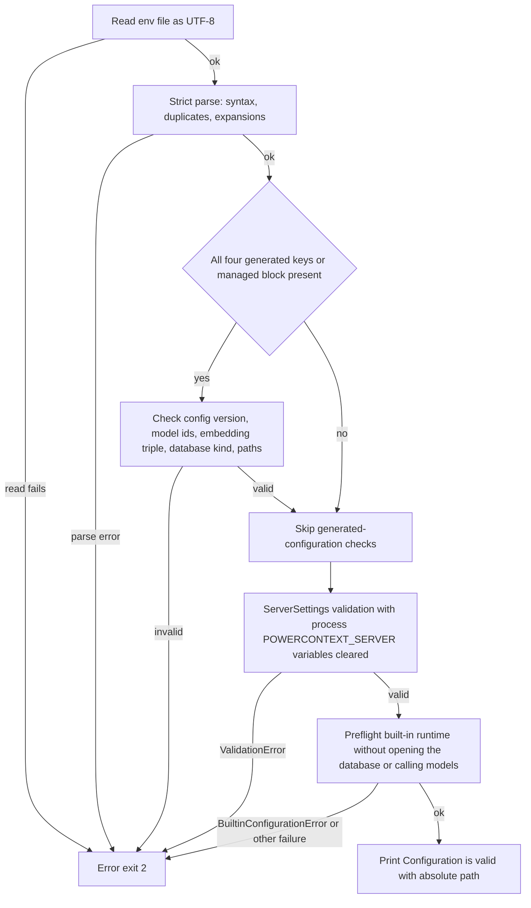

# Configuration Settings Reference

PowerContext is configured through environment variables. The Server, the Client CLI, and each Coding Agent integration read their own prefixed names. The guided wizard (`powercontext config init`) and the basic template write these names into a single environment file, normally `.env`. This page lists the settings, their exact names and defaults as spelled in the settings classes, the rules that reject a value, and the workflow for creating, inspecting, validating, and launching with that file.

Values are never reproduced here. Treat any `.env` file as a secret-bearing deployment artifact that must not be committed. The template header says the same: load the file and never commit `.env` or real credentials ([.env.example](repo://.env.example#L1-L4)).

## Configuration families

| Family | Prefix | Owner | Notes |
| --- | --- | --- | --- |
| Server | `POWERCONTEXT_SERVER_` | `ServerSettings` in the Server settings module | Nested sections such as HTTP, RUNTIME, and INFERENCE use the same prefix. |
| Client | `POWERCONTEXT_CLIENT_` | `ClientSettings` in the Client settings module | Server URL, API token, timeout, and insecure-HTTP consent. |
| Agent Scope and endpoints | `POWERCONTEXT_<AGENT>_` | Each integration | Explicit Scope ID, Server endpoint, and prompt capture per Agent. |
| User data directory | `POWERCONTEXT_HOME` | Path resolution | Overrides the default data directory that holds the default SQLite database. |

Server nesting follows one rule. The settings model uses `env_prefix="POWERCONTEXT_SERVER_"` with `env_nested_delimiter="_"` and `env_nested_max_split=1`, so only the first underscore after the prefix separates the section name. `POWERCONTEXT_SERVER_RUNTIME_SOURCE_WINDOW_LIMIT` therefore sets `runtime.source_window_limit` ([server settings](repo://src/powercontext/server/settings.py#L239-L251)).

## The environment file workflow

### Create

- `powercontext config init` runs the guided wizard. It asks for storage, network, capabilities, model connections, processing, and agents, and it can reuse or edit an existing file. Its default output is `.env`.
- `powercontext config init --template` writes the basic model-free template. It refuses to replace an existing file unless `--force` is given. The template runs with `collect_configuration`, which creates "a runnable Server without configuring an inference provider" ([init command](repo://src/powercontext/cli/config.py#L358-L413), [template collection](repo://src/powercontext/cli/config.py#L478-L500)).
- The guided wizard and the template both reject a UDS listener. UDS must be edited directly in the file ([init command](repo://src/powercontext/cli/config.py#L358-L413), [wizard guard](repo://src/powercontext/cli/config_wizard.py#L114-L150), [test](repo://tests/test_config_wizard.py#L52-L70)).
- The wizard suggests port `17429` for new guided setups ([suggested port](repo://src/powercontext/cli/config_wizard.py#L59)). The template and the code default both use `8000` ([base environment](repo://src/powercontext/cli/config.py#L181-L186)).

### Write and preserve

- Writes are atomic. The file is replaced through a temporary file and gets mode `0600`. When an existing file is replaced, a timestamped `.bak-` copy is created with mode `0600` first ([write_environment](repo://src/powercontext/cli/config.py#L716-L737)).
- The template manages a versioned block delimited by `# >>> powercontext managed configuration >>>` and `# <<< powercontext managed configuration <<<`. Unknown assignments and comments outside the block are preserved. Managed names outside the block are removed and rewritten into the block ([managed block](repo://src/powercontext/cli/config.py#L529-L572)).
- The guided wizard edits only the assignments it selected. It shell-quotes each value, rejects duplicate assignments before editing, and leaves unrelated bytes alone ([document update](repo://src/powercontext/cli/config_wizard_document.py#L37-L69)).
- Before a write that would remove existing model, embedding, schedule, or provider-credential settings, the template asks for explicit confirmation and states that a backup will be created ([confirmation](repo://src/powercontext/cli/config.py#L1099-L1122)).

### Inspect

`powercontext config show --env-file <path>` prints the file's assignments, not defaults and not the process environment. Values are replaced with `<redacted>` when the name is a known secret or matches a credential pattern. Those patterns include names ending in `_KEY`, `_PASSWORD`, `_SECRET`, `_TOKEN`, `_AUTHORIZATION`, or the header and cookie container suffixes, plus `POWERCONTEXT_SERVER_DATABASE_URL`, `POWERCONTEXT_SERVER_AUTH_TOKEN`, and `POWERCONTEXT_CLIENT_API_TOKEN`. Credential names recorded in the managed block are also redacted ([show](repo://src/powercontext/cli/config.py#L416-L431), [secret classification](repo://src/powercontext/cli/config.py#L1019-L1026)).

### Validate

`powercontext config validate --env-file <path>` runs the checks below and exits with code 2 on the first failure. Success prints `Configuration is valid:` followed by the absolute path ([validate command](repo://src/powercontext/cli/config.py#L433-L449)).

Validation branches of `config validate`, in order. The diagram shows the decision flow; the list below gives the content of each check.

1. Read the file. A missing or unreadable file, or invalid UTF-8, fails through the OS or Unicode error path.
2. Parse strictly. Syntax errors, duplicate names, invalid names, NUL characters, unclosed quotes, and unquoted or double-quoted `$`, backtick, or leading `~` expansions fail ([parser](repo://src/powercontext/env_file.py#L36-L73), [shell word scanner](repo://src/powercontext/env_file.py#L120-L173)).
3. Run generated-configuration checks only when all four keys `POWERCONTEXT_SERVER_INFERENCE_GENERATION_MODEL`, `..._EMBEDDING_MODEL`, `..._EMBEDDING_PROFILE_ID`, and `..._EMBEDDING_DIMENSION` are present, or when a managed block exists ([gate](repo://src/powercontext/cli/config.py#L704-L713), [validate command](repo://src/powercontext/cli/config.py#L433-L449)). These checks cover the config version, the `provider:model` format, the embedding triple, a schedule of at least one second, the database kind, OceanBase requiring a URL, an absolute seekdb path, and an absolute SQLite path ([validate configuration](repo://src/powercontext/cli/config.py#L616-L640), [storage location](repo://src/powercontext/cli/config.py#L642-L660)).
4. Validate `ServerSettings` against the file values. Process `POWERCONTEXT_SERVER_*` variables are cleared for the check ([server validation](repo://src/powercontext/cli/config.py#L1069-L1076)).
5. Run `preflight_builtin_runtime`. This composes the generation and embedding pipelines and checks the scheduled, reranker, and decision requirements, but it "validate[s] Runtime composition without opening persistence or making requests" ([built-in preflight](repo://src/powercontext/builtin/runtime/composition.py#L2012-L2052), [runtime check](repo://src/powercontext/cli/config.py#L673-L696)).

Gating means a partial embedding definition can bypass step 3 but still fails in step 4. A model with no profile ID or dimension is rejected by the `InferenceConfig` validator ([embedding profile validator](repo://src/powercontext/builtin/runtime/config.py#L411-L418)).

### Launch and precedence

`powercontext server run` selects the file in this order. An explicit `--env-file` wins. Otherwise, `.env` in the current working directory is used if it exists. `--no-env-file` disables file loading and cannot be combined with `--env-file` ([env-file selection](repo://src/powercontext/server/configuration.py#L136-L153), [server run](repo://src/powercontext/server/cli.py#L854-L882)).

For `server run`, values resolve in this order, highest first:

1. CLI options such as `--host`, `--port`, and `--uds`.
2. Process environment variables.
3. The selected file.
4. Field defaults.

This is implemented by reading file values with `override=False` for non-Server names and by placing the process environment ahead of the file mapping in the settings sources ([server settings context](repo://src/powercontext/server/configuration.py#L166-L245)).

Native services and maintenance commands use a different rule. The file is authoritative, and it overrides and clears process `POWERCONTEXT_SERVER_*` values so that preflight and runtime see the same configuration ([server settings context](repo://src/powercontext/server/configuration.py#L166-L245)).

The template's own instructions load the file with `set -a; . ./.env; set +a` ([.env.example](repo://.env.example#L3)). That shell form evaluates the file. PowerContext's own readers do not; they parse it strictly as described above.

The wizard warns when a process environment variable overrides a value in the file it is saving ([finish step](repo://src/powercontext/cli/config_wizard.py#L1129-L1183)).

## Server settings

Defaults are those of the `ServerSettings` classes. "Unset" means the field is `None` or an empty collection, and the fallback is stated in the table.

### Listener, transport, and public URL

Reader: `HttpConfig`, `McpConfig`, and the top-level fields of `ServerSettings` in `src/powercontext/server/settings.py`.

| Variable | Default when unset | Notes |
| --- | --- | --- |
| `POWERCONTEXT_SERVER_HTTP_HOST` | `127.0.0.1` | Ignored when `HTTP_UDS` is set. |
| `POWERCONTEXT_SERVER_HTTP_PORT` | `8000` | Must be between 1 and 65535. |
| `POWERCONTEXT_SERVER_HTTP_UDS` | unset | Absolute socket path. It selects UDS only and cannot be combined with the background role. |
| `POWERCONTEXT_SERVER_HTTP_UDS_EXTERNAL_SCHEME` | unset | `http` or `https`. Requires `HTTP_UDS`. |
| `POWERCONTEXT_SERVER_HTTP_MAX_REQUEST_BODY_BYTES` | `16777216` | Must be positive. |
| `POWERCONTEXT_SERVER_HTTP_MAX_CONCURRENT_REQUESTS` | `64` | Must be positive. |
| `POWERCONTEXT_SERVER_WORKSPACE` | the working directory at startup | Resolved to an existing directory; this root resolves local project Skill folders. |
| `POWERCONTEXT_SERVER_MCP_ENABLED` | `true` | Enables the Streamable HTTP MCP route. |
| `POWERCONTEXT_SERVER_MCP_PATH` | `/mcp` | Must be an absolute non-root path. |
| `POWERCONTEXT_SERVER_PUBLIC_URL` | unset | Remote-reachable base URL for Skill Receivers. HTTPS is required unless the host is loopback or `ALLOW_INSECURE_HTTP` is set. |
| `POWERCONTEXT_SERVER_ALLOW_INSECURE_HTTP` | `false` | Allows cleartext HTTP for remote Skill Receiver endpoints. |

The listener and HTTP-field defaults are in the [HTTP config](repo://src/powercontext/server/settings.py#L114-L131). The public URL rules are in [the public URL validators](repo://src/powercontext/server/settings.py#L325-L364). The MCP defaults are in [the MCP config](repo://src/powercontext/server/settings.py#L140-L152).

### Access, authentication, and secrets

Reader: `AccessControlConfig`, `BearerAuthConfig`, and the secret fields of `ServerSettings` in `src/powercontext/server/settings.py`.

| Variable | Default when unset | Notes |
| --- | --- | --- |
| `POWERCONTEXT_SERVER_ACCESS_MODE` | `disabled` | `disabled` or `enforced`, the only supported Access switch. |
| `POWERCONTEXT_SERVER_ACCESS_DEPLOYMENT_ID` | `powercontext` | 1 to 128 printable ASCII characters. |
| `POWERCONTEXT_SERVER_ACCESS_BACKGROUND_PRINCIPAL_ID` | unset | Service Principal for scheduled jobs in a multi-user enforced deployment. 1 to 255 characters. |
| `POWERCONTEXT_SERVER_ACCESS_BACKGROUND_PRINCIPAL_DESCRIPTION` | unset | Display-only. Requires the principal ID. |
| `POWERCONTEXT_SERVER_AUTH_ENABLED` | `false` | Legacy static Bearer switch. `true` forces `ACCESS_MODE=enforced`. |
| `POWERCONTEXT_SERVER_AUTH_TOKEN` | unset | Secret. Required when legacy authentication is enabled without an identity file. |
| `POWERCONTEXT_SERVER_AUTH_IDENTITIES_FILE` | unset | Identity map. Requires enforced mode and cannot be combined with `AUTH_TOKEN`. |
| `POWERCONTEXT_SERVER_DASHBOARD_ENABLED` | `false` | With enforced access, the Dashboard requires `AUTH_TOKEN`. |
| `POWERCONTEXT_SERVER_ALLOW_UNAUTHENTICATED_NON_LOOPBACK` | `false` | Separate opt-in for a non-loopback bind without authentication. |
| `POWERCONTEXT_SERVER_CURSOR_SIGNING_SECRET` | unset | Secret of at least 32 bytes for REST pagination cursors. The documented fallback is a local persisted key. |
| `POWERCONTEXT_SERVER_HANDOFF_GENERATION_VERIFICATION_SECRETS` | empty tuple | At most 8 secrets, each at least 32 bytes. |

The access defaults and cross-field rules are in [the access config](repo://src/powercontext/server/settings.py#L192-L199) and [the Bearer config](repo://src/powercontext/server/settings.py#L155-L168). The cross-field validator is the source of the bind and authentication rules listed below ([cross-field validator](repo://src/powercontext/server/settings.py#L383-L421)). The secret length checks are in [the secret validators](repo://src/powercontext/server/settings.py#L296-L312).

### Storage

Reader: the `database` field of `ServerSettings` (`DatabaseConfig` variants in `src/powercontext/builtin/runtime/config.py`) in `src/powercontext/server/settings.py`.

| Variable | Default when unset | Notes |
| --- | --- | --- |
| `POWERCONTEXT_SERVER_DATABASE_KIND` | `sqlite` | `sqlite`, `oceanbase`, or `seekdb`. |
| `POWERCONTEXT_SERVER_DATABASE_URL` | SQLite file `powercontext.db` in the user data directory | SQLAlchemy URL for SQLite or OceanBase. Treated as secret. |
| `POWERCONTEXT_SERVER_DATABASE_PATH` | `seekdb` directory under the user data directory | Used for embedded seekdb. Must be absolute when validated. |
| `POWERCONTEXT_SERVER_DATABASE_DATABASE` | `powercontext` | seekdb database name. Set `test` to keep legacy seekdb data. |

The default data directory is `POWERCONTEXT_HOME` when set, and otherwise the platform user data path. The default SQLite file and seekdb directory are derived from it ([paths](repo://src/powercontext/paths.py#L25-L37)). The SQLite default is applied in [the database default validator](repo://src/powercontext/server/settings.py#L375-L381).

### Logging, metrics, tracing, and skills

Reader: `ServerLoggingConfig`, `MetricsConfig`, `TracingConfig`, and the `handoff_report` and `external_skills` fields of `ServerSettings` in `src/powercontext/server/settings.py`.

| Variable | Default when unset | Notes |
| --- | --- | --- |
| `POWERCONTEXT_SERVER_LOGGING_LEVEL` | `INFO` | `DEBUG`, `INFO`, `WARNING`, `ERROR`, or `CRITICAL`. Normalized to upper case. |
| `POWERCONTEXT_SERVER_LOGGING_FORMAT` | `console` | `console` or `json`. |
| `POWERCONTEXT_SERVER_LOGGING_ACCESS` | `true` | Logs external HTTP and MCP request completion. |
| `POWERCONTEXT_SERVER_LOGGING_FILE` | `false` | Writes managed log files instead of stdout. |
| `POWERCONTEXT_SERVER_LOGGING_DIRECTORY` | `logs` under the user data directory | Managed log directory. |
| `POWERCONTEXT_SERVER_LOGGING_MAX_BYTES` | `20971520` | Must be positive. |
| `POWERCONTEXT_SERVER_LOGGING_BACKUP_COUNT` | `10` | At least 1. |
| `POWERCONTEXT_SERVER_LOGGING_COMPRESSION` | `gzip` | `gzip` or `none`. |
| `POWERCONTEXT_SERVER_LOGGING_OTLP_ENABLED` | `false` | OTLP log export switch. |
| `POWERCONTEXT_SERVER_METRICS_ENABLED` | `true` | Prometheus metrics. |
| `POWERCONTEXT_SERVER_METRICS_BACKGROUND_PORT` | `8001` | Background-role metrics port. |
| `POWERCONTEXT_SERVER_TRACING_ENABLED` | `false` | Span recording and OTLP export, using standard OpenTelemetry variables. |
| `POWERCONTEXT_SERVER_HANDOFF_REPORT_ENABLED` | `true` | Enables the Handoff Report feature. |
| `POWERCONTEXT_SERVER_EXTERNAL_SKILLS` | local targets under the workspace | JSON override. When not set, the Server registers `.agents/skills` and `.claude/skills` under the workspace as project targets with the host ID `local-workspace`. |

Logging, metrics, and tracing defaults are in [the logging and metrics configs](repo://src/powercontext/server/settings.py#L201-L236). The external Skill defaults are applied by [the local target default](repo://src/powercontext/server/settings.py#L318-L324) and [the local targets factory](repo://src/powercontext/server/settings.py#L81-L103).

### Runtime

Runtime variables use the prefix `POWERCONTEXT_SERVER_RUNTIME_`. Reader: `RuntimeConfig` in `src/powercontext/builtin/runtime/config.py`, reached through the `runtime` field of `ServerSettings`. Unless noted, these are the defaults in the runtime configuration.

| Variable | Default | Notes |
| --- | --- | --- |
| `SOURCE_WINDOW_LIMIT` | `100` | Source journal positions per activation. |
| `CONTEXT_ASSEMBLY_MAX_ENTRIES` | `8` | Sum of explicit assembly section limits. |
| `MEMORY_EXTRACTION_PROFILE` | `coding` | `coding` or `conversation`. |
| `SCOPE_CACHE_SIZE` | `128` | Inactive scope compositions kept by the Runtime. |
| `MEMORY_RERANK_ENABLED` | `false` | Listwise rerank after coarse memory retrieval. |
| `MEMORY_RERANK_CANDIDATE_LIMIT` | `30` | Coarse candidate pool, 1 to 100. |
| `DECISION_ASSISTANCE_ENABLED` | `false` | Decision role for narrow judgements. |
| `MEMORY_WRITE_GATE_ENABLED` | `false` | Evidence-sufficiency check before a memory write. |
| `MEMORY_WRITE_GATE_MODE` | `shadow` | Shadow records observations without changing the write. |
| `MEMORY_WRITE_GATE_PRIVACY_BOUNDARY` | `no_external_call` | Decision egress boundary. |
| `MEMORY_WRITE_GATE_SANITIZER` | `none` | `known_secrets` installs the built-in sanitizer. |
| `MEMORY_WRITE_GATE_HOLD_ON` | `yes` | Verdict that means evidence is insufficient. |
| `MEMORY_WRITE_GATE_THRESHOLD` | unset | Optional confidence floor from 0 to 1. |
| `RECALL_GATE_ENABLED` | `false` | Recall-sufficiency gate. |
| `RECALL_GATE_MAX_ROUNDS` | `2` | 0 to 2. |
| `RECALL_GATE_MIN_CANDIDATES` | `2` | Fewest candidates for a sufficient recall. |
| `RECALL_GATE_MIN_TOP_SCORE` | `0.35` | Lowest accepted top score. |
| `RECALL_GATE_MIN_TOP_GAP` | `0.02` | Smallest top-minus-mean score gap. |
| `RECALL_GATE_MIN_LEXICAL_OVERLAP` | `0.5` | Lowest accepted lexical coverage. |
| `RECALL_GATE_ROUND1_MIN_SEMANTIC_SIMILARITY` | `0.15` | Must not exceed the round-zero floor of 0.3. |
| `RECALL_GATE_ROUND2_MIN_SEMANTIC_SIMILARITY` | `0.10` | Must not exceed the round-one value. |
| `RECALL_GATE_ALLOW_WITH_RERANK` | `false` | Whether expansion still runs when reranking is enabled. |
| `RECALL_FTS_WEIGHT` | `1.0` | Relative full-text contribution in hybrid fusion. |
| `RECALL_VECTOR_WEIGHT` | `1.0` | Relative vector contribution in hybrid fusion. |
| `RECALL_EMBEDDING_TIMEOUT_SECONDS` | `0.5` | Total query-embedding wait per context preparation, at most 60. |
| `PROFILE_SCHEDULE_ENABLED` | `false` | Automatic Profile admission. |
| `PROFILE_CRON` | `0 2 * * *` | Cron expression, validated at startup. |
| `PROFILE_TIMEZONE` | `Asia/Shanghai` | IANA timezone, validated at startup. |
| `PROFILE_MAX_WORKERS` | `4` | Profile worker quota. Alias: `PROFILE_MAX_CONCURRENCY`. |
| `MEMORY_SCHEDULE_SECONDS` | unset | Memory automatic admission interval. Alias: `SCHEDULE_SECONDS`. |
| `TOPIC_MEMORY_SCHEDULE_SECONDS` | unset | Topic Memory automatic admission. Unset disables new automatic admission. |
| `EXPERIENCE_SCHEDULE_SECONDS` | unset | Experience automatic admission. |
| `TOPIC_MEMORY_SOURCE_WINDOW_LIMIT` | `10` | Maximum Sources per Topic Memory window, capped at 100. |
| `TOPIC_MEMORY_HISTORY_MAX_CANDIDATES` | `20` | Historical Topic candidates considered. |
| `TOPIC_MEMORY_HISTORY_RRF_THRESHOLD` | `70` | RRF acceptance threshold, 0 to 100. |
| `TOPIC_MEMORY_HISTORY_MIN_CANDIDATES` | `5` | Minimum historical recall count. |
| `ARTIFACT_PROCESSING_ROLE` | `all` | `all`, `api`, or `background`. |
| `ARTIFACT_PROCESSING_SUPERVISOR_MODE` | `global` | `global` or `dedicated`. |
| `TOPIC_MEMORY_MAX_WORKERS` | `10` | Topic worker quota. Alias: `ARTIFACT_PROCESSING_MAX_WORKERS`. |
| `MEMORY_MAX_WORKERS` | `1` | Memory worker quota. |
| `EXPERIENCE_MAX_WORKERS` | `1` | Experience worker quota. |
| `SKILL_MAX_WORKERS` | `1` | Skill worker quota for Dream derivation. |
| `HANDOFF_MAX_WORKERS` | `1` | Handoff worker quota. |
| `*_WORKER_TIMEOUT_SECONDS` | `600` | Total Scope invocation timeout per family. Topic's alias is `ARTIFACT_PROCESSING_WORKER_TIMEOUT_SECONDS`. |
| `DREAM_ENABLED` | `true` | Accepts explicit Dream requests. |
| `DREAM_MAX_PENDING_PER_SCOPE` | `32` | Combined queued and running DreamRun limit per Scope. |
| `GENERATION_CONCURRENCY` | `4` | Foreground generation concurrency. |
| `MODEL_USAGE_QUEUE_CAPACITY` | `256` | Accepted usage records held in memory. |
| `MODEL_USAGE_WRITE_TIMEOUT_SECONDS` | `1.0` | Budget for one usage record's statistics transaction. |
| `MODEL_USAGE_FLUSH_TIMEOUT_SECONDS` | `0.5` | Bounded wait for accepted usage at a flush boundary. |

Runtime defaults are declared in [the runtime config](repo://src/powercontext/builtin/runtime/config.py#L147-L200) for the memory, recall, and Profile settings and in [the runtime config](repo://src/powercontext/builtin/runtime/config.py#L247-L290) for the processing and worker settings. The scope cache default of 128 is [DEFAULT_SCOPE_CACHE_SIZE](repo://src/powercontext/builtin/runtime/_scope_cache.py#L25).

Old and new processing names are accepted together only when they agree. Conflicting values fail startup ([alias normalization](repo://src/powercontext/builtin/runtime/config.py#L86-L128)).

### Inference

Inference variables use the prefix `POWERCONTEXT_SERVER_INFERENCE_`. Reader: `InferenceConfig` in `src/powercontext/builtin/runtime/config.py`, reached through the `inference` field of `ServerSettings`. The model identifier is a `provider:model` string, such as `openai:gpt-4.1-mini` in the template ([.env.example](repo://.env.example#L187-L187)).

| Variable | Default when unset | Notes |
| --- | --- | --- |
| `GENERATION_MODEL` | unset | Used by extraction, Topic Memory, Profile, Experience, Handoff, and reranking when those are configured. |
| `GENERATION_BASE_URL` | provider default | Custom provider base URL. |
| `GENERATION_HEADERS` | `{}` | Static client headers. Values are secrets. |
| `GENERATION_MODEL_SETTINGS` | `{}` | Model settings object. Cannot contain `extra_headers`. |
| `GENERATION_TIMEOUT_SECONDS` | `30.0` | Positive. Per structured generation operation. |
| `GENERATION_MAX_REQUESTS` | `2` | Provider requests per operation, including retries. |
| `GENERATION_STREAMING` | `disabled` | `auto` or `disabled`. |
| `GENERATION_STREAM_IDLE_TIMEOUT_SECONDS` | `60.0` | Idle limit while aggregating a stream. |
| `GENERATION_MODEL_CONTEXT_WINDOW_TOKENS` | `125000` | Used to budget Topic processing. |
| `EMBEDDING_MODEL` | unset | Requires profile ID and dimension. |
| `EMBEDDING_PROFILE_ID` | unset | Stable identity for the model, dimension, and normalization. |
| `EMBEDDING_DIMENSION` | unset | Positive output dimension. |
| `EMBEDDING_BASE_URL` | provider default | Custom OpenAI-compatible base URL. |
| `EMBEDDING_HEADERS` | `{}` | Static client headers. Values are secrets. |
| `EMBEDDING_SEND_DIMENSIONS` | `true` | Set `false` for fixed-dimension models. |
| `EMBEDDING_NORMALIZATION` | `unit` | `unit` or `none`. |
| `EMBEDDING_TIMEOUT_SECONDS` | `30.0` | Positive. |
| `EMBEDDING_BATCH_SIZE` | `10` | Texts per embedding request. |
| `RERANK_MODEL` | generation model | Optional dedicated reranker. |
| `RERANK_BASE_URL`, `RERANK_HEADERS`, `RERANK_MODEL_SETTINGS` | inherited or unset | Require `RERANK_MODEL` or `GENERATION_MODEL`. |
| `RERANK_TIMEOUT_SECONDS`, `RERANK_MAX_REQUESTS` | generation values | Unset means the generation timeout and request limit apply. |
| `DECISION_MODEL` | generation model | Optional dedicated decision model for decision assistance and the write gate. |
| `DECISION_BASE_URL`, `DECISION_HEADERS`, `DECISION_MODEL_SETTINGS` | inherited or unset | Base URL requires `DECISION_MODEL`. |
| `DECISION_TIMEOUT_SECONDS`, `DECISION_MAX_REQUESTS` | generation values | Unset means the generation values apply. |

Inference defaults are declared in [the inference config](repo://src/powercontext/builtin/runtime/config.py#L317-L352). The generation timeout default is [here](repo://src/powercontext/builtin/runtime/config.py#L325-L325), and the dedicated rerank and decision models are declared at [rerank_model](repo://src/powercontext/builtin/runtime/config.py#L340-L340) and [decision_model](repo://src/powercontext/builtin/runtime/config.py#L346-L346). The override rules are in [workload overrides](repo://src/powercontext/builtin/runtime/config.py#L420-L456).

## Client settings

`ClientSettings` in `src/powercontext/client/settings.py` reads the `POWERCONTEXT_CLIENT_` prefix ([client settings](repo://src/powercontext/client/settings.py#L37-L56)).

| Variable | Default when unset | Notes |
| --- | --- | --- |
| `POWERCONTEXT_CLIENT_SERVER_URL` | `http://127.0.0.1:8000` | Validated HTTP or HTTPS URL without credentials, query, or fragment. |
| `POWERCONTEXT_CLIENT_API_TOKEN` | unset | Secret. Hidden from `repr`. |
| `POWERCONTEXT_CLIENT_TIMEOUT` | `10.0` | Positive number of seconds. |
| `POWERCONTEXT_CLIENT_ALLOW_INSECURE_HTTP` | `false` | Consent for a plaintext non-loopback Server URL. |

A plaintext Server URL that is not loopback is rejected unless consent is set ([URL normalization](repo://src/powercontext/client/settings.py#L28-L38)). Client resolution follows the order in the next section.

### Client endpoint resolution

For a Client connection, the server URL comes from the first source that provides one. The order is constructor value, then the host-specific variable `POWERCONTEXT_<HOST>_BASE_URL` or `POWERCONTEXT_<HOST>_SERVER_URL` (plus `POWERCONTEXT_<HOST>_ENDPOINT` for dsh, pi, opencode, and openclaw), then `POWERCONTEXT_CLIENT_SERVER_URL`, then the saved host entry in the shared client configuration file, and finally the default `http://127.0.0.1:8000` ([resolution](repo://src/powercontext/client/transport_policy.py#L129-L162)).

Insecure-HTTP consent resolves from the constructor, then the host-specific and common environment variables, then saved settings. Saved consent is bound to the endpoint it was granted for. Invocation-level overrides for a different endpoint do not inherit it ([transport settings](repo://src/powercontext/client/transport_policy.py#L164-L237)).

## Agent Scope IDs and endpoints

Each Coding Agent integration reads its own Scope variable. The variables are optional. The documented meaning is that a Scope ID is set "only to select an existing Scope explicitly" ([.env.example](repo://.env.example#L226-L236)).

| Variable | Integration | Behavior when unset |
| --- | --- | --- |
| `POWERCONTEXT_CODEX_SCOPE_ID` | Codex | Uses the workspace binding, then the Server default Scope. An explicit value overrides the stored workspace binding ([Codex host reference](repo://integrations/codex/plugins/powercontext/skills/powercontext-project-context/references/host.md#L13)). |
| `POWERCONTEXT_CLAUDE_SCOPE_ID` | Claude Code | Read by the Claude Code settings ([Claude Code settings](repo://integrations/claude-code/plugins/powercontext/claude_code_settings.py#L144-L144)). |
| `POWERCONTEXT_DSH_SCOPE_ID` | DeepSeek Harness | Resolved before the session workspace binding and Server default ([DSH config](repo://integrations/dsh/plugins/powercontext/src/config.ts#L132-L140)). |
| `POWERCONTEXT_OPENCODE_SCOPE_ID` | OpenCode | Read from the OpenCode environment ([OpenCode config](repo://integrations/opencode/plugins/powercontext/src/config.ts#L108-L108)). |
| `POWERCONTEXT_PI_SCOPE_ID` | Pi | Read from the Pi environment ([Pi config](repo://integrations/pi/plugins/powercontext/src/config.ts#L110-L110)). |
| `POWERCONTEXT_LANGGRAPH_SCOPE_ID` | LangGraph | Existing Server Scope used instead of the Server default ([LangGraph README](repo://integrations/langgraph/README.md#L88-L106)). |
| `POWERCONTEXT_HERMES_SCOPE_ID` | Hermes | Read by the Hermes provider ([Hermes provider](repo://integrations/hermes/plugins/powercontext/provider.py#L411-L411)). |
| `POWERCONTEXT_WORKBUDDY_SCOPE_ID` | WorkBuddy | Read by the WorkBuddy settings ([WorkBuddy settings](repo://integrations/workbuddy/plugins/powercontext/hooks/workbuddy_settings.py#L77-L77)). |
| `POWERCONTEXT_ZCODE_SCOPE_ID` | ZCode | Read by the ZCode settings ([ZCode settings](repo://integrations/zcode/plugins/powercontext/shared/settings.mjs#L60-L60)). |

`POWERCONTEXT_ZCODE_REMOTE_WORKSPACE` is a ZCode-only switch that turns off local path binding. The ZCode settings loader reads it through the `enabled` helper, which is true for `1`, `true`, `yes`, or `on` after lower-casing the value, so matching is case-insensitive. An unset variable yields `false` ([enabled helper](repo://integrations/zcode/plugins/powercontext/shared/settings.mjs#L27-L28), [remote flag](repo://integrations/zcode/plugins/powercontext/shared/settings.mjs#L59-L59)). When the switch is on, `bindingKeys` returns an empty list before it reads the session or workspace, so Scope resolution sends no workspace or session key ([binding keys](repo://integrations/zcode/plugins/powercontext/shared/scope.mjs#L56-L69)). Resolution then relies on `POWERCONTEXT_ZCODE_SCOPE_ID`, which the settings loader maps to `explicitScopeId` ([explicit Scope mapping](repo://integrations/zcode/plugins/powercontext/shared/settings.mjs#L60-L60)). `resolveScope` throws `scope_unresolved` in remote mode without that explicit ID. Otherwise it posts `explicit_scope_id` and `binding_keys` to `/v1/scope-bindings/resolve` and accepts only a 200 response with a valid `scope_id` ([resolve guard](repo://integrations/zcode/plugins/powercontext/shared/scope.mjs#L65-L66), [request construction](repo://integrations/zcode/plugins/powercontext/shared/scope.mjs#L67-L72)). The scope script accepts `resolve`, `bind`, and `unbind` as commands. `clear` is not accepted and fails earlier with `invalid_arguments` during argument validation. In remote mode, `bind` and `unbind` are rejected with `remote_binding_disabled` by the guard that follows argument validation, while `resolve` is still allowed ([argument validation and remote guard](repo://integrations/zcode/plugins/powercontext/scripts/scope.mjs#L34-L44)). For plugin installation and configuration, see the [ZCode section of the host adapters page](../integrations/host-adapters.md#zcode). The variable is listed with the other ZCode settings in the [ZCode integration guide](repo://docs/en/docs/integrations/zcode.md#L452-L452).

The guided wizard's agent table records `SCOPE_ID` as a consumed setting for each supported agent, with the agent-specific prefix ([agent metadata](repo://src/powercontext/cli/config_wizard_agents.py#L47-L150)). The pydantic-ai adapter treats an unset value as "selects the Server default" ([pydantic-ai README](repo://integrations/pydantic-ai/README.md#L55-L55)).

Each host has its own endpoint variable: `POWERCONTEXT_CLAUDE_SERVER_URL`, `POWERCONTEXT_DSH_BASE_URL`, `POWERCONTEXT_OPENCODE_BASE_URL`, `POWERCONTEXT_PI_BASE_URL`, and `POWERCONTEXT_LANGGRAPH_BASE_URL`. Each of these falls back to the Server URL in the shared client settings ([.env.example](repo://.env.example#L236-L241)). Prompt capture is controlled by `POWERCONTEXT_<AGENT>_CAPTURE_PROMPTS`, which defaults to `true` in the template ([base environment](repo://src/powercontext/cli/config.py#L181-L215)).

## Model settings and their dependencies

The model identifier must be `provider:model`, with both parts non-empty. A base URL in the provider environment must not contain credentials ([model selection checks](repo://src/powercontext/cli/config.py#L966-L981)).

The wizard supports these API protocols: OpenAI-compatible Chat Completions, OpenAI Responses, and Anthropic-compatible Messages. Its provider list includes Alibaba Cloud Bailian, OpenAI, Anthropic, OpenRouter, and a custom API-compatible service ([wizard models](repo://src/powercontext/cli/config_wizard_models.py#L48-L92)). The template's credential variables are `OPENAI_API_KEY`, `OPENAI_BASE_URL`, `ANTHROPIC_API_KEY`, `ANTHROPIC_BASE_URL`, and `OPENROUTER_API_KEY`. Their values belong in the Server's shell or secret store, not in documentation.

The embedding definition is all or nothing. `EMBEDDING_MODEL`, `EMBEDDING_PROFILE_ID`, and `EMBEDDING_DIMENSION` must be set together. Setting any one of them without the other two is rejected ([embedding profile validator](repo://src/powercontext/builtin/runtime/config.py#L411-L418)).

Background features need a model. A scheduled pipeline without a generation model fails preflight with `scheduled-pipeline`. An experience schedule without one fails with `scheduled-experience-pipeline`. The memory reranker needs a generation or rerank model. Decision assistance needs a generation or decision model ([built-in preflight](repo://src/powercontext/builtin/runtime/composition.py#L2012-L2052)).

Feature gates are off by default. Memory reranking, decision assistance, the memory write gate, the recall gate, and Profile scheduling are all `false` by default ([memory and recall gate defaults](repo://src/powercontext/builtin/runtime/config.py#L150-L178), [Profile schedule default](repo://src/powercontext/builtin/runtime/config.py#L194-L194)).

## Startup validation rules that reject a value

These rules run when the settings load, so a violation fails `server run` and `config validate` alike.

- A non-loopback bind is refused when authentication is disabled and `ALLOW_UNAUTHENTICATED_NON_LOOPBACK` is not set. The check is skipped for a UDS listener, and for the background role without metrics ([bind rule](repo://src/powercontext/server/settings.py#L383-L421)).
- `HTTP_UDS` cannot be combined with the background role. `HTTP_UDS_EXTERNAL_SCHEME` requires `HTTP_UDS` ([HTTP config](repo://src/powercontext/server/settings.py#L114-L131), [cross-field validator](repo://src/powercontext/server/settings.py#L383-L421)).
- `AUTH_TOKEN` requires enforced mode, and an identity file cannot be combined with a token. The Dashboard in enforced mode requires `AUTH_TOKEN` ([cross-field validator](repo://src/powercontext/server/settings.py#L383-L421)).
- A background principal description requires a principal ID. A background principal is rejected when access is disabled ([cross-field validator](repo://src/powercontext/server/settings.py#L383-L421)).
- `CURSOR_SIGNING_SECRET` must be at least 32 bytes. Each handoff verification secret must be at least 32 bytes, with at most 8 secrets ([secret validators](repo://src/powercontext/server/settings.py#L296-L312)).
- `PUBLIC_URL` must be an absolute HTTP or HTTPS URL without credentials, query, or fragment. Non-loopback public URLs must use HTTPS unless `ALLOW_INSECURE_HTTP` is set ([public URL validators](repo://src/powercontext/server/settings.py#L325-L364)).
- A non-`all` artifact processing role is rejected for SQLite and embedded seekdb ([built-in config](repo://src/powercontext/builtin/runtime/config.py#L519-L546)).
- The Profile cron expression and timezone are validated at startup even when Profile scheduling is disabled ([Profile schedule validator](repo://src/powercontext/builtin/runtime/config.py#L199-L210)).

## Missing or incomplete values

| Situation | Result |
| --- | --- |
| No generation model | The Server still composes. Model-driven processing is unavailable, scheduled pipelines fail preflight, and the memory reranker or decision assistance fail when enabled ([built-in preflight](repo://src/powercontext/builtin/runtime/composition.py#L2012-L2052)). |
| Embedding model without profile ID or dimension | Rejected by the embedding triple validator. `config validate` fails in the Server settings step ([embedding profile validator](repo://src/powercontext/builtin/runtime/config.py#L411-L418)). |
| Generated keys complete but OceanBase has no URL | The generated-configuration check rejects it ([validate configuration](repo://src/powercontext/cli/config.py#L616-L640)). |
| `AUTH_ENABLED=true` or dashboard enforcement without a token | Rejected by the Bearer and cross-field validators ([Bearer config](repo://src/powercontext/server/settings.py#L155-L168), [cross-field validator](repo://src/powercontext/server/settings.py#L383-L421)). |
| Cursor secret unset | The Server uses the documented local persisted key ([operate configuration](repo://docs/en/docs/operate/configuration.md#L146-L146)). |
| `POWERCONTEXT_CLIENT_SERVER_URL` unset | The Client uses `http://127.0.0.1:8000`. |
| `POWERCONTEXT_SERVER_HTTP_PORT` unset | The Server uses `8000`. |

The `_required` helper in the CLI config module raises `missing required environment value` for a missing or blank name. No caller of it exists in the CLI package, so the current `config validate` path does not produce that message ([required helper](repo://src/powercontext/cli/config.py#L1012-L1016)).

## Related pages

- [Client CLI and transports](../architecture/client-cli-and-transports.md) for how the Client resolves endpoints and consent.
- [Server runtime](../architecture/server-runtime.md) for how the Server applies these settings at startup.
- [Quickstart](../quickstart.md) for the first guided run.
- [Install and verify](../workflows/install-and-verify.md) for the post-setup checks.
