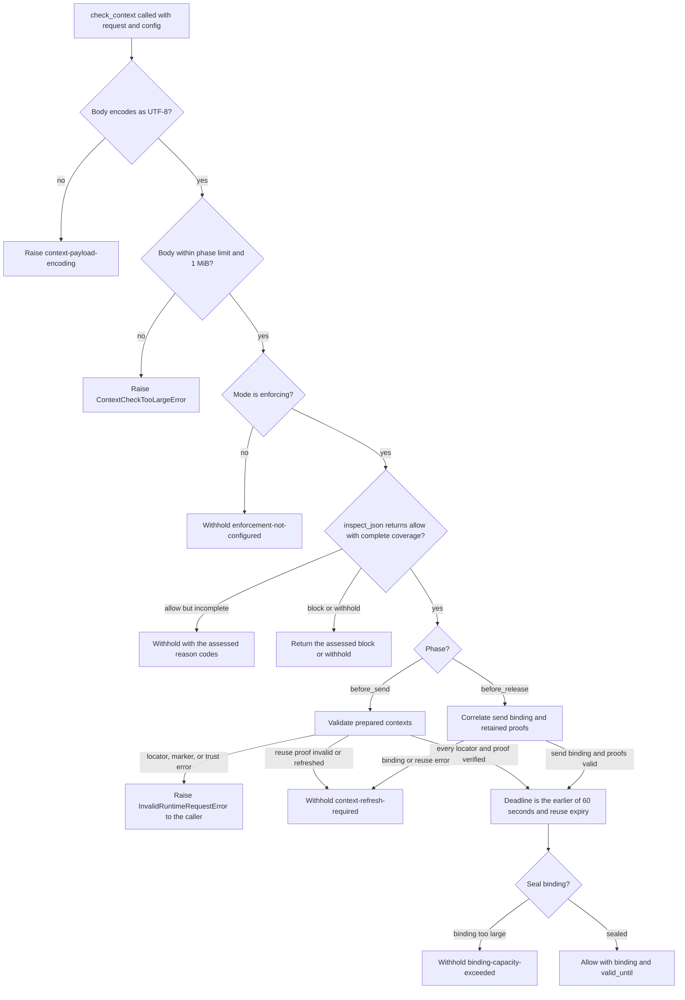
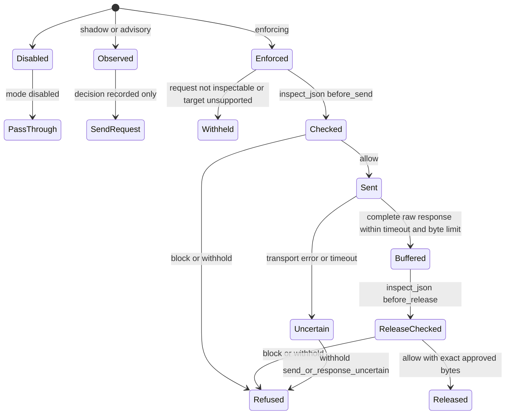

# Context and Inference Protection

Context protection is the set of controls that decide whether exact model-bound bytes may leave PowerContext. It has three layers that share one vocabulary of verdicts:

1. **Admission of final bytes** through `check_context`, at two phases: `before_send` (the request body, after the caller's native provider rendering, before anything is written) and `before_release` (the complete raw response, before any content, tool argument, or error is exposed).
2. **Inference protection** at PowerContext's owned provider transports, which runs the same rule engine on every actual HTTP attempt and refuses delivery when enforcement fails.
3. **Reuse and projection bindings** that tie a prepared historical context to its current authorization and source state, and that limit what a decision backend sees.

<!-- openwiki: broken internal link [../operate/context-protection.md] file "../operate/context-protection.md" does not exist. Fix the href or restore the target, then delete this comment. -->
<!-- openwiki: broken internal link [../operate/inference-protection.md] file "../operate/inference-protection.md" does not exist. Fix the href or restore the target, then delete this comment. -->
The protection is opt-in. Its default mode is `disabled`, and the rule engine never calls a model, never redacts, and never rewrites content. The caller still owns model execution and delivery; a check does not authorize spending. For the operator-facing contract, see the [context protection guide](../operate/context-protection.md) and the [inference privacy guide](../operate/inference-protection.md) in the repository docs. This page explains how the implementation fits together.

## Verdicts and phases

The check result carries one of three decisions, `allow`, `block`, or `withhold`, defined by `ContextCheckResult` in [context_check.py](repo://src/powercontext/builtin/runtime/context_check.py#L123-L130). The rule engine returns the same three values in `PrivacyDecision` ([privacy.py](repo://src/powercontext/builtin/inference/privacy.py#L112-L120)).

| Verdict | Meaning | Action permitted |
| --- | --- | --- |
| `allow` with `coverage.complete=true` | Every supported representation was inspected and no rule fired. | The corresponding action (send or release) may proceed. |
| `block` | A configured forbidden value or format was found. | None. |
| `withhold` | The check could not be completed or the payload uses an unsupported shape, such as an unsupported target, duplicate keys, or an exceeded budget. | None. |
| refusal | A protected transport raised `InferencePrivacyError` carrying the phase and a `block` or `withhold` decision. | The call fails before send or before release. |

`allow` without complete coverage is never returned to a caller: `check_context` converts it to `withhold` (see the flow below). Refusal is the transport-side form of a non-allow verdict; the exception is deliberately not an unavailable-provider or validation error, so advisory fallbacks and smaller-window retries cannot consume it ([errors.py](repo://src/powercontext/builtin/inference/errors.py#L23-L56)).

The `before_send` and `before_release` phases use different size limits. The payload limit is `max_payload_bytes` for send and `max_response_bytes` for release, both capped by `MAX_CHECK_BODY_BYTES` of 1,048,576 bytes ([context_check.py](repo://src/powercontext/builtin/runtime/context_check.py#L40-L44), [privacy.py](repo://src/powercontext/builtin/inference/privacy.py#L82-L96)).

## Check flow

`check_context` is a pure admission function over the complete carrier. `ScopedContextApplication.check` wraps it, first checks scope access, and supplies a `validate_reuse` callback that reauthorizes retained proofs ([application.py](repo://src/powercontext/builtin/runtime/application.py#L1160-L1197)). The Server route forwards the request and authorizes `SCOPE_READ` on every requested scope, and it derives the binding identity from the current subject, actor, groups, and credential ([app.py](repo://src/powercontext/server/app.py#L3602-L3626)).

Caption: the branches of `check_context` in [context_check.py](repo://src/powercontext/builtin/runtime/context_check.py#L340-L424). Errors raised as plain `InvalidRuntimeRequestError` propagate to the caller, while binding and reuse-proof failures are converted into a `withhold` result.

Several behaviors follow from this flow:

- Observation modes (`shadow`, `advisory`) never reach the rule engine in `check_context`; they return `withhold` with `enforcement-not-configured`. Observation modes only report on already materialized requests at the transport.
- A `block` or `withhold` from the rule engine is returned as-is with its reason codes and coverage. It is not converted to `allow`.
<!-- openwiki: broken internal link [../operate/context-protection.md] file "../operate/context-protection.md" does not exist. Fix the href or restore the target, then delete this comment. -->
- Structural errors in the carrier, such as an unsupported JSON pointer, a locator that does not cover a whole text block, an overlap, or a non-user message, are not verdicts. They raise and are reported as request errors. The public API maps invalid carriers and locators to 422, authorization failures to 401 or 403, and oversized payloads to 413 ([operate guide](../operate/context-protection.md)).

## Admission of prepared context before send

A `before_send` carrier contains the exact JSON text (`powercontext.model-json-payload.v1`) and, for each retained prepared block, a binding plus a text location given as a JSON pointer and half-open UTF-8 byte offsets ([context_check.py](repo://src/powercontext/builtin/runtime/context_check.py#L65-L107)).

`_validate_prepared` enforces these invariants before it allows the send ([context_check.py](repo://src/powercontext/builtin/runtime/context_check.py#L278-L310)):

- A target profile with `require_prepared_contexts` cannot be sent without at least one prepared context. A pure check does not silently downgrade.
- Locators must point at a `user` message's text, in the protocol's supported position (`messages` for chat and Anthropic, `input` for Responses). System or developer content cannot be promoted into a prepared block.
- Locators must be strictly ordered and non-overlapping, and they must fall on UTF-8 character boundaries.
- The bytes located must match the verified proof's `content_bytes` and SHA-256 digest, and the proof's trust must be `historical-data`.
- Any historical-data marker that appears in the body must be covered by a bound locator. Markers split across native text blocks cannot be covered and are rejected.

The send permit's deadline is the earlier of `SEND_VALIDITY` (60 seconds) and the earliest reuse proof expiry ([context_check.py](repo://src/powercontext/builtin/runtime/context_check.py#L37-L48), [context_check.py](repo://src/powercontext/builtin/runtime/context_check.py#L385-L403)). The send binding is sealed until `correlate_until`, which is `now` plus `RESPONSE_CORRELATION` of 300 seconds, so the response can be correlated for up to five minutes after the send decision.

## Correlation before release

A `before_release` carrier contains the complete raw response and the send binding as `request_binding`. `_correlate` opens that binding under the send purpose and requires the same identity, Scope, target profile, policy fingerprint, and phase `before_send` ([context_check.py](repo://src/powercontext/builtin/runtime/context_check.py#L312-L338)). It then reauthorizes every retained prepared binding through `validate_reuse`, so policy or permission changes between send and release stop release. The release permit is sealed until its 60-second deadline; correlation never extends the send deadline.

Two points matter for implementers:

- The send permit records a payload digest of the approved headers and body, but the release correlation path does not compare the release payload with that digest. The release check verifies the response against current policy and rule engine, and it confirms that the send binding is valid. Matching the released response to the exact approved request is the executor's job: it must retain each call's `request_binding` locally, since a stateless Core cannot prove which approved request an external executor actually sent.
- A policy change alters the policy fingerprint, so a binding sealed under the old policy fails correlation. The fingerprint hashes the whole configuration, including the forbidden values, without storing those values in metadata ([context_check.py](repo://src/powercontext/builtin/runtime/context_check.py#L137-L142)).

## Inference protection at owned transports

Built-in OpenAI and Anthropic clients, configured embedding and rerank paths, and the MiniMax and JEV paths install `ProtectedAsyncTransport` at the final HTTP layer, after native SDK rendering ([composition.py](repo://src/powercontext/builtin/runtime/composition.py#L2186-L2196), [minimax.py](repo://src/powercontext/builtin/inference/minimax.py#L98-L108)).

Caption: the protected transport's send and release states, from [protected_transport.py](repo://src/powercontext/builtin/inference/protected_transport.py#L65-L190).

Details that follow from the transport code:

- In `shadow` and `advisory`, the transport records the decision but never refuses delivery, and it does not inspect or buffer responses. Only `enforcing` buffers the response and refuses.
- In enforcing mode, the transport reads a streaming request body into memory before inspection. A stream it cannot read, a body above `max_payload_bytes`, a target that does not match a trusted profile, or a method other than POST is withheld before send.
- A response with a non-identity `content-encoding`, a body above `max_response_bytes`, a timeout, or a transport error is withheld at release. Timeouts and transport errors carry the reason `send_or_response_uncertain`, and their usage is recorded as incomplete.
- The SDK receives only the exact approved decoded bytes; compression and length headers are removed. Streaming responses (`text/event-stream`) use the SSE inspector rather than the JSON inspector.
- Refusals are raised as `InferencePrivacyError` and are not absorbed by advisory decision fallbacks. Usage known at the failure remains attached and is reported.

<!-- openwiki: broken internal link [../operate/inference-protection.md] file "../operate/inference-protection.md" does not exist. Fix the href or restore the target, then delete this comment. -->
The Memory write gate and Topic Memory workers inherit this behavior: a refusal leaves the Source window pending rather than publishing or acknowledging it, as described in the [inference privacy guide](../operate/inference-protection.md).

## Rule engine

`PrivacyPolicy.inspect_json` implements the admission rules shared by the transport and `check_context` ([privacy.py](repo://src/powercontext/builtin/inference/privacy.py#L334-L421)). Its order determines which reason code a caller sees:

1. `disabled` allows, and an unknown target profile withholds with `target_unsupported`.
2. Endpoint mismatch, payload too large, duplicate or unsupported headers, and a non-JSON content type withhold.
3. Non-UTF-8 bodies withhold with `encoding_unsupported`.
4. A forbidden value or pattern in headers or text blocks with `block` and `forbidden_content`, which is a complete-coverage verdict.
5. Invalid or too-deep JSON, or duplicate keys, withhold. Opaque image, audio, and file carriers and incomplete tool arguments withhold.
6. For `before_send`: the model must match the profile, unknown fields withhold, streaming requires `allow_streaming` on OpenAI Chat, provider state (`store: true`, `extra_body`, or `truncation: auto`) withholds, `n` must be 1, and cache settings must be approved. Budget checks run last.
7. For `before_release`: a response model must match the profile or its listed `response_models`, and the response must be complete.

Budget checks (`_budget`) apply to generating protocols. An enforcing generating target without a declared context window and output limit withholds with `budget_unconfigured`. A request whose output limit is missing, zero, or above the configured maximum withholds. The window check requires `validated_utf8_token_bound`, and it withholds when the payload plus reserve plus output limit exceeds the declared window. The rule engine does not treat a character estimate as a hard bound.

Rule matching covers configured exact secret values and the bounded formats `email`, `private_key`, and `api_token`. It is not a general PII classifier or semantic DLP system.

## Reuse bindings and their lifetimes

`prepare` with `include_reuse` returns a `PreparedContextWithReuse` whose `reuse` binding is produced by `prepare_reuse` ([context_reuse.py](repo://src/powercontext/builtin/runtime/context_reuse.py#L136-L176)). The binding captures the content's digest and byte count, the ordered Atomic Memory roots, a complete dependency snapshot, one dependency per cited code file (its path and SHA-256 digest), and the expiry. Reuse is supported only for a single Scope without context references.

`validate_reuse` reopens the binding and compares the current state with the recorded one ([context_reuse.py](repo://src/powercontext/builtin/runtime/context_reuse.py#L178-L221)):

- A binding whose Scope or identity differs is rejected with `context-binding-identity-mismatch`.
- The Atomic Memory dependency snapshot must equal the recorded one, otherwise the proof fails with `context-reuse-source-changed`.
- Each cited code file must still have its recorded digest in the Scope's worktree. Edits to uncited files or an index rebuild do not invalidate the proof.
- The combined dependency count is capped at `MAX_REUSE_DEPENDENCIES`, which equals `MAX_ATOMIC_MEMORY_DEPENDENCIES` of 64 ([atomic_memory.py](repo://src/powercontext/builtin/runtime/atomic_memory.py#L119-L119)). Proofs with more than 32,768 content bytes are rejected.

Lifetimes and binding properties:

| Artifact | Lifetime | Source |
| --- | --- | --- |
| Reuse binding | 5 minutes (`REUSE_RETENTION`) | [context_reuse.py](repo://src/powercontext/builtin/runtime/context_reuse.py#L45-L45) |
| Send permit deadline | 60 seconds (`SEND_VALIDITY`), capped by the earliest reuse expiry | [context_check.py](repo://src/powercontext/builtin/runtime/context_check.py#L37-L48) |
| Send permit correlation | 5 minutes (`RESPONSE_CORRELATION`) | [context_check.py](repo://src/powercontext/builtin/runtime/context_check.py#L37-L48) |
| Release permit | 60 seconds, not extended by correlation | [context_check.py](repo://src/powercontext/builtin/runtime/context_check.py#L385-L403) |

`BindingCodec` seals each token as authenticated, encrypted AES-GCM with an audience that includes the key ID, deployment ID, generation, and purpose, so a token cannot be replayed for a different purpose ([context_bindings.py](repo://src/powercontext/builtin/runtime/context_bindings.py#L33-L108)). A caller-supplied key must be exactly 32 bytes. Without one, the key is ephemeral and bindings do not survive restart. A binding never grants access: every use rechecks current authorization.

Reuse is not a cache. There is no stored prompt or response cache, and reuse does not create a provider KV cache.

## Decision projection and processing security

The same verdict discipline extends to decision backends and to background processing, though with separate boundaries.

**Decision projection.** A decision backend receives only a bounded projected request, not the authoritative object. `KnownSecretDecisionRequestSanitizer` replaces known secret values and provider-key prefixes, recognizes JSON evidence values, and returns either a permitted projection with content-free redaction facts (`subject_redacted`, `evidence_redacted`) or a withheld projection with one of the reason codes `projection_material_removed`, `projection_sanitizer_failed`, or `projection_sanitizer_invalid` ([decision_projection.py](repo://src/powercontext/builtin/runtime/decision_projection.py#L51-L60), [decision_projection.py](repo://src/powercontext/builtin/runtime/decision_projection.py#L164-L227)). `apply_decision_request_sanitizer` rejects any result that changes the decision kind or question, or that exceeds the subject and evidence bounds, so a sanitizer can only replace the subject and evidence ([decision_projection.py](repo://src/powercontext/builtin/runtime/decision_projection.py#L287-L325)).

Decision policy maps the backend's outcome to its own verdict vocabulary, `ALLOW`, `DENY`, or `UNKNOWN`, separate from the transport verdicts. A fallback or abstain becomes `UNKNOWN` with coverage `UNADJUDICATED`, and a deterministic local rule can record an adjudicated verdict with no model usage ([decision_policy.py](repo://src/powercontext/builtin/runtime/decision_policy.py#L49-L100), [decision_policy.py](repo://src/powercontext/builtin/runtime/decision_policy.py#L101-L141)). Observation logs record only bounded fields, not a content ledger ([decision_policy.py](repo://src/powercontext/builtin/runtime/decision_policy.py#L144-L171)).

**Processing security.** Scheduled artifact processing in a child process reconstructs Server authorization from trusted settings rather than from model output ([processing_security.py](repo://src/powercontext/server/processing_security.py#L1-L19)). `build_worker_security` raises `BuiltinConfigurationError` before dispatch if the authorization provider or relational repository was injected or is not the standard builtin type in enforced mode. The background principal comes from `background_principal_id`, falling back to the legacy static principal, and the serialized spec omits credentials ([processing_security.py](repo://src/powercontext/server/processing_security.py#L55-L86)). Topic Memory publications are authorized by Scope authority alone, with no per-topic owner ([processing_security.py](repo://src/powercontext/server/processing_security.py#L174-L183)).

## Invariants and failure semantics

- Only `allow` with complete coverage permits an action. Every other path, including a refused reuse proof, a missing enforcing configuration, or an incomplete response, yields no send or release.
- If the required check is unavailable, the caller must not send or release. The API withholds when enforcing is not configured.
- Enforcing mode disables SDK transport retries, while the output-schema retries that remain are bounded and every actual attempt is checked.
- Usage that a protected response consumed is retained on refusal, and cache-read input is not double counted.
- Admission never redacts or restores values. A changed payload, including a reversible placeholder substitution, has different bytes and therefore needs its own admission. Literal placeholder text in an approved body stays ordinary content.
- A correlated release proves only that current policy and the retained proofs still hold; it does not prove execution exactly once or that the model understood its evidence.

## Tests that anchor this behavior

- [test_automatic_prompt_privacy.py](repo://tests/test_automatic_prompt_privacy.py#L1-L147) runs each automatic prompt hook against a controlled loopback server. For credential-bearing prompts, the hook skips source capture, keeps preparation running, does not forward the secret in any request, and logs only a `sensitive_content` reason.
- [test_processing_security.py](repo://tests/test_processing_security.py#L1-L153) checks that worker identity excludes credentials, that injected or subclassed authorization providers fail before background dispatch, and that the background CLI preserves the deployment identity.

The page's source is limited to the runtime, inference, and server modules cited above. Repository docs under `docs/en/docs/operate/` describe the operator contract and were used for the public status codes and the bounded streaming profile. Behavior beyond the owned transports, such as provider-side retention or routing, is outside this protection's guarantees.

## Related pages

- [Sources and processing](sources-and-processing.md) describes the Source and processing lifecycle that feeds Memory writes gated by these checks.
- [Gateway architecture](../architecture/gateway.md) describes the Server layer that exposes the check and prepare routes.
- [Prepare and recall workflow](../workflows/prepare-and-recall.md) describes the prepare path that produces prepared context and reuse bindings.
