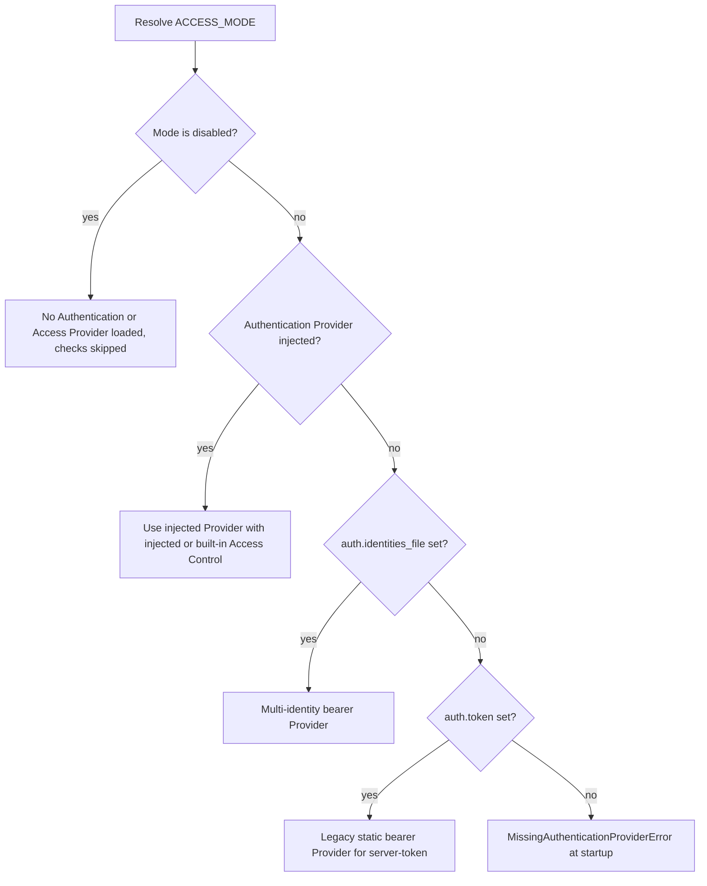
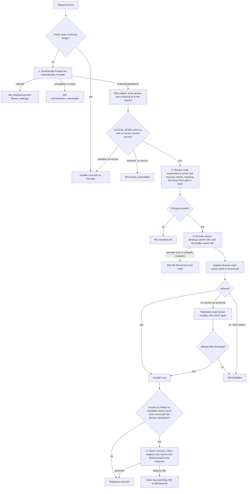
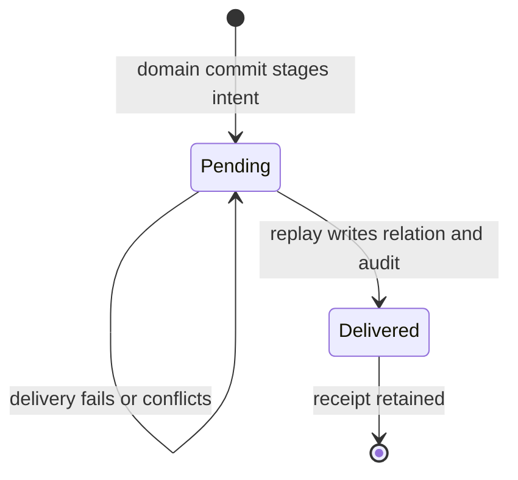

# Scopes and Access Control

A **Scope** is the ownership and isolation unit of PowerContext. Every Artifact, Candidate, Prompt, and Handoff lives inside exactly one Scope, and every authorization decision is expressed against a Scope or a resource nested in it. The opaque `scope_id` identifies data; it does not authenticate the caller and it does not grant permission. Authentication and authorization are separate layers that the Server composes around the Scope model.

This page reflects the repository at commit `b8b18909`. Read it with [Server Runtime](../architecture/server-runtime.md), which describes how the Server assembles these providers at startup, and with [Artifact Families](artifact-families.md), which defines the families that Access profiles govern.

## Responsibilities at a glance

| Layer | Owner in source | Responsibility |
| --- | --- | --- |
| Scope identity and binding | `builtin/scope/application.py` | Create Scopes, resolve which Scope a host uses, keep a default pointer. |
| Authentication | `server/authentication.py`, `server/middleware.py` | Turn a transport credential into a trusted `PrincipalRef` and groups. |
| Authorization service | `builtin/authz/service.py` | Decide whether a Principal may perform an action on a resource, enforce fail-closed behavior, and audit decisions. |
| Vocabulary and profiles | `builtin/authz/models.py`, `builtin/authz/profiles.py` | Define actions, roles, resource kinds, and the per-family Access profiles. |
| Providers | `builtin/authz/repository.py`, `composition.py`, `casbin.py`, `authzen.py` | Store immutable Bindings, Artifact owners, Candidate attestations, and decision audit; evaluate decisions. |
| Dream and background access | `builtin/authz/dream.py`, `server/dream_access.py` | Re-check a recorded Dream principal and bind Review checks to the request principal. |
| Owner recovery | `builtin/authz/owner_recovery.py` | Stage and deliver ownership intents that could not commit in the domain transaction. |
| Route wiring | `server/app.py`, `server/factory.py` | Attach one authorization dependency per operation and select providers at startup. |
| Migration | `server/ownership.py`, `server/cli.py` | Attribute legacy data created while Access was disabled. |

Agents should treat the Scope as a precondition. Before writing content, the agent must have a resolved Scope (see [Resolving the Scope before writing](#resolving-the-scope-before-writing)), and the Principal behind its credential must hold the permission that the write requires.

## Access modes

`ACCESS_MODE` has two values, `disabled` and `enforced`. The default is `disabled`. [`AccessControlConfig`](../../src/powercontext/server/settings.py) carries the mode, the deployment identifier (default `powercontext`), and an optional background Principal.

Caption: provider selection when the Server is created. Enforced mode never starts without an Authentication Provider.

### Disabled mode

In `disabled` mode the factory loads no security Providers and raises `ValueError` if an Access Control service or Authentication Provider is injected anyway. The per-operation authorization dependency finds no Access Control service and does nothing, so requests run without a Principal. The connection identity then reports `DISABLED` authentication. Disabled mode is the local default, which is why a fresh install works without a token.

Disabled mode is not a multi-user mode. A legacy `AUTH_TOKEN` combined with `disabled` is rejected by settings validation, and so is a background Principal.

### Enforced mode and the provider fallback

When `enforced` is set, the Server picks the Authentication Provider in this order:

1. An Authentication Provider injected into `create_server_app`.
2. The multi-identity file at `auth.identities_file`, which is loaded as `MultiBearerAuthenticationProvider`.
3. The legacy `auth.token`, which is loaded as `StaticBearerAuthenticationProvider`.
4. None of the above. The Server raises `MissingAuthenticationProviderError`, whose message says that enforced mode requires an injected Authentication Provider or a legacy `AUTH_TOKEN`.

An injected Access Control service without an Authentication Provider does not satisfy the fallback. Authentication must come from one of the first three sources. When no Access Control service was injected, the lifespan opens the built-in relational Access store, described below.

Settings validation enforces several coupling rules. `auth.enabled` forces `enforced`. An identity file requires `enforced` and cannot be combined with a legacy token. A legacy token cannot be used with `disabled`. An enabled Dashboard in `enforced` mode requires a token, and source management requires `enforced`. A non-loopback bind without authentication is rejected unless the operator explicitly allows it.

## Authentication

### Legacy static bearer

The legacy token maps every valid bearer credential to one fixed service Principal, `PrincipalRef(type="service", id="server-token")`, with the description `PowerContext static bearer`. The comparison uses a constant-time check, and the credential ID is `static-bearer`. Because this Principal is the legacy administrator, the factory passes it as a bootstrap administrator. That bootstrap creates `server.observer` and `server.admin` Bindings for the Principal on the Server resource, and the same Principal becomes the static Scope preset (see [Static Scope preset](#static-scope-preset)). The token therefore identifies one administrator and cannot distinguish individual users.

### Multi-identity bearer file

`MultiBearerAuthenticationProvider` reads a JSON file with an `identities` list. Each entry holds a `credential_id`, a SHA-256 `token_digest`, and a `subject` Principal. The loader rejects symbolic links and non-regular files. On POSIX it rejects any group or other permission bits, so the file must be private (mode `600`). Digests must be 64 lowercase hexadecimal characters, and credential IDs and digests must be unique. Each request rereads the file, so rotation takes effect on the next request. If the file becomes unreadable mid-run, the provider raises `AuthenticationUnavailableError` and the request gets `authentication_unavailable`, not an accepted credential. An identity receives no implicit role. Its Principal can only act through Bindings, or through the administrators listed in `auth.administrators`, which the factory bootstraps as server administrators.

### Authentication Provider SPI

Any object that implements `authenticate(request)` and `readiness()` can serve as an Authentication Provider. The SPI receives an `AuthenticationRequest` carrying the transport, headers, and client host. It must return an `AuthenticationResult` with a trusted `subject` Principal, an optional `actor`, a bounded tuple of `subject_groups` (at most 100, with no duplicates and no collision with the subject or actor), and an optional `credential_id` of at most 255 trimmed characters. The result is frozen, and `__post_init__` rejects invalid values, so a provider cannot smuggle an untrusted group or identifier into decisions.

### Request authentication

`AuthenticationMiddleware` authenticates each protected external HTTP request before routing. It skips internal bridge calls and public paths: health probes, the root and docs paths, the remote-skill enrollment and receipt paths, and the dashboard static, session, and plugin asset paths. The middleware maps outcomes as follows:

- A rejected credential returns `401` with the `unauthorized` code and a `WWW-Authenticate: Bearer` header.
- An unavailable provider, or any other provider exception, returns `503` with `authentication_unavailable`.
- A successful result is bound to the request context for the handler, and the binding is reset after the handler returns.

When the Dashboard is enabled and the path is under `/dashboard/`, a rejection returns a login response instead of a JSON error.

### Transport access logs

`server/access.py` contains transport access logging only. It writes one completion record per external request and per logical MCP request. It does not make authorization decisions and is not part of the access-control path.

## Permissions and roles

The vocabulary is defined once in [`models.py`](../../src/powercontext/builtin/authz/models.py). Action names are the `AccessAction` values and appear unchanged in audit records, in `/v1/access/check`, and in operation metadata.

The public action set (`PUBLIC_ACCESS_ACTIONS`) has fourteen members:

- Server resource: `server.observe`, `server.admin`.
- Scope resource: `scope.read`, `scope.contribute`, `scope.review`, `scope.delegate`, `scope.admin`, and `gateway.invoke`.
- Artifact resource: `artifact.read`, `artifact.write`, `artifact.share`, `handoff.evidence.inspect`, `handoff.acknowledge`, and `prompt.use`.

`access.self` is an internal authentication-only requirement used by self-service routes. It is excluded from the public set, and the built-in provider answers it with `authenticated` without consulting bindings.

The role set (`AccessRole`) has thirteen fixed members: `handoff.viewer`, `handoff.receiver`, `artifact.viewer`, `prompt.user`, `artifact.owner`, `scope.viewer`, `scope.contributor`, `scope.reviewer`, `scope.delegator`, `scope.admin`, `gateway.user`, `server.observer`, and `server.admin`.

Each role maps to a fixed action set (`ROLE_ACTIONS`) on the resource it is bound to:

| Role | Actions on its own resource |
| --- | --- |
| `scope.viewer` | `scope.read` |
| `scope.contributor` | `scope.read`, `scope.contribute` |
| `scope.reviewer` | `scope.read`, `scope.review` |
| `scope.delegator` | `scope.read`, `scope.delegate` |
| `scope.admin` | `scope.admin` only |
| `gateway.user` | `gateway.invoke` |
| `server.observer` | `server.observe` |
| `server.admin` | `server.admin` |
| `artifact.viewer` | `artifact.read` |
| `prompt.user` | `artifact.read`, `prompt.use` |
| `handoff.viewer` | `artifact.read`, `handoff.evidence.inspect` |
| `handoff.receiver` | `artifact.read`, `handoff.evidence.inspect`, `handoff.acknowledge` |
| `artifact.owner` | `artifact.read`, `artifact.write`, `artifact.share`, `handoff.evidence.inspect` |

Parent roles also imply child actions on resources inside them (`ROLE_CHILD_ACTIONS`). `scope.viewer`, `scope.reviewer`, and `scope.delegator` imply `artifact.read`, `handoff.evidence.inspect`, and `prompt.use` on Artifacts in their Scope. `scope.contributor` adds `handoff.acknowledge`. `scope.admin` implies only `artifact.share`, and `server.admin` implies `scope.admin` and `artifact.share` on Scopes and Artifacts. `server.observer` has no child actions. This split is deliberate: administration roles do not become content roles. A `scope.admin` Binding can share Artifacts in its Scope but cannot read or write them, and a reviewer does not carry `scope.contribute`.

`ROLE_CARDINALITIES` makes `handoff.receiver` and `artifact.owner` the only one-per-resource roles; every other role may have many active Bindings per resource. `ROLE_SUBJECT_TYPES` lets groups hold every role except `handoff.receiver` and `artifact.owner`, which accept only `user` and `service` subjects. `artifact.owner` is never bindable directly; it is established only by the owner relation described below.

### Artifact Family profiles

[`profiles.py`](../../src/powercontext/builtin/authz/profiles.py) defines one `ArtifactFamilyAccessProfile` per built-in family. Each profile fixes the base read action, the additional actions, the grantable roles, the selector rule, and the share unit:

| Family | Share unit | Shareable states | Additional actions | Grantable roles | Selector |
| --- | --- | --- | --- | --- | --- |
| `atomic-memory` | artifact | active, forgotten, merged, retired | none | `artifact.viewer` | forbidden |
| `handoff` | artifact | committed | `handoff.evidence.inspect`, `handoff.acknowledge` | `handoff.viewer`, `handoff.receiver` | forbidden |
| `memory` | memory_entry | active, retired | none | `artifact.viewer` | required (`memory_entry`) |
| `experience` | artifact | approved | none | `artifact.viewer` | forbidden |
| `skill` | artifact | approved | none | `artifact.viewer` | forbidden |
| `profile` | artifact | committed | none | `artifact.viewer` | forbidden |
| `prompt` | artifact | none | `prompt.use` | none | forbidden |

Prompts inherit Scope access and cannot be shared directly: they have no grantable roles. Every profile lists `artifact.write` as a mutation action. Plugin families registered at load time receive the framework's read and write semantics with no grantable roles. Binding validation (`validate_binding_role` and `validate_binding_subject`) rejects a role that the family does not grant, and a subject type that the role does not accept.

## Authorization

### The decision path

Every operation with an access requirement is wrapped by one authorization dependency, attached in `_add_route` only when the operation declares `access`. When an Access Control service is present, the dependency resolves the requirement into concrete `(action, resource)` checks, runs them, and only then calls the handler. A requirement can be static (for example `server.admin` on the Server), request-derived (for example `scope.admin` on the `scope_id` in the body), or resolved by a named resolver such as `create_artifact_access` or `path_artifact_write_access`. The authorization dependency is the only place where route-level checks run; handlers do not re-check the route requirement.

Caption: the request authorization path in enforced mode. Disabled mode skips the dependency entirely. The owner-recovery branch applies only to creation of Artifacts and Candidates, and it runs after the check has allowed the write.

The check path itself is defined in `AccessControlService`. `check` validates the action against the resource (`validate_action_resource`), evaluates the request through the provider, validates the provider's decision shape, and appends one audit event unless the action is `access.self`. `require` raises `AccessDeniedError` on a denial, and a decision whose reason is `artifact-owner-pending` raises `AccessUnavailableError("artifact_owner_pending")` instead. `require_all` and `require_any` apply the same rules to a set of checks.

When the provider rejects a decision, the route does not always fail at once. `_authorize_checks` first checks whether the denial is `no-matching-binding` or `no-matching-policy` and whether the static preset could supply the action. If so, it materializes the preset grants and checks again. Any other denial raises immediately.

### Built-in decision logic

The built-in provider (`BuiltinAuthorizationProvider`) reads one snapshot consisting of the policy revision, the active Bindings for the caller and its groups, the owners of the requested Artifacts, and the Artifacts the caller owns. A Binding is active only if its state is active and it has not expired at the decision time. The provider grants access when an active Binding's role covers the requested action on the same resource, on a covering parent Scope, or on the Server through a parent role. If no Binding grants the action, the owner rule applies: an Artifact owner whose Principal equals the caller receives the `artifact.owner` actions on that Artifact, with reason `artifact-owner`. Otherwise the reason code is `no-matching-binding`.

The snapshot is read in one SQL statement when the repository supports `decision_snapshot`, which is the case for the relational repository. The statement is a `UNION ALL` over the policy head, the active Bindings for the subjects, the owners of the requested Artifacts, and the Artifacts owned by the caller, so a decision never pairs a policy revision with bindings from a different state. A repository without the snapshot capability falls back to reading the revision, Bindings, and owners separately, and it checks that the revision did not move. Both paths retry up to three times and then raise `policy-snapshot-unstable`, which the caller sees as `503`.

The resource-filter path used by list operations derives its authorized set from the same function as point decisions (`_derive_authorized_resource_filter`), so list results and point decisions cannot drift apart. A provider must return a complete filter. The number of direct resource keys is capped at the smaller of the provider's `max_direct_resource_keys` and 10,000, and a filter above that cap raises `resource_filter_limit_exceeded`.

Provider decisions are validated before use. A decision must be an `AccessDecision` with a boolean `allowed`, a reason code of 1 to 64 safe characters, a bounded policy revision, and no matched subject on a denial. A malformed decision raises `AccessUnavailableError` and is never treated as a grant.

### Static Scope preset

The legacy static Principal is special. The preset lets the Server create the Scopes a legacy deployment needs without a separate administrator step. It applies only when the factory passed the static Principal as the single bootstrap administrator, which happens with the legacy `AUTH_TOKEN` (or the CLI path that sets it when a token is configured).

The four Scope roles granted by the preset are `scope.viewer`, `scope.contributor`, `scope.reviewer`, and `scope.delegator`. `scope.admin` is not part of the preset. Its administrative actions reach the preset through the server administrator role that the factory bootstraps for the same Principal. The preset is materialized in four situations:

- A Scope is created through `POST /v1/scopes`, which requires `server.admin` on the Server, and the caller is the preset Principal.
- A denied check comes back as `no-matching-binding` or `no-matching-policy` for the preset Principal and the action can be supplied by one of the four roles (`can_bootstrap_static_scope`).
- A subject-source request binds to a Scope through the same connection, so the grant joins the atomic write.
- A scheduled profile flush runs as the scheduled Principal, which is the legacy preset Principal when no background Principal is configured (see [Background and Dream access](#background-and-dream-access)).

Each grant is protected by a receipt key from `_static_scope_receipt_keys`, which combines the deployment, Principal, Scope, and role. If the key is too long for the 255-character column, the key becomes a SHA-256 digest of the legacy form. Before creating a Binding, the service checks whether the receipt already exists, including under the legacy key. An existing receipt is final even if the Binding was later revoked, so a revoked preset grant is not recreated. The preview used by the migration plan (`static_scope_bootstrap_would_grant`) follows the same rule and never treats a receipt as a grant.

### Scope and Artifact checks used by content writes

Creating a non-Prompt Artifact in a Scope checks `scope.contribute` on that Scope. Creating a Prompt checks `scope.admin`. Reading an exact Scope selection checks `scope.read` on each Scope, while an all-Scope or subtree-style selection checks `server.observe` on the Server. Reading a Handoff revision checks `artifact.read` and `handoff.evidence.inspect`, and acknowledging an exact revision checks `handoff.acknowledge`. Acknowledgement of a non-exact selection checks `scope.contribute` on the Scope. The operation table in `http/_generated/operations.py` is the source of truth for each route.

`POST /v1/scopes` requires `server.admin` on the Server resource. This is why creating a new Scope is an administrative act even though binding a host to an existing Scope is not.

Managing Access itself is also restricted. Binding management requires `scope.admin` on the Scope, `server.admin` on the Server, or the delegate action for Handoff bindings, depending on the resource. Access plans and migrations require `server.admin` in enforced mode.

### Providers

The Server ships three Authorization Provider implementations. The Server factory selects only the built-in provider.

- **Built-in relational provider.** `open_builtin_access_control` in [`composition.py`](../../src/powercontext/builtin/authz/composition.py) opens the Access tables in the configured database (SQLite, OceanBase, or SeekDB) and wraps them in `BuiltinAuthorizationProvider`. The factory uses it in enforced mode whenever no Access Control service was injected. It reports `safe_resource_filtering`, `multi_requirement_check`, and `relationship_management` as enabled, and `group_subjects` as disabled.
- **Embedded Casbin adapter.** `CasbinAuthorizationProvider` evaluates active Bindings with a fixed request and policy model that matches action, object, Scope, and deployment. It builds a fresh Casbin enforcer for each decision, so no enforcer state is shared between decisions. It applies the same artifact owner rule as the built-in provider and returns `casbin-policy` or `no-matching-policy`. It is opened only through `open_casbin_access_control`, and the Server factory does not select it. Tests check that it produces the same terminal semantics as the built-in provider.
- **AuthZen client.** `AuthZenAuthorizationProvider` calls an external AuthZen PDP over the evaluation and evaluations endpoints. It returns only the boolean decision and an optional `policy_revision`, and it maps provider responses to `authzen-allow` or `authzen-deny`. It does not provide relationships and does not support resource filtering. Its `resolve_resource_filter` raises `safe_resource_filtering_unavailable`, so list operations fail closed. The Server factory does not select it.

`GET /v1/access/me` reports the active mode, the resource kinds, the Artifact families with their share units and actions, and the provider capabilities: safe resource filtering, multi-requirement check, relationship management, group subjects, multi-principal support, and the direct resource key limit. The authenticated Principal in that response is an opaque identity, not a binary attestation.

## Resolving the Scope before writing

An Agent must resolve the Scope before it writes. `ScopeApplication.resolve_binding` chooses the Scope in this order, and the first match wins:

1. An explicit Scope ID supplied by the caller. If it is missing, the lookup raises `ScopeNotFoundError`.
2. The durable binding for each binding key in the order given. The first existing binding decides the Scope.
3. The default Scope pointer, unless the caller passes `allow_default=false`.

When no explicit ID is supplied, no binding exists, and no default is set, or when the default is disallowed, resolution raises `ScopeBindingNotFoundError`. Both missing-Scope and missing-binding errors map to `404 scope_not_found`. A direct lookup of a missing Scope also returns `404`, because a bare ID cannot prove that the Scope ever existed.

If a binding or the default pointer exists but its target Scope is gone, the Server returns `409 scope_binding_target_missing`, with the original target ID in `error.details.scope_id`. Resolution stops at that binding and does not fall back to a later binding or to the default. Clients should surface this conflict. They should not create a replacement Scope and overwrite the binding, because that would silently move data to a different project. The operator must restore the target Scope or repair the binding explicitly.

`ScopeApplication.bootstrap_default` creates a Scope titled `Default` with a fixed idempotency key and sets it as the default pointer, returning the existing default if one is already set. Creation is idempotent per key: replaying the same key with the same parameters returns the existing Scope, and reusing a key with different parameters returns `409 scope_idempotency_conflict`. Parent references are validated for existence and acyclicity, and context references must point at existing Scopes other than the Scope itself. Parents organize Scopes, and context references describe reuse. Neither grants access. Exact, subtree, and all-Scope selections change which Scopes an inspection covers. They do not change the caller's permissions.

Resolving or selecting a Scope never authenticates the caller or grants a permission. The permission check happens afterward, in the authorization dependency or the in-transaction `require` call.

## Owner recovery

Artifacts and Review Candidates have a single owner, established by the Server when the object is created. Ownership is written to relationship and audit stores. When those stores are the same database as the business data, the owner write joins the domain transaction through `owner_write_access`. When they are not, the Server cannot guarantee that the owner write and the domain commit succeed together. Owner recovery covers that case.

Caption: lifecycle of one ownership intent. A delivered receipt is never removed by the Server.

### Staging and delivery

When the factory composes a built-in Runtime whose owner-write database does not support the Access write transaction, it creates an `OwnerRecovery` outbox, initializes the `pc_access_owner_recovery` table in that database, and starts its monitor. The table has a `completed` flag, a JSON `payload`, and a unique pending-page index. A creation hook then stages a typed intent in the same connection: either an Artifact owner relation or a Candidate owner attestation. The intent records the owner, the Scope, and the audit context. The operation ID is a SHA-256 of the deployment, kind, and logical resource key, so a repeated creation maps to the same intent. A conflicting payload for the same ID is refused with `owner-recovery-intent`.

Delivery happens before the response is returned. `owner_recovery_session` wraps the request and flushes the staged operations on normal exit, and a failure propagates to the caller. The intent stays pending. A mapped `AccessUnavailableError` returns `503`, and a conflict returns `409`. The domain object may already be committed, so the operator must not repeat a non-idempotent create blindly. Retrying an idempotent domain request replays the original persisted intent, never the retry's identity.

### Replay and monitoring

`replay(operation_id)` completes one accepted intent using only the persisted payload. It never accepts a caller-supplied owner. It writes the relation through the relationship store, expecting the same owner and key, and then marks the intent completed with a conditional update on the stored payload. A completed intent is a no-op on replay. Artifact delivery also writes one audit event with a stable UUID derived from the operation ID. A monitor task retries pending intents every five seconds, in pages of 100, and advances past intents that fail, so one damaged payload cannot block the others.

### Artifact recovery needs idempotent audit

Artifact owner delivery requires an audit store that implements `append_audit_once`, the idempotent recovery capability. The contract is one immutable event per stable event ID, and a replay with different fields is rejected. `OwnerCommit.establish_artifact_owner` checks this capability before it stages anything, so when the capability is missing the operation fails before the domain commit and the Server never creates an Artifact whose owner cannot be recorded later.

### Inventory of gaps

`inventory_gaps` lets an operator with the embedded application inspect ownership gaps in bounded pages. It classifies each identity as `unknown` (no trusted intent exists), `pending` (an intent exists but has not been delivered), `delivered_relation_missing` (the receipt is complete but its relation no longer exists), or `legacy_selector_required` (a Memory collection needs an explicit entry inventory). The inventory returns identity metadata only, never Artifact or Candidate bodies, and it grants no ownership. Replay does not restore a relation whose receipt was completed and then deleted, and an independent read grant does not fill an ownership gap.

No HTTP or MCP route calls `replay` or `inventory_gaps` directly. The ownership migration plan and apply operations call the inventory internally to protect pending and delivered identities from being overwritten, and they report such identities as conflicts with a detail such as `owner-recovery-pending`.

## Migrating existing data to enforced

Data written while Access was `disabled` has no Artifact owner and no Candidate attestation. Switching to `enforced` therefore leaves that data read-only for every Principal, and approval of Candidates that lack an attestation is blocked. The migration in [`ownership.py`](../../src/powercontext/server/ownership.py) never invents an identity. An administrator names the owner for one explicit call, existing relations are never modified, and each item write is a single idempotent Access transaction that can be repeated safely.

Two entry points run the same logic. The HTTP routes `POST /v1/access/ownership/plan` and `POST /v1/access/ownership/apply` declare only `access.self` at the route level. In enforced mode the handler then requires `server.admin` on the Server, and apply is refused with `ownership_migration_unavailable` outside enforced mode. The server CLI command `access-ownership-migrate` runs plan or apply against the database directly. Apply requires `--owner TYPE:ID` and `--maintenance-confirmed`, which the operator sets only after stopping every Server process that uses the database, and plan accepts `--background-principal TYPE:ID`. Apply recomputes the inventory at run time, so an interrupted run refills only the still-missing items, and an existing relation owned by a different Principal is reported as a conflict.

The plan also checks the optional background Principal. It reports whether that Principal can `scope.contribute` on each Scope and, when a `profile` Artifact exists, whether it can write it. The checked Principal does not inherit the administrator's groups.

## Background and Dream access

Background work has no request identity, so it carries the Principal recorded when the work was created. [`dream.py`](../../src/powercontext/builtin/authz/dream.py) maps each Dream permission to an Access check. The permission values are `read`, `contribute`, `write`, and `write_tags` (see the Dream service). `contribute` checks `scope.contribute` on the Scope. `write` and `write_tags` check `artifact.write` on the Artifact, or `scope.admin` on the Scope for Prompt and Topic Memory evidence. `read` checks `scope.read` when the evidence is the Scope itself, and `artifact.read` otherwise. A denial becomes `DreamError("access_revoked")`, and an unavailable provider becomes `DreamError("access_unavailable")`.

The server subclass [`dream_access.py`](../../src/powercontext/server/dream_access.py) binds these checks to the request principal for Review. Review requires `scope.review` on the Scope before a Candidate action. A `revise` action additionally requires that the caller is the Candidate's proposed owner, and a `reject` action skips the target check. Catalog changes and Candidate reviews both run the Review check first, and they run it in the same request so the audit records the request ID.

Scheduled profile processing resolves its Principal in this order: `ACCESS_BACKGROUND_PRINCIPAL_ID` when configured, otherwise the legacy static Principal when the token is in use, otherwise startup fails with a `ValueError`. Before it runs, the scheduled flush calls `bootstrap_static_scope` and then requires `scope.contribute` on the Scope, so the background Principal needs the same Binding a human Agent would need. `ACCESS_BACKGROUND_PRINCIPAL_ID` cannot be configured when the mode is `disabled`.

## Dashboard and team use

The Dashboard supports only the built-in static bearer profile. The factory refuses to combine an enabled Dashboard with an injected Authentication Provider or Access Control service. In enforced mode an enabled Dashboard requires a legacy token. The Dashboard is a personal or demonstration interface and is not a team RBAC interface. Team deployments should leave `POWERCONTEXT_SERVER_DASHBOARD_ENABLED=false` and use the API, MCP, or host integrations with distinct identities.

## Failure semantics

| Condition | Result |
| --- | --- |
| No credential, or invalid bearer credential | `401 unauthorized`, with `WWW-Authenticate: Bearer` |
| Authentication Provider unavailable or raising | `503 authentication_unavailable` |
| Principal missing where Access is enforced | `401 unauthorized` through `AccessIdentityRequiredError` |
| Denied decision | `403 forbidden` through `AccessDeniedError` |
| Preset-eligible denial from the static Principal | Preset receipts are materialized, the check is repeated, and a second denial returns `403` |
| Enforced mode with no Access Control object | `503 access_unavailable` through `access_control_for_mode` |
| Access provider unavailable, unstable snapshot, malformed decision, or unsupported filter | `503` with the Access error code, such as `access_unavailable`, `policy-snapshot-unstable`, or `safe_resource_filtering_unavailable` |
| Artifact owner pending | `503 artifact_owner_pending` |
| Invalid Access request, such as an unknown action on a resource | `422 invalid_access_request` |
| Missing explicit Scope, or no binding and no default | `404 scope_not_found` |
| Binding target Scope missing | `409 scope_binding_target_missing` |

Operators should expect a fail-closed posture. An unavailable provider, a missing relationship capability, or an unstable snapshot denies or errors rather than granting access. The readiness probe performs real decisions and store reads with a five-second timeout and returns not ready on any failure. It never caches or grants authority. In disabled mode, a request with no Principal reports `DISABLED` on the connection identity. In enforced mode, the same request is rejected with `401` instead.

## Configuration

- `POWERCONTEXT_SERVER_ACCESS_MODE` selects `disabled` (default) or `enforced`.
- `POWERCONTEXT_SERVER_AUTH_TOKEN` supplies the legacy static bearer token. It is a single administrator credential, and it requires enforced mode.
- The identity file is configured through `auth.identities_file` in [`settings.py`](../../src/powercontext/server/settings.py). The file must be private, and it must contain unique credential IDs and SHA-256 digests. It cannot be combined with the legacy token.
- `POWERCONTEXT_SERVER_ACCESS_DEPLOYMENT_ID` names the deployment used in Server resource keys. It defaults to `powercontext`.
- `POWERCONTEXT_SERVER_ACCESS_BACKGROUND_PRINCIPAL_ID` and its description configure the background Principal used by scheduled processing. The description requires the ID to be set.

## Tests that matter

[`tests/test_access_control.py`](../../tests/test_access_control.py) covers the behavior most likely to break:

- Administration roles do not become content writers. A `scope.admin` Binding on a Scope can share Artifacts there but cannot read or write them.
- Group Bindings are resolved from the trusted authentication context, and cursors are bound to the caller's group membership.
- Resource cursors are bound to the policy revision, so a stale cursor is rejected after a policy change.
- Artifact owners are immutable and independent, and missing owners preserve explicit grants.
- A Candidate owner is locked to the proposer and target, and attestation does not grant or overwrite Artifact ownership.
- Replacing a singleton Binding is atomic, and role cardinalities are explicit.

[`tests/test_access_adapters.py`](../../tests/test_access_adapters.py) checks that the built-in and Casbin providers share terminal semantics, that transaction binding preserves custom repository policy, and that the AuthZen adapter fails closed on malformed decisions and rejects credential-bearing or insecure remote URLs.

## Related pages

- [Server Runtime](../architecture/server-runtime.md) describes where these providers are assembled in the Server lifecycle.
- [Artifact Families](artifact-families.md) describes the families whose Access profiles this page summarizes.
- [HTTP and MCP API](../architecture/http-and-mcp-api.md) lists the routes whose access requirements appear above.
- [Context Protection](context-protection.md) describes how the content that these checks protect is handled.
- [Troubleshooting](../operations/troubleshooting.md) covers the `401`, `403`, `404`, `409`, and `503` results listed above.
