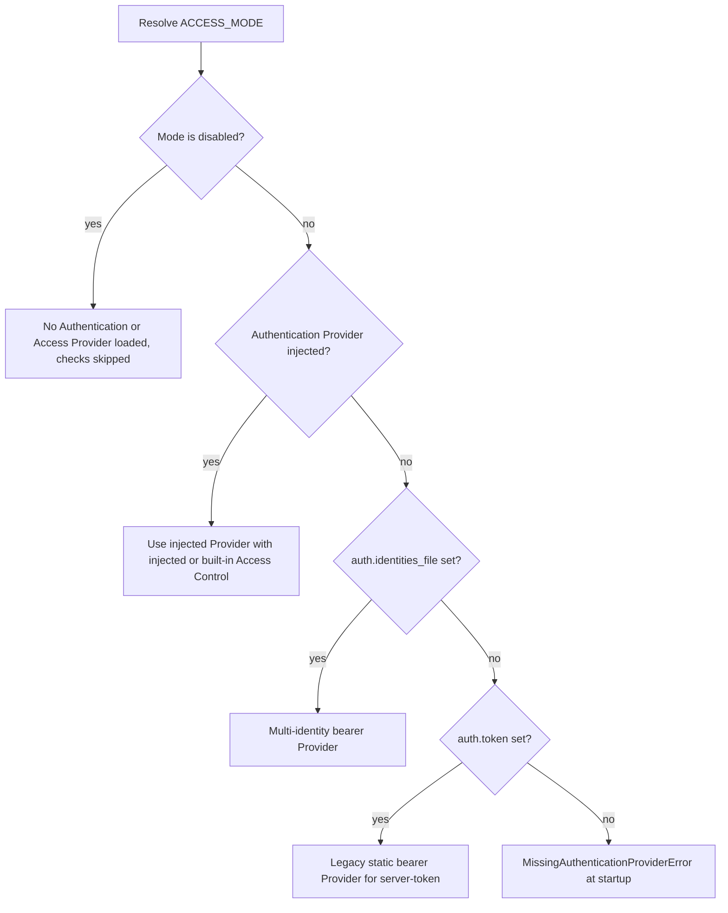
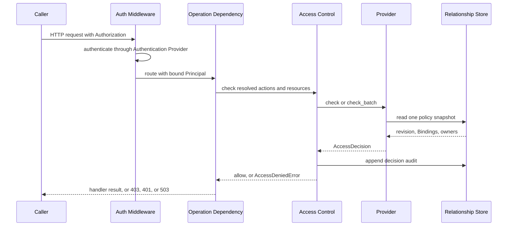
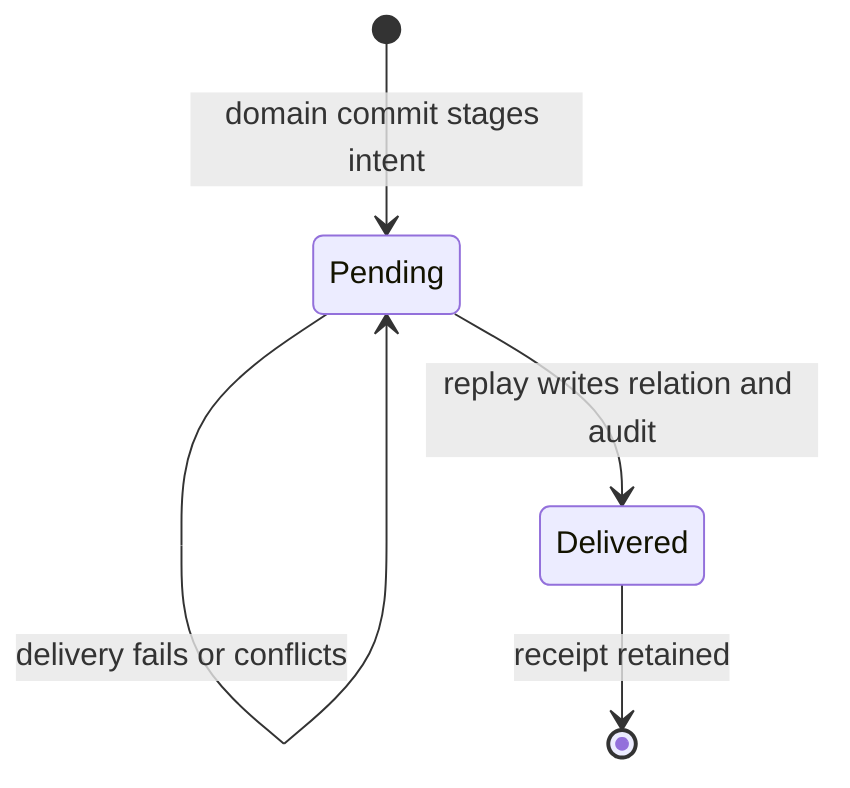

# Scopes and Access Control

A **Scope** is the ownership and isolation unit of PowerContext. Every Artifact, Candidate, Prompt, and Handoff lives inside exactly one Scope, and every authorization decision is expressed against a Scope or a resource nested in it. The opaque `scope_id` identifies data; it does not authenticate the caller and it does not grant permission. Authentication and authorization are separate layers that the Server composes around the Scope model.

This page was written from the repository at commit `b8b18909`. Read it together with [Server Runtime](../architecture/server-runtime.md), which describes how the Server assembles these providers at startup, and with [Artifact Families](artifact-families.md), which defines the families that Access profiles govern.

## Responsibilities at a glance

| Layer | Owner in source | Responsibility |
| --- | --- | --- |
| Scope identity and binding | `builtin/scope` | Create Scopes, resolve which Scope a host uses, keep a default pointer. |
| Authentication | `server/authentication.py`, `server/middleware.py` | Turn a transport credential into a trusted `PrincipalRef`. |
| Authorization | `server/authz/service.py` and providers | Decide whether a Principal may perform an action on a resource, and audit the decision. |
| Relationship state | `server/authz/repository.py`, `composition.py` | Store immutable Bindings, Artifact owners, Candidate attestations, and decision audit. |
| Owner recovery | `server/authz/owner_recovery.py` | Deliver ownership intents that could not commit in the domain transaction. |
| Migration | `server/ownership.py` | Attribute legacy data created while Access was disabled. |

Agents should treat the Scope as a precondition. Before writing content, the agent must have a resolved Scope (see [Resolve the Scope before writing](#resolve-the-scope-before-writing)), and the Principal behind its credential must hold the permission that the write requires.

## Access modes

`ACCESS_MODE` has two values, `disabled` and `enforced`. The default is `disabled`. [`AccessControlConfig`](../../src/powercontext/server/settings.py) carries the mode, the deployment identifier, and an optional background Principal.

Caption: provider selection when the Server is created. Enforced mode never starts without a Provider.

### Disabled mode

In `disabled` mode the Server loads no security Providers. The factory raises `ValueError` if an Access Control service or Authentication Provider is injected anyway. Per-operation authorization dependencies find no Access Control service and do nothing, so every request runs without a Principal. The connection identity then reports `DISABLED` authentication. The factory also treats some internal routes as trusted local when no access service exists. Disabled mode is the local default and the reason that a fresh install works without a token.

Disabled mode is not a multi-user mode. A legacy `AUTH_TOKEN` combined with `disabled` is rejected by settings validation.

### Enforced mode and the provider fallback

When `enforced` is set, the Server picks the Authentication Provider in this order:

1. An Authentication Provider injected into `create_server_app`.
2. The multi-identity file at `auth.identities_file`, which is loaded as `MultiBearerAuthenticationProvider`.
3. The legacy `auth.token`, which is loaded as `StaticBearerAuthenticationProvider`.
4. None of the above. The Server raises `MissingAuthenticationProviderError` with the message that enforced mode requires an injected Authentication Provider or a legacy `AUTH_TOKEN`.

An injected Access Control service without an Authentication Provider does not satisfy the fallback. Authentication must come from one of the first three sources. When the Provider is injected, the Server uses the injected Access Control service. When it is not, the Server opens the built-in relational Access store, described below.

Settings validation enforces several coupling rules. `auth.enabled` forces `enforced`. An identity file requires `enforced` and cannot be combined with a legacy token. A legacy token cannot be used with `disabled`. An enabled Dashboard in `enforced` mode requires a token, and source management requires `enforced`. A non-loopback bind without authentication is rejected unless the operator explicitly allows it.

## Authentication

### Legacy static bearer

The legacy token maps every valid bearer credential to one fixed service Principal, `PrincipalRef(type="service", id="server-token")`. The comparison uses a constant-time check. The credential ID is `static-bearer`. Because this Principal is treated as the legacy administrator, the factory passes it as a bootstrap administrator. That bootstrap creates `server.observer` and `server.admin` Bindings for the Principal on the Server resource, and the same Principal becomes the static Scope preset (see [Static Scope preset](#static-scope-preset)). The token therefore identifies one administrator and cannot distinguish individual users.

### Multi-identity bearer file

`MultiBearerAuthenticationProvider` reads a JSON file with an `identities` list. Each entry holds a `credential_id`, a SHA-256 `token_digest`, and a `subject` Principal. The loader rejects symbolic links and non-regular files. On POSIX it rejects any group or other permission bits, so the file must be private (mode `600` in practice). Digests must be 64 lowercase hexadecimal characters, and credential IDs and digests must be unique. Each request rereads the file, so rotation takes effect on the next request. A configuration that becomes unreadable mid-run produces `authentication_unavailable`, not an accepted credential. An identity receives no implicit role. Its Principal can only act through Bindings, or through the server administrator list that the factory bootstraps as server administrators.

### Authentication Provider SPI

Any object that implements `authenticate(request)` and `readiness()` can serve as an Authentication Provider. The SPI receives an `AuthenticationRequest` carrying the transport, headers, and client host. It must return an `AuthenticationResult` with a trusted `subject` Principal, an optional `actor`, a bounded tuple of `subject_groups` (at most 100, with no duplicates and no collision with the subject or actor), and an optional `credential_id` of at most 255 trimmed characters. The result is frozen, and `__post_init__` rejects invalid values, so a provider cannot smuggle an untrusted group or identifier into decisions.

### Request authentication

`AuthenticationMiddleware` authenticates each protected external HTTP request before routing. Public paths include health probes, the root and docs paths, and the dashboard static and session paths. The middleware maps outcomes as follows:

- A rejected credential returns `401` with the `unauthorized` code and a `WWW-Authenticate: Bearer` header.
- An unavailable provider, or any unexpected provider exception, returns `503` with `authentication_unavailable`.
- A successful result is bound to the request context, and the handler runs with that Principal.

Dashboard routes return a login response instead of a JSON error when the Dashboard is enabled.

### Transport access logs

`server/access.py` contains transport access logging only. It writes one completion record per external request and per logical MCP request. It does not make authorization decisions, and it should not be read as part of the access-control path.

## Permissions

Access permissions are the `AccessAction` values. They are the names that appear in audit records, in `/v1/access/check`, and in the operation metadata. The complete public set is:

- `server.observe` and `server.admin` for Server resources.
- `scope.read`, `scope.contribute`, `scope.review`, `scope.delegate`, and `scope.admin` for Scope resources.
- `artifact.read`, `artifact.write`, and `artifact.share` for Artifact resources.
- `handoff.evidence.inspect` and `handoff.acknowledge` for Handoff revisions.
- `prompt.use` for Prompt Artifacts.

`access.self` is an internal authentication-only requirement used by self-service routes and is not a public action. Roles are fixed as well: `server.observer`, `server.admin`, `scope.viewer`, `scope.contributor`, `scope.reviewer`, `scope.delegator`, `scope.admin`, `artifact.viewer`, `artifact.owner`, `handoff.viewer`, `handoff.receiver`, and `prompt.user`.

Each role maps to a fixed set of actions. Scope roles cover their own Scope and also imply actions on child resources inside that Scope. Server roles imply child actions on Scopes and Artifacts. The split is deliberate. Administration roles do not become content roles. For example, `scope.admin` on a Scope carries `scope.admin` on that Scope and only the child action `artifact.share` on artifacts. It does not grant `artifact.read` or `artifact.write`. Scope roles also imply child content actions as follows:

- `scope.viewer` implies `artifact.read`, `handoff.evidence.inspect`, and `prompt.use` on its artifacts.
- `scope.contributor` implies the viewer actions plus `handoff.acknowledge`.
- `scope.reviewer` and `scope.delegator` imply the viewer actions. Reviewers hold `scope.review` on the Scope; delegators hold `scope.delegate`.

A reviewer role therefore carries `scope.review` and the viewer content actions, but it does not carry `scope.contribute`. A `scope.contributor` role carries `scope.contribute`, which the Server checks for Scope writes such as Artifact creation. Keeping these roles on separate identities is the operational separation that the Agent workflow relies on.

Artifact families have explicit profiles. [`profiles.py`](../../src/powercontext/server/authz/profiles.py) defines, for each family, the base read action, additional actions such as `handoff.evidence.inspect` and `handoff.acknowledge` for Handoffs, the grantable roles, the selector rule for Memory entries, and the share unit. Prompts inherit Scope access and cannot be shared directly. A Prompt can be used with `prompt.use` but has no grantable roles.

## Authorization

### The decision path

Every operation with an access requirement is wrapped by an authorization dependency. When an Access Control service is present, the dependency resolves the operation's requirement into concrete `(action, resource)` checks, runs the checks, and only then calls the handler. A requirement can be static (for example `server.admin` on the Server), request-derived (for example `scope.admin` on the `scope_id` in the body), or resolved by a named resolver.

Caption: the request authorization path in enforced mode. Disabled mode skips the dependency entirely.

Every decision is written to the audit store unless its action is `access.self`. A provider error becomes an `AccessUnavailableError`, which the Server maps to `503`. A denial becomes `AccessDeniedError`, mapped to `403`, and a request without a Principal maps to `401`.

### Built-in decision logic

The built-in provider (`BuiltinAuthorizationProvider`) reads one snapshot consisting of the policy revision, the active Bindings for the caller and its groups, the owners of the requested Artifacts, and the Artifacts the caller owns. A Binding is active only if its state is active and it has not expired at the decision time. The provider grants access when an active Binding's role covers the requested action on the same resource, on a covering parent resource, or through a Scope or Server parent. If no Binding grants the action, the owner rule applies: an Artifact owner whose Principal equals the caller receives the `artifact.owner` actions on that Artifact. Otherwise the reason code is `no-matching-binding`.

Snapshots are read in a single transaction when the repository supports it. Otherwise the reader retries the revision check up to three times and fails closed with `policy-snapshot-unstable`. The resource-filter path used by list operations uses the same derivation, so list results and point decisions cannot drift apart. Authorized list results are bounded: a provider must return a complete filter, and results that exceed the direct resource limit are rejected.

### Static Scope preset

The legacy static Principal is special. The Access service treats it as a fixed preset, so the Server can create the Scopes a legacy deployment needs without a separate administrator step. When a Scope is created through `POST /v1/scopes`, or when a request denied with `no-matching-binding` or `no-matching-policy` comes from the preset Principal, the service creates Bindings for the five Scope roles `scope.viewer`, `scope.contributor`, `scope.reviewer`, `scope.delegator`, and `scope.admin`. Each Binding is protected by a receipt key derived from the deployment, Principal, Scope, and role, so a revoked preset grant is not recreated on the next request. The preset cannot be used to escape a revocation.

### Scope and Artifact checks used by content writes

Creating a non-Prompt Artifact in a Scope checks `scope.contribute` on that Scope. Creating a Prompt checks `scope.admin`. Reading an exact Scope selection checks `scope.read` on each Scope, while an all-Scope or subtree-style selection checks `server.observe` on the Server. Reading a Handoff revision checks `artifact.read` and `handoff.evidence.inspect`, and acknowledging an exact revision checks `handoff.acknowledge`. Acknowledgement of a non-exact selection checks `scope.contribute` on the Scope. The operation table is the source of truth for each route.

`POST /v1/scopes` requires `server.admin` on the Server resource. This is why creating a new Scope is an administrative act even though binding a host to an existing Scope is not.

Managing Access itself is also restricted. Binding management requires `scope.admin` on the Scope, `server.admin` on the Server, or the delegate action for Handoff bindings, depending on the resource. Access plans and migrations require `server.admin` in enforced mode.

### Providers

The Server ships three Authorization Provider implementations. Only one is selected by the Server factory.

- **Built-in relational provider.** `open_builtin_access_control` opens the Access tables in the configured database (SQLite, OceanBase, or SeekDB) and wraps them in `BuiltinAuthorizationProvider`. The factory uses this provider in enforced mode whenever no Access Control service was injected. It supports safe resource filtering, multi-requirement checks, and relationship management.
- **Embedded Casbin adapter.** `CasbinAuthorizationProvider` builds a fresh Casbin enforcer for each decision batch from the active Bindings, using a fixed request and policy model that matches action, object, scope, and deployment. It applies the same owner rule and returns the reason `casbin-policy` or `no-matching-policy`. It is opened only through `open_casbin_access_control`. The Server factory does not select it. Its behavior is tested against the built-in provider for artifact owner rules.
- **AuthZen client.** `AuthZenAuthorizationProvider` calls an external AuthZen PDP over the evaluation and evaluations endpoints. It returns only the boolean decision and an optional `policy_revision`, and it maps provider responses to `authzen-allow` or `authzen-deny`. It does not provide relationships and does not support resource filtering. Its `resolve_resource_filter` raises `safe_resource_filtering_unavailable`, so list operations fail closed. It is not selected by the Server factory.

`GET /v1/access/me` reports the active mode, the resource kinds, the Artifact families and their share units, and the provider capabilities: safe resource filtering, multi-requirement checks, relationship management, group subjects, multi-principal support, and the direct resource key limit.

## Resolve the Scope before writing

An Agent must resolve the Scope before it writes. The Scope is chosen in this order, and the first match wins:

1. An explicit Scope ID supplied by the caller. A missing explicit ID returns `404 scope_not_found`.
2. The durable binding for each binding key in the order given. The first existing binding decides the Scope.
3. The default Scope pointer, unless the caller disallows the default.

When no binding exists and no default is set, resolution returns `404 scope_not_found`. Direct lookups of a missing Scope also return `404`, because a bare ID cannot prove that the Scope ever existed.

If a binding or the default pointer exists but its target Scope is gone, the Server returns `409 scope_binding_target_missing`, with the original target ID in `error.details.scope_id`. Resolution stops at that binding and does not fall back to a later binding or to the default. Client `Ensure()` implementations must surface this conflict. They must not create a replacement Scope and overwrite the binding, because that would silently move data to a different project. The operator must restore the target Scope or repair the binding explicitly.

`ScopeApplication.bootstrap_default` creates a Scope titled `Default` with a fixed idempotency key and sets it as the default pointer. Creation is idempotent per key: replaying the same key with the same parameters returns the existing Scope, and reusing a key with different parameters returns `409 scope_idempotency_conflict`. Parent references are validated for existence and acyclicity. Parents organize Scopes, and context references describe reuse. Neither grants access. Exact, subtree, and all-Scope selections change which Scopes an inspection covers. They do not change the caller's permissions.

## Owner recovery

Artifacts and Review Candidates have a single owner, established by the Server when the object is created. Ownership is written to relationship and audit stores. When those stores are the same database as the business data, the owner write joins the domain transaction. When they are not, the Server cannot guarantee that the owner write and the domain commit succeed together. Owner recovery covers that case.

Caption: lifecycle of one ownership intent. A delivered receipt is never removed by the Server.

### Staging and delivery

When `create_server_app` composes a built-in Runtime whose relationship or audit stores cannot share the business transaction, the factory creates an `OwnerRecovery` outbox and initializes the `pc_access_owner_recovery` table in the primary database. A creation hook then stages a typed intent, either an Artifact owner relation or a Candidate owner attestation, in that table. The intent records the owner, the scope, and the audit context. The operation ID is derived deterministically from the deployment, kind, and resource key, so a repeated creation maps to the same intent. Conflicting payloads for the same ID are refused.

Delivery happens before the response is returned. The session flushes the staged operations, and a failure propagates to the caller. The intent stays pending. A mapped `AccessUnavailableError` returns `503`, and a conflict returns `409`. The domain object may already be committed, so the operator must not repeat a non-idempotent create blindly.

### Replay and monitoring

`replay(operation_id)` completes one accepted intent using only the persisted payload. It never accepts a caller-supplied owner. It writes the relation through the relationship store, expecting the same owner and key, and then marks the intent completed. Artifact delivery also writes an audit event with a stable UUID derived from the operation ID. A monitor task retries pending intents every five seconds, in pages of 100, and advances past intents that fail so one damaged payload cannot block the others.

### Artifact recovery needs idempotent audit

Artifact owner delivery requires an audit store that implements `append_audit_once`, which is the idempotent recovery capability. The contract is one immutable event per stable event ID, and a replay with different fields is rejected. If the capability is missing, the operation fails before the domain commit, so the Server never creates an Artifact whose owner cannot be recorded later.

### Inventory of gaps

`inventory_gaps` lets an operator with the embedded application inspect ownership gaps in bounded pages. It classifies each identity as `unknown` (no trusted intent exists), `pending` (an intent exists but has not been delivered), `delivered_relation_missing` (the receipt is complete but its relation no longer exists), or `legacy_selector_required` (a Memory collection needs an explicit entry inventory). The inventory returns identity metadata only, never Artifact or Candidate bodies, and it grants no ownership. Replay does not restore a relation whose receipt was completed and then deleted, and an independent read grant does not fill an ownership gap. No public HTTP, MCP, or CLI endpoint exposes these recovery operations.

## Migrating existing data to enforced

Data written while Access was `disabled` has no Artifact owner and no Candidate attestation. Switching to `enforced` therefore leaves that data read-only for every Principal, and approval of Candidates that lack an attestation is blocked. The migration in [`ownership.py`](../../src/powercontext/server/ownership.py) is explicit. It never invents an identity. An administrator names the owner for one explicit call, existing relations are never modified, and each item write is a single idempotent Access transaction that can be repeated safely.

The plan and apply routes, `POST /v1/access/ownership/plan` and `POST /v1/access/ownership/apply`, declare only `access.self` at the route level. The handler then requires `server.admin` on the Server in enforced mode, and apply is refused outside enforced mode. Apply uses the owner named in the request and returns applied items and conflicts.

## Dashboard and team use

The Dashboard supports only the built-in static bearer profile. The factory refuses to combine an enabled Dashboard with an injected Authentication Provider or Access Control service. In enforced mode an enabled Dashboard requires a legacy token. The Dashboard is a personal or demonstration interface and is not a team RBAC interface. Team deployments should leave `POWERCONTEXT_SERVER_DASHBOARD_ENABLED=false` and use the API, MCP, or host integrations with distinct identities.

## Failure semantics

| Condition | Result |
| --- | --- |
| No credential, or invalid bearer credential | `401 unauthorized`, with `WWW-Authenticate: Bearer` |
| Authentication Provider unavailable or raising | `503 authentication_unavailable` |
| Principal missing where Access is enforced | `401` through `AccessIdentityRequiredError` |
| Denied decision | `403 forbidden` |
| Access provider unavailable, unstable snapshot, or unsupported filter | `503` with the Access error code |
| Invalid Access request, such as an unknown action on a resource | `422 invalid_access_request` |
| Missing explicit Scope, or no binding and no default | `404 scope_not_found` |
| Binding target Scope missing | `409 scope_binding_target_missing` |

Operators should expect a fail-closed posture. An unavailable provider, a missing relationship capability, or an unstable snapshot denies or errors rather than granting access.

## Configuration

- `POWERCONTEXT_SERVER_ACCESS_MODE` selects `disabled` (default) or `enforced`.
- `POWERCONTEXT_SERVER_AUTH_TOKEN` supplies the legacy static bearer token. It is a single administrator credential and requires enforced mode.
- The identity file is configured through `auth.identities_file` in [`settings.py`](../../src/powercontext/server/settings.py). The file must be private, and it must contain unique credential IDs and SHA-256 digests.
- `POWERCONTEXT_SERVER_ACCESS_DEPLOYMENT_ID` names the deployment used in Server resource keys. It defaults to `powercontext`.
- `POWERCONTEXT_SERVER_ACCESS_BACKGROUND_PRINCIPAL_ID` and its description configure the background Principal used by scheduled processing. Scheduled Source and Experience processing requires an authorized background Principal, and it cannot be configured when the mode is `disabled`.

Scheduled processing performs its own `scope.contribute` check on the Scope before it runs, so a background Principal needs the same Binding a human Agent would need.

## Tests that matter

[`tests/test_access_control.py`](../../tests/test_access_control.py) covers the behavior most likely to break:

- Administration roles do not become content writers. A `scope.admin` Binding on a Scope can share Artifacts there but cannot read or write them.
- Group Bindings are resolved from the trusted authentication context, and cursors are bound to the caller's group membership.
- Resource cursors are bound to the policy revision, so a stale cursor is rejected after a policy change.
- Artifact owners are immutable and independent, and missing owners preserve explicit grants.
- The built-in and Casbin providers produce the same artifact owner decisions.
- A Candidate owner is locked to the proposer and target, and attestation does not grant or overwrite Artifact ownership.
- Replacing a singleton Binding is atomic, and role cardinalities are explicit.

## Related pages

- [Server Runtime](../architecture/server-runtime.md) describes where these providers are assembled in the Server lifecycle.
- [Artifact Families](artifact-families.md) describes the families whose Access profiles this page summarizes.
- [HTTP and MCP API](../architecture/http-and-mcp-api.md) lists the routes whose access requirements appear above.
