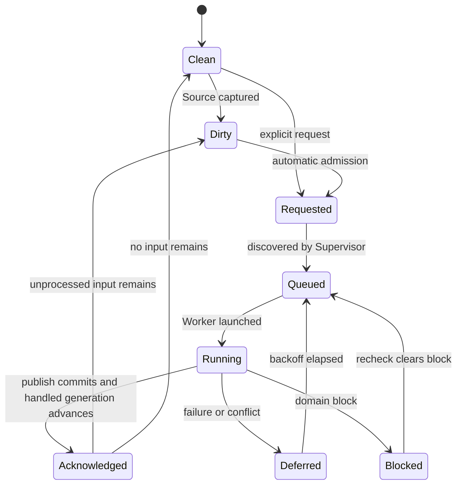

# Sources and Background Processing

A **Source** is preserved evidence. Capture stores it in a per-Scope journal, and only later does
background processing decide whether a Source may feed model generation and produce Artifacts. Capture
success therefore means "the evidence is stored and queued for processing," not "knowledge was extracted."
The [Artifact families](artifact-families.md) page describes what each family produces; this page covers the
path from evidence to published revision.

The user-facing workflow is in [Sources and capture](../../docs/en/docs/workflows/sources.md). Built-in
processing rules for individual families are in [Atomic Memory](../workflows/atomic-memory.md),
[Topic Memory](../workflows/topic-memory.md), and
[Experience and skill lifecycle](../workflows/experience-and-skill-lifecycle.md).

## Responsibilities at a glance

| Concern | Owner |
| --- | --- |
| Store Source evidence and assign journal positions | `SourceRepository` in `builtin/persistence/sources.py` |
| Mark processing bindings dirty in the same commit | `ArtifactProcessingIntentRepository` (`builtin/persistence/processing_intents.py`) |
| Decide whether a Source may enter generation | `builtin/source_eligibility.py` and `GenerationSourceAccess` |
| Select the next bounded journal window | `SourceWindowTrigger` (`builtin/triggers/source_window.py`) |
| Admit, lease, retry, and launch processing Workers | `ArtifactProcessingSupervisor` (`builtin/runtime/artifact_processing.py`) |
| Consume a window and publish Artifact revisions | Family processors, for example `atomic_memory_processing.py` |

## Source capture and the journal

Every Source is written through `SourceRepository.add_many_with_status`. Inside one transaction it locks the
Scope's journal head, classifies each Source in the batch, and assigns the next contiguous journal position to
each new identity. A Source's identity is its `SourceRef` (`source_type` plus `source_id`). The same identity
with identical content is reused and keeps its original position. The same identity with different content is
rejected with a stored-payload conflict, so capture never silently rewrites evidence.
[repo://src/powercontext/builtin/persistence/sources.py#L174-L254](repo://src/powercontext/builtin/persistence/sources.py#L174-L254)

The same transaction marks processing dirty. Every newly inserted Source increments the dirty counter of the
built-in bindings listed in `SOURCE_PROCESSING_BINDINGS` (Memory window, Topic Memory window, Experience
incubation, and Profile window). It also increments any plugin binding whose manifest covers the Scope.
If the intent write fails, the Source insert rolls back with it, and a test asserts exactly this behavior.
[repo://src/powercontext/builtin/persistence/sources.py#L75-L80](repo://src/powercontext/builtin/persistence/sources.py#L75-L80),
[repo://src/powercontext/builtin/persistence/sources.py#L1251-L1269](repo://src/powercontext/builtin/persistence/sources.py#L1251-L1269),
[repo://tests/builtin/persistence/test_processing_intents.py#L127-L150](repo://tests/builtin/persistence/test_processing_intents.py#L127-L150)

Journal positions are monotonic per Scope. `list_window` returns exactly the interval `(after, through]` in
journal order, and `journal_position` returns the high watermark. A Memory window that comes back with gaps is a
conflict, not a partial result.
[repo://src/powercontext/builtin/persistence/sources.py#L852-L896](repo://src/powercontext/builtin/persistence/sources.py#L852-L896),
[repo://src/powercontext/builtin/runtime/atomic_memory_processing.py#L873-L875](repo://src/powercontext/builtin/runtime/atomic_memory_processing.py#L873-L875)

The built-in captured-text Source is `ContentSource`. It carries two flags that matter for eligibility: an
explicit `working_note` flag, and an optional `internal` lineage target that only server-owned Artifact writes
set.
[repo://src/powercontext/builtin/sources/content.py#L87-L113](repo://src/powercontext/builtin/sources/content.py#L87-L113)

Sources can enter through several surfaces: direct content capture, Source plugins (write plugins save
synchronously in the Server, collect plugins run in a separate Runtime and submit to the same journal), and
Working Note capture. All of them reach the same repository path. See
[Source plugins](../../docs/en/docs/workflows/source-plugins.md) for the plugin lifecycle.

## Eligibility for generation

Eligibility is a property of the Source's purpose, not of its permissions. Access control still applies
separately. The shared rules live in `builtin/source_eligibility.py`.

| Source kind | Ordinary window read | Explicit reference for generation |
| --- | --- | --- |
| Ordinary captured Source | Included | Allowed |
| Working Note (`working_note` flag set) | Excluded | Allowed only when the caller opts in and the note has not expired |
| Lineage-only Source (`internal` set) | Excluded | Allowed only at the exact Artifact revision it is bound to |

A metadata marker alone does not make a Source a Working Note. A legacy record that only has
`metadata.kind = "working_note"` remains an ordinary Source; a test asserts this.
[repo://src/powercontext/builtin/source_eligibility.py#L47-L57](repo://src/powercontext/builtin/source_eligibility.py#L47-L57),
[repo://src/powercontext/builtin/source_eligibility.py#L60-L88](repo://src/powercontext/builtin/source_eligibility.py#L60-L88),
[repo://src/powercontext/builtin/sources/content.py#L114-L131](repo://src/powercontext/builtin/sources/content.py#L114-L131),
[repo://tests/builtin/persistence/test_generation_sources.py#L102-L125](repo://tests/builtin/persistence/test_generation_sources.py#L102-L125)

Lineage-only Sources come from server-owned Artifact operations (create, replace, restore, undo merge). Their
`internal.target` binds them to one Scope, family, Artifact, and revision, so they serve as provenance for that
exact revision and nothing else.
[repo://src/powercontext/builtin/sources/content.py#L87-L95](repo://src/powercontext/builtin/sources/content.py#L87-L95),
[repo://src/powercontext/builtin/persistence/artifacts.py#L1090-L1100](repo://src/powercontext/builtin/persistence/artifacts.py#L1090-L1100)

### Branch for ineligible Sources (`SourceNotEligibleError`)

An ineligible Source produces a different outcome depending on how it is reached:

- **Explicit generation request.** `require_for_generation` rejects the whole request if any referenced Source
  is ineligible. The HTTP layer returns `422` with error code `source_not_eligible` and the offending `source_ref`.
  A Working Note past its expiry raises `WorkingNoteUnavailableError`, a subclass of the same error.
  [repo://src/powercontext/builtin/persistence/generation_sources.py#L35-L48](repo://src/powercontext/builtin/persistence/generation_sources.py#L35-L48),
  [repo://src/powercontext/server/app.py#L6411-L6421](repo://src/powercontext/server/app.py#L6411-L6421)
- **Journal window.** `list_window_for_generation` silently omits ineligible rows. The window still consumes
  its journal positions, so an all-ineligible window produces no model call but still advances the cursor.
  [repo://src/powercontext/builtin/persistence/generation_sources.py#L51-L62](repo://src/powercontext/builtin/persistence/generation_sources.py#L51-L62),
  [repo://src/powercontext/builtin/runtime/atomic_memory_processing.py#L219-L226](repo://src/powercontext/builtin/runtime/atomic_memory_processing.py#L219-L226)
- **Evidence resolution.** A direct reference to an ineligible Source fails with
  `EvidenceResolutionError("source_not_eligible")`. The same Source reached only as lineage is kept as a
  `lineage_only` evidence node, provenance without projection into the model input.
  [repo://src/powercontext/builtin/evidence/resolver.py#L451-L476](repo://src/powercontext/builtin/evidence/resolver.py#L451-L476)
- **Handoff orientation.** If any evidence check is unavailable or a Source is ineligible, the Handoff service
  withholds orientation (returns no hint) instead of failing the Handoff.
  [repo://src/powercontext/builtin/artifacts/handoff/service.py#L328-L345](repo://src/powercontext/builtin/artifacts/handoff/service.py#L328-L345)
- **Atomic Memory lineage.** Dependency traversal converts a missing or ineligible Source into an
  `AtomicMemoryDependencyError("evidence-unavailable")`.
  [repo://src/powercontext/builtin/runtime/atomic_memory.py#L521-L570](repo://src/powercontext/builtin/runtime/atomic_memory.py#L521-L570)

### Branch for unavailable evidence

"Unavailable" covers evidence that is missing, cannot be projected, or cannot be processed yet. The Memory
window path is the clearest example, and its key property is that a failed window does not advance the cursor:

- A Source referenced by lineage but no longer present raises `RepositoryNotFoundError`, which surfaces as
  `evidence-unavailable` during lineage traversal above.
- If projection of an eligible Source fails (`InvalidSourceProjectionError` or
  `SourceProjectionNotFoundError`), the resolver raises `EvidenceResolutionError("evidence_unavailable")`.
  [repo://src/powercontext/builtin/evidence/resolver.py#L451-L476](repo://src/powercontext/builtin/evidence/resolver.py#L451-L476)
- A window that has eligible Sources but no configured extraction pipeline raises
  `InferenceUnavailableError`. The cursor is not saved, so the same window is retried after configuration is fixed.
  [repo://src/powercontext/builtin/runtime/atomic_memory_processing.py#L223-L234](repo://src/powercontext/builtin/runtime/atomic_memory_processing.py#L223-L234)
- A provider timeout on a multi-Source window halves the window through a retained window hint, so the next
  attempt covers fewer Sources. Single-Source timeouts are raised instead.
  [repo://src/powercontext/builtin/runtime/atomic_memory_processing.py#L278-L290](repo://src/powercontext/builtin/runtime/atomic_memory_processing.py#L278-L290),
  [repo://src/powercontext/builtin/persistence/memory_windows.py#L28-L58](repo://src/powercontext/builtin/persistence/memory_windows.py#L28-L58)

## Triggers: what starts processing

Processing is started by four kinds of event. They all converge on the same intent counters described in the
next section.

1. **Capture.** Each new Source increments the dirty counter of the built-in bindings in the same commit.
   Capture itself never runs a model.
2. **Scheduled admission.** The Supervisor, once it holds leadership, periodically scans for dirty Scopes and admits
   them under the binding's automatic interval or cron. The Memory binding's interval comes from
   `memory_schedule_seconds` (alias `schedule_seconds`). Automatic processing is off unless a schedule is set.
   [repo://src/powercontext/builtin/runtime/composition.py#L1022-L1031](repo://src/powercontext/builtin/runtime/composition.py#L1022-L1031),
   [repo://src/powercontext/builtin/runtime/config.py#L92-L108](repo://src/powercontext/builtin/runtime/config.py#L92-L108),
   [repo://src/powercontext/builtin/runtime/config.py#L248-L249](repo://src/powercontext/builtin/runtime/config.py#L248-L249)
3. **Explicit Memory flush.** The Memory flush route runs the Atomic Memory flush synchronously for the Scope and
   processes one window in the request, using the same cursor and publish path.
   [repo://src/powercontext/server/app.py#L1652](repo://src/powercontext/server/app.py#L1652),
   [repo://src/powercontext/server/app.py#L3515-L3523](repo://src/powercontext/server/app.py#L3515-L3523)
4. **Explicit Topic Memory flush.** `request_topic_memory_flush` increments a durable flush generation and writes
   an explicit request in the same transaction, so a flush is never lost between the two writes.
   [repo://src/powercontext/builtin/runtime/relational.py#L1018-L1032](repo://src/powercontext/builtin/runtime/relational.py#L1018-L1032),
   [repo://src/powercontext/builtin/persistence/processing.py#L179-L210](repo://src/powercontext/builtin/persistence/processing.py#L179-L210)

The trigger policy itself is pure. `SourceWindowTrigger` acts only when the journal sequence is greater than
the cursor. It produces one window `through = min(sequence, cursor + limit)`, so the default Memory window is
bounded by `source_window_limit` (100) and Topic Memory by `topic_memory_source_window_limit` (10).
[repo://src/powercontext/builtin/triggers/source_window.py#L34-L60](repo://src/powercontext/builtin/triggers/source_window.py#L34-L60),
[repo://src/powercontext/builtin/runtime/config.py#L148](repo://src/powercontext/builtin/runtime/config.py#L148),
[repo://src/powercontext/builtin/runtime/config.py#L265](repo://src/powercontext/builtin/runtime/config.py#L265)

## Invocation counters: the processing state

Each `(Scope, binding)` pair has one intent row with four generation counters:

- `dirty_generation` and `clean_generation`: new domain input versus input that a completed run has cleaned.
  Dirty means `dirty > clean`.
- `requested_generation` and `handled_generation`: accepted invocations versus acknowledged ones. Requested means
  `requested > handled`.

An explicit request increments `requested`. An automatic admission increments `requested` only when the Scope is
dirty and has no outstanding request. A completed run acknowledges its claimed generation with
`acknowledge`, and clears the dirty state only when no input remains.
[repo://src/powercontext/builtin/persistence/processing_intents.py#L136-L200](repo://src/powercontext/builtin/persistence/processing_intents.py#L136-L200),
[repo://src/powercontext/builtin/persistence/processing_intents.py#L203-L250](repo://src/powercontext/builtin/persistence/processing_intents.py#L203-L250),
[repo://src/powercontext/builtin/persistence/processing_intents.py#L323-L350](repo://src/powercontext/builtin/persistence/processing_intents.py#L323-L350)

The Supervisor's state machine for one invocation is shown below.

Caption: Processing state for one Scope and binding invocation; Artifacts become visible on the Running to Acknowledged transition.

The states are read from the intent counters and the Supervisor's in-process queue. `Deferred` and
`Blocked` are in-memory retry records, not durable rows, and a restart rebuilds them from the durable request
counters.

## How the Supervisor admits and runs work

`ArtifactProcessingSupervisor` owns one or more supervisor groups. In `global` mode one group serves every
binding. In `dedicated` mode each family gets its own group. Leadership is taken with a lease
(`try_acquire` on OceanBase, a single-process term otherwise), and a leader that loses its lease revokes its
fence and reaps its children before anything else runs.
[repo://src/powercontext/builtin/runtime/composition.py#L1151-L1162](repo://src/powercontext/builtin/runtime/composition.py#L1151-L1162),
[repo://src/powercontext/builtin/persistence/supervision.py#L110-L175](repo://src/powercontext/builtin/persistence/supervision.py#L110-L175),
[repo://src/powercontext/builtin/runtime/artifact_processing.py#L825-L852](repo://src/powercontext/builtin/runtime/artifact_processing.py#L825-L852)

Each cycle alternates two discovery channels so one cannot starve the other:

- **Requested channel.** Pages through rows with `requested > handled`.
- **Automatic channel.** Runs a scan that freezes an upper pending sequence, admits dirty rows, and checks each
  Scope's `automatic_scope_filter`. A scan that stops mid-page resumes from its checkpoint.

Admitted Scopes enter a bounded ready queue. Each family has its own `max_workers` budget. A Worker runs in a
spawned child process, and its result is only trusted after the durable acknowledgement is observed. A
successful child whose acknowledgement is missing is recorded as a failure and retried.
[repo://src/powercontext/builtin/runtime/artifact_processing.py#L942-L962](repo://src/powercontext/builtin/runtime/artifact_processing.py#L942-L962),
[repo://src/powercontext/builtin/runtime/artifact_processing.py#L963-L1087](repo://src/powercontext/builtin/runtime/artifact_processing.py#L963-L1087),
[repo://src/powercontext/builtin/runtime/artifact_processing.py#L1213-L1240](repo://src/powercontext/builtin/runtime/artifact_processing.py#L1213-L1240),
[repo://src/powercontext/builtin/runtime/artifact_processing.py#L1557-L1600](repo://src/powercontext/builtin/runtime/artifact_processing.py#L1557-L1600)

Failure handling uses three distinct paths, and they are not interchangeable:

| Outcome | Behavior |
| --- | --- |
| Worker failure or missing acknowledgement | Exponential backoff from 30 seconds, doubling with jitter, capped at 1800 seconds |
| Cursor or head conflict | Retry after 0.1 seconds; not counted as a provider failure |
| Durable domain block | Recheck every 300 seconds; logs `artifact_processing.blocked` and waits for operator remediation |

[repo://src/powercontext/builtin/runtime/artifact_processing.py#L89-L97](repo://src/powercontext/builtin/runtime/artifact_processing.py#L89-L97),
[repo://src/powercontext/builtin/runtime/artifact_processing.py#L1134-L1180](repo://src/powercontext/builtin/runtime/artifact_processing.py#L1134-L1180),
[repo://src/powercontext/builtin/runtime/artifact_processing.py#L1323-L1376](repo://src/powercontext/builtin/runtime/artifact_processing.py#L1323-L1376),
[repo://src/powercontext/builtin/runtime/artifact_processing.py#L1377-L1379](repo://src/powercontext/builtin/runtime/artifact_processing.py#L1377-L1379)

The Server starts these supervisors in global mode for any non-API role. The API role does not run workers.
[repo://src/powercontext/server/factory.py#L336-L352](repo://src/powercontext/server/factory.py#L336-L352)

### Legacy APScheduler path

`BuiltinRuntime.start_scheduler` is a second, embedded scheduling path. It persists APScheduler interval jobs in
a SQLite sidecar and dispatches them to `ScheduledSourceProcessor`. That processor runs one Memory flush per
Scope returned by `unconsumed_source_scope_ids`, logs `success`, `noop`, `hold`, or `failure` for each Scope,
and swallows per-Scope errors so one failing Scope does not stop the others. It is exercised by tests in this
revision but is not called from the Server factory.
[repo://src/powercontext/builtin/runtime/application.py#L4581-L4655](repo://src/powercontext/builtin/runtime/application.py#L4581-L4655),
[repo://src/powercontext/builtin/runtime/application.py#L4111-L4168](repo://src/powercontext/builtin/runtime/application.py#L4111-L4168),
[repo://src/powercontext/builtin/runtime/scheduler.py#L105-L142](repo://src/powercontext/builtin/runtime/scheduler.py#L105-L142),
[repo://src/powercontext/builtin/runtime/relational.py#L1402-L1405](repo://src/powercontext/builtin/runtime/relational.py#L1402-L1405)

In enforced access mode, scheduled Memory processing runs as a deployment principal. The Server must have an
Authorization Provider, and that principal must hold `SCOPE_CONTRIBUTE` on each Scope it processes.
[repo://src/powercontext/server/factory.py#L610-L629](repo://src/powercontext/server/factory.py#L610-L629)

## When Artifacts appear

An Artifact revision is visible exactly when its publish transaction commits. For a Memory window,
`_publish` runs the following inside one database transaction:

1. Re-check the cursor generation and the exact window, including eligibility, so the decision still applies.
2. Commit the Artifact writes (`commit_window`).
3. Save the window cursor.
4. Clear the consumed window hints.
5. Call `processing.complete`, which acknowledges the claimed generation.

Because steps 2 to 5 share a transaction, the cursor never advances past work whose Artifacts were not committed,
and an acknowledgement never exists without its Artifacts.
[repo://src/powercontext/builtin/runtime/atomic_memory_processing.py#L342-L460](repo://src/powercontext/builtin/runtime/atomic_memory_processing.py#L342-L460)

Two shortcuts still consume input without publishing revisions:

- **No eligible Sources.** The window advances with no model call and no Artifact write, because `_publish` runs
  with an empty eligible set.
- **Held write.** When the write gate returns `HOLD`, `results` is empty. The cursor and window still advance, the
  observation is recorded as `memory_write_hold`, and the flush reports `held`.
  [repo://src/powercontext/builtin/runtime/atomic_memory_processing.py#L414-L421](repo://src/powercontext/builtin/runtime/atomic_memory_processing.py#L414-L421)

A held window therefore produces no Artifact revision, even though its Sources are no longer pending.

## Extension points

- **Processing bindings.** A family registers an `ArtifactProcessingBinding` with its launcher, budgets, optional
  `pending_provider`, `automatic_scope_filter`, `invocation_scope_filter`, `work_block`, and `work_failure`
  callbacks. The Supervisor enforces these without knowing the family's domain logic.
  [repo://src/powercontext/builtin/runtime/artifact_processing.py#L122-L146](repo://src/powercontext/builtin/runtime/artifact_processing.py#L122-L146)
- **Plugin bindings.** A binding registered with a `scope_ids` manifest is dirtied only for those Scopes at Source
  commit, so plugin processors do not wake on unrelated Scopes.
  [repo://src/powercontext/builtin/persistence/sources.py#L1251-L1269](repo://src/powercontext/builtin/persistence/sources.py#L1251-L1269)
- **Source definitions and projections.** Adapters decide how a Source is resolved and projected for evidence. A
  projection failure surfaces as unavailable evidence, described above. See [Source plugins](../../docs/en/docs/workflows/source-plugins.md).

## Configuration

| Setting | Default | Effect |
| --- | --- | --- |
| `memory_schedule_seconds` (alias `schedule_seconds`) | unset (off) | Automatic Memory admission interval |
| `experience_schedule_seconds` | unset (off) | Automatic Experience incubation interval |
| `topic_memory_schedule_seconds` | unset (off) | Automatic Topic Memory interval |
| `source_window_limit` | 100 | Maximum journal positions per Memory window |
| `topic_memory_source_window_limit` | 10 | Maximum journal positions per Topic Memory window |
| `artifact_processing_supervisor_mode` | `global` | One supervisor group, or one per family |
| `artifact_processing_role` | `all` | `api` disables workers; `background` runs only workers |
| `*_max_workers`, `*_worker_timeout_seconds` | per family | Concurrency and per-attempt timeout |

[repo://src/powercontext/builtin/runtime/config.py#L269-L273](repo://src/powercontext/builtin/runtime/config.py#L269-L273)

Relevant log events for operators are `artifact_processing.queued`, `artifact_processing.attempt.completed`,
`artifact_processing.blocked`, and `artifact_processing.block_recheck_failed`.

## Troubleshooting

| Symptom | What it usually means |
| --- | --- |
| Capture succeeded, no Artifact appears | Automatic scheduling is off and no flush was requested; check the binding's schedule and run an explicit flush |
| Explicit request returns `422 source_not_eligible` | The referenced Source is a Working Note, a lineage-only Source outside its bound revision, or an expired note |
| Memory window stalls with an inference-unavailable error | Eligible Sources exist but no extraction pipeline is configured; the cursor did not move |
| A scope is repeatedly retried with backoff | Worker failure or missing acknowledgement; inspect the failure stage and error code in logs |
| A scope is parked for a long time | A durable block is in place; it is rechecked every 300 seconds and needs remediation |
| Artifacts absent after a held verdict | The write gate held the window; the cursor advanced without a revision |

For the general diagnostic flow, see [Troubleshooting](../operations/troubleshooting.md).

## Focused tests

- `tests/builtin/persistence/test_generation_sources.py` checks that explicit references are rejected and that
  window entries are skipped, and that a metadata-only working-note marker remains ordinary.
- `tests/builtin/persistence/test_processing_intents.py` checks that source publication dirties every family once
  and rolls back with the intent write.
- `tests/builtin/runtime/test_processing_scheduler.py` checks that success without durable acknowledgement is a
  failure, that retries do not starve other scopes, and that a timeout reclaims the slot while preserving intent.
- `tests/builtin/runtime/test_scheduler.py` checks the APScheduler job persistence and the interval activation of
  the Source-window policy.

[repo://tests/builtin/runtime/test_processing_scheduler.py#L195-L222](repo://tests/builtin/runtime/test_processing_scheduler.py#L195-L222),
[repo://tests/builtin/runtime/test_processing_scheduler.py#L320-L340](repo://tests/builtin/runtime/test_processing_scheduler.py#L320-L340),
[repo://tests/builtin/runtime/test_scheduler.py#L203-L249](repo://tests/builtin/runtime/test_scheduler.py#L203-L249)
