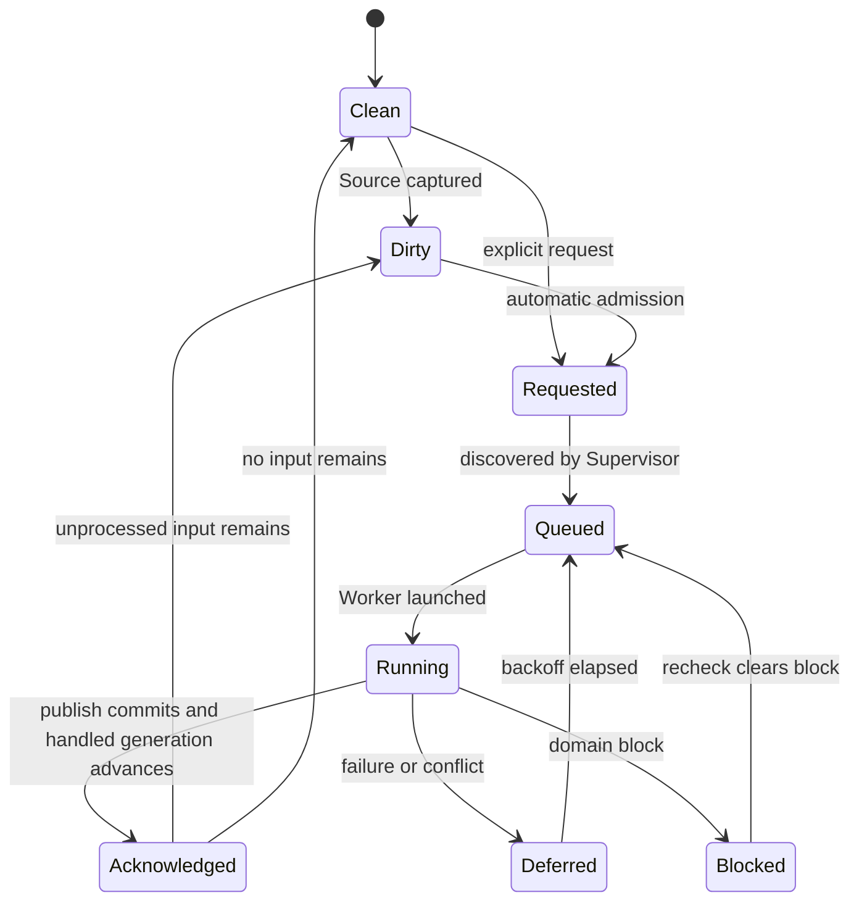
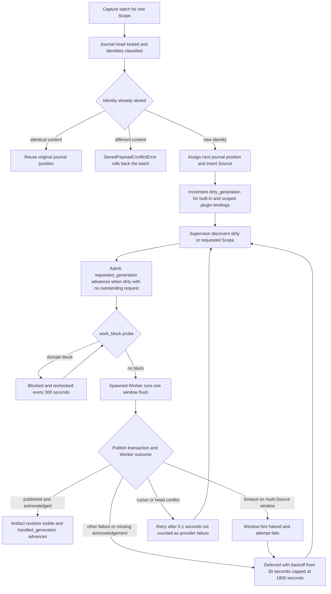

# Sources and Processing

A **Source** is preserved evidence. Capture stores it in a per-Scope journal, and only later does
background processing decide whether a Source may feed model generation and produce Artifacts. Capture
success therefore means "the evidence is stored and queued for processing," not "knowledge was extracted."
The [Artifact families](artifact-families.md) page describes what each family produces; this page covers the
path from evidence to published revision.

The user-facing workflow is in [Sources and capture](../../docs/en/docs/workflows/sources.md). Built-in
processing rules for individual families are in [Atomic Memory](../workflows/atomic-memory.md),
[Topic Memory](../workflows/topic-memory.md), and
[Experience and skill lifecycle](../workflows/experience-and-skill-lifecycle.md).

## Responsibilities at a glance

| Concern | Owner |
| --- | --- |
| Store Source evidence and assign journal positions | `SourceRepository` in `builtin/persistence/sources.py` |
| Mark processing bindings dirty in the same commit | `ArtifactProcessingIntentRepository` (`builtin/persistence/processing_intents.py`) |
| Decide whether a Source may enter generation | `builtin/source_eligibility.py` and `GenerationSourceAccess` |
| Select the next bounded journal window | `SourceWindowTrigger` (`builtin/triggers/source_window.py`) |
| Admit, lease, retry, and launch processing Workers | `ArtifactProcessingSupervisor` (`builtin/runtime/artifact_processing.py`) |
| Consume a window and publish Artifact revisions | Family processors, for example `atomic_memory_processing.py` |

## Source capture and the journal

A content capture from the Scope API is queued in `SourceCaptureCoalescer`, which batches up to 32 waiting
captures into one transaction under the Scope lock. If a batch fails, it is retried one capture at a time, so
one caller's error does not change another caller's outcome. A capture whose `metadata.kind` is
`working_note` is rejected by this generic path and must use the dedicated Working Note path.
[repo://src/powercontext/builtin/runtime/_source_capture.py#L34-L115](repo://src/powercontext/builtin/runtime/_source_capture.py#L34-L115),
[repo://src/powercontext/builtin/runtime/application.py#L572-L606](repo://src/powercontext/builtin/runtime/application.py#L572-L606)

The record service opens the transaction and calls `SourceRepository.add_many_with_status`. Inside that
transaction the repository locks the Scope's journal head, classifies each Source in the batch, and assigns the
next contiguous journal position to each new identity. A Source's identity is its `SourceRef` (`source_type`
plus `source_id`). The same identity with identical content is reused and keeps its original position. The same
identity with different content raises `StoredPayloadConflictError`, so capture never silently rewrites evidence.
The one exception is an upgrade that sets `handoff_receipt` on an otherwise identical stored `ContentSource`.
[repo://src/powercontext/builtin/persistence/records.py#L258-L273](repo://src/powercontext/builtin/persistence/records.py#L258-L273),
[repo://src/powercontext/builtin/persistence/sources.py#L201-L262](repo://src/powercontext/builtin/persistence/sources.py#L201-L262),
[repo://src/powercontext/builtin/persistence/sources.py#L1248-L1274](repo://src/powercontext/builtin/persistence/sources.py#L1248-L1274)

The same transaction marks processing dirty. Every newly inserted Source increments the dirty counter of the
built-in bindings listed in `SOURCE_PROCESSING_BINDINGS` (Memory window, Topic Memory window, Experience
incubation, and Profile window). It also increments any plugin binding whose registered scope set covers the
Scope. If the intent write fails, the Source insert rolls back with it, and a test asserts exactly this behavior.
The record service also advances the source-through pending row for the Topic Memory binding in the same
transaction.
[repo://src/powercontext/builtin/persistence/sources.py#L76-L80](repo://src/powercontext/builtin/persistence/sources.py#L76-L80),
[repo://src/powercontext/builtin/persistence/sources.py#L282-L285](repo://src/powercontext/builtin/persistence/sources.py#L282-L285),
[repo://src/powercontext/builtin/persistence/sources.py#L1287-L1296](repo://src/powercontext/builtin/persistence/sources.py#L1287-L1296),
[repo://src/powercontext/builtin/persistence/records.py#L263-L271](repo://src/powercontext/builtin/persistence/records.py#L263-L271),
[repo://src/powercontext/builtin/runtime/relational.py#L714-L715](repo://src/powercontext/builtin/runtime/relational.py#L714-L715),
[repo://tests/builtin/persistence/test_processing_intents.py#L153-L177](repo://tests/builtin/persistence/test_processing_intents.py#L153-L177)

Journal positions are monotonic per Scope. `list_window` returns exactly the interval `(after, through]` in
journal order, and `journal_position` returns the high watermark. A Memory window whose positions are not the
exact contiguous range is a conflict ("Source journal window is not an exact contiguous interval"), not a
partial result.
[repo://src/powercontext/builtin/persistence/sources.py#L885-L930](repo://src/powercontext/builtin/persistence/sources.py#L885-L930),
[repo://src/powercontext/builtin/runtime/atomic_memory_processing.py#L990-L993](repo://src/powercontext/builtin/runtime/atomic_memory_processing.py#L990-L993)

The built-in captured-text Source is `ContentSource`, a subclass of `Source`. The base `Source` carries `name`,
`definition_version`, `materialization` (`captured` or `referenced`), and `description`. `ContentSource` adds
`content`, `metadata`, the explicit `working_note` flag, and an optional `internal` lineage target that only
server-owned Artifact writes set. It also carries `handoff_receipt`, which only the Work acknowledgement writer sets.
[repo://src/powercontext/builtin/sources/content.py#L87-L113](repo://src/powercontext/builtin/sources/content.py#L87-L113),
[repo://src/powercontext/sources/models.py#L32-L37](repo://src/powercontext/sources/models.py#L32-L37),
[repo://src/powercontext/sources/models.py#L102-L110](repo://src/powercontext/sources/models.py#L102-L110)

Sources can enter through several surfaces: direct content capture, Source plugins (write plugins save
synchronously in the Server, collect plugins run in a separate Runtime and submit to the same journal), and
Working Note capture. All of them reach the same repository path. See
[Source plugins](../../docs/en/docs/workflows/source-plugins.md) for the plugin lifecycle.

## Eligibility for generation

Eligibility is a property of the Source's purpose, not of its permissions. Access control still applies
separately. The shared rules live in `builtin/source_eligibility.py`.

| Source kind | Ordinary window read | Explicit reference for generation |
| --- | --- | --- |
| Ordinary captured Source | Included | Allowed |
| Working Note (`working_note` flag set) | Excluded | Allowed only when the caller opts in and the note has not expired |
| Lineage-only Source (`internal` set) | Excluded | Allowed only at the exact Artifact revision it is bound to |

A metadata marker alone does not make a Source a Working Note. A legacy record that only has
`metadata.kind = "working_note"` remains an ordinary Source; a test asserts this.
[repo://src/powercontext/builtin/source_eligibility.py#L47-L57](repo://src/powercontext/builtin/source_eligibility.py#L47-L57),
[repo://src/powercontext/builtin/source_eligibility.py#L60-L88](repo://src/powercontext/builtin/source_eligibility.py#L60-L88),
[repo://src/powercontext/builtin/sources/content.py#L114-L131](repo://src/powercontext/builtin/sources/content.py#L114-L131),
[repo://tests/builtin/persistence/test_generation_sources.py#L102-L125](repo://tests/builtin/persistence/test_generation_sources.py#L102-L125)

Lineage-only Sources are created by server-owned Artifact operations: create and replace (in the record service
and the plugin writer) and restore or undo merge (in the merge restoration path). Their `internal.target` binds
them to one Scope, family, Artifact, and revision, so they serve as provenance for that exact revision and
nothing else.
[repo://src/powercontext/builtin/persistence/records.py#L381-L400](repo://src/powercontext/builtin/persistence/records.py#L381-L400),
[repo://src/powercontext/builtin/plugins/writer.py#L816-L836](repo://src/powercontext/builtin/plugins/writer.py#L816-L836),
[repo://src/powercontext/builtin/artifacts/merge.py#L747-L758](repo://src/powercontext/builtin/artifacts/merge.py#L747-L758),
[repo://src/powercontext/builtin/sources/content.py#L87-L95](repo://src/powercontext/builtin/sources/content.py#L87-L95)

### Branch for ineligible Sources (`SourceNotEligibleError`)

An ineligible Source produces a different outcome depending on how it is reached:

- **Explicit generation request.** `require_for_generation` rejects the whole request if any referenced Source
  is ineligible. The HTTP layer returns `422` with error code `source_not_eligible` and the offending
  `source_ref`. A Working Note past its expiry raises `WorkingNoteUnavailableError`, a subclass of the same error.
  [repo://src/powercontext/builtin/persistence/generation_sources.py#L33-L48](repo://src/powercontext/builtin/persistence/generation_sources.py#L33-L48),
  [repo://src/powercontext/server/app.py#L7002-L7012](repo://src/powercontext/server/app.py#L7002-L7012)
- **Generation window.** `list_window_for_generation` silently omits ineligible rows, and the Memory window path
  filters the same way with `is_generation_eligible`. The window still consumes its journal positions, so an
  all-ineligible window produces no model call but still advances the cursor.
  [repo://src/powercontext/builtin/persistence/generation_sources.py#L50-L62](repo://src/powercontext/builtin/persistence/generation_sources.py#L50-L62),
  [repo://src/powercontext/builtin/runtime/atomic_memory_processing.py#L231-L240](repo://src/powercontext/builtin/runtime/atomic_memory_processing.py#L231-L240)
- **Evidence resolution.** A direct reference to an ineligible Source fails with
  `EvidenceResolutionError("source_not_eligible")`. The same Source reached only as lineage is kept as a
  `lineage_only` evidence node, provenance without projection into the model input.
  [repo://src/powercontext/builtin/evidence/resolver.py#L450-L476](repo://src/powercontext/builtin/evidence/resolver.py#L450-L476)
- **Handoff orientation.** If any evidence check is unavailable, or a cited omission lacks its evidence, the Handoff
  service withholds orientation (returns no hint) instead of failing the Handoff.
  [repo://src/powercontext/builtin/artifacts/handoff/service.py#L337-L352](repo://src/powercontext/builtin/artifacts/handoff/service.py#L337-L352)
- **Atomic Memory lineage.** Dependency traversal converts a missing or ineligible Source into an
  `AtomicMemoryDependencyError("evidence-unavailable")`. A lineage-only Source passes only when its bound target
  equals the dependent revision.
  [repo://src/powercontext/builtin/runtime/atomic_memory.py#L578-L586](repo://src/powercontext/builtin/runtime/atomic_memory.py#L578-L586),
  [repo://src/powercontext/builtin/runtime/atomic_memory.py#L612-L616](repo://src/powercontext/builtin/runtime/atomic_memory.py#L612-L616)

### Branch for unavailable evidence

"Unavailable" covers evidence that is missing, cannot be projected, or cannot be processed yet. The Memory
window path is the clearest example, and its key property is that a failed window does not advance the cursor:

- A Source referenced by lineage but no longer present raises `RepositoryNotFoundError`, which surfaces as
  `evidence-unavailable` during lineage traversal above.
- If projection of an eligible Source fails (`InvalidSourceProjectionError` or
  `SourceProjectionNotFoundError`), the resolver raises `EvidenceResolutionError("evidence_unavailable")`.
  [repo://src/powercontext/builtin/evidence/resolver.py#L450-L476](repo://src/powercontext/builtin/evidence/resolver.py#L450-L476)
- A window that has eligible Sources but no configured extraction pipeline raises `InferenceUnavailableError`
  before any model call. The cursor is not saved, so the same window is retried after configuration is fixed.
  [repo://src/powercontext/builtin/runtime/atomic_memory_processing.py#L237-L240](repo://src/powercontext/builtin/runtime/atomic_memory_processing.py#L237-L240)
- A provider timeout or invalid output on a multi-Source window halves the window through a retained window hint,
  so the next attempt covers fewer Sources, and the error is re-raised. A single-Source timeout is raised without
  a reduction.
  [repo://src/powercontext/builtin/runtime/atomic_memory_processing.py#L251-L257](repo://src/powercontext/builtin/runtime/atomic_memory_processing.py#L251-L257),
  [repo://src/powercontext/builtin/runtime/atomic_memory_processing.py#L289-L306](repo://src/powercontext/builtin/runtime/atomic_memory_processing.py#L289-L306),
  [repo://src/powercontext/builtin/persistence/memory_windows.py#L52-L62](repo://src/powercontext/builtin/persistence/memory_windows.py#L52-L62)

## Triggers: what starts processing

Processing is started by four kinds of event. They all converge on the same intent counters described in the
next section.

1. **Capture.** Each new Source increments the dirty counter of the built-in bindings in the same commit.
   Capture itself never runs a model.
2. **Scheduled admission.** The Supervisor, once it holds leadership, periodically scans for dirty Scopes and
   admits them under the binding's automatic interval or cron. The Memory binding's interval comes from
   `memory_schedule_seconds` (alias `schedule_seconds`). Automatic processing is off unless a schedule is set.
   [repo://src/powercontext/builtin/runtime/composition.py#L1022-L1031](repo://src/powercontext/builtin/runtime/composition.py#L1022-L1031),
   [repo://src/powercontext/builtin/runtime/config.py#L93-L115](repo://src/powercontext/builtin/runtime/config.py#L93-L115),
   [repo://src/powercontext/builtin/runtime/config.py#L256-L258](repo://src/powercontext/builtin/runtime/config.py#L256-L258),
   [repo://src/powercontext/builtin/runtime/artifact_processing.py#L1020-L1021](repo://src/powercontext/builtin/runtime/artifact_processing.py#L1020-L1021)
3. **Explicit Memory flush.** The `FLUSH_MEMORY` route runs the Atomic Memory flush synchronously for the Scope and
   processes one window in the request, using the same cursor and publish path.
   [repo://src/powercontext/server/app.py#L1670](repo://src/powercontext/server/app.py#L1670),
   [repo://src/powercontext/server/app.py#L4019-L4027](repo://src/powercontext/server/app.py#L4019-L4027),
   [repo://src/powercontext/builtin/runtime/atomic_memory_processing.py#L173-L196](repo://src/powercontext/builtin/runtime/atomic_memory_processing.py#L173-L196)
4. **Explicit Topic Memory flush.** `request_topic_memory_flush` writes a durable flush generation and then requests
   the binding's intent, in one transaction. A flush is only recorded when the Topic cursor is behind the locked
   journal head.
   [repo://src/powercontext/builtin/runtime/relational.py#L1023-L1036](repo://src/powercontext/builtin/runtime/relational.py#L1023-L1036),
   [repo://src/powercontext/builtin/persistence/processing.py#L178-L210](repo://src/powercontext/builtin/persistence/processing.py#L178-L210)

The trigger policy itself is pure. `SourceWindowTrigger` acts only when the journal sequence is greater than
the cursor. It produces one window `through = min(sequence, cursor + limit)`, so the default Memory window is
bounded by `source_window_limit` (100) and Topic Memory by `topic_memory_source_window_limit` (10).
[repo://src/powercontext/builtin/triggers/source_window.py#L33-L60](repo://src/powercontext/builtin/triggers/source_window.py#L33-L60),
[repo://src/powercontext/builtin/runtime/config.py#L149](repo://src/powercontext/builtin/runtime/config.py#L149),
[repo://src/powercontext/builtin/runtime/config.py#L274](repo://src/powercontext/builtin/runtime/config.py#L274)

## Invocation counters: the processing state

Each `(Scope, binding)` pair has one intent row, modeled as `StoredArtifactProcessingIntent`, with four
generation counters:

- `dirty_generation` and `clean_generation`: new domain input versus input that a completed run has cleaned.
  Dirty means `dirty_generation` exceeds `clean_generation`.
- `requested_generation` and `handled_generation`: accepted invocations versus acknowledged ones. Requested means
  `requested_generation` exceeds `handled_generation`.

An explicit request increments `requested_generation`. An automatic admission increments `requested_generation`
only when the Scope is dirty and has no outstanding request. A completed run acknowledges its claimed generation
with `acknowledge`, which raises if the generation was never accepted, and advances `clean_generation` only to the
`clean_generation` value the caller supplies (never past `dirty_generation`).
[repo://src/powercontext/builtin/persistence/processing_intents.py#L57-L69](repo://src/powercontext/builtin/persistence/processing_intents.py#L57-L69),
[repo://src/powercontext/builtin/persistence/processing_intents.py#L202-L221](repo://src/powercontext/builtin/persistence/processing_intents.py#L202-L221),
[repo://src/powercontext/builtin/persistence/processing_intents.py#L223-L256](repo://src/powercontext/builtin/persistence/processing_intents.py#L223-L256),
[repo://src/powercontext/builtin/persistence/processing_intents.py#L322-L350](repo://src/powercontext/builtin/persistence/processing_intents.py#L322-L350)

The Supervisor's state machine for one invocation is shown below.

Caption: Processing state for one Scope and binding invocation; Artifacts become visible on the Running to Acknowledged transition.

The states are read from the intent counters and the Supervisor's in-process queue. `Deferred` and `Blocked` are
in-memory retry records, not durable rows, and a restart rebuilds them from the durable request counters.

## Processing flow: capture to Artifact write

The flowchart below joins the capture path, the intent counters, the Supervisor, and the Worker. It shows the
failure and retry branches that the next sections describe.

Caption: Path from capture through processing intent, Supervisor admission, Worker execution, and Artifact publication, including the blocked, conflict, and backoff retry branches.

## How the Supervisor admits and runs work

`ArtifactProcessingSupervisor` owns one or more supervisor groups. In `global` mode one group serves every
binding. In `dedicated` mode each family gets its own group. Leadership is taken with a lease
(`try_acquire` on OceanBase, a single-process term otherwise), and a leader that loses its lease revokes its
term before any further work is dispatched.
[repo://src/powercontext/builtin/runtime/composition.py#L1157-L1168](repo://src/powercontext/builtin/runtime/composition.py#L1157-L1168),
[repo://src/powercontext/builtin/persistence/supervision.py#L110-L175](repo://src/powercontext/builtin/persistence/supervision.py#L110-L175),
[repo://src/powercontext/builtin/runtime/artifact_processing.py#L830-L857](repo://src/powercontext/builtin/runtime/artifact_processing.py#L830-L857)

When leadership is lost, the Supervisor cancels lease renewal, rotates the lease holder and increments
`supervisor_generation` so the old term cannot act, cancels the running Worker tasks, and reaps any child
whose termination was unconfirmed. It then clears its in-memory ready queue, retry records, and scan checkpoints.
Durable intent rows are untouched, so the next leader rebuilds its work from them.
[repo://src/powercontext/builtin/runtime/artifact_processing.py#L1714-L1763](repo://src/powercontext/builtin/runtime/artifact_processing.py#L1714-L1763)

Each cycle alternates two discovery channels so one cannot starve the other:

- **Requested channel.** Pages through rows with `requested_generation` greater than `handled_generation`.
- **Automatic channel.** Runs a scan that freezes an upper pending sequence, admits dirty rows, and checks each
  Scope's `automatic_scope_filter`. A scan that stops mid-page resumes from its checkpoint.
  [repo://src/powercontext/builtin/runtime/artifact_processing.py#L947-L966](repo://src/powercontext/builtin/runtime/artifact_processing.py#L947-L966),
  [repo://src/powercontext/builtin/runtime/artifact_processing.py#L968-L1086](repo://src/powercontext/builtin/runtime/artifact_processing.py#L968-L1086)

Admitted Scopes enter a bounded ready queue. Each family has its own `max_workers` budget. Dispatch re-reads the
intent row under the current fence, drops a Scope when `invocation_scope_filter` or the row's request counters
no longer apply, and runs the `work_block` probe before launching. A Worker runs in a spawned child process, and
its result is only trusted after the durable acknowledgement is observed. A successful child whose
acknowledgement is missing is recorded as a failure and retried.
[repo://src/powercontext/builtin/runtime/artifact_processing.py#L1088-L1091](repo://src/powercontext/builtin/runtime/artifact_processing.py#L1088-L1091),
[repo://src/powercontext/builtin/runtime/artifact_processing.py#L1218-L1284](repo://src/powercontext/builtin/runtime/artifact_processing.py#L1218-L1284),
[repo://src/powercontext/builtin/runtime/artifact_processing.py#L230-L240](repo://src/powercontext/builtin/runtime/artifact_processing.py#L230-L240),
[repo://src/powercontext/builtin/runtime/artifact_processing.py#L1459-L1470](repo://src/powercontext/builtin/runtime/artifact_processing.py#L1459-L1470),
[repo://src/powercontext/builtin/runtime/artifact_processing.py#L1548-L1556](repo://src/powercontext/builtin/runtime/artifact_processing.py#L1548-L1556),
[repo://src/powercontext/builtin/runtime/artifact_processing.py#L1595-L1601](repo://src/powercontext/builtin/runtime/artifact_processing.py#L1595-L1601)

Failure handling uses three distinct paths, and they are not interchangeable:

| Outcome | Behavior |
| --- | --- |
| Worker failure or missing acknowledgement | Exponential backoff from 30 seconds, doubling per failure and multiplied by jitter between 0.8 and 1.2, capped at 1800 seconds |
| Cursor or head conflict | Retry after 0.1 seconds; recorded as a `conflict` retry, not as a provider failure |
| Durable domain block | Recheck every 300 seconds; logs `artifact_processing.blocked` and waits for operator remediation |

Retry state is in memory. It is bounded by `_RETRY_STATE_LIMIT` (1000); when the limit is reached, a retry that
is not yet due is evicted, and an overflow failure pauses new discovery until its cooldown ends.
[repo://src/powercontext/builtin/runtime/artifact_processing.py#L89-L103](repo://src/powercontext/builtin/runtime/artifact_processing.py#L89-L103),
[repo://src/powercontext/builtin/runtime/artifact_processing.py#L567-L567](repo://src/powercontext/builtin/runtime/artifact_processing.py#L567-L567),
[repo://src/powercontext/builtin/runtime/artifact_processing.py#L1139-L1217](repo://src/powercontext/builtin/runtime/artifact_processing.py#L1139-L1217),
[repo://src/powercontext/builtin/runtime/artifact_processing.py#L1328-L1385](repo://src/powercontext/builtin/runtime/artifact_processing.py#L1328-L1385),
[repo://src/powercontext/builtin/runtime/artifact_processing.py#L1386-L1387](repo://src/powercontext/builtin/runtime/artifact_processing.py#L1386-L1387),
[repo://src/powercontext/builtin/runtime/artifact_processing.py#L1582-L1592](repo://src/powercontext/builtin/runtime/artifact_processing.py#L1582-L1592)

Worker outcomes are typed. `ArtifactProcessingWorkerOutcome` has `succeeded`, `cursor_conflict`, `head_conflict`,
and `leadership_lost`; the two conflict values are rescheduled as control conflicts, not as failures.
[repo://src/powercontext/builtin/runtime/processing_contracts.py#L30-L36](repo://src/powercontext/builtin/runtime/processing_contracts.py#L30-L36)

The built-in processing supervisors are started only when dispatch is enabled, the role is not `api`, recovery is
off, and bindings exist. The Server factory separately enables plugin Artifact dispatch only in `global` mode and
for a non-API role.
[repo://src/powercontext/builtin/runtime/composition.py#L1157-L1162](repo://src/powercontext/builtin/runtime/composition.py#L1157-L1162),
[repo://src/powercontext/server/factory.py#L336-L341](repo://src/powercontext/server/factory.py#L336-L341)

In enforced access mode, background processing runs as a deployment principal. The Server must have an
Authorization Provider, and the principal must hold `SCOPE_CONTRIBUTE` on each Scope it processes. The principal is
`ACCESS_BACKGROUND_PRINCIPAL_ID` when set, otherwise the legacy static principal, and it is required to exist.
Scheduled Profile flushes apply the same check before they write.
[repo://src/powercontext/server/processing_security.py#L29-L57](repo://src/powercontext/server/processing_security.py#L29-L57),
[repo://src/powercontext/server/processing_security.py#L77-L86](repo://src/powercontext/server/processing_security.py#L77-L86),
[repo://src/powercontext/builtin/authz/worker.py#L76-L86](repo://src/powercontext/builtin/authz/worker.py#L76-L86),
[repo://src/powercontext/server/factory.py#L605-L622](repo://src/powercontext/server/factory.py#L605-L622),
[repo://src/powercontext/server/factory.py#L659-L671](repo://src/powercontext/server/factory.py#L659-L671)

## When Artifacts appear

An Artifact revision is visible exactly when its publish transaction commits. For a Memory window, `_publish`
runs the following inside one database transaction:

1. Advance the journal head row so that no Source capture can change the window during validation, then re-check
   the cursor generation and the exact window, including eligibility, so the decision still applies.
2. Commit the Artifact writes (`commit_window`), unless the write gate returned `HOLD`.
3. Save the window cursor.
4. Clear the consumed window hints.
5. Call `processing.complete`, which acknowledges the claimed generation.

Because steps 2 to 5 share a transaction, the cursor never advances past work whose Artifacts were not committed,
and an acknowledgement never exists without its Artifacts.
[repo://src/powercontext/builtin/runtime/atomic_memory_processing.py#L353-L467](repo://src/powercontext/builtin/runtime/atomic_memory_processing.py#L353-L467)

Two shortcuts still consume input without publishing revisions:

- **No eligible Sources.** The window advances with no model call and no Artifact write, because `_publish` runs
  with an empty eligible set and no extraction pipeline is used.
- **Held write.** When the write gate returns `HOLD`, `results` is empty. The cursor and window still advance, the
  observation is recorded as `memory_write_hold`, and the flush reports `held`.
  [repo://src/powercontext/builtin/runtime/atomic_memory_processing.py#L427-L436](repo://src/powercontext/builtin/runtime/atomic_memory_processing.py#L427-L436),
  [repo://src/powercontext/builtin/runtime/atomic_memory_processing.py#L259-L270](repo://src/powercontext/builtin/runtime/atomic_memory_processing.py#L259-L270)

A held window therefore produces no Artifact revision, even though its Sources are no longer pending.

An explicit Memory flush also retries the window inline. `_retry_window` makes up to three attempts when the
attempt raises an atomic-memory, generation, or revision conflict, and re-raises the conflict on the third.
[repo://src/powercontext/builtin/runtime/atomic_memory_processing.py#L197-L209](repo://src/powercontext/builtin/runtime/atomic_memory_processing.py#L197-L209)

## Extension points

- **Processing bindings.** A family registers an `ArtifactProcessingBinding` with its launcher, budgets, optional
  `pending_provider`, `automatic_scope_filter`, `invocation_scope_filter`, `work_block`, and `work_failure`
  callbacks. The Supervisor enforces these without knowing the family's domain logic.
  [repo://src/powercontext/builtin/runtime/artifact_processing.py#L128-L149](repo://src/powercontext/builtin/runtime/artifact_processing.py#L128-L149)
- **Plugin bindings.** A binding registered with a `scope_ids` manifest is dirtied only for those Scopes at Source
  commit, so plugin processors do not wake on unrelated Scopes. A binding registered without a scope set is dirtied
  for every Scope.
  [repo://src/powercontext/builtin/plugins/families.py#L61-L68](repo://src/powercontext/builtin/plugins/families.py#L61-L68),
  [repo://src/powercontext/builtin/plugins/host.py#L182-L182](repo://src/powercontext/builtin/plugins/host.py#L182-L182),
  [repo://src/powercontext/builtin/persistence/sources.py#L1287-L1296](repo://src/powercontext/builtin/persistence/sources.py#L1287-L1296)
- **Source definitions and projections.** Adapters decide how a Source is resolved and projected for evidence. A
  projection failure surfaces as unavailable evidence, described above. See [Source plugins](../../docs/en/docs/workflows/source-plugins.md).

## Configuration

| Setting | Default | Effect |
| --- | --- | --- |
| `memory_schedule_seconds` (alias `schedule_seconds`) | unset (off) | Automatic Memory admission interval |
| `experience_schedule_seconds` | unset (off) | Automatic Experience incubation interval |
| `topic_memory_schedule_seconds` | unset (off) | Automatic Topic Memory interval |
| `source_window_limit` | 100 | Maximum journal positions per Memory window |
| `topic_memory_source_window_limit` | 10 | Maximum journal positions per Topic Memory window |
| `artifact_processing_supervisor_mode` | `global` | One supervisor group, or one per family |
| `artifact_processing_role` | `all` | `api` disables workers; `background` runs only workers |
| `*_max_workers`, `*_worker_timeout_seconds` | per family (for example `memory_max_workers` 1, `topic_memory_max_workers` 10) | Concurrency and per-attempt timeout |

[repo://src/powercontext/builtin/runtime/config.py#L256-L258](repo://src/powercontext/builtin/runtime/config.py#L256-L258),
[repo://src/powercontext/builtin/runtime/config.py#L273-L281](repo://src/powercontext/builtin/runtime/config.py#L273-L281),
[repo://src/powercontext/builtin/runtime/config.py#L283-L289](repo://src/powercontext/builtin/runtime/config.py#L283-L289)

Relevant log events for operators are `artifact_processing.queued`, `artifact_processing.attempt.completed`,
`artifact_processing.blocked`, and `artifact_processing.block_recheck_failed`.

## Troubleshooting

| Symptom | What it usually means |
| --- | --- |
| Capture succeeded, no Artifact appears | Automatic scheduling is off and no flush was requested; check the binding's schedule and run an explicit flush |
| Explicit request returns `422 source_not_eligible` | The referenced Source is a Working Note, a lineage-only Source outside its bound revision, or an expired note |
| Memory window stalls with an inference-unavailable error | Eligible Sources exist but no extraction pipeline is configured; the cursor did not move |
| A scope is repeatedly retried with backoff | Worker failure or missing acknowledgement; inspect the failure stage and error code in logs |
| A scope is parked for a long time | A durable block is in place; it is rechecked every 300 seconds and needs remediation |
| Artifacts absent after a held verdict | The write gate held the window; the cursor advanced without a revision |

For the general diagnostic flow, see [Troubleshooting](../operations/troubleshooting.md).

## Focused tests

- `tests/builtin/persistence/test_generation_sources.py` checks that explicit references are rejected and that
  window entries are skipped, and that a metadata-only working-note marker remains ordinary.
- `tests/builtin/persistence/test_processing_intents.py` checks that source publication dirties every family once
  and rolls back with the intent write.
- `tests/builtin/runtime/test_processing_scheduler.py` checks that success without durable acknowledgement is a
  failure, that retry backoff does not starve other scopes, that a control conflict retries without counting a
  provider failure, and that a timeout reclaims the slot while preserving intent.

[repo://tests/builtin/persistence/test_generation_sources.py#L74-L125](repo://tests/builtin/persistence/test_generation_sources.py#L74-L125),
[repo://tests/builtin/persistence/test_processing_intents.py#L153-L177](repo://tests/builtin/persistence/test_processing_intents.py#L153-L177),
[repo://tests/builtin/runtime/test_processing_scheduler.py#L202-L230](repo://tests/builtin/runtime/test_processing_scheduler.py#L202-L230),
[repo://tests/builtin/runtime/test_processing_scheduler.py#L327-L347](repo://tests/builtin/runtime/test_processing_scheduler.py#L327-L347),
[repo://tests/builtin/runtime/test_processing_scheduler.py#L379-L405](repo://tests/builtin/runtime/test_processing_scheduler.py#L379-L405)
