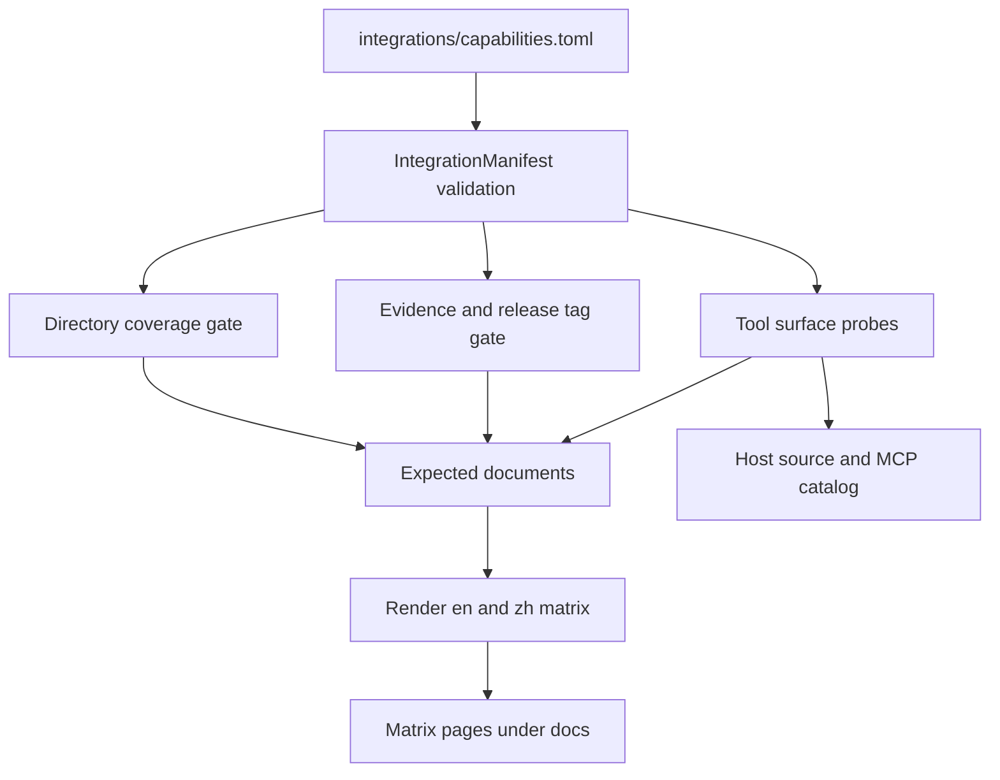

# Agent Integration Capability Matrix

This page explains the integration contract at commit b8b18909. `integrations/capabilities.toml` is the single
declaration of which integrations exist, what they expose, and what they are allowed to claim. The Python module
[`scripts/integration_manifest.py`](../../scripts/integration_manifest.py) validates that declaration, probes the
real tool surfaces, and renders the bilingual matrix pages. Support profiles, the Kimi MCP profile file, and the
distribution descriptors are related but separately owned. Read this page before changing a host's declared
support, adding a host, or interpreting the generated matrix.

## Source of truth and generated outputs

| Path | Role | Hand-edit? |
| --- | --- | --- |
| [integrations/capabilities.toml](../../integrations/capabilities.toml) | Declared contract: directory coverage, availability, toolsets, integrations, evidence | Yes, it is the input |
| [scripts/integration_manifest.py](../../scripts/integration_manifest.py) | Pydantic schema, validators, tool surface probes, and the matrix renderer | Edit code, not outputs |
| [scripts/generate_integration_manifest_docs.py](../../scripts/generate_integration_manifest_docs.py) | Writes or checks the en and zh matrix pages, using the `en` and `zh` paths in `DOCUMENTATION_PATHS` ([integration_manifest.py](../../scripts/integration_manifest.py), lines 424-427) | Edit code, not outputs |
| [docs/en/docs/integrations/capabilities.md](../../docs/en/docs/integrations/capabilities.md) and `docs/zh/docs/integrations/capabilities.md` | Generated matrix pages | **No.** Regenerate them |
| [integrations/kimi-code/plugins/powercontext/profiles.json](../../integrations/kimi-code/plugins/powercontext/profiles.json) | Generated Kimi MCP profile, written by [scripts/generate_kimi_profiles.py](../../scripts/generate_kimi_profiles.py) | **No.** Regenerate it |
| [src/powercontext/cli/guidance.py](../../src/powercontext/cli/guidance.py) | Distribution descriptors (`HOST_GUIDANCE`) and guidance refresh; not generated | Yes |

The generated matrix pages are not marked with a "generated" banner in their body. Their protection is the byte
comparison in the check target: any hand edit makes `make integration-manifest-docs-check` and the matrix currency
test fail.

## What the manifest declares

The TOML file has five kinds of table:

- `directory_exclusions` lists `integrations/` directories that are intentionally not declared. The current
  exclusions are `cindy`, `agent-plugin`, and `opendal`; each carries a recorded reason. A directory cannot be
  both declared and excluded ([capabilities.toml](../../integrations/capabilities.toml), lines 15-21).
- `documentation_waivers` exempts a whole kind from per-host documentation pages. Only `evaluation_harness` is
  waived, because evaluation harnesses document operation in their own README and the shared evaluation guide
  ([capabilities.toml](../../integrations/capabilities.toml), lines 23-25).
- `availability_definitions` gives English and Chinese wording for the five availability states.
- `[[toolsets]]` names a host-visible surface (MCP server, prompt hook, slash command, lifecycle event, or
  adapter tool list), a `probe` that verifies that surface, and its `[[toolsets.tools]]` entries.
- `[[integrations]]` declares each integration with `kind`, `availability`, `capabilities`, `profiles`,
  `toolsets`, optional `lifecycle.pre_compaction`, `evidence`, and status pointers.

The schema is strict. `IntegrationManifest` and its nested models use `extra="forbid"`, so unknown keys fail
validation. `schema_version` must be 2 ([integration_manifest.py](../../scripts/integration_manifest.py), lines
274-398).

The diagram below shows how the gates consume this declaration.

The generator runs the directory, evidence, release tag, and tool surface gates before it renders anything. If any
gate fails, it raises and writes nothing ([generate_integration_manifest_docs.py](../../scripts/generate_integration_manifest_docs.py), lines 34-65).
It renders one page per entry in `DOCUMENTATION_PATHS`: `en` maps to `docs/en/docs/integrations/capabilities.md` and
`zh` maps to `docs/zh/docs/integrations/capabilities.md` ([integration_manifest.py](../../scripts/integration_manifest.py), lines 424-427).
With `--check`, it fails when either checked-in page differs byte-for-byte from its rendered output.
The diagram is a dataflow view of that gate, not a runtime sequence.

## Capabilities and support profiles

`IntegrationCapability` is a closed `StrEnum` of 19 identifiers, including `memory_read`, `memory_write`,
`source_capture`, `context_injection`, `flush_or_checkpoint`, `work_contract`, `handoff`, `acknowledge`,
`task_outcome`, `candidate_review`, `external_skill`, `pre_compaction_capture`, and `persistent_scope_binding`. Its
docstring states that a capability is user-observable and never an authorization grant
([integration_manifest.py](../../scripts/integration_manifest.py), lines 48-74).

Support profiles are derived from capabilities. They are not declared by hand:

- **minimal** requires `memory_read`, `memory_write`, `source_capture`, and `context_injection`.
- **recommended** adds `work_contract`, `handoff`, `acknowledge`, and `task_outcome`.
- **full** adds `experience_read_or_generate`, `skill_read_or_generate`, `candidate_review`, and `external_skill`.

`derived_profiles` assigns a profile only when the declared set is a superset of the profile's set
([integration_manifest.py](../../scripts/integration_manifest.py), lines 114-135 and 410-418). An implemented
`agent_host` must declare exactly its derived profiles. Only `agent_host` may declare profiles or lifecycle.

### Candidate review wording

The matrix states that `candidate_review` permits listing and reading candidates only. The manifest's own
`server-mcp` toolset agrees: `approve_candidate`, `reject_candidate`, and `revise_candidate` carry a
`non_profile_reason` rather than a capability ([capabilities.toml](../../integrations/capabilities.toml), lines
193-196). The Pi toolset is the exception described under [Known inconsistencies](#known-inconsistencies).

## Availability rules

The five availability states are `released`, `master_only`, `experimental`, `proposed`, and `unsupported`.
`released`, `master_only`, and `experimental` are the implemented set ([integration_manifest.py](../../scripts/integration_manifest.py), lines 114-140).
The validator enforces different rules for each group:

- **Implemented** integrations must have implementation, documentation, and test evidence, at least one toolset,
  and no `proposal` or `rationale` pointer. Their declared `capabilities` must equal the union of capabilities
  across the tools in their referenced toolsets (`capabilities_from_toolsets`).
- **Released** integrations also need a `release_tag`. The release gate runs `git rev-parse --verify` on
  `refs/tags/<tag>` and reports an unresolved tag.
- **Proposed** integrations need a proposal pointer, which must be a GitHub issue or pull request URL or an
  `rfcs/` Markdown file. They cannot declare toolsets, profiles, or a release tag.
- **Unsupported** integrations need a rationale pointer under `docs/`. They cannot declare capabilities, profiles,
  toolsets, or evidence.

No declared integration is `released` at this commit. The current statuses are `master_only` or `experimental`.

## Tool surfaces and drift detection

Every toolset names one probe from the `ToolSurfaceProbe` enum. `tool_surface_errors` runs each probe, compares the
probed identifiers with the declared tool identifiers, and reports both missing and unexpected entries as drift
([integration_manifest.py](../../scripts/integration_manifest.py), lines 550-566). A probe name with no branch in
`_probe_toolset` raises `unimplemented tool surface probe`, so adding a new probe is a code change
([integration_manifest.py](../../scripts/integration_manifest.py), lines 569-691).

The probes read different sources:

- `server_mcp` lists the Server's public MCP catalog through a FastMCP client. It creates the app with
  `handoff_report_enabled=True`, so the opt-in reporting tools are part of the catalog
  ([mcp_catalog.py](../../scripts/mcp_catalog.py), lines 30-37).
- `dsh_mcp` reads the generated DSH MCP operation catalog and requires the bridge to reference `mcpEndpoint`.
- `json_prompt_hook` (used by Codex, Claude Code, and WorkBuddy) parses each host's hook JSON. A hook event counts
  as complete only if the registered command resolves inside the plugin root and the script contains the required
  markers. Otherwise the event is reported as `:incomplete`, which is drift
  ([integration_manifest.py](../../scripts/integration_manifest.py), lines 769-804 and 838-850).
- The Dify, OpenCode, Pi, Hermes, OpenClaw, LangChain, LangGraph, and Bub probes parse provider YAML, TypeScript,
  Python, or decorators to extract operation identifiers.

Many probes check for marker strings in source, not runtime behavior. A probe passing means the expected identifiers
and markers are present in the checked-in source. It does not prove that the host executes them.

For the four `server-mcp` hosts (Codex, Claude Code, WorkBuddy, ZCode), the gate also requires the packaged
`.mcp.json` to contain both `/mcp` and `powercontext` ([integration_manifest.py](../../scripts/integration_manifest.py), lines 1006-1024).

## Pre-compaction lifecycle

`lifecycle.pre_compaction.mode` takes one of three values:

- `unsupported`: no public host pre-compaction boundary is available. The integration cannot claim
  `pre_compaction_capture`.
- `best_effort`: the boundary runs bounded checkpoint work, but a failure does not stop compaction. The
  integration must also declare `source_capture`, `flush_or_checkpoint`, and `pre_compaction_capture`, and its
  `surface` must be exposed by one of its toolsets.
- `required_capable`: an explicit opt-in can stop host compaction until the captured Source position is
  acknowledged. This mode also requires an explicit opt-in surface (`required_mode_opt_in`) and complete
  implementation, documentation, and test evidence. No integration uses it at this commit.

`PreCompactionLifecycle` rejects a surface, opt-in, or evidence on an `unsupported` lifecycle, and rejects an opt-in
on a `best_effort` lifecycle ([integration_manifest.py](../../scripts/integration_manifest.py), lines 168-193).
Only OpenClaw (`before_compaction`) and Pi (`session_before_compact`) are `best_effort` today
([capabilities.toml](../../integrations/capabilities.toml), lines 996-1014 and 1029-1047). All other declared agent
hosts are `unsupported`.

## Current inventory

The matrix declares 16 integrations: 11 `agent_host`, 4 framework adapters, and 1 evaluation harness.
This table is a summary; the generated pages hold the full capability lists.

| ID | Kind | Availability | Profiles | Pre-compaction |
| --- | --- | --- | --- | --- |
| codex | Agent host | master_only | minimal, recommended, full | unsupported |
| claude-code | Agent host | master_only | minimal, recommended, full | unsupported |
| dsh | Agent host | master_only | minimal, recommended, full | unsupported |
| hermes | Agent host | master_only | minimal, recommended, full | unsupported |
| openclaw | Agent host | master_only | minimal | best_effort (`before_compaction`) |
| opencode | Agent host | master_only | minimal | unsupported |
| pi | Agent host | master_only | minimal, recommended, full | best_effort (`session_before_compact`) |
| workbuddy | Agent host | master_only | minimal, recommended, full | unsupported |
| zcode | Agent host | master_only | minimal, recommended, full | unsupported |
| kimi-code | Agent host | experimental | minimal, recommended, full | unsupported |
| minimax | Agent host | experimental | none | unsupported |
| pydantic-ai | Framework adapter | experimental | none | not applicable |
| langchain | Framework adapter | master_only | none | not applicable |
| langgraph | Framework adapter | master_only | none | not applicable |
| dify | Framework adapter | experimental | none | not applicable |
| bub | Evaluation harness | master_only | none | not applicable |

The `minimax` entry declares no profile even though it is experimental. Its capabilities include `memory_read`,
`memory_write`, and `source_capture` but not `context_injection`, so the derived minimal profile is empty
([capabilities.toml](../../integrations/capabilities.toml), lines 1322-1334). The `pydantic-ai`, `langchain`,
`langgraph`, `dify`, and `bub` entries have no lifecycle block because only `agent_host` may declare one.

## Matrix rendering and currency

`render_integration_capability_reference(manifest, locale)` produces one page per locale. The English page has
front matter, the availability definitions, the support profile and lifecycle explanations, and a table with the
columns ID, Kind, Availability, Profiles, Pre-compaction mode, Public surface, and Capabilities. The Chinese page
uses the same structure with localized labels ([integration_manifest.py](../../scripts/integration_manifest.py), lines 1054-1140).

`DOCUMENTATION_PATHS` maps `en` and `zh` to the matrix files ([integration_manifest.py](../../scripts/integration_manifest.py), lines 424-427). The directory gate requires each non-waived
integration to have both locale pages, and requires implemented integrations to list those pages in their evidence
([integration_manifest.py](../../scripts/integration_manifest.py), lines 424-460).

## Distribution guidance and setup

The setup side is separate from the matrix. [`guidance.py`](../../src/powercontext/cli/guidance.py) keeps a
`HOST_GUIDANCE` mapping from host IDs to package roots, recognition files, and an optional package name. The
docstring says supported capabilities are read from `capabilities.toml`, not stored there
([guidance.py](../../src/powercontext/cli/guidance.py), lines 34-101). `resolve_plugin_source` uses the mapping to
find a host's native package in a checkout ([git_source.py](../../src/powercontext/cli/git_source.py), lines 108-116).

`refresh_skill` and `merge_guidance` update packaged Skill files without touching user content. Only the text
between the `POWERCONTEXT-GUIDANCE:START` and `END` markers is owned. Unmarked non-empty content, duplicate or
reversed markers, and unrecognized user resources abort the refresh. The plan is built before any file is written
([guidance.py](../../src/powercontext/cli/guidance.py), lines 157-183 and 240-299).

`installers()` in [installation.py](../../src/powercontext/cli/installation.py) (lines 119-137) maps 11 setup
targets to installer classes. The matrix test requires this set to equal the set of declared `agent_host`
IDs ([test_integration_manifest.py](../../tests/test_integration_manifest.py), lines 40-53). Framework adapters and
the evaluation harness are not setup targets; they are installed in the application environment.

## Kimi MCP profile

`scripts/generate_kimi_profiles.py` writes `profiles.json` for the Kimi Code plugin. Its `minimal` profile is a
fixed list of three tools. `recommended` and `full` are computed from `server-mcp` tools whose capabilities
intersect the profile's capability set, excluding `get_handoff_report`. The `full` profile also adds
`approve_candidate`, `reject_candidate`, and `revise_candidate` explicitly
([generate_kimi_profiles.py](../../scripts/generate_kimi_profiles.py), lines 31-50). Its `--check` mode fails
when the file is stale. There is no Make target for it, so run it directly after changing the Server MCP catalog
or the `server-mcp` capability assignments.

## Checking and regenerating

| Command | What it does |
| --- | --- |
| `make integration-manifest-docs` | Runs the generator and rewrites the en and zh matrix pages |
| `make integration-manifest-docs-check` | Fails when the checked-in pages differ from the rendered output |
| `make integration-manifest-check` | Runs the docs check, then `tests/test_integration_manifest.py` |

`make check` includes `integration-manifest-check` ([Makefile](../../Makefile), lines 22 and 295-305). Gates
that call `git rev-parse` need a checkout that has the release tags they reference.

## Adding a host or capability

1. Add `integrations/<id>/`, or add a directory exclusion with a recorded reason.
2. Declare the integration in `capabilities.toml`. Choose `kind` and `availability`, and list its
   implementation, documentation, and test evidence. For an `agent_host` that is implemented, also declare
   `lifecycle.pre_compaction`.
3. Declare each host-visible tool with either `capabilities` or a `non_profile_reason`, and reference the
   toolset from the integration. If no existing probe fits, add an enum member and a branch in `_probe_toolset`.
4. Set `capabilities` to the union of its tool capabilities, and set `profiles` to the derived profiles.
5. Add `docs/en/docs/integrations/<id>.md` and `docs/zh/docs/integrations/<id>.md`.
6. For an `agent_host`, add it to `installers()` and to `HOST_GUIDANCE` so that setup can find its package.
7. Regenerate with `make integration-manifest-docs`, then run `make integration-manifest-check`.

## Known inconsistencies

- **Pi candidate decisions.** The `pi-tools` toolset maps `pc_review_approve`, `pc_review_reject`, and
  `pc_review_revise` to `candidate_review` ([capabilities.toml](../../integrations/capabilities.toml), lines 842-850).
  As a result, the Pi `full` profile counts decision operations. The `IntegrationCapability` docstring and the
  generated text say `candidate_review` never grants decision authority, and the `server-mcp` and Hermes toolsets
  classify the same operations as non-profile. Pi's own guidance says decisions require explicit user approval
  ([guidance.ts](../../integrations/pi/plugins/powercontext/src/guidance.ts), line 29). Treat this as an open issue:
  the manifest and the documented rule disagree.
- **Host count in prose.** The integrations index says "The 9 Agent Hosts" are `master_only`. That matches the nine
  `master_only` hosts here. The manifest also declares `kimi-code` and `minimax` as experimental agent hosts, so
  there are 11 `agent_host` entries in total ([index.md](../../docs/en/docs/integrations/index.md), lines 1-125).
- **Codex doctor list.** `_CODEX_FULL_MCP_TOOLS` in [system.py](../../src/powercontext/cli/system.py) (lines 58-63) is
  hand-maintained, and its comment asks maintainers to keep it aligned with the manifest. The doctor test derives
  the Codex `server-mcp` tools from the manifest and checks that doctor requires each one
  ([test_system_cli.py](../../tests/test_system_cli.py), lines 233-247). Changing a Codex MCP tool's capabilities
  therefore needs a matching update to the hand-maintained list.

## Tests that matter

- [test_integration_manifest.py](../../tests/test_integration_manifest.py) checks the setup catalog match
  (lines 40-53), the generated page currency (lines 257-262), prompt-hook drift (lines 305-370), the directory gate
  in both directions (lines 489-507), and the rejection of contradictory declarations (lines 372-378).
- The lifecycle validator tests (lines 155-240) cover the three modes and the rejected fields.
- [test_cli_capabilities.py](../../tests/test_cli_capabilities.py) covers the Server's `capabilities` command output for
  extraction diagnostics. It does not test the integration matrix.

## Related pages

- [Claude Code plugin](claude-code-plugin.md)
- [Codex plugin](codex-plugin.md)
- [Framework adapters](framework-adapters.md)
- [Host adapters](host-adapters.md)
- [Source map](../architecture/source-map.md)
