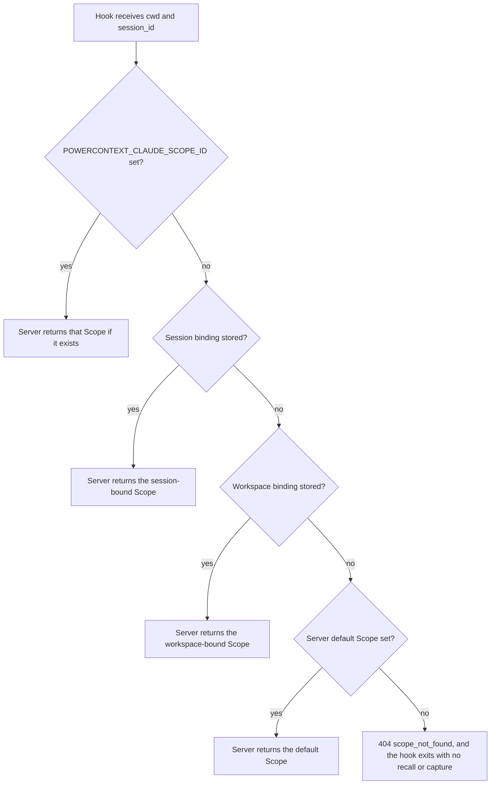
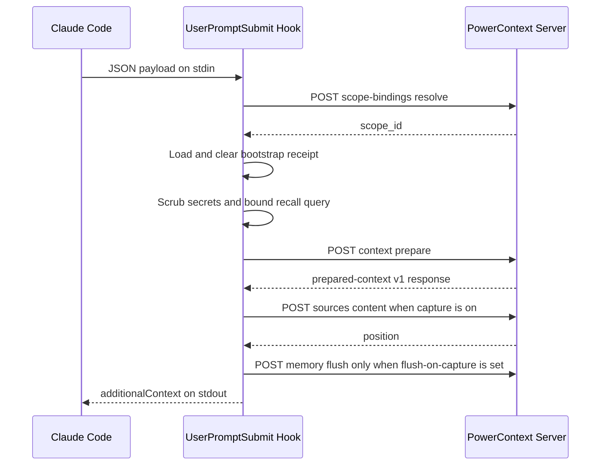

# Claude Code Plugin Integration

The Claude Code integration is a marketplace plugin that makes Claude Code a client of a running PowerContext Server. It does three things: it recalls one bounded Prepared Context before each user prompt and injects it unchanged, it captures each user prompt as ordinary Content Source evidence, and it exposes explicit Memory and Handoff operations through an MCP server. Every hook path is fail-open, so Server, transport, or contract failures never block normal Claude Code work.

The plugin is a thin client. Durable state (Scopes, Scope bindings, Sources, Memory, Handoffs) lives in the Server. The plugin keeps only a content-free bootstrap receipt on the local machine.

## Packaging and entry points

Claude Code discovers the plugin from a repository-root marketplace that lists one plugin named `powercontext`, sourced from `integrations/claude-code/plugins/powercontext`, at version `0.1.3` [repo://.claude-plugin/marketplace.json#L1-L17]. The plugin manifest declares three user options, `server_url`, `capture_prompts`, and `allow_insecure_http`, and does not declare `hooks` or `mcpServers`; the hook configuration, MCP configuration, and status line script are discovered from their standard locations [repo://integrations/claude-code/plugins/powercontext/.claude-plugin/plugin.json#L1-L38] [repo://tests/claude_code_plugin/test_contract.py#L46-L56].

| Path under the plugin root | Responsibility |
| --- | --- |
| `hooks/hooks.json` | Registers the `SessionStart` and `UserPromptSubmit` hooks |
| `hooks/user_prompt_submit.py` | Per-prompt recall, prompt capture, and optional flush |
| `hooks/session_start.py` | Opt-in bootstrap context injection and delivery receipts |
| `hooks/prepared_context.py` | Prepare contract: response validation and the bounded recall query |
| `hooks/prompt_privacy.py` | Best-effort credential scrubbing for the recall query |
| `hooks/diagnostics.py` | Cross-process throttling of failure diagnostics |
| `claude_code_settings.py` | Validated process configuration from environment, plugin options, and stored credentials |
| `bootstrap_state.py` | Local, content-free bootstrap receipt file keyed by a hashed session ID |
| `scripts/workspace_scope.py` | Scope resolution, workspace binding, and the Scope binding CLI |
| `scripts/statusline.py` | Claude Code status line showing estimated token reduction |
| `.mcp.json` | Top-level `powercontext` HTTP MCP server entry |

The hook configuration is deliberately minimal. It has exactly two event keys, `SessionStart` and `UserPromptSubmit`, and each runs `python3` in exec form against a script under `${CLAUDE_PLUGIN_ROOT}/hooks/`. The contract test asserts that no `Stop` hook is registered [repo://integrations/claude-code/plugins/powercontext/hooks/hooks.json#L1-L36] [repo://tests/claude_code_plugin/test_contract.py#L58-L70].

## Hook registration

| Event | Matcher | Script | Timeout | Status message |
| --- | --- | --- | --- | --- |
| `SessionStart` | `startup\|resume\|clear\|compact\|fork` | `hooks/session_start.py` | 10 s | Loading PowerContext context |
| `UserPromptSubmit` | none | `hooks/user_prompt_submit.py` | 10 s | Syncing PowerContext |

`SessionStart` runs only for the five lifecycle sources in its matcher, and the script enforces the same five values again; any other source exits with no output [repo://integrations/claude-code/plugins/powercontext/hooks/session_start.py#L60-L60] [repo://integrations/claude-code/plugins/powercontext/hooks/session_start.py#L96-L120]. The ten-second timeout is the host's limit; the hook's own budget is smaller, as described under [Failure behavior](#failure-behavior).

The MCP server is declared as a top-level `powercontext` entry of type `http`. Its URL is `${user_config.server_url}/mcp`, and its only header is `Authorization` with the value `${POWERCONTEXT_CLAUDE_AUTHORIZATION:-}`, so an absent variable expands to an empty header [repo://integrations/claude-code/plugins/powercontext/.mcp.json#L1-L9] [repo://tests/claude_code_plugin/test_contract.py#L72-L81].

## Installation and configuration flow

`powercontext setup claude-code` is implemented by `ClaudeInstaller`. Its `install` method requires the `claude` CLI on `PATH`, refuses to reuse a marketplace whose source differs from the requested one, adds or updates the `powercontext` marketplace at user scope, installs or updates `powercontext@powercontext` at user scope, and reads back the installed version and cache path [repo://src/powercontext/cli/system.py#L1495-L1530].

After the native installation, `_claude_configuration_updates` merges the non-sensitive options into `pluginConfigs["powercontext@powercontext"].options` in Claude Code's `settings.json`: `server_url` and `allow_insecure_http`, plus `capture_prompts` when the caller supplied it. Unrelated settings are preserved [repo://src/powercontext/cli/system.py#L1125-L1170].

The same function sets the status line to a `python3` command that runs the installed `scripts/statusline.py` with `--server-url`. It does so only when no `statusLine` exists or the existing one already points at a PowerContext `statusline.py` (checked by `_is_powercontext_statusline`), so a user's custom status line is left in place [repo://src/powercontext/cli/system.py#L1173-L1186] [repo://src/powercontext/cli/system.py#L1197-L1212].

Authorization is never written into plugin options. It stays in the process environment.

## Scope resolution and POWERCONTEXT_CLAUDE_SCOPE_ID

Every hook that talks to the Server must resolve a Scope first. `POWERCONTEXT_CLAUDE_SCOPE_ID` is read into `ClaudeCodePluginSettings.scope_id` and treated as absent when blank after trimming [repo://integrations/claude-code/plugins/powercontext/claude_code_settings.py#L120-L150] [repo://integrations/claude-code/plugins/powercontext/claude_code_settings.py#L93-L115].

The plugin does not choose a Scope locally. `resolve_scope_id` sends one `POST /v1/scope-bindings/resolve` request. The body carries `explicit_scope_id`, which is the environment value or `null`, and an ordered `binding_keys` list containing a `session` key when the payload has a `session_id`, followed by a `workspace` key [repo://integrations/claude-code/plugins/powercontext/scripts/workspace_scope.py#L127-L150] [repo://integrations/claude-code/plugins/powercontext/scripts/workspace_scope.py#L195-L202].

The Server applies the order in `resolve_binding`: an explicit Scope ID wins and must exist; otherwise the first binding key with a stored binding wins; otherwise the Server's default Scope is used [repo://src/powercontext/builtin/scope/application.py#L272-L292]. The HTTP handler `resolve_scope_binding` passes the explicit ID and keys straight through [repo://src/powercontext/server/app.py#L2524-L2534].

Caption: the Scope resolution order seen by the Hook, with the no-configuration fallback on the right-hand path.

### Fallback when no Scope ID is configured

When `POWERCONTEXT_CLAUDE_SCOPE_ID` is unset, the plugin sends `explicit_scope_id: null`, so resolution depends only on durable Server state:

1. a stored session binding for the Claude Code `session_id`;
2. a stored workspace binding for the checkout;
3. the Server's default Scope.

If no default Scope exists, the Server answers `404` with `scope_not_found`, because `ScopeBindingNotFoundError` maps to that response [repo://src/powercontext/server/app.py#L6515-L6516]. In `UserPromptSubmit`, the `resolve_scope_id` call sits in the main lifecycle outside the suppression that guards recall, so the resulting error reaches the outer handler in `main`, which returns `0` [repo://integrations/claude-code/plugins/powercontext/hooks/user_prompt_submit.py#L122-L149]. The result is silent: no context is injected and the prompt is not captured. A no-configuration install therefore works only when the Server has a binding or a default Scope.

### Workspace and session keys

The workspace key is `{integration: claude-code, kind: workspace, external_id}`, where `external_id` is the SHA-256 of the Git top-level path reported by `git rev-parse --show-toplevel`. When Git is unavailable or fails, the key uses the working directory instead [repo://integrations/claude-code/plugins/powercontext/scripts/workspace_scope.py#L210-L219] [repo://integrations/claude-code/plugins/powercontext/scripts/workspace_scope.py#L343-L360]. The key is never derived from a Git remote or the directory name, so two checkouts with the same name do not share a Scope by accident. The session key carries the trimmed raw `session_id` and is limited to 256 characters [repo://integrations/claude-code/plugins/powercontext/scripts/workspace_scope.py#L203-L209].

Binding is explicit. `workspace_scope.py --bind-scope SCOPE_ID` sends `PUT /v1/scope-bindings` for the workspace key and checks that the Server echoes the same Scope ID; `--clear-scope` posts to `/v1/scope-bindings/clear` [repo://integrations/claude-code/plugins/powercontext/scripts/workspace_scope.py#L151-L173] [repo://integrations/claude-code/plugins/powercontext/scripts/workspace_scope.py#L174-L193] [repo://integrations/claude-code/plugins/powercontext/scripts/workspace_scope.py#L361-L380]. On the Server, `bind` requires the target Scope to exist before it writes [repo://src/powercontext/builtin/scope/application.py#L246-L257].

Setting `POWERCONTEXT_CLAUDE_SCOPE_ID` is an override. It takes precedence over every stored binding and the default Scope, so it should be used only when the work must intentionally go to that Scope.

## Per-prompt recall and capture

The `UserPromptSubmit` hook is the core of the plugin. The sequence below shows one prompt.

Caption: one UserPromptSubmit invocation. Recall and capture are independent requests; the flush step runs only when explicitly enabled.

The steps, in order, are:

1. **Filter the event.** Only a `hook_event_name` that normalizes to `userpromptsubmit` is processed. The prompt is read from `prompt`, falling back to `user_prompt`. A missing or blank prompt, or a non-string `cwd`, records a `skipped` event and exits [repo://integrations/claude-code/plugins/powercontext/hooks/user_prompt_submit.py#L211-L217] [repo://integrations/claude-code/plugins/powercontext/hooks/user_prompt_submit.py#L313-L315] [repo://integrations/claude-code/plugins/powercontext/hooks/user_prompt_submit.py#L122-L149].
2. **Resolve the Scope** as described above, under one HTTP budget shared by recall, capture, and flush [repo://integrations/claude-code/plugins/powercontext/hooks/user_prompt_submit.py#L138-L149].
3. **Load and clear the bootstrap receipt.** The first ordinary prompt reads any receipt for the same session and Scope, then clears the session's receipt regardless of outcome; the receipt ID is passed to recall as `bootstrap_receipt_id` [repo://integrations/claude-code/plugins/powercontext/hooks/user_prompt_submit.py#L151-L156].
4. **Scrub and bound the query.** `scrub_secrets` replaces recognized credentials with `[REDACTED]` in the query only, and the query is bounded as described in [Recall query bounds](#recall-query-bounds) [repo://integrations/claude-code/plugins/powercontext/hooks/user_prompt_submit.py#L157-L166].
5. **Recall.** `POST /v1/context/prepare` is sent at most once, with `scope_id`, the query, `max_bytes` set to 8,000, and optional `include_code`, `assembly`, and `bootstrap_receipt_id` fields [repo://integrations/claude-code/plugins/powercontext/hooks/user_prompt_submit.py#L219-L242] [repo://integrations/claude-code/plugins/powercontext/hooks/user_prompt_submit.py#L404-L440].
6. **Capture.** When `capture_prompts` is enabled and the prompt is at most 200,000 characters, the original prompt is posted to `POST /v1/sources/content`. Capture is skipped for prompts that the scrubber changed, and the skip is reported with reason `sensitive_content` [repo://integrations/claude-code/plugins/powercontext/hooks/user_prompt_submit.py#L167-L177] [repo://integrations/claude-code/plugins/powercontext/hooks/user_prompt_submit.py#L243-L277].
7. **Flush, when enabled.** Flush is opt-in and runs only after a successful capture. `POWERCONTEXT_CLAUDE_FLUSH_ON_CAPTURE` defaults to `false`, both in the settings dataclass and in the environment read [repo://integrations/claude-code/plugins/powercontext/claude_code_settings.py#L87] [repo://integrations/claude-code/plugins/powercontext/claude_code_settings.py#L161-L164], so ordinary prompts do not wait for Memory processing. When enabled, `_flush_through` calls `POST /v1/memory/flush` up to `flush_max_calls` times, returning as soon as the reported `current_cursor` reaches the captured Source's position. If the cursor never reaches it, the loop raises and the failure is reported as a `flush_memory` diagnostic [repo://integrations/claude-code/plugins/powercontext/hooks/user_prompt_submit.py#L189-L200] [repo://integrations/claude-code/plugins/powercontext/hooks/user_prompt_submit.py#L278-L295].
8. **Emit output.** Diagnostics go to `systemMessage`, and recalled context goes to `hookSpecificOutput.additionalContext` with `hookEventName` `UserPromptSubmit`. Nothing is written when both are absent [repo://integrations/claude-code/plugins/powercontext/hooks/user_prompt_submit.py#L544-L563].

### Recall query bounds

A prompt of at most 8,192 characters and 8,192 UTF-8 bytes is sent after whitespace trimming. A longer prompt keeps its most recent text: the tail is cut to the last 8,192 characters and then to the last 8,192 bytes without splitting a character [repo://integrations/claude-code/plugins/powercontext/hooks/prepared_context.py#L17-L30] [repo://integrations/claude-code/plugins/powercontext/hooks/prepared_context.py#L71-L89]. A long prompt therefore narrows recall instead of failing it. Capture is not bounded by this query limit; it keeps its own 200,000-character ceiling [repo://integrations/claude-code/plugins/powercontext/hooks/user_prompt_submit.py#L47-L48].

### Prepared Context contract

The Hook accepts only a response with exactly the fields `schema`, `status`, `content`, and `content_bytes`. The schema must be `powercontext.prepared-context.v1`. An `empty` status must have null content and zero bytes. A `ready` status must have non-blank content whose UTF-8 length equals `content_bytes` and does not exceed 8,000 bytes. Any other shape is rejected and nothing is injected [repo://integrations/claude-code/plugins/powercontext/hooks/prepared_context.py#L36-L69].

### Prompt capture identity

Captured prompts become Content Source records with a deterministic source ID: `claude-code-user-prompt:` followed by the SHA-256 of the scope ID, session ID, prompt ID, and prompt text, separated by NUL bytes. Repeating the same prompt in the same session and Scope therefore produces the same Source identity. Metadata records `origin: claude-code`, `event: user_prompt_submit`, the working directory, and, when present, the session and prompt IDs [repo://integrations/claude-code/plugins/powercontext/hooks/user_prompt_submit.py#L243-L277]. The test suite checks that repeated capture is idempotent and that a captured prompt is not treated as a task outcome [repo://tests/claude_code_plugin/test_hook.py#L470-L520].

Prompt capture does not write Memory. The Server's Source pipeline decides later whether Memory is produced, and the Hook never labels an ordinary prompt as `task-outcome`.

### Secret handling

`scrub_secrets` removes PEM private-key blocks and common credential assignments such as `authorization`, `cookie`, `password`, `token`, and `api_key`, along with bearer tokens and several provider token prefixes. It also removes the active `Authorization` credential from the text. The scrubbed text is used only for the recall query. The capture request is never rewritten, so a recognized secret causes capture to be skipped rather than stored in a modified form [repo://integrations/claude-code/plugins/powercontext/hooks/prompt_privacy.py#L17-L47] [repo://integrations/claude-code/plugins/powercontext/hooks/user_prompt_submit.py#L167-L177]. This is best-effort recognition, not a guarantee.

## SessionStart bootstrap

`SessionStart` is a separate, opt-in path. The hook reads the event's `session_id`, `cwd`, and `source`, and runs only for `startup`, `resume`, `clear`, `compact`, or `fork` [repo://integrations/claude-code/plugins/powercontext/hooks/session_start.py#L60-L60] [repo://integrations/claude-code/plugins/powercontext/hooks/session_start.py#L96-L120]. It resolves the Scope the same way and posts `POST /v1/context/bootstrap` with the profile `powercontext.scope-bootstrap.v1` [repo://integrations/claude-code/plugins/powercontext/hooks/session_start.py#L63-L63] [repo://integrations/claude-code/plugins/powercontext/hooks/session_start.py#L181-L215]. The request always carries `enabled` set from `POWERCONTEXT_CLAUDE_BOOTSTRAP_CONTEXT` and `max_bytes`; an optional exact Handoff identity comes from `POWERCONTEXT_CLAUDE_BOOTSTRAP_HANDOFF`.

Delivery uses a two-step receipt:

1. The Server returns a ready package with a `receipt_id`.
2. The hook posts `outcome: injected` to `/v1/context/bootstrap/receipts`. Only after the Server confirms the `injected` state does the hook persist the receipt locally and write `additionalContext` [repo://integrations/claude-code/plugins/powercontext/hooks/session_start.py#L121-L160]. If the claim fails, the hook posts `outcome: failed` and emits nothing.

The local receipt is a file under `${CLAUDE_PLUGIN_DATA}/powercontext-bootstrap/`, named by the SHA-256 of the session ID. It holds only the Scope ID and receipt ID, is written with mode `0600` through an atomic replace, and is ignored when its permissions or shape are wrong [repo://integrations/claude-code/plugins/powercontext/bootstrap_state.py#L41-L63] [repo://integrations/claude-code/plugins/powercontext/bootstrap_state.py#L65-L100] [repo://integrations/claude-code/plugins/powercontext/bootstrap_state.py#L163-L174]. On the next ordinary prompt, that receipt suppresses only the bootstrap revisions that were fully delivered. Artifacts that were truncated and newer revisions remain eligible.

Bootstrap is disabled by default and is never selected automatically from Handoffs. Preparation and receipt failures fail open and inject nothing.

## Explicit Memory and Handoff operations

Durable writes do not happen through hooks. The `.mcp.json` entry gives Claude Code direct access to the Server's MCP tools, and a bundled Skill guides Claude to use them when the user explicitly asks to persist Memory or to transfer work. The plugin does not install a `Stop` hook, does not read the transcript, and does not capture Claude's final response. Automatic recall therefore does not depend on Claude choosing to call MCP, and MCP Memory writes do not replace prompt capture.

The MCP header relies only on `POWERCONTEXT_CLAUDE_AUTHORIZATION`. The Hook has a second source, a stored credential file under `CLAUDE_CONFIG_DIR` used only when its Server URL matches the effective URL, but the MCP configuration does not read that file [repo://integrations/claude-code/plugins/powercontext/claude_code_settings.py#L260-L276] [repo://tests/claude_code_plugin/test_contract.py#L202-L245].

## Server endpoint and transport policy

The effective Server URL comes from `POWERCONTEXT_CLAUDE_SERVER_URL`, then the entry point's explicit URL, then the plugin option, then the saved client setting, and finally `http://127.0.0.1:8000` [repo://integrations/claude-code/plugins/powercontext/claude_code_settings.py#L120-L135]. The URL must be HTTP or HTTPS, must not contain credentials, a query, or a fragment, and may use plaintext HTTP only for loopback hosts unless `allow_insecure_http` is explicitly set [repo://integrations/claude-code/plugins/powercontext/claude_code_settings.py#L278-L305]. A non-loopback Server therefore needs HTTPS or explicit consent. Authorization must be a single Bearer credential with no whitespace inside it [repo://integrations/claude-code/plugins/powercontext/claude_code_settings.py#L243-L258].

Requests are JSON over `urllib` with three bounds. Redirects are refused by the custom opener [repo://integrations/claude-code/plugins/powercontext/scripts/workspace_scope.py#L82-L95]. Responses are capped at 1 MiB [repo://integrations/claude-code/plugins/powercontext/hooks/user_prompt_submit.py#L47-L47] [repo://integrations/claude-code/plugins/powercontext/hooks/user_prompt_submit.py#L366-L385]. Each socket read is clamped to an absolute deadline by a socket wrapper, so a trickling server cannot outlive the budget [repo://integrations/claude-code/plugins/powercontext/scripts/workspace_scope.py#L268-L311] [repo://integrations/claude-code/plugins/powercontext/scripts/workspace_scope.py#L99-L125].

## Failure behavior

Recall and capture are independent. A failed recall does not stop capture, and a failed capture does not remove recalled context. Each failure is classified as follows; the Hook injects nothing for a failed recall.

| Condition | Recall outcome | Diagnostic |
| --- | --- | --- |
| HTTP 401 | `authentication_failed` | Emitted |
| HTTP 404 on `/v1/context/prepare` with no structured error code | `version_mismatch` | Emitted |
| HTTP 503, or the Server is unreachable or times out | `server_unavailable` | Emitted, with recovery `powercontext doctor` |
| Any other HTTP status (for example 400, 409, 422, or 404 with an error code), malformed JSON, schema mismatch, or an oversized response | `invalid_response` | Emitted |
| `status: empty` | `empty` | Written to stderr only |

The classification comes from `_http_failure_outcome` and the Prepared Context validator [repo://integrations/claude-code/plugins/powercontext/hooks/user_prompt_submit.py#L96-L107] [repo://integrations/claude-code/plugins/powercontext/hooks/user_prompt_submit.py#L404-L466].

Diagnostics contain only the outcome and safe numeric or code fields. They never include the prompt, the Scope ID, the prepared content, the Authorization value, or the response body. Each failure outcome is emitted at most once per process, and across processes it is throttled by a 60-second cooldown kept in a best-effort state file [repo://integrations/claude-code/plugins/powercontext/hooks/diagnostics.py#L34-L34] [repo://integrations/claude-code/plugins/powercontext/hooks/diagnostics.py#L79-L105] [repo://integrations/claude-code/plugins/powercontext/hooks/user_prompt_submit.py#L468-L506].

Two timing bounds apply. The Hook's shared HTTP budget defaults to six seconds, and each request is limited to three seconds by default [repo://integrations/claude-code/plugins/powercontext/claude_code_settings.py#L75-L92]. Scope resolution runs under the same shared deadline.

## Configuration reference

| Variable | Default | Effect on the plugin |
| --- | --- | --- |
| `POWERCONTEXT_CLAUDE_SERVER_URL` | `http://127.0.0.1:8000` | Hook Server URL; overrides the persisted setting |
| `POWERCONTEXT_CLAUDE_SCOPE_ID` | unset | Explicit Scope sent as `explicit_scope_id`; overrides bindings and default |
| `POWERCONTEXT_CLAUDE_AUTHORIZATION` | unset | Complete `Bearer <token>` header for the Hook and the MCP entry |
| `POWERCONTEXT_CLAUDE_CAPTURE_PROMPTS` | `true` | Enables prompt capture |
| `POWERCONTEXT_CLAUDE_FLUSH_ON_CAPTURE` | `false` | Waits for Source processing after capture |
| `POWERCONTEXT_CLAUDE_BOOTSTRAP_CONTEXT` | `false` | Enables the SessionStart bootstrap package |
| `POWERCONTEXT_CLAUDE_BOOTSTRAP_HANDOFF` | unset | Exact committed Handoff identity for bootstrap |
| `POWERCONTEXT_CLAUDE_REQUEST_TIMEOUT_SECONDS` | `3` | Per-request timeout |
| `POWERCONTEXT_CLAUDE_HTTP_BUDGET_SECONDS` | `6` | Shared Hook HTTP budget |
| `POWERCONTEXT_CLAUDE_FLUSH_MAX_CALLS` | `4` | Maximum flush calls per prompt, 1 through 16 |

Authorization is environment-only. The Server URL and plugin options must not carry a token. Restart Claude Code after changing its environment, because hooks and the MCP client inherit the environment at launch.

## Differences from the Codex integration

The Codex plugin in `integrations/codex` follows the same Server contract, but its wiring differs in ways that matter when changing either plugin [repo://integrations/codex/plugins/powercontext/hooks/hooks.json#L1-L55].

| Aspect | Claude Code plugin | Codex plugin |
| --- | --- | --- |
| Hook events | `SessionStart`, `UserPromptSubmit` | `SessionStart`, `PreToolUse`, `UserPromptSubmit`, `Stop` |
| Tool binding | None; no `PreToolUse` hook | `PreToolUse` on `mcp__powercontext__.*` |
| Final response | Not captured | `Stop` runs a token-savings hook |
| Hook runtime | `python3` with the standard library only | `uv run --frozen` in the plugin project |
| MCP header | Environment variable expanded in `.mcp.json` | `http_headers_helper` installed by setup |
| Status line | Installed as `statusLine` when none is custom | Not installed by the plugin |

Both plugins use the same Scope resolution endpoint and the same explicit `POWERCONTEXT_*` controls. See the [Codex Plugin](codex-plugin.md) page for its internal details and the [Capability Matrix](capability-matrix.md) for how the two hosts compare.

## Tests that protect this behavior

The focused suite is in `tests/claude_code_plugin`. `test_contract.py` pins the marketplace entry, the two-event hook shape with no `Stop` hook, the MCP header form, the Scope resolution keys, and URL and credential validation [repo://tests/claude_code_plugin/test_contract.py#L31-L129]. `test_hook.py` covers recall injection, capture idempotency, the prompt-length bounds, failure isolation between recall and capture, redirect refusal, and bounded error bodies [repo://tests/claude_code_plugin/test_hook.py#L105-L150] [repo://tests/claude_code_plugin/test_hook.py#L293-L330] [repo://tests/claude_code_plugin/test_hook.py#L694-L740]. `test_bootstrap.py`, `test_statusline.py`, and `test_python_floor.py` cover the SessionStart path, the status line, and the Python version floor. The integration README also lists service-chain tests that run against live public and authenticated Servers [repo://integrations/claude-code/README.md#L1-L51].

## Related pages

- [Capability Matrix](capability-matrix.md) compares host coverage across integrations.
- [Codex Plugin](codex-plugin.md) describes the parallel Codex wiring.
- [Prepare and Recall](../workflows/prepare-and-recall.md) explains the Server-side preparation that the recall hook calls.
