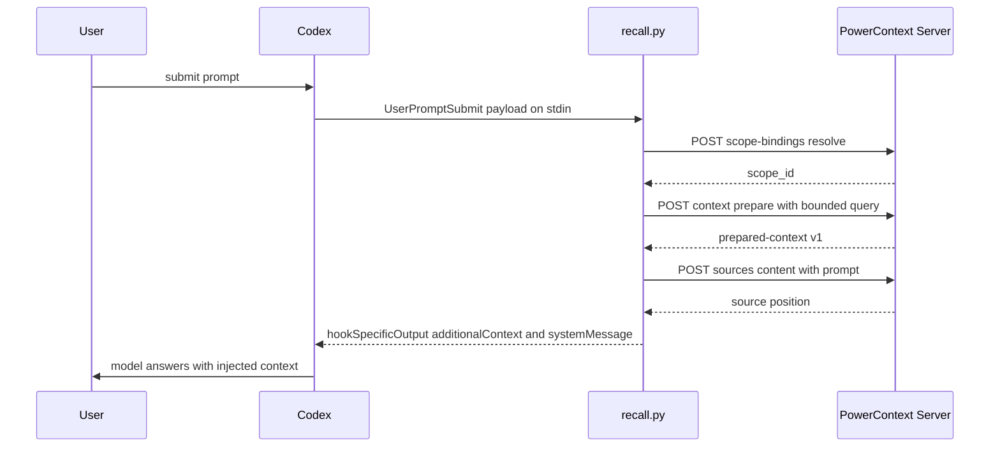

# Codex Plugin Integration

The PowerContext Codex plugin is a thin client of a running PowerContext Server. It does not embed storage and it does not start the Server. Its source lives under `integrations/codex/plugins/powercontext` and this page describes the behavior at repository commit `b8b18909`.

The plugin does three things:

- **Hooks** run as short-lived processes inside Codex. They bind the Session to a Scope, optionally load a bootstrap package, recall context before each prompt, capture each prompt as Source evidence, and print a token-savings line after each turn.
- **MCP** gives Codex explicit PowerContext tools for Memory, work continuity (Handoff), Experience and Skill review, and external Skill import through the Streamable HTTP endpoint.
- **Setup and doctor** in the PowerContext CLI install the plugin, write the installed MCP endpoint, store the credential, and check the installed connection.

Hooks and MCP share one endpoint and one credential source, so a single Server URL and credential must serve both paths.

## Hook set

The plugin declares its hooks in [hooks.json](../../integrations/codex/plugins/powercontext/hooks/hooks.json). Each hook is a `command` hook that runs `uv run --frozen --quiet --project "${PLUGIN_ROOT}" python` against one script.

| Event | Matcher | Timeout | Script | Role |
| --- | --- | --- | --- | --- |
| `SessionStart` | `startup\|resume\|clear\|compact\|fork` | 10 | `hooks/session_binding.py` | Persist the Session binding and optionally inject one bootstrap package |
| `PreToolUse` | `mcp__powercontext__.*` | 10 | `hooks/bind_tools.py` | Inject the bound Scope into PowerContext MCP calls |
| `UserPromptSubmit` | none | 10 | `hooks/recall.py` | Prepare recall context and capture the prompt |
| `Stop` | none | 10 | `hooks/token_savings.py` | Show scoped recall-token savings for the completed turn |

The `SessionStart` matcher covers the five lifecycles Codex sends. The script also accepts `restore` as a lifecycle value, but the matcher does not list it. Every hook timeout is the outer host limit; the scripts keep their own HTTP budgets below it. The `UserPromptSubmit` and `Stop` entries have no matcher, so they run on every prompt and every completed turn.

## Connection and endpoint

The installed MCP entry lives in the plugin's [.mcp.json](../../integrations/codex/plugins/powercontext/.mcp.json). It declares one HTTP server named `powercontext` at `http://127.0.0.1:8000/mcp/`, marks it `required: false`, and maps `Authorization` to the `POWERCONTEXT_CODEX_AUTHORIZATION` environment variable. The file must define only the `powercontext` server, and its URL must end in `/mcp` without credentials, query, or fragment ([settings.py](../../integrations/codex/plugins/powercontext/settings.py)).

The hooks do not read their endpoint from an environment variable. `CodexPluginSettings` takes `server_url` from this same `.mcp.json` file, so changing the hook endpoint means changing the installed MCP configuration. Setup rewrites that URL in the installed plugin cache and adds an `http_headers_helper` that reads the saved credential ([system.py](../../src/powercontext/cli/system.py)).

Plain HTTP is accepted only for loopback hosts unless HTTP consent is set. Settings resolve consent from the `POWERCONTEXT_CODEX_ALLOW_INSECURE_HTTP` variable, then the shared client configuration, and the consent does not disable certificate validation for HTTPS.

## Authorization

The credential has three sources, in precedence order:

1. The process variable `POWERCONTEXT_CODEX_AUTHORIZATION`, which must be a complete `Bearer <token>` header.
2. A setup-managed record at `$CODEX_HOME/powercontext/credentials.json`, which defaults to `~/.codex/powercontext/credentials.json`.
3. No credential, which sends unauthenticated requests.

The stored record is used only when its URL matches the effective MCP endpoint, when it is not a symlink, and when it has no group or other permissions on POSIX. Malformed records are ignored. The MCP helper in [mcp_headers.py](../../integrations/codex/plugins/powercontext/mcp_headers.py) and the hooks read the same URL-bound record, so new Codex sessions do not need an authorization export.

## Scope binding

Every Codex Session is pinned to one Scope. The plugin never derives a Scope ID from a path, remote, or branch. It only sends lookup keys to the Server.

[resolve_scope_id](../../integrations/codex/plugins/powercontext/scripts/scope_binding.py) posts `explicit_scope_id` and an ordered list of binding keys to `POST /v1/scope-bindings/resolve`. The keys are:

- a `session` key built from the Codex session identifier, and
- a `workspace` key built as the SHA-256 of the Git root path, falling back to the working directory when Git is unavailable.

The Server applies the precedence. The plugin's documented order is the explicit `POWERCONTEXT_CODEX_SCOPE_ID`, then an existing Session binding, then a host-managed workspace binding, then the Server's default Scope. An explicit Scope skips the Session persistence step. When `SessionStart` resolves a Scope, it also writes the Session binding with `PUT /v1/scope-bindings`.

The `scope_binding.py` script can bind a Git checkout to a Scope with `--bind-scope`, print the resolved Scope, or remove only the workspace binding with `--clear-scope`. A new Session in that checkout then uses the workspace binding, while a Session that already started keeps its Session binding.

## First-session hook trust

Codex runs plugin hooks only after the user trusts them. The plugin's own code does not implement a trust check. The user-facing setup is documented in [Configure Codex](../../docs/en/docs/integrations/codex.md#first-session-hook-trust) and the [Codex quickstart](../../docs/en/docs/workflows/codex-workflow.md#5-save-memory-in-the-first-codex-session): open a new session, inspect the PowerContext hooks with `/hooks`, and grant trust when prompted.

This creates a branch the operator must recognize. When the hooks are not trusted or are disabled, Codex does not run recall, capture, bootstrap, scope injection, or the savings line, even though the MCP tools may still be connected. The diagnostics in `powercontext doctor codex` do not detect trust or hook execution. The documentation states that loading the plugin or discovering MCP tools does not prove the hooks ran, and the operator must check capture separately.

## Recall and capture on each prompt

The `UserPromptSubmit` hook in [recall.py](../../integrations/codex/plugins/powercontext/hooks/recall.py) handles one prompt in a fixed order: resolve the Scope, clear the consumed bootstrap receipt, scrub secrets, recall, then capture. Recall and capture are independent. A failure in one does not suppress the other.

Caption: one `UserPromptSubmit` invocation resolves the Scope, prepares recall context once, and then captures the prompt as an independent Source.

### Recall

The hook calls `POST /v1/context/prepare` once per prompt with the bound `scope_id`, a `max_bytes` budget of 8000, and, when configured, `include_code`, `assembly`, and the bootstrap receipt identity. Bootstrap receipts are sent only when they belong to the same Scope.

Before sending, the hook bounds the query. A prompt within 8,192 characters and 8,192 UTF-8 bytes is sent as submitted. A longer prompt keeps its most recent text, cut by character and then by byte, so recall narrows instead of failing. The helper is `bounded_recall_query` in [prepared_context.py](../../integrations/codex/plugins/powercontext/hooks/prepared_context.py).

The response must match `powercontext.prepared-context.v1` exactly: the four keys `schema`, `status`, `content`, and `content_bytes`; the schema string; and for `ready`, a non-blank string whose UTF-8 length equals `content_bytes` and does not exceed 8000 bytes. An `empty` status must carry no content. Any other shape is rejected. The hook injects the validated content unchanged and performs no second selection. The Runtime owns rendering and citations.

### Capture

When capture is enabled and the prompt is within 200,000 characters, the hook posts the prompt to `POST /v1/sources/content`. The `source_id` is `codex-user-prompt:` followed by the SHA-256 of the Scope, session, turn, and prompt. The metadata records `origin: codex`, `event: user_prompt_submit`, the working directory, and, when present, the session and turn identifiers. Repeating the same prompt in the same turn therefore produces the same Source.

If secret scrubbing changed the prompt, the hook skips capture and records a `skipped` event with reason `sensitive_content`. Recall still runs with the scrubbed query. Capture never sends a scrubbed prompt as the captured content.

With `flush_on_capture` set, the hook polls `POST /v1/memory/flush` until the returned `current_cursor` reaches the captured Source position, at most `flush_max_calls` times. The default is `false`, so ordinary prompts do not wait for Memory processing.

### Gateway mode

When both `prompt_recall` and `capture_prompts` are `false`, the hook returns before reading the prompt and sends no request. This is the documented setup for turns that already pass through the PowerContext gateway, which prepares and captures on its own ([Codex configuration](../../docs/en/docs/integrations/codex.md#leave-prompt-time-context-to-the-gateway)).

## Session start and bootstrap

[session_binding.py](../../integrations/codex/plugins/powercontext/hooks/session_binding.py) handles `SessionStart`. A payload without a recognized lifecycle source only resolves and persists the Session binding. With a recognized source, the hook decides whether to inject bootstrap context.

Bootstrap context is off unless `POWERCONTEXT_CODEX_BOOTSTRAP_CONTEXT=true`. When enabled, the hook posts `POST /v1/context/bootstrap` with the lifecycle, the `powercontext.scope-bootstrap.v1` profile, the byte limit (512 through 8192, default 4096), and an optional exact committed Handoff identity. The response must validate as `powercontext.bootstrap-context.v1`, including a `sha256` package digest. A `ready` package is delivered in this order:

1. The hook posts a receipt with outcome `injected`, which moves the receipt to `injected` only if the Server confirms it.
2. The hook saves the receipt identity locally in a hashed, mode-0600 state file.
3. The hook writes `hookSpecificOutput` with event name `SessionStart` and the package as `additionalContext`.

If the receipt cannot be confirmed, the hook posts a `failed` receipt and injects nothing. Failures before a new lifecycle package is established clear any stale saved receipt. The first ordinary recall then sends the saved receipt so the Runtime suppresses already delivered Atomic Memory revisions.

## Data-plane binding in PreToolUse

[bind_tools.py](../../integrations/codex/plugins/powercontext/hooks/bind_tools.py) runs before tools matching `mcp__powercontext__.*`. It rewrites the tool input so the Agent cannot redirect a read or write to another Scope.

- Session-control operations, `set_scope_binding` and `clear_scope_binding`, are allowed with the `key` replaced by the Session binding key.
- The resolve operation, `resolve_scope_binding`, is allowed with the explicit Scope and both binding keys.
- Host-level operations, such as `create_scope`, `get_scope`, `list_scopes`, and `publish_artifact`, are allowed unchanged.
- Current data-plane operations receive the resolved `scope_id`. Selection operations, `get_handoff_report` and `get_stats`, receive an exact `selection` for that Scope.
- Unknown tool names return with no decision, so Codex's normal approval applies.

When binding fails, the hook returns `permissionDecision: deny` with a reason. A 401 yields the authentication-failure message that points to `powercontext setup codex`. A 403 yields the authorization message. Other failures yield a generic binding failure message.

## Stop and the savings line

The `Stop` hook in [token_savings.py](../../integrations/codex/plugins/powercontext/hooks/token_savings.py) resolves the Scope and then loads two `POST /v1/stats` windows, `today` and `30d`, for that Scope. Its HTTP budget is capped at 8 seconds, below the 10-second host deadline. It writes `continue: true` with a `systemMessage` such as `PowerContext · saved 1.2k today · saved 12k in 30d`. A window with no comparable preparations reads as `no data`, not as zero. The figures are estimates, not billable savings.

When the Server is unavailable, the hook prints a single content-free diagnostic instead of the savings line. It never blocks the turn.

## Failure outcomes

Every hook fails open. The scripts catch their exceptions and exit with status 0, so a Server problem does not stop normal Codex work. A hook prints diagnostics as JSON. The `UserPromptSubmit` output puts them in a top-level `systemMessage`, and when context is also available, `hookSpecificOutput` is returned beside them. Diagnostics never include the query, Scope, content, citations, response body, or credential.

Failure outcomes are throttled. [diagnostics.py](../../integrations/codex/plugins/powercontext/hooks/diagnostics.py) suppresses a repeated failure outcome for 60 seconds across hook processes, using a locked state file. Within one `UserPromptSubmit` invocation, each failure outcome is emitted at most once.

### Server unavailable

Connection failures, timeouts, an expired shared deadline, and HTTP 503 are classified as `server_unavailable`. Each carries the recovery hint `powercontext doctor`. In recall, the failure returns no context, the prompt still reaches Codex, and capture runs only if its own request can proceed. A slow response is aborted at the per-request or shared deadline rather than waiting for Codex's host timeout.

### Invalid response

A body that is not a JSON object, a response that fails the prepared-context or bootstrap contract, or an HTTP status that does not fit another class is reported as `invalid_response`. The hook injects nothing. Responses larger than 1 MiB are rejected, and redirects are refused.

### Version mismatch

The hook identifies itself with the `User-Agent` built from the plugin version and sends `X-PowerContext-Dream-Contract: 2`. In recall, `version_mismatch` is reported for HTTP 404 on a compatibility path (`/health/live`, `/health/ready`, `/v1/capabilities`, or `/v1/context/prepare`) that returns no error code. In `SessionStart`, any HTTP 404 from a bootstrap or scope-binding request is classified as `version_mismatch`. The recall path does not map other statuses such as 426 to `version_mismatch`; they fall through to `invalid_response`, so an operator who sees that outcome should check the Server version against the plugin version.

### Authentication and authorization

HTTP 401 is `authentication_failed` in every hook. HTTP 403 is `authorization_denied` in `SessionStart` and in the `PreToolUse` binding path; the `UserPromptSubmit` and `Stop` paths classify other statuses as `invalid_response`. In `SessionStart`, a failed receipt claim is reported as `delivery_failed`. The text names the Server or credential, not the query or content.

## Setup and doctor

`powercontext setup codex` runs `CodexInstaller` in [system.py](../../src/powercontext/cli/system.py). Its `install` step registers the marketplace and installs the plugin, preserving an installed copy that is already disabled, then records the plugin version and data directory. Its `configure` step rewrites the installed plugin cache's `.mcp.json` with the chosen URL and an `http_headers_helper` that reads the credential file by absolute path, then saves the credential and, on Windows, mirrors it into the user environment for Codex Desktop. Setup can be run again. An endpoint change without a new token keeps the old credential bound to its previous URL, and that credential is not forwarded.

`powercontext doctor codex` runs the Codex verifier in [system.py](../../src/powercontext/cli/system.py). It checks, in order:

1. The Codex CLI on PATH. Windows batch launchers that would make shell metacharacters unsafe are refused.
2. The plugin entry, which must be enabled.
3. The native MCP entry, which must be enabled, have the environment-backed Authorization header, and report its authorization state.
4. A native MCP discovery probe. The required tools are `remember_memory` and `search_memory`. Missing either fails `mcp_tools`.
5. Full-profile coverage. Missing additional tools make `mcp_full_profile` degraded and list the names.

Doctor does not verify hook trust, hook execution, model readiness, or write authorization. Its output lists the MCP and plugin state separately from hook behavior.

## Configuration

| Variable | Default | Effect |
| --- | --- | --- |
| `POWERCONTEXT_CODEX_SCOPE_ID` | unset | Explicit Scope, sent to the Server resolve request |
| `POWERCONTEXT_CODEX_AUTHORIZATION` | unset | Process credential, overriding the saved record |
| `POWERCONTEXT_CODEX_BOOTSTRAP_CONTEXT` | `false` | Enables bootstrap injection on `SessionStart` |
| `POWERCONTEXT_CODEX_BOOTSTRAP_MAX_BYTES` | `4096` | Bootstrap byte limit, from 512 to 8192 |
| `POWERCONTEXT_CODEX_BOOTSTRAP_HANDOFF` | unset | Exact committed Handoff identity to add to bootstrap |
| `POWERCONTEXT_CODEX_PROMPT_RECALL` | `true` | Prepare and inject context for each prompt |
| `POWERCONTEXT_CODEX_CAPTURE_PROMPTS` | `true` | Capture prompts as Source evidence |
| `POWERCONTEXT_CODEX_FLUSH_ON_CAPTURE` | `false` | Wait for Source processing after capture |
| `POWERCONTEXT_CODEX_REQUEST_TIMEOUT_SECONDS` | `3` | Per-request budget |
| `POWERCONTEXT_CODEX_HTTP_BUDGET_SECONDS` | `6` | Shared hook budget |
| `POWERCONTEXT_CODEX_FLUSH_MAX_CALLS` | `4` | Maximum flush calls per prompt |
| `POWERCONTEXT_CODEX_ALLOW_INSECURE_HTTP` | `false` | Allow non-loopback plaintext HTTP for hooks |

The full list, and the Server-side Scope and authorization details, are in [Configure Codex](../../docs/en/docs/integrations/codex.md#environment-variables).

## Tests

The focused tests are in `tests/codex_plugin`. They cover the contract between the hooks and the Server, and the failure branches on the hook side:

- `test_contract.py` checks the hook declarations, including the `SessionStart` matcher against each lifecycle, the `PreToolUse` matcher, the bounded settings, and the manifest prompts.
- `test_recall.py` checks the prepare contract, the query bounds, failure classification (`version_mismatch`, `authentication_failed`, `invalid_response`, and deadline-based `server_unavailable`), capture idempotence, and diagnostic throttling.
- `test_bootstrap.py` checks the receipt state machine, delivery-before-injection order, concurrent receipt handling, and HTTP failure classification at `SessionStart`.
- `test_scope_binding.py` checks the binding keys, bounded network reads, and deadline enforcement under a trickling server.
- `test_token_savings.py` checks the `Stop` savings message and its bounded behavior.

Run them from a checkout with the command in [Codex integration](../../integrations/codex/README.md). The characterization test in `tests/test_hook_characterization.py` is a separate check of the hook behavior that the other tests do not repeat.

## Related pages

- [Capability matrix](capability-matrix.md) lists the MCP tools and their profiles across hosts.
- [Claude Code plugin](claude-code-plugin.md) describes the parallel integration for Claude Code.
- [Memory and Handoff](../workflows/memory-and-handoff.md) explains the boundary between durable Memory and temporary Handoff.
- [Prepare and recall](../workflows/prepare-and-recall.md) describes the Server-side context preparation that the recall hook calls.
