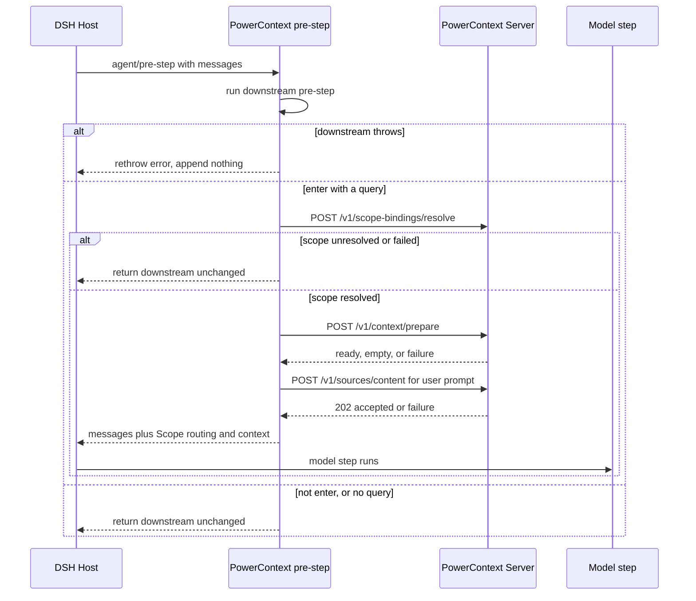

# DSH Plugin (DeepSeek Harness)

The DSH integration is a client of a running PowerContext Server. It ships as the `powercontext-dsh` package in
`integrations/dsh/plugins/powercontext` and is installed by the Python command `powercontext setup dsh`. The plugin
gives DeepSeek Harness three things: model-facing MCP tools named `mcp__powercontext__<operation>`, automatic per-step
context and prompt capture, and `/pc` slash commands. It also has an optional browser sidebar that is only enabled on
a verified local owner surface. A separate package, `dsh-pet`, adds opt-in memory for DSH pets.

All links and line ranges below cite the repository at commit `b8b18909`.

## Components

| Piece | Where it lives | Role |
| --- | --- | --- |
| Installer | `src/powercontext/cli/dsh.py` | Validates the built plugin, copies the Skill, runs `dsh plugin add`, and reports diagnostics. |
| Plugin entry | `integrations/dsh/plugins/powercontext/src/index.ts` | Builds the runtime and registers every hook, command, and bridge. |
| Config | `integrations/dsh/plugins/powercontext/src/config.ts` | Resolves settings from environment, plugin patch, saved credentials, and defaults. |
| Pre-step recall and capture | `.../src/recall.ts`, `.../src/capture.ts` | Runs `POST /v1/context/prepare` and captures the user prompt once per model step. |
| MCP registration and policy | `.../src/mcp.ts`, `.../src/mcp-transport.ts` | Connects the native DSH MCP client to the Server and gates tool calls. |
| `/pc` commands | `.../src/commands.ts` | Direct, non-model commands for status, search, remember, review, and diagnostics. |
| Sidebar bridge | `.../src/status-bridge.ts`, `.../src/dashboard-bridge.ts` | Owner-local read-only status and dashboard routes. |
| Handoff delivery | `.../src/handoff/delivery.ts` | Internal local package store and delivery service; not a browser route by itself. |
| dsh-pet companion | `integrations/dsh/plugins/dsh-pet/src/index.ts`, `src/powercontext/cli/dsh_pet.py` | Recall and capture for dsh-pet dialogue through a memory slot. |

## Install and setup

The README gives the supported flow. Install the PowerContext tool from the same Git ref you pass to setup, then run
setup and start the Server:

```bash
uv tool install --force "powercontext[cli,server] @ git+https://github.com/oceanbase/powercontext.git@master"
powercontext setup dsh --source oceanbase/powercontext --ref master
powercontext server run
```

A local checkout uses `powercontext setup dsh --source .`. The plugin directory must already contain a built
`lib/index.js`, otherwise setup fails with a build instruction ([dsh.py](../../src/powercontext/cli/dsh.py#L152-L157)).
The browser client is optional and packaged as `lib/client.js` with `./assets/*`; a headless install still loads only
`lib/index.js` ([README](../../integrations/dsh/README.md)).

`DshInstaller.install` stages the `powercontext-project-context` Skill, publishes it, and then runs
`dsh plugin --profile <profile> add <package>` ([dsh.py](../../src/powercontext/cli/dsh.py#L266-L296)).
The profile defaults to `web`; the Desktop profile is selected through `--profile desktop` and the `--dsh-command`
override ([system.py](../../src/powercontext/cli/system.py#L227-L231)). After installation, the setup flow writes the
connection transport and runs `enable` when the installer provides it
([installation.py](../../src/powercontext/cli/installation.py#L146-L207)).

Verification is partial by design. `DshInstaller.verify` runs `dsh --profile web --dump-config` and reports whether
the plugin id is registered. It reports `running_host_configuration`, `server_liveness`, `server_readiness`,
`route_compatibility`, and `session_scope` as `not_observed` or `not_checked`, so the real check is `/pc doctor`
inside a running DSH session ([dsh.py](../../src/powercontext/cli/dsh.py#L312-L402)).

## Startup order

`apply` runs once per plugin load. It loads the DSH LLM peer, builds the runtime from the resolved config, and then
registers the hooks in this order: MCP policy, the Skill, the system-prompt guidance, the pre-step recall, the `/pc`
command, the status bridge, the update bridge, and finally the native MCP connection
([index.ts](../../integrations/dsh/plugins/powercontext/src/index.ts#L177-L189)).

The plugin registers no direct HTTP operation tools. Its only tool surface is the native DSH MCP client, which
publishes the Server's MCP catalog. The README states the naming rule: model-facing operations appear as
`mcp__powercontext__<operation>`, and the plugin does not register direct HTTP operation tools
([README](../../integrations/dsh/README.md)). The source matches this. `mcpConfig` describes one streamable-HTTP
server named `powercontext` ([mcp.ts](../../integrations/dsh/plugins/powercontext/src/mcp.ts#L151-L162)), and
`rawOperation` accepts a tool name only when its suffix is in the generated MCP catalog
([mcp.ts](../../integrations/dsh/plugins/powercontext/src/mcp.ts#L68-L72)).

## Configuration

`resolveConfig` resolves the plugin settings. The defaults and precedence come from `DEFAULTS` and the resolver
([config.ts](../../integrations/dsh/plugins/powercontext/src/config.ts#L61-L73),
[config.ts](../../integrations/dsh/plugins/powercontext/src/config.ts#L135-L174)).

| Setting | Default | Source precedence and notes |
| --- | --- | --- |
| `baseUrl` | `http://127.0.0.1:8000` | Environment `POWERCONTEXT_DSH_BASE_URL`, then `POWERCONTEXT_DSH_SERVER_URL`, `POWERCONTEXT_DSH_ENDPOINT`, `POWERCONTEXT_CLIENT_SERVER_URL`, then the plugin patch, then the saved client file, then the default. Non-loopback HTTP needs explicit consent. |
| `allowInsecureHttp` | `false` | Environment `POWERCONTEXT_DSH_ALLOW_INSECURE_HTTP` or `POWERCONTEXT_CLIENT_ALLOW_INSECURE_HTTP` wins; otherwise consent must match the endpoint. |
| `authorization` | unset | `POWERCONTEXT_DSH_AUTHORIZATION` (a full `Bearer ` header), then the plugin patch, then the stored credential under `$DSH_HOME/powercontext/credentials.json` (defaults to `~/.dsh`). The stored file is ignored unless its permissions have no group or other bits (non-Windows) and its `server_url` matches `baseUrl`. |
| `scopeId` | unset | `POWERCONTEXT_DSH_SCOPE_ID`, then the plugin patch. When unset, the host resolves the Scope from the workspace binding. |
| `timeoutMs` | `4000` | Budget for the whole automatic pre-step. |
| `requestTimeoutMs` | `1000` | Per-request timeout. The readiness operation uses at least `40000` ms. |
| `maxBytes` | `8000` | Must be between `512` and `32768`; sent as `max_bytes` on prepare. |
| `capturePrompts` | `true` | `POWERCONTEXT_DSH_CAPTURE_PROMPTS` overrides the plugin patch. |
| `flushOnCapture` | `false` | `POWERCONTEXT_DSH_FLUSH_ON_CAPTURE` overrides the plugin patch. |
| `flushMaxCalls` | `4` | Bounded `flush_memory` polls after a flush-on-capture. |
| `ownerLocal` | unset | `POWERCONTEXT_DSH_OWNER_LOCAL` overrides the plugin patch; a non-boolean value throws. |
| `contextAssembly` | unset | `POWERCONTEXT_DSH_CONTEXT_ASSEMBLY` must be a JSON object, or the patch value is used. |

The plugin config schema validates the same values at load time
([index.ts](../../integrations/dsh/plugins/powercontext/src/index.ts#L42-L58)). The setup-side authorization variable
for DSH is `POWERCONTEXT_DSH_AUTHORIZATION`, registered alongside the other hosts in
[authorization.py](../../src/powercontext/cli/authorization.py#L36-L46).

## Transport and Scope

Every HTTP call goes through `PowerContextClient`. It refuses unknown operation ids, sends the Dream contract header,
and sets `redirect: 'manual'` so redirects are not followed
([client.ts](../../integrations/dsh/plugins/powercontext/src/client.ts#L221-L223)). Operation paths come from the
generated table. For example, `prepare_context` is `POST /v1/context/prepare`, `capture_content_source` is
`POST /v1/sources/content`, `resolve_scope_binding` is `POST /v1/scope-bindings/resolve`, and `flush_memory` is
`POST /v1/memory/flush` ([operations.generated.ts](../../integrations/dsh/plugins/powercontext/src/operations.generated.ts#L44-L54)).

Scope is resolved per session. `resolveScopeId` sends the configured `explicit_scope_id` and a workspace binding key
derived from the session `cwd` ([scope.ts](../../integrations/dsh/plugins/powercontext/src/scope.ts#L50-L64)). The
session resolver refreshes the Scope on every pre-step, while MCP calls reuse the cached value only when the `cwd`
matches. A failed refresh deletes the cache entry, so a previous turn's Scope is not used
([index.ts](../../integrations/dsh/plugins/powercontext/src/index.ts#L93-L115)).

## MCP tools and the 5-second startup wait

`registerMcp` starts the native connection and waits at most five seconds for it. The initialization promise is
raced against a `MCP_STARTUP_WAIT_MS = 5000` deadline ([mcp.ts](../../integrations/dsh/plugins/powercontext/src/mcp.ts#L51)).

- If initialization finishes within five seconds, the function returns and the tools are available at once.
- If the deadline wins, the function logs `mcp_connect` with outcome `pending` and recovery `/pc doctor`, and returns.
  The initialization promise is not cancelled. The native client keeps connecting and publishes its tools when it
  is ready. The runtime tests cover this late publication
  ([runtime.test.mjs](../../integrations/dsh/plugins/powercontext/tests/runtime/runtime.test.mjs)).
- If initialization fails, `reportFailure` logs `mcp_connect` and the promise resolves. Host startup is not blocked.

The MCP config sets `failOnStartupError: false` and `toolCallTimeoutMs: 60000`, so the host stays usable while the
Server starts or is unavailable ([mcp.ts](../../integrations/dsh/plugins/powercontext/src/mcp.ts#L151-L162)).
The native client does not talk to the Server directly. `protectMcpEndpoint` opens a relay on `127.0.0.1` with a
random path. The relay accepts only `GET`, `POST`, and `DELETE` on that path. It rejects redirects with
`redirect_rejected`. It replaces upstream error bodies with a fixed code (`authentication_failed`,
`authorization_failed`, `unavailable`, and so on) and never relays upstream diagnostics
([mcp-transport.ts](../../integrations/dsh/plugins/powercontext/src/mcp-transport.ts#L53-L112)).

### Tool policy

The `tools/pre-execute` hook decides each PowerContext MCP call before it is sent
([mcp.ts](../../integrations/dsh/plugins/powercontext/src/mcp.ts#L92-L150)). It proceeds in this order:

1. A name outside `mcp__powercontext__` passes to the next hook. A name with the prefix but an unknown operation is
   denied with "No MCP request was sent".
2. If the arguments contain likely secret content, the call is denied with `secret_rejected`.
3. Operations that take a Scope resolve the host Scope. If resolution throws or returns nothing, the call is denied.
   If the arguments do not match that Scope (`scope_id` for current-Scope operations, or an exact single-entry
   `selection` for selection operations), the call is denied.
4. Operations whose catalog entry is not `readOnly` return `ask`. The host must approve them, and the reason text says
   to approve only an explicitly requested change.

The mutation list comes from the generated MCP catalog ([mcp-operations.generated.ts](../../integrations/dsh/plugins/powercontext/src/mcp-operations.generated.ts#L1-L20)).

## Per-step context and prompt capture

The automatic path runs on the `agent/pre-step` hook. `registerRecall` wires the hook to `runRecallPreStep`
([index.ts](../../integrations/dsh/plugins/powercontext/src/index.ts#L117-L150)). Each model step follows the order
below. The code path and the sequence diagram match each other.



Caption: one model step. Prompt capture happens before the model step, and a failed prepare still leaves the Scope
routing message in place when the Scope resolved.

Branches as the code runs them:

- **Downstream failure.** If the downstream pre-step throws, the hook skips the remaining stages, records the injection
  as unavailable, and rethrows. No PowerContext message is appended
  ([recall.ts](../../integrations/dsh/plugins/powercontext/src/recall.ts#L151-L183)).
- **Downstream rejection or no input.** A decision other than `enter` is returned unchanged. An `enter` decision with
  no messages, or with no non-empty query text after host snapshots and Skill messages are removed, is also returned
  unchanged ([recall.ts](../../integrations/dsh/plugins/powercontext/src/recall.ts#L151-L213)).
- **Automatic budget.** The pre-step signal combines the host signal with `AbortSignal.timeout(timeoutMs)`. If it is
  already aborted, the downstream decision is returned unchanged.
- **Scope.** The Scope is resolved for the session. If resolution throws, `scope_failed` is recorded and nothing
  else runs. If it is unresolved, `prepare`, `capture`, and `flush` are skipped.
- **Prepare.** The query is `boundedRecallQuery` of the scrubbed text, capped at 8,192 characters and bytes. The
  request body is `{scope_id, query, max_bytes}`, plus `assembly` when `contextAssembly` is set. The response must match
  the prepared-context schema. A `status: empty` result returns no content. An invalid or failed response is reported
  and returns no content ([recall.ts](../../integrations/dsh/plugins/powercontext/src/recall.ts#L115-L150),
  [prepared-context.ts](../../integrations/dsh/plugins/powercontext/src/prepared-context.ts#L75-L86)).
- **Capture.** After prepare, and regardless of its outcome, the user prompt is captured if one exists and the signal
  is still live ([recall.ts](../../integrations/dsh/plugins/powercontext/src/recall.ts#L216-L263)). `captureUserPrompt`
  then:
  - skips when `capturePrompts` is false (`capture_disabled`);
  - skips when the prompt exceeds `200000` characters (`source_too_long`) or contains the configured authorization
    value or a secret (`sensitive_content`);
  - posts `capture_content_source` with a `source_id` that is the SHA-256 of scope, session, turn, and prompt, and
    metadata `origin: 'dsh'` and `event: 'user_prompt_submit'` ([capture.ts](../../integrations/dsh/plugins/powercontext/src/capture.ts#L38-L40),
    [capture.ts](../../integrations/dsh/plugins/powercontext/src/capture.ts#L68-L129));
  - on failure, reports the error and skips the flush, so the model step still runs;
  - on success with `flushOnCapture` true and a valid `position`, calls `flush_memory` up to `flushMaxCalls` times until
    `current_cursor` reaches that position. The result says memory production is not verified. A cursor not reached
    within the budget is reported as `flush_budget_exhausted`.
- **Injection.** If scope resolved, a routing message is added. If prepared content is ready, it is wrapped as
  untrusted context that supersedes earlier snapshots. If neither exists, or the signal aborted, the downstream
  decision is returned unchanged. If the host message wrapper throws, nothing is appended.

So a failed prepare still leaves the turn working. The model receives the ordinary conversation, plus Scope routing when
the Scope resolved.

## Slash commands

`registerCommands` registers `/pc` ([commands.ts](../../integrations/dsh/plugins/powercontext/src/commands.ts#L153-L174)).
Commands call the Server directly and do not go through the MCP policy. `handlePcCommand` supports these subcommands
([commands.ts](../../integrations/dsh/plugins/powercontext/src/commands.ts#L99-L150)):

| Command | Behavior |
| --- | --- |
| `/pc` (no arguments) | Shows the resolved Scope, the Server origin, and the automatic-path status. |
| `/pc doctor` | Runs the full Server diagnosis and returns a JSON report. |
| `/pc search <query>` | `search_memory` with `limit: 8` and `mode: 'auto'`. |
| `/pc remember <text>` | `remember_memory` with `kind: 'agent-note'`. |
| `/pc flush` | `flush_memory`. |
| `/pc review [approve or reject ...]` | Lists pending candidates, or approves or rejects one with its expected version. |
| `/pc stats`, `/pc capabilities`, `/pc skills scan` | Server statistics, capabilities (no Scope), or external Skill scan. |

Every command that needs a Scope returns `unscoped` when none can be resolved. An unknown subcommand returns an error.

## Owner-local web sidebar

The sidebar and dashboard are optional. `registerStatusBridge` injects `webServer` and `connection`. A headless host that
does not provide those services never enters the callback, so tools and hooks still load
([status-bridge.ts](../../integrations/dsh/plugins/powercontext/src/status-bridge.ts#L675-L705)).

### Owner-local gate

`ownerLocal` is the explicit owner assertion. It comes from `POWERCONTEXT_DSH_OWNER_LOCAL` when set, otherwise from
the plugin patch `ownerLocal`. It is `undefined` when neither is set. Desktop is identified by the managed
`desktop` profile context, not by Electron ([status-bridge.ts](../../integrations/dsh/plugins/powercontext/src/status-bridge.ts#L212-L239)).

`deploymentRejection` decides each request in this order ([status-bridge.ts](../../integrations/dsh/plugins/powercontext/src/status-bridge.ts#L182-L209)):

1. A socket address that is not loopback is rejected with `local_only` (403). Only `127.0.0.0/8`, `::1`, and their
   IPv4-mapped forms count as loopback ([status-bridge.ts](../../integrations/dsh/plugins/powercontext/src/status-bridge.ts#L238-L246)).
2. If the host was launched through SSH (`SSH_CONNECTION` or `SSH_TTY` set), the request is rejected with
   `ssh_untrusted`, even on loopback. A loopback reverse proxy or SSH-forwarded host shares the address, so loopback
   alone is not proof.
3. If the host is Desktop (`profileContext.name === 'desktop'`) or `ownerLocal` is `true`, the request is allowed.
4. If `ownerLocal` is `false`, the request is rejected with `owner_local_disabled`.
5. Otherwise, the request is rejected with `owner_local_unverified`. The message tells the owner to set `ownerLocal: true`
   or `POWERCONTEXT_DSH_OWNER_LOCAL=true` only for their own local deployment.

Shared or remote hosts have no separate detector. They are rejected by the loopback check, by the SSH check, or by the
missing explicit assertion. The gate runs after the DSH connection check (`requestRejection`) and is not a replacement
for it. The route handler sends a 401 or 403 from that check first ([status-bridge.ts](../../integrations/dsh/plugins/powercontext/src/status-bridge.ts#L633-L674)).
Only `GET` is accepted; other methods get `405`.

### Read-only status and dashboard

Two routes are registered: `/powercontext/status` and `/powercontext/dashboard`
([status-bridge.ts](../../integrations/dsh/plugins/powercontext/src/status-bridge.ts#L34),
[dashboard-contract.ts](../../integrations/dsh/plugins/powercontext/src/dashboard-contract.ts#L17)).

The status bridge only reads. Its probes run `get_liveness`, then optional `get_server_info` for the package version,
then `get_readiness`, then `get_capabilities`. The bridge never calls prepare, capture, generation, MCP, or `/pc doctor`
([status-bridge.ts](../../integrations/dsh/plugins/powercontext/src/status-bridge.ts#L256-L262),
[status-bridge.ts](../../integrations/dsh/plugins/powercontext/src/status-bridge.ts#L444-L520)). If liveness fails,
readiness and capabilities are not read and the connection is `failed`. A status request waits up to
`STATUS_FIRST_PROBE_WAIT_MS = 2000` ms for the first probe ([status-bridge.ts](../../integrations/dsh/plugins/powercontext/src/status-bridge.ts#L36)).

The dashboard route reads the Server's `/dashboard/home` once per request, with a timeout between 1 and 8 seconds. It
returns one state: `disabled` on 404, `authentication` on 401 or 403, `load_unavailable` on other non-200 responses,
`scope_unresolved` when the session Scope is not resolved, `available` with a Scope-scoped URL, or
`server_unavailable` on a network error ([dashboard-bridge.ts](../../integrations/dsh/plugins/powercontext/src/dashboard-bridge.ts#L35-L73)).

## Handoff delivery

`LocalDeliveryService` in `handoff/delivery.ts` is the internal local delivery component. It takes a verified preflight
gate and a connection resolver, prepares a handoff package from inspected work input, a configured generation, or an
exact Handoff revision, and stores the result in a private directory ([delivery.ts](../../integrations/dsh/plugins/powercontext/src/handoff/delivery.ts#L97-L127)).
The design document states the scope: this component does not add a browser route or enable delivery in the DSH UI on
its own ([dsh-handoff-delivery.md](../../docs/en/development/dsh-handoff-delivery.md)).

Key behaviors from the design and the code:

- **Idempotency.** A request key belongs to one owner and one input. A replay with different input fails with
  `idempotency_conflict`. Equivalent requests on the same binding reuse the delivery
  ([delivery.ts](../../integrations/dsh/plugins/powercontext/src/handoff/delivery.ts#L286-L300)).
- **Carriers.** Inspected work calls `handoff_current_work`. Generation captures a Source, then calls `prepare_handoff`
  and `finalize_handoff`, with the model call capped at 90 seconds. An explicit revision is verified with
  `get_artifact_revision` ([prepare.ts](../../integrations/dsh/plugins/powercontext/src/handoff/prepare.ts#L44-L100)).
  Without a usable input or generation, the result is `needs_input`.
- **Recovery.** Records are written before dispatch. A package is published only after its size and checksum are
  saved. On restart, a valid package becomes `prepared`. Otherwise the delivery becomes `unknown`, and recovery does not
  re-run the original Source or finalize call.
- **Capacity.** The default is 100 carrier slots or 50 MiB. Pending and pinned packages are never evicted. Deletion
  leaves a 30-day tombstone. Unpinned confirmed packages can expire after seven days.

Native target launch and receipt verification still need acceptance tests, and the design doc lists wiring the real
Host boundary reads and connection resolution as remaining work.

## dsh-pet companion

`dsh-pet` is a separate package at `integrations/dsh/plugins/dsh-pet`. It applies only when the profile is `web` or
`desktop` and a pet memory slot exists ([dsh-pet index.ts](../../integrations/dsh/plugins/dsh-pet/src/index.ts#L331-L340)).
It reads `bindings.json` for pet-to-Scope bindings and writes `status.json` each second.

- **Recall** calls `search_atomic_memory` in `mode: 'text'` with `limit: 3`, within a `1200` ms budget. Returned
  memories are wrapped as untrusted historical evidence capped at 3072 bytes. Recall failure backs off for five seconds
  ([dsh-pet index.ts](../../integrations/dsh/plugins/dsh-pet/src/index.ts#L28-L35),
  [dsh-pet index.ts](../../integrations/dsh/plugins/dsh-pet/src/index.ts#L172-L197)).
- **Capture** queues each dialogue turn locally, per binding generation. The queue drains through
  `capture_content_source` on a one-second tick with a five-second timeout. Successful captures are removed. Conflict or
  rejection blocks the item. Other failures retry with exponential backoff
  ([dsh-pet index.ts](../../integrations/dsh/plugins/dsh-pet/src/index.ts#L198-L236),
  [dsh-pet index.ts](../../integrations/dsh/plugins/dsh-pet/src/index.ts#L237-L286)).

Enable it through setup. Each pet binding must be a unique `PET_ID=SCOPE_ID` pair, with a different existing Scope for
each pet, and there must be between one and sixteen bindings ([dsh_pet.py](../../src/powercontext/cli/dsh_pet.py#L55-L73)).
`--dsh-pet-memory on` is required with `--dsh-pet-bind`. `--dsh-pet-memory off` disables delivery without touching the
Server, and `--discard-dsh-pet-pending` requires `off` ([system.py](../../src/powercontext/cli/system.py#L189-L206),
[dsh_pet.py](../../src/powercontext/cli/dsh_pet.py#L100-L125)).

## Operations and troubleshooting

- Run `/pc` for the Scope and automatic status, and `/pc doctor` for Server readiness and tool-catalog checks.
- The plugin logs one JSON line per event with component `powercontext.dsh`. Quiet outcomes (`ready`, `ok`, `empty`) go
  to the debug logger, and other outcomes go to the diagnostic emitter ([index.ts](../../integrations/dsh/plugins/powercontext/src/index.ts#L68-L91)).
- A non-boolean `ownerLocal` value fails configuration validation. A missing Scope returns `unscoped` for commands,
  and the sidebar status reports the `scope_unresolved` notice.

## Tests that matter

- [tests/mcp.spec.ts](../../integrations/dsh/plugins/powercontext/tests/mcp.spec.ts): the `mcp__powercontext__` tool
  policy, Scope checks, and mutation approval.
- [tests/runtime/runtime.test.mjs](../../integrations/dsh/plugins/powercontext/tests/runtime/runtime.test.mjs): the tool
  catalog, the native MCP client, and late tool publication after the startup wait.
- [tests/handoff-delivery.spec.ts](../../integrations/dsh/plugins/powercontext/tests/handoff-delivery.spec.ts) and the
  end-to-end spec in `tests/e2e/handoff-delivery.spec.ts`: preparation, idempotency, and recovery.
- [tests/test_dsh_cli.py](../../tests/test_dsh_cli.py) and [tests/test_dsh_transport.py](../../tests/test_dsh_transport.py):
  setup, configuration inspection, and transport policy.

The README's model-free checks run from a repository checkout with `make js-api-generate-check`, `make js-test`, and the
pytest selection for `dsh` shown in [the README](../../integrations/dsh/README.md).

## Related pages

- [Host Adapters](./host-adapters.md) and [Capability Matrix](./capability-matrix.md) for how DSH compares with other hosts.
- [Client CLI and Transports](../architecture/client-cli-and-transports.md) for the setup and transport layer.
- [Prepare and Recall](../workflows/prepare-and-recall.md) and [Memory and Handoff](../workflows/memory-and-handoff.md) for the
  Server-side behavior behind prepare, capture, and handoff.
- [Configuration Settings](../concepts/configuration-settings.md) for how the environment and config files are merged.
