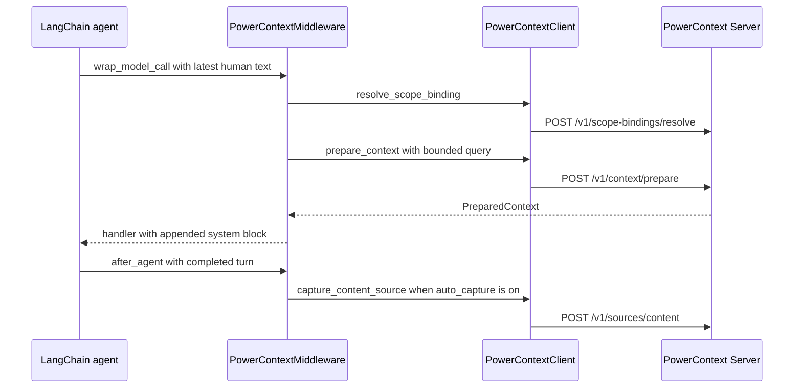
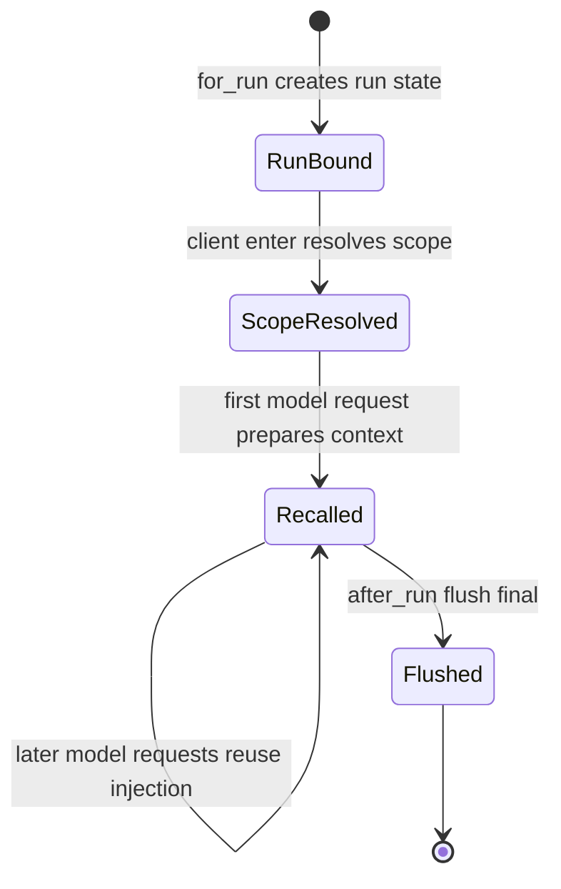
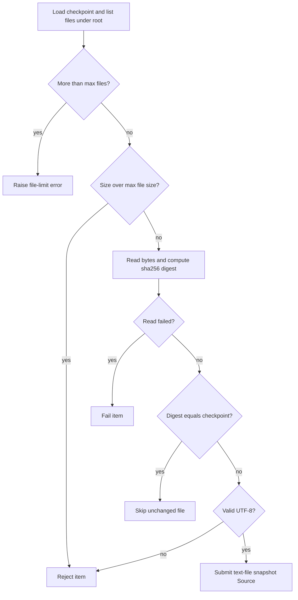

# Framework and Platform Adapters

PowerContext ships several host-facing adapters. The three Python framework adapters are thin layers over the public
`powercontext.client.PowerContextClient` facade. The platform integrations (Dify, Cindy, MiniMax) either call the
HTTP contract directly from their own runtime or install a native plugin that the host connects to over MCP. The
OpenDAL package is an independently scheduled Connector worker, not an agent adapter.

This page describes what each entry point does on the request path and which invariants hold across them. For the
transport layer that all Python adapters share, see [Client, CLI, and transports](../architecture/client-cli-and-transports.md).
For the HTTP and MCP surface, see [HTTP and MCP API](../architecture/http-and-mcp-api.md). For the broader matrix of
host capabilities, see [Capability matrix](capability-matrix.md).

## Adapter map

| Adapter | Entry module | Host surface | Server operations used | Automatic behavior |
| --- | --- | --- | --- | --- |
| LangChain | `integrations/langchain/src/powercontext_langchain/middleware.py` | `AgentMiddleware` for `create_agent` | `resolve_scope_binding`, `prepare_context`, `capture_content_source` | Recall before each model call. Capture after a completed turn only when `auto_capture=True`. |
| LangGraph | `integrations/langgraph/src/powercontext_langgraph/recall.py`, `tools.py` | `pre_model_hook` node and `BaseTool` list | `resolve_scope_binding`, `prepare_context`, `search_memory`, `remember_memory` | Recall through `llm_input_messages`. Memory tools run only when the model calls them. |
| Pydantic AI | `integrations/pydantic-ai/src/powercontext_pydantic_ai/capability.py`, `toolset.py` | `AbstractCapability` and `FunctionToolset` | `resolve_scope_binding`, `prepare_context`, `capture_content_source`, `flush_memory`, `search_memory`, `remember_memory` | Recall once per run. Event capture only when `capture_events=True`. |
| OpenDAL | `integrations/opendal/src/powercontext_connector_opendal/cli.py`, `connector.py` | Independent process or embedded `RemoteConnectorWorker` | Source Definition registration, checkpoint load and compare-and-swap save, and Source submission through `RemoteConnectorWorker` | One full scan per run. Creates Sources, not Memory. |
| Dify | `integrations/dify/plugin/main.py`, `powercontext_dify/tool.py`, `client.py` | Dify plugin provider and `pc_*` tools | `resolve_scope_binding`, `get_scope`, and the operations named by each tool | No automatic recall or capture. The model calls tools explicitly. |
| Cindy | `integrations/cindy/plugins/powercontext-hooks/main.js` and `integrations/cindy/src/worker.ts` | Ghost hook for `will-user-message` plus read tools | `resolve_scope_binding`, `prepare_context`, `search_memory`, `capture_content_source` | Recall rewrites the user message. The original prompt is captured as a Source. |
| MiniMax | `src/powercontext/cli/minimax.py` (`MiniMaxInstaller`) and `integrations/minimax/plugins/powercontext/` | Native MiniMax plugin with a streamable HTTP MCP entry | None directly. The host opens the MCP session to `/mcp`. | None. The plugin does not capture conversations. |

## Shared request contract

Every adapter reaches the Server through `PowerContextClient` or, in Dify and Cindy, through an equivalent HTTP
call. The Python facade maps each method to a generated operation. For the operations used here:

- `resolve_scope_binding` posts to `/v1/scope-bindings/resolve` ([client.py](repo://src/powercontext/client/client.py#L510-L512), [operations.py](repo://src/powercontext/http/_generated/operations.py#L1071-L1079)).
- `prepare_context` posts to `/v1/context/prepare` ([client.py](repo://src/powercontext/client/client.py#L1077-L1087), [operations.py](repo://src/powercontext/http/_generated/operations.py#L1326-L1334)).
- `capture_content_source` posts to `/v1/sources/content` and expects `202` ([client.py](repo://src/powercontext/client/client.py#L590-L593), [operations.py](repo://src/powercontext/http/_generated/operations.py#L1140-L1148)).
- `flush_memory` posts to `/v1/memory/flush` ([client.py](repo://src/powercontext/client/client.py#L973-L975), [operations.py](repo://src/powercontext/http/_generated/operations.py#L1903-L1911)).

Two rules apply to every Python adapter:

1. **Scope is resolved by the Server, not derived locally.** Each operation first calls `resolve_scope_binding`. The
   explicit ID is the invocation or settings value, or `None` for the Server default. The adapters never infer a Scope
   from Git, the path, the agent, or the prompt. The Pydantic AI and Cindy adapters resolve once per run or per
   invocation and reuse or re-resolve as described below.
2. **Recalled content is untrusted evidence.** Each adapter prefixes the prepared content with the marker
   `PowerContext host-supplied context`, followed by the instruction that the block is untrusted historical evidence.
   LangChain uses this prefix in its appended system block
   ([middleware.py](repo://integrations/langchain/src/powercontext_langchain/middleware.py#L24-L31)). LangGraph and Pydantic AI
   use the same marker ([recall.py](repo://integrations/langgraph/src/powercontext_langgraph/recall.py#L37-L38),
   [capability.py](repo://integrations/pydantic-ai/src/powercontext_pydantic_ai/capability.py#L38-L40)).

The Python transport policy is also shared. `PowerContextClient` refuses to send plaintext HTTP to a non-loopback
host unless the caller sets `allow_insecure_http` or supplies a caller-owned `http_client` with
`trust_transport_security=True`. Loopback clients bypass proxy discovery
([client.py](repo://src/powercontext/client/client.py#L360-L420)). The settings base class resolves the
endpoint and consent for every adapter ([transport_policy.py](repo://src/powercontext/client/transport_policy.py#L150-L237)).
Saved consent does not transfer to a different endpoint.

## LangChain middleware

`PowerContextMiddleware` subclasses LangChain's `AgentMiddleware`. It works with `create_agent` and uses only the
public middleware hooks ([middleware.py](repo://integrations/langchain/src/powercontext_langchain/middleware.py#L52-L66)).

Recall runs on every model step. `wrap_model_call` reads the latest human message. If there is none, it calls the
handler unchanged. Otherwise it calls `_prepare` and, if content is returned, overrides the request's system message
with a copy that appends a text block. The override is local to that `ModelRequest`, so the recalled block never enters
agent state or a checkpointer ([middleware.py](repo://integrations/langchain/src/powercontext_langchain/middleware.py#L68-L82),
[middleware.py](repo://integrations/langchain/src/powercontext_langchain/middleware.py#L268-L269)). The async variant
`awrap_model_call` follows the same logic with `await`.

`_prepare` builds one client per operation, resolves the Scope, then calls `prepare_context` with the query clamped to
8192 characters and `max_bytes` from settings. If settings include `context_assembly`, it is forwarded as
`assembly` ([middleware.py](repo://integrations/langchain/src/powercontext_langchain/middleware.py#L133-L160)). Empty
envelopes return no content, and so do unexpected envelope types.

Capture is opt-in. `PowerContextMiddleware(auto_capture=False)` is the default, and `after_agent` and `aafter_agent`
return immediately unless `auto_capture` is true. When it is enabled, `_completed_turn` takes the latest human text and,
as the assistant text, either the serialized `structured_response` or the final AI message. The final AI message is
empty when it still carries tool calls, so an incomplete turn is skipped
([middleware.py](repo://integrations/langchain/src/powercontext_langchain/middleware.py#L101-L131),
[middleware.py](repo://integrations/langchain/src/powercontext_langchain/middleware.py#L234-L266)). The source body uses
`User:` and `Assistant:` headers, is bounded to 200,000 characters, and carries `integration=langchain` and
`kind=agent-turn` metadata. Its source ID is the SHA-256 of scope, user text, and assistant text
([middleware.py](repo://integrations/langchain/src/powercontext_langchain/middleware.py#L162-L185),
[middleware.py](repo://integrations/langchain/src/powercontext_langchain/middleware.py#L270-L296)).

The synchronous hooks use `asyncio.run` only when no event loop is running. Inside a running loop they log one warning and
return without work, telling the caller to use `ainvoke` or `astream`
([middleware.py](repo://integrations/langchain/src/powercontext_langchain/middleware.py#L187-L200)).

Caption: one model step with recall, then capture at the end of a completed turn. Capture only happens when
`auto_capture=True`.

Failures are fail-open. Validation errors, `ClientError`, and unexpected exceptions return `None` for recall, and
capture logs and returns without raising. Authentication failures are logged once per middleware instance, not once per
operation. `__init__` initializes a single `_configuration_error_logged` flag
([middleware.py](repo://integrations/langchain/src/powercontext_langchain/middleware.py#L64)). Recall
([middleware.py](repo://integrations/langchain/src/powercontext_langchain/middleware.py#L133-L160)) and capture
([middleware.py](repo://integrations/langchain/src/powercontext_langchain/middleware.py#L162-L185)) both report client
failures through `_log_client_failure`, which shares that flag
([middleware.py](repo://integrations/langchain/src/powercontext_langchain/middleware.py#L202-L216)). The first HTTP 401 or
403 that either operation receives is logged at error level, naming `POWERCONTEXT_LANGCHAIN_TOKEN` or
`PowerContextScope(token=...)`. Later 401 or 403 responses from either operation on the same instance, and all other
client failures, are logged at debug level.

Configuration uses `PowerContextLangChainSettings` with prefix `POWERCONTEXT_LANGCHAIN_`. `max_bytes` must be 512 through
32768 and defaults to 8000. `timeout` defaults to 10 seconds. Invocation-level `PowerContextScope` values override the
environment field by field. `ResolvedConfig` keeps the token out of the representation
([settings.py](repo://integrations/langchain/src/powercontext_langchain/settings.py#L24-L61),
[client.py](repo://integrations/langchain/src/powercontext_langchain/client.py#L27-L81)).

## LangGraph adapter

The LangGraph package has three public parts: `PowerContextRecall`, the three Memory tools, and `PowerContextScope`
read from the graph runtime. Its docs describe the `create_react_agent` wiring
([__init__.py](repo://integrations/langgraph/src/powercontext_langgraph/__init__.py#L14-L31)).

`PowerContextRecall` is a `pre_model_hook`. Its `__call__` takes the run's messages and the latest human text. If no
human text exists, it returns the messages unchanged. Otherwise it builds `llm_input_messages` as one leading
`SystemMessage` followed by the unchanged messages. The hook never writes recalled content to `messages`, so the
persisted history does not accumulate context from earlier turns
([recall.py](repo://integrations/langgraph/src/powercontext_langgraph/recall.py#L45-L76),
[recall.py](repo://integrations/langgraph/src/powercontext_langgraph/recall.py#L77-L92)).

Preparation is cached per human turn. `_prepare_once` resolves configuration from the active scope, and `_prepare`
resolves the Scope, then builds a cache key from the scope ID, the human message identifier or text, and a digest of
`max_bytes` and `assembly`. A cache hit returns without contacting the Server. The cache is a bounded dictionary of 64
entries that drops the oldest key when full. The scope component keeps one shared hook from serving one tenant's content
to another run ([recall.py](repo://integrations/langgraph/src/powercontext_langgraph/recall.py#L108-L160),
[recall.py](repo://integrations/langgraph/src/powercontext_langgraph/recall.py#L186-L199)).

The Memory tools are `powercontext_search`, `powercontext_remember`, and `powercontext_context`, returned by
`powercontext_tools()` ([tools.py](repo://integrations/langgraph/src/powercontext_langgraph/tools.py#L129-L131)). Each
resolves its config from the runtime scope, opens a client, resolves the Scope, and makes one request:
`search_memory` for search, `remember_memory` for writes, and `prepare_context` for bounded context. Failures do not
raise. `ValidationError` returns an invalid-argument message, `ClientError` returns an unavailable message with the
exception type, and other exceptions return a generic unavailable message. The stated reason is that an empty search
result would otherwise look like "no memory exists" to the model
([tools.py](repo://integrations/langgraph/src/powercontext_langgraph/tools.py#L52-L127),
[tools.py](repo://integrations/langgraph/src/powercontext_langgraph/tools.py#L132-L148)).

`current_scope()` reads `PowerContextScope` from `langgraph.runtime.get_runtime`. It returns `None` when called outside
a runnable context, when no graph runtime is attached, or when the runtime context has the wrong type. In each of those
cases the hooks and tools use environment settings
([runtime.py](repo://integrations/langgraph/src/powercontext_langgraph/runtime.py#L24-L39)).

Connection behavior matches LangChain. `open_client` borrows a context-variable shared `httpx.AsyncClient` when
`shared_http_client(...)` is active and otherwise creates its own client with `config.timeout`. The shared client's
`trust_transport_security` flag defaults to false
([client.py](repo://integrations/langgraph/src/powercontext_langgraph/client.py#L104-L124),
[client.py](repo://integrations/langgraph/src/powercontext_langgraph/client.py#L126-L147)). The settings class uses
`POWERCONTEXT_LANGGRAPH_` and the same field defaults, and it carries a bare `token` rather than a complete
`Authorization` header ([settings.py](repo://integrations/langgraph/src/powercontext_langgraph/settings.py#L24-L61)).

## Pydantic AI capability and toolset

The Pydantic AI package offers two entry points. `PowerContext` is the `AbstractCapability` that adds automatic recall
and optional capture. `PowerContextToolset` is a `FunctionToolset` of the same three Memory tools for applications
that do not want automatic work ([__init__.py](repo://integrations/pydantic-ai/src/powercontext_pydantic_ai/__init__.py#L14-L20)).

Each run gets its own state. `PowerContext.for_run` and `PowerContextToolset.for_run` create a `_RunState` holding the run
ID, conversation ID, a lock, the resolved Scope, and capture counters. `PowerContextToolset.__aenter__` creates one
`PowerContextClient` per run, enters it, and resolves the Scope through `resolve_scope_binding` once. If resolution
fails, the client is closed before the exception propagates. `__aexit__` closes the client
([toolset.py](repo://integrations/pydantic-ai/src/powercontext_pydantic_ai/toolset.py#L81-L144),
[toolset.py](repo://integrations/pydantic-ai/src/powercontext_pydantic_ai/toolset.py#L146-L171),
[scope.py](repo://integrations/pydantic-ai/src/powercontext_pydantic_ai/scope.py#L24-L62)).

Recall runs once per run in `before_model_request`. The hook captures the prompt once when capture is enabled. It then
checks `context_injected` and `_has_current_run_context` and skips recall if a run-scoped block already exists. Otherwise
it strips earlier PowerContext context blocks from the request, calls `_prepare_context`, and prepends a run-scoped
`SystemPromptPart` with the marker ([capability.py](repo://integrations/pydantic-ai/src/powercontext_pydantic_ai/capability.py#L115-L152),
[capability.py](repo://integrations/pydantic-ai/src/powercontext_pydantic_ai/capability.py#L218-L236)). A new run prepares
again even when it continues an earlier message history, because state is per run.

Capture is opt-in through `capture_events`, which defaults to false. When it is on, `after_model_request` records visible
text and tool-call arguments. `after_tool_execute` records tool arguments and results. `_capture_event` increments a
run-local sequence under the run lock, renders the event with `render_capture_event`, and posts a Source. Its metadata
includes schema `powercontext.pydantic-ai-capture-event/v1`, origin `pydantic-ai`, and the run ID. Every
`capture_checkpoint_every` successful captures trigger `_flush_locked`, and `after_run` flushes the rest. Flush repeats
`flush_memory` until the cursor reaches the captured position or stops making progress
([capability.py](repo://integrations/pydantic-ai/src/powercontext_pydantic_ai/capability.py#L155-L203),
[capability.py](repo://integrations/pydantic-ai/src/powercontext_pydantic_ai/capability.py#L205-L216),
[capability.py](repo://integrations/pydantic-ai/src/powercontext_pydantic_ai/capability.py#L238-L292),
[capability.py](repo://integrations/pydantic-ai/src/powercontext_pydantic_ai/capability.py#L294-L335)).

Failure behavior differs by path. Recall, capture, and flush are fail-open and log at debug level. A `ClientError` from
the Memory tools is re-raised as `ModelRetry`, so the model can see that the call failed and retry. A 401 or 403 is
logged once as a configuration warning, and only the first such failure is reported
([capability.py](repo://integrations/pydantic-ai/src/powercontext_pydantic_ai/capability.py#L218-L236),
[toolset.py](repo://integrations/pydantic-ai/src/powercontext_pydantic_ai/toolset.py#L55-L77),
[toolset.py](repo://integrations/pydantic-ai/src/powercontext_pydantic_ai/toolset.py#L239-L252)).

Settings validate at construction. The base URL must be HTTP or HTTPS, must not carry credentials, query, or fragment,
and is normalized without a trailing slash. `token` must be a bare printable token with no `Bearer` scheme and no
whitespace. `scope_id` is trimmed and bounded. `capture_checkpoint_every` is 1 through 100, and `capture_max_bytes` is
512 through 32768 ([settings.py](repo://integrations/pydantic-ai/src/powercontext_pydantic_ai/settings.py#L28-L108)).

Caption: the per-run lifecycle of the Pydantic AI capability. Recall is injected once per run, and final flush runs at
run end when capture is enabled.

## Dify plugin

The Dify package is a Python plugin that Dify loads through `main.py`, which starts `DifyPluginEnv` and `Plugin`
([main.py](repo://integrations/dify/plugin/main.py#L15-L20)). It exposes one provider and 20 `pc_*` tools. Each tool YAML
names a Python class with an `operation` attribute, for example `pc_search` maps to `search_memory`
([pc_search.py](repo://integrations/dify/plugin/tools/pc_search.py#L17-L21)).

Connection settings are validated by `Connection` in `client.py`. Exactly one of `scope_id` or
`binding_external_id` must be set. The token must be non-empty, the URL must be HTTP or HTTPS with no credentials, and
plaintext HTTP is accepted only for loopback or with `allow_insecure_http`. `max_bytes` is 512 through 32768. The
default request timeout is 10 seconds and the generation timeout is 120 seconds. `context_assembly` is validated against
the contract schema ([client.py](repo://integrations/dify/plugin/powercontext_dify/client.py#L96-L157)).

The provider validates credentials by resolving the Scope and reading `get_scope`
([powercontext.py](repo://integrations/dify/plugin/provider/powercontext.py#L16-L24)). Scope resolution is
`resolve_scope`. With a configured ID it sends `explicit_scope_id`. With a binding key it sends an
`integration: dify`, `kind: configured-scope` binding. It rejects a response whose Scope differs from the configured ID
([client.py](repo://integrations/dify/plugin/powercontext_dify/client.py#L276-L291)).

`PowerContextTool._invoke` runs the sequence: build `Connection`, resolve the Scope, validate and build the request,
dispatch through `call_memory`, and emit the result
([tool.py](repo://integrations/dify/plugin/powercontext_dify/tool.py#L139-L190)). `request_for` rejects any parameter not
in the schema, decodes JSON-text parameters, applies defaults, and injects the Scope and `max_bytes`. Hidden parameters
such as `scope_id`, `max_bytes`, and `assembly` are never exposed to the model
([tool.py](repo://integrations/dify/plugin/powercontext_dify/tool.py#L59-L137),
[policy.py](repo://integrations/dify/plugin/powercontext_dify/policy.py#L1-L30)). For `capture_content_source`, a metadata
`origin` of `dify` is set and secret-looking content is rejected before any write.

`Client.call` sends the request through `httpx.Client` with `trust_env=False` and `follow_redirects=False`, and reads the
body in streamed chunks. Responses over 4 MiB are rejected. A JSON response must validate against the contract for its
status. Write operations that fail at transport or with a 5xx response are marked unconfirmed, so the outcome is
reported as `unknown` rather than `error`
([client.py](repo://integrations/dify/plugin/powercontext_dify/client.py#L159-L275)).

Memory tools have translation boundaries in `call_memory`. `list_memory_entries` maps to `list_atomic_memories` and
defaults `states` to active entries unless inactive entries are requested. `revise_memory_entry` sends `If-Match` as a
revision ETag. `retire_memory_entry` changes lifecycle state to `forgotten` using the state version
([client.py](repo://integrations/dify/plugin/powercontext_dify/client.py#L293-L330)).

The tool returns a text envelope with `ok`, `operation`, `status`, `data`, and `error`, then JSON and variable messages.
A successful empty result becomes status `empty`, not an error
([tool.py](repo://integrations/dify/plugin/powercontext_dify/tool.py#L139-L190)).

## Cindy hooks

The Cindy integration has two parts. The Ghost script `main.js` runs in the browser sandbox. It answers host messages and
delegates Server work to a Node worker started by Cindy's broker ([main.js](repo://integrations/cindy/plugins/powercontext-hooks/main.js#L21-L38)).
The worker `worker.ts` exposes two entry points: `runHook` for the `will-user-message` event and `runReadTool` for read
tools ([worker.ts](repo://integrations/cindy/src/worker.ts#L105-L149),
[worker.ts](repo://integrations/cindy/src/worker.ts#L151-L252)).

The Ghost resolves a bearer-token credential only inside the worker. It forwards the hook with `deadline_at` and a 2-second
timeout. The worker's `HOOK_BUDGET_MS` is 1800 milliseconds. The worker caps the prepare call at 800 milliseconds so that
capture has time to run ([worker.ts](repo://integrations/cindy/src/worker.ts#L14-L16),
[worker.ts](repo://integrations/cindy/src/worker.ts#L151-L185)). The Ghost always sends an `allow` verdict after its local
timeout.

`runHook` runs these branches in order. If the hook is disabled, it returns skipped. If the deadline has passed, it returns
`hook_deadline` with capture `not_sent`. If the text already contains the Cindy context markers, it returns
`prepared_context_present` and does not recapture. If the text contains a secret or the credential, it returns
`sensitive_content`. Otherwise it resolves the Scope through a `cindy`/`session` binding and calls `prepare_context`
with `max_bytes`. Only a `ready` status with content produces a rewrite. Capture runs independently and is skipped when
`capture_prompts` is false or the text exceeds `MAX_SOURCE_LENGTH`. The source ID is a SHA-256 over scope, session,
hook, and text, and metadata includes `event: user_prompt_submit` and `capture_stage: will-user-message-input`
([worker.ts](repo://integrations/cindy/src/worker.ts#L151-L252)).

The Ghost appends the prepared content to the user message only when the result is ready, the message has no markers,
and the total length is within 16,000 characters. The appended block states that the Scope was resolved for the message
and that the historical evidence is untrusted
([main.js](repo://integrations/cindy/plugins/powercontext-hooks/main.js#L70-L104)).

Read tools are `resolve_scope`, `prepare_context`, and `search_memory`. A `status` tool answers from the last observed
hook outcome without any Server call ([main.js](repo://integrations/cindy/plugins/powercontext-hooks/main.js#L24-L38)).
The Ghost removes model-supplied `session_context` and substitutes the trusted session ID. `runReadTool` resolves the
binding on every call and never captures. It validates arguments, rejects `query` values containing secrets, and bounds
`prepare_context` `max_bytes` to 512 through 8192
([worker.ts](repo://integrations/cindy/src/worker.ts#L105-L149)).

## MiniMax native plugin

MiniMax is not a Python framework adapter. `powercontext setup minimax` installs a native plugin that contains the
`powercontext-project-context` Skill and a streamable HTTP MCP connection. The MiniMax host owns the MCP session, and the
plugin itself does not capture conversations ([minimax.md](repo://docs/en/docs/integrations/minimax.md#L1-L18)).

The packaged MCP declaration points to `http://127.0.0.1:8000/mcp`
([powercontext.mcp.json](repo://integrations/minimax/plugins/powercontext/powercontext.mcp.json#L1-L9)). `_mcp_entry`
accepts only `type: streamable-http`, requires an enabled flag that is a boolean, requires a literal URL that ends in `/mcp`,
and rejects `${...}` placeholders in headers. It accepts at most one `Authorization` header
([minimax.py](repo://src/powercontext/cli/minimax.py#L169-L194),
[minimax.py](repo://src/powercontext/cli/minimax.py#L196-L203)).

`MiniMaxInstaller.install` validates the package manifest and its resources before writing. It checks the file inventory
hashes recorded under the PowerContext data directory, refuses conflicts with user-owned or unmanaged files, stages
the new plugin tree, and publishes it with the installation record
([minimax.py](repo://src/powercontext/cli/minimax.py#L274-L345)). The installer's `configure` path updates the private
`mcp.json` entry and the installed bundle together, and it preserves an existing disabled private entry
([minimax.py](repo://src/powercontext/cli/minimax.py#L347-L420)).

Qualification is narrower than the code path. The MiniMax docs state that plugin-only MCP tool injection was not reliably
qualified for CLI 0.6.9 or 0.7.2, and that setup, doctor, and upgrades do not change that result
([minimax.md](repo://docs/en/docs/integrations/minimax.md#L9-L13)).

## OpenDAL Connector

The OpenDAL package is an independently scheduled worker. It reads files through an OpenDAL-backed fsspec filesystem and
submits UTF-8 snapshots through the shared Connector lifecycle. It does not run inside the Server and does not create
Memory directly ([connector.py](repo://integrations/opendal/src/powercontext_connector_opendal/connector.py#L84-L119)).

The `powercontext-connector-opendal` command requires `--base-url`, `--scope-id`, `--binding-id`, `--service`, and
`--source-namespace`. It accepts `--root`, repeated `--storage-option KEY=VALUE`, repeated `--pattern`, `--max-files`, and
`--max-file-size`. It builds the connector, a `ConnectorBinding`, and a `PowerContextClient` that reads
`POWERCONTEXT_TOKEN` from the environment. It then calls one `RemoteConnectorWorker.run` and exits 0 only when the status
is `COMPLETE` ([cli.py](repo://integrations/opendal/src/powercontext_connector_opendal/cli.py#L31-L75),
[cli.py](repo://integrations/opendal/src/powercontext_connector_opendal/cli.py#L88-L101)).

`from_service` imports `opendalfs` and raises `ImportError` when the package is unavailable, reporting the Python 3.12
requirement. It forces `use_listings_cache=False` so that each run sees files created outside the worker
([connector.py](repo://integrations/opendal/src/powercontext_connector_opendal/connector.py#L120-L150)).

`run` executes the following steps in order, and each step has branches that matter for the checkpoint:

Caption: the per-file decision path of the OpenDAL Connector. Unchanged files are skipped, and reject or fail outcomes
prevent the checkpoint from advancing.

The checkpoint is a schema-versioned map from relative path to `sha256:<hex>` digest. Its validator rejects absolute
paths, parent escapes, and uppercase hex
([connector.py](repo://integrations/opendal/src/powercontext_connector_opendal/connector.py#L60-L82)). The default
patterns select Markdown, text, reStructuredText, and AsciiDoc files. Relative paths are sorted before processing
([connector.py](repo://integrations/opendal/src/powercontext_connector_opendal/connector.py#L51-L52),
[connector.py](repo://integrations/opendal/src/powercontext_connector_opendal/connector.py#L229-L245)).

`ConnectorLifecycle` owns the commit rule, not the connector. It saves the proposed checkpoint only when the completion
status is `COMPLETE`, the checkpoint differs from the previous one, and no item was rejected or failed. It saves with
`expected=previous`, which is a compare-and-swap. If any item was rejected or failed, the result is reported as
`INCOMPLETE` and the previous checkpoint remains committed
([connectors.py](repo://src/powercontext/sources/connectors.py#L256-L300)).

The connector declares the `text-file-snapshot` Source definition. Its Source ID is derived from namespace, path, and
content digest, and a projection exposes the text as text evidence with provenance metadata
([source.py](repo://integrations/opendal/src/powercontext_connector_opendal/source.py#L79-L180)).

The OpenDAL docs say that the default per-file limit is 2 MiB. The code default is `DEFAULT_MAX_FILE_SIZE = 256 * 1024`,
which is 256 KiB ([connector.py](repo://integrations/opendal/src/powercontext_connector_opendal/connector.py#L51)). Treat the
code value as authoritative until the docs are corrected. The docs also mention a `POWERCONTEXT_SCOPE_ID` variable, but
the CLI requires `--scope-id` as an argument ([cli.py](repo://integrations/opendal/src/powercontext_connector_opendal/cli.py#L88-L101)).

## Cross-cutting invariants

- **Fail-open for host work.** Recall, capture, and flush never raise into the agent, the graph, or the Dify tool
  envelope. The exceptions are the Pydantic AI Memory tools, which raise `ModelRetry` for the model to handle, and the
  Dify and LangGraph tools, which return structured failure text.
- **Explicit or default Scope only.** No adapter derives a Scope from Git, paths, agents, or prompts. Cindy's plugin read
  tools and Dify's configured scope both require an explicit binding or an explicit ID.
- **Capture is always a Source.** Every capture path creates Source evidence through `capture_content_source` or the
  connector lifecycle. Extraction into Memory happens later through the normal Server pipeline.
- **Recall never persists.** LangChain and LangGraph keep recalled content out of `messages` and the checkpointer.
  Pydantic AI keeps it in the run-scoped request.
- **Secrets are rejected before write.** Dify and Cindy scan capture content and some read queries for credential-like
  text. The Python middlewares rely on the caller's transcript policy, as the LangChain docs state.

## Configuration summary

| Adapter | Environment or input | Key defaults |
| --- | --- | --- |
| LangChain | `POWERCONTEXT_LANGCHAIN_BASE_URL`, `_TOKEN`, `_SCOPE_ID`, `_TIMEOUT`, `_MAX_BYTES`, `_ALLOW_INSECURE_HTTP` | Base URL `http://127.0.0.1:8000`, timeout 10 s, max bytes 8000, capture off |
| LangGraph | `POWERCONTEXT_LANGGRAPH_*` with the same fields | Same defaults, token as a bare value |
| Pydantic AI | `POWERCONTEXT_PYDANTIC_AI_*`, including `_CAPTURE_EVENTS`, `_CAPTURE_CHECKPOINT_EVERY`, `_CAPTURE_MAX_BYTES` | Capture off, checkpoint every 5 captures, capture max 8192 bytes |
| Dify | Plugin credentials: `server_url`, `api_token`, exactly one of `scope_id` or `binding_external_id` | `max_bytes` 8000, timeout 10 s, generation timeout 120 s |
| Cindy | Plugin settings: `enabled`, `server_url`, `auth_mode`, `scope_id`, `capture_prompts`, `max_bytes` | Max bytes 6000 for hooks, hook budget 1800 ms |
| MiniMax | `powercontext setup minimax`, `POWERCONTEXT_MINIMAX_AUTHORIZATION` | Endpoint `http://127.0.0.1:8000/mcp` |
| OpenDAL | CLI flags, `POWERCONTEXT_TOKEN` | Patterns for Markdown and text, max files 10000, max file size 256 KiB |

## Focused tests

- LangChain middleware: `tests/langchain_middleware/test_middleware.py` covers recall without persistence
  (`test_middleware_injects_recall_without_persisting_it`), capture off by default, capture on completion, structured
  response capture, and reaching the end of an agent run when the server is unreachable, both async and sync.
- LangGraph adapter: `tests/langgraph_adapter/test_recall.py`, `test_tools.py`, and `test_scope.py` exercise the recall
  hook, the Memory tools, and runtime scope resolution.
- Pydantic AI adapter: `tests/pydantic_ai_adapter/test_capability.py`, `test_capture.py`, `test_toolset.py`, and
  `test_settings_scope.py` exercise the capability, capture and flush, the toolset, and settings validation.
- OpenDAL: `integrations/opendal/tests/test_opendal_connector.py` covers checkpoint persistence across a Server restart,
  retention of the previous checkpoint before a rejected item, oversized-file rejection without aborting, and the
  source-to-Memory loop.
- Dify: `integrations/dify/tests/test_plugin_contract.py` covers exact memory revision handling, secret rejection before
  write, and the rule that a missing binding never falls back to a default Scope or calls Memory.
- Cindy: `integrations/cindy/tests/hooks.test.cjs` and `settings.test.cjs`.
- MiniMax: `tests/test_cli_minimax.py` exercises the MiniMax CLI installer.

## Related pages

- [Capability matrix](capability-matrix.md) compares host capabilities across integrations.
- [Client, CLI, and transports](../architecture/client-cli-and-transports.md) describes the shared Python Client that the
  framework adapters call.
- [HTTP and MCP API](../architecture/http-and-mcp-api.md) lists the operations and the MCP projection behind these calls.
