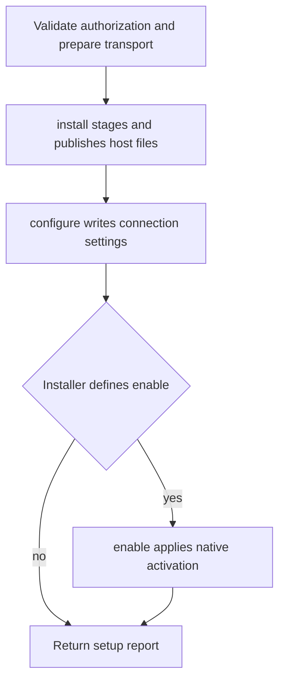
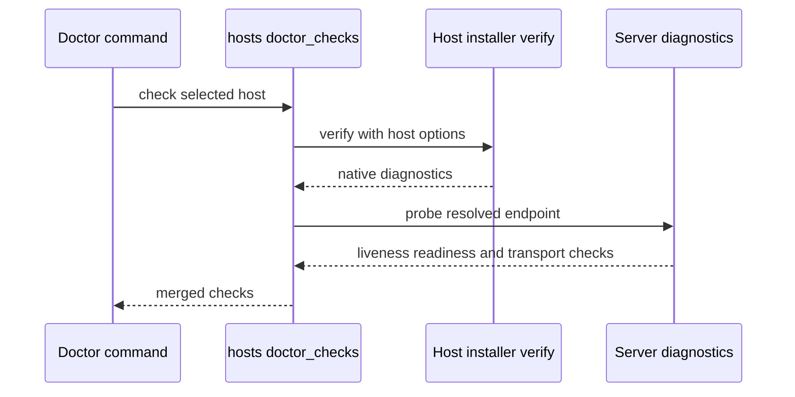

# Other Host Adapters

This page covers eight agent-host adapters beyond Codex and Claude Code: Hermes, OpenClaw, ZCode, OpenCode,
Kimi Code, WorkBuddy, Pi, and DeepSeek Harness (DSH). Each adapter has two halves. A Python installer class in
`src/powercontext/cli/` copies or registers host files, writes connection settings, performs native activation
where the host supports it, and reports diagnostics. Host-native files under `integrations/<host>/` supply the
plugin, extension, hook, MCP, and Skill content that the host loads.

[Capability Matrix](./capability-matrix.md) explains the capability vocabulary. The declarations for these hosts
live in `integrations/capabilities.toml`. Seven of the eight hosts are declared `master_only`; Kimi Code is
declared `experimental`. Only OpenClaw and Pi declare a best-effort pre-compaction checkpoint. The other six
declare pre-compaction as unsupported.

## Shared installer contract

The CLI maps each host name to its installer class in one place. `setup` then runs the same sequence for every
host, so the per-host sections below describe only what differs.

Caption: the shared `setup` pipeline. Only Hermes and OpenClaw define the optional `enable` step.

The pipeline is ordered and partly transactional. Each installer publishes its file changes through a shared
publish helper, which snapshots every target before writing. If a write or an installer action fails, the helper
restores the previous contents in reverse order and removes directories it created. A failure in `configure`
or `enable` is raised after the plugin files were already published, and the error is annotated to say so, so
a retry must account for the installed files. Setup does not start the PowerContext Server; these installers only
write host-side files and configuration.

Several installers refuse to overwrite a path that does not carry a PowerContext ownership marker. The marker
scheme differs by host, but the rule is the same: an unowned directory with the target name stops setup rather
than being replaced.

`hosts.py` keeps native options host-scoped. A flag such as `--boundary-flush` or `--profile` is accepted only
when the selected host owns it. Doctor runs `verify` on the installer with only the options that host consumes,
then appends the shared Server diagnostics. A native verification exception becomes a single failed
`verification` entry, and a failed Server probe becomes a `transport` entry, so one broken layer does not hide
the others.

Caption: doctor composes host-native checks with Server checks. Native checks never start a model or capture
prompts.

### Host summary

| Host | CLI module | Shipped host files | Native activation | Pre-compaction (`capabilities.toml`) | Profiles |
| --- | --- | --- | --- | --- | --- |
| Hermes | `cli/hermes.py` | `integrations/hermes/plugins/powercontext` (provider) and `powercontext-command` (`/pc` companion) | `enable()` enables the companion and selects the memory provider | unsupported | minimal, recommended, full |
| OpenClaw | `cli/openclaw.py` | `integrations/openclaw/plugins/memory-powercontext` | `enable()` sets the memory slot, tool allow-list, and restarts the gateway | best effort on `before_compaction` | minimal |
| ZCode | `cli/zcode.py` | `integrations/zcode/plugins/powercontext` | none; registers the plugin directory in the shared ZCode config | unsupported; Stop-hook flush is opt-in | minimal, recommended, full |
| OpenCode | `cli/opencode.py` | `integrations/opencode/plugins/powercontext` | none; a probe verifies activation | unsupported | minimal |
| Kimi Code | `cli/kimi_code.py` | `integrations/kimi-code/plugins/powercontext` | none; registers in `plugins/installed.json` | unsupported | minimal, recommended, full |
| WorkBuddy | `cli/workbuddy.py` | `integrations/workbuddy/plugins/powercontext` | none; merges hook and MCP settings | unsupported | minimal, recommended, full |
| Pi | `cli/pi.py` | `integrations/pi/plugins/powercontext` (extension and Skill) | installs a managed package through `pi install` | best effort on `session_before_compact` | minimal, recommended, full |
| DSH | `cli/dsh.py` | `integrations/dsh/plugins/powercontext` | `dsh plugin add` in the selected profile | unsupported | minimal, recommended, full |

The profiles column reflects the `profiles` field in `capabilities.toml`. Profiles select which Server MCP tools a
host exposes; OpenClaw and OpenCode currently declare only the minimal profile.

## Hermes

Hermes ships two plugin directories. `powercontext` is the exclusive Hermes memory provider, with the lifecycle
hooks declared in its `plugin.yaml`. `powercontext-command` is a standalone companion that registers the `/pc`
and `/powercontext` slash commands. The companion exists because Hermes loads the provider only after the
interactive Agent is created, which is later than the TUI needs for its command registry.

**Install and configure.** `HermesInstaller` requires the Hermes executable on `PATH` and parses `--version`.
Versions below 0.20.4, or output without a recognizable version, stop setup. Install copies both plugin
directories into `$HERMES_HOME/plugins` (default `~/.hermes`) and carries the Skill across in the same
publish transaction. `configure` writes non-sensitive connection fields to `powercontext/config.json` under
`HERMES_HOME`, or to `POWERCONTEXT_HERMES_CONFIG` when set. It refuses to run unless the provider's
`__init__.py` is already installed.

**Native activation.** `enable()` checks Hermes' native configuration. It runs
`plugins enable powercontext-command --no-allow-tool-override` only when the companion is neither enabled nor
disabled. It runs `memory setup powercontext` only when `memory.provider` is absent, so an explicit provider
choice, including an empty value, is preserved. After the commands run, `enable()` requires the provider to be
selected or raises an error that points the user to `hermes memory setup`.

**Command routing constraint.** The companion selects the provider only through the interactive CLI reference.
Its docstring states that Hermes 0.20.4 does not pass the caller's session, user, workspace, or scope to plugin
command handlers. When no CLI reference exists, as in gateway invocations, the handler returns a not-initialized
message and never falls back to a cached provider. Gateway sessions therefore use the provider's tools rather
than slash commands.

**Diagnostics.** `verify` checks Hermes availability and version, then runs `hermes plugins doctor --ci` on each
plugin directory. It also reports whether the provider is selected and whether the companion is enabled. If the
provider is not installed, the companion check is skipped.

**Constraints and tests.** `capabilities.toml` declares Hermes pre-compaction as unsupported, even though the
provider manifest lists an `on_pre_compress` hook. The page follows the capability declaration. Focused tests are
in `tests/test_hermes_cli.py`, which covers rollback when the second plugin replacement fails and retry after a
failed configuration, and in `tests/integrations/test_hermes_provider.py` for the provider contract.

## OpenClaw

OpenClaw uses a memory plugin, `memory-powercontext`, whose manifest declares `onStartup: false` and activates
from the `plugins.entries.memory-powercontext` config path. Its manifest also marks the store, revise, retire, and
handoff tools as side-effecting.

**Version and build requirements.** `require_supported_openclaw` requires OpenClaw 2026.8.1-beta.2 or newer, and
it verifies that `openclaw plugins install --help` advertises `--no-enable`. `build_openclaw_plugin` runs
`pnpm install --frozen-lockfile` with `CI=true`, then the build script, and fails unless `dist/index.js` exists.

**Install and configure.** `install` builds a copy of the plugin, packs it into a tarball with pnpm, and installs
the archive with `openclaw plugins install --force --no-enable`. OpenClaw then owns the managed runtime, and the
installer reads its install path back from `plugins inspect`. `configure` first inspects the plugin and then writes
`endpoint` and `allowInsecureHttp` through `config set --batch-json`. It does not change host policy and does not
restart the gateway.

**Native activation.** `enable()` writes only settings that are absent. It sets the memory slot, `autoRecall`,
`autoCapture`, and `hooks.allowConversationAccess`, and when no memory slot is configured it appends the five
PowerContext tool names to `tools.alsoAllow` without removing existing grants. It skips activation entirely when
the plugin system or plugin entry is disabled, when the plugin is denied, or when another plugin owns the memory
slot. It enables the plugin and restarts the gateway only when something changed.

**Lifecycle.** The plugin handles OpenClaw's `before_compaction` event as a best-effort checkpoint. Failures there
are caught by OpenClaw and do not block compaction, so the integration is not declared as required-capable.

**Diagnostics.** `verify` lists enabled plugins with `--json` and reads `plugins.slots.memory`. It reports the plugin
as ready only when it is enabled, loaded, and selected for the memory slot. It explicitly records that the running
gateway's loading is not observed.

**Tests.** `tests/test_openclaw_cli.py` covers activation that preserves native choices, rejection of installers
without the policy-preserving `--no-enable` path, and config read failures that are not treated as absent
settings. `tests/test_openclaw_configure_script.py` covers the configure script, and the plugin package has its own
`lifecycle.test.ts`.

## ZCode

ZCode is shared by the open-source CLI and the Windows desktop app. The installer locates the host through the
`ZCODE_CLI_BIN` override, `zcode` on `PATH`, or the desktop path under `%LOCALAPPDATA%\Programs\ZCode\ZCode.exe`.
If none is found, setup stops before touching files.

**Files shipped.** The plugin contains `.zcode-plugin/plugin.json`, a `.mcp.json` declaration, and three process
hooks in `hooks/hooks.json`. Those hooks run `user_prompt_submit.mjs`, `session_start.mjs`, and `stop.mjs` under
`${ZCODE_PLUGIN_ROOT}`. Shared modules under `shared/` and scripts under `scripts/` provide scope resolution,
pending-flush handling, observations, and diagnostics.

**Install and configure.** `install` copies the plugin into `~/.zcode/cli/plugins/powercontext` and writes an
owner marker. It adds that directory to `plugins.dirs` in the shared `~/.zcode/cli/config.json`, enables plugins
if the setting is absent, and preserves the existing `powercontext.json` and `.mcp.json` across refreshes.
`configure` normalizes the endpoint into an HTTP(S) origin without a path, query, or credentials, then writes
`powercontext.json` with `server_url`, `allow_insecure_http`, `capture_prompts`, and `boundary_flush`. It also sets
the MCP URL to `<origin>/mcp`. The Authorization header is written as the placeholder
`${POWERCONTEXT_ZCODE_AUTHORIZATION}`, so the token itself is never stored in the plugin.

**Boundary flush.** The Stop hook flushes pending Sources only when `boundary_flush` is enabled. The default is off.
`POWERCONTEXT_ZCODE_BOUNDARY_FLUSH` overrides the saved value. When the setting is off, the Stop hook records a
skipped `boundary_flush_disabled` result. Stop hooks that reenter, or that exceed the deadline, skip or finish
without blocking the host.

**Remote workspace.** `POWERCONTEXT_ZCODE_REMOTE_WORKSPACE` turns off local path binding for a workspace whose
files are not on the machine running ZCode. The loader treats `1`, `true`, `yes`, or `on` (case-insensitive) as
enabled; an unset variable is false ([settings loader](repo://integrations/zcode/plugins/powercontext/shared/settings.mjs#L26-L28),
[flag parsing](repo://integrations/zcode/plugins/powercontext/shared/settings.mjs#L59)). When it is disabled, the
plugin builds the normal session and workspace binding keys, and the resolve request sends a null explicit Scope ID
unless `POWERCONTEXT_ZCODE_SCOPE_ID` is set ([binding keys](repo://integrations/zcode/plugins/powercontext/shared/scope.mjs#L55-L58),
[resolve request body](repo://integrations/zcode/plugins/powercontext/shared/scope.mjs#L67-L69),
[explicit Scope mapping](repo://integrations/zcode/plugins/powercontext/shared/settings.mjs#L60)).
When it is enabled, `bindingKeys` returns `[]` at line 57, so no session or workspace key is sent. `resolveScope`
then requires `POWERCONTEXT_ZCODE_SCOPE_ID` and raises `scope_unresolved` without it
([required explicit Scope](repo://integrations/zcode/plugins/powercontext/shared/scope.mjs#L64-L66)). The scope
script validates its arguments first: only `resolve`, `bind`, and `unbind` are accepted, so `clear` fails earlier with
`invalid_arguments` ([argument validation](repo://integrations/zcode/plugins/powercontext/scripts/scope.mjs#L31-L37)).
In remote mode, the guard in the same script rejects `bind` and `unbind` with `remote_binding_disabled` before any
Server request ([remote guard](repo://integrations/zcode/plugins/powercontext/scripts/scope.mjs#L43-L44),
[test](repo://integrations/zcode/plugins/powercontext/tests/scope.test.mjs#L116-L118)). `resolve` is not guarded
by that check. The Scope model itself is
described in [Scopes and Access](../concepts/scopes-and-access.md), and the setting is listed with the other
variables in [Configuration Settings](../concepts/configuration-settings.md).

**Diagnostics.** `verify` checks five things independently: the CLI or desktop app, plugin registration in
`plugins.dirs`, hook modules through `node --check`, MCP URL and authorization consistency, and a server probe
through `scripts/doctor.mjs`. The probe must emit the `powercontext.zcode.diagnostics.v2` schema. Any other output,
or a missing Node runtime, becomes one failure that tells the user to rerun setup. Runtime observations are
labelled as historical Hook observations, not evidence of current-session MCP discovery.

**Tests.** `integrations/zcode/plugins/powercontext/tests/boundary.test.mjs` checks disabled boundary flush and
flush behavior. `host.test.mjs` and `lifecycle.test.mjs` cover host wiring. `tests/test_cli_zcode.py` covers the
installer, and `tests/e2e/test_zcode_host_acceptance.py` is the host acceptance path.

## OpenCode

OpenCode uses a native plugin bundle, `lib/index.js`, and a TUI bundle, `lib/tui.js`. The package also ships the
owned `powercontext-project-context` Skill.

**Version and location.** `_version` requires an OpenCode 1.x release at or above 1.18.21. Releases outside the 1.x
line are rejected. The config directory comes from the `config` line of `opencode debug paths`.

**Install and configure.** `install` requires the bundles and Skill to be present in the package. It writes the
plugin bundle as `plugins/powercontext-opencode.js` with an ownership manifest, `.powercontext-opencode.json`. It
stages the Skill with its own `.powercontext.json` marker and deletes the legacy `powercontext-opencode-tui.js`
file. It rewrites the plugin array in `tui.json` or `tui.jsonc` in place, so comments and surrounding formatting
survive. Entries that point at PowerContext TUI bundles, or at stale OpenCode checkouts under the PowerContext data
directory, are replaced by the current bundle path. `configure` only checks that the plugin file exists and then
applies the shared transport settings. The plugin has no separate native activation step.

**Activation check.** `verify` does not infer activation from configuration alone. It starts a short-lived
`opencode serve` process on a free loopback port with nonce environment variables. The plugin is active only if it
writes the nonce to the probe file within 15 seconds. The probe process is then terminated. Configuration is
recognized from `opencode debug config` output or from the owned plugin file. The Skill is checked separately.

**Constraints and tests.** Pre-compaction is unsupported, and the profile is minimal. Tests are in
`tests/test_opencode_cli.py`, `tests/test_opencode_installation.py`, and `tests/e2e/test_opencode_plugin_host.py`,
with plugin-side tests in `integrations/opencode/plugins/powercontext/tests/`.

## Kimi Code

Kimi Code is declared `experimental` in `capabilities.toml`. Its installer manages a copy under
`<Kimi home>/plugins/managed/powercontext`, where Kimi home is `KIMI_CODE_HOME` or `~/.kimi-code`.

**Prerequisites.** Setup requires both `kimi` and `node` on `PATH`. `KIMI_CLI_BIN` can point to a built binary for
diagnostics.

**Install.** The source must be an unconfigured plugin. Setup checks for the scope placeholders
`__POWERCONTEXT_SCOPE_JSON__` and `__POWERCONTEXT_SCOPE_SCRIPT_JSON__` and rejects sources with an owner marker. It
also requires a complete file list and a manifest whose `hooks` value is exactly the `UserPromptSubmit` hook, with
the `powercontext-project-context` session-start Skill. The managed copy is registered in `plugins/installed.json`.
Setup refuses symlinked install paths, a registration pointing at another root, or an existing unowned directory.
Refreshes preserve the installed `powercontext.json` and any native `mcpServers` declaration.

**Scope selection.** The first install requires exactly one of `--scope-id` or `--workspace-scope`. The options are
mutually exclusive. Setup never creates a Scope. Workspace mode leaves the binding to the `scope.mjs` script.

**Connection and token.** `_endpoint` accepts HTTPS, or HTTP only for a loopback host, and rejects paths, queries,
fragments, and credentials. When `POWERCONTEXT_KIMI_TOKEN` is supplied, `configure` sets the MCP
`bearerTokenEnvVar` to that variable name. The token is not written to the plugin. Without it, the variable is
removed. `configure` also rewrites the managed Skill's binding region with the current scope, script path, and
profile, and it fails if the managed-guidance markers are missing.

**Profiles.** `profiles.json` defines the three profiles, and the default is `minimal`. Setup validates each
profile's tool list for schema, non-empty entries, and uniqueness. Setup writes `enabledTools` only on first
installation or when a profile is explicitly chosen, so an update without profile options keeps the installed
choice.

**Hook.** `kimi.plugin.json` declares a `UserPromptSubmit` hook running `node ./hooks/user_prompt_submit.mjs` with a
five-second timeout. The hook script aborts its own work after 4000 ms.

**Diagnostics.** `verify` is read-only by default. It checks registration and enablement, profile tool count,
declared MCP settings, the Skill, and the hook files. It reports the hook as configured without claiming that
injection was verified. The `runtime` and `mcp` options run `scripts/doctor.mjs`. The `mcp` option only discovers
the Server tools; it does not run domain tools.

**Tests.** `tests/test_cli_kimi_code.py` covers the installer, and `integrations/kimi-code/plugins/powercontext/tests/plugin.test.mjs`
covers the plugin. `tests/e2e/test_kimi_code_host.py` and `tests/e2e/test_kimi_code_workflows.py` are opt-in and
run only when `KIMI_CLI_BIN` is set.

## WorkBuddy

WorkBuddy is configured through three user-level surfaces under `WORKBUDDY_HOME` (default `~/.workbuddy`): hooks,
`settings.json`, and `mcp.json`. The installer also installs the Skill under `skills/`.

**Hook files.** `_install_hook_files` copies the hook driver `workbuddy_powercontext_hook.py`, its helper modules,
and the workspace scope resolver. The resolver is copied under the name `powercontext_scope_binding.py` into the
hooks directory.

**Settings.** `_merge_workbuddy_settings` adds a `UserPromptSubmit` command hook with a 30-second timeout and the
status message `Syncing PowerContext`. The command runs the current Python executable on the driver. The installer
identifies its own hook by the driver filename, updates that entry in place, and leaves other hooks alone.

**MCP.** `_merge_workbuddy_mcp` adds a `powercontext` HTTP server entry. The URL and Authorization header are
environment-variable placeholders, `POWERCONTEXT_WORKBUDDY_SERVER_URL` and `POWERCONTEXT_WORKBUDDY_AUTHORIZATION`.
An existing entry keeps its URL, headers, and `disabled` flag, so user customizations survive re-setup.

**Skill.** The `powercontext-project-context` Skill is copied with its command placeholders resolved to the
shell-quoted current Python executable and to the scope resolver's path. An ownership manifest marks it as managed.

**Transaction and diagnostics.** The installer stages hooks, Skill, and a copy of `settings.json`, then publishes
them together. `verify` checks four things separately: the hook modules, the settings registration, the MCP entry
(which fails when it is disabled), and the Skill, which fails while any placeholder remains unresolved.

**Template file.** `integrations/workbuddy/plugins/powercontext/hooks/hooks.workbuddy.json` is a reference copy of the
hook block with `<POWERCONTEXT_PYTHON>` placeholders. No code under `src/` reads it, because the installer builds
the command string itself.

**Tests.** `tests/test_cli_workbuddy.py` covers the installer and diagnostics. `tests/test_automatic_prompt_privacy.py`
covers the prompt-capture privacy rules that the hook applies.

## Pi

Pi is installed as a package, not a loose set of files. The package must contain `extensions/powercontext.ts` and the
`powercontext-project-context` Skill.

**Install.** The installer stages the package into `powercontext_data_dir()/plugins/pi` with an owner marker and then
runs `pi install <managed path>`. If the install command fails, the staged directory is rolled back. Pi's own
`pi list` output is parsed for user packages. Legacy PowerContext entries at other paths are superseded only after
the managed package installs successfully. An entry with resource filters blocks setup, and the error tells the
user to migrate the filters to the managed path before retrying.

**Configure.** `configure` requires the owned package marker and then writes connection settings through the shared
transport helper. It does not register anything natively beyond the package install.

**Lifecycle.** The extension flushes pending Sources on `session_before_compact`. `capabilities.toml` declares this as
best-effort pre-compaction capture.

**Diagnostics.** `verify` runs `pi list`, and it reports the package installed when a listed path is recognized by
the host guidance registry. It does not check the running session.

**Tests.** `tests/test_pi_cli.py` covers setup, rejection of a filtered legacy migration without changing the host,
keeping the existing package when a refresh fails, and doctor output. The plugin package has `extension.spec.ts` and
`flush.spec.ts` for the extension lifecycle.

## DeepSeek Harness

DSH loads the plugin from its bundle, `lib/index.js`. The bundle, `cordis.patch.yml`, Skill, and `src/` modules all live
in `integrations/dsh/plugins/powercontext`.

**Install.** `require_built_plugin` rejects a directory without `lib/index.js`. `DshInstaller.install` stages the Skill,
then runs `dsh plugin --profile <profile> add <package>` inside the publish transaction. The default profile is `web`.
The installed profile directory is `DSH_HOME/profiles/<profile>`, where `DSH_HOME` defaults to `~/.dsh`.

**Desktop profile.** The Desktop profile must use the Desktop-installed `dsh` command, not an npm shim.
`_desktop_diagnostics` reads the registration through the Desktop settings parser without booting the reserved
Desktop profile. It reports `running_host_configuration`, `server_liveness`, and `server_readiness` as not checked
or not observed, and it tells the user to run `/pc doctor` in a live session.

**Configure.** `configure` reads the target profile's settings with `require_installed=True`, validates the Setup
transport against the requested Server URL and insecure-HTTP flag, and then writes the connection through
`configure_connection`.

**Diagnostics.** For the web profile, `verify` runs `dsh --profile web --dump-config`. It counts the plugin as
registered only when the dump contains the plugin ID `powercontext-dsh`, not the package name. On a failure, it
returns a generic message, and it withholds raw host output because that output can contain credentials.

**Tests.** `tests/test_dsh_cli.py` covers rejection of a plugin without its bundle, the plugin-ID requirement in
doctor, and redaction of config-dump failures. `tests/test_dsh_profiles.py`, `tests/test_dsh_transport.py`, and
`tests/e2e/test_dsh_http_chain.py` cover profiles, transport, and the HTTP chain.

## Constraints to remember

- Each host has its own ownership check and rollback path. Refreshing an installation is safe only when the target
  carries the marker or manifest that the installer expects.
- Native activation exists only for Hermes and OpenClaw. For the other hosts, a successful setup means files and
  connection settings are in place. Running-session behavior has to be checked in the host itself.
- Doctor results separate installation from running behavior. Hermes, OpenClaw, ZCode, Kimi Code, and DSH all label
  live-session evidence as not observed or historical.
- Plain HTTP to a non-loopback Server needs an explicit opt-in. Kimi Code's endpoint parser enforces this rule
  directly, and OpenClaw and Hermes store an explicit insecure-HTTP setting in their native configuration.

## Related pages

- [Capability Matrix](./capability-matrix.md) for the declared capabilities and profiles.
- [Codex Plugin](./codex-plugin.md) for the adapter that uses the same Claude-style plugin and hook model.
- [Framework Adapters](./framework-adapters.md) for non-host integrations that use the Server APIs directly.
