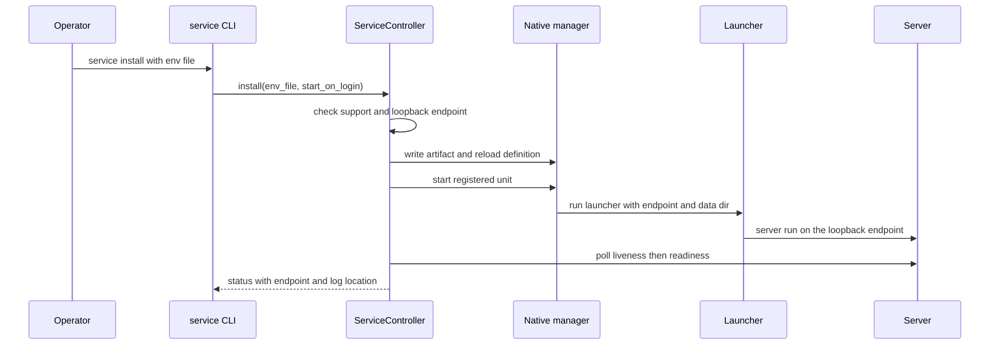
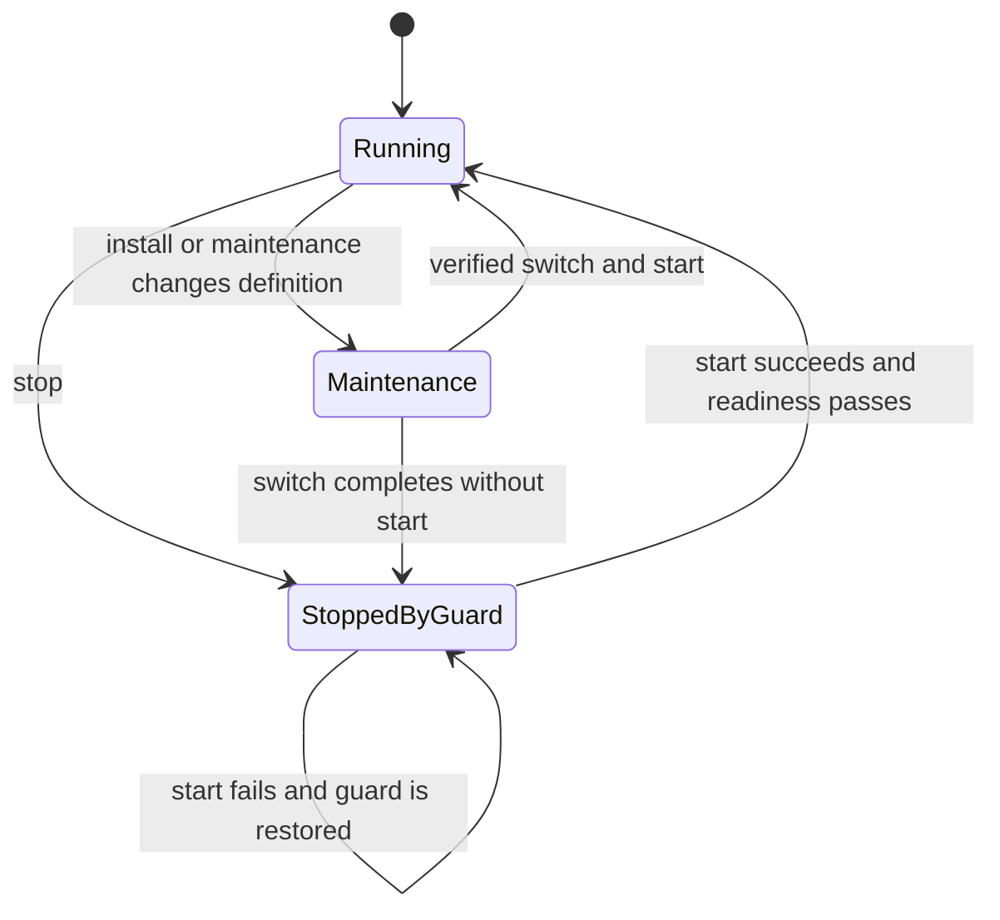
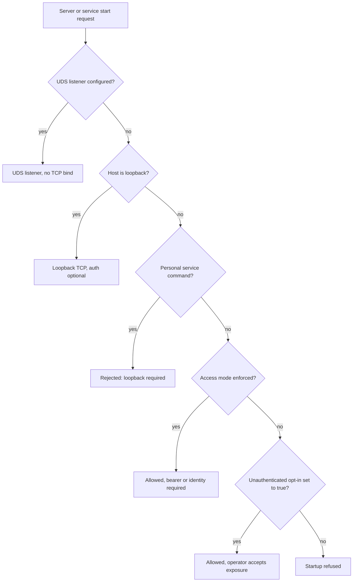

# Server Deployment (Local Service, Docker, Helm, Remote)

This runbook covers the supported ways to run the PowerContext Server and how each form selects its listener,
authentication boundary, and persistence. Read the boundary rules in this page before exposing any listener. Client
configuration for remote Servers is described in the repository guide `docs/en/docs/operate/connect-remote-server.md`;
this page covers the server side.

## Choose a deployment form

| Form | Listener | Authentication default | Persistence | Use when |
| --- | --- | --- | --- | --- |
| Foreground `powercontext server run` | `127.0.0.1:8000` unless changed | Disabled | `POWERCONTEXT_HOME` directory | Development, or the fallback when no native manager exists |
| Personal native service (`powercontext service`) | Loopback TCP only | Inherited from the env file | Data directory under the user profile | One user's persistent workstation Server |
| Docker image | `0.0.0.0:8000` inside the container | Disabled, opted in by the image | `/data` volume (SQLite, scheduler state) | A single container host with loopback publishing |
| Helm chart | ClusterIP Service on port 8000 | Enforced, bearer token required | External OceanBase; `emptyDir` for `/data` | Kubernetes with an external OceanBase database |
| Same-host Unix socket | `POWERCONTEXT_SERVER_HTTP_UDS` socket, no TCP listener | Socket permissions plus optional bearer | Data directory as configured | A same-user gateway or HTTPS-terminating proxy |

Remote clients should reach the Server over HTTPS through a reverse proxy, or through an SSH tunnel. The built-in
command serves plain HTTP and has no TLS options.

## Server settings used by this runbook

`ServerSettings` reads `POWERCONTEXT_SERVER_`-prefixed variables; nested groups use `_` as the delimiter, so
`POWERCONTEXT_SERVER_HTTP_HOST` maps to `http.host` ([server/settings.py](../../src/powercontext/server/settings.py#L114-L137)).
The defaults below are the ones the code defines when a variable is unset.

| Variable | Default when unset | Effect |
| --- | --- | --- |
| `POWERCONTEXT_SERVER_HTTP_HOST` | `127.0.0.1` | TCP bind address |
| `POWERCONTEXT_SERVER_HTTP_PORT` | `8000` | TCP port, 1 to 65535 |
| `POWERCONTEXT_SERVER_HTTP_UDS` | none | Unix socket path; no TCP listener is opened |
| `POWERCONTEXT_SERVER_HTTP_UDS_EXTERNAL_SCHEME` | none | `http` or `https`; requires `HTTP_UDS` |
| `POWERCONTEXT_SERVER_HTTP_MAX_REQUEST_BODY_BYTES` | 16 MiB (`16777216`) | Request body ceiling |
| `POWERCONTEXT_SERVER_HTTP_MAX_CONCURRENT_REQUESTS` | `64` | Process-local request admission |
| `POWERCONTEXT_SERVER_ACCESS_MODE` | `disabled` | `enforced` turns on authentication |
| `POWERCONTEXT_SERVER_AUTH_ENABLED` | `false` | Legacy switch; when `true`, access mode becomes `enforced` |
| `POWERCONTEXT_SERVER_AUTH_TOKEN` | none | Static bearer token |
| `POWERCONTEXT_SERVER_ALLOW_UNAUTHENTICATED_NON_LOOPBACK` | `false` | Opt-in for an unauthenticated non-loopback TCP bind |
| `POWERCONTEXT_SERVER_DASHBOARD_ENABLED` | `false` | Enables the Dashboard |
| `POWERCONTEXT_SERVER_METRICS_ENABLED` | `true` | Enables metrics |
| `POWERCONTEXT_SERVER_METRICS_BACKGROUND_PORT` | `8001` | Port of the background-role metrics listener |

## Foreground `server run`

`powercontext server run` runs the configured API and/or background processing in the foreground. Its options are
`--host`, `--port`, `--uds`, `--env-file`, `--no-env-file`, `--observability`, and `--role` with the values `all`,
`api`, or `background` [server/cli.py](../../src/powercontext/server/cli.py). `--env-file` cannot be combined with
`--no-env-file`. Without `--no-env-file`, the command discovers a default environment file; process environment
variables override same-named file values.

The process must be able to create and update `POWERCONTEXT_HOME`, which holds the default SQLite database and
scheduler state. The foreground command is the only deployment form that does not install anything into the operating
system, so it is also the fallback when a native service manager is unavailable (see below).

```bash
export POWERCONTEXT_HOME=/srv/powercontext
powercontext config validate --env-file /etc/powercontext/powercontext.env
powercontext server run --env-file /etc/powercontext/powercontext.env
```

For the `background` role, the Server runs no HTTP API; its readiness is therefore not an HTTP signal (see
[Helm](#helm-chart)).

## Personal native service

The `service` command group registers the same Server runner with the current user's native service manager. It is for
a single user's persistent workstation and does not replace a container platform or an administrator-owned service
manager.

### Subcommands and options

The commands are defined in [service/cli.py](../../src/powercontext/service/cli.py):

| Command | Options | Behavior |
| --- | --- | --- |
| `powercontext service install` | `--env-file PATH`, `--observability`, `--start-on-login` / `--no-start-on-login` | Installs or updates the registration. `--no-start-on-login` is accepted only on Windows; on other platforms the command exits with code 2. Without either flag on Windows, the command asks. |
| `powercontext service status` | `--json` | Reports support, registration, definition, manager ownership, manager state, server liveness, log location, and recovery action. Exits 1 when the service is not healthy. |
| `powercontext service start` | none | Starts the owned registered Server and waits for readiness. |
| `powercontext service stop` | none | Stops the owned Server and suppresses automatic activation. Configuration is retained. |
| `powercontext service restart` | none | Runs stop, then start. Migrations are a separate operation. |
| `powercontext service uninstall` | none | Stops and removes the owned registration. Server data and logs are kept. |

```bash
powercontext service install --env-file /path/to/powercontext.env
powercontext service status --json
```

### Installation sequence



The installer fails before writing anything when the endpoint is not a loopback TCP listener, when the environment
file is invalid, or when the initial probe finds a foreign listener (`CONFLICT`) on the endpoint. A PowerContext Server
that is already live on the endpoint does not block installation. The launcher (`powercontext.service.launcher`)
runs the Server only when the configuration still resolves to the registered endpoint and loopback host. It exits
successfully without starting a second Server when the endpoint is already live, and exits with an error when the
endpoint belongs to a different listener.

Caption: the install path. The controller checks support and the endpoint first, writes the native artifact, starts
it through the manager, and reports status only after the endpoint answers.

### Runbook as the code runs it

Service install (`powercontext service install`):

1. The CLI resolves login auto-start. On Windows without a flag it prompts, defaulting to no; elsewhere it defaults to
   yes. `--no-start-on-login` on a non-Windows platform exits with code 2 before any other work
   ([service/cli.py](../../src/powercontext/service/cli.py#L50-L76)).
2. The CLI loads the optional env file through `server_settings_context` to validate it and read the model names. A
   `ServerConfigurationError` exits with code 2 ([service/cli.py](../../src/powercontext/service/cli.py#L78-L99)).
3. `ServiceController.install` repeats the auto-start rule, then `_require_support()` raises the adapter's detail if the
   platform or manager is unsupported ([service/controller.py](../../src/powercontext/service/controller.py#L185-L199)).
4. `preview_definition` builds the target without writing. An invalid env file exits with code 2. Without an env file,
   inherited `POWERCONTEXT_HOME` or `POWERCONTEXT_SERVER_*` variables exit with code 2. A UDS setting or a non-loopback
   host exits with code 2. `_server_target(require_exists=True)` requires the Python executable, and on Windows
   `pythonw.exe` ([service/controller.py](../../src/powercontext/service/controller.py#L1002-L1068),
   [L175-L183](../../src/powercontext/service/controller.py#L175-L183)).
5. The initial probe of the endpoint runs. A `CONFLICT` result refuses installation
   ([service/controller.py](../../src/powercontext/service/controller.py#L200-L205)).
6. Under the controller mutation lock, a pending maintenance record stops installation unless its phase is
   `manual_stopped` or `manual_switching`. In that case the stopped registration is updated and the Server is not
   started ([service/controller.py](../../src/powercontext/service/controller.py#L207-L221)).
7. The current registration and loaded definition are compared with the target. A changed definition is written,
   reloaded, and enabled by `_commit_definition`, which rolls back on failure. An unchanged definition only re-enables
   the job ([service/controller.py](../../src/powercontext/service/controller.py#L222-L240)).
8. If the manager was active and the definition changed, or the endpoint was not live, the adapter starts the job. A
   start failure becomes a post-commit error. `_wait_until_live` then waits for liveness only
   ([service/controller.py](../../src/powercontext/service/controller.py#L241-L261)).
9. The CLI prints the status, the environment-file location, and the inference notice
   ([service/cli.py](../../src/powercontext/service/cli.py#L100-L119)).

Controller start (`powercontext service start`):

1. `mutation()` takes the lock, `_recover_definition_switch()` finishes any verified switch, and `_owned_registration()`
   checks support, the installed artifact, the loopback HTTP endpoint, loaded ownership, and the probe
   ([service/controller.py](../../src/powercontext/service/controller.py#L325-L331),
   [L749-L775](../../src/powercontext/service/controller.py#L749-L775)).
2. A `runtime_repair` record is refused. Any record phase other than `manual_stopped`, `database_ready`, or
   `start_failed` is refused because its migration is not verified
   ([service/controller.py](../../src/powercontext/service/controller.py#L332-L338)).
3. If the service is already running with no record, readiness must be `LIVE` and the loaded definition must match.
   The method then returns without changing state ([service/controller.py](../../src/powercontext/service/controller.py#L339-L346)).
4. When no record exists, a `manual_stopped` guard is written ([service/controller.py](../../src/powercontext/service/controller.py#L347-L348)).
5. `_start_registered` checks that the executable exists, resumes activation, starts the job, waits for liveness, and
   then polls readiness. On any failure it re-suspends activation, stops the job, and re-raises
   ([service/controller.py](../../src/powercontext/service/controller.py#L800-L838)).
6. Only after success is the maintenance guard removed ([service/controller.py](../../src/powercontext/service/controller.py#L349-L350)).

Launcher (run by the native job):

1. On macOS only, `powercontext_service_bootstrap` runs first and counts the attempt in a retry-budget state file
   before importing the launcher ([powercontext_service_bootstrap/__main__.py](../../src/powercontext_service_bootstrap/__main__.py#L42-L132)).
   Linux and Windows invoke the launcher directly.
2. `launcher.main` reloads the env file and compares its identity with the registration. Mismatch exits with code 1
   ([service/launcher.py](../../src/powercontext/service/launcher.py#L55-L127)).
3. It rejects UDS, and any endpoint that does not match the configured loopback host and port, with code 1.
4. It probes the endpoint. `LIVE` exits 0 without a second Server. `CONFLICT` exits 1. Otherwise it runs the Server
   runner in the same process.

Health gating:

1. Liveness (`GET /health/live`) gates install and start. Readiness (`GET /health/ready`) gates only `start`, `restart`,
   and Ops installs that pass `require_ready=True`. The CLI `install` does not pass that flag.
2. `_wait_until_live` waits 60 seconds, then keeps waiting while the native manager reports the job as active, up to a
   further 120 seconds ([service/controller.py](../../src/powercontext/service/controller.py#L1123-L1145)).
3. A readiness failure or a readiness timeout after 60 seconds fails `_start_registered` and triggers the guard
   restore and stop described above.

### Platform adapters

The adapter is selected by `sys.platform` in [service/adapters/__init__.py](../../src/powercontext/service/adapters/__init__.py).

| Platform | Native artifact | Activation | Logs |
| --- | --- | --- | --- |
| Linux | `systemd --user` unit `powercontext.service` under `$XDG_CONFIG_HOME/systemd/user` (default `~/.config`) | `WantedBy=default.target`, `Restart=on-failure`, `RestartSec=5s`, start limit 3 per 60 seconds | `journalctl --user --unit powercontext.service` |
| macOS | LaunchAgent `com.oceanbase.powercontext` under `~/Library/LaunchAgents` | `RunAtLoad` with a retry token; `KeepAlive` tied to the token file | `<data_dir>/logs/server.stdout.log` and `server.stderr.log` |
| Windows (experimental) | Task Scheduler task `\PowerContext Personal Server`, stored as `personal-server.xml` under `%LOCALAPPDATA%\PowerContext\Services` | `LogonTrigger` only when login auto-start is chosen; `InteractiveToken` with `LeastPrivilege`; restart up to 3 times at 1-minute intervals | `<data_dir>/logs` |

On Linux, the service commands fail unless `systemctl --user` is usable. On Windows, the registered executable must be
`pythonw.exe`, and the task must run as the current interactive user; service accounts are rejected.

### Environment file and configuration

Use a protected environment file for explicit configuration:

```bash
chmod 600 /path/to/powercontext.env
powercontext config validate --env-file /path/to/powercontext.env
powercontext service install --env-file /path/to/powercontext.env
```

The native definition stores the absolute file path and identity metadata (device, inode, size, modification time,
owner, mode, and on Windows the owner SID), not the file contents or the caller's shell environment. The launcher
reloads the file on each start and rejects it if the identity no longer matches. Re-run `service install` after editing
the file or upgrading PowerContext. On Windows, restrict the file to the current user, `SYSTEM`, and local
`Administrators`, as described in the repository deploy guide.

Without `--env-file`, `service install` rejects inherited `POWERCONTEXT_HOME` and `POWERCONTEXT_SERVER_*` variables
rather than silently baking them in. Persistent settings belong in the env file.

### Lifecycle guard and stop

`stop` and any stopped-state installation write a durable maintenance record next to the adapter lock file. Native
activation is then suppressed: the systemd adapter adds a `ConditionPathExists=!` drop-in keyed to that record, and the
launchd adapter disables the job. `start` clears the guard only after the endpoint is live and readiness passes.
`restart` is `stop` followed by `start`. If a start fails, the controller restores the guard and stops the process
again rather than leaving an unguarded running service.



Caption: service states. The guard file, not the manager's own state, decides whether automatic activation can resume
after a stop, a reboot, or an interrupted maintenance step.

### Status and probes

`status` distinguishes four facts: whether the registration is valid, whether the loaded manager definition matches it,
whether the manager reports the unit as active, and whether the endpoint answers. The CLI exits 1 unless all six
conditions hold: support is `SUPPORTED`, registration is `INSTALLED`, definition is `CURRENT`, manager ownership is
`OWNED`, manager state is `ACTIVE`, and liveness is `LIVE` ([service/model.py](../../src/powercontext/service/model.py#L280-L289)). Liveness is `GET /health/live` and must
return a JSON `status` of `ok` with a PowerContext request-ID header. Readiness is `GET /health/ready`; HTTP 503 or a
`not_ready` status is reported as unreachable rather than as a listener conflict. A different response on the port is
reported as a conflict, and install refuses to replace it.

### Uninstall

`uninstall` stops the manager job, disables it, removes the owned artifact, and reloads the manager. It does not delete
the database, configuration, or logs. Recovery commands for each stage are shown in `status` output if a stage fails.

## Fallback when no native manager is available

The native adapter reports `UNSUPPORTED` when the platform is not Linux, macOS, or Windows, or when `systemctl`,
`launchctl`, or `schtasks.exe` is missing, or when the current user has no reachable manager domain. On Windows it also
reports `UNSUPPORTED` when the current user is a service account ([service/adapters/windows.py](../../src/powercontext/service/adapters/windows.py#L97-L108)). In that case
`install` and the lifecycle commands fail before changing anything. The error carries the adapter's detail, for example
that the current user has no available systemd user manager.

The personal-service commands do not print a substitute command. The operator then runs the Server directly:

```bash
powercontext server run --env-file /path/to/powercontext.env
```

Run it under a supervisor that the operator controls, such as a container platform, a host init system, or a terminal
multiplexer. The foreground process has no restart policy of its own.

## Network boundary

Two guards decide whether an unauthenticated Server may listen off loopback. They are separate and both apply.

1. The personal service requires a loopback TCP bind. `service install` rejects a non-loopback `HTTP_HOST` with the
   message that personal services require a loopback Server bind, even when authentication is enabled.
2. The Server refuses to start on a non-loopback TCP address when authentication is disabled. The guard treats a
   non-UDS bind as unsafe when `access.mode` is `disabled`, `POWERCONTEXT_SERVER_ALLOW_UNAUTHENTICATED_NON_LOOPBACK`
   is not `true`, and the process is not a background-only worker with metrics disabled.



Caption: bind decision. Non-loopback hosts are only safe with enforced access; the opt-in flag is an explicit
acknowledgment that the surrounding network provides the boundary.

When a non-loopback listener is exposed, enable enforced access and a bearer token. The token is read from
`POWERCONTEXT_SERVER_AUTH_TOKEN` and is never printed. Health and readiness endpoints stay public so that probes work;
API, MCP, metrics, and `/openapi.json` require authentication. A Dashboard enabled with enforced access also requires
the token, and startup fails without it. Do not rely on a shared static token to separate submission from review; it
gives every holder one administrator identity.

## Unix domain socket listener

On Linux and macOS, a same-host proxy or gateway can reach the Server over HTTP on a Unix socket. Select it with
`POWERCONTEXT_SERVER_HTTP_UDS` or `server run --uds`. When it is selected, the Server opens no TCP listener and ignores
the configured host and port. Explicit `--host` or `--port` options are rejected alongside it.

Constraints enforced at startup:

- The socket path must be absolute, contain no `..` or NUL, and be at most 103 filesystem-encoded bytes.
- A missing parent directory is created with mode `0700`. An existing parent must be a real directory owned by the
  Server user, with no group or other access, and not a symlink.
- The socket is created with owner-only access, so the gateway or proxy must run as the same user.
- A `*.lock` file beside the socket serializes startup and remains after shutdown. A stale socket is reclaimed only when
  its identity matches the lock record and a connection attempt confirms it is dead. Other files, live sockets, and
  unrecognized sockets are preserved and cause startup to fail.
- UDS is supported for the `all` and `api` roles. The `background` role and personal services reject it.

When a trusted same-user proxy terminates HTTPS and is the only external entry, set
`POWERCONTEXT_SERVER_HTTP_UDS_EXTERNAL_SCHEME=https` to make Dashboard origin validation and Secure cookies use HTTPS.
This declaration applies to every request on the socket, so do not use it when the proxy also forwards plaintext
traffic. The Server never trusts `X-Forwarded-Proto` or `X-Forwarded-For` for scheme or peer identity.

Verify readiness and an authenticated request from the same user:

```bash
curl --fail --unix-socket "$POWERCONTEXT_SERVER_HTTP_UDS" http://localhost/health/ready
curl --fail --unix-socket "$POWERCONTEXT_SERVER_HTTP_UDS" \
  --header "Authorization: Bearer ${POWERCONTEXT_DEPLOYMENT_TOKEN}" \
  http://localhost/v1/capabilities
```

### Gateway deployment forms

The UDS listener is the Core transport for the Rust gateway. The gateway is described in [Gateway](../architecture/gateway.md).
Two forms matter for deployment:

- Combined deployment: the gateway reaches Core over UDS through `PC_GATEWAY_CORE_UDS`. The gateway then injects
  prepared context into Chat and Responses requests that belong to a conversation, unless `PC_GATEWAY_INJECTION` or
  `PC_GATEWAY_INJECTION_RESPONSES` disables it.
- Standalone gateway: `PC_GATEWAY_CORE_BASE` points to Core over HTTP and injects only when `PC_GATEWAY_INJECTION=on`.

Gateway body and concurrency limits are deployment settings. `PC_GATEWAY_MAX_BODY_BYTES` defaults to 16 MiB, and
`PC_GATEWAY_MAX_CONCURRENT` defaults to 64 per call class (model calls and fallback calls each). A response buffer
overflow returns HTTP 400 with `response_buffer_limit_exceeded`, and the call is not retried.

## Docker image

The image is built in two stages from `docker/Dockerfile`. The builder uses a pinned `uv` to sync the locked
dependencies with the `cli`, `server`, and `tracing-otlp` extras. It fails the build unless the installed package
version equals `POWERCONTEXT_VERSION`. The runtime stage is `python:3.11-slim-bookworm`, runs as UID and GID 10001, and
sets `POWERCONTEXT_HOME=/data`, `POWERCONTEXT_SERVER_HTTP_HOST=0.0.0.0`, and `POWERCONTEXT_SERVER_HTTP_PORT=8000`.
The entrypoint is `powercontext` with the default command `server run`.

Build from the repository root with the version argument:

```bash
POWERCONTEXT_VERSION=$(uvx --from hatchling --with hatch-vcs hatchling version)
docker build \
  --file docker/Dockerfile \
  --build-arg "POWERCONTEXT_VERSION=${POWERCONTEXT_VERSION}" \
  --tag powercontext-server:local \
  .
```

Run with a named volume, publishing the port only on the host loopback interface:

```bash
docker run --rm \
  --name powercontext-server \
  --publish 127.0.0.1:8000:8000 \
  --volume powercontext-data:/data \
  powercontext-server:local
```

The container binds `0.0.0.0` because the port must be reachable through Docker networking. The host-side address in
`--publish` is therefore the access control. The image sets `POWERCONTEXT_SERVER_ALLOW_UNAUTHENTICATED_NON_LOOPBACK=true`
so the documented `docker run` starts without configuration. Production deployments should enable enforced access and
a bearer token, or terminate TLS upstream. In enforced mode the opt-in is not required. A contract test reads these
environment assignments from the Dockerfile and checks that the documented `server run` starts with them.

The image declares a `HEALTHCHECK` that runs every 30 seconds against `GET /health/ready`. A runtime or database failure
returns `not_ready` with HTTP 503. A configured inference failure returns `degraded` with HTTP 200, so the container
stays in service while the response names the affected capability. Provider checks use the Runtime's credentials and
never expose them.

Configure other databases or inference providers with the same `POWERCONTEXT_SERVER_*` variables used by a regular
installation, passed with `--env` rather than in the command line when they contain secrets.

## Helm chart

The chart is in `deploy/helm/powercontext`. It renders two Deployments from one template, `<release>-api` and
`<release>-background`, and one ClusterIP Service that selects only the `api` component. The API and background roles
run the same image with `server run`, differing in `POWERCONTEXT_SERVER_RUNTIME_ARTIFACT_PROCESSING_ROLE`.

What the chart fixes and what you must supply:

- The image must be pinned by `image.tag` or `image.digest`. The tag `latest` is rejected, and rendering fails without
  an image reference.
- The database is OceanBase. `database.kind=sqlite` is rejected by the chart tests.
- Secrets come from an existing Secret whose keys default to `database-url`, `bearer-token`, and
  `cursor-signing-secret`. The chart maps them to `POWERCONTEXT_SERVER_DATABASE_URL`,
  `POWERCONTEXT_SERVER_AUTH_TOKEN`, and `POWERCONTEXT_SERVER_CURSOR_SIGNING_SECRET`.
- Access is enforced and authentication is enabled. The chart sets
  `POWERCONTEXT_SERVER_ALLOW_UNAUTHENTICATED_NON_LOOPBACK=false`, which differs from the Docker image's `true` default.
- Pods run as UID and GID 10001 with a read-only root filesystem, all capabilities dropped, a `RuntimeDefault` seccomp
  profile, and no automounted service-account token. `/data` and `/tmp` are `emptyDir` volumes.
- The strategy is `Recreate`. Upgrades are coordinated offline; the chart does not promise mixed-version support.
- Ingress is off by default. Enabling it without a host fails rendering.

The API Deployment has startup, liveness, and readiness probes; the readiness probe uses `/health/ready`. The background
Deployment has no ports and no readiness probe, because the background runner has no HTTP endpoint. Pod readiness
therefore does not establish that background processing is healthy. `background.maxWorkers` is a legacy alias for the
Topic Memory worker quota, not a process limit; enabled capabilities and their quotas determine actual concurrency.

```bash
helm template powercontext deploy/helm/powercontext \
  --set image.repository=example/powercontext \
  --set image.tag=1.2.3 \
  --set existingSecret=powercontext-credentials
```

Operational boundaries:

- The chart does not run migrations. Before the first install, initialize even an empty OceanBase database with the
  target image's full Server database migration and confirm `server_ready=true`. Existing databases need a reviewed
  migration plan, backup, and stopped writers. Domain-specific paths are described in the database migration pages.
- SQLite and embedded seekdb are single-process evaluation options outside this chart.
- `values-acceptance.yaml` configures two API replicas, one background replica, and a `test` generation model. The
  acceptance script requires at least two API Pods and destroys and recreates test data, so run it only in an isolated
  namespace with a disposable OceanBase database and pass `--confirm-disposable`. A passing `helm template` test is not
  cluster acceptance.

## Remote access and client boundary

The Server does not add TLS. Remote clients should reach it through HTTPS on a reverse proxy, or through an SSH tunnel to
the loopback listener. PowerContext clients accept loopback HTTP by default and reject other `http://` URLs unless the
operator sets an explicit insecure opt-in, such as `--allow-insecure-http` or the matching `*_ALLOW_INSECURE_HTTP`
environment variable. Private and VPN addresses are not loopback and still require HTTPS.

The opt-in allows plaintext only; it does not disable certificate checks, add authentication, or change the Server's
bind address. Keep Server authentication enabled for any remote use. An example tunnel is
`ssh -N -L 18000:127.0.0.1:8000 your-server`, after which the client uses `http://127.0.0.1:18000` with no opt-in.

## Operations checklist

- Confirm the listener before anything else: loopback for personal or Docker-with-loopback-publish, enforced access for any
  non-loopback address, or a UDS path with owner-only permissions.
- For a personal service, use `powercontext service status --json`; a non-zero exit means the service is not healthy.
  Logs are in `journalctl --user --unit powercontext.service` on Linux and in `<data_dir>/logs` elsewhere.
- After a configuration or PowerContext upgrade, re-run `service install` with the same `--env-file`, then check that the
  manager and endpoint agree.
- After `service stop`, `service start` is the only way to resume automatic activation.
- For Docker, check `docker inspect --format '{{.State.Health.Status}}' powercontext-server`; the healthcheck uses
  `GET /health/ready`.
- For Helm, distinguish three facts: rendering passed, the Pods are Ready, and background processing works. Only the first
  two are visible through Kubernetes readiness.

## Failure modes

| Symptom | Cause | Action |
| --- | --- | --- |
| `service install` says personal services require a loopback Server bind | `HTTP_HOST` is non-loopback, even with authentication | Keep loopback, or use a container or administrator-owned service manager behind a reverse proxy |
| Service commands report an unsupported platform or manager | No native user manager, `systemctl` or `launchctl` missing, Windows service account | Run `powercontext server run` under an external supervisor |
| Server refuses to start with an unsafe non-loopback bind | Access disabled and the unauthenticated opt-in not set | Enable enforced access with a token, or set the opt-in only inside a controlled network boundary |
| Launcher exits because the endpoint does not match | Configuration changed without re-registering | Re-run `service install` with the current env file |
| Launcher or install reports a conflict on the endpoint | Another listener owns the port | Stop that listener or change the port through a new configuration |
| `start` fails readiness and the service stops | Readiness did not pass within the start budget | Inspect the logs, fix the configuration or database, then `service start` again |
| Helm render fails on the image tag | `latest` or missing tag or digest | Pin an immutable tag or digest |
| Helm readiness is green but background work is stalled | Background Pods have no readiness probe | Check background logs and capability configuration directly |

## Focused tests

- `tests/test_docker_contract.py` renders the Dockerfile environment and checks that the documented `server run` starts
  out of the box with the image's bind and opt-in.
- `tests/test_helm_chart.py` covers role separation, service selection, secret references, rejected configurations, the
  acceptance profile, and metadata and security overrides.
- `tests/test_service.py` covers the `service` CLI, including the loopback-only install path, UDS rejection before
  registration (`test_service_install_rejects_uds_before_registering_or_starting`), and launcher preflight
  (`test_service_launcher_does_not_start_over_an_existing_powercontext_server`).
- `tests/test_service_bootstrap.py` covers the macOS retry-budget wrapper, including exhausted, error, and cleanup exits.
- The lifecycle, maintenance, and runtime repair behaviors are covered by `tests/test_service_maintenance.py`,
  `tests/test_service_runtime_repair.py`, and `tests/native/test_personal_service_lifecycle.py`.

## Related pages

- [Quickstart](../quickstart.md) for a first local run.
- [Gateway](../architecture/gateway.md) for the gateway's routing, injection, and limits.
- [Observability](observability.md) for metrics, tracing, and the optional monitoring stack.
- [Troubleshooting](troubleshooting.md) for diagnosing failed startup and readiness.
