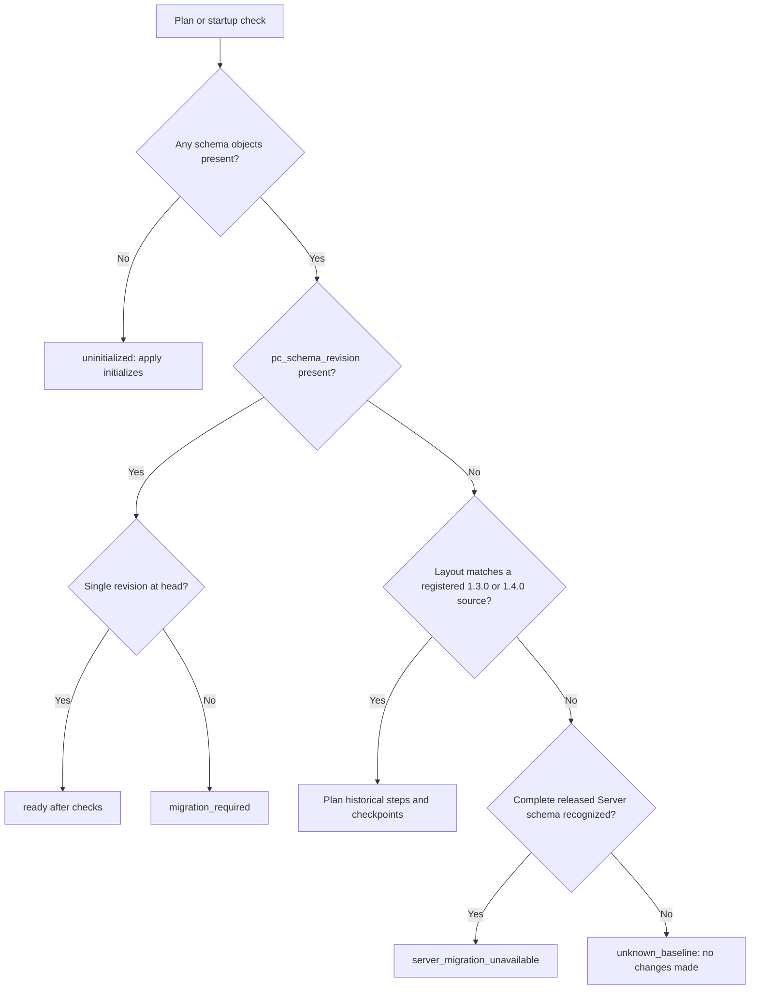
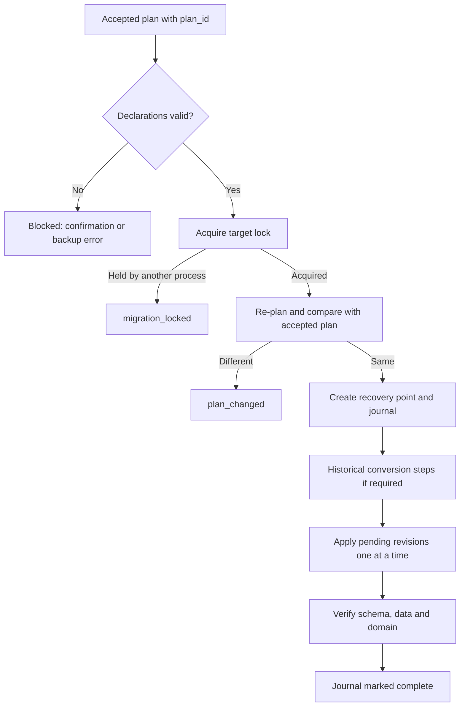
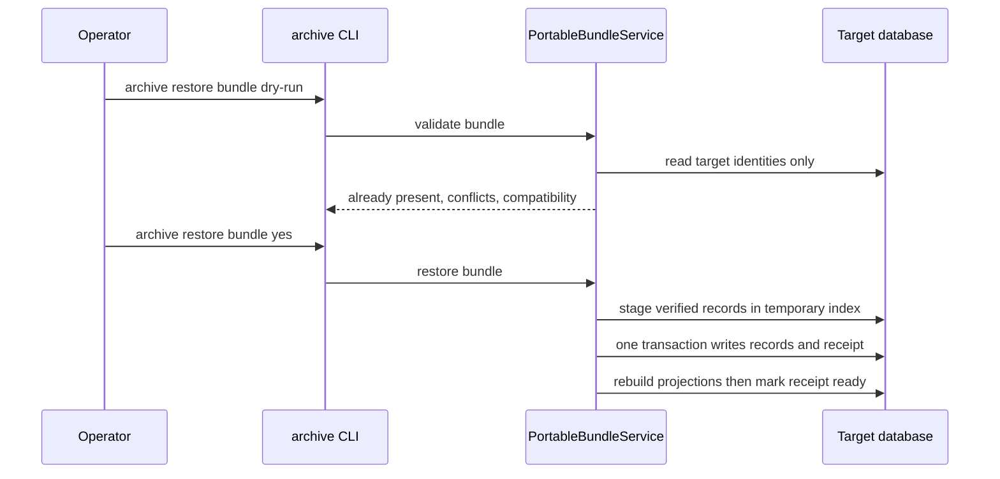

# Database Migrations, Data Migration and Portable Archives

This runbook separates three mechanisms that operators often confuse:

1. **Schema revisions.** Registered Alembic revisions applied only by an explicit `powercontext server db-migrate apply`. Installing software never migrates a database.
2. **Data migrations.** Offline conversions and repairs of domain data: Processing scheduling state, legacy Memory to Atomic Memory, Atomic search projections, and Topic Memory recovery.
3. **Portable archives.** Logical `.pcb` bundles that move complete scopes with `powercontext archive`. An archive is not a database upgrade and does not replace a deployment-native backup.

## Support status

The release policy is in `upgrade-required` mode for `target_version` `1.5.2`, which must equal the `version` in `openapi/powercontext.yaml` ([repo://release/upgrade-support.json#L1-L4](../../release/upgrade-support.json#L1-L4), [repo://scripts/upgrade_release_gate.py#L100-L111](../../scripts/upgrade_release_gate.py#L100-L111)). The public notice in the gate says that database upgrade support is limited to source-version, target-artifact, backend and configuration combinations that pass full Server acceptance ([repo://scripts/upgrade_release_gate.py#L63-L66](../../scripts/upgrade_release_gate.py#L63-L66)). The install guide repeats that text between its `upgrade-support` markers, and the gate's `check_docs` step rejects the docs when they differ from the policy-derived text ([repo://docs/en/docs/get-started/install-and-run.md#L317-L319](../../docs/en/docs/get-started/install-and-run.md#L317-L319), [repo://scripts/upgrade_release_gate.py#L192-L205](../../scripts/upgrade_release_gate.py#L192-L205)). The notice itself does not name individual source versions; the 1.3.0 source appears only in the policy's `automatic_sources` declaration.

Treat existing databases as not upgradable until the exact target artifact passes the required automatic matrix and the reviewed support declaration changes. The code paths below exist and are tested locally, but local tests do not establish installed-release acceptance.

## Commands at a glance

| Command | Purpose | Writes |
| --- | --- | --- |
| `powercontext server db-migrate status` | Report the schema version without creating a database or control tables. | No |
| `powercontext server db-migrate verify` | Check readiness of the selected bundle. It does not assert cluster readiness. | No |
| `powercontext server db-migrate plan` | Produce a reviewable plan with `plan_id`, backup policy and maintenance scope. | No |
| `powercontext server db-migrate apply` | Back up, migrate, verify. Requires an accepted plan. | Yes |
| `powercontext server processing-migrate` | Processing state. Managed databases delegate to `db-migrate --bundle processing`. | Yes, when applied |
| `powercontext server atomic-memory-migrate` | Legacy Memory to Atomic Memory. Managed databases delegate to `db-migrate --bundle server`. | Yes, when applied |
| `powercontext server atomic-memory-rebuild-projection` | Rebuild current Atomic search rows. Managed databases delegate to `db-migrate --bundle atomic-projection`. | Yes, when applied |
| `powercontext archive export` / `inspect` / `restore` | Portable `.pcb` bundle. `restore --dry-run` validates; `restore --yes` writes. | Restore only |

`db-migrate` accepts `--bundle server|artifacts|topic-memory-recovery|processing|atomic-projection`. The default is `server`, and only the `server` bundle can report full Server readiness ([repo://src/powercontext/server/database_migration.py#L44-L48](../../src/powercontext/server/database_migration.py#L44-L48), [repo://src/powercontext/server/database_migration.py#L280-L294](../../src/powercontext/server/database_migration.py#L280-L294)). The archive group has no `validate` subcommand; dry-run is the `--dry-run` flag on `restore` ([repo://src/powercontext/cli/archive.py#L69-L122](../../src/powercontext/cli/archive.py#L69-L122)).

## Revision chain

Migration names use `v<major>_<minor>_<patch>_<sequence>`. Stored IDs for older revisions are opaque aliases. The release-based names are presentation metadata only ([repo://src/powercontext/builtin/persistence/migrations/revision_names.py#L19-L55](../../src/powercontext/builtin/persistence/migrations/revision_names.py#L19-L55)). Frozen resources, plan IDs and recovery evidence keep their original IDs (`s1300`, `r1400`, `s1400` to `s1402`).

Two registered source histories reach the same head `v1_5_0_005`. The default source is the 1.3.0 baseline. The 1.4.0 source runs through a separate frozen bridge ([repo://src/powercontext/builtin/persistence/migrations/deployment.py#L46-L57](../../src/powercontext/builtin/persistence/migrations/deployment.py#L46-L57)). The bundle loads the source overlay, walks the revisions, and rejects any history that is not a single linear chain. It then sets `head` to the last revision ([repo://src/powercontext/builtin/persistence/migrations/bundle.py#L86-L93](../../src/powercontext/builtin/persistence/migrations/bundle.py#L86-L93)).

```text
1.3.0: v1_3_0_000 -> v1_4_1_001 -> v1_4_1_002 -> v1_4_1_003 -> v1_4_1_004 -> v1_4_1_005 -> v1_4_1_006 -> v1_5_0_001 -> v1_5_0_002 -> v1_5_0_003 -> v1_5_0_004 -> v1_5_0_005
1.4.0: v1_4_0_000 -> v1_4_1_001 -> v1_4_1_002 -> v1_4_1_003 -> v1_4_1_004 -> v1_4_1_005 -> v1_4_1_006 -> v1_5_0_001 -> v1_5_0_002 -> v1_5_0_003 -> v1_5_0_004 -> v1_5_0_005
```

Each step has a file in the bundled `server_resources/versions/` directory and a `revision_resources` entry in `server_resources/manifest.json` ([repo://src/powercontext/builtin/persistence/migrations/server_resources/manifest.json#L1-L60](../../src/powercontext/builtin/persistence/migrations/server_resources/manifest.json#L1-L60)). For example, `v1_5_0_003` registers the disposable evidence projection ([repo://src/powercontext/builtin/persistence/migrations/server_resources/versions/v1_5_0_003_atomic_memory_evidence_projection.py](../../src/powercontext/builtin/persistence/migrations/server_resources/versions/v1_5_0_003_atomic_memory_evidence_projection.py)).

The two newest steps have different effects:

- **`v1_5_0_004`** creates the optional `pc_artifact_source_locators` relation with the empty table from its registered schema resource. It does not rewrite lineage, payloads or Source identities ([repo://src/powercontext/builtin/persistence/migrations/server_resources/versions/v1_5_0_004_source_locators.py#L22-L28](../../src/powercontext/builtin/persistence/migrations/server_resources/versions/v1_5_0_004_source_locators.py#L22-L28)).
- **`v1_5_0_005`** drops the empty storage of the removed Artifact plugin framework and adds the nullable Artifact metadata column. Its domain preflight refuses the upgrade while the previous framework still holds any registration, declaration or index row. Native maintenance refuses registered native vector spaces, so no data is dropped silently. Revision reads omit `metadata` so that earlier registered domain steps still run ([repo://release/upgrade-support.json#L7-L7](../../release/upgrade-support.json#L7-L7), [repo://src/powercontext/builtin/persistence/migrations/server_resources/versions/v1_5_0_005_plugin_interfaces.py#L22-L28](../../src/powercontext/builtin/persistence/migrations/server_resources/versions/v1_5_0_005_plugin_interfaces.py#L22-L28)).

## Admission and legacy rejection

Admission classifies the database before any write. The selected source determines which steps may run.



Caption: admission of an unmanaged or managed database, as implemented in the SQLite and MySQL-family runners.

Branches, in the order the code applies them:

- **Managed storage with a revision.** The control table must have the registered single-column shape. Multiple revision rows are rejected as `incompatible_schema`. An unknown control-table shape is `recovery_required` ([repo://src/powercontext/builtin/persistence/migrations/sqlite.py#L384-L400](../../src/powercontext/builtin/persistence/migrations/sqlite.py#L384-L400)). Pending revisions make the plan `migration_required`.
- **Unmanaged storage with a recognized layout.** `select_source` compares the layout against the default and bridge source bundles. A unique match selects that source and its historical steps. More than one matching contract is `incompatible_schema` ([repo://src/powercontext/builtin/persistence/migrations/historical.py#L75-L95](../../src/powercontext/builtin/persistence/migrations/historical.py#L75-L95)).
- **Historical steps are state-based.** Admission records only the steps the data requires: `historical_structure`, `historical_scopes`, `historical_processing` and `historical_atomic_memory` ([repo://src/powercontext/builtin/persistence/migrations/historical.py#L114-L137](../../src/powercontext/builtin/persistence/migrations/historical.py#L114-L137)). Software version strings never authorize adoption.
- **Unrecognized schema.** For SQLite, a non-empty schema with no selected source and no baseline match raises `unknown_baseline` and makes no changes. A schema that matches a complete released Server baseline, but for which no path is selected, raises `server_migration_unavailable` ([repo://src/powercontext/builtin/persistence/migrations/sqlite.py#L384-L443](../../src/powercontext/builtin/persistence/migrations/sqlite.py#L384-L443), [repo://src/powercontext/builtin/persistence/migrations/server_baselines.py#L40-L75](../../src/powercontext/builtin/persistence/migrations/server_baselines.py#L40-L75)).
- **Baseline matching.** A complete schema fingerprint must match a frozen baseline exactly. An inconsistent frozen baseline resource, or a fingerprint claimed by several releases, is `invalid_bundle` ([repo://src/powercontext/builtin/persistence/migrations/server_baselines.py#L60-L75](../../src/powercontext/builtin/persistence/migrations/server_baselines.py#L60-L75)).
- **Recorded evidence.** If a maintenance journal exists, its recorded release checksums must still match. A changed checksum is `checksum_conflict` ([repo://src/powercontext/builtin/persistence/migrations/sqlite.py#L95-L120](../../src/powercontext/builtin/persistence/migrations/sqlite.py#L95-L120)).
- **Source selection by journal.** A journal selects its recorded source chain. Two source chains that both claim the same journal are `recovery_required` ([repo://src/powercontext/builtin/persistence/migrations/sources.py#L36-L53](../../src/powercontext/builtin/persistence/migrations/sources.py#L36-L53)).

Startup uses the same classification. It never upgrades an existing managed database; it initializes only an empty local SQLite or seekDB database. See [Startup and readiness](#startup-and-readiness) below.

## Applying a schema migration

Run the sequence below for every database. Stop all API hosts, Workers, SDK clients and automatic restarts before `apply`. The command cannot discover external writers.

```bash
powercontext server db-migrate plan --env-file .env --backup auto
powercontext server db-migrate apply --env-file .env --plan-id PLAN_ID --backup auto --maintenance-confirmed --yes
powercontext server db-migrate verify --env-file .env
```

`apply` plans first. A `ready` result returns the verify result with no changes. Otherwise it checks declarations and backup policy, then runs the locked sequence:



Caption: the locked apply order shared by the SQLite and MySQL-family runners. The recovery point is taken before any structural change.

Key rules:

- **Consent.** `apply` requires an explicit `--plan-id` matching the reviewed plan, `--maintenance-confirmed`, and a backup declaration. `--backup manual` requires `--backup-confirmed`. `--backup skip` requires `--accept-no-backup`. Automation requires both `--backup` and `--plan-id` ([repo://src/powercontext/server/database_migration.py#L147-L242](../../src/powercontext/server/database_migration.py#L147-L242), [repo://src/powercontext/server/database_migration.py#L396-L411](../../src/powercontext/server/database_migration.py#L396-L411)). Automatic backup that is unavailable blocks the command with `backup_unsupported` unless the operator chooses another policy. The SQLite and MySQL-family runners apply the same checks ([repo://src/powercontext/builtin/persistence/migrations/sqlite.py#L318-L344](../../src/powercontext/builtin/persistence/migrations/sqlite.py#L318-L344), [repo://src/powercontext/builtin/persistence/migrations/mysql.py#L402-L427](../../src/powercontext/builtin/persistence/migrations/mysql.py#L402-L427)).
- **Plan binding.** The plan is recomputed after the lock is acquired and again before the write transaction. Any difference raises `plan_changed` ([repo://src/powercontext/builtin/persistence/migrations/sqlite.py#L241-L275](../../src/powercontext/builtin/persistence/migrations/sqlite.py#L241-L275), [repo://src/powercontext/builtin/persistence/migrations/mysql.py#L430-L444](../../src/powercontext/builtin/persistence/migrations/mysql.py#L430-L444)).
- **Recovery point.** SQLite uses the Online Backup API, verifies integrity and creates the manifest exclusively. A partial file is kept as evidence and never reported as complete. `create_backup` refuses unless writers are declared stopped ([repo://src/powercontext/builtin/persistence/migrations/backup.py#L131-L200](../../src/powercontext/builtin/persistence/migrations/backup.py#L131-L200)).
- **Completion.** The journal is marked `complete` only after schema, data and domain validation succeed ([repo://src/powercontext/builtin/persistence/migrations/mysql.py#L470-L526](../../src/powercontext/builtin/persistence/migrations/mysql.py#L470-L526), [repo://src/powercontext/builtin/persistence/migrations/sqlite.py#L296-L316](../../src/powercontext/builtin/persistence/migrations/sqlite.py#L296-L316)).

Managed domain operations, namely Processing state, the Atomic Memory conversion and the Atomic projection repair, share `ManagedMaintenanceRunner` in `maintenance.py`. Its `apply` returns `ready` without changes when the plan is ready or has no domain steps. Otherwise it reads or creates the maintenance journal, takes a backup unless the policy is `manual` or `skip`, and begins the write transaction. It then compares the locked state with the initial plan and raises `plan_changed` on any difference. After the operation it runs `check_server_schema` and the domain validation, and only then marks the journal `complete` ([repo://src/powercontext/builtin/persistence/migrations/maintenance.py#L160-L262](../../src/powercontext/builtin/persistence/migrations/maintenance.py#L160-L262)).

### Journal and interrupted runs

The maintenance journal is `maintenance.json` in `<database>.pc-migration-state`. It records the state (`preparing`, `active` or `complete`), the database identity, the source revision, the bundle and configuration digests, the backup policy and reference, and the release checksums ([repo://src/powercontext/builtin/persistence/migrations/sqlite.py#L34-L108](../../src/powercontext/builtin/persistence/migrations/sqlite.py#L34-L108)).

Retry rules:

- Repeat the same bundle and configuration. A changed bundle, configuration digest or historical conversion definition raises `recovery_required` or `plan_changed` instead of resuming ([repo://src/powercontext/builtin/persistence/migrations/sqlite.py#L444-L490](../../src/powercontext/builtin/persistence/migrations/sqlite.py#L444-L490)).
- A partially migrated database does not get a new automatic backup. Switching to `auto` after partial progress raises `recovery_required` ([repo://src/powercontext/builtin/persistence/migrations/sqlite.py#L612-L620](../../src/powercontext/builtin/persistence/migrations/sqlite.py#L612-L620)).
- A missing journal for a database with pending revisions is `recovery_required`. Do not back up partial state in that case ([repo://src/powercontext/builtin/persistence/migrations/sqlite.py#L384-L443](../../src/powercontext/builtin/persistence/migrations/sqlite.py#L384-L443)).
- Keep the original backup. A backup-required error means the original recovery point is unavailable and must not be replaced after schema changes.

The 1.3.0 upgrade has a precondition the code cannot verify. Stop all writers and drain queued or running 1.3.0 Dream tasks before upgrading, because the target cannot execute the old prompt contract ([repo://docs/en/docs/operate/database-migrations.md#L73-L73](../../docs/en/docs/operate/database-migrations.md#L73-L73)).

## Locks and admission failures

Each backend uses a different lock. None of these is a cross-host lock for the whole database.

| Backend | Lock | Failure codes and behavior |
| --- | --- | --- |
| SQLite | Non-blocking OS file lock on `<database>.pc-migration.lock`. The lock file is kept after release so waiters and newcomers share one inode. | Contention raises `migration_locked`. A platform without an OS-backed lock raises `migration_lock_unsupported` ([repo://src/powercontext/builtin/persistence/migrations/locking.py#L31-L62](../../src/powercontext/builtin/persistence/migrations/locking.py#L31-L62)). |
| SQLite startup | Read-only probe of an existing lock file with a shared non-blocking lock. The probe never creates the lock file. | An active maintenance lock refuses startup as `migration_locked`. Unsupported inspection raises `migration_lock_unsupported` ([repo://src/powercontext/builtin/persistence/migrations/locking.py#L64-L96](../../src/powercontext/builtin/persistence/migrations/locking.py#L64-L96), [repo://src/powercontext/builtin/persistence/migrations/server_readiness.py#L123-L134](../../src/powercontext/builtin/persistence/migrations/server_readiness.py#L123-L134)). |
| Embedded seekDB | Local lock on the engine directory. A nonempty directory must contain recognized native storage. A missing directory is not created on a read-only path. | Unrecognized storage raises `unsupported_target` ([repo://src/powercontext/builtin/persistence/migrations/connections.py#L103-L145](../../src/powercontext/builtin/persistence/migrations/connections.py#L103-L145)). |
| OceanBase | Coordinator OS lock on one fixed host, plus a durable run receipt. | Requires `--lock-coordination single-host` and `--evidence-dir` ([repo://src/powercontext/builtin/persistence/migrations/deployment.py#L117-L232](../../src/powercontext/builtin/persistence/migrations/deployment.py#L117-L232)). |

OceanBase details:

- The coordinator lock is an OS lock, not a database-wide or cross-host lock. All migrators for the deployment must use the same host and evidence directory ([repo://src/powercontext/builtin/persistence/migrations/oceanbase.py#L1-L21](../../src/powercontext/builtin/persistence/migrations/oceanbase.py#L1-L21)).
- A lock loss or a changed lock file or directory raises `migration_lock_lost`. A symbolic link, a non-regular file, or a platform without an OS lock raises `migration_lock_unsupported` ([repo://src/powercontext/builtin/persistence/migrations/oceanbase.py#L49-L120](../../src/powercontext/builtin/persistence/migrations/oceanbase.py#L49-L120)).
- Every started run writes a receipt. A clean close clears it. An unclean exit keeps it. The next attempt raises `recovery_required` until the operator passes the exact token with `--acknowledge-previous-run`. An acknowledgment with no pending run raises `stale_ack` ([repo://src/powercontext/builtin/persistence/migrations/oceanbase.py#L316-L336](../../src/powercontext/builtin/persistence/migrations/oceanbase.py#L316-L336), [repo://src/powercontext/builtin/persistence/migrations/mysql.py#L354-L385](../../src/powercontext/builtin/persistence/migrations/mysql.py#L354-L385)).
- `--acknowledge-previous-run` is accepted only for OceanBase; other backends raise `unsupported_option` ([repo://src/powercontext/builtin/persistence/migrations/deployment.py#L117-L232](../../src/powercontext/builtin/persistence/migrations/deployment.py#L117-L232)). The acknowledgment asserts that the previous remote operation and background DDL have ended. The coordinator cannot verify that.

Other frequent blocking codes:

| Code | Meaning and action |
| --- | --- |
| `confirmation_required` | Plan ID or backup declaration missing. Review a plan and pass the explicit flags. |
| `maintenance_required` | `--maintenance-confirmed` missing. Stop all writers first. |
| `plan_changed` | Database, bundle, configuration or options changed after review. Create a new plan. |
| `backup_unsupported` | Automatic backup unavailable. Choose `manual` or `skip` and review a new plan. |
| `migration_required` | Startup found pending revisions. Run `db-migrate apply`. |
| `embedding_profile_mismatch` | Configured embedding profile differs from stored managed storage, or the profile is incomplete. |
| `unsupported_upgrade_configuration` | A partial bundle was asked to handle a vector configuration, or a managed database has no registered transition. |
| `unknown_baseline`, `server_migration_unavailable`, `incompatible_schema` | Schema not registered for upgrade. No changes were made. |

Embedding profiles are admitted strictly. A configured model requires a profile ID and a dimension ([repo://src/powercontext/builtin/persistence/migrations/deployment.py#L87-L101](../../src/powercontext/builtin/persistence/migrations/deployment.py#L87-L101)). The snapshot admission path compares the stored profile with the configured one ([repo://src/powercontext/builtin/persistence/migrations/sqlite.py#L209-L239](../../src/powercontext/builtin/persistence/migrations/sqlite.py#L209-L239)). Partial bundles reject vector configuration before a plan or backup is created ([repo://src/powercontext/builtin/persistence/migrations/deployment.py#L117-L140](../../src/powercontext/builtin/persistence/migrations/deployment.py#L117-L140)).

## Startup and readiness

The Server lifespan calls `prepare_server_storage` before serving ([repo://src/powercontext/server/factory.py#L221-L230](../../src/powercontext/server/factory.py#L221-L230)). That function never upgrades an existing managed database. Its branches run in this order ([repo://src/powercontext/builtin/persistence/migrations/server_readiness.py#L123-L161](../../src/powercontext/builtin/persistence/migrations/server_readiness.py#L123-L161)):

1. An in-memory SQLite database returns without any check.
2. A file-backed SQLite database with a plain path and no URL query is probed for a maintenance lock. An active lock refuses startup as `migration_locked` ([repo://src/powercontext/builtin/persistence/migrations/server_readiness.py#L129-L134](../../src/powercontext/builtin/persistence/migrations/server_readiness.py#L129-L134), [repo://src/powercontext/builtin/persistence/migrations/locking.py#L64-L96](../../src/powercontext/builtin/persistence/migrations/locking.py#L64-L96)).
3. When an embedding profile was injected but none is configured, the optional-profile check runs and startup returns without adopting managed storage ([repo://src/powercontext/builtin/persistence/migrations/server_readiness.py#L163-L185](../../src/powercontext/builtin/persistence/migrations/server_readiness.py#L163-L185)).
4. OceanBase: a connection with no `pc_schema_revision` table is refused as `migration_required`. Otherwise the exact layout is checked, a stored embedding profile that differs from the configured one is refused as `embedding_profile_mismatch`, and the full Server schema check runs ([repo://src/powercontext/builtin/persistence/migrations/server_readiness.py#L142-L152](../../src/powercontext/builtin/persistence/migrations/server_readiness.py#L142-L152)).
5. Other backends build a plan. An `uninitialized` plan on local SQLite or seekDB is applied with the plan's own `plan_id`, which initializes empty storage. Any other state that is not `ready` raises `MigrationError` with that state, and the message tells the operator to stop writers and run `powercontext server db-migrate apply` before startup.

Version mismatch is handled by the full-Server layout check. `check_server_layout` requires the `pc_schema_revision` table to hold exactly the bundle head. Any other content raises `migration_required` ("The full Server revision chain is incomplete.") ([repo://src/powercontext/builtin/persistence/migrations/server_readiness.py#L50-L61](../../src/powercontext/builtin/persistence/migrations/server_readiness.py#L50-L61)).

- The full-Server check requires exactly one revision at the bundle head. It verifies retained objects, runs a live foreign-key check, and then validates the domain ([repo://src/powercontext/builtin/persistence/migrations/server_readiness.py#L26-L48](../../src/powercontext/builtin/persistence/migrations/server_readiness.py#L26-L48), [repo://src/powercontext/builtin/persistence/migrations/server_readiness.py#L50-L91](../../src/powercontext/builtin/persistence/migrations/server_readiness.py#L50-L91)).
- An unfinished portable restore receipt blocks normal startup and workers. `check_server_schema` raises `BundleRecoveryRequiredError` when a `pc_portable_restore_receipts` row has `projections_ready = false`. Only the explicit archive restore path, which passes `_archive_recovery`, may continue ([repo://src/powercontext/builtin/persistence/migrations/server_readiness.py#L30-L40](../../src/powercontext/builtin/persistence/migrations/server_readiness.py#L30-L40)).

The managed Ops snapshot admission (`powercontext`'s private admission entry) validates a private copy of the main file and WAL. It is read-only. Its errors return only safe reason codes and never database contents or configuration ([repo://src/powercontext/server/database_admission.py#L79-L143](../../src/powercontext/server/database_admission.py#L79-L143)).

## Processing migration

`processing-migrate` upgrades existing Topic Memory processing state so that the Scope-based Artifact Processing Supervisor can start. The command has two paths:

- **Managed database.** The command delegates to `db-migrate --bundle processing`. An identity marker without a revision is blocked until the full Server upgrade finishes ([repo://src/powercontext/server/cli.py#L132-L190](../../src/powercontext/server/cli.py#L132-L190), [repo://src/powercontext/server/cli.py#L233-L262](../../src/powercontext/server/cli.py#L233-L262)).
- **Unmanaged SDK storage.** The domain-only procedure runs. Its plan, apply and verify steps are described in [the Processing migration docs](../../docs/en/docs/operate/artifact-processing-migration.md).

Startup bootstrap is conservative. A fresh database with no legacy data receives a `complete` marker. A database with the legacy processing schema, or existing processing data, raises `ProcessingSchemaNotReadyError` and must be migrated offline ([repo://src/powercontext/builtin/persistence/processing_migration.py#L154-L189](../../src/powercontext/builtin/persistence/processing_migration.py#L154-L189), [repo://src/powercontext/builtin/persistence/processing_migration.py#L213-L236](../../src/powercontext/builtin/persistence/processing_migration.py#L213-L236)).

Mode switches between global and dedicated processing need a new `--migration-id` each time. Keep the same ID only to resume the same switch ([repo://src/powercontext/server/database_migration.py#L67-L70](../../src/powercontext/server/database_migration.py#L67-L70)). The migration preserves Topic Pending values, Source Cursors, CAS generations, and request counters. Uncovered Sources become ordinary dirty state, and a Scope with unresolved legacy Pending is retained as an accepted invocation ([repo://docs/en/docs/operate/artifact-processing-migration.md](../../docs/en/docs/operate/artifact-processing-migration.md)).

## Atomic Memory migration

The conversion task `powercontext.memory.v1-to-atomic-memory.v1` converts legacy Memory collections into independent `atomic-memory` artifacts ([repo://src/powercontext/builtin/persistence/migrations/atomic_memory_v1.py#L100](../../src/powercontext/builtin/persistence/migrations/atomic_memory_v1.py#L100)). Its key rules:

- **Identity.** A new identity is a UUIDv5 of the canonical JSON `(scope_id, memory_artifact_id, entry_id)`, prefixed `mem-`. Entry IDs shared by different containers stay distinct ([repo://src/powercontext/builtin/persistence/atomic_memory_identity.py#L1-L30](../../src/powercontext/builtin/persistence/atomic_memory_identity.py#L1-L30)).
- **Blocking custom prompts.** A custom `memory.extract` Prompt blocks the task until it is explicitly converted to the Atomic contract ([repo://src/powercontext/builtin/persistence/migrations/atomic_memory_v1.py#L700-L722](../../src/powercontext/builtin/persistence/migrations/atomic_memory_v1.py#L700-L722)).
- **Archive, not delete.** Legacy collections are copied to `pc_memory_artifact_archive` ([repo://docs/en/docs/operate/atomic-memory-migration.md#L9-L10](../../docs/en/docs/operate/atomic-memory-migration.md#L9-L10), [repo://src/powercontext/builtin/persistence/migrations/atomic_memory_archive.py#L21-L40](../../src/powercontext/builtin/persistence/migrations/atomic_memory_archive.py#L21-L40)). They leave public tables, search and online reads. The archive has no online read surface, and the task does not downgrade the database.
- **Reference decisions.** Candidates that cite only whole collections need a decision file. Only `replace` is accepted, and its replacement evidence must be existing exact Atomic revisions, not a legacy collection ([repo://src/powercontext/builtin/persistence/migrations/atomic_memory_references.py#L174-L190](../../src/powercontext/builtin/persistence/migrations/atomic_memory_references.py#L174-L190)).
- **Owner decisions.** Ownerless legacy entries under enforced access need an explicit operator attestation through `--owner-decisions`. The CLI parses the decision file before any database work ([repo://src/powercontext/server/cli.py#L369-L449](../../src/powercontext/server/cli.py#L369-L449)). The decision format is validated in the conversion module ([repo://src/powercontext/builtin/persistence/migrations/atomic_memory_v1.py#L133-L165](../../src/powercontext/builtin/persistence/migrations/atomic_memory_v1.py#L133-L165)).

The CLI routes by storage ownership. On a managed database, it delegates to `db-migrate --bundle server` and rejects `--decisions` and `--owner-decisions`. On an unmanaged legacy database, it runs the domain-only conversion with those files ([repo://src/powercontext/server/cli.py#L369-L449](../../src/powercontext/server/cli.py#L369-L449)).

Atomic evidence for a revision is stored in a disposable projection, `pc_atomic_memory_evidence`. Invalid or missing declarations are kept as neutral evidence. Trust is never backfilled from the current registry ([repo://src/powercontext/builtin/persistence/atomic_memory_evidence.py#L58-L109](../../src/powercontext/builtin/persistence/atomic_memory_evidence.py#L58-L109), [repo://src/powercontext/builtin/persistence/atomic_memory_evidence.py#L118-L130](../../src/powercontext/builtin/persistence/atomic_memory_evidence.py#L118-L130)).

### OceanBase and seekDB acceptance runner

`scripts/run_atomic_memory_clean_migration.py` runs the Atomic Memory migration suites for one backend, `seekdb` or `oceanbase`. Its default suites are `tests/e2e/test_atomic_memory_migration_evidence.py`, `tests/e2e/test_atomic_memory_grant_migration.py` and `tests/e2e/test_atomic_memory_migration_vector.py` ([repo://scripts/run_atomic_memory_clean_migration.py#L31-L36](../../scripts/run_atomic_memory_clean_migration.py#L31-L36)).

- Each collected node runs in its own pytest process under a GNU `timeout` (`--test-timeout`, default 180 seconds). A node passes only when the exit code is 0 and its JUnit report has exactly one test case with no `skipped`, `failure` or `error` child. Failed nodes are not retried ([repo://scripts/run_atomic_memory_clean_migration.py#L104-L145](../../scripts/run_atomic_memory_clean_migration.py#L104-L145)).
- `INDEX/COUNT` shards are validated before collection. Without `--durations`, nodes are assigned round-robin by index. With OceanBase durations, the expensive nodes are packed first under an equal per-shard case ceiling, and each shard keeps collection order ([repo://scripts/run_atomic_memory_clean_migration.py#L39-L49](../../scripts/run_atomic_memory_clean_migration.py#L39-L49), [repo://scripts/run_atomic_memory_clean_migration.py#L67-L86](../../scripts/run_atomic_memory_clean_migration.py#L67-L86)).
- `summary.json` is written as incomplete at the start, and `complete` is set only after every assigned node has passed. The shard verifier in the release gate then checks these summaries ([repo://scripts/run_atomic_memory_clean_migration.py#L147-L228](../../scripts/run_atomic_memory_clean_migration.py#L147-L228)).

## Atomic projection and Topic recovery bundles

`--bundle atomic-projection` repairs derived current Atomic rows and the SQLite FTS helper on a current managed database. It preserves immutable history, lifecycle, tags, permissions and Source or Processing state. It runs only in the registered no-vector configuration and cannot register vector-profile changes ([repo://src/powercontext/builtin/persistence/migrations/deployment.py#L117-L140](../../src/powercontext/builtin/persistence/migrations/deployment.py#L117-L140)). Invalid authority stops the repair with `invalid_authority`. A failed post-repair check stops it with `projection_verification_failed` ([repo://src/powercontext/builtin/persistence/migrations/atomic_projection.py#L100-L118](../../src/powercontext/builtin/persistence/migrations/atomic_projection.py#L100-L118), [repo://src/powercontext/builtin/persistence/migrations/atomic_projection.py#L175-L185](../../src/powercontext/builtin/persistence/migrations/atomic_projection.py#L175-L185)).

`server atomic-memory-rebuild-projection` has two branches, selected by storage ownership:

- **Managed databases** delegate `plan`, `verify` and `apply` to `db-migrate --bundle atomic-projection`, and the managed bundle rules above apply.
- **Unmanaged databases** accept only `apply`. `plan` and `verify` fail with `plan and verify require managed Server storage`. `apply` also requires `--maintenance-confirmed` after writers are stopped; without it the command stops before any database work. It then runs the standalone `rebuild_atomic_memory_projection` through `_atomic_memory_maintenance`, passing the configured embedding model when one is present ([repo://src/powercontext/server/cli.py#L495-L578](../../src/powercontext/server/cli.py#L495-L578)).

The standalone rebuild is not the no-vector bundle. It accepts a configured embedding profile only when the supplied model's profile matches it, and it raises `maintenance-required` or `embedding-profile` before any work otherwise ([repo://src/powercontext/builtin/runtime/atomic_memory_rebuild.py#L474-L484](../../src/powercontext/builtin/runtime/atomic_memory_rebuild.py#L474-L484)).

Current-row selection covers every Atomic Memory head, not only active ones. The rebuild reads head identities in `(scope_id, artifact_id)` keyset batches ([repo://src/powercontext/builtin/runtime/atomic_memory_rebuild.py#L118-L126](../../src/powercontext/builtin/runtime/atomic_memory_rebuild.py#L118-L126)). For each identity it loads the state and the latest revision. An `active` state publishes a freshly prepared current row, and any other state removes that identity's current row. Each identity commits in its own transaction after the prepared content is rechecked against the authority, so an interrupted run can leave partial derived repair and should be repeated while maintenance remains in force ([repo://src/powercontext/builtin/runtime/atomic_memory_rebuild.py#L458-L531](../../src/powercontext/builtin/runtime/atomic_memory_rebuild.py#L458-L531)).

After the loop, one transaction deletes obsolete current rows. A current row is obsolete when no Atomic Memory head for it is `active` and unmerged, which also covers orphan rows with no head ([repo://src/powercontext/builtin/runtime/atomic_memory_rebuild.py#L252-L263](../../src/powercontext/builtin/runtime/atomic_memory_rebuild.py#L252-L263), [repo://src/powercontext/builtin/runtime/atomic_memory_rebuild.py#L532-L553](../../src/powercontext/builtin/runtime/atomic_memory_rebuild.py#L532-L553)). The same transaction rebuilds the evidence projection and runs a verification that requires both evidence and evidence projection. The report's `ready` value sets the exit code. Its counts include `rebuilt_rows`, `removed_rows` and `embedding_calls`.

`--bundle topic-memory-recovery` covers only the registered Topic recovery layouts for unmanaged storage. Its output reports `server_ready=false`. Any database containing `pc_schema_revision` is rejected before backup or writes ([repo://src/powercontext/server/database_migration.py#L44-L48](../../src/powercontext/server/database_migration.py#L44-L48), [repo://src/powercontext/builtin/persistence/migrations/deployment.py#L117-L140](../../src/powercontext/builtin/persistence/migrations/deployment.py#L117-L140)).

## Portable archives

A `.pcb` bundle is a logical ZIP that carries complete scopes in portable form. It holds a `manifest.json` and a `records.ndjson` stream. The export writer sets `format_version` to `FORMAT_VERSION`, which is `1`, and that is the only version writers produce ([repo://src/powercontext/builtin/portability/bundle.py#L129-L137](../../src/powercontext/builtin/portability/bundle.py#L129-L137), [repo://src/powercontext/builtin/portability/bundle.py#L580-L589](../../src/powercontext/builtin/portability/bundle.py#L580-L589)).



Caption: restore validates first, stages records outside the target transaction, then writes authoritative rows and marks projections ready.

### Export

- **Authorization first.** The selected scope IDs are validated and authorized before any database query. For this offline command, the authority is the OS and database permission to read the configured deployment. It never uses Server bearer tokens ([repo://src/powercontext/builtin/portability/bundle.py#L547-L579](../../src/powercontext/builtin/portability/bundle.py#L547-L579), [repo://src/powercontext/cli/archive.py#L152-L153](../../src/powercontext/cli/archive.py#L152-L153)).
- **Consistent snapshot.** One consistent-snapshot transaction streams rows to a temporary NDJSON file. The archive is published with a replace only after its structure and dependencies pass. A failed export keeps any previous file at the destination ([repo://src/powercontext/builtin/portability/bundle.py#L566-L611](../../src/powercontext/builtin/portability/bundle.py#L566-L611), [repo://src/powercontext/builtin/portability/bundle.py#L980-L1002](../../src/powercontext/builtin/portability/bundle.py#L980-L1002)).
- **Destination guard.** On SQLite, export refuses a destination that is the source database or a file with its `-wal`, `-shm` or `-journal` names, case-insensitively ([repo://src/powercontext/builtin/portability/bundle.py#L1156-L1172](../../src/powercontext/builtin/portability/bundle.py#L1156-L1172)).

### Inspect and validate

`inspect` verifies the ZIP structure, the manifest, per-record digests, the record count, record classes and the scope list. It never opens the target database ([repo://src/powercontext/builtin/portability/bundle.py#L612-L616](../../src/powercontext/builtin/portability/bundle.py#L612-L616), [repo://src/powercontext/builtin/portability/bundle.py#L1205-L1262](../../src/powercontext/builtin/portability/bundle.py#L1205-L1262), [repo://src/powercontext/cli/archive.py#L91-L102](../../src/powercontext/cli/archive.py#L91-L102)).

`restore --dry-run` validates against the target without domain writes. It reports `already_present`, `conflicts`, required and unsupported Source types and Artifact families, and whether a projection rebuilder exists ([repo://src/powercontext/builtin/portability/bundle.py#L618-L668](../../src/powercontext/builtin/portability/bundle.py#L618-L668)). A missing SQLite target is validated without creating its file or parent directory ([repo://src/powercontext/cli/archive.py#L156-L180](../../src/powercontext/cli/archive.py#L156-L180)).

### Restore

- **Confirmation.** `restore` without `--dry-run` requires `--yes` ([repo://src/powercontext/cli/archive.py#L105-L126](../../src/powercontext/cli/archive.py#L105-L126)).
- **Pre-write conflicts.** Restore revalidates and aborts before any write when validation finds conflicting target records. It also aborts when the target is incompatible with the bundle's source types or artifact families ([repo://src/powercontext/builtin/portability/bundle.py#L702-L707](../../src/powercontext/builtin/portability/bundle.py#L702-L707)).
- **Staging and transaction.** Verified records are staged in a temporary disk index before the write transaction opens. Records replay in dependency order inside one transaction. An integrity error at write time becomes a conflict and rolls back ([repo://src/powercontext/builtin/portability/bundle.py#L710-L725](../../src/powercontext/builtin/portability/bundle.py#L710-L725), [repo://src/powercontext/builtin/portability/bundle.py#L1265-L1280](../../src/powercontext/builtin/portability/bundle.py#L1265-L1280), [repo://src/powercontext/builtin/portability/bundle.py#L919-L948](../../src/powercontext/builtin/portability/bundle.py#L919-L948)).
- **Idempotency.** Identical records count as `already_present`. A different payload at the same identity never overwrites the target ([repo://src/powercontext/builtin/portability/bundle.py#L950-L978](../../src/powercontext/builtin/portability/bundle.py#L950-L978)).
- **Receipt and projections.** A durable receipt keyed by `bundle_id` moves from `authoritative_restored` to `ready` only after projection rebuild completes. If rebuild fails, rerun the same restore. `projections_ready=false` keeps the target out of normal serving until recovery ([repo://src/powercontext/builtin/portability/bundle.py#L725-L748](../../src/powercontext/builtin/portability/bundle.py#L725-L748), [repo://src/powercontext/builtin/portability/bundle.py#L749-L796](../../src/powercontext/builtin/portability/bundle.py#L749-L796)).

### What is and is not portable

The bundle carries Scope identity and hierarchy, Source journal heads and Source records, referenced Source definition manifests, accepted evidence bindings, Artifact revisions with their lineage and heads, Atomic Memory merge relationships, Candidate versions and decision heads, managed Skill packages and manifests, Profile policies and Prompt revisions, and Work and Handoff records stored as Sources ([repo://src/powercontext/builtin/portability/bundle.py#L154-L170](../../src/powercontext/builtin/portability/bundle.py#L154-L170)).

The following classes are excluded: access bindings, audit records, credentials and provider secrets, evaluation receipts, external Skill registrations, host-local installation state, search projections and indexes, Source cursors and scheduler state. Archives are not encrypted. Checksums detect corruption, not authenticity ([repo://docs/en/docs/operate/portable-archive.md](../../docs/en/docs/operate/portable-archive.md)).

### Limits and exit codes

The archive file is limited to 512 MiB. The manifest is limited to 256 KiB. Records are limited to 2 GiB uncompressed, 2,000,000 records, and 8 MiB per NDJSON line. The container check rejects a records member above the 2 GiB limit, and the record reader rejects lines above 8 MiB and counts above 2,000,000 ([repo://src/powercontext/builtin/portability/bundle.py#L129-L137](../../src/powercontext/builtin/portability/bundle.py#L129-L137), [repo://src/powercontext/builtin/portability/bundle.py#L1317-L1345](../../src/powercontext/builtin/portability/bundle.py#L1317-L1345)). Bundle IDs must be canonical lowercase UUIDs ([repo://docs/en/docs/operate/portable-archive.md](../../docs/en/docs/operate/portable-archive.md)). A manifest with an unknown `format_version` is rejected by `_validate_manifest` during inspection, before any target write ([repo://src/powercontext/builtin/portability/bundle.py#L1365-L1382](../../src/powercontext/builtin/portability/bundle.py#L1365-L1382)).

Exit codes:

- `2`: invalid or unreadable bundle, or an uninspectable SQLite target filename.
- `3`: incompatible target, conflict, or pending recovery. A dry-run that reports an incompatible target also exits `3`.

These are raised by the archive CLI's error-to-exit mapping ([repo://src/powercontext/cli/archive.py#L256-L293](../../src/powercontext/cli/archive.py#L256-L293)).

## Upgrade release gate

`scripts/upgrade_release_gate.py` validates the policy, runs every required backend case against the target wheel, and writes a `result.json` into a fresh output directory. Each case failure is recorded, and the run fails if any required backend fails ([repo://scripts/upgrade_release_gate.py#L516-L549](../../scripts/upgrade_release_gate.py#L516-L549)). Local regression tests do not replace this run.

Policy fields. `release/upgrade-support.json` must contain exactly these top-level fields: `format` (must be `2`), `target_version`, `mode`, `schema_review`, `cases` and `automatic_sources`. `schema_review` contains `persistence_sha256` and `rationale`, and `automatic_sources` contains `strategy` (must be `fixed-version`), `source_version` and `profiles`, where each profile has `backend`, `configuration` and `suite` ([repo://scripts/upgrade_release_gate.py#L100-L125](../../scripts/upgrade_release_gate.py#L100-L125)).

Policy validation:

- The policy `target_version` must match the `version` in `openapi/powercontext.yaml` ([repo://scripts/upgrade_release_gate.py#L100-L111](../../scripts/upgrade_release_gate.py#L100-L111)).
- `mode` must be `upgrade-required` or `supported-upgrades`. Any other value is refused.
- The 1.3.0 baseline must cover SQLite, seekDB and OceanBase. Every acceptance suite must live under `tests/release_upgrades` ([repo://scripts/upgrade_release_gate.py#L112-L170](../../scripts/upgrade_release_gate.py#L112-L170)).
- The automatic 1.3.0 matrix lists twelve configurations: no-vector, Code, vector and vector-plus-Code on each backend ([repo://release/upgrade-support.json#L10-L76](../../release/upgrade-support.json#L10-L76)).
- A persistence-input change requires a refreshed compatibility review. The digest covers every managed persistence file, with CRLF normalized to LF. A mismatched `persistence_sha256` fails policy loading until `schema_review` is updated ([repo://scripts/upgrade_release_gate.py#L82-L98](../../scripts/upgrade_release_gate.py#L82-L98), [repo://scripts/upgrade_release_gate.py#L118-L124](../../scripts/upgrade_release_gate.py#L118-L124)).
- The notice in the install guide must equal the text derived from `mode`. `check_docs` compares it with the `upgrade-support` region in the English and Chinese install pages and fails on any difference ([repo://scripts/upgrade_release_gate.py#L171-L205](../../scripts/upgrade_release_gate.py#L171-L205)).

Release wheel check:

- With `--release`, the gate requires the wheel's version to equal the policy `target_version`. A mismatch raises `Wheel version differs from upgrade policy target` before any case runs ([repo://scripts/upgrade_release_gate.py#L507-L514](../../scripts/upgrade_release_gate.py#L507-L514)).
- `mode` is recorded in `result.json`, which the gate writes in its `finally` block. The `mode` value does not by itself block acceptance or publication. The `run_upgrade_release_gate.py` publisher calls `gate` (line 109) and copies the validated distributions. Its `uv publish` step (line 158) runs only when `--publish` is given, which requires `--release`. The success line prints the mode ([repo://scripts/run_upgrade_release_gate.py#L101-L118](../../scripts/run_upgrade_release_gate.py#L101-L118), [repo://scripts/run_upgrade_release_gate.py#L151-L160](../../scripts/run_upgrade_release_gate.py#L151-L160)).

Acceptance evidence:

- The JUnit report must contain every named full-Server phase, including `test_legacy_startup_is_rejected` and `test_fresh_upgrade_equivalence`. Any failure or skipped test rejects acceptance ([repo://scripts/upgrade_release_gate.py#L49-L58](../../scripts/upgrade_release_gate.py#L49-L58), [repo://scripts/upgrade_release_gate.py#L207-L214](../../scripts/upgrade_release_gate.py#L207-L214)).
- OceanBase shard reports must have matching collections and disjoint, exactly-once coverage. A missing or duplicate node fails verification ([repo://scripts/check_atomic_memory_migration_shards.py#L30-L78](../../scripts/check_atomic_memory_migration_shards.py#L30-L78), [repo://scripts/check_atomic_memory_migration_shards.py#L80-L89](../../scripts/check_atomic_memory_migration_shards.py#L80-L89)).
- The historical rejection regression, `scripts/ci_legacy_upgrade_rejection.py`, asserts that unsupported upgrades are rejected. Passing `--respect-policy` retires those assertions only when the loaded policy `mode` is `supported-upgrades`. In that case the script writes a `not-applicable` result and the supported matrix must pass instead ([repo://scripts/ci_legacy_upgrade_rejection.py#L133-L146](../../scripts/ci_legacy_upgrade_rejection.py#L133-L146)).
- The 1.4.0 source bridge is registered but is not one of the automatic cases. Passing the gate does not certify it ([repo://release/upgrade-support.json#L7-L7](../../release/upgrade-support.json#L7-L7)).

## Operator checklist

1. Confirm the target and source. Read the `source_migration` and `target_migration` fields in the plan ([repo://src/powercontext/server/database_migration.py#L280-L294](../../src/powercontext/server/database_migration.py#L280-L294)).
2. Stop every writer, Worker, SDK client and automatic restart. Pause input and manual writes.
3. Take an independent backup, or accept the automatic recovery point. Do not replace an original backup after schema changes.
4. Run `plan`, review the output, then `apply` with the `--plan-id` and an explicit backup policy.
5. Run `verify` and confirm `ready` with `server_ready=true` before restarting writers.
6. For OceanBase, use one fixed maintenance host and one evidence directory for every migrator. Acknowledge any pending run only after confirming the previous remote operation ended.
7. For archives, run `restore --dry-run` first, then `restore --yes`. Confirm `projections_ready` is `true` before serving.
8. Keep the previous binary until a restore drill succeeds across a major release.

## Related pages

- [Persistence and storage](../architecture/persistence-and-storage.md) describes the storage backends and profiles this runbook operates on.
- [Troubleshooting](troubleshooting.md) covers common startup and maintenance failures.
- The Atomic Memory model that the conversion targets is described in the source (`src/powercontext/builtin/persistence/migrations/atomic_memory_v1.py`); no dedicated wiki page exists yet.
