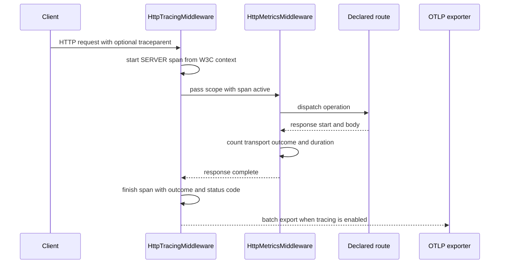
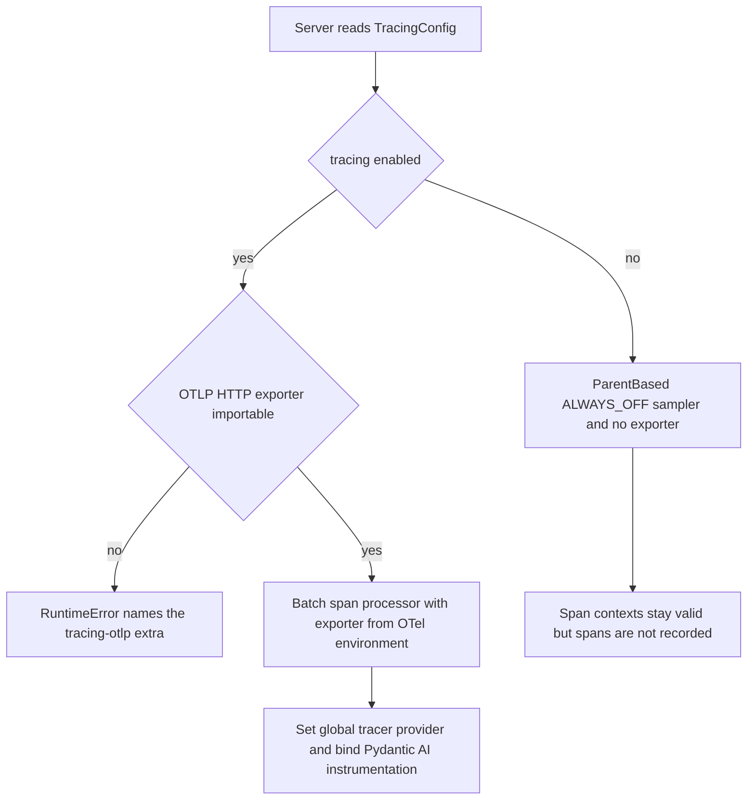
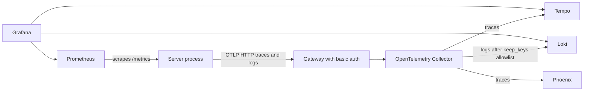

# Observability, Metrics and Tracing

PowerContext's Server emits three signal families from its own process: Prometheus metrics, OpenTelemetry spans, and structured operational logs. The Server modules under `src/powercontext/server/` own the instruments, middleware, and log handlers. The `src/powercontext/observability/` package provides an operator CLI that can provision a local Docker Compose reference stack or record a connection to components that already exist. Signals describe service behavior. They do not prove that stored Memory or Source evidence is correct, and a missing series is not the same as a healthy zero.

For how the Server process is assembled, see [Server runtime](../architecture/server-runtime.md). For installation and host layout, see [Deployment](deployment.md). For recovery steps, see [Troubleshooting](troubleshooting.md).

## Signal map

| Signal | Owner modules | Default | Destination |
| --- | --- | --- | --- |
| Prometheus metrics | `server/metrics.py`, `server/operational_metrics.py`, `server/background_metrics.py` | Enabled (`POWERCONTEXT_SERVER_METRICS_ENABLED`) | `/metrics` on the API host, or the background listener |
| Traces | `server/tracing.py`, `server/worker_tracing.py` | Disabled (`POWERCONTEXT_SERVER_TRACING_ENABLED`) | OTLP/HTTP batch export when enabled |
| Operational logs | `server/logging.py` | Console on stdout; file output off | stdout or managed files; optional OTLP log export |
| Reference stack | `observability/cli.py`, `observability/deployment.py`, `observability/connection.py` | Not provisioned | Docker Compose services, or saved external-connection files |

## Server metrics

`ServerMetrics` in `src/powercontext/server/metrics.py` owns one isolated `CollectorRegistry` per Server instance. It declares the transport, application, retrieval, artifact-read, Topic Memory, Runtime, readiness, processing, and model-usage instruments. Every instrument name begins with `powercontext_server_`. These names are the contract that dashboards and alerts depend on.

The `/metrics` route is added only when the metrics configuration is enabled. Setting `POWERCONTEXT_SERVER_METRICS_ENABLED=false` removes the route and the HTTP metrics middleware. When access control is active, a scrape must pass a `server.observe` authorization check before rendering. A scrape first calls `refresh_runtime`, which builds the processing counts and the passive operational snapshot together and then publishes both. If that build fails, the last published observation is kept and `powercontext_server_metrics_collection_failures_total` increments.

Families the page relies on:

- Transport and application: `powercontext_server_transport_requests_total`, `powercontext_server_transport_request_duration_seconds`, `powercontext_server_transport_requests_in_progress`, `powercontext_server_application_operations_total`, and `powercontext_server_application_operation_duration_seconds`.
- Final response observation: `powercontext_server_http_responses_total{operation,status_code}` and `powercontext_server_http_response_observation_enabled`.
- Domain operations: `powercontext_server_retrieval_requests_total`, `powercontext_server_retrieval_duration_seconds`, `powercontext_server_artifact_read_duration_seconds`, and `powercontext_server_topic_memory_searches_total`.
- Runtime and readiness: `powercontext_server_runtime_ready`, `powercontext_server_runtime_scopes`, `powercontext_server_readiness_state`, `powercontext_server_readiness_evaluated_timestamp_seconds`, and `powercontext_server_dependency_state`.
- Processing: the `powercontext_server_artifact_processing_*` family, including `powercontext_server_artifact_processing_invocation_duration_seconds`.
- Model usage: `powercontext_server_model_usage_queue_depth`, `powercontext_server_model_usage_queue_capacity`, `powercontext_server_model_usage_dropped_records_total`, `powercontext_server_model_usage_write_failures_total`, and `powercontext_server_model_usage_worker_reports_total{outcome}`.
- Provider calls: the `powercontext_server_provider_*` family, described in the operator guide's Provider call observations section (`docs/en/docs/operate/observability.md`, lines 363-421).

Labels are bounded. Scope, worker, request, trace, and content identities are never metric labels. A processing family name must pass a shape check (lowercase letters, digits, and hyphens, with a length limit) before it is exported. Exemplars carry only a sampled `trace_id`. They are attached only when tracing is enabled, a tracer is supplied, and the current span is sampled.

### Passive collection and freshness

Metrics collection is passive. The operational collector copies existing in-memory observations: the Runtime readiness snapshot, the Supervisor's per-family status, and the bounded duration histograms. Collection does not query the database, probe a dependency, invoke a model, or wait for a worker. A successful scrape therefore shows that the endpoint answered. It does not show that a dependency is currently healthy.

Several timestamps answer different questions and should not be merged:

- `powercontext_server_telemetry_collection_timestamp_seconds` marks the last successful passive snapshot. It is `0` before the first collection.
- `runtime_readiness_observed_timestamp_seconds` marks the last readiness evaluation, which may use cached probe results.
- `dependency_observed_timestamp_seconds` and `dependency_last_success_timestamp_seconds` mark actual probes only. Cache hits do not update them.
- `artifact_processing_last_success_timestamp_seconds` marks the last acknowledgement verified by the Supervisor, not a child process return.

Dependency and readiness states are one-hot gauges. The labelled state is `1` and every other supported state is `0`. An absent observation is unknown, not healthy. `powercontext_server_runtime_ready=1` means the Runtime can admit operations. It can coexist with a `degraded` aggregate readiness state.

### Background role

A process whose `artifact_processing_role` is `background` does not serve the business API. It serves `/metrics` and `/health/live` on a separate listener, bound to `POWERCONTEXT_SERVER_HTTP_HOST` and to `POWERCONTEXT_SERVER_METRICS_BACKGROUND_PORT`, whose default is `8001`. That listener is not started when metrics are disabled. When an API host and a background host share a machine, they need different ports.

## Request tracing

`configure_server_tracing` in `src/powercontext/server/tracing.py` is called once per Server process by the foreground command, before the application is created. Worker bootstraps call it again with `role="worker"`. The configuration decides whether spans are recorded and exported. It never changes a business result.

Caption: the ingress span wraps the metrics middleware, so each external request is traced and counted once. Export runs in a batch processor and is not on the response path.

### Tracing configuration branches

Caption: the disabled branch still gives each request a valid trace context, which the request ID is derived from, but nothing is exported.

### Disabled tracing and missing endpoint

When `POWERCONTEXT_SERVER_TRACING_ENABLED` is false, `configure_server_tracing` builds a `TracerProvider` with the `ParentBased(ALWAYS_OFF)` sampler. It creates no exporter and does not install a global tracer provider. Spans get valid identifiers but are not recorded, and the inference instrumentation is `None`. Business behavior is the same as with tracing on.

When tracing is enabled but the `tracing-otlp` extra is not installed, startup fails with a `RuntimeError` that names `powercontext[server,tracing-otlp]`. The Server does not fall back to silently disabled tracing.

When tracing is enabled and no endpoint is configured, the source adds no fallback. The OTLP exporter is constructed with no arguments, so it takes its endpoint from the standard OpenTelemetry environment, such as `OTEL_EXPORTER_OTLP_ENDPOINT`, or from the OpenTelemetry SDK's defaults. PowerContext does not validate the endpoint at startup. The Phoenix and Langfuse guides set `OTEL_EXPORTER_OTLP_ENDPOINT` explicitly, and the managed profile generated by the CLI does too.

### Spans the Server creates

- `HttpTracingMiddleware` creates a `SERVER` span named `HTTP <operation>`. It extracts W3C context from the incoming headers. It skips the health, `/metrics`, and MCP paths and internal bridge calls. It sets `powercontext.operation.outcome` to `success` for status codes below 400 and to `failure` otherwise.
- `McpTracingMiddleware` creates a `SERVER` span named `MCP mcp.<method>` with `powercontext.transport` set to `mcp`.
- `ServerTracing.stage` traces one bounded Runtime stage as an internal child span. A cancellation sets the outcome to `cancelled`. Any other exception sets it to `failure`, unless the outcome was already `blocked` or `cancelled`.
- `ServerTracing.background` starts a fresh trace root for each scheduled activation. It attaches an empty context first, so child stages cannot join an ambient HTTP or MCP trace.

The request ID returned to clients is the ingress span ID formatted as sixteen lowercase hex digits. If no valid span exists, the code generates an ID of the same shape.

### Content and failure sanitization

Inference spans come from Pydantic AI's instrumentation, configured with `include_content`, `include_binary_content`, and `include_model_request_parameters` all set to `False`. Prompts, responses, Memory content, and vectors therefore stay out of spans.

Spans created through the sanitized path disable the SDK's automatic exception events and status descriptions, because provider error bodies can echo Source or prompt content. Only a bounded `error.type` attribute and an error status are kept. A failure category goes into `powercontext.error.category`, using the same vocabulary as logs.

Inference spans are suppressed while readiness probes run. Tracing setup failures never fail readiness.

## Worker tracing

Child processes spawned for artifact processing do not inherit a live tracer. `WorkerTracing.wrap` returns the entrypoint unchanged when tracing is disabled. When tracing is enabled, it captures only the W3C `traceparent` and `tracestate` values from the supervisor's context and passes them to the child. Baggage is not forwarded.

Inside the child, `_TracedWorker` creates its own provider with `role="worker"`. It opens an `artifact_processing.worker.execute` span carrying the family and Scope identity, and it binds the child's model instrumentation to that worker context. If this setup raises, the failure is logged as `observability.worker_tracing_failed` and the domain invocation still runs. The span outcome maps a cancelled exception to `cancelled` and a blocked exception to `blocked`. Every other exception maps to `failure`. The supervisor's acknowledgement, not the child's return, is the evidence of verified business completion.

## Operational logging

`configure_server_logging` in `src/powercontext/server/logging.py` configures the `powercontext` and `uvicorn.error` loggers for the foreground process. SDK embedding does not run it. The format is `console` by default, or `json` when `POWERCONTEXT_SERVER_LOGGING_FORMAT=json`. The handler is a stdout stream handler by default. When `POWERCONTEXT_SERVER_LOGGING_FILE=true`, it is a queue handler that writes files, and worker records reach that handler over socket channels.

Only fields on an explicit allowlist are serialized. Arbitrary `extra` attributes are dropped. The allowlist covers correlation fields (`request_id`, `trace_id`, `span_id`), service identity (`service_name`, `service_version`, `service_role`, `service_instance_id`, `service_target`, `service_owner_role`), outcome and error fields (`event`, `operation`, `outcome`, `error_code`, `error_category`, `duration_ms`), processing fields, and provider fields. `code.*` events also keep the code diagnostic fields.

A filter attaches the current request ID, the trace and span IDs when the span context is valid, and the service identity. It derives `error_category` from the error code and status when none is set. A trace ID appears whenever the span context is valid, even if that span is not sampled. A trace ID is therefore not proof that a backend stored the trace.

### File output

File logging is opt-in. With `POWERCONTEXT_SERVER_LOGGING_FILE=true`, the Server writes `<role>.log` in the configured directory. It takes an exclusive file lock per role, so a second writer for the same directory and role is rejected. Rotation uses a `RotatingFileHandler` with `POWERCONTEXT_SERVER_LOGGING_MAX_BYTES` (default 20 MiB) and `POWERCONTEXT_SERVER_LOGGING_BACKUP_COUNT` (default 10). With `POWERCONTEXT_SERVER_LOGGING_COMPRESSION=gzip`, the default, a completed archive is published before its uncompressed source is removed.

When the Server owns the file sink, workers do not open their own files. Each worker gets a socket channel created before the spawn, and the parent drains those channels into a bounded queue of 1024 records. The receiver does not listen on a network port.

When a directory is set explicitly but file output is not enabled, the Server adds a per-process JSON file handler. It writes `<role>-<pid>.jsonl` with a 10 MiB threshold and three backups, and keeps at most 64 process generations.

### Log export and failure isolation

OTLP log export is off by default: `ServerLoggingConfig.otlp_enabled` defaults to `False`. Only when `POWERCONTEXT_SERVER_LOGGING_OTLP_ENABLED=true` does `configure_server_logging` add an OTLP log handler. That handler sends the same allowlisted payload through a batch log record processor. If the `tracing-otlp` extra is missing while the handler is enabled, configuration fails with a `RuntimeError`.

Formatting, queue, write, and compression failures increment a process-level counter, which `powercontext_server_telemetry_log_records_dropped_total` exports. Each handler emits at most one content-free `observability.log_failed` notice to stderr and does not dump the failed record. Logging failures never change a business result.

## Observability CLI and the reference stack

The `observability` Typer application in `src/powercontext/observability/cli.py` has five commands: `up`, `status`, `down`, `check`, and `connect`. Only the `docker-compose` backend is supported. The state directory is `POWERCONTEXT_OBSERVABILITY_HOME` when set. Otherwise it is the `observability` folder under the user data directory.

- `up` runs only in managed mode and refuses to run when `connection.json` exists. It takes the deployment lock and checks Docker and Compose. On a first run it generates the deployment through `initialize`, with default ports of `13000` for Grafana, `14318` for the gateway, and `6006` for Phoenix. On later runs it refuses initialization options and reuses the saved state. It then runs `docker compose up -d` with a 600-second timeout and waits up to 60 seconds for Tempo, Loki, Prometheus, and Grafana to answer.
- `down` stops only this project. It keeps volumes, credentials, and business data, and it does not stop the business Server.
- `status` prints the saved external configuration for connected components, or runs `docker compose ps` for managed ones. It sends no traffic.
- `check` queries the backends. Without `--exercise`, it verifies that a current Prometheus `up` sample for the Server target is fresh (within 45 seconds), looks for a Tempo trace and a Loki log in the last 15 minutes, and checks that Phoenix's default project is queryable. Idle systems produce no traces, so the output reports "none; idle or not delivered" rather than a failure. With `--exercise`, it sends one sampled read-only `GET /v1/capabilities` request with a generated `traceparent`. It then waits up to 60 seconds for the matching Tempo trace, a Loki log containing that trace ID, and a Prometheus exemplar for `get_capabilities`. Finally it waits up to 120 seconds for Phoenix to return the trace.
- `connect` writes connection and import files for components that already exist. It never runs Docker and never changes remote configuration.

### Profile opt-in and conflicts

`profile_environment` in `src/powercontext/observability/profile.py` lets an explicit Server opt in to a managed deployment without overwriting business settings. It refuses to run when both managed and external configurations exist, and it requires the OTLP HTTP exporter to be importable. It accepts only `OTEL_*` keys and four logging and tracing keys: `POWERCONTEXT_SERVER_TRACING_ENABLED`, `POWERCONTEXT_SERVER_LOGGING_DIRECTORY`, `POWERCONTEXT_SERVER_LOGGING_FORMAT`, and `POWERCONTEXT_SERVER_LOGGING_OTLP_ENABLED`. Any other key in the profile is rejected.

A conflicting explicit value is rejected, and the error never prints the configured value, because exporter headers can contain credentials. The same rule applies to signal-specific OTLP overrides such as `OTEL_EXPORTER_OTLP_TRACES_ENDPOINT` and to `OTEL_SDK_DISABLED`. Nested JSON settings in `POWERCONTEXT_SERVER_TRACING` or `POWERCONTEXT_SERVER_LOGGING` are read as equivalent keys. After these checks pass, the merged environment lets caller-supplied values override the profile.

### Generated telemetry profile

`telemetry_environment` in `src/powercontext/observability/deployment.py` builds the managed export profile. It enables tracing and OTLP log export, points `OTEL_EXPORTER_OTLP_ENDPOINT` at the local gateway, and authenticates as the `collector` user with Basic authentication. It also sets bounded values: a 2-second OTLP timeout, a queue size of 512 and batch size of 128 for both span and log processors, a 1000 ms schedule delay, and a `parentbased_traceidratio` sampler at `0.1`. Resource attributes carry the API and optional background scrape targets.

`initialize` writes `server.env` for a local Server and `container.env` for a Docker Server. The container profile changes the log directory to `/var/log/powercontext` and the endpoint to `http://gateway:8080`. The gateway password is stored as an RFC 2307 SHA digest. Prometheus targets go to `targets.json`, with `role` set to `api` (or `all` when no background target is configured) for the API target and to `background` for the background target. Grafana, gateway, and Phoenix ports are published on `127.0.0.1`.

### Components and routing

The packaged reference stack pins its images: Prometheus `v3.8.0`, Tempo `2.9.0`, Loki `3.6.0`, the OpenTelemetry Collector contrib image `0.141.0`, Phoenix `20.1.0`, nginx `1.28.0-alpine`, and Grafana `12.3.0`. The shipped resources live under `src/powercontext/observability/resources/`, and the repository's `deploy/observability/README.md` describes the isolated demonstration built on them.

Caption: traces fan out to Tempo and Phoenix, logs reach only Loki after an allowlist transform, and Prometheus scrapes metrics directly from the Server.

The Collector accepts OTLP HTTP on port `4318` and reads offline JSON files through a `filelog` receiver. The logs pipeline drops every field that is not on its `keep_keys` list and sets the resource service name from the log body. The traces pipeline does not apply that transform.

The Prometheus rules file defines twelve alerts: `PowerContextTargetDown`, `PowerContextTargetsMissing`, `PowerContextReadinessStale`, `PowerContextReadinessMissing`, `PowerContextDependencyFailure`, `PowerContextSustainedErrors`, `PowerContextProcessingStalled`, `PowerContextDiscoveryStale`, `PowerContextCollectionFailure`, `TelemetryTargetDown`, `TelemetryExportFailure`, and `PowerContextSustainedTransportErrors`. Grafana provisions eight dashboards: five under the main folder (Flow, Overview, Processing, Providers, and Service) and three under the advanced folder (Business, Dependencies, and Scopes).

### Stalled-processing guidance

The operator guide describes how to alert on stalled processing. A stall alert needs a fresh collection and current pending evidence: `observed_pending_scopes > 0`, `used_workers > 0`, or a recent `requested_snapshot_timestamp_seconds` with `unacknowledged_requests > 0`. It also needs no verified acknowledgement progress over the chosen window. Judge progress with `last_acknowledgement_timestamp_seconds` and changes in `completed_total`. A zero acknowledgement timestamp means "never acknowledged", not an outage since 1970. See `docs/en/docs/operate/observability.md`, lines 317-362.

## Phoenix trace integration

Phoenix is an optional trace UI. The managed stack runs it as a container, and the Collector forwards traces to it. `wait_for_phoenix` in `src/powercontext/observability/phoenix.py` polls `/v1/projects/default/spans` on `127.0.0.1` at the Phoenix port. It requires a queryable project within 60 seconds, or, when a trace ID is given, that trace within 120 seconds. On timeout it raises an error that points to Phoenix container logs.

For a standalone Phoenix, the guide in `docs/en/docs/operate/trace-with-phoenix.md` starts an `arizephoenix/phoenix:20.1.0` container, sets `OTEL_EXPORTER_OTLP_ENDPOINT=http://localhost:6006`, and enables tracing. The OTLP HTTP route is `http://localhost:6006/v1/traces`. Opening the UI, or reaching that route, proves only that the service is running. The guide's acceptance check is a real operation whose span can be found in Phoenix. The integration needs no PowerContext code change.

## Langfuse trace integration

The PowerContext source has no Langfuse code path. The guide in `docs/en/docs/operate/trace-with-langfuse.md` sends the same OTLP spans to Langfuse by changing environment variables only. It sets `OTEL_EXPORTER_OTLP_ENDPOINT=http://localhost:3000/api/public/otel`, passes an `Authorization=Basic` header built from the project's public and secret keys, and adds `x-langfuse-ingestion-version=4`. That header makes Langfuse process spans immediately instead of with up to ten minutes of lag. The guide requires Langfuse v3.22.0 or later.

## Tests that anchor the behavior

- `tests/test_server_tracing.py` covers context propagation, the disabled default, inference instrumentation that records no content, provider exception sanitization, worker spans, readiness isolation, background trace roots, and the missing OTLP extra.
- `tests/test_observability_cli.py` covers profile conflicts, split API and background targets, OTLP log routing, idempotent repeat `up`, Docker-mode override generation, and the generated Grafana Explore links.

## Operating invariants

- Telemetry failure never changes a business result. Tracing setup, exporter, log-handler, and collection failures are contained, and the last good metric snapshot is kept.
- A disabled signal is neither healthy nor broken. Absence means the signal was not observed, so dashboards must separate unobserved, stale, disabled, and failed states.
- Identity fields such as Scope, worker, request, and trace IDs appear in logs and spans, never in metric labels.
- The managed CLI owns only its own deployment. `down` keeps volumes, and `connect` never changes remote systems.
- A trace ID or exemplar shows that a trace was sampled, not that it was stored. Verify storage with `check --exercise`, Tempo, or Phoenix before assuming a trace exists.
