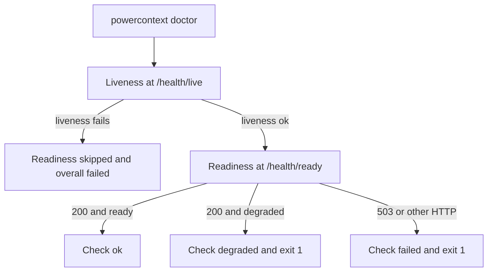
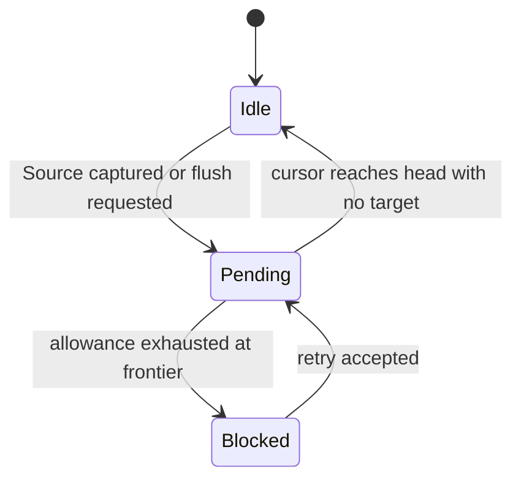

# Troubleshooting and Recovery Runbook

This runbook tells an operator or agent which command reports which state, how to read each readiness outcome, why background processing may look delayed, and how to recover Topic Memory processing and schema migrations. Commands are spelled as the source defines them. Read the outcome from the response body or the JSON `status` field, not only from the exit code.

## Which command reports which state

| Question | Command or endpoint | What it reports | Source |
| --- | --- | --- | --- |
| Is the installed package and the selected Server usable? | `powercontext doctor` | Package, Server liveness and Server readiness as `ok`, `degraded`, `failed` or `skipped` | [system.py](repo://src/powercontext/cli/system.py#L270-L342) |
| Is the Server process answering? | `GET /health/live` | Liveness only; it never checks dependencies | [app.py](repo://src/powercontext/server/app.py#L1747-L1748) |
| Are the Server's bindings ready? | `powercontext ready` or `powercontext --json ready` | The `GET /health/ready` body: aggregate `status` and per-dependency `checks` | [client/cli.py](repo://src/powercontext/client/cli.py#L628-L630) |
| What behavior does the remote Server enable? | `powercontext capabilities` | The `/v1/capabilities` contract, including Context versions and memory-extraction state | [client/cli.py](repo://src/powercontext/client/cli.py#L594-L597) |
| Is a configuration file valid before start? | `powercontext config validate --env-file <path>` (default `.env`) | Syntax, configured model adapters and Server settings, with no Server contacted | [config.py](repo://src/powercontext/cli/config.py#L433-L449) |
| Is the personal service registered and live? | `powercontext service status` (add `--json` for JSON) | Registration, definition, manager ownership, manager state and liveness; exits 1 unless `ok` | [service/cli.py](repo://src/powercontext/service/cli.py#L121-L136) |
| Is Topic Memory processing pending or blocked? | `POST /v1/topic-memory/processing/status` | `idle`, `pending` or `blocked`, with the cursor, head and any retained block | [http operations](repo://src/powercontext/http/_generated/operations.py#L1769-L1791) |
| Is a database schema current? | `db-migrate status`, `db-migrate verify` | Schema version and readiness of the database, without creating control tables | [database_migration.py](repo://src/powercontext/server/database_migration.py#L85-L115) |
| Is the processing schema ready for a Server? | `processing-migrate --action plan`, `verify`, `apply` | Offline artifact-processing migration plan, verification or apply | [server/cli.py](repo://src/powercontext/server/cli.py#L132-L160) |

`powercontext ready` and `powercontext doctor` are the two entry points most often used. `doctor` combines liveness and readiness, while `ready` returns the readiness body directly.

With no names and no server option, `doctor` checks the saved agent connections when any exist, and otherwise checks the package and the Server. Explicit names such as `powercontext doctor codex` select host integrations, and `--server-url` cannot be combined with agent names. The doctor function and its status helpers implement that selection (see the sources above).

Caption: the order `doctor` uses to classify Server health. Readiness is only attempted after liveness succeeds.

## Doctor outcomes

`doctor` collects one diagnostic per check. The overall status uses this precedence: `failed`, then `degraded`, then `skipped`, then `ok`. The command exits 1 unless the overall status is `ok` (see [system.py](repo://src/powercontext/cli/system.py#L1003-L1008)). A `degraded` readiness result is therefore not a complete diagnostic success.

For the Server, the checks run in this order:

- If the Server URL cannot be resolved, the liveness result is `failed` and readiness is `skipped` ([server_diagnostics](repo://src/powercontext/cli/system.py#L392-L431)).
- If liveness fails, readiness is `skipped` with the detail "not checked because Server liveness failed".
- Readiness is read from `/health/ready`. HTTP 200 with `ready` is `ok`, HTTP 200 with `degraded` is `degraded`, and HTTP 503 or any other shape is `failed` ([_server_readiness_diagnostic](repo://src/powercontext/cli/system.py#L953-L975)).
- Insecure remote HTTP that has been explicitly allowed is reported as `degraded`, because credentials and content are not encrypted in transit.

## Readiness outcomes

### Dependency checks

Each dependency probe returns one check value. The values are defined by `ReadinessCheckStatus`: `ready`, `unavailable`, `timeout` and `misconfigured` ([readiness.py](repo://src/powercontext/builtin/runtime/readiness.py#L37-L44)). A probe converts its operation into one of these values:

- A success becomes `ready`.
- A timeout becomes `timeout`. The default probe timeout is 2.0 seconds.
- An `InferenceConfigurationError` becomes `misconfigured`. The detail is a stable code, never the error message; the reason is shown as `misconfigured: <code>` when the code is present ([dependency_readiness_probe](repo://src/powercontext/builtin/runtime/readiness.py#L255-L283)).
- Any other exception becomes `unavailable`.

The Runtime registers a blocking `database` probe that calls `ping`. Inference probes for generation, rerank, decision and embedding are non-blocking and are added only when configured ([composition.py](repo://src/powercontext/builtin/runtime/composition.py#L747-L765)).

Probe results can be cached. `CachedReadinessProbe` keeps a result for 300 seconds, except `timeout` and `unavailable`, which expire after 30 seconds. Concurrent refreshes share one probe run ([CachedReadinessProbe](repo://src/powercontext/builtin/runtime/readiness.py#L211-L251)).

### Aggregate status

`RuntimeReadinessChecks.run` returns one of three aggregate statuses ([readiness.py](repo://src/powercontext/builtin/runtime/readiness.py#L180-L195)):

- `not_ready` when any blocking check is not `ready`.
- `degraded` when every blocking check is `ready` but some non-blocking check is not `ready`.
- `ready` when every check is `ready`.

`Runtime.readiness()` then applies the artifact-processing Supervisor. If the Supervisor reports `degraded`, the aggregate is forced to `not_ready`. The response also includes `runtime`, `artifact_processing_supervisor`, and one `artifact_processing.<family>` entry for each family ([application.py](repo://src/powercontext/builtin/runtime/application.py#L4551-L4575)).

### HTTP mapping

`GET /health/ready` maps the aggregate to HTTP status ([app.py](repo://src/powercontext/server/app.py#L1751-L1770)):

- `ready` returns HTTP 200.
- `degraded` returns HTTP 200.
- `not_ready` returns HTTP 503. This also happens when `authentication_provider` or `access_provider` reports `not_ready`, even if the Runtime itself is ready.

Two further cases matter for diagnosis. If no Runtime is bound, the Server returns `not_ready` with the check `runtime: not_ready`. If the readiness callable itself raises, the Server returns `not_ready` with `runtime: unavailable` ([_ServerReadinessProbe._check](repo://src/powercontext/server/factory.py#L834-L846)).

The Server publishes readiness to metrics as well. A background task re-runs the readiness observer every 30 seconds ([factory.py monitor](repo://src/powercontext/server/factory.py#L800-L832)).

### Branch summary

| Status returned | HTTP | Meaning | Operator action |
| --- | --- | --- | --- |
| `ready` | 200 | Every blocking and non-blocking check is `ready`, and the processing Supervisor is not degraded | No action needed |
| `degraded` | 200 | A non-blocking dependency, usually inference, is not `ready`; database-backed operations remain available | Fix the named inference check, then wait for the cache or restart the Server |
| `not_ready` | 503 | A blocking dependency such as the database failed, the Supervisor is degraded, access or authentication is not ready, or the Runtime could not be checked | Inspect the named check and the Server log before retrying |

The wording "unavailable" appears in two places. As a dependency check value, it means the probe raised an error. As a whole-readiness outcome, it appears only as the `runtime: unavailable` check on `not_ready`.

## Degraded and failure causes

| Symptom | Cause the code reports | Recovery |
| --- | --- | --- |
| `degraded` with HTTP 200 and an `inference.*` check of `unavailable`, `timeout` or `misconfigured` | A configured generation, embedding, rerank or decision provider failed its probe | Correct the provider endpoint or credentials. Restart the Server to apply static configuration immediately, or wait for the cached result to expire |
| `not_ready` with HTTP 503 and `database` not `ready` | The blocking database `ping` failed or timed out | Restore database reachability. Do not infer write capability: the probe runs `ping`, not writes |
| `not_ready` with `artifact_processing_supervisor: degraded` | A processing family failed scope discovery, which marks the Supervisor degraded | Read the Supervisor failure in the Server log; the family recovers after a successful discovery |
| `not_ready` with `authentication_provider` or `access_provider` not ready | Access control or the authentication provider is not ready, even when the Runtime is ready | Check the authentication and access configuration. Do not clear authentication variables to bypass the error |
| Server startup refuses to proceed with `ProcessingSchemaNotReadyError` | The processing schema is legacy or incomplete | Run the processing migration described below |
| Service `ok` is false | Registration, definition, manager ownership, manager state or liveness is not in its expected state | Read the fields in `service status --json` and follow the recovery action it names |

Supervisor degradation is the case most often mistaken for a dependency failure. The Supervisor is degraded only when a family has failed discovery and the Supervisor holds leadership, and then the whole Server reports `not_ready` ([artifact_processing.py status](repo://src/powercontext/builtin/runtime/artifact_processing.py#L587-L594); [discovery failure](repo://src/powercontext/builtin/runtime/artifact_processing.py#L889-L906)).

## Service state

`ServiceStatus.ok` is true only when all six conditions hold: the platform is supported, the registration is installed, the definition is current, manager ownership is owned, the manager is active, and the Server is live ([model.py](repo://src/powercontext/service/model.py#L280-L289)). `powercontext service status` exits 1 when `ok` is false ([service/cli.py](repo://src/powercontext/service/cli.py#L121-L136)).

Liveness and readiness are probed separately for a registered endpoint ([probe.py](repo://src/powercontext/service/probe.py#L80-L106)):

- A readiness HTTP 503, or a `not_ready` body, is reported as `unreachable` with the detail "required Server bindings are not ready".
- A `degraded` body is reported as live, with the readiness detail `readiness=degraded`.
- A listener that answers with the wrong media type, an invalid body or an unexpected HTTP status is reported as `conflict`, which points to a port that is used by something other than PowerContext.

`powercontext service start` and `powercontext service restart` run through the same lifecycle path. `start` is documented as checking business readiness after the owned Server starts ([service/cli.py lifecycle](repo://src/powercontext/service/cli.py#L161-L175)).

Service mutations are serialized. `ServiceController.mutation` takes an in-process lock and an OS lock file, and it rejects a second operation that cannot acquire the lock within the timeout ([controller.py mutation](repo://src/powercontext/service/controller.py#L150-L170)).

## Background processing delays

A Scope in the artifact-processing Supervisor is always in one of a small set of states. These states come from the scheduler observation, not from any model call ([artifact_processing.py observations](repo://src/powercontext/builtin/runtime/artifact_processing.py#L676-L700)):

| State | Reason | What it means |
| --- | --- | --- |
| `running` | `executing` | A Worker is processing this Scope |
| `queued` | `waiting_capacity` | The Scope waits because every Worker slot for the binding is busy |
| `queued` | `waiting_dispatch` | The Scope is queued and has a free slot but has not been dispatched |
| `retry_wait` | `retry_backoff` | A previous attempt failed and the next attempt is scheduled |
| `blocked` | `policy_block` | A retained block stops automatic retries; an explicit recovery step is needed |
| `idle` | `waiting_schedule` or `idle` | No work is pending; the next scheduled check is shown when one exists |

The timing constants that shape these delays are in the same module ([constants](repo://src/powercontext/builtin/runtime/artifact_processing.py#L90-L103)):

- A failed attempt waits 30 seconds before the first retry, doubling up to a cap of 1800 seconds.
- Each binding carries a `worker_timeout_seconds` value, which defaults to 600 seconds. Use it as the upper bound on one Worker attempt when judging a long `running` state.
- Scope discovery is bounded to 2 seconds per run. A discovery failure marks the family degraded and retries discovery on the next tick.

Retries are admitted from the retry queue only when the deadline has passed and the Scope is neither running nor queued, and each channel has a bounded allowance ([activate retries](repo://src/powercontext/builtin/runtime/artifact_processing.py#L1088-L1099)). A retry queue entry is therefore delayed by backoff, not lost.

Two conditions look like delay but are not. A `degraded` Supervisor makes readiness `not_ready` while the work itself continues in the background. A `blocked` Scope will not retry automatically; it needs the Topic Memory recovery below.

## Topic Memory recovery

Topic Memory processing has a durable frontier per Scope. Its status reports `blocked` when a retained block exists, `idle` when the cursor has reached the head with no target, and `pending` otherwise ([topic_memory_recovery.py status](repo://src/powercontext/builtin/runtime/topic_memory_recovery.py#L39-L80)).

Caption: the Topic Memory processing states as the status and retry paths define them.

### How a block is created

A block is recorded only when the frontier's work budget is exhausted and there is work beyond the cursor. The observation is idempotent per attempt: a second read for the same attempt returns the same block ([observe_topic_memory_block](repo://src/powercontext/builtin/persistence/topic_memory_recovery.py#L50-L120)).

The budget limits are server-owned and shared by all attempts at the same cursor: 3 attempts, 512 provider requests and 64,000,000 tokens ([budget constants](repo://src/powercontext/builtin/persistence/topic_memory_budget.py#L41-L51)). `exhausted_reason` decides which code is recorded ([exhausted_reason](repo://src/powercontext/builtin/persistence/topic_memory_budget.py#L60-L80)):

- A recorded rejection that is not recoverable ends the frontier immediately and becomes the block code.
- The recoverable rejections are `related_history_limit`, `invalid_topic_placeholder` and `invalid_topic_coordination_content`. They spend the attempt and provider ceilings, and are recorded as diagnosis, but they do not end the frontier by themselves.
- When the attempt ceiling is reached, the block code is the recurring rejection, or `window_attempt_limit` if none was recorded.
- When the request or token ceiling is reached, the block code is `window_provider_budget_exceeded`.

### Inspect and retry

The HTTP operations are `POST /v1/topic-memory/processing/status`, `POST /v1/topic-memory/processing/blocks/get` and `POST /v1/topic-memory/processing/retry` ([operations](repo://src/powercontext/http/_generated/operations.py#L1769-L1843); [route registration](repo://src/powercontext/server/app.py#L1644-L1644)). The retry operation declares 200, 404, 409, 422, 503 and 500 responses. Its 200 response covers duplicate acceptance.

Retry is an explicit grant of one new allowance for an observed block. The persistence layer ([retry_topic_memory_block](repo://src/powercontext/builtin/persistence/topic_memory_recovery.py#L161-L214)) does the following under locks:

- Returns the block unchanged when `retried_at` is already set. This is what makes a repeated retry safe.
- Refuses with a conflict when the current attempt, cursor or recorded code no longer matches the block. A conflict means the frontier has moved, so the block must be read again.
- Deletes the exhausted budget row, requests a pending flush for the binding, creates an intent, and records `retried_at`.

The runtime adds two checks around this ([application.py retry](repo://src/powercontext/builtin/runtime/application.py#L4051-L4085)). If Topic Memory processing is not configured, a retry is accepted only for a block that was already retried; otherwise the request fails as unavailable. After a successful acceptance, the Supervisor is woken for the binding. A wake failure is logged and does not undo the accepted retry.

Recovery steps for a `blocked` Scope:

1. Call the status endpoint and note `block.error_code`, `block.block_id`, `attempts`, `requests` and `tokens`.
2. If the code is a provider or content rejection, correct the cause first (model, provider credentials, or the content that produced the rejection). A retry without a fix spends the next allowance on the same failure.
3. Call the retry endpoint with the block identity. Accept `status: accepted` as the outcome of one durable grant. Do not loop on retry.
4. Read the status again. The state moves to `pending` once the budget row is removed, and returns to `blocked` only if a new budget is exhausted.

## Migrations and schema recovery

### Startup gate

At bootstrap, the processing schema must be either a fresh current schema or a complete marker. `bootstrap_processing_schema` raises `ProcessingSchemaNotReadyError` for three kinds of state: legacy processing columns, missing processing tables, or existing processing data that requires an offline migration ([bootstrap_processing_schema](repo://src/powercontext/builtin/persistence/processing_migration.py#L154-L186)). The bootstrap must run before any API, domain initializer or Worker writes.

### Processing migration

The `processing-migrate` command in the Server CLI has three actions: `plan`, `apply` and `verify`. `apply` requires `--maintenance-confirmed`, which means the operator has stopped old background candidates, Workers, writes and explicit triggers. The command accepts a `--migration-id` (default `rfc1515`) that identifies a resumable run, and a `--batch-size` of 1 to 10000 rows per step ([processing_migrate](repo://src/powercontext/server/cli.py#L132-L160)).

For managed storage, the command delegates to the database migration runner. For other storage it uses an internal maintenance path. A database that already has the Server identity table but no `pc_schema_revision` table is rejected with `migration_required`, and the operator is told to complete the registered full Server upgrade before partial maintenance ([_managed_storage](repo://src/powercontext/server/cli.py#L233-L258)).

Run the sequence in this order: `processing-migrate --action plan`, review the plan, stop the old writers and Workers, run `processing-migrate --action apply --maintenance-confirmed`, then run `processing-migrate --action verify`. A failed apply is resumed with the same `--migration-id`.

### Database migration commands

The `db-migrate` group provides `status`, `verify`, `plan` and `apply` ([database_migration.py](repo://src/powercontext/server/database_migration.py#L85-L154)). `status` inspects the schema version without creating a database or control tables. `verify` checks database readiness, but it does not assert that the Server or the cluster is ready. Run `plan` before `apply`.

The Topic Memory recovery migration is a separate, versioned, offline conversion. It converts work budgets and retained retry evidence using a frozen schema resource ([topic memory recovery migration](repo://src/powercontext/builtin/persistence/migrations/topic_memory_recovery.py#L1-L20); [schema resource](repo://src/powercontext/builtin/persistence/topic_memory_recovery_schema.py#L33-L33)). Other domain tables are covered by the database recovery point, not verified by this task.

### OceanBase identity collation

An older deployment may use a case-insensitive collation such as `utf8mb4_general_ci` for opaque identity columns. The current Server refuses to start when it finds such a mismatch, and the error lists each `table.column`. Do not alter these columns in place. Follow the documented procedure: stop writers, take and verify a backup, export the data without DDL, create a new empty database so the current release creates the tables with `utf8mb4_bin`, import the data in four ordered layers, then compare row counts and identity collations before accepting writes. See the full steps in [troubleshoot.md](repo://docs/en/docs/operate/troubleshoot.md). If records were merged by the old collation, a schema change cannot reconstruct them.

## Ops tool recovery

The Ops tool is a non-interactive boundary for a personal Server. Its requests are `inspect`, `config_validate`, `preflight`, `apply`, `resume`, `operation_status` and `cancel`. Its operations are `register`, `start`, `stop`, `restart`, `remove_registration`, `config_apply`, `install` and `repair` ([protocol.py](repo://src/powercontext/ops/protocol.py#L26-L36)). `apply` requires an authorization whose `plan_id` matches the approved plan, and the protocol rejects any other authorization with `authorization_required` ([authorize](repo://src/powercontext/ops/protocol.py#L228-L232)).

For a lost response or an interrupted mutation, query `operation_status` first. Do not repeat the mutation automatically. The Ops reference documents three execution states: `finished` when a final result is saved, `interrupted` when an unfinished attempt's executor has exited, and `unknown` otherwise. A present process identifier is not proof that the executor is still running. While a previous native command may be alive, new mutations, including stop and removal, remain blocked ([local-server-ops.md](repo://docs/en/docs/operate/local-server-ops.md)).

## Host integration diagnostics

The Codex, Claude Code, DSH, OpenClaw, Pi and Hermes integrations are fail-open. A PowerContext outage does not block the host task. Recall failures are reported through each host's supported channel as one content-free event. The stable outcomes are `authentication_failed`, `version_mismatch`, `server_unavailable` and `invalid_response`, and `empty` is only a local diagnostic ([troubleshoot.md](repo://docs/en/docs/operate/troubleshoot.md)). A `version_mismatch` means the installed plugin expects `POST /v1/context/prepare` but the Server does not provide it; reinstall the plugin and tool from the same ref and restart the Server.

## Focused tests

These tests describe the intended behavior of the paths above. Run them before changing the corresponding code:

- [test_runtime_readiness_observations.py](repo://tests/test_runtime_readiness_observations.py#L30-L66) distinguishes disabled, unobserved and observed readiness snapshots.
- The same file checks that cached probes refresh only on cache misses, bounds probe failure details, and preserves cancellation ([cached and bounded outcomes](repo://tests/test_runtime_readiness_observations.py#L68-L146)).
- [test_service_runtime_repair.py](repo://tests/test_service_runtime_repair.py#L32-L60) checks that an interrupted runtime repair is guarded and resumes without starting the service. Another test checks that repair does not clear database maintenance ([test_service_runtime_repair.py](repo://tests/test_service_runtime_repair.py#L80-L96)).

## Related pages

- [Deployment](deployment.md) covers how the Server, its database and its services are configured and started.
