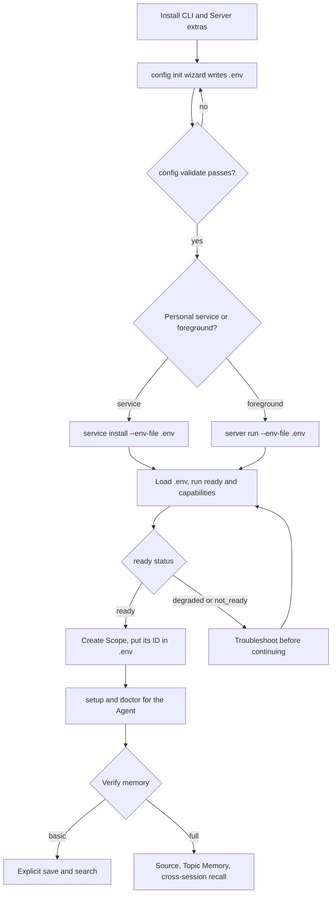
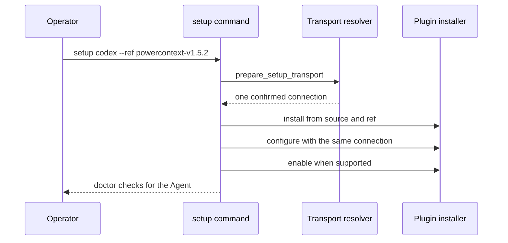

# PowerContext Quickstart and Task Router

This page is the entry point for an AI coding agent working on or with PowerContext. It gives the shortest correct path from installation to a verified memory check, states the conditions that change each step, and routes you to the deeper page for each task. It does not repeat the full reference material; follow the links for that.

The commands and defaults below are for PowerContext `1.5.2`, the version the current installation guides use ([install and run](../docs/en/docs/get-started/install-and-run.md#L147), [quickstart](../docs/en/docs/get-started/quickstart.md#L8)). The Agent integration tag must match the package version (`powercontext-v1.5.2`).

## Start here: the path in one view



Onboarding path. Steps A to C only write files. Step D has two alternatives, and the foreground run is also the fallback when no user service manager is available. Step G must return `ready` before a Scope is created; `degraded` is a warning, not success.

Steps A to C only write files. The wizard can start a background SeekDB package install when embedded SeekDB was selected and its dependency is missing, and then it waits for that install to finish before it exits ([config wizard](../src/powercontext/cli/config_wizard.py#L326-L345), [finish step](../src/powercontext/cli/config_wizard.py#L1206-L1225)). It does not start the Server or create a Scope, and an Agent plugin is only installed by the separate `setup` command.

## Task router

Pick the row that matches your task. Each deeper page is the source of truth for its topic.

| Task | Start with | Deeper page |
| --- | --- | --- |
| Install the CLI and Server | Section 1 below | [Install, Configure, Start and Verify](workflows/install-and-verify.md) |
| Configure the Server, client and Scope IDs | `powercontext config init`, then Section 2 | [Configuration Settings Reference](concepts/configuration-settings.md) |
| Start a personal Server or a foreground Server | Section 3 | [Server Deployment](operations/deployment.md) |
| Connect a Codex, Claude Code or other Agent | Section 5 | [Codex Plugin Integration](integrations/codex-plugin.md), [Claude Code Plugin Integration](integrations/claude-code-plugin.md), [Other Host Adapters](integrations/host-adapters.md) |
| Connect the DeepSeek Harness (DSH) | Section 5, `setup dsh` | [DSH Plugin](integrations/dsh-plugin.md) |
| Use the desktop app (preview) | Not required for the CLI path | [Desktop App (Tauri Preview)](architecture/desktop-app.md) |
| Verify memory (basic or full) | Section 6 | [Memory, Handoff and Continuity Across Sessions](workflows/memory-and-handoff.md), [Prepare Context and Recall](workflows/prepare-and-recall.md) |
| Debug a failure | Section 7 | [Troubleshooting and Recovery Runbook](operations/troubleshooting.md) |
| Integrate with code or a host | [Capability Matrix](integrations/capability-matrix.md) | [HTTP and MCP API Surface](architecture/http-and-mcp-api.md), [Python Client, CLI and Transports](architecture/client-cli-and-transports.md), [Framework and Platform Adapters](integrations/framework-adapters.md) |
| Operate the Server over time | Section 8 | [Observability](operations/observability.md), [Database Migrations and Portable Archives](operations/migrations-and-archives.md) |
| Change or test the code | [Source Map](architecture/source-map.md) | [Test Map and Verification Guide](testing/test-map.md) |

### Every section page

Use these when a task spans several domains. Each link goes to one top-level page.

**Architecture**
- [PowerContext System Overview](architecture/system-overview.md)
- [Source Map](architecture/source-map.md)
- [PowerContext Server Runtime](architecture/server-runtime.md)
- [Python Client, CLI and Transports](architecture/client-cli-and-transports.md)
- [HTTP and MCP API Surface](architecture/http-and-mcp-api.md)
- [Persistence and Storage Backends](architecture/persistence-and-storage.md)
- [Rust Gateway (Model Traffic Boundary)](architecture/gateway.md)
- [Desktop App (Tauri Preview)](architecture/desktop-app.md)

**Concepts**
- [Artifact Families, Revisions and Handles](concepts/artifact-families.md)
- [Configuration Settings Reference](concepts/configuration-settings.md)
- [Context and Inference Protection](concepts/context-protection.md)
- [Scopes and Access Control](concepts/scopes-and-access.md)
- [Sources and Background Processing](concepts/sources-and-processing.md)

**Workflows**
- [Install, Configure, Start and Verify](workflows/install-and-verify.md)
- [Memory, Handoff and Continuity Across Sessions](workflows/memory-and-handoff.md)
- [Prepare Context and Recall](workflows/prepare-and-recall.md)
- [Atomic Memory Lifecycle](workflows/atomic-memory.md)
- [Topic Memory Lifecycle](workflows/topic-memory.md)
- [Experience, Candidate Review and Skill Lifecycle](workflows/experience-and-skill-lifecycle.md)

**Integrations**
- [Agent Integration Capability Matrix](integrations/capability-matrix.md)
- [Codex Plugin Integration](integrations/codex-plugin.md)
- [Claude Code Plugin Integration](integrations/claude-code-plugin.md)
- [DSH Plugin (DeepSeek Harness)](integrations/dsh-plugin.md)
- [Framework and Platform Adapters](integrations/framework-adapters.md)
- [Other Host Adapters](integrations/host-adapters.md)

**Operations**
- [Server Deployment](operations/deployment.md)
- [Database Migrations, Data Migration and Portable Archives](operations/migrations-and-archives.md)
- [Observability, Metrics and Tracing](operations/observability.md)
- [Troubleshooting and Recovery Runbook](operations/troubleshooting.md)

**Testing**
- [Test Map and Verification Guide](testing/test-map.md)

## Prerequisites

- macOS or Linux is the supported path. Windows support is `experimental`, and embedded seekdb is unavailable there ([install and run](../docs/en/docs/get-started/install-and-run.md)).
- Python 3.11 or newer, Git, and [uv](https://docs.astral.sh/uv/getting-started/installation/).
- An Agent CLI such as Codex CLI if you connect an Agent.
- For full memory, working Generation and Embedding model APIs (base URL, model name, API key). A subscription login to an Agent does not give the Server those APIs.

## 1. Install

Install the CLI and the local Server extras with one version, then keep the Agent integration on the matching tag:

```bash
uv tool install --force "powercontext[cli,server]==1.5.2"
powercontext --version
```

The CLI root decides which command providers to expose. The `server` and `service` providers are loaded only when the requirements of their role are installed: `_OPTIONAL_COMMAND_ROLES` maps `powercontext.server.cli:app` and `powercontext.service.cli:app` to the `server` role, and `_role_available` returns `False` when a declared requirement is missing or outside its specifier ([app.py](../src/powercontext/cli/app.py#L35-L61)). Providers come from the `powercontext.cli` entry-point group, and a provider whose command name is already registered is rejected ([app.py](../src/powercontext/cli/app.py#L69-L96), [app.py](../src/powercontext/cli/app.py#L157-L163)). A `cli`-only install therefore does not expose `server` or `service`. The `cli` extra provides `setup`, `doctor` and the remote content commands. The `server` extra provides `server run` and the `service` commands ([pyproject.toml](../pyproject.toml#L41-L101)). The installer script documented for macOS, Linux and Windows supports `--version`, `--region` and `--host` ([install and run](../docs/en/docs/get-started/install-and-run.md)).

## 2. Configure with the wizard

```bash
mkdir -p ~/powercontext-demo && cd ~/powercontext-demo
powercontext config init --language en --output .env
```

`config init` runs the guided wizard unless `--template` is given. Its flags are `--output`/`-o` (default `.env`), `--language`/`-l`, `--advanced` and `--template` ([config.py](../src/powercontext/cli/config.py#L358-L390)). The wizard asks about storage, usage scenario, memory capabilities, models, Dashboard and access, background processing, and Agents. When you confirm, it writes two files:

| File | Contents |
| --- | --- |
| `.env` | Server, client, Agent, database and model settings, including credentials |
| `.env.next-steps.md` | Startup, Scope creation, plugin connection and checks for your choices |

Facts that matter when you use the wizard:

- Both files are built in one bundle, then saved only after you confirm. Before saving, the wizard checks that each output file is unchanged since the bundle was built, and refuses to save if one changed ([config_wizard.py](../src/powercontext/cli/config_wizard.py#L1160-L1204)).
- Writes use an atomic replace with mode `0600`. An existing file is kept as a timestamped `.bak-*` backup ([config.py](../src/powercontext/cli/config.py#L716-L733)).
- Template mode is `powercontext config init --template --output .env`. It writes the model-free template. If the output exists, it fails unless `--force` is given. It also refuses to write when a Unix socket (UDS) configuration is present, because the template supports TCP listeners only ([config.py](../src/powercontext/cli/config.py#L372-L390)).
- A fresh local setup suggests port `17429` (`SUGGESTED_SERVER_PORT` in [config_wizard.py](../src/powercontext/cli/config_wizard.py#L59)), but the runtime default port is `8000`. Always check `POWERCONTEXT_SERVER_HTTP_PORT` in the saved file, not the runtime default.

Validate the file before starting anything:

```bash
powercontext config validate --env-file .env
powercontext config show --env-file .env
```

`config validate` always checks the Server settings and the built-in runtime settings. It runs the model-adapter validation only when the file holds a complete generated configuration or managed metadata ([config.py](../src/powercontext/cli/config.py#L433-L448)). It does not check the running service. `config show` prints the effective assignments and replaces credentials with `<redacted>`, both for recognized secret names and for names the file records as credentials ([config.py](../src/powercontext/cli/config.py#L415-L431)).

### Settings that decide what you get

Setting names follow the code exactly. Unset values fall back to the default listed here. The full reference, with every variable, is [Configuration Settings Reference](concepts/configuration-settings.md).

| Setting | Default when unset | Effect |
| --- | --- | --- |
| `POWERCONTEXT_SERVER_HTTP_HOST` | `127.0.0.1` | Listener address. Dashboard, HTTP API and MCP share it. |
| `POWERCONTEXT_SERVER_HTTP_PORT` | `8000` | Listener port (valid range `1` to `65535`). |
| `POWERCONTEXT_SERVER_MCP_ENABLED` | `true` | Enables the MCP projection at `POWERCONTEXT_SERVER_MCP_PATH`, default `/mcp`. |
| `POWERCONTEXT_SERVER_DASHBOARD_ENABLED` | `false` | Dashboard is off until enabled. |
| `POWERCONTEXT_SERVER_ACCESS_MODE` | `disabled` | `enforced` requires an authentication provider (see Section 3). |
| `POWERCONTEXT_SERVER_AUTH_TOKEN` | unset | Legacy static bearer token. Used when access is enforced and no identity map is set. |
| `POWERCONTEXT_SERVER_DATABASE_URL` / `POWERCONTEXT_SERVER_DATABASE_KIND` | SQLite file in the user data directory | Storage backend selection. |
| `POWERCONTEXT_SERVER_INFERENCE_GENERATION_MODEL` | unset (no Generation model) | Enables LLM-backed extraction and generation. |
| `POWERCONTEXT_SERVER_INFERENCE_EMBEDDING_MODEL` | unset (no Embedding model) | Enables semantic retrieval. |
| `POWERCONTEXT_SERVER_RUNTIME_SCHEDULE_SECONDS` | unset (no scheduled Memory pipeline) | Interval for the scheduled Memory pipeline. |
| `POWERCONTEXT_CLIENT_SERVER_URL` | `http://127.0.0.1:8000` | Server URL used by the CLI and Agent connections. |
| `POWERCONTEXT_CLIENT_TIMEOUT` | `10` seconds | Client request timeout. |
| `POWERCONTEXT_CODEX_SCOPE_ID` / `POWERCONTEXT_CLAUDE_SCOPE_ID` | unset | Scope bound to a host. Set it to a real returned ID, not a planned title. |

Defaults come from the Server settings model: the listener in [HttpConfig](../src/powercontext/server/settings.py#L114-L124), MCP in [McpConfig](../src/powercontext/server/settings.py#L140-L146), the Dashboard in [DashboardConfig](../src/powercontext/server/settings.py#L186-L190) and access in [AccessControlConfig](../src/powercontext/server/settings.py#L192-L197). The Server reads the `POWERCONTEXT_SERVER_` prefix with `_` as the nested delimiter, so `POWERCONTEXT_SERVER_RUNTIME_SCHEDULE_SECONDS` maps to `runtime.schedule_seconds` ([settings.py](../src/powercontext/server/settings.py#L237-L268)). The client settings model is in [client/settings.py](../src/powercontext/client/settings.py#L22-L57). The wizard's and the template's base values are in [`_BASE_ENVIRONMENT`](../src/powercontext/cli/config.py#L181-L215).

Refusals at startup, which you must resolve in the configuration:

- **Unauthenticated non-loopback bind.** The Server refuses to bind an unauthenticated listener to a non-loopback host unless `POWERCONTEXT_SERVER_ALLOW_UNAUTHENTICATED_NON_LOOPBACK=true` is set or access is enforced ([settings.py](../src/powercontext/server/settings.py#L103-L113), [validator](../src/powercontext/server/settings.py#L389-L427)). The check is skipped when a Unix socket listener is configured, and for a background-role process that has metrics disabled. The Docker image sets the opt-in by default ([Dockerfile](../docker/Dockerfile#L36-L57)).
- **Access enforced with no token.** Enforced access without a token, and without an injected identity provider, is refused when the Server builds its security providers, not when the settings are validated. The CLI reports it as a bad parameter ([factory.py](../src/powercontext/server/factory.py#L570-L584), [server/cli.py](../src/powercontext/server/cli.py#L898-L899)).
- **Token while access is disabled, or enforced Dashboard without a token.** The settings validator rejects `AUTH_TOKEN` when access is disabled, and rejects an enforced Dashboard with no token ([settings.py](../src/powercontext/server/settings.py#L389-L427)).

## 3. Start the Server

Two equivalent ways. Choose the personal service for a Server that keeps running after you close the terminal, and the foreground command for development, debugging, or systems without a user-service manager.

**Personal service** (Linux needs an available `systemd --user` manager):

```bash
powercontext service install --env-file .env
powercontext service status
```

`service install` installs or updates the current user's Server registration and preserves an explicit stop. On macOS and Linux, login auto-start is on by default; on Windows the command asks unless `--start-on-login` or `--no-start-on-login` is given. `--no-start-on-login` is refused outside Windows ([service/cli.py](../src/powercontext/service/cli.py#L49-L119)). If the registration was left inactive or failed, the command reports that the service remains stopped and suggests `powercontext service start`. After editing `.env`, rerun `service install --env-file .env`. `service stop` stops the Server without deleting its configuration; `service status` exits non-zero when the service is not OK ([service/cli.py](../src/powercontext/service/cli.py#L121-L151)).

**Foreground** (stop the personal service first if it is running, because both would bind the same address):

```bash
powercontext server run --env-file .env
```

`server run` takes `--host`, `--port`, `--uds`, `--env-file`, `--no-env-file`, `--observability` and `--role` (`all`, `api` or `background`) ([server/cli.py](../src/powercontext/server/cli.py#L829-L883)). An explicit `--env-file` is used as given. Without it, the Server looks for `.env` in the current directory, unless `--no-env-file` is set; when no file is found it runs from process settings and defaults ([configuration.py](../src/powercontext/server/configuration.py#L136-L154)). Without any environment file or variables, the Server binds `127.0.0.1:8000`, enables MCP at `/mcp`, creates a default Scope, and uses a persistent SQLite database. It supports explicit Memory operations without an inference provider ([install and run](../docs/en/docs/get-started/install-and-run.md)).

## 4. Load client settings and check the service

Load the generated client settings into the terminal that starts your Agent, then run the remote checks:

```bash
set -a
. ./.env
set +a
powercontext ready
powercontext capabilities
```

`ready`, `live`, and `capabilities` are remote checks registered on the CLI root ([client/cli.py](../src/powercontext/client/cli.py#L2323-L2340)). `ready` calls the readiness endpoint and reports the result ([client/cli.py](../src/powercontext/client/cli.py#L628-L630)). On the Server side the readiness probe returns `not_ready` when the runtime is absent, when the runtime readiness check raises, and otherwise mirrors the runtime status as `ready`, `degraded`, or `not_ready`; the same probe is exposed at `/health/ready`, alongside `/health/live` ([factory.py](../src/powercontext/server/factory.py#L701-L752), [dashboard runtime](../src/powercontext/server/dashboard/runtime.py#L66-L67)).

The CLI diagnostic for readiness maps HTTP `200` with `ready` to OK, HTTP `200` with `degraded` to DEGRADED, and any other result to FAILED. The HTTP `503` case is therefore FAILED ([system.py](../src/powercontext/cli/system.py#L1077-L1098)). A `degraded` result means at least one configured capability needs attention. It is **not** a successful full-memory check. A `not_ready` result means runtime or database failures ([docker README](../docker/README.md#L26-L32)).

`powercontext doctor` with no arguments is a host-independent check. It reports the package version, then the Server liveness, readiness, and memory-protocol checks. If liveness fails, readiness and the memory-protocol check are SKIPPED ([system.py](../src/powercontext/cli/system.py#L494-L549)). It exits non-zero unless every check is OK (see the invariants).

## 5. Create a Scope and bind the Agent

A Scope is the isolation unit for Sources, Memory, Topic Memory, Handoffs and recall. Changing directories does not change the Scope. Read [Scopes and Access Control](concepts/scopes-and-access.md) before you share a Scope between Agents.

Create one with the request in `.env.next-steps.md`, or directly:

```bash
powercontext scope create --title "my-project" --summary "Scope for my project" --idempotency-key my-project-v1
```

`scope create` requires `--title` and `--summary`. Repeating the same `--idempotency-key` returns the same Scope. Without the flag, the command generates a random UUID key, so each call creates a new Scope ([client/cli.py](../src/powercontext/client/cli.py#L398-L426)). The Server returns the real `scope_id`, which is an opaque value. Put that value in `.env` as the matching `POWERCONTEXT_<AGENT>_SCOPE_ID` variable. The explicit names are `POWERCONTEXT_CODEX_SCOPE_ID`, `POWERCONTEXT_CLAUDE_SCOPE_ID`, `POWERCONTEXT_DSH_SCOPE_ID`, `POWERCONTEXT_OPENCODE_SCOPE_ID`, `POWERCONTEXT_PI_SCOPE_ID` and `POWERCONTEXT_LANGGRAPH_SCOPE_ID` ([config.py](../src/powercontext/cli/config.py#L216-L223)). The wizard's planned titles (`codex-<random>`) are labels, never IDs. Then reload `.env` and reinstall the service ([quickstart](../docs/en/docs/get-started/quickstart.md#L72-L77)).

Connect the Agent with the same version tag as the package:

```bash
powercontext setup codex --ref powercontext-v1.5.2
powercontext doctor codex
```

`setup` runs in this order. It validates authorization, resolves and confirms the endpoint once before any installation side effects, installs the plugin from the source and ref, configures the plugin's MCP and Hook connection with that same connection, and then enables it where the host supports activation. A failure before installation changes nothing ([installation.py](../src/powercontext/cli/installation.py#L146-L197), [transport.py](../src/powercontext/cli/transport.py#L68-L130)). The default ref is `master` ([system.py](../src/powercontext/cli/system.py#L55)), so pin the release tag as shown.



Caption: the `setup` order for one Agent. The endpoint is confirmed before the plugin is installed, and the same connection is used for configuration.

`doctor codex` checks installation, connection, and tool coverage. It does not check Hook trust, Hook execution or memory processing. For Codex, after the first `codex` start, open `/hooks` and grant trust. The Codex quickstart states that until trust is granted, `SessionStart` does not resolve the Scope and `UserPromptSubmit` does not run, so automatic capture and recall do not happen ([quickstart](../docs/en/docs/get-started/quickstart.md#L88-L92)). The plugin's `hooks.json` registers `SessionStart`, `PreToolUse`, `UserPromptSubmit` and `Stop` ([hooks.json](../integrations/codex/plugins/powercontext/hooks/hooks.json#L1-L55)). Host-specific details are in [Codex Plugin Integration](integrations/codex-plugin.md) and [Claude Code Plugin Integration](integrations/claude-code-plugin.md).

## 6. Verify memory

Pick the check that matches your configuration. A conversational reply from the Agent is not proof of a write. Check the stored record, its citation, or the Source in the Dashboard or through the CLI.

**Basic memory** (no Generation or Embedding model). Explicit save and retrieval work without a Server model. Ask the bound Agent to save a decision, note the record reference, then open a new session with the same Scope and search for it. This checks explicit save and recall only. It does not check automatic extraction or Topic Memory.

**Full memory** (Generation and Embedding configured, background processing scheduled). Send a concrete project decision, confirm that a Source appears in the bound Scope, wait for processing, send a related update, and confirm that Topic Memory reflects it. Then open a new session with the same Scope and ask for the decision with citations. Processing takes additional time after the inspection interval; a fixed wait is not a check. The model may merge evidence or decide that no update is needed.

Facts that keep these checks honest:

- Automatic processing needs a Generation model. Without one, the processing capability list is empty ([processing_registry.py](../src/powercontext/builtin/runtime/processing_registry.py#L47-L54)). The Server refuses to start a scheduled pipeline without one ([composition.py](../src/powercontext/builtin/runtime/composition.py#L2036-L2039), [processing bindings](../src/powercontext/builtin/runtime/composition.py#L1028-L1050)).
- Scheduled pipelines are off by default. The runtime schedule fields default to unset ([config.py](../src/powercontext/builtin/runtime/config.py#L256-L258), [topic-memory schedule](../src/powercontext/builtin/runtime/config.py#L273)). The legacy `schedule_seconds` is an alias for the memory schedule ([config.py](../src/powercontext/builtin/runtime/config.py#L86-L120)).
- The recommended schedule values (memory `60` seconds, topic-memory `300`, experience `900`, Profile cron `0 2 * * *` in `Asia/Shanghai`) are setup-tool recommendations. Runtime defaults remain disabled ([processing_registry.py](../src/powercontext/builtin/runtime/processing_registry.py#L38-L44)).

Use [Install, Configure, Start and Verify](workflows/install-and-verify.md) for the full acceptance table, and [Memory, Handoff and Continuity Across Sessions](workflows/memory-and-handoff.md) for the cross-session flow.

## 7. Debug

Find the symptom, run the command, then read the matching runbook section.

| Symptom | First command | Where to go next |
| --- | --- | --- |
| Wizard or config error | `powercontext config validate --env-file .env` | [Configuration Settings Reference](concepts/configuration-settings.md) |
| Server will not start, bind refused, token missing | `powercontext server run --env-file .env` (read the error) | [Server Runtime](architecture/server-runtime.md), [Troubleshooting](operations/troubleshooting.md) |
| Service registered but not running | `powercontext service status` | [Server Deployment](operations/deployment.md) |
| `ready` returns `degraded` or `not_ready` | `powercontext ready` | [Troubleshooting](operations/troubleshooting.md) |
| Agent tools missing or Hook not capturing | `powercontext doctor codex`, then `/hooks` in Codex | [Codex Plugin Integration](integrations/codex-plugin.md) |
| Memory never appears | Check the Source in the bound Scope, then processing state | [Sources and Background Processing](concepts/sources-and-processing.md) |
| Desktop app or DSH behaves differently from the CLI | Compare the URL, Scope and credentials each host receives | [Desktop App (Tauri Preview)](architecture/desktop-app.md), [DSH Plugin](integrations/dsh-plugin.md) |

## 8. Integrate and operate

- For code integration, read [HTTP and MCP API Surface](architecture/http-and-mcp-api.md) for the `/v1` routes and headers, and [Python Client, CLI and Transports](architecture/client-cli-and-transports.md) for the Client.
- For model traffic, see [Rust Gateway](architecture/gateway.md), which is optional.
- For containers and remote access, see the Docker notes in [docker/README.md](../docker/README.md). The image binds `0.0.0.0` inside the container and checks `GET /health/ready`. Keep the published host address on loopback unless authentication and TLS are in place. The image sets `POWERCONTEXT_SERVER_ALLOW_UNAUTHENTICATED_NON_LOOPBACK=true` by default ([Dockerfile](../docker/Dockerfile#L36-L57)).
- For storage, migrations and archives, read [Persistence and Storage Backends](architecture/persistence-and-storage.md) and [Database Migrations, Data Migration and Portable Archives](operations/migrations-and-archives.md) before any upgrade.
- For schema and code changes, read [Source Map](architecture/source-map.md) and [Test Map and Verification Guide](testing/test-map.md) so you change the right owner and run focused tests.

## Invariants to keep in mind

- Setup and config commands write files; they do not start, migrate or verify. Each step has its own check. The one exception is the optional background SeekDB package install during the wizard.
- Ready is not a memory check. `degraded` is returned with HTTP `200` but is a warning, not success.
- `doctor` with no arguments returns OK only when every check is OK. A SKIPPED `server_memory_protocol` check is ignored, but any SKIPPED or DEGRADED result from the other checks makes the exit code non-zero.
- A Scope is an opaque server ID. Never use a planned title or a directory name as a Scope.
- Credentials live in `.env` (mode `0600`) or the service environment. Do not commit them, and do not paste the token into logs.
