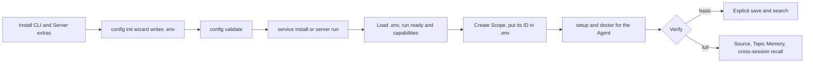

# PowerContext Quickstart and Task Router

This page is the entry point for an AI coding agent working on or with PowerContext. It gives the shortest correct path from installation to a verified memory check, states the conditions that change each step, and routes you to the deeper page for each task. It does not repeat the full reference material; follow the links for that.

The commands and defaults below are for PowerContext `1.5.0`, matching the installation guides in the repository (`docs/en/docs/get-started/install-and-run.md`, `../docs/en/docs/get-started/quickstart.md`).

## Start here: the path in one view



The wizard only writes files. Nothing in steps A to C starts a process, creates a Scope, or installs an Agent plugin. Those are separate steps, and each is checked separately.

## Task router

Pick the row that matches your task. Each deeper page is the source of truth for its topic.

| Task | Start with | Deeper page |
| --- | --- | --- |
| Install the CLI and Server | Section 1 below | [Install, Configure, Start and Verify](workflows/install-and-verify.md) |
| Configure the Server, client and Scope IDs | `powercontext config init`, then Section 2 | [Configuration Settings Reference](concepts/configuration-settings.md) |
| Start a personal Server or a foreground Server | Section 3 | [Server Deployment](operations/deployment.md) |
| Connect a Codex, Claude Code or other Agent | Section 4 | [Codex Plugin Integration](integrations/codex-plugin.md), [Claude Code Plugin Integration](integrations/claude-code-plugin.md), [Other Host Adapters](integrations/host-adapters.md) |
| Verify memory (basic or full) | Section 5 | [Memory, Handoff and Continuity Across Sessions](workflows/memory-and-handoff.md), [Prepare Context and Recall](workflows/prepare-and-recall.md) |
| Debug a failure | Section 6 | [Troubleshooting and Recovery Runbook](operations/troubleshooting.md) |
| Integrate with code or a host | [Capability Matrix](integrations/capability-matrix.md) | [HTTP and MCP API Surface](architecture/http-and-mcp-api.md), [Python Client, CLI and Transports](architecture/client-cli-and-transports.md), [Framework and Platform Adapters](integrations/framework-adapters.md) |
| Operate the Server over time | Section 7 | [Observability](operations/observability.md), [Database Migrations and Portable Archives](operations/migrations-and-archives.md) |
| Change or test the code | [Source Map](architecture/source-map.md) | [Test Map and Verification Guide](testing/test-map.md) |

### Every section page

Use these when a task spans several domains. Each link goes to one top-level page.

**Architecture**
- [PowerContext System Overview](architecture/system-overview.md)
- [Source Map](architecture/source-map.md)
- [PowerContext Server Runtime](architecture/server-runtime.md)
- [Python Client, CLI and Transports](architecture/client-cli-and-transports.md)
- [HTTP and MCP API Surface](architecture/http-and-mcp-api.md)
- [Persistence and Storage Backends](architecture/persistence-and-storage.md)
- [Rust Gateway (Model Traffic Boundary)](architecture/gateway.md)

**Concepts**
- [Artifact Families, Revisions and Handles](concepts/artifact-families.md)
- [Configuration Settings Reference](concepts/configuration-settings.md)
- [Context and Inference Protection](concepts/context-protection.md)
- [Scopes and Access Control](concepts/scopes-and-access.md)
- [Sources and Background Processing](concepts/sources-and-processing.md)

**Workflows**
- [Install, Configure, Start and Verify](workflows/install-and-verify.md)
- [Memory, Handoff and Continuity Across Sessions](workflows/memory-and-handoff.md)
- [Prepare Context and Recall](workflows/prepare-and-recall.md)
- [Atomic Memory Lifecycle](workflows/atomic-memory.md)
- [Topic Memory Lifecycle](workflows/topic-memory.md)
- [Experience, Candidate Review and Skill Lifecycle](workflows/experience-and-skill-lifecycle.md)

**Integrations**
- [Agent Integration Capability Matrix](integrations/capability-matrix.md)
- [Codex Plugin Integration](integrations/codex-plugin.md)
- [Claude Code Plugin Integration](integrations/claude-code-plugin.md)
- [Framework and Platform Adapters](integrations/framework-adapters.md)
- [Other Host Adapters](integrations/host-adapters.md)

**Operations**
- [Server Deployment](operations/deployment.md)
- [Database Migrations, Data Migration and Portable Archives](operations/migrations-and-archives.md)
- [Observability, Metrics and Tracing](operations/observability.md)
- [Troubleshooting and Recovery Runbook](operations/troubleshooting.md)

**Testing**
- [Test Map and Verification Guide](testing/test-map.md)

## Prerequisites

- macOS or Linux is the supported path. Windows support is `experimental`, and embedded seekdb is unavailable there (`../docs/en/docs/get-started/install-and-run.md`).
- Python 3.11 or newer, Git, and [uv](https://docs.astral.sh/uv/getting-started/installation/).
- An Agent CLI such as Codex CLI if you connect an Agent.
- For full memory, working Generation and Embedding model APIs (base URL, model name, API key). A subscription login to an Agent does not give the Server those APIs.

## 1. Install

Install the CLI and the local Server extras with one version, then keep the Agent integration on the matching tag:

```bash
uv tool install --force "powercontext[cli,server]==1.5.0"
powercontext --version
```

The `cli` extra provides `setup`, `doctor` and the remote content commands. The `server` extra provides `server run` and the `service` commands. The CLI root only loads the `server` and `service` command providers when their declared requirements are installed, so a `cli`-only install does not expose them (`../src/powercontext/cli/app.py`). An installer script is also documented for macOS, Linux and Windows; it supports `--version`, `--region` and `--host` flags (`../docs/en/docs/get-started/install-and-run.md`).

## 2. Configure with the wizard

```bash
mkdir -p ~/powercontext-demo && cd ~/powercontext-demo
powercontext config init --language en --output .env
```

The wizard asks about storage, usage scenario, memory capabilities, models, Dashboard and access, background processing, and Agents. When you confirm, it writes two files:

| File | Contents |
| --- | --- |
| `.env` | Server, client, Agent, database and model settings, including credentials |
| `.env.next-steps.md` | Startup, Scope creation, plugin connection and checks for your choices |

Facts that matter when you use the wizard:

- The wizard only generates files. It does not start the Server, migrate a database, create a Scope, install a plugin, or probe remote endpoints (`../src/powercontext/cli/config_wizard.py`, the `_next_steps` text around line 1283).
- Writes use an atomic replace with mode `0600`, and an existing file is kept as a timestamped `.bak-*` backup (`../src/powercontext/cli/config.py`, `write_environment`, around line 716).
- A fresh local setup suggests port `17429` (`SUGGESTED_SERVER_PORT` in `../src/powercontext/cli/config_wizard.py`), but the runtime default port is `8000`. Always check `POWERCONTEXT_SERVER_HTTP_PORT` in the saved file, not the runtime default.
- Template mode is `powercontext config init --template --output .env`. It keeps the model-free template; replacing an existing file requires `--force`.

Validate the file before starting anything:

```bash
powercontext config validate --env-file .env
powercontext config show --env-file .env
```

`config show` redacts recognized credentials. `config validate` checks configuration only; it does not check the running service.

### Settings that decide what you get

Setting names follow the code exactly. Unset values fall back to the default listed here. The full reference, with every variable, is [Configuration Settings Reference](concepts/configuration-settings.md).

| Setting | Default when unset | Effect |
| --- | --- | --- |
| `POWERCONTEXT_SERVER_HTTP_HOST` | `127.0.0.1` | Listener address. Dashboard, HTTP API and MCP share it. |
| `POWERCONTEXT_SERVER_HTTP_PORT` | `8000` | Listener port (valid range `1` to `65535`). |
| `POWERCONTEXT_SERVER_MCP_ENABLED` | `true` | Enables the MCP projection at `POWERCONTEXT_SERVER_MCP_PATH`, default `/mcp`. |
| `POWERCONTEXT_SERVER_DASHBOARD_ENABLED` | `false` | Dashboard is off until enabled. |
| `POWERCONTEXT_SERVER_ACCESS_MODE` | `disabled` | `enforced` requires a token (see Section 3). |
| `POWERCONTEXT_SERVER_AUTH_TOKEN` | unset | Server token, used only when access is enforced. |
| `POWERCONTEXT_SERVER_DATABASE_URL` / `POWERCONTEXT_SERVER_DATABASE_KIND` | SQLite file in the user data directory | Storage backend selection. |
| `POWERCONTEXT_SERVER_INFERENCE_GENERATION_MODEL` | unset (no Generation model) | Enables LLM-backed extraction and generation. |
| `POWERCONTEXT_SERVER_INFERENCE_EMBEDDING_MODEL` | unset (no Embedding model) | Enables semantic retrieval. |
| `POWERCONTEXT_SERVER_RUNTIME_SCHEDULE_SECONDS` | unset (no scheduled Memory pipeline) | Interval for the scheduled Memory pipeline. |
| `POWERCONTEXT_CLIENT_SERVER_URL` | `http://127.0.0.1:8000` | Server URL used by the CLI and Agent connections. |
| `POWERCONTEXT_CLIENT_TIMEOUT` | `10` seconds | Client request timeout. |
| `POWERCONTEXT_CODEX_SCOPE_ID` / `POWERCONTEXT_CLAUDE_SCOPE_ID` | unset | Scope bound to a host. Set it to a real returned ID, not a planned title. |

Defaults come from the Server settings model (`../src/powercontext/server/settings.py`, `HttpConfig`, `DashboardConfig`, `AccessControlConfig`, `McpConfig`) and the Client settings model (`../src/powercontext/client/settings.py`). The wizard's and the template's base values are in `../src/powercontext/cli/config.py` (`_BASE_ENVIRONMENT`).

Two combinations that the Server refuses at startup:

- Access enforced with no token. Enforced access needs `POWERCONTEXT_SERVER_AUTH_TOKEN`. Dashboard combined with enforced access also needs the token.
- An unauthenticated Server bound to a non-loopback address. The Server refuses this unless `POWERCONTEXT_SERVER_ALLOW_UNAUTHENTICATED_NON_LOOPBACK=true` is set or access is enforced (`../src/powercontext/server/settings.py`, `reject_unauthenticated_non_loopback_bind`).

## 3. Start the Server

Two equivalent ways. Choose the personal service for a Server that keeps running after you close the terminal, and the foreground command for development, debugging, or systems without a user-service manager.

**Personal service** (Linux needs an available `systemd --user` manager):

```bash
powercontext service install --env-file .env
powercontext service status
```

`service install` registers the current user's Server, preserves an explicit stop, and writes where the environment file and token are stored (`../src/powercontext/service/cli.py`, `install` and `_write_environment_guidance`). After editing `.env`, rerun `service install --env-file .env`. Use `service stop` to stop it without deleting its configuration.

**Foreground** (stop the personal service first if it is running, because both would bind the same address):

```bash
powercontext server run --env-file .env
```

Without any environment file or variables, the Server binds `127.0.0.1:8000`, enables MCP at `/mcp`, creates a default Scope, and uses a persistent SQLite database. It supports explicit Memory operations without an inference provider (`../docs/en/docs/get-started/install-and-run.md`).

## 4. Load client settings and check the service

Load the generated client settings into the terminal that starts your Agent, then run the remote checks:

```bash
set -a
. ./.env
set +a
powercontext ready
powercontext capabilities
```

`ready`, `live` and `capabilities` are remote checks registered on the CLI root (`../src/powercontext/client/cli.py`, `register_commands`). The readiness probe is the `/health/ready` route. Its response is HTTP `200` for `ready` and for `degraded`, and HTTP `503` for `not_ready` (`../src/powercontext/cli/system.py`, `_server_readiness_diagnostic`). A `degraded` result means at least one configured capability needs attention. It is **not** a successful full-memory check.

`powercontext doctor` with no arguments checks the Server's liveness and readiness. Its overall status is only `OK` when every check is `OK`. A `degraded` or `failed` check makes the overall result non-OK and exits non-zero (`../src/powercontext/cli/system.py`, `_diagnostics_status`).

## 5. Create a Scope and bind the Agent

A Scope is the isolation unit for Sources, Memory, Topic Memory, Handoffs and recall. Changing directories does not change the Scope. Read [Scopes and Access Control](concepts/scopes-and-access.md) before you share a Scope between Agents.

Create one with the request in `.env.next-steps.md`, or directly:

```bash
powercontext scope create --title "my-project" --summary "Scope for my project" --idempotency-key my-project-v1
```

The Server returns the real `scope_id`, which is an opaque value (`../src/powercontext/client/cli.py`, `create_scope`; `../src/powercontext/server/app.py`, `create_scope`). Put that value in `.env` as `POWERCONTEXT_CODEX_SCOPE_ID` or `POWERCONTEXT_CLAUDE_SCOPE_ID`. The wizard's planned titles (`codex-<random>`) are labels, never IDs. Then reload `.env` and reinstall the service.

Connect the Agent with the same version tag as the package:

```bash
powercontext setup codex --ref powercontext-v1.5.0
powercontext doctor codex
```

`setup` resolves one connection URL per Agent and reuses it for the plugin's MCP and Hook configuration (`../src/powercontext/cli/installation.py`, `setup`; `../src/powercontext/cli/system.py`, `setup_agents`). `doctor codex` checks installation, connection, and tool coverage. It does not check Hook trust, Hook execution or memory processing.

For Codex, after the first `codex` start, open `/hooks` and grant trust. `SessionStart` resolves the Scope and `UserPromptSubmit` prepares context and captures your input as a Source. Without an enabled `UserPromptSubmit` hook, automatic capture and recall do not run (`../docs/en/docs/get-started/quickstart.md`). Host-specific details are in [Codex Plugin Integration](integrations/codex-plugin.md) and [Claude Code Plugin Integration](integrations/claude-code-plugin.md).

## 6. Verify memory

Pick the check that matches your configuration. A conversational reply from the Agent is not proof of a write. Check the stored record, its citation, or the Source in the Dashboard or through the CLI.

**Basic memory** (no Generation or Embedding model). Explicit save and retrieval work without a Server model. Ask the bound Agent to save a decision, note the record reference, then open a new session with the same Scope and search for it. This checks explicit save and recall only. It does not check automatic extraction or Topic Memory.

**Full memory** (Generation and Embedding configured, background processing scheduled). Send a concrete project decision, confirm that a Source appears in the bound Scope, wait for processing, send a related update, and confirm that Topic Memory reflects it. Then open a new session with the same Scope and ask for the decision with citations. Processing takes additional time after the inspection interval; a fixed wait is not a check. The model may merge evidence or decide that no update is needed.

Two facts keep the checks honest:

- Automatic processing needs a Generation model. The Server refuses to start a scheduled pipeline without one (`../src/powercontext/builtin/runtime/composition.py`, around line 2036). Unset `POWERCONTEXT_SERVER_RUNTIME_SCHEDULE_SECONDS` means no scheduled Memory run.
- The recommended schedule values (memory `60` seconds, topic-memory `300`, experience `900`, Profile cron `0 2 * * *` in `Asia/Shanghai`) are setup-tool recommendations. Runtime defaults remain disabled (`../src/powercontext/builtin/runtime/processing_registry.py`, around lines 36 to 44).

Use [Install, Configure, Start and Verify](workflows/install-and-verify.md) for the full acceptance table, and [Memory, Handoff and Continuity Across Sessions](workflows/memory-and-handoff.md) for the cross-session flow.

## 7. Debug

Find the symptom, run the command, then read the matching runbook section.

| Symptom | First command | Where to go next |
| --- | --- | --- |
| Wizard or config error | `powercontext config validate --env-file .env` | [Configuration Settings Reference](concepts/configuration-settings.md) |
| Server will not start, bind refused, token missing | `powercontext server run --env-file .env` (read the error) | [Server Runtime](architecture/server-runtime.md), [Troubleshooting](operations/troubleshooting.md) |
| Service registered but not running | `powercontext service status` | [Server Deployment](operations/deployment.md) |
| `ready` returns `degraded` or `not_ready` | `powercontext ready` | [Troubleshooting](operations/troubleshooting.md) |
| Agent tools missing or Hook not capturing | `powercontext doctor codex`, then `/hooks` in Codex | [Codex Plugin Integration](integrations/codex-plugin.md) |
| Memory never appears | Check the Source in the bound Scope, then processing state | [Sources and Background Processing](concepts/sources-and-processing.md) |

## 8. Integrate and operate

- For code integration, read [HTTP and MCP API Surface](architecture/http-and-mcp-api.md) for the `/v1` routes and headers, and [Python Client, CLI and Transports](architecture/client-cli-and-transports.md) for the Client.
- For model traffic, see [Rust Gateway](architecture/gateway.md), which is optional.
- For containers and remote access, see the Docker notes in `../docker/README.md`. The image binds `0.0.0.0` inside the container and checks `GET /health/ready`. Keep the published host address on loopback unless authentication and TLS are in place.
- For storage, migrations and archives, read [Persistence and Storage Backends](architecture/persistence-and-storage.md) and [Database Migrations, Data Migration and Portable Archives](operations/migrations-and-archives.md) before any upgrade.
- For schema and code changes, read [Source Map](architecture/source-map.md) and [Test Map and Verification Guide](testing/test-map.md) so you change the right owner and run focused tests.

## Invariants to keep in mind

- Setup and config commands write files; they do not start, migrate or verify. Each step has its own check.
- Ready is not a memory check. `degraded` is returned with HTTP `200` but is a warning, not success.
- A Scope is an opaque server ID. Never use a planned title or a directory name as a Scope.
- Credentials live in `.env` (mode `0600`) or the service environment. Do not commit them, and do not paste the token into logs.
