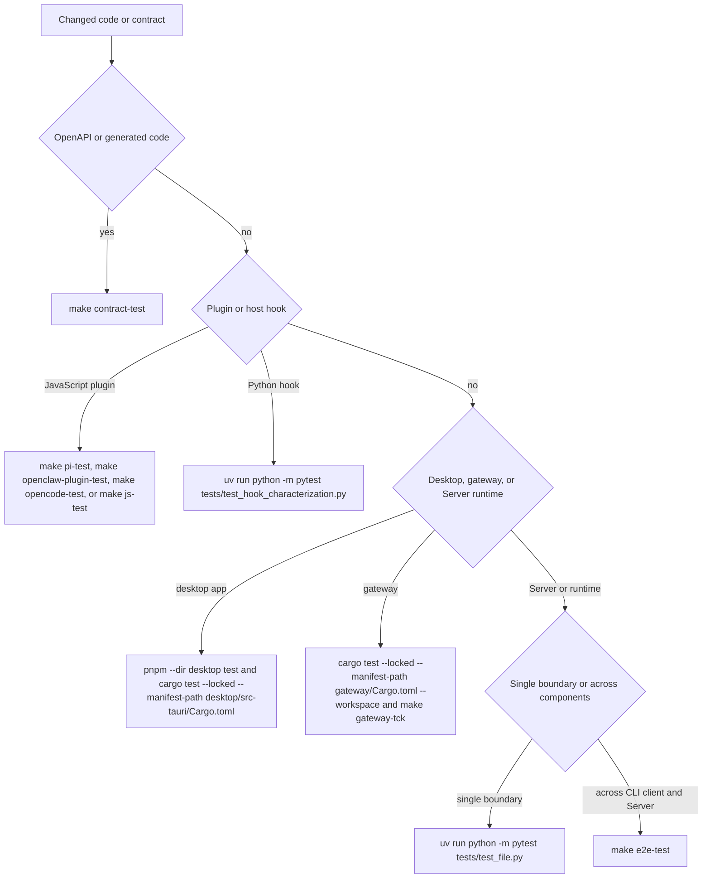

# Test Map and Verification Guide

This page tells you which test suite protects which part of PowerContext and which command runs it. Start from the boundary your change touches, run the narrowest suite that covers it, and widen only when the change crosses components. The named `make` targets in the repository's `Makefile` are the authoritative entry points; `tox` covers the Python version matrix. Desktop and gateway Rust suites have no `make` target of their own; they run through the `cargo` and `pnpm` commands listed below. Do not invent other targets: if a command is not listed in the `Makefile`, `tox.ini`, or the package scripts named here, use `uv run python -m pytest <path>` with a path from the tables below.

Default runs are hermetic. Suites that need real Codex, model providers, external databases, installed host applications, a pinned DSH runtime, or a Docker Compose environment are opt-in and are skipped or refused unless their flag, environment, or target is used. A passing hermetic run does not prove that a real host or backend behaves the same way; `AGENTS.md` asks contributors to keep actual execution, mocks, emulators, and direct hook invocation distinct when they make external claims ([AGENTS.md](repo://AGENTS.md)).

## Choosing a check

The diagram shows the first decision for a change. Run `make check` before a PR when you touch version references, the integration manifest, workflow actions, or the lock file; run `tox` when the change can affect supported Python versions.

## Make targets

The table lists the test-related targets in the `Makefile`. Commands are shown as the target runs them. The "Live Server or Docker" column states which targets need an already running Server, a real host, or Docker Compose; all other targets are hermetic.

| Target | What it runs | Live Server or Docker | Use when |
| --- | --- | --- | --- |
| `make test` | `pytest -n auto --doctest-modules` over the whole test tree, with the serial Hook-deadline file run afterwards at `-n 0` ([Makefile](repo://Makefile#L59-L62)) | No | Broad confidence before submitting |
| `make unit-test` | The same pytest run with `--ignore=tests/e2e` ([Makefile](repo://Makefile#L64-L67)) | No | Fast loop for in-process behavior |
| `make e2e-test` | `tests/e2e` in parallel, then the serial Hook-deadline file ([Makefile](repo://Makefile#L69-L72)) | No for most files; host chains use installed hosts | CLI to client SDK to Server flows |
| `make contract-test` | `api-generate-check`, `js-api-generate-check`, then `tests/test_api_contract.py`, `tests/test_js_operations.py`, `tests/test_desktop_contract.py` ([Makefile](repo://Makefile#L173-L175)) | No | Any change to the HTTP contract or generated bindings |
| `make api-generate` / `make api-generate-check` | Regenerate or verify Python API models from `openapi/powercontext.yaml` ([Makefile](repo://Makefile#L177-L183)) | No | After editing the OpenAPI contract |
| `make js-api-generate` / `make js-api-generate-check` | Regenerate or verify JavaScript operation tables ([Makefile](repo://Makefile#L185-L191)) | No | After editing the contract used by JavaScript integrations |
| `make integration-manifest-check` | Integration capability docs check, then `tests/test_integration_manifest.py` ([Makefile](repo://Makefile#L329-L331)) | No | Changing integration catalog or capability metadata |
| `make check` | Version, upgrade-policy, workflow-action, integration-manifest, integration-guidance, and integration-lifecycle checks ([Makefile](repo://Makefile#L22-L22)); the `workflow-actions-check` step also verifies lock file consistency and runs `prek` and `ty` ([Makefile](repo://Makefile#L39-L50)) | No | Before opening a PR |
| `make js-test` | Installs with the frozen lockfile, runs the DSH unit tests, builds, and fails if the committed `operations.generated.ts` or `lib` output differ; then runs the `dsh-pet` Node tests, the unit tests again, and `test:e2e` ([Makefile](repo://Makefile#L193-L203)) | No | Changes under `integrations/dsh/plugins/powercontext` or `integrations/dsh/plugins/dsh-pet` |
| `make dsh-runtime-test` | Runs the built plugin in the pinned real DSH runtime with a local model fixture ([Makefile](repo://Makefile#L210-L213)) | Yes: the pinned DSH runtime | Claims about the real DSH host |
| `make dsh-pet-runtime-test` | Runs the packed pet adapter in pinned DSH Web, or in the binary named by `DSH_PET_TEST_DESKTOP_APP` ([Makefile](repo://Makefile#L206-L208)) | Yes: the pinned DSH Web runtime | Claims about the packed pet adapter in a real host |
| `make pi-test` | Installs, tests, and typechecks the Pi package ([Makefile](repo://Makefile#L246-L250)) | No | Changes under `integrations/pi/plugins/powercontext` |
| `make openclaw-plugin-test` | Installs, tests, typechecks, and builds the OpenClaw memory plugin ([Makefile](repo://Makefile#L227-L232)) | No | Changes under `integrations/openclaw/plugins/memory-powercontext` |
| `make opencode-test` | Installs, tests, typechecks, builds, and fails if the committed OpenCode `lib` bundle differs ([Makefile](repo://Makefile#L238-L243)) | No | Changes under `integrations/opencode/plugins/powercontext` |
| `make cindy-test` | Builds the Cindy hook adapter, checks its worker bundle, runs `node --test`, and packages it ([Makefile](repo://Makefile#L215-L221)) | No | Changes under `integrations/cindy` |
| `make dify-test` | Checks the isolated Dify SDK plugin and runs `tests/e2e/test_dify_tools_http.py` ([Makefile](repo://Makefile#L252-L261)) | No: the Dify test starts its own HTTP/SQLite tools | Changes under `integrations/dify` |
| `make gateway-tck` | Runs the pinned upstream OpenAI and Open Responses compatibility suites against a controlled upstream directly and through the built Rust gateway ([Makefile](repo://Makefile#L74-L77)) | No live Server; scripted Core and recorded provider bodies | Changes to gateway protocol behavior |
| `make harness-check` | Lints, typechecks, and tests the Bub replay harness under `e2e/bub` ([Makefile](repo://Makefile#L130-L131)) | No | Changes to the replay harness |
| `make harness-acceptance` / `make harness-paired` | Evaluates workloads or compares PowerContext off and on against an existing Server ([Makefile](repo://Makefile#L144-L152)) | Yes: an existing Server | Harness acceptance against a running deployment |
| `make harness-compose-check` / `make harness-compose-acceptance` / `make harness-compose-down` | Validates the SQLite and OceanBase Compose environments, runs acceptance in them, or removes them ([Makefile](repo://Makefile#L160-L171)) | Yes: Docker Compose | Isolated database-backed harness runs |
| `make opendal-test` | Lints, typechecks, and tests the OpenDAL connector ([Makefile](repo://Makefile#L121-L128)) | No | Changes under `integrations/opendal` |
| `make evaluation-unit-test` | Runs the evaluation unit suites with `-m "not live"` and the agent tool recovery suite ([Makefile](repo://Makefile#L80-L90)) | No | Changes under `evaluation/` only |
| `make code-seekdb-test` | Runs native code indexing against an embedded seekdb instance ([Makefile](repo://Makefile#L92-L95)) | No: embedded seekdb | Native code indexing with seekdb |
| `make real-e2e-test` | Runs the opt-in real Codex Experience and Skill tests with `--run-real-e2e` ([Makefile](repo://Makefile#L97-L102)) | Yes: real Codex and configured services | Real host and model acceptance, with credentials configured |
| `make topic-memory-r8-acceptance` | Runs the bounded topic-memory product-chain harness, by default layers `e0` through `e4` ([Makefile](repo://Makefile#L104-L110)) | Partly: the real-product layers need configured services | Topic-memory product acceptance |
| `make docs-test` | Lints, tests, and builds the website ([Makefile](repo://Makefile#L315-L319)) | No | Documentation site changes |

Packaging and release gates such as `make version-check` ([Makefile](repo://Makefile#L278-L281)), `make upgrade-policy-check` ([Makefile](repo://Makefile#L287-L289)), `make release-check` ([Makefile](repo://Makefile#L283-L285)), and `make upgrade-release-test` ([Makefile](repo://Makefile#L291-L293)) are described in the `Makefile` and are separate from the behavior suites on this page.

## Python matrix with tox

`tox.ini` defines the `py311`, `py312`, `py313`, and `py314` environments. Each one runs `uv sync --locked`, then `pytest --doctest-modules tests` with coverage, then `ty check` ([tox.ini](repo://tox.ini#L1-L21)). Use `tox` for changes that affect supported Python versions. Extra arguments are passed through as pytest positional arguments.

## pytest configuration and collection controls

`pyproject.toml` sets the default collection roots to `tests` and `evaluation/memory/atomic_extraction/tests`, and registers the opt-in markers `native_service`, `real_e2e`, `zcode_host_acceptance`, `zcode_live_model`, and `cross_host_acceptance` ([pyproject.toml](repo://pyproject.toml#L270-L278)).

The root [`tests/conftest.py`](repo://tests/conftest.py#L47-L77) controls behavior that every test inherits:

- An autouse fixture restores the shared artifact-family profile registry after each test, so a plugin registration in one test cannot change another Server's readiness.
- Unless `--run-real-e2e` is set, developer `POWERCONTEXT_SERVER_`, `POWERCONTEXT_CLIENT_`, and `POWERCONTEXT_CODEX_` variables are removed, client settings and host homes (`HERMES_HOME`, `DSH_HOME`) point at per-test temporary paths, and `localhost` bypasses proxies.
- [`pytest_collection_modifyitems`](repo://tests/conftest.py#L154-L188) deselects ZCode host acceptance and cross-host tests unless their marker or file is selected explicitly. Selecting them without prerequisites fails rather than silently passing.
- [`pytest_ignore_collect`](repo://tests/conftest.py#L190-L207) excludes `tests/release_upgrades`, the Alembic migration `env.py`, and `tests/e2e/real_experience_skill` unless `--run-real-e2e` is passed.

The options registered in [`pytest_addoption`](repo://tests/conftest.py#L80-L152) include `--run-real-e2e`, `--real-e2e-mode` (`baseline`, `configured`, or `all`), `--real-codex-timeout`, `--real-e2e-env-file`, `--run-zcode-acceptance`, `--zcode-model-config`, `--zcode-generation-env`, `--require-dsh-runtime`, `--require-dsh-config-runtime`, `--require-claude-code-python-floor`, and `--cross-host-acceptance-output`. Use `make real-e2e-test` for the real Codex path rather than assembling these options by hand.

## Suite map by protected code

### Server, access control, and HTTP contract

| Suite | Protects | Representative tests |
| --- | --- | --- |
| [`tests/test_access_control.py`](repo://tests/test_access_control.py#L62-L118) | The authorization service: receipt commit proof separate from identity reservation, logical artifact share as read-only across versions, memory share targeting one logical entry, and administration roles that do not become content writers | `test_receipt_commit_proof_is_separate_from_identity_reservation`, `test_logical_artifact_share_is_read_only_across_all_versions` |
| `tests/test_access_http.py`, `tests/test_access_mcp.py`, `tests/test_access_adapters.py`, `tests/test_access_snapshot_boundary.py` | Access enforcement at the HTTP, MCP, and adapter boundaries and at snapshot reads | Per-boundary access cases |
| `tests/e2e/test_access_control_http.py`, `tests/e2e/test_access_control_regressions.py` | End-to-end access control through the running Server, including regressions | Regression cases named for the defect |
| `tests/test_server.py`, `tests/test_server_http_limits.py`, `tests/test_server_uds.py`, `tests/test_mcp.py` | Server application wiring, HTTP request limits, Unix domain socket transport, and MCP surface | Server factory and transport cases |
| [`tests/test_api_contract.py`](repo://tests/test_api_contract.py#L188-L193) | The checked-in OpenAPI contract at `openapi/powercontext.yaml`: the namespaced request-id header, typed public shapes, and declared responses | `test_contract_uses_the_namespaced_request_id_header`, `test_every_access_protected_operation_declares_the_unavailable_response` |
| [`tests/test_js_operations.py`](repo://tests/test_js_operations.py#L36-L60) | The JavaScript operation generator covers every OpenAPI operation with method, path, location, and scope | `test_js_operations_cover_every_openapi_operation` |

The contract is the source of truth. After editing it, run `make api-generate` and `make contract-test`, as `AGENTS.md` requires ([AGENTS.md](repo://AGENTS.md)). The generated `src/powercontext/http/_generated/` code and the JavaScript operation tables are verified for freshness by `make api-generate-check` and `make js-api-generate-check`; the contract tests then check properties of the contract itself.

### Topic memory

[`tests/test_topic_memory_server.py`](repo://tests/test_topic_memory_server.py#L143-L214) covers the public topic-memory HTTP shapes, mapping of missing or cross-scope values to not-found, a 503 response when flush is requested without a processing capability, and redacted fallback failure output. Its log and span tests check that the failure log and span agree without exposing private error text ([test_topic_memory_server.py](repo://tests/test_topic_memory_server.py#L294-L300)). Product-chain and privacy behavior is covered by `tests/e2e/test_topic_memory_*.py`, and the layered acceptance run is `make topic-memory-r8-acceptance`.

### Handoff report

[`tests/test_handoff_report.py`](repo://tests/test_handoff_report.py#L29-L88) checks that the handoff report uses the same scope selection as the rest of the Server (`subtree`, `exact`, and `all` modes). A second case checks that Markdown output keeps scope organization and exact addresses ([test_handoff_report.py](repo://tests/test_handoff_report.py#L92-L100)), and a third checks that the statement count does not grow with the number of scopes: it counts SQL statements issued for one `all` selection at 16 scopes and asserts the count stays within `2 * selected + 3` ([test_handoff_report.py](repo://tests/test_handoff_report.py#L159-L210)). Runtime handoff behavior is covered by `tests/e2e/test_handoff_runtime.py`.

### Client SDK and receivers

`tests/test_client.py` and `tests/test_client_transport_policy.py` cover the Python client SDK and its transport policy. `tests/client/test_skill_receiver.py` and `tests/client/test_receiver_service.py` cover the remote skill receiver, which applies Skill packages to a target environment and reports results.

### CLI, setup, and installation

The CLI suites are mostly named for their command group: `tests/test_cli.py`, `tests/test_cli_scope.py`, `tests/test_config_cli.py`, `tests/test_config_wizard*.py`, `tests/test_installation*.py`, `tests/test_system_cli.py`, `tests/test_setup_transport.py`, and the per-host CLI files such as `tests/test_cli_zcode.py`, `tests/test_opencode_cli.py`, and `tests/test_openclaw_cli.py`. Installation tests use the `installed_agent_checks`, `server_checks`, and `hermes_activation` fixtures in `tests/conftest.py` to isolate native installation behavior from separately exercised runtime probes ([conftest.py](repo://tests/conftest.py#L208-L247)).

### Host hooks and plugins

- **Hook characterization.** [`tests/test_hook_characterization.py`](repo://tests/test_hook_characterization.py#L14-L30) runs installed copies of the Claude Code and Codex plugin hooks with the host's own invocation style and a scripted Server. It records the requests the Server receives, the hook's stdout, stderr, and exit status, and files left for later hooks, then compares them with the recorded expectations. The parametrized case runs per host and case ([test_hook_characterization.py](repo://tests/test_hook_characterization.py#L81-L91)). The fixtures live under `tests/fixtures`; this page does not document their contents. The module is skipped on Windows because the recorded state includes POSIX file modes. After a reviewed behavior change, the docstring says to regenerate expectations with `uv run python tests/test_hook_characterization.py` and review the diff.
- **Codex plugin.** The `tests/codex_plugin` suite loads plugin scripts by file path from `integrations/codex/plugins/powercontext` and isolates `CODEX_HOME`, diagnostic state, and bootstrap state per test ([conftest.py](repo://tests/codex_plugin/conftest.py#L22-L62)). `test_recall.py` checks that recall emits bounded, untrusted context ([test_recall.py](repo://tests/codex_plugin/test_recall.py#L93-L100)).
- **Plugin execution helper.** `tests/plugin_support.py` provides `invoke`, which loads a plugin manifest, starts a single-process processing lease and intent for a scope, and runs the plugin through the real `execute_plugin` executor against the caller's open database rather than the configured one ([plugin_support.py](repo://tests/plugin_support.py#L59-L80)). Plugin suites use it so that they exercise the executor path rather than a stub.
- **JavaScript plugins.** `make js-test`, `make pi-test`, `make openclaw-plugin-test`, and `make opencode-test` run each package's own test runner and typecheck. Their behavior is described by the plugin pages, not repeated here. The DeepSeek Harness plugin has its own suites, described in [DeepSeek Harness TypeScript suites](#deepseek-harness-typescript-suites).

### Integration conformance

The integration conformance suite is a shared behavior contract for pending-Source delivery, consumed by both Python and JavaScript:

- [`tests/integration_conformance/cases.json`](repo://tests/integration_conformance/cases.json#L1-L60) defines schema version 1 cases, each with `modes`, `input`, and `expected`. The cases cover cursor catch-up, malformed acknowledgements, flush failure, duplicate delivery, scope isolation, closing and cancellation boundaries, best-effort fail-open, required-mode fail-closed, and extraction unavailable.
- [`tests/integration_conformance/test_cases.py`](repo://tests/integration_conformance/test_cases.py#L20-L48) checks that the fixture has exactly the ten required case IDs, that each case has non-empty input and expected blocks, and that `required_mode_fail_closed` runs only in `required_capable` mode with `host_continues` set to `false`.
- The Pi flush spec ([flush.spec.ts](repo://integrations/pi/plugins/powercontext/tests/flush.spec.ts#L27-L37)) and the OpenClaw lifecycle test ([lifecycle.test.ts](repo://integrations/openclaw/plugins/memory-powercontext/src/lifecycle.test.ts#L35-L40)) load the same JSON file. The Pi spec looks up a case by ID in `best_effort` mode and fails if it is missing.

Changing a case's expectations therefore affects the Python fixture test and the JavaScript plugin tests together. Run `uv run python -m pytest tests/integration_conformance` and the relevant plugin target.

### Adapters and optional APIs

[`tests/integrations/test_python_adapter_compatibility.py`](repo://tests/integrations/test_python_adapter_compatibility.py#L17-L73) runs the LangChain, LangGraph, and Pydantic AI adapter settings in a separate isolated interpreter, both with and without the core text-assembly API. It checks that `context_assembly` works when the API is present and fails with a clear validation message when it is not. `tests/integrations/test_hermes_provider.py` covers the Hermes provider.

### Builtin runtime and native code

`tests/builtin/` holds unit tests for the builtin runtime: native code indexing (`test_native_code*.py`), publication, scope application, tags, processing diagnostics, and work receipt models, with subdirectories for artifacts, dream, inference, persistence, portability, review, and runtime. The native command and service paths are also exercised by root-level suites such as `tests/test_native_command.py` and `tests/test_native_service_diagnostics.py`.

### Integration manifest

[`tests/test_integration_manifest.py`](repo://tests/test_integration_manifest.py#L28-L45) checks that the agent-host integrations in the manifest match the setup installers, that integration directories and evidence paths resolve, and that the tool surfaces match. `make integration-manifest-check` runs it after the generated capability docs check.

### End-to-end acceptance

`tests/e2e/` holds cross-component scenarios that run from the CLI or client SDK through a running Server. Many of them run the Server in-process: for example, the SDK handoff lifecycle test builds the app with `create_server_app`, enters its lifespan, and sends requests through an `httpx.ASGITransport` to `http://testserver` ([test_runtime_server.py](repo://tests/e2e/test_runtime_server.py#L552-L592)), so they do not need a separately started Server. Examples include `tests/e2e/test_runtime_server.py`, `tests/e2e/test_mcp_transport.py`, `tests/e2e/test_server_cli.py`, the host service chains such as `tests/e2e/test_codex_service_chain.py` and `tests/e2e/test_zcode_service_chain.py`, and `tests/e2e/test_dify_tools_http.py`. The `Makefile` runs the Hook-deadline file `tests/e2e/test_zcode_service_chain.py` serially so unrelated parallel work cannot starve its deadlines ([Makefile](repo://Makefile#L55-L56)).

Database-backed migration scenarios use a `migration_backend` fixture that always runs with SQLite, runs with seekdb only when `POWERCONTEXT_TEST_MIGRATION_SEEKDB=1`, and runs with OceanBase only when `POWERCONTEXT_TEST_MIGRATION_OCEANBASE_URL` is set. The OceanBase path refuses a URL without an explicit management database and verifies a real OceanBase version before creating its per-test database ([e2e conftest.py](repo://tests/e2e/conftest.py#L30-L108)).

### DeepSeek Harness TypeScript suites

The DSH plugin at `integrations/dsh/plugins/powercontext` has its own Vitest suites under `tests/`, run by its `package.json` scripts ([package.json](repo://integrations/dsh/plugins/powercontext/package.json#L70-L78)):

| Command | Runs | Needs live Server or host |
| --- | --- | --- |
| `pnpm --dir integrations/dsh/plugins/powercontext test` (via `make js-test`) | `vitest run --exclude=tests/e2e/**`: the unit specs such as `tests/handoff-delivery.spec.ts`, `tests/client.spec.ts`, `tests/mcp.spec.ts`, and `tests/status.spec.ts` | No |
| `pnpm --dir integrations/dsh/plugins/powercontext test:e2e` (via `make js-test`) | `vitest run tests/e2e`, including `tests/e2e/handoff-delivery.spec.ts` | Check the spec before relying on it; it is not a pinned-runtime run |
| `make dsh-runtime-test` | `test:e2e:runtime`, which runs `tests/runtime` against the pinned real DSH runtime with a local model fixture | Yes: pinned DSH runtime |

The handoff delivery spec drives `LocalDeliveryService` with a mocked `fetch` and a stubbed preflight gate, so it exercises the local delivery state machine rather than a running Server. It asserts that a gate rejection (`not_ready`, `stale_preflight`, `binding_mismatch`, or `not_found`) causes no connection resolution, no remote request, and no file written to the delivery directory; that a missing gate fails with `integration_unavailable`; that input identity overrides, unsupported claims, and over-budget omissions fail with `payload_invalid` before any dispatch; and that a prepared delivery is persisted, can be reopened without remote work, and keeps its acknowledgement identity ([handoff-delivery.spec.ts](repo://integrations/dsh/plugins/powercontext/tests/handoff-delivery.spec.ts#L121-L180)). Files under `tests/fixtures` are dependencies of these suites and are not documented here.

### Desktop Rust and UI suites

The desktop app under `desktop/` has no `make` target. Its documented verification commands are run from the repository root ([desktop/README.md](repo://desktop/README.md#L101-L110)):

- `pnpm --dir desktop test` runs `node --test scripts/prepare-openapi-generator.test.mjs` and then `vitest run` over `desktop/ui/tests`. The UI suite in [`desktop/ui/tests/app.test.tsx`](repo://desktop/ui/tests/app.test.tsx#L19-L75) mocks the IPC layer and checks that, with no connected Server, the shell shows the "not connected" state, the Memory save and search controls are disabled, and the language and theme settings switch without the native host. These tests run in jsdom and need no Server.
- `cargo test --locked --manifest-path desktop/src-tauri/Cargo.toml` runs the Rust suites under `desktop/src-tauri/tests/`. [`tests/api.rs`](repo://desktop/src-tauri/tests/api.rs#L26-L80) starts a loopback fixture peer, builds a `ServerApi` against an endpoint with a path prefix, and checks that scope paging is bounded and preserves the opaque cursor and the prefix. It makes no connection to a real Server.
- `make contract-test` includes `tests/test_desktop_contract.py`, the Python-side check of the desktop contract ([Makefile](repo://Makefile#L173-L175)).

### Gateway Rust and TCK suites

The gateway is a Cargo workspace under `gateway/`. Its Rust tests run with `cargo test --locked --manifest-path gateway/Cargo.toml --workspace` ([AGENTS.md](repo://AGENTS.md#L26-L26)). Two groups matter for protocol changes:

- **Focused behavior tests.** [`gateway_behaviors.rs`](repo://gateway/crates/pc-gateway-app/tests/gateway_behaviors.rs#L132-L200) starts the built `pc-gateway` binary (`CARGO_BIN_EXE_pc-gateway`) as a subprocess and points it at loopback HTTP peers that stand in for the upstream provider and the scripted Core. Its ten async tests cover request field preservation, tool continuations, length and empty-argument finishes, refusals, denied or withheld send and release (which must never return recorded content or resend it), developer instructions, text input, upstream error status and body preservation, and reasoning and citation streaming ([gateway_behaviors.rs](repo://gateway/crates/pc-gateway-app/tests/gateway_behaviors.rs#L436-L484)). The run command is `cargo test --locked -p pc-gateway-app --test gateway_behaviors` ([gateway README](repo://gateway/README.md#L112-L112)). Core verdicts and provider responses are scripted, so a green run does not prove real Core authorization or provider compatibility.
- **Compatibility TCK.** `make gateway-tck` runs `tests/e2e/gateway_tck.py`. It builds `pc-gateway` with `cargo build --locked`, installs the pinned Node tooling, and runs two pinned upstream suites: the OpenAI compatibility tester, using a native mock server, and the Open Responses compliance suite, using recorded provider bodies ([gateway_tck.py](repo://tests/e2e/gateway_tck.py#L208-L303); [Makefile](repo://Makefile#L74-L77)). Each suite runs first against the controlled upstream directly, then against the gateway process. If the direct baseline fails, the loop breaks before the gateway target runs, so a gateway result is never attributed to a broken baseline. The run exits nonzero if any result fails and writes `report.json` to the output directory ([gateway_tck.py](repo://tests/e2e/gateway_tck.py#L208-L303)).
- **Scripted boundary.** The TCK's `core_and_recordings` helper serves a scripted `/v1/capabilities` document with context-protection limits and scripted `/v1/context/check` verdicts, and replays fixture bodies for the upstream ([gateway_tck.py](repo://tests/e2e/gateway_tck.py#L99-L172)). The [TCK README](repo://gateway/tck/README.md#L1-L34) lists the selected coverage and states that the tests do not establish real Core authorization, model quality, or provider compatibility, and that WebSockets and stored responses are outside the tested profile. The TCK needs Node 22+, npm, Go 1.26+, and uv, and fetches its upstream sources by immutable commit into `.cache/gateway-tck`.

### CI and release tooling tests

Some root tests check repository tooling rather than product behavior. `tests/test_ci_pipeline.py` and `tests/test_ci_changes.py` exercise CI selection and retry logic, `tests/test_upgrade_release_gate.py` checks the release gate, and `tests/test_release_version.py` checks version synchronization.

- **Suite selection.** `scripts/ci_changes.py` maps changed paths to suites. `select_suites` returns every suite when a path matches a `full` rule or when a non-ignored path matches no suite, so a new directory cannot bypass checks before it has an owner ([ci_changes.py](repo://scripts/ci_changes.py#L34-L54)). `tests/test_ci_changes.py` checks that unclassified changes run every suite ([test_ci_changes.py](repo://tests/test_ci_changes.py#L171-L183)).
- **macOS build retry.** `tests/test_ci_pipeline.py` parametrizes the macOS build script against a fake `hdiutil`. Only `Resource busy` disk-image failures are retried, and the parametrized cases expect exit status 0 after two attempts for a busy eject or create, and exit status 17 after three busy attempts or after any non-busy failure ([test_ci_pipeline.py](repo://tests/test_ci_pipeline.py#L37-L60)).
- **Release gate.** The release gate's required mode, exercised by the test below, executes its cases and publishes when every case passes; release acceptance does not require support declaration prose in the release notes ([test_upgrade_release_gate.py](repo://tests/test_upgrade_release_gate.py#L94-L110)). Run these tooling suites when you change the corresponding scripts, not as evidence about Server behavior.

## Opt-in and host-dependent suites

| Suite | Opt-in control | Notes |
| --- | --- | --- |
| Real Codex Experience and Skill tests (`tests/e2e/real_experience_skill`) | `make real-e2e-test`, which passes `--run-real-e2e`, `--real-e2e-mode`, `--real-codex-timeout`, and `--real-e2e-env-file` | Uses real Codex and configured services; skipped at collection otherwise |
| ZCode host acceptance | `--run-zcode-acceptance`, with `--zcode-model-config` or `--zcode-generation-env` for live mode | Requires an explicitly configured ZCode CLI and isolated Server; marked `zcode_host_acceptance` and `zcode_live_model` |
| Cross-host work continuity | Marker `cross_host_acceptance` or the `test_cross_host_work_continuity.py` file | Actual Pi RPC to ZCode CLI with isolated SQLite and controlled inference |
| Native service tests | Marker `native_service` | Mutates a disposable current-user service manager on a matching platform |
| Code indexing with seekdb | `make code-seekdb-test` | Runs against an embedded seekdb instance |
| DSH pinned runtime | `make dsh-runtime-test`, `make dsh-pet-runtime-test` | Needs the pinned DSH runtime or DSH Web binary |
| Bub replay harness | `make harness-check` for hermetic checks; `make harness-acceptance` and `make harness-paired` against an existing Server | The compose targets (`make harness-compose-check`, `make harness-compose-acceptance`) build isolated environments with Docker Compose ([run.sh](repo://e2e/bub/run.sh#L65-L90)) |

Do not treat a skipped opt-in suite as passing. When a change claims real-host or real-backend behavior, run the matching target with its prerequisites and report what actually executed.

## Practical guidance

- Start with the focused file for the module you changed, for example `uv run python -m pytest tests/test_handoff_report.py -q`. Add `make contract-test` for any `openapi/` edit and `make e2e-test` when a CLI, client, and Server path changes together.
- For desktop changes, run `pnpm --dir desktop test` and `cargo test --locked --manifest-path desktop/src-tauri/Cargo.toml`. For gateway protocol changes, run `cargo test --locked --manifest-path gateway/Cargo.toml --workspace` and `make gateway-tck`. For DSH changes, run `make js-test`, and `make dsh-runtime-test` when the change depends on the real runtime.
- Changes to hook scripts should run the hook characterization suite, not only the plugin's own unit tests, because that suite exercises the installed copies with each host's invocation style.
- Changes to the conformance fixture should run the Python fixture test and every JavaScript plugin that loads it.
- Changes to the OpenAPI contract require regeneration before tests: `make api-generate`, `make js-api-generate`, then `make contract-test`.
- Keep the design guidance in `AGENTS.md` in mind when adding tests: assert through public interfaces, add regression tests for defects likely to recur, and avoid tests that only freeze implementation details ([AGENTS.md](repo://AGENTS.md)).

## Related pages

- [HTTP and MCP API](../architecture/http-and-mcp-api.md) describes the contract surfaces that the contract and transport suites protect.
- [Source map](../architecture/source-map.md) locates the source directories that these suites import.
- [Desktop app](../architecture/desktop-app.md) describes the desktop surfaces covered by the Rust and UI suites.
- [Gateway](../architecture/gateway.md) describes the gateway components covered by the Rust and TCK suites.
- [DSH plugin](../integrations/dsh-plugin.md) describes the DeepSeek Harness plugin covered by the TypeScript suites.
- [Quickstart](../quickstart.md) covers installing the development environment that the commands above assume.
