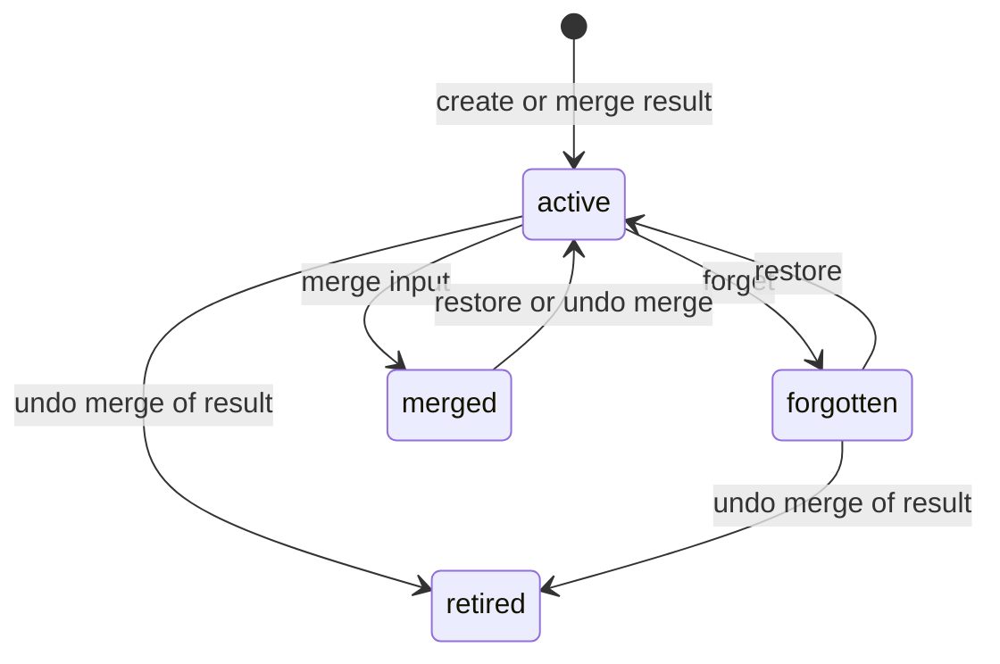
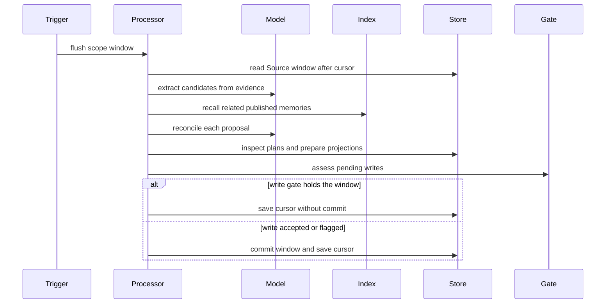
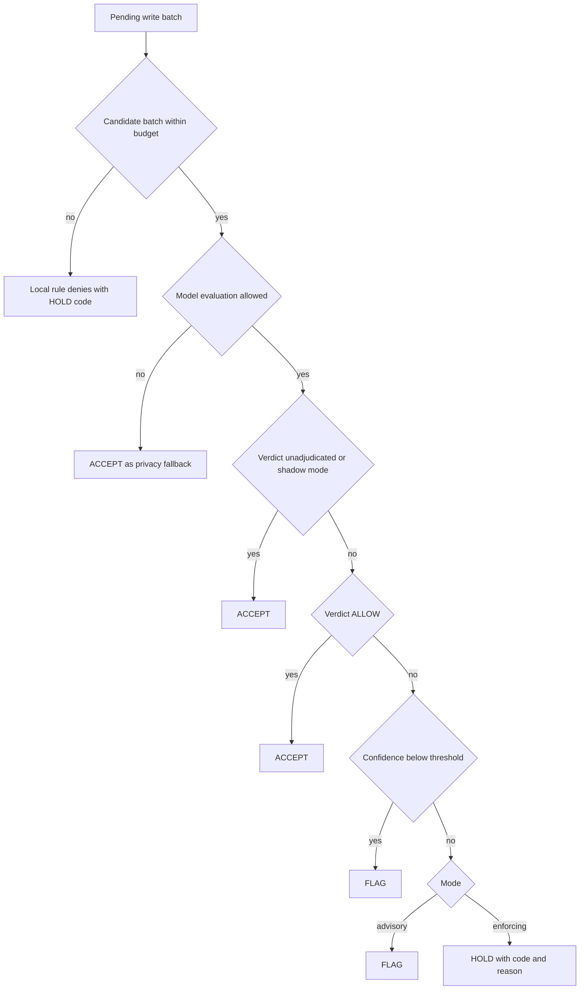

# Atomic Memory Lifecycle

Atomic Memory stores each durable fact, preference, decision or constraint as an independent `atomic-memory` Artifact. Its content revisions are immutable. Its lifecycle lives in a separate state record (`active`, `forgotten`, `merged`, `retired`) with a `state_version`, so forgetting or merging never rewrites history. This page follows one memory through creation, replacement, forgetting, merging and restoration, then covers the Source-driven extraction path that creates memories automatically, the search path that returns only active memories, and the boundary where legacy Memory collection calls are refused.

The code is split across four areas:

- `src/powercontext/builtin/artifacts/atomic_memory/` holds the content models, the Atomic service adapter, extraction and reconciliation contracts, and search planning.
- `src/powercontext/builtin/artifacts/merge.py` and `merge_restoration.py` hold the shared lifecycle engine that Atomic Memory delegates to.
- `src/powercontext/builtin/runtime/atomic_memory*.py` hold the runtime application, Source processing and search.
- `src/powercontext/server/atomic_memory.py` holds the HTTP adapters, and `src/powercontext/builtin/runtime/memory_write_gate.py` holds the optional gate.

For the general Artifact model see [Artifact families](../concepts/artifact-families.md). For Source windows see [Sources and processing](../concepts/sources-and-processing.md). For offline migration of legacy collections see [Migrations and archives](../operations/migrations-and-archives.md). For the surrounding continuity workflow see [Memory and handoff](memory-and-handoff.md).

## Content model

`AtomicMemoryContent` defines the Atomic Memory content. Field names are exact:

- `schema` (alias of `schema_`) is fixed to `powercontext.atomic-memory.v1`.
- `kind` is a nonblank string of 1 to 128 characters. It is application-defined, and the search and list `kind` filters match against it.
- `text` is required with a minimum length of 1. The canonical normalizer validates it, and new writes are normalized before drafting. Historical revisions keep their stored text.
- `description` is optional. When present it must be 1 to 200 characters and a single line, and it is omitted from serialization when absent.
- `creation` is maintained by the service, never by the caller. Merge results carry the input identities here.

[AtomicMemoryContent](repo://src/powercontext/builtin/artifacts/atomic_memory/models.py#L64-L111) enforces these bounds. Ordinary writes that include a `creation` key are rejected by the family validator ([family validation](repo://src/powercontext/builtin/persistence/family_management.py#L516-L527)). The draft adapter normalizes non-historical text with the canonical normalizer, and it raises `AtomicMemoryRelationError` if creation metadata arrives on an ordinary path ([draft](repo://src/powercontext/builtin/artifacts/atomic_memory/service.py#L247-L277)). A historical draft drops creation and keeps the original text.

## Lifecycle at a glance

The diagram shows the state transitions the shared engine can produce. A plain state change does not append a content revision. A revision is appended only when content is written or when a restoration rewrites an identity. `retired` is reached only through an undo of a merge result, and no direct operation can set it.

The public states map onto the shared lifecycle as follows. `forgotten` and `merged` both map to deprecated governance, `retired` maps to retired governance, and `merged` requires a `merged_into_id` ([state model](repo://src/powercontext/builtin/artifacts/atomic_memory/models.py#L125-L147), [governance mapping](repo://src/powercontext/builtin/artifacts/atomic_memory/service.py#L117-L139)). A state read reports `state_version` as the governance generation.

| State | Entered by | Meaning |
| --- | --- | --- |
| `active` | Create, replace, merge result, or restore | Included in ordinary search, list and recall. Eligible as a merge input. |
| `forgotten` | `forget` | Content and history stay readable. Restore makes it active again. |
| `merged` | Merge of this identity as an input | Frozen. `merged_into_id` names the result. Restore or undo of the result reactivates it. |
| `retired` | Undo of a merge result | Not restorable. Merging it is refused because only active identities can be inputs. |

## Create and replace

Explicit creation and replacement do not call a generation model. The Atomic family manager receives validated content and prepares the write ([prepare commands](repo://src/powercontext/builtin/persistence/family_management.py#L550-L579)). When no expected revision is supplied, it inspects a creation window with fresh identities. When an expected revision is supplied, it inspects a change against that revision and state version. Each prepared plan then prepares its projection before the transaction commits.

Writes that omit `description` receive a default. The default collapses whitespace in the final text and keeps at most 200 characters, with a trailing `…` when it truncates ([default description](repo://src/powercontext/builtin/artifacts/atomic_memory/summary.py#L15-L33)). The default is applied during change or merge preparation, before the content hash and projection are fixed ([prepare change](repo://src/powercontext/builtin/artifacts/atomic_memory/service.py#L343-L358)). At commit, `commit_window` rejects any prepared new write that still lacks a description, and it never applies defaults after preparation ([commit window check](repo://src/powercontext/builtin/artifacts/atomic_memory/service.py#L360-L391)). Historical restoration keeps the stored description as-is and never adds one.

The HTTP surface uses the generic Artifact routes for creation and replacement, and the Atomic routes for the lifecycle operations below. The dedicated Atomic handlers are in [server adapters](repo://src/powercontext/server/atomic_memory.py#L65-L255).

## Forget and retire

`forget` is the only lifecycle transition the HTTP lifecycle endpoint can make, and that endpoint accepts only `forgotten`. Restoration is a separate direct operation. The generated request enum contains exactly that value ([generated enum](repo://src/powercontext/http/_generated/models.py#L132-L138)). The handler rejects any family other than `atomic-memory` and forwards to `forget` ([lifecycle handler](repo://src/powercontext/server/atomic_memory.py#L185-L201)).

`ScopedAtomicMemory.forget` opens an inspect transaction, then a commit transaction ([runtime forget](repo://src/powercontext/builtin/runtime/atomic_memory.py#L1219-L1233)). `inspect_forget` authorizes write on the target and checks the caller's expected revision and state version. It refuses a merged identity, and it refuses any state other than active or deprecated with `invalid_state` ("only active or deprecated Artifacts can be deprecated"). For an active identity it produces one write that moves the state to deprecated with no draft, so no content revision is appended. For an identity already forgotten it produces no writes, and the result reports `changed: false` ([inspect forget](repo://src/powercontext/builtin/artifacts/merge.py#L387-L420)).

`retired` has no direct operation. The only producer is the undo path in restoration: when a merge result is undone, the calculation marks that result retired and reactivates its inputs ([undo expansion](repo://src/powercontext/builtin/artifacts/merge_restoration.py#L95-L137)). A retired identity cannot be restored, so restoration refuses it with `invalid_state` ([retired check](repo://src/powercontext/builtin/artifacts/merge_restoration.py#L42-L94)). To adopt the same content again, create a new Artifact.

## Merge

`ScopedAtomicMemory.merge` runs inspection in one transaction and commits in another ([runtime merge](repo://src/powercontext/builtin/runtime/atomic_memory.py#L1201-L1218)). `inspect_merge` applies these checks in order, and each failure stops the plan:

1. It requires at least two inputs with distinct identities, and the result identity must not be one of them. Otherwise it raises a relation error.
2. It authorizes `create` on the result identity and `write` on each input.
3. It re-reads each input. If the current read differs from the caller's expected read, it raises `conflict` ("merge inputs changed before preparation").
4. It refuses any input whose lifecycle is not active or that already has a `merged_into_id`, with `invalid_state` ("only active Artifacts can be merge inputs").
5. It drafts the result with `creation` naming the input identities, and it sets each input to deprecated with `merged_into_id` set to the result ([inspect merge](repo://src/powercontext/builtin/artifacts/merge.py#L317-L386)).

The HTTP route is `POST /v1/atomic-memory/merges`, handled by `merge_atomic_memories`. It converts each input into an exact active read with its `state_version`, and it passes any extra `source_refs` and `artifact_refs` as lineage ([merge handler](repo://src/powercontext/server/atomic_memory.py#L154-L184)).

## Restore and undo

Restoration runs in two phases. A preview returns a signed endpoint token. A commit validates that token and the freshness of every affected identity. The restore handler accepts `operation` of `restore` or `undo_merge`, and an optional `revision` ([restore handler](repo://src/powercontext/server/atomic_memory.py#L202-L255)).

The shared calculation first follows the current merge path from the target to its live endpoint. It then expands the undo set and computes the final state of every affected identity ([calculate restoration](repo://src/powercontext/builtin/artifacts/merge_restoration.py#L42-L94)):

- For `restore`, the target's merge results are undone, each frozen input is reactivated, and the target itself becomes active.
- For `undo_merge`, the target's own merge is undone as well. The operation refuses a content `revision`, with `invalid_state` ("undo_merge does not accept a content revision").
- A restore of an identity that is already active without a selected revision produces no writes, so `changed` is false.

For the example in the existing workflow, where A and B merge into C and then C and D merge into E, restoring B reactivates A, B and D and retires C and E. Undoing a result that has no marked inputs fails with a relation error, and so does an input whose frozen version or destination no longer matches ([expand undo](repo://src/powercontext/builtin/artifacts/merge_restoration.py#L95-L137)).

Each affected identity appends a content revision numbered current plus one. The target's content comes from the frozen input, or from the selected historical revision when `revision` was supplied. Restoration records its outcome as a `lineage_only` Source with restoration outcome data, under the same lock as the writes ([restoration writes](repo://src/powercontext/builtin/artifacts/merge_restoration.py#L138-L200), [record restoration](repo://src/powercontext/builtin/artifacts/merge.py#L713-L761)).

The preview is produced inside a consistent read snapshot and returns the signed token and endpoint without committing ([preview](repo://src/powercontext/builtin/runtime/atomic_memory.py#L1234-L1249)). The signer uses format `powercontext.atomic-memory.restoration-preview.v1` and a default TTL of 300 seconds ([signer](repo://src/powercontext/builtin/artifacts/atomic_memory/restoration.py#L14-L32)). Token validation binds scope, subject, operation, artifact identity and revision. Inspection rejects a token whose endpoint no longer matches, with `preview_stale` ([inspect restore](repo://src/powercontext/builtin/artifacts/merge.py#L421-L478)).

The commit path enforces freshness under locks. `commit_window` locks the heads of every read, validates the preview endpoint again, rechecks the dependencies with update intent, and re-inspects every restore or undo plan. If the re-inspected plan differs from the prepared one, it raises a conflict and asks the caller to prepare the whole group again ([commit window](repo://src/powercontext/builtin/artifacts/merge.py#L543-L618), [validate preview](repo://src/powercontext/builtin/artifacts/merge.py#L630-L644)). The runtime restore retries up to `restore_retry_budget` times, which defaults to 3, when there is no preview token. When a preview token is supplied, a conflict becomes `preview_stale` instead of a retry ([runtime restore](repo://src/powercontext/builtin/runtime/atomic_memory.py#L1250-L1274), [budget default](repo://src/powercontext/builtin/runtime/atomic_memory.py#L299-L312)).

## Extraction from Sources

Atomic extraction turns Source windows into memory writes. The processor is `AtomicMemorySourceWindowProcessor`, and its entry point is `flush` ([flush](repo://src/powercontext/builtin/runtime/atomic_memory_processing.py#L162-L185)). It binds the `atomic_memory.extract` and `atomic_memory.reconcile` prompts. If the legacy `memory.extract` prompt is in custom mode, it raises `legacy_memory_prompt_unsupported` before any write.

The sequence is the order the code runs it. The caption: a flush extracts, reconciles, prepares and gates the window, then either commits or consumes it under a HOLD.

Each step has its own conditions:

- **Window selection.** `_flush_once` loads the stored cursor and computes the high watermark. If the trigger yields no action, the flush returns a no-op ([flush once](repo://src/powercontext/builtin/runtime/atomic_memory_processing.py#L200-L277)). Otherwise it reads the window and requires an exact contiguous journal interval. Only generation-eligible Sources count. The caller must pass scope read and create authorization, and the Source authorization check must pass for every eligible Source. If eligible Sources exist and no pipeline is configured, the flush raises `InferenceUnavailableError`.
- **Retries and reduction.** Atomic, generation and revision conflicts retry the whole flush up to three attempts ([retry](repo://src/powercontext/builtin/runtime/atomic_memory_processing.py#L186-L199)). A generation timeout or an invalid input-budget error halves the window when more than one Source is in it, and then re-raises ([reduce window](repo://src/powercontext/builtin/runtime/atomic_memory_processing.py#L278-L295)).
- **Extraction.** The extractor returns candidates whose `kind` is one of `fact`, `preference`, `decision`, `constraint` or `working_note`. Each candidate must cite evidence IDs that were supplied in the input, and `description` is required. A candidate with invalid content or an unsupplied citation raises `InvalidInferenceOutputError` ([extraction models](repo://src/powercontext/builtin/artifacts/atomic_memory/extraction.py#L120-L149), [extract](repo://src/powercontext/builtin/artifacts/atomic_memory/extraction.py#L150-L190)).
- **Recall and reconciliation.** Candidates are sorted by their supporting journal positions. Each candidate becomes a working item, related published memories are recalled through search and authorized for read, and reconciliation compares the proposal in batches of `comparison_batch_size`. When both built-in prompts are in use, a candidate with nothing to compare is kept as extracted ([prepare](repo://src/powercontext/builtin/runtime/atomic_memory_processing.py#L458-L561)).
- **Plan inspection.** Changes with two or more published origins are inspected as merges. A change with one published origin is inspected as a revision of that identity, using its expected revision and state version. A change with no origin is inspected as a create with a fresh identity ([inspect decisions](repo://src/powercontext/builtin/runtime/atomic_memory_processing.py#L296-L341)).
- **Publish.** Under the journal lock, `_publish` re-reads the cursor and the window, compares them with the prepared snapshot, and re-authorizes Sources, artifacts and the scope. If the gate did not hold, it calls `commit_window`. It then finalizes the decision observation, saves the cursor, clears the consumed window and completes processing ([publish](repo://src/powercontext/builtin/runtime/atomic_memory_processing.py#L342-L457)).

`AtomicMemoryProcessingConfig` sets the batch limits: `related_mode` defaults to `auto`, `related_max_distance` to 1.0, `related_fts_fallback` to `False`, `comparison_batch_size` to 20, and `input_tokens_limit` to 24000. Invalid values raise `ValueError`, and `from_runtime` copies the matching runtime settings ([config](repo://src/powercontext/builtin/runtime/atomic_memory_processing.py#L110-L134)).

## Reconciliation and duplicate handling

Reconciliation decides, for one proposal and its related published memories, whether to create a new memory, revise an existing one, merge several, or do nothing. [Output validation](repo://src/powercontext/builtin/artifacts/atomic_memory/reconciliation.py#L294-L342) enforces the contract: every supplied related item must be compared exactly once, targets must come from the supplied items, a `create` cannot consume related items, and a `revise` must name exactly one target. The working set resolves aliases so that a consumed item is not compared again.

Duplicate and no-op handling has these branches:

- **`noop` with a target.** The proposal becomes an alias of that existing item, and its evidence is added to the target. The target's content does not change, so a published target receives no new revision ([apply](repo://src/powercontext/builtin/artifacts/atomic_memory/reconciliation.py#L215-L240)).
- **`noop` without a target.** The proposal is dropped from the write set. This applies when the candidate is unworthy or unsupported and has no published origin.
- **Recalled items that stay unchanged.** A published memory that is recalled but not changed is never written. Only items that are both retained and changed are returned as changes ([changes](repo://src/powercontext/builtin/artifacts/atomic_memory/reconciliation.py#L290-L292)).
- **The same published identity recalled twice.** `add` resolves the second occurrence to the existing working item rather than creating a second one. A recalled read that differs from the first is a conflict ([add](repo://src/powercontext/builtin/artifacts/atomic_memory/reconciliation.py#L187-L205)).

## Memory write gate

The write gate answers one question for a pending batch: are the cited evidence items strong enough to record these candidates now? It never decides content. It returns `ACCEPT`, `FLAG` or `HOLD`, and any backend failure degrades to `ACCEPT` so an unavailable judge cannot block a write ([gate class](repo://src/powercontext/builtin/runtime/memory_write_gate.py#L176-L237)).

The gate is built only when it is enabled and its mode is not `disabled`. Without a decision model it is `None`, unless the privacy boundary is `NO_EXTERNAL_CALL`. The builder defaults `hold_on` to `yes` and `mode` to `SHADOW` ([build gate](repo://src/powercontext/builtin/runtime/memory_write_gate.py#L131-L174)). Under `SHADOW`, every verdict is accepted, so enabling the gate without choosing a mode does not hold writes.

The diagram follows the branches of `assess` and `_map`. The first branch is the candidate budget. The privacy fallback is the second. The model verdict is mapped last, so a shadow verdict never becomes a hold.

The branches in order:

1. **Batch over budget.** If the candidate subject exceeds the limit, a local rule denies and the gate builds a `HOLD` with the rejection code and the reason "the candidate batch exceeds the gate assessment budget". The mode is then applied ([assess](repo://src/powercontext/builtin/runtime/memory_write_gate.py#L244-L270)).
2. **Model evaluation not allowed.** When the privacy boundary or sanitizer does not permit a model call, the gate returns `ACCEPT` with `used_fallback` set. The reason is `projection_sanitizer_missing` or `privacy_boundary` ([privacy fallback](repo://src/powercontext/builtin/runtime/memory_write_gate.py#L327-L349)).
3. **Hosted redaction.** Under `HOSTED_REDACTED`, a missing sanitizer, a sanitizer exception, an invalid projection or a projection that is not permitted each produce an `ACCEPT` fallback with a specific reason. The model is not called.
4. **Verdict mapping.** An unadjudicated assessment (abstain or fallback) is `ACCEPT`. Under `SHADOW`, the result is `ACCEPT`. An `ALLOW` verdict is `ACCEPT` ([map](repo://src/powercontext/builtin/runtime/memory_write_gate.py#L366-L392)).
5. **Hold-direction verdict.** When a threshold is configured and the confidence is below it, the result is `FLAG`. Otherwise the mode applies: `advisory` converts `HOLD` to `FLAG`, and `enforcing` keeps `HOLD` ([mode assessment](repo://src/powercontext/builtin/runtime/memory_write_gate.py#L394-L404)).

The rejection code is structured. `needs_evidence` applies when the request has no evidence. `evidence_limit_exceeded` applies when there are more than 32 evidence items. Any other hold is `insufficient_coverage` ([rejection code](repo://src/powercontext/builtin/runtime/memory_write_gate.py#L511-L518), [vocabulary](repo://src/powercontext/builtin/artifacts/memory/protocols.py#L39-L60)). Every `HOLD` carries both a code and a reason.

In the processor, `_assess_write_gate` returns no verdict when there is no gate or no prepared write. If `assess` raises an exception other than a privacy error, the processor treats the gate as having no verdict and the write proceeds ([assess write gate](repo://src/powercontext/builtin/runtime/atomic_memory_processing.py#L877-L900)). `InferencePrivacyError` propagates.

A `HOLD` has these effects, in order. The commit is skipped. The observation is finalized as `memory_write_hold`. The cursor still advances and the consumed window is cleared, so the held window is not retried. The flush result reports `held_count` as 1, `hold_codes` with the rejection code, and `memory_ref` as `None` ([publish](repo://src/powercontext/builtin/runtime/atomic_memory_processing.py#L342-L457), [result](repo://src/powercontext/builtin/runtime/atomic_memory_processing.py#L948-L961)).

## Search and retrieval

The dedicated search is `ScopedAtomicMemory.search`. Its branches are these ([search](repo://src/powercontext/builtin/runtime/atomic_memory.py#L799-L941)):

- The limit must be between 1 and 100, and the mode must be `auto`, `text`, `vector` or `hybrid`.
- A `kind` filter is validated by constructing the content model.
- Query embedding runs before the business snapshot opens. With `auto`, an inference timeout or unavailability falls back to lexical retrieval and sets `embedding_fallback`. Any other requested mode raises ([query embedding](repo://src/powercontext/builtin/runtime/atomic_memory.py#L1034-L1070)).
- Filters come from the access policy and the requested tags, then the index returns text and vector channels that are combined.
- Every returned candidate is validated against its authoritative head. An inconsistent candidate fails the search and is never silently dropped ([validate hits](repo://src/powercontext/builtin/runtime/atomic_memory.py#L942-L960)).
- When a reranker is configured, the candidate limit is raised to at least `rerank_candidate_limit`, which defaults to 30 ([application](repo://src/powercontext/builtin/runtime/atomic_memory.py#L299-L312)).

Only active memories reach the search projection. `publish` removes any identity whose state is not active from the index, and projection rows carry the `state_version` and tag keys ([publish](repo://src/powercontext/builtin/persistence/atomic_memory_index.py#L318-L330), [projection](repo://src/powercontext/builtin/persistence/atomic_memory_index.py#L345-L360)).

The HTTP search route `POST /v1/atomic-memory/search` returns each hit with `state` fixed to `active`, the current `state_version`, `matched_by` and `score` ([search handler](repo://src/powercontext/server/atomic_memory.py#L122-L153)). The list route defaults `states` to `["active"]` when it is omitted ([list handler](repo://src/powercontext/server/atomic_memory.py#L105-L121)). Search and list require the Scope read permission, applied through `AtomicMemoryAccess.filters` ([access](repo://src/powercontext/builtin/runtime/atomic_memory.py#L187-L233)).

## Legacy Memory boundary

Legacy Memory collection operations are not executed against Atomic Memory. When the server maps a `BaseOperationNotSupportedError` for artifact family `memory`, it returns HTTP `422` with `error.code` `legacy_memory_operation_unsupported` ([legacy mapping](repo://src/powercontext/server/app.py#L6239-L6292)). Its `details` contain `kind`, `name`, `operation`, `alternatives` and `instruction`.

The alternatives depend on the operation:

- A citation read points to the exact Atomic revision route or to `POST /v1/memory/entries/get` with a `target`.
- A citation revision points to `PUT /v1/scopes/{scope_id}/artifacts/atomic-memory/{artifact_id}`.
- A citation retirement points to `POST /v1/atomic-memory/lifecycle` with `forgotten`.
- Collection capacity, continuous changes and compaction have no alternative, so `alternatives` is empty.
- A collection tag query points to `POST /v1/atomic-memory/list` and `POST /v1/atomic-memory/search`.
- Any other operation points to the generic Artifact create route and the Atomic list route.

The instruction says clients must not drop collection compare-and-set preconditions and retry automatically. Reconstruct the request with Atomic operations instead.

## Operations and configuration

- `restore_retry_budget` defaults to 3 ([application](repo://src/powercontext/builtin/runtime/atomic_memory.py#L299-L312)).
- The restoration preview TTL defaults to 300 seconds ([signer](repo://src/powercontext/builtin/artifacts/atomic_memory/restoration.py#L14-L32)).
- The memory write gate is off unless enabled, and its default mode is `SHADOW` ([build gate](repo://src/powercontext/builtin/runtime/memory_write_gate.py#L131-L174)).
- The `description` column in the search projection is added by a registered migration, and existing managed databases need the migration first ([migration resource](repo://src/powercontext/builtin/persistence/migrations/server_resources/schemas/sqlite-v1_4_1_005.json#L1-L2)). See [Migrations and archives](../operations/migrations-and-archives.md).

## Focused tests

These tests cover the behaviour above. Read them before changing a lifecycle transition, a gate branch or a restoration rule:

- `tests/builtin/artifacts/atomic_memory/` covers content, extraction and evidence projection, reconciliation, forgetting and search.
- `tests/builtin/runtime/test_atomic_merge_restoration.py` covers cascade restoration with appended revisions, a changed endpoint rejecting a signed preview, and a merge that rejects a changed input without a partial result ([tests](repo://tests/builtin/runtime/test_atomic_merge_restoration.py)).
- `tests/builtin/runtime/test_memory_write_gate_paths.py` covers gate injection before explicit writes and before ingestion, and the no-backend path ([tests](repo://tests/builtin/runtime/test_memory_write_gate_paths.py)).
- `tests/e2e/test_atomic_memory_generation_merge.py` covers Source flush merges with history, batched reconciliation, and rollback of the whole window when a merge projection fails ([tests](repo://tests/e2e/test_atomic_memory_generation_merge.py)).
- `tests/test_atomic_artifact_search_server.py` covers the HTTP alias for the content JSON ([tests](repo://tests/test_atomic_artifact_search_server.py)).
