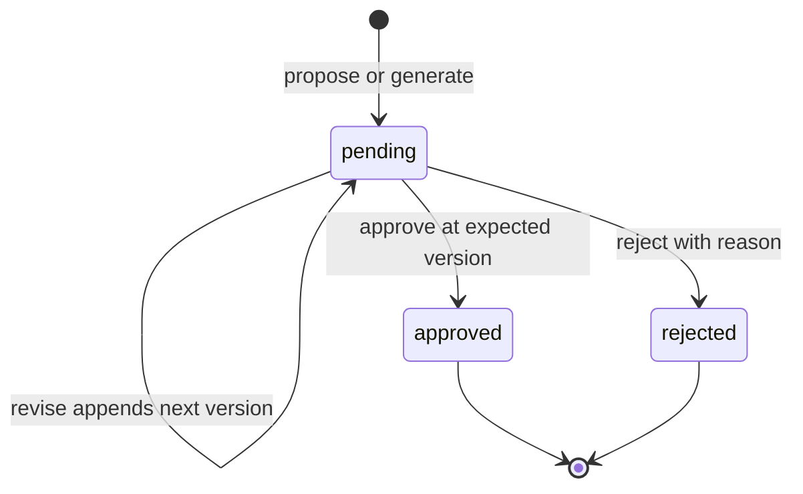

# Experience, Candidate Review and Skill Lifecycle

This page describes how Experience and managed Skill content moves from evidence to a reviewed, immutable Artifact Revision, and how an approved Skill later reaches a host. Source references point at repository commit `b8b18909`.

The system has two write paths into the Experience and Skill families:

- **Generated proposal path.** Generation, scheduled incubation, recurrence, and Dream runs create a **Candidate**. A Candidate is a pending proposal. Nothing becomes an Artifact Revision until a reviewer approves the exact version.
- **Direct Create/Replace path.** `POST` to the artifacts collection and `PUT` to a single Artifact commit a Revision immediately. **Direct Create/Replace does not create a Candidate**, and there is no review step.

Approved Skills are inert content. Approval does not install a Skill, grant execution authority, or put it into `PreparedContext`. A separate export or publication operation projects one exact Revision into a host.

For the underlying Artifact model, see [Artifact families](../concepts/artifact-families.md). For how Source windows are read, see [Sources and processing](../concepts/sources-and-processing.md).

## Responsibilities and entrypoints

| Responsibility | Where it lives |
| --- | --- |
| Generate a proposal from exact evidence | `ReviewedGenerationService` in `builtin/review/generation.py` |
| Incubate Experiences from Task Outcome Sources | `_RelationalExperienceIncubator.flush` in `builtin/runtime/relational.py` |
| Record recurrence and propose repair revisions | `RelationalRecurrenceLedger` in `builtin/runtime/recurrence.py` |
| Own Candidate storage and the pending-head CAS | `CandidateRepository` in `builtin/persistence/candidates.py` |
| Validate, revise, reject, and approve Candidates | `ReviewService` in `builtin/review/service.py` |
| Commit direct Create and Replace | `RelationalRecordService.create_artifact` and `replace_artifact` in `builtin/persistence/records.py`, with family writers in `builtin/persistence/family_management.py` |
| Export one Revision to a host directory | `_export_managed_skill` in `client/cli.py` and the projection modules under `client/projections/` |
| Track server-side publication intent and local observations | `ManagedSkillPublicationService` in `builtin/artifacts/skill/publication.py` and `SkillPublicationRepository` in `builtin/persistence/skill_publications.py` |
| Deliver remote desired state to a target | `RemoteSkillDistributionService` in `builtin/artifacts/skill/distribution.py` and `RemoteSkillReceiver` in `client/skill_receiver.py` |

## Candidate lifecycle

A Candidate has a stable identity, a mutable head, and immutable numbered versions. The head records the current version and status. Each version stores one complete proposal, its sources, artifact references, optional target, and reason. The `Candidate` status enum has exactly three values: `pending`, `approved`, and `rejected` ([models](repo://src/powercontext/builtin/review/models.py#L37-L48)).

Caption: A Candidate starts pending; revision keeps it pending while advancing the version, and approval or rejection is terminal.

Creation writes version 1 as `pending` and does not write an Artifact ([repository](repo://src/powercontext/builtin/persistence/candidates.py#L70-L140)). A pending Candidate has no `result_artifact`. Approval records the exact `result_artifact` in the same transaction that commits the Artifact, and rejection records only a decision reason.

## The expected_version contract

Every reviewer decision names the version the reviewer inspected. The contract is a compare-and-swap on the pending head:

- `revise`, `approve`, and `reject` pass `expected_version`. The repository updates the head only where `candidate_id`, the artifact kind, `version`, and `status = pending` all match ([lock_pending](repo://src/powercontext/builtin/persistence/candidates.py#L299-L323)).
- If the update matches no row, the repository re-reads the head. A non-pending head raises a terminal error. A pending head with a newer version raises a conflict error ([helper](repo://src/powercontext/builtin/persistence/candidates.py#L401-L404)).
- Before a revision writes anything, the service compares the preview version with `expected_version` and raises a conflict if they differ ([revise](repo://src/powercontext/builtin/review/service.py#L544-L570)).

A reviewer therefore never applies a decision to content it did not inspect. If another writer revised the Candidate, the old version number is stale and the decision fails without a partial write.

## Generated proposal path

Each generated path resolves evidence first and calls the model outside any write transaction, then hands the typed proposal to `ReviewService`:

1. **Experience generation** loads the exact Source and Artifact references, requires a configured Experience generator, and proposes through `propose_experience`. A `no_op` result from the model creates no Candidate ([generation](repo://src/powercontext/builtin/review/generation.py#L107-L134)).
2. **Skill generation** validates the origin before any model call, then proposes through `propose_skill`. The three origins are fixed:
   - `experience` requires one or more Experience references and no target.
   - `source` requires exact Sources and no Artifact references.
   - `usage` requires the exact target Skill plus Source evidence that records its use ([validate_skill_lineage](repo://src/powercontext/builtin/review/generation.py#L233-L262)).
3. **Scheduled incubation** is described below.
4. **Dream runs** produce Candidates through the same `propose_*` methods, with candidate identities prefixed `cand_dream_`. At approval, the service checks that the run and operation match the Candidate ([Dream](repo://src/powercontext/builtin/dream/service.py#L515-L545), [approval check](repo://src/powercontext/builtin/review/service.py#L700-L725)).

Generation returns a pending Candidate or an explicit no-op. It never approves, installs, exports, or recalls the proposal.

### Experience content

An Experience proposal has four required fields, `situation`, `action`, `outcome`, and `lesson`, and an optional `failure` block. The failure block carries a recall cue, a repair surface, and verification bindings used later for recurrence matching ([models](repo://src/powercontext/builtin/artifacts/experience/models.py#L15-L84)). A human or integration with complete typed content can call `propose_experience` without a model.

## Review operations

### Revise

`revise` appends a complete replacement proposal as the next version, so the reviewer sends the whole proposal rather than a diff. It does not change the target. It re-runs family validation, canonicalizes Skill packages, rechecks Dream Skill targets, and resolves evidence again before the CAS write ([revise](repo://src/powercontext/builtin/review/service.py#L544-L625)).

### Reject

`reject` requires a reason and moves the pending head to `rejected`. It writes no Artifact, and it is terminal ([reject](repo://src/powercontext/builtin/review/service.py#L627-L656), [persistence](repo://src/powercontext/builtin/persistence/candidates.py#L271-L297)). A correction requires a new Candidate.

### Approve

Approval is the only operation that creates an Artifact Revision from a Candidate. In one database transaction the service:

1. Validates the approval lineage and locks the generic review inputs.
2. Re-checks the pending head with `expected_version` ([lock](repo://src/powercontext/builtin/review/service.py#L700-L735)).
3. Creates the Artifact if the Candidate has no target, or appends the next Revision under the target identity. A target whose head has moved raises an Artifact target conflict ([publish](repo://src/powercontext/builtin/review/service.py#L735-L781)).
4. Updates the Experience index or the Skill package index.
5. Calls `mark_approved` with the exact result Artifact ([persistence](repo://src/powercontext/builtin/persistence/candidates.py#L325-L355)).

If any step fails, the Artifact write and the status update roll back together. A test covers a projection failure during Experience approval ([test](repo://tests/builtin/review/test_service.py#L464-L517)).

Approval has three terminal-state rules:

- Approving a rejected Candidate raises a terminal error before any target or evidence work ([approve](repo://src/powercontext/builtin/review/service.py#L658-L692)).
- Approving an approved Candidate at the same version returns the stored result, which handles overlapping retries.
- If approval loses a race to another publication, the service re-reads the terminal decision. A stale replacement stays pending when another writer advanced the target head first ([test](repo://tests/builtin/review/test_service.py#L833-L886)).

### Evidence and target checks

Exact references are checked at proposal, revision, and approval. Every Source and Artifact must exist in the Candidate's scope and resolve through the evidence resolver. A failure-bearing Experience must cite a failed Task Outcome whose verified exact evidence matches its recall cue ([evidence](repo://src/powercontext/builtin/review/service.py#L1088-L1144), [failure check](repo://src/powercontext/builtin/review/service.py#L1313-L1358)).

A replacement names the exact current Revision in both `target` and `artifacts`. The target must match the latest head at proposal time ([target](repo://src/powercontext/builtin/review/service.py#L1154-L1177)). If another approval advanced the head first, the stale replacement is not published. It remains pending until a reviewer rejects it or inspects the new head and decides how to proceed.

## Review authority

Review authority depends on the Server access mode, described in the [review procedure](../../docs/en/docs/workflows/review-candidates.md) guide that operators use.

- **Disabled mode.** Review operations are not bound to a reviewer identity.
- **Enforced mode.** Review decisions are authorized through the access hook on each decision. The `scope.reviewer` role grants `scope.review` together with `scope.read` ([role map](repo://src/powercontext/server/authz/models.py#L375-L382)). The permission flags returned to clients are computed from the same `scope.review` check and from ownership ([permissions](repo://src/powercontext/server/app.py#L4811-L4840)).
- **Revise** additionally requires that the caller is the original proposer recorded by the candidate-owner attestation. A reviewer who did not propose the Candidate cannot revise it.
- **Approve** in enforced mode requires a recorded candidate-owner attestation. If none exists, the request fails with `artifact_owner_pending`. The first successful approval establishes the resulting Artifact's owner from that attestation ([approve endpoint](repo://src/powercontext/server/app.py#L4887-L4925)).

Separating submission from review therefore depends on role assignment. A single identity that holds both submission and review permissions can approve its own proposal.

## Experience recall and incubation

### Recall

Only approved, current Experience heads are eligible for same-scope `PreparedContext` recall. Pending and rejected Candidates and historical Revisions are excluded ([test](repo://tests/builtin/review/test_service.py#L576-L656)). Recall eligibility does not guarantee selection; the Runtime still applies the query and the shared output budget.

Managed Skills do not enter `PreparedContext`. The test for an approved Skill confirms that its content is absent from the prepared context ([test](repo://tests/builtin/review/test_service.py#L701-L745)).

### Scheduled incubation

Scheduled incubation is off unless `experience_schedule_seconds` is set to a positive value ([config](repo://src/powercontext/builtin/runtime/config.py#L250)). Composition rejects the schedule when no generation model is configured ([composition](repo://src/powercontext/builtin/runtime/composition.py#L2038-L2040)).

Each activation inspects at most 32 Sources from the cursor window and keeps only those with `kind: task-outcome`. The pipeline sends the eligible inputs (bounded to 100 Sources and 64,000 characters each) to the model and maps each returned candidate back to the exact Source ids it cites. A candidate that cites a Source outside the window is rejected as invalid output ([pipeline](repo://src/powercontext/builtin/artifacts/experience/incubation.py#L88-L150)).

The job writes pending Experience Candidates and advances its own cursor in the same transaction. It never approves a Candidate, and pending content never enters recall ([flush](repo://src/powercontext/builtin/runtime/relational.py#L1841-L1990)).

### Recurrence

The recurrence ledger is written only inside the incubation window. It is append-only and idempotent: replaying a window reuses recorded decisions rather than asking the generator again. It records three event types, `selected`, `avoided`, and `recurred`, and each `recurred` match freezes its candidate set before any decision is recorded ([ledger](repo://src/powercontext/builtin/runtime/recurrence.py#L15-L25), [window](repo://src/powercontext/builtin/runtime/recurrence.py#L107-L121)).

A repair proposal is created only when one Experience revision reaches a terminal recurrence streak of at least three ([threshold](repo://src/powercontext/builtin/artifacts/experience/recurrence.py#L38)). Only the `experience_content` repair surface yields an Artifact proposal. A `recall_policy`, `working_state`, or `acceptance_check` repair is a retrieval or process problem and produces no Experience revision ([proposal](repo://src/powercontext/builtin/runtime/recurrence.py#L275-L320)). The resulting proposal is a pending Candidate that targets the exact current revision.

## Direct Create and Replace

The direct path is the non-review write. It is useful for trusted, typed content that a reviewer does not need to gate, but it bypasses the Candidate lifecycle entirely.

- **Create** is `POST` to the scope's artifacts collection. The request validates family content, stores a lineage-only Source describing the write, and commits the Artifact through the family writer in one transaction ([route](repo://src/powercontext/server/app.py#L2888-L2911), [records](repo://src/powercontext/builtin/persistence/records.py#L354-L400)). Experience and Skill have their own writers that also update the Experience index or the Skill package index ([Experience writer](repo://src/powercontext/builtin/persistence/family_management.py#L254-L268), [Skill writer](repo://src/powercontext/builtin/persistence/family_management.py#L330-L345)).
- **Replace** is `PUT` to one Artifact. It requires an `If-Match` ETag that equals the current revision's ETag. A mismatch raises a precondition error. A match writes the next Revision as the current head ([route](repo://src/powercontext/server/app.py#L3289-L3316), [records](repo://src/powercontext/builtin/persistence/records.py#L710-L780)).

Neither operation creates a Candidate, and neither produces a `pending` state. A reviewer who wants a second look must generate or propose through the Candidate path instead. Memory writes follow the same rule: a Memory write remains direct and does not create a Candidate ([test](repo://tests/builtin/review/test_service.py#L446-L460)).

## Skill content and canonical packages

Managed Skill content is stored as an instruction package. On create, replace, and approval the Skill writer builds or loads that package and derives the Skill fields from it. A proposal that carries a package reference must match the stored package exactly; otherwise the write is rejected ([writer](repo://src/powercontext/builtin/persistence/family_management.py#L298-L320), [service](repo://src/powercontext/builtin/review/service.py#L1236-L1254)).

Approving a Skill creates an immutable Skill Revision. It does not write any file on a host. The approval code path only commits the Artifact, the index, and the Candidate status ([approval](repo://src/powercontext/builtin/review/service.py#L735-L781)).

## Exporting a Skill to a host

There are two ways an approved Skill reaches a host, and they have different authority.

### Host-local export (CLI)

`powercontext skill export` is the operator-driven path described in the [export procedure](../../docs/en/docs/workflows/create-and-export-skill.md). It works like this:

1. The CLI reads the exact Skill Revision from the Server ([export](repo://src/powercontext/client/cli.py#L1955-L1975)).
2. If the Skill is text-only, it writes the rendered Skill to a new directory named after the Skill, with a `powercontext.json` manifest that records the exact Artifact reference and a SHA-256 of `SKILL.md` ([projection](repo://src/powercontext/builtin/artifacts/skill/projection.py#L73-L110), [Codex adapter](repo://src/powercontext/client/projections/codex.py#L20-L30)).
3. If the Skill is package-backed, it downloads the archive, rebuilds the package reference locally, and materializes the package only if that reference matches the stored Artifact package ([download](repo://src/powercontext/client/cli.py#L1985-L2016)).
4. The export refuses an existing destination, so it never overwrites a directory it did not create.

The export targets are `codex` and `claude_code` ([projections](repo://src/powercontext/client/projections/__init__.py#L24-L55)). The exported directory is a copy of one Revision. The Artifact remains the content authority.

### Managed publication and remote delivery

The Server also tracks publication state for configured Agent targets. Local publication first records a per-target publication intent, then materializes the package, then observes the result ([publish](repo://src/powercontext/builtin/artifacts/skill/publication.py#L105-L165)):

- **First publication** creates the publication row at generation 0.
- **Identical intent** reuses the stored row and does not advance its generation.
- **Changed intent**, such as a different desired Revision, package digest, or compatibility state, replaces the row through replacement CAS, which checks the expected generation and advances it by one ([intent](repo://src/powercontext/builtin/artifacts/skill/publication.py#L265-L308)).
- **Observation** writes the result of the local materialization through observation CAS. It checks the expected generation but does not advance it ([observation CAS](repo://src/powercontext/builtin/persistence/skill_publications.py#L173-L208)).

Unpublish moves the existing directory aside first, advances the publication generation, and restores the directory if the database update fails ([unpublish](repo://src/powercontext/builtin/artifacts/skill/publication.py#L166-L212), [replacement CAS](repo://src/powercontext/builtin/persistence/skill_publications.py#L132-L172)).

Local inspection classifies a destination as `unpublished`, `current`, `update_available`, `drifted`, `conflict`, or `incompatible`. A directory that the publication does not own is reported as a conflict and is not replaced ([inspection](repo://src/powercontext/builtin/artifacts/skill/publication.py#L315-L455)).

Remote distribution splits intent from action. The Server stores a desired state per target. Reconciliation returns actions only for the latest publication generation, and download serves only the exact package currently desired for that target. A Receipt older than the stored generation is rejected as stale ([distribution](repo://src/powercontext/builtin/artifacts/skill/distribution.py#L411-L467), [reconcile](repo://src/powercontext/builtin/artifacts/skill/distribution.py#L497-L552), [receipts](repo://src/powercontext/builtin/artifacts/skill/distribution.py#L584-L620)). The Receiver applies actions locally, records a Receipt after the local change, keeps signed journals for replay, and keeps a failed Receipt delivery pending instead of mutating the host again ([sync](repo://src/powercontext/client/skill_receiver.py#L211-L268), [replay](repo://src/powercontext/client/skill_receiver.py#L271-L292)).

Export and publication both act only on an exact Revision. Neither approves content or changes review state.

## Invariants and failure behavior

- A pending Candidate is never recallable and never an Artifact Revision.
- Each decision names one version. A stale or terminal Candidate rejects the decision without a partial write.
- Approval is atomic with the Artifact commit and the index update.
- Approved and rejected Candidates are terminal. A correction is a new Candidate.
- Direct Create and Replace commit immediately and create no Candidate.
- A host copy is always a projection of one exact Revision. A Revision's history is preserved by the Artifact, not by the host directory.

## Extension points and operating notes

- Enable scheduled incubation only with a generation model configured, and expect pending Candidates to accumulate for review.
- For team review, use enforced access mode with distinct identities and grant the reviewer the `scope.reviewer` role. See [review candidates](../../docs/en/docs/workflows/review-candidates.md) for the procedure.
- Dream runs and recurrence produce Candidates through the same review path. Operators reviewing a Dream-produced Candidate should check its run lineage, because approval rejects a mismatched origin.

## Focused tests

- `tests/builtin/review/test_service.py` covers approval rollback, replacement conflicts, terminal rejection, managed Skill lineage, memory direct writes, and retrieval gating ([tests](repo://tests/builtin/review/test_service.py#L446-L517)).
- `tests/builtin/review/test_service.py` also covers the Experience revise, approve, and retrieval flow ([flow](repo://tests/builtin/review/test_service.py#L576-L656)) and the managed Skill review gate ([Skill](repo://tests/builtin/review/test_service.py#L701-L745)).
- `tests/codex_plugin/test_skill_projection.py` covers host-local projection behavior for Codex.
