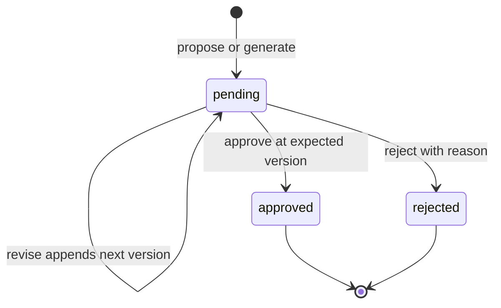
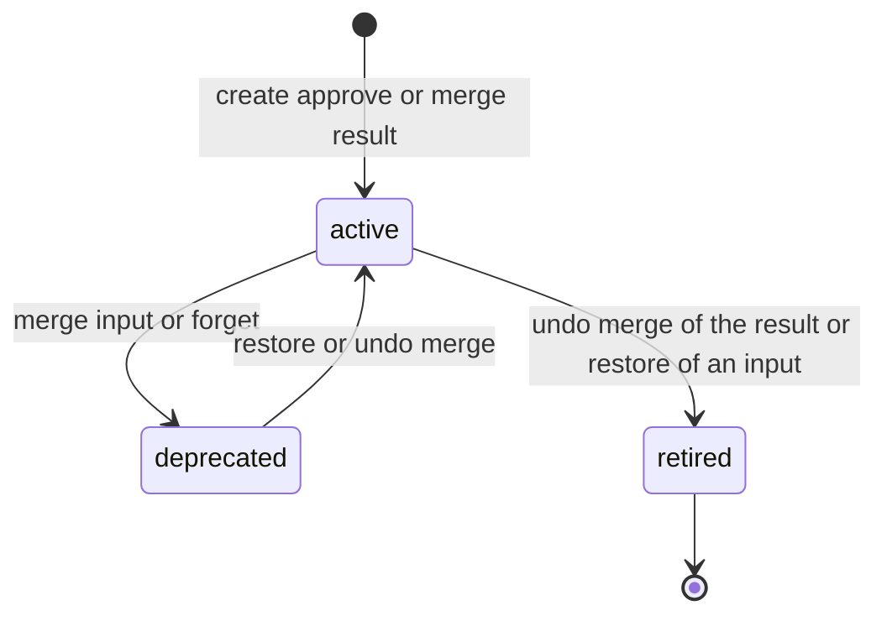
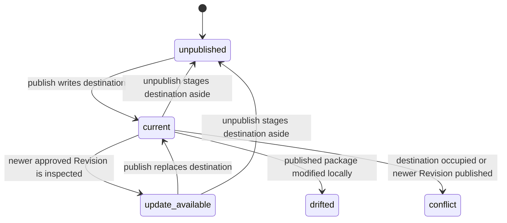

# Workflow: Experience and Skill Lifecycle

This page traces how Experience and managed Skill content moves from evidence to a reviewed, immutable Artifact Revision, how Experience Artifacts are merged or restored, and how an approved Skill reaches a host. Source references point at repository commit `b8b18909`.

The system has three distinct paths:

- **Generated proposal path.** Generation, scheduled incubation, recurrence, and Dream runs create a **Candidate**. A Candidate is a pending proposal. Nothing becomes an Artifact Revision until a reviewer approves the exact version.
- **Direct Create and Replace path.** `POST` to the artifacts collection and `PUT` to one Artifact commit a Revision immediately. Direct writes do not create a Candidate and have no review step.
- **Governance path.** An explicit merge creates a new Experience identity from exact current inputs. Forget and restore change only the lifecycle state of existing Artifacts. None of these creates a Candidate.

Approved Skills are inert content. Approval does not install a Skill, grant execution authority, or put it into `PreparedContext`. A separate export or publication operation projects one exact Revision into a host.

For the underlying Artifact model, see [Artifact families](../concepts/artifact-families.md). For how Source windows are read, see [Sources and processing](../concepts/sources-and-processing.md). For access modes, see [Scopes and access](../concepts/scopes-and-access.md).

## Responsibilities and entrypoints

| Responsibility | Where it lives |
| --- | --- |
| Generate a proposal from exact evidence | `ReviewedGenerationService` in [`builtin/review/generation.py`](repo://src/powercontext/builtin/review/generation.py#L106-L134) |
| Incubate Experiences from Task Outcome Sources | `LLMExperienceCandidatePipeline` in [`builtin/artifacts/experience/incubation.py`](repo://src/powercontext/builtin/artifacts/experience/incubation.py#L96-L190) and `_RelationalExperienceIncubator.flush` in [`builtin/runtime/relational.py`](repo://src/powercontext/builtin/runtime/relational.py#L1826-L1986) |
| Record recurrence and propose repair revisions | `RelationalRecurrenceLedger` in [`builtin/runtime/recurrence.py`](repo://src/powercontext/builtin/runtime/recurrence.py#L15-L25) |
| Own Candidate storage and the pending-head CAS | `CandidateRepository` in [`builtin/persistence/candidates.py`](repo://src/powercontext/builtin/persistence/candidates.py#L70-L140) |
| Validate, revise, reject, and approve Candidates | `ReviewService` in [`builtin/review/service.py`](repo://src/powercontext/builtin/review/service.py#L544-L781) |
| Bind review authorization in enforced mode | `DreamAccess.review_action` in [`server/dream_access.py`](repo://src/powercontext/server/dream_access.py#L106-L123) |
| Commit direct Create and Replace | `RelationalRecordService.create_artifact` and `replace_artifact` in [`builtin/persistence/records.py`](repo://src/powercontext/builtin/persistence/records.py#L354-L400), with family writers in [`builtin/persistence/family_management.py`](repo://src/powercontext/builtin/persistence/family_management.py#L250-L366) |
| Merge, forget, and restore Artifacts through one shared engine | `ArtifactMergeService` in [`builtin/artifacts/merge.py`](repo://src/powercontext/builtin/artifacts/merge.py#L115-L381), registered per Family by `ArtifactMergeApplication` in [`builtin/runtime/artifact_merge.py`](repo://src/powercontext/builtin/runtime/artifact_merge.py#L118-L250) |
| Export one Revision to a host directory | `_export_managed_skill` in [`client/cli.py`](repo://src/powercontext/client/cli.py#L1955-L2022) and the projection modules under `client/projections/` |
| Track server-side publication intent and local observations | `ManagedSkillPublicationService` in [`builtin/artifacts/skill/publication.py`](repo://src/powercontext/builtin/artifacts/skill/publication.py#L105-L212) and `SkillPublicationRepository` in [`builtin/persistence/skill_publications.py`](repo://src/powercontext/builtin/persistence/skill_publications.py#L132-L208) |
| Deliver remote desired state to a target | `RemoteSkillDistributionService` in [`builtin/artifacts/skill/distribution.py`](repo://src/powercontext/builtin/artifacts/skill/distribution.py#L411-L620) and `RemoteSkillReceiver` in [`client/skill_receiver.py`](repo://src/powercontext/client/skill_receiver.py#L211-L292) |

## Lifecycle states

The code defines three state machines. Each one is separate, and a transition in one does not imply a transition in another.

### Candidate

A Candidate has a stable identity, a mutable head, and immutable numbered versions. The head records the current version and status. Each version stores one complete proposal, its sources, artifact references, optional target, and reason. The `CandidateStatus` enum has exactly three values: `pending`, `approved`, and `rejected` ([models](repo://src/powercontext/builtin/review/models.py#L38-L43)).

Caption: A Candidate starts pending. Revision keeps it pending while advancing the version. Approval and rejection are terminal.

### Artifact governance (Experience and Skill)

Approval, merge, forget, and restore change an Artifact's `ArtifactLifecycleState`, which has three values: `active`, `deprecated`, and `retired` ([governance](repo://src/powercontext/builtin/persistence/artifact_governance.py#L35-L40)).

Caption: A merge input becomes deprecated and points to its result. Restoring an input reactivates it and retires the result. A retired identity cannot be restored.

### Skill publication (local target)

A local Agent target reports one `AgentSkillProjectionState` for a managed Skill. The enum defines eight values, but local inspection produces six of them. `pending` and `delivery_failed` come from the remote distribution path ([states](repo://src/powercontext/builtin/artifacts/skill/projection.py#L42-L50)).

Caption: Publish and unpublish are the only operations that move the destination. Drifted and conflict states block publish until the local condition is resolved.

## Candidate lifecycle

Creation writes version 1 as `pending` and does not write an Artifact ([repository](repo://src/powercontext/builtin/persistence/candidates.py#L70-L140)). A pending Candidate has no `result_artifact`. Approval records the exact `result_artifact` in the same transaction that commits the Artifact, and rejection records only a decision reason.

### The expected_version contract

Every reviewer decision names the version the reviewer inspected. The contract is a compare-and-swap on the pending head:

- `revise`, `approve`, and `reject` pass `expected_version`. The repository updates the head only where `candidate_id`, the artifact kind, `version`, and `status = pending` all match ([lock_pending](repo://src/powercontext/builtin/persistence/candidates.py#L299-L323)).
- If the update matches no row, the repository re-reads the head. A non-pending head raises a terminal error. A pending head with a newer version raises a conflict error ([helper](repo://src/powercontext/builtin/persistence/candidates.py#L487-L491)).
- Before a revision writes anything, the service compares the preview version with `expected_version` and raises a conflict if they differ ([revise](repo://src/powercontext/builtin/review/service.py#L544-L575)).

A reviewer therefore never applies a decision to content it did not inspect. If another writer revised the Candidate, the old version number is stale and the decision fails without a partial write.

## Generated proposal path

Each generated path resolves evidence first and calls the model outside any write transaction, then hands the typed proposal to `ReviewService`:

1. **Experience generation** loads the exact Source and Artifact references, requires a configured Experience generator, and proposes through `propose_experience`. If the generator returns no proposal, the result is an empty `GeneratedCandidateResult` and no Candidate is created ([generation](repo://src/powercontext/builtin/review/generation.py#L106-L134)).
2. **Skill generation** validates the origin before any model call, then proposes through `propose_skill`. The three origins are fixed:
   - `experience` requires one or more Experience references and no target.
   - `source` requires exact Sources and no Artifact references.
   - `usage` requires the exact target Skill plus Source evidence that records its use ([validate_skill_lineage](repo://src/powercontext/builtin/review/generation.py#L233-L262)).
3. **Scheduled incubation** is described below.
4. **Dream runs** produce Candidates through the same `propose_*` methods. The Candidate identity is `cand_dream_` followed by the run id. At approval, the service checks that the run's operation and Candidate identity match ([Dream](repo://src/powercontext/builtin/dream/service.py#L779-L781), [approval check](repo://src/powercontext/builtin/review/service.py#L700-L725)).

Generation returns a pending Candidate or an explicit no-op. It never approves, installs, exports, or recalls the proposal.

### Experience content

An Experience proposal has four required fields, `situation`, `action`, `outcome`, and `lesson`, and an optional `failure` block. The failure block carries a recall cue, a repair surface, and verification bindings used later for recurrence matching ([models](repo://src/powercontext/builtin/artifacts/experience/models.py#L15-L84)). A human or integration with complete typed content can call `propose_experience` without a model.

### Scheduled incubation

Scheduled incubation is off unless `experience_schedule_seconds` is set to a positive value. The default is `None`, and the field accepts only values greater than zero ([config](repo://src/powercontext/builtin/runtime/config.py#L258-L258)). When the schedule is set and no generation model is configured, composition raises `scheduled-experience-pipeline` at startup ([composition](repo://src/powercontext/builtin/runtime/composition.py#L2038-L2039)).

An incubation activation runs in this order:

1. `ScopedExperienceApplication.incubate` rejects a window limit below 1, and uses `EXPERIENCE_INCUBATION_WINDOW_LIMIT`, 32, when no limit is supplied ([application](repo://src/powercontext/builtin/runtime/application.py#L2936-L2966)).
2. The flush loads the cursor and the journal high watermark. If no window is available, it returns a no-op result ([flush](repo://src/powercontext/builtin/runtime/relational.py#L1837-L1860)).
3. The window's Sources are read. Only Sources whose kind is `task-outcome` are sent to the pipeline. The pipeline returns no candidates when no eligible Source exists, and the model is not called ([pipeline](repo://src/powercontext/builtin/artifacts/experience/incubation.py#L96-L124)).
4. If eligible rows exist, the pipeline calls the model once. Each returned candidate must cite Source ids from the window; a candidate that cites a Source outside the window raises `InvalidInferenceOutputError` ([selection](repo://src/powercontext/builtin/artifacts/experience/incubation.py#L164-L190), [window check](repo://src/powercontext/builtin/runtime/relational.py#L1953-L1985)).
5. In one transaction, the flush writes the pending Candidates, records recurrence events, and saves the cursor. The cursor is therefore not advanced if a Candidate write fails ([flush](repo://src/powercontext/builtin/runtime/relational.py#L1892-L1934)).
6. When the window holds no eligible Source, the flush saves the cursor in its own transaction and writes no Candidate. A window with only lineage-only Sources still advances the cursor over the full window.

Incubation never approves a Candidate, and pending content never enters recall.

### Recurrence

The recurrence ledger is written only inside the incubation window. It is append-only and idempotent: replaying a window reuses recorded decisions rather than asking the generator again. It records three event types, `selected`, `avoided`, and `recurred`, and each `recurred` match freezes its candidate set before any decision is recorded ([ledger](repo://src/powercontext/builtin/runtime/recurrence.py#L15-L25), [window](repo://src/powercontext/builtin/runtime/recurrence.py#L107-L121)).

A repair proposal is created only when one Experience revision reaches a terminal recurrence streak of at least three ([threshold](repo://src/powercontext/builtin/artifacts/experience/recurrence.py#L38-L38)). Only the `experience_content` repair surface yields an Artifact proposal. A `recall_policy`, `working_state`, or `acceptance_check` repair is a retrieval or process problem and produces no Experience revision ([proposal](repo://src/powercontext/builtin/runtime/recurrence.py#L266-L320)). The resulting proposal is a pending Candidate that targets the exact current revision.

## Review operations

### Revise

`revise` appends a complete replacement proposal as the next version, so the reviewer sends the whole proposal rather than a diff. It does not change the target. The service reads a preview, rejects a version mismatch, locks the generic review inputs for Experience and Skill, re-validates the family proposal, canonicalizes Skill packages, rechecks Dream Skill targets, and resolves evidence again before the CAS write ([revise](repo://src/powercontext/builtin/review/service.py#L544-L625)).

### Reject

`reject` requires a reason and moves the pending head to `rejected`. It writes no Artifact, and it is terminal ([reject](repo://src/powercontext/builtin/review/service.py#L627-L656), [persistence](repo://src/powercontext/builtin/persistence/candidates.py#L271-L297)). A correction requires a new Candidate.

### Approve

Approval is the only operation that creates an Artifact Revision from a Candidate. The service branches on the current status before any write:

1. If the Candidate is `rejected`, it raises a terminal error before any target or evidence work ([approve](repo://src/powercontext/builtin/review/service.py#L681-L686)).
2. If the Candidate is already `approved` at the same version, it returns the stored result. This handles overlapping retries. A different version raises a conflict.
3. Otherwise, in one database transaction the service validates the approval lineage, locks the generic review inputs, re-checks the pending head with `expected_version`, and authorizes the decision again ([lock](repo://src/powercontext/builtin/review/service.py#L700-L735)).
4. For a Dream Skill, the service confirms that the run's operation is `derive_skill` or `revise_skill` and that the run points at the same Candidate. A `revise_skill` must still target its original Revision ([Dream origin](repo://src/powercontext/builtin/review/service.py#L700-L725)).
5. The service creates the Artifact if the Candidate has no target, or appends the next Revision under the target identity. A target whose head has moved raises an Artifact target conflict ([publish](repo://src/powercontext/builtin/review/service.py#L735-L781)).
6. It updates the Experience index, or the Skill package index when the Skill has a package.
7. It calls `mark_approved` with the exact result Artifact ([persistence](repo://src/powercontext/builtin/persistence/candidates.py#L325-L355)).

If any step fails, the Artifact write and the status update roll back together. A test covers a projection failure during Experience approval ([test](repo://tests/builtin/review/test_service.py#L464-L517)).

The `approve` wrapper handles a losing race. When the commit raises an artifact target conflict, a terminal error, or a revision conflict, it re-reads the Candidate. A rejected Candidate raises a terminal error. An approved Candidate at the expected version returns its result. Otherwise the original error is re-raised ([wrapper](repo://src/powercontext/builtin/review/service.py#L658-L675)). A stale replacement stays pending when another writer advanced the target head first ([test](repo://tests/builtin/review/test_service.py#L833-L886)).

### Evidence and target checks

Exact references are checked at proposal, revision, and approval. Every Source and Artifact must exist in the Candidate's scope and resolve through the evidence resolver. A failure-bearing Experience must cite a failed Task Outcome whose verified exact evidence matches its recall cue. If not, evidence validation raises `InvalidCandidateError` ([evidence](repo://src/powercontext/builtin/review/service.py#L1088-L1144), [failure check](repo://src/powercontext/builtin/review/service.py#L1313-L1351)).

A replacement names the exact current Revision in both `target` and `artifacts`. The target must match the latest head at proposal time ([target](repo://src/powercontext/builtin/review/service.py#L1154-L1177)). If another approval advanced the head first, the stale replacement is not published. It remains pending until a reviewer rejects it or inspects the new head and decides how to proceed.

## Review authority

Review authority depends on the Server access mode, described in the [review procedure](../../docs/en/docs/workflows/review-candidates.md) guide that operators use.

### Disabled mode

The Server binds the review authorization hook only when access is enforced. `DreamAccess` is constructed only when `resolved.access.mode == "enforced"` ([factory](repo://src/powercontext/server/factory.py#L263-L266)). In disabled mode, `ReviewService.authorize_action` stays unset, so review operations are not bound to a reviewer identity. Candidate responses carry no `permissions` object because `access_control_for_mode` returns no control when access is disabled ([permissions](repo://src/powercontext/server/app.py#L5385-L5414)).

### Enforced mode

Each decision calls `DreamAccess.review_action` before the write ([hook](repo://src/powercontext/server/dream_access.py#L106-L123)):

- All decisions first require an identity and the `scope.review` permission on the scope. The `scope.reviewer` role grants `scope.review` together with `scope.read` ([role map](repo://src/powercontext/builtin/authz/models.py#L375-L382)).
- `reject` stops after the scope check.
- `approve` and `revise` also require write authority on the Candidate's target Artifact when a target exists.
- `revise` additionally requires that the caller is the original proposer recorded by the candidate-owner attestation. A reviewer who did not propose the Candidate cannot revise it ([revise endpoint](repo://src/powercontext/server/app.py#L5512-L5537)).

Each Experience or Skill proposal and generation attests the request principal as the candidate owner. The attestation runs after the proposal commits ([attestation](repo://src/powercontext/server/app.py#L5234-L5266), [propose](repo://src/powercontext/server/app.py#L4627-L4645)).

The approve endpoint requires a recorded attestation before the approval runs. If none exists, the request fails with `artifact_owner_pending`. A Candidate without a target establishes the resulting Artifact's owner from the attestation after its first successful approval. A Candidate that targets an existing Artifact does not change that Artifact's owner ([approve endpoint](repo://src/powercontext/server/app.py#L5460-L5501)).

Separating submission from review therefore depends on role assignment. A single identity that holds both submission and review permissions can approve its own proposal.

## Explicit Experience merge, forget, and restore

Merge, forget, and restore are governance operations on existing Artifacts. They are not Candidate paths. The same shared engine serves the Experience Family and the shared Artifact Family services. The `ExperienceMergeAdapter` accepts direct Sources and exact in-Scope Artifacts as lineage, and rejects publication lineage on new writes ([adapter](repo://src/powercontext/builtin/artifacts/experience/merge.py#L24-L60)). Composition registers the Experience merge service with the shared application ([composition](repo://src/powercontext/builtin/runtime/composition.py#L509-L519)).

### Merge

`POST /v1/scopes/{scope_id}/artifacts/{family}/merges` is the HTTP entry point ([operation](repo://src/powercontext/http/_generated/operations.py#L1642-L1659), [handler](repo://src/powercontext/server/app.py#L1924-L1968)). The handler maps each input to an exact `ArtifactMergeRead` with its `state_version`, then calls `ScopedArtifactMerge.merge`.

`inspect_merge` accepts the request only when:

- there are at least two distinct inputs, all in the Experience Family, and the new result identity is not one of them,
- each input's current read equals the expected read (its revision and state version), otherwise it raises a conflict,
- each input is `active` with no `merged_into_id`, otherwise it raises an invalid-state error ([inspect_merge](repo://src/powercontext/builtin/artifacts/merge.py#L317-L385)).

When it succeeds, the plan writes one `active` result with the frozen inputs as lineage. Each input becomes `deprecated` with `merged_into_id` set to the result ([plan](repo://src/powercontext/builtin/artifacts/merge.py#L355-L384)). The merge then prepares projections outside any connection, and commits in a second write transaction ([merge](repo://src/powercontext/builtin/runtime/artifact_merge.py#L207-L231)). The commit validates the preview and dependencies before it publishes any write ([commit window](repo://src/powercontext/builtin/artifacts/merge.py#L543-L628)).

### Forget

`forget` deprecates one exact current Artifact without a replacement and without a new content Revision. It requires the expected revision and state version. It rejects an Artifact that is already merged or not `active` or `deprecated`. When the Artifact is already `deprecated`, it writes nothing ([inspect_forget](repo://src/powercontext/builtin/artifacts/merge.py#L387-L419), [runtime](repo://src/powercontext/builtin/runtime/artifact_merge.py#L233-L251)).

### Restore and undo merge

`inspect_restore` walks the `merged_into_id` chain from the target to its endpoint. A retired identity cannot be restored. A live path cannot end in a retired result ([calculate_restoration](repo://src/powercontext/builtin/artifacts/merge_restoration.py#L51-L86)). For `restore`, the target becomes `active`. For `undo_merge`, the result ids in the path become `retired`, and their frozen inputs become `active` again ([expansion](repo://src/powercontext/builtin/artifacts/merge_restoration.py#L124-L160)). Restoring an older content revision creates a new Revision with the selected content.

A restore preview is signed. `preview_restoration` returns a token and its endpoint, and `restore` validates the token before commit ([preview](repo://src/powercontext/builtin/runtime/artifact_merge.py#L272-L297)). Preview tokens need an explicitly configured shared signing key. Without one, `_signer` raises `invalid_preview` ([signer](repo://src/powercontext/builtin/artifacts/merge.py#L1048-L1054), [composition](repo://src/powercontext/builtin/runtime/composition.py#L496-L507)). The token lifetime defaults to 300 seconds, with a maximum of 3600 ([config](repo://src/powercontext/builtin/runtime/config.py#L270-L270)).

A restore without a preview token retries a conflict up to `restore_retry_budget`, which defaults to 3, and then raises. A restore with a preview token converts a conflict into a stale-preview error without retrying ([restore](repo://src/powercontext/builtin/runtime/artifact_merge.py#L298-L321)).

## Direct Create and Replace

The direct path is the non-review write. It is useful for trusted, typed content that a reviewer does not need to gate, but it bypasses the Candidate lifecycle entirely.

- **Create** is `POST` to the scope's artifacts collection. The handler validates the family content and calls the record service. The record service stores a lineage-only Source describing the write and commits the Artifact through the family writer in one transaction ([route](repo://src/powercontext/server/app.py#L3071-L3100), [records](repo://src/powercontext/builtin/persistence/records.py#L354-L400)). The Experience writer also updates the Experience index ([Experience writer](repo://src/powercontext/builtin/persistence/family_management.py#L250-L268)). The Skill writer canonicalizes the package and updates the Skill package index ([Skill writer](repo://src/powercontext/builtin/persistence/family_management.py#L287-L345)).
- **Replace** is `PUT` to one Artifact. It requires an `If-Match` ETag that equals the current revision's ETag. A mismatch raises a precondition error. A match writes the next Revision as the current head ([route](repo://src/powercontext/server/app.py#L3554-L3626), [records](repo://src/powercontext/builtin/persistence/records.py#L710-L780)).

Neither operation creates a Candidate, and neither produces a `pending` state. A reviewer who wants a second look must generate or propose through the Candidate path instead. Memory writes follow the same rule: a Memory write remains direct and does not create a Candidate ([test](repo://tests/builtin/review/test_service.py#L446-L462)).

## Skill content and canonical packages

Managed Skill content is stored as an instruction package. On create, replace, and approval the Skill writer builds or loads that package and derives the Skill fields from it. A proposal that carries a package reference must match the stored package exactly; otherwise the write is rejected ([writer](repo://src/powercontext/builtin/persistence/family_management.py#L298-L320), [service](repo://src/powercontext/builtin/review/service.py#L1236-L1254)).

Approving a Skill creates an immutable Skill Revision. It does not write any file on a host. The approval code path only commits the Artifact, the index, and the Candidate status ([approval](repo://src/powercontext/builtin/review/service.py#L735-L781)).

## Exporting a Skill to a host

There are two ways an approved Skill reaches a host, and they have different authority.

### Host-local export (CLI)

`powercontext skill export` is the operator-driven path described in the [export procedure](../../docs/en/docs/workflows/create-and-export-skill.md). It branches on whether the Skill has a package:

1. The CLI reads the exact Skill Revision from the Server ([export](repo://src/powercontext/client/cli.py#L1955-L1975)).
2. **Text-only Skill** (`content.package` is `None`). The CLI calls `export_skill` for the target. The Codex and Claude Code projections write the rendered Skill to a new directory named after the Skill, with a `powercontext.json` manifest that records the exact Artifact reference and a SHA-256 of `SKILL.md` ([projection](repo://src/powercontext/builtin/artifacts/skill/projection.py#L73-L110), [Codex adapter](repo://src/powercontext/client/projections/codex.py#L36-L38)).
3. **Package-backed Skill.** The CLI downloads the archive, decodes it, and rebuilds the package reference locally. If the decoded archive does not reproduce the stored package reference, the export fails with a mismatch error. Otherwise the package is materialized to the destination ([download](repo://src/powercontext/client/cli.py#L1985-L2016)).
4. The projection refuses an existing destination with `FileExistsError`, so it never overwrites a directory it did not create. The CLI reports that as an export error with exit code 2 ([projection guard](repo://src/powercontext/builtin/artifacts/skill/projection.py#L82-L104)).

The export targets are `codex` and `claude_code` ([projections](repo://src/powercontext/client/projections/__init__.py#L24-L55)). The exported directory is a copy of one Revision. The Artifact remains the content authority.

### Managed publication (local target)

The Server also tracks publication state for configured Agent targets. Local publication runs in this order ([publish](repo://src/powercontext/builtin/artifacts/skill/publication.py#L105-L165)):

1. The call stops unless the target has `allow_managed_publish` enabled. It also stops when the Skill is incompatible with the target.
2. The current observation is read. If the destination already matches the desired Revision, the call records the observation and returns `current`. A `current` state with no publication row is a conflict.
3. The Artifact governance state gates the publish. A `retired` Skill is refused. A `deprecated` Skill is refused unless the caller passes `allow_deprecated`.
4. Only `unpublished` and `update_available` states may publish. Any other state raises a conflict.
5. The publication records its intent, then materializes the package, then writes the observed result through observation CAS.

The intent step has three branches ([intent](repo://src/powercontext/builtin/artifacts/skill/publication.py#L265-L308)):

- **First publication** creates the publication row at generation 0.
- **Identical intent** reuses the stored row and does not advance its generation.
- **Changed intent**, such as a different desired Revision, package digest, or compatibility state, replaces the row through replacement CAS. The replacement `UPDATE` matches `expected_generation` in its WHERE clause and writes `generation` as `expected_generation + 1`. If the update does not match exactly one row, a missing row raises `RepositoryNotFoundError` and a stale generation raises `StoredPayloadConflictError` ([replacement CAS](repo://src/powercontext/builtin/persistence/skill_publications.py#L132-L172)).

Observation writes the result of the local materialization through observation CAS. It checks the expected generation but does not advance it ([observation CAS](repo://src/powercontext/builtin/persistence/skill_publications.py#L173-L208)).

Unpublish moves the existing directory aside first, advances the publication generation, and restores the directory if the database update fails. It returns immediately when there is no publication row or when the destination is already unpublished ([unpublish](repo://src/powercontext/builtin/artifacts/skill/publication.py#L166-L212), [replacement CAS](repo://src/powercontext/builtin/persistence/skill_publications.py#L132-L172)).

Local inspection classifies a destination from its files and the stored row. It reports `incompatible` when the target validation fails, and `conflict` when the destination is occupied outside managed publication, when the stored destination is missing or lies outside the target, when a newer Revision is already published, or when the same Revision has a different identity. It reports `drifted` when the published tree no longer matches the observed digest. It reports `update_available` when the observed Revision is older than the approved one ([inspection](repo://src/powercontext/builtin/artifacts/skill/publication.py#L316-L455)). A directory that the publication does not own is reported as a conflict and is not replaced.

### Remote distribution and receiver

Remote distribution splits intent from action. The Server stores a desired state per target.

- **Publish** requires an active target and an exact package-backed Skill. A `retired` Skill is refused. A `deprecated` Skill is refused unless `allow_deprecated` is set. The first publication creates a `pending` row at generation 0. An identical desired state returns the current row. A changed desired state replaces the row with a `pending` state through replacement CAS ([publish](repo://src/powercontext/builtin/artifacts/skill/distribution.py#L411-L466)).
- **Reconcile** returns actions only for the latest publication generation for the authenticated target. A publication whose observation fails verification is recorded as an observation error ([reconcile](repo://src/powercontext/builtin/artifacts/skill/distribution.py#L497-L552)).
- **Download** serves only the exact package currently desired for that target. A request with a stale generation, a different digest, or an unpublished state is refused ([download](repo://src/powercontext/builtin/artifacts/skill/distribution.py#L553-L583)).
- **Receipt** is generation-bound. A Receipt older than the stored generation is rejected as stale. A Receipt newer than the desired state is an error ([receipts](repo://src/powercontext/builtin/artifacts/skill/distribution.py#L584-L620)).

The Receiver's `sync` runs in this order ([sync](repo://src/powercontext/client/skill_receiver.py#L211-L268)):

1. It replays signed journals for receipts that were not delivered. If any receipt is still pending, it returns immediately without reconciling ([replay](repo://src/powercontext/client/skill_receiver.py#L271-L292)).
2. It reconciles with the Server and applies each returned action locally. An install downloads the package first. A failure while applying an action records a failure Receipt. If that Receipt cannot be delivered, the desired generation stays retryable.
3. After a local change, it records a success Receipt. If delivery fails, the change stays pending for replay and the Receiver does not mutate the host again.

Export and publication both act only on an exact Revision. Neither approves content or changes review state.

## Invariants and failure behavior

- A pending Candidate is never recallable and never an Artifact Revision.
- Each decision names one version. A stale or terminal Candidate rejects the decision without a partial write.
- Approval is atomic with the Artifact commit and the index update.
- Approved and rejected Candidates are terminal. A correction is a new Candidate.
- Direct Create and Replace commit immediately and create no Candidate.
- Merge deprecates its inputs and retires nothing. A result becomes retired only when a restore or undo of one of its inputs moves the group back.
- A host copy is always a projection of one exact Revision. A Revision's history is preserved by the Artifact, not by the host directory.

## Extension points and operating notes

- Enable scheduled incubation only with a generation model configured. Expect pending Candidates to accumulate for review.
- For team review, use enforced access mode with distinct identities and grant the reviewer the `scope.reviewer` role. See [review candidates](../../docs/en/docs/workflows/review-candidates.md) for the procedure.
- Dream runs and recurrence produce Candidates through the same review path. Operators reviewing a Dream-produced Candidate should check its run lineage, because approval rejects a mismatched origin.
- Restore previews need `atomic_memory_preview_signing_secret` configured on the server. Without it, previews fail with `invalid_preview`.
- Related workflows: [Atomic memory](atomic-memory.md) and [Memory and handoff](memory-and-handoff.md).

## Focused tests

- `tests/builtin/review/test_service.py` covers approval rollback, replacement conflicts, terminal rejection, managed Skill lineage, memory direct writes, and retrieval gating ([approval rollback](repo://tests/builtin/review/test_service.py#L464-L517), [stale target](repo://tests/builtin/review/test_service.py#L833-L886)).
- The same file covers the Experience revise, approve, and retrieval flow ([flow](repo://tests/builtin/review/test_service.py#L576-L656)) and the managed Skill review gate ([Skill](repo://tests/builtin/review/test_service.py#L701-L745)).
- `tests/builtin/runtime/test_experience_incubation.py` covers the independent cursor and gated candidates ([cursor](repo://tests/builtin/runtime/test_experience_incubation.py#L78-L136)), retry after a generation failure ([retry](repo://tests/builtin/runtime/test_experience_incubation.py#L183-L211)), the fixed 32-Source budget ([budget](repo://tests/builtin/runtime/test_experience_incubation.py#L213-L239)), and lineage-only skipping ([skip](repo://tests/builtin/runtime/test_experience_incubation.py#L241-L262)).
- `tests/e2e/test_artifact_merge_experience.py` covers the explicit merge with frozen inputs, preserved history, and candidate rollback ([merge](repo://tests/e2e/test_artifact_merge_experience.py#L151-L252)), and nested restore ([restore](repo://tests/e2e/test_artifact_merge_experience.py#L319-L404)).
- `tests/codex_plugin/test_skill_projection.py` covers host-local projection behavior for Codex.
