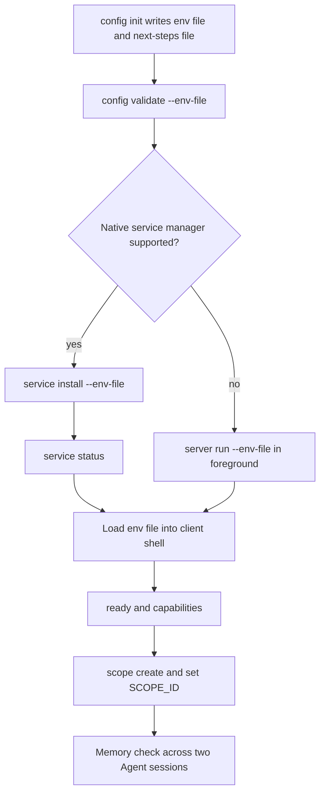
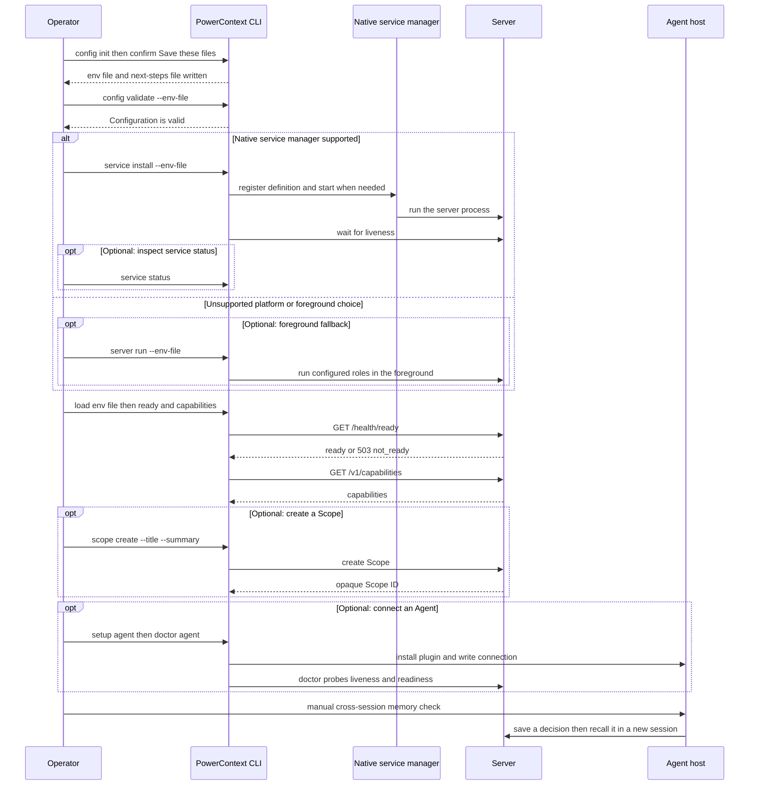

# Install, Configure, Start and Verify

This workflow takes a new installation from generated configuration files to a verified Server. Source references below are to repository commit `b8b18909`. The sequence is: generate files, validate them, start the Server through the personal service (or the foreground fallback), load client settings, run the `ready` and `capabilities` checks, create a Scope, and then perform a real memory check from an Agent session. Each stage answers a different question, and the checks at the end do not prove that memory processing works.



Workflow from first file to verified Server. Saving files and installing dependencies does not start the Server; a start step is always a separate command.



Sequence of the install, config init, server start, Scope creation, host setup, and verification steps. Steps marked `opt` are optional; the foreground fallback applies only when no native service manager is used, and the memory check is manual and is not performed by any command.

## 1. Generate the files with the wizard

`powercontext config init --output .env` runs the guided wizard unless `--template` is given. The wizard collects storage, usage scenario, memory capabilities, network, models, processing, and Agent choices in memory, then previews the change set. Nothing is written until the operator confirms "Save these files?" ([run_wizard](repo://src/powercontext/cli/config_wizard.py#L114-L184), [_finish](repo://src/powercontext/cli/config_wizard.py#L1129-L1184)). Saving first backs up any existing file and writes the environment file with mode `0600` ([write_environment](repo://src/powercontext/cli/config.py#L716-L745)).

The wizard writes two files: the environment file and a sibling `<name>.next-steps.md` document. The next-steps document opens by stating that only files were generated, with no Server, database migration, Scope, or plugin created ([_next_steps](repo://src/powercontext/cli/config_wizard.py#L1283-L1300)). Saving files and installing dependencies therefore does not start the Server.

The wizard's own closing output names the foreground start command `powercontext server run --env-file <file>` and prints the Dashboard and MCP URLs derived from the saved listener ([_show_connection_details](repo://src/powercontext/cli/config_wizard.py#L1235-L1282)). A test confirms that the saved port and the generated client URL match the listener ([test_local_port_is_saved_with_matching_connection_urls](repo://tests/test_config_wizard.py#L72-L100)).

If an environment variable with the `POWERCONTEXT_SERVER_` prefix already exists in the process, the wizard warns that the process environment overrides the file ([_finish](repo://src/powercontext/cli/config_wizard.py#L1139-L1152)). Check the shell before relying on the saved values.

`config init --template` is the model-free alternative. It writes a basic template and refuses to replace an existing file unless `--force` is supplied ([init_command](repo://src/powercontext/cli/config.py#L358-L413)).

## 2. Dependencies that finish in the background (seekdb)

Choosing the embedded seekdb store triggers an automatic dependency check. If `pylibseekdb` is missing and installable, the wizard asks for consent and starts an install in a background task while configuration continues ([_prepare_seekdb_dependency](repo://src/powercontext/cli/config_wizard.py#L319-L346), [inspect_seekdb_dependency](repo://src/powercontext/cli/config_wizard_seekdb.py#L158-L186)). Declining the install notes that it must be completed before Server starts.

The installer first resolves the requirement, then installs it, then validates it. It tries the default index and falls back to the Aliyun mirror when the timezone or an explicit setting calls for it ([run_seekdb_install](repo://src/powercontext/cli/config_wizard_seekdb.py#L188-L232)).

The wizard saves the files first, then waits for the install task to finish and reports one of three outcomes ([_finish_seekdb_install](repo://src/powercontext/cli/config_wizard.py#L1206-L1234)):

- **Ready:** the wizard reports the installed version.
- **Unsupported:** no compatible seekdb wheel exists for this Python and platform. The wizard tells the operator to choose SQLite or OceanBase instead.
- **Failed:** the wizard prints a single manual install command to run before starting the Server.

If the wizard exits before the install finishes, its `finally` block cancels the task ([run_wizard](repo://src/powercontext/cli/config_wizard.py#L114-L184)).

## 3. Validate the file

```bash
powercontext config validate --env-file .env
```

Validation checks syntax, Server settings, and the built-in runtime composition. It prints `Configuration is valid` and does not start the Server ([validate_command](repo://src/powercontext/cli/config.py#L433-L452), [_validate_builtin_runtime](repo://src/powercontext/cli/config.py#L673-L697)). Validation is a static and composition check. It does not prove that database or model endpoints are reachable, and the wizard says so explicitly ([_finish](repo://src/powercontext/cli/config_wizard.py#L1139-L1152)).

## 4. Install and inspect the personal service

On macOS and Linux, the recommended persistent start uses the native current-user service manager:

```bash
powercontext service install --env-file .env
powercontext service status
```

`service install` refuses to install over a listener that does not belong to PowerContext. On the ordinary path, with no maintenance guard on the registration, it registers the definition when it changed (otherwise it enables the existing one), starts the native service when the definition or loaded manager changed or the service is not live, and waits for liveness. A failure after registration is reported as a post-commit error that names the log location ([ServiceController.install](repo://src/powercontext/service/controller.py#L185-L260)). The start-and-wait sequence therefore does not apply to every stopped service: a guarded stop is handled as described below. The CLI prints the environment file path and the token location without printing the token value ([_write_environment_guidance](repo://src/powercontext/service/cli.py#L219-L236)).

An explicitly stopped service stays stopped. `service install` checks the maintenance guard before any start logic. When the guard is `manual_stopped` or `manual_switching`, it recovers any pending definition switch and updates the registration, then returns status without starting the service or waiting for liveness ([maintenance guard branch](repo://src/powercontext/service/controller.py#L205-L215), [_update_manually_stopped_definition](repo://src/powercontext/service/controller.py#L638-L665)). The CLI then reports that the service remains stopped with automatic activation suppressed and tells the operator to run `powercontext service start` when ready, when the manager reports the service inactive or failed ([install CLI](repo://src/powercontext/service/cli.py#L48-L118)). For any other maintenance phase, such as an unfinished migration, `install` refuses and directs the operator to finish the migration or use `service start` first. This refusal applies to a `start_failed` guard too, unless the caller passes `require_ready` (see below); with `require_ready`, only a `start_failed` guard is exempted, and every other non-stopped phase still refuses. A successful `install` on a stopped service therefore does not mean the service is running.

Callers that pass `require_ready` take a different path. The Ops installer and runtime call `install` with that flag ([Ops installer call](repo://src/powercontext/ops/installer.py#L564-L570), [Ops runtime call](repo://src/powercontext/ops/runtime.py#L750-L752)). The `powercontext service install` CLI does not set `require_ready`; it calls `install` with the environment file, login, and observability options ([install CLI](repo://src/powercontext/service/cli.py#L48-L118)). Every `install` call runs in a fixed order ([install ordering](repo://src/powercontext/service/controller.py#L200-L235)):

1. The initial listener probe runs before any state is read or written. A `CONFLICT` result refuses with "refusing to install over another listener" ([initial listener probe](repo://src/powercontext/service/controller.py#L200-L210)).
2. The maintenance guard branch runs under the mutation lock ([maintenance guard branch](repo://src/powercontext/service/controller.py#L205-L215)). A `manual_stopped` or `manual_switching` guard returns early with status. Any other phase refuses, except that a `start_failed` guard is passed through when `require_ready` is set.
3. Only then does a `require_ready` call delegate to `_install_ready`, after the registration and loaded-manager ownership checks ([require_ready delegation](repo://src/powercontext/service/controller.py#L227-L235)). Calls without `require_ready` continue with the ordinary registration and start logic described above. When the registration and loaded manager are unchanged, the manager was ACTIVE, and no maintenance guard is pending, `_install_ready` takes a no-restart fast path: it probes readiness, rejects a non-live result with an error, checks that the running definition matches, and returns status without rewriting or restarting the service ([fast path](repo://src/powercontext/service/controller.py#L274-L278)). Any other case, including a pending `start_failed` guard, is the rewrite path. It writes a `start_failed` guard, suspends native activation, stops the service, confirms it is stopped, rewrites the definition, starts it through the registered start path, and clears the guard only after business readiness is verified ([rewrite path](repo://src/powercontext/service/controller.py#L282-L291), [start path](repo://src/powercontext/service/controller.py#L800-L821)).

`service status` prints support, registration, definition, manager ownership, manager state, liveness, endpoint, and log location. It exits non-zero unless every field is in its healthy state: supported platform, installed registration, current definition, owned and active manager, and live server ([status CLI](repo://src/powercontext/service/cli.py#L121-L138), [ServiceStatus.ok](repo://src/powercontext/service/model.py#L279-L290)).

Use the lifecycle commands carefully:

- `powercontext service start` starts the owned registration and requires business readiness, not just liveness ([start](repo://src/powercontext/service/controller.py#L325-L352), [probe_readiness](repo://src/powercontext/service/probe.py#L80-L106)).
- `powercontext service stop` persists a manual-stop guard that suppresses automatic activation. Configuration and data are retained ([stop](repo://src/powercontext/service/controller.py#L424-L450)).

### Branch: service manager unavailable

Support depends on the platform. Linux, macOS, and Windows each have an adapter. Any other platform, or a system where the adapter reports itself unsupported, gets an unsupported adapter ([native_service_adapter](repo://src/powercontext/service/adapters/__init__.py#L19-L40)). In that case:

- `service install` refuses with the adapter's support detail ([_require_support](repo://src/powercontext/service/controller.py#L744-L747)).
- `service status` reports `support: unsupported` and exits non-zero ([status](repo://src/powercontext/service/controller.py#L918-L933)).

Fall back to the foreground server. Keep it running in its own terminal:

```bash
powercontext server run --env-file .env
```

The foreground command discovers `.env` in the current directory unless `--env-file` or `--no-env-file` is given. CLI options override process environment variables, which override the file and defaults. The command prints the resolved file path and never prints credentials. It runs the configured API and/or background role in the foreground ([run](repo://src/powercontext/server/cli.py#L829-L898), [_run_configured_server](repo://src/powercontext/server/cli.py#L902-L930)).

## 5. Load client settings and run the checks

Load the same file into the shell that runs the client commands. The wizard's next-steps document uses this pattern:

```bash
set -a
. ./.env
set +a
powercontext ready
powercontext capabilities
```

Loading the file supplies `POWERCONTEXT_CLIENT_SERVER_URL` and, when authentication is enabled, the token. A local unauthenticated configuration needs no token ([next steps](repo://src/powercontext/cli/config_wizard.py#L1283-L1340)).

`powercontext ready` calls `GET /health/ready`. The route uses the readiness probe installed on the application state when one is present; otherwise it uses the runtime aggregate. It then adds the access and authentication checks to the response. It returns HTTP 503 with `status` `not_ready` when the runtime status is `not_ready`, or when the `authentication_provider` or `access_provider` check is `not_ready`. A `degraded` runtime status still returns HTTP 200 ([get_readiness](repo://src/powercontext/server/app.py#L1769-L1786), [access_readiness_checks](repo://src/powercontext/server/app.py#L1790-L1821), [runtime aggregate](repo://src/powercontext/server/app.py#L5566-L5576), [client get_readiness](repo://src/powercontext/client/client.py#L426-L429), [ready command](repo://src/powercontext/client/cli.py#L627-L632)).

`powercontext capabilities` calls `GET /v1/capabilities`. The Server returns the capabilities of its assembled runtime. When its plugin manager provides artifact families that the set does not already list, those families are appended to `artifact_families`, so custom declarations extend the reported behavior ([get_capabilities](repo://src/powercontext/server/app.py#L2048-L2056), [route registration](repo://src/powercontext/server/app.py#L1581-L1583), [capabilities command](repo://src/powercontext/client/cli.py#L593-L597)).

For a single diagnostic pass, run `powercontext doctor` without agent names. Without `--server-url` or `--allow-insecure-http`, it first reads the saved agent connections. An unreadable saved file fails with `Cannot read saved agent connections` ([doctor](repo://src/powercontext/cli/system.py#L312-L383)).

- When saved connections name installed agents, it runs each agent's checks ([doctor_checks](repo://src/powercontext/cli/hosts.py#L108-L143)) and does not run the bare Server checks.
- When no agent is saved, or `--server-url` or `--allow-insecure-http` is given, it runs the installed-environment diagnostics ([run_diagnostics](repo://src/powercontext/cli/system.py#L494-L500)). These report the package version and the Server checks ([server_diagnostics](repo://src/powercontext/cli/system.py#L503-L550)). Server liveness runs first. Server readiness and the memory-protocol check run only when liveness passes; otherwise they are reported as skipped.
- For a loopback URL, the personal service registration and manager are also correlated ([local service diagnostics](repo://src/powercontext/cli/system.py#L553-L641)).

The command prints each check and exits with status 1 unless the overall status is OK. A degraded check, or a skipped check other than the memory-protocol check, therefore also fails the run ([_diagnostics_ok](repo://src/powercontext/cli/system.py#L1134-L1137), [_diagnostics_status](repo://src/powercontext/cli/system.py#L1138-L1148)). The Server readiness diagnostic maps HTTP 200 with `ready` to OK, HTTP 200 with `degraded` to DEGRADED, and any other response, including HTTP 503 `not_ready`, to FAILED ([server readiness diagnostic](repo://src/powercontext/cli/system.py#L1077-L1100)).

## 6. Create a Scope

A Scope is the isolation boundary for memory, sources, and recall. Without a bound Scope, integrations use the Server default. Create a dedicated Scope explicitly with the client:

```bash
powercontext scope create --title "my-project" --summary "Memory for my project"
```

`scope create` calls the Server to create the Scope. Repeating the command with the same `--idempotency-key` returns the same Scope. When the flag is omitted, the command generates a random key, so a repeated run without the flag is not matched to the earlier Scope ([create_scope](repo://src/powercontext/client/cli.py#L398-L421)). The command prints the opaque Scope ID and reminds the operator to place it in the matching `SCOPE_ID` environment variable.

The wizard's planned Scopes use the same endpoint. The next-steps document gives a `POST /v1/scopes` request per planned Scope. It uses the planned title as the idempotency key and tells the operator to write the returned `scope_id` into the environment file. The title is never used as an ID ([_scope_creation_steps](repo://src/powercontext/cli/config_wizard.py#L1562-L1600)).

Editing the file does not update a process that is already running. After saving a returned Scope ID, reload the client environment in each Agent's terminal and start a new Agent session. The Server also needs a restart or `service install` to load edited server settings ([next steps](repo://src/powercontext/cli/config_wizard.py#L1283-L1420)).

## 7. Connect an Agent

When the wizard configured an Agent, its next-steps document lists, for each Agent, `powercontext setup <agent>` followed by `powercontext doctor <agent>`. The `--source` value is the checkout or Git source that this installation came from, and `--ref` is added when that installation requested a branch or tag. Agents whose setup takes a server address also receive `--server-url` with the address the wizard configured. When the wizard cannot identify the installation source, it prints only `powercontext setup <agent> --help` for each Agent and no doctor line ([_agent_installation_steps](repo://src/powercontext/cli/config_wizard.py#L1524-L1560), [installation_source](repo://src/powercontext/cli/config_wizard_installation.py#L36-L72)). The Codex path is:

```bash
powercontext setup codex --source oceanbase/powercontext --ref master
powercontext doctor codex
```

`setup` runs the host installation for each selected Agent, and then runs the same `doctor_checks` that `doctor <agent>` runs for that host. Those checks combine the host's native verification with the Server checks from section 5 ([setup_agents](repo://src/powercontext/cli/system.py#L210-L308), [doctor_checks](repo://src/powercontext/cli/hosts.py#L108-L143)). See [Codex plugin](../integrations/codex-plugin.md) for host-specific details.

## 8. Readiness is not a successful memory check

The checks in section 5 answer whether this Server can accept requests and whether its dependencies and access providers are ready. They do not run an extraction, write a memory, or recall one. Readiness aggregates runtime dependency statuses and the access and authentication checks. The Runtime readiness aggregate reports `not_ready` when the artifact processing supervisor is `degraded`; its snapshot form also reports `not_ready` while the Runtime is closing or closed ([RuntimeReadiness](repo://src/powercontext/builtin/runtime/readiness.py#L27-L70), [Runtime readiness](repo://src/powercontext/builtin/runtime/application.py#L4447-L4490), [_check](repo://src/powercontext/server/factory.py#L750-L764)).

Configuration saving does not verify memory either. The wizard reports "Static configuration passed" and states that database and model connectivity and actual memory processing remain unverified ([_finish](repo://src/powercontext/cli/config_wizard.py#L1139-L1152)). Even with the basic model-free setup, explicit Agent-saved memories work, while automatic extraction requires model settings.

The real memory check is manual and cross-session. Memory and handoff behavior is described in [Memory and handoff](memory-and-handoff.md):

1. Open a new Agent session.
2. Explicitly save one decision as a memory.
3. Open a second session and find that decision, with its citation, through recall.

If the topic-memory capability is enabled, also confirm that the Source was ingested, that a Topic was created, and that a second related input evolves it ([_next_steps](repo://src/powercontext/cli/config_wizard.py#L1283-L1420)). A green `ready` result is a precondition for this check, not evidence that it passed.

Tests cover the wizard's file and seekdb behavior. The base wizard test verifies a private environment file, validation, and that no model settings are written ([test_base_wizard_writes_private_environment_without_models](repo://tests/test_config_wizard.py#L333-L365)). The seekdb tests verify background install ordering and a single manual command on failure ([test_seekdb_install_runs_behind_prompts_and_finishes_after_save](repo://tests/test_config_wizard.py#L410-L458), [test_seekdb_install_failure_prints_one_manual_command](repo://tests/test_config_wizard.py#L461-L493)).

## Recovery quick reference

| Symptom | Next step |
| --- | --- |
| `service install` refuses, citing another listener | Stop the process that owns the endpoint, or choose another port in the wizard |
| `service status` exits 1 | Read the detail and action lines, then run `service install` to reconcile the definition |
| `ready` returns 503 or `not_ready` | Inspect the checks in the response and the Server logs before retrying |
| `doctor` exits 1 with a `degraded` or `skipped` check | Read the check line; a skipped readiness check means liveness failed, so fix liveness first |
| seekdb install failed | Run the printed manual command, then start the Server |
| Server is started but ignores new settings | Restart the process; editing the file does not reload it |

For configuration keys and precedence, see [Configuration settings](../concepts/configuration-settings.md). For operational guidance, see [Deployment](../operations/deployment.md) and [Troubleshooting](../operations/troubleshooting.md). The shorter path is in the [Quickstart](../quickstart.md).
