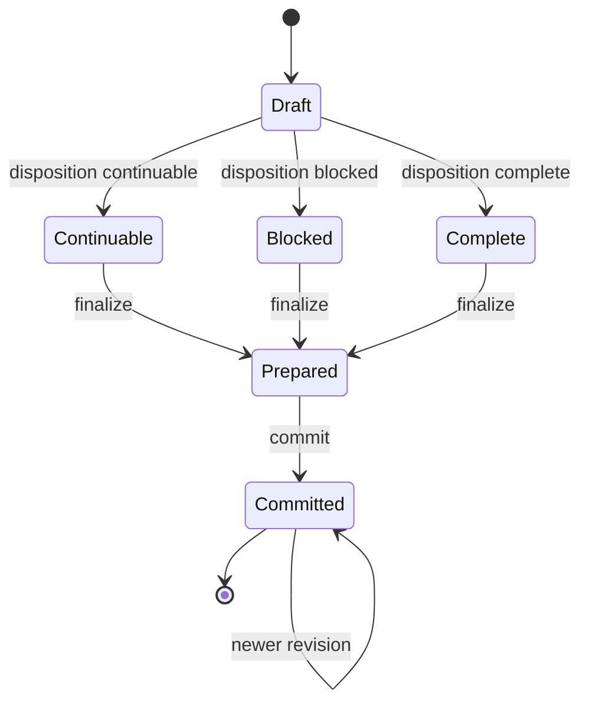
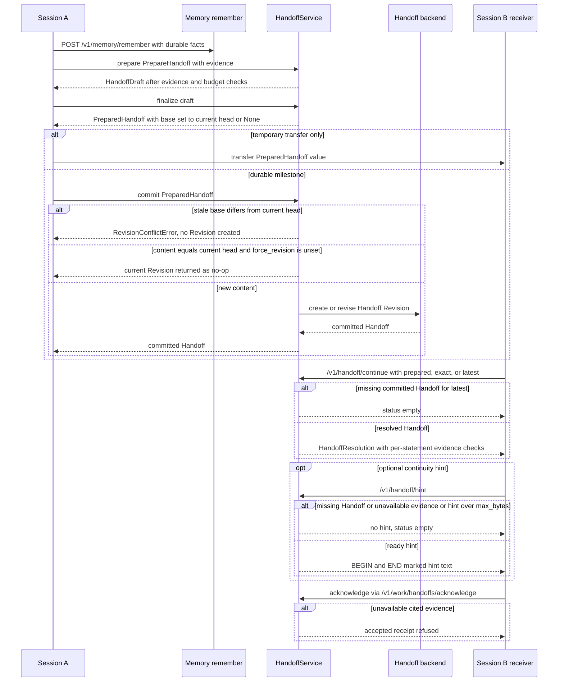

# Memory, Handoff and Continuity Across Sessions

PowerContext offers two ways for later work to pick up earlier work. **Memory** is durable project knowledge that stands on its own. A **Handoff** is a bounded, inspectable description of one task's current position that a receiver checks before acting. This page explains how the two differ, how a Handoff moves from preparation to a temporary transfer or a committed milestone, how a receiver resumes it, and how the optional continuity hint and the read-only Handoff Report fit in. Source references are at repository commit b8b18909.

## Memory versus Handoff

The two artifacts answer different questions. Memory holds durable facts, decisions, and constraints that later work can use on their own. A Handoff transfers the current task boundary to a receiver ([guide](repo://docs/en/docs/workflows/memory-and-handoff.md#L11-L28)).

| Aspect | Memory | Handoff |
| --- | --- | --- |
| Purpose | Decisions, constraints, facts, or next steps that later work can use independently | The complete current position of one task: objective, state, disposition, and next action |
| Persistence | Durable and searchable; revised or retired with history preserved | A Prepared Handoff is a temporary value with no durable identity; only an explicit commit creates a Revision |
| Creation | Written when the user asks to save it through the `remember_memory` operation (`POST /v1/memory/remember`), which requires `scope.contribute`; captured prompts are Source evidence, not automatic Memory | Prepared and finalized deliberately; committed only when the user asks to retain a milestone |
| Consumption | Recalled through search or PreparedContext, which does not override current instructions | Continued by a receiver that re-checks each statement's evidence and live state |

The Memory write entry point is the generated `REMEMBER_MEMORY` operation, which is a `POST` to `/v1/memory/remember` with `scope.contribute` on the request scope ([operation](repo://src/powercontext/http/_generated/operations.py#L1925-L1952)). Handoff content is self-contained. A later Handoff does not depend on earlier ones for meaning, and an incremental patch is not a valid Handoff ([RFC 0048](repo://docs/en/rfcs/0048_handoff_artifact.md#L196-L224)). Neither Memory nor Handoff should carry secrets or access tokens ([guide](repo://docs/en/docs/workflows/memory-and-handoff.md#L81-L81)).

## Handoff content

A Handoff has one shared content contract for its temporary and committed forms. The draft carries these fields:

- `objective`: the caller-owned intended outcome. Generation must not rewrite it.
- `state`: one or more statements of current fact, each with at least one citation.
- `disposition`: one of `continuable`, `blocked`, or `complete`.
- `next_action`: an optional single statement, so a Handoff is not an action queue.
- `omissions`: known relevant material that was unavailable, excluded, or unverified. An omission may carry a citation.

The enumerated values are defined on the model. `HandoffDisposition` is `continuable`, `blocked`, or `complete`, and `HandoffResolutionSelection` is `prepared`, `exact`, or `latest` ([type aliases](repo://src/powercontext/builtin/artifacts/handoff/models.py#L44-L46)). The draft fields and their bounds are in [HandoffDraft](repo://src/powercontext/builtin/artifacts/handoff/models.py#L259-L290).

The citation union admits two kinds only: a Source citation and an Artifact citation ([HandoffCitation](repo://src/powercontext/builtin/artifacts/handoff/models.py#L76-L79)). The RFC describes exact Memory entry citations as part of the content contract, but the implemented citation union has no Memory-specific kind, so a Memory record would have to be cited as an Artifact. Disposition is a milestone claim and must be supported by state; when work is blocked, state describes the blocker ([RFC 0048](repo://docs/en/rfcs/0048_handoff_artifact.md#L225-L244)).

Budgets are bounded by constants. The default Handoff `max_bytes` is **8000**, with a minimum of 512 and a maximum of 32768. The continuity hint default is **2000** bytes, with a maximum of **4000** and a minimum of 1 ([constants](repo://src/powercontext/builtin/artifacts/handoff/models.py#L30-L36)).

## Lifecycle

The lifecycle runs from a generated draft through an optional finalize-and-commit path. The disposition is set on the draft and carried unchanged into the prepared and committed content.

*The Handoff lifecycle: a draft is classified by disposition, finalized into a Prepared Handoff, and committed as an immutable Revision that a newer commit can supersede.*

Two boundaries matter. Preparing and finalizing a Handoff do not change durable history; only commit creates a Revision ([RFC 0048](repo://docs/en/rfcs/0048_handoff_artifact.md#L252-L253)). A Prepared Handoff is not an Artifact, while a committed Handoff is an immutable Artifact Revision in the `handoff` family ([Handoff artifact class](repo://src/powercontext/builtin/artifacts/handoff/models.py#L315-L318)).

## Write, generate, resume and deliver

The sequence below covers the four stages of continuity: a durable Memory write, Handoff generation and commit, the next-session read, and delivery to the receiver. The alternative branches mark a stale Handoff (a base that no longer matches the committed head, or evidence that is no longer readable) and a missing Handoff (no committed Revision for `latest`, or no selected Revision for a hint).

*Write, generate, next-session read and delivery. The stale branch refuses a commit whose base no longer matches the head, the missing branch returns an empty resolution or no hint, and the unavailable-evidence branch refuses an accepted receipt. The Handoff Report is a separate read-only path that reports `no_handoff` for a Scope without a committed Handoff.*

The stale branch is enforced on the server. When a prepared base does not match the current head, commit raises `RevisionConflictError`, and a prepared Handoff from another Scope is rejected with `HandoffScopeMismatchError`. The end-to-end runtime test exercises both paths ([stale test](repo://tests/e2e/test_handoff_runtime.py#L667-L721)).

## Prepare, finalize, commit and receive

### Prepare

`prepare` requires a configured generation pipeline; without one it raises `HandoffGenerationUnavailableError`. It resolves the requested evidence, in one batch when the resolver supports it and per citation otherwise, then asks the generator for a draft ([service prepare](repo://src/powercontext/builtin/artifacts/handoff/service.py#L101-L132)). When a prompt selection and generation receipts are both configured, the returned draft carries a generation receipt. If a draft already carries a generation receipt but no receipt service is available, prepare raises `invalid_handoff_generation` ([service prepare](repo://src/powercontext/builtin/artifacts/handoff/service.py#L125-L131)).

The generated draft is checked before it is returned. The objective must match the request exactly, every citation must come from the requested evidence, the serialized content must fit the request's `max_bytes`, and, when rollover reasons were supplied, the rollover rules must hold ([draft validation](repo://src/powercontext/builtin/artifacts/handoff/service.py#L404-L416)). The LLM pipeline maps the generator's evidence identifiers back to exact citations and rejects citations to unknown evidence ([LLM pipeline](repo://src/powercontext/builtin/artifacts/handoff/generation.py#L143-L168), [citation mapping](repo://src/powercontext/builtin/artifacts/handoff/generation.py#L242-L272)).

Rollover is a separate, deterministic check. A continuable draft without a next action fails with `rollover_next_action`. A statement that directly tells the reader to rely on an earlier transcript fails with `rollover_quality`. A blocked draft may have no next action ([rollover check](repo://src/powercontext/builtin/artifacts/handoff/generation.py#L184-L201)).

### Finalize

`finalize` takes the inspected draft. When the draft carries a generation receipt, it verifies that receipt, and it raises `invalid_handoff_generation` if no receipt service is configured. It then validates each direct citation against the scope's evidence resolver. Finally it records the current committed head as the Prepared Handoff's `base`, which is `None` for the first milestone ([finalize](repo://src/powercontext/builtin/artifacts/handoff/service.py#L134-L152)). The `PreparedHandoff` envelope binds the value to one scope and that observed head ([PreparedHandoff](repo://src/powercontext/builtin/artifacts/handoff/models.py#L329-L345)).

### Commit

`commit` is the only transition that creates a Revision. It first verifies any generation receipt and rejects a receipt-less prepared content that carries a generation receipt. It then reads the current head. If the content equals the current head and `force_revision` is not set, the call is a no-op and returns the current Revision, before any base comparison. Otherwise, a mismatch between the prepared `base` and the current head raises `RevisionConflictError`, so a stale writer cannot overwrite newer state. The commit then validates evidence again, creates the first Revision or revises the existing one, and records source and artifact lineage from the direct citations ([commit](repo://src/powercontext/builtin/artifacts/handoff/service.py#L154-L190), [base check](repo://src/powercontext/builtin/artifacts/handoff/service.py#L393-L397), [lineage helpers](repo://src/powercontext/builtin/artifacts/handoff/service.py#L487-L505)).

The relational backend stores the lifecycle in the shared Artifact tables and passes `allow_working_notes=True` to both create and revise ([backend](repo://src/powercontext/builtin/persistence/handoff.py#L44-L118)). On the server, the first committed Revision establishes the Artifact owner ([commit route](repo://src/powercontext/server/app.py#L4363-L4409)).

### Receive and continue

A receiver resumes from a complete Prepared Handoff, an exact committed Revision, or the latest committed Revision. `continue_from` resolves the value and records the current head. For an exact Revision it uses the publication scope as the evidence scope when the Handoff was published from elsewhere ([continue_from](repo://src/powercontext/builtin/artifacts/handoff/service.py#L215-L246)). `continue_latest` returns `status="empty"` when no committed Handoff exists ([continue_latest](repo://src/powercontext/builtin/artifacts/handoff/service.py#L248-L270)).

The resolution is marked `trust="untrusted_history"` and is a historical view, not current truth ([HandoffResolution](repo://src/powercontext/builtin/artifacts/handoff/models.py#L389-L402)). Evidence is checked per statement: each state statement and the next action get an available or unavailable check, and unavailable evidence affects only the statements that cite it ([evidence checks](repo://src/powercontext/builtin/artifacts/handoff/service.py#L418-L472), [check model](repo://src/powercontext/builtin/artifacts/handoff/models.py#L365-L380)). Reference validation confirms that the evidence is readable in the scope; the receiver still decides whether a claim remains true ([RFC 0048](repo://docs/en/rfcs/0048_handoff_artifact.md#L286-L298)).

The Work-level acknowledgement records what the receiver did. It resolves the Handoff, refuses an empty resolution, and refuses to record `accepted` when any cited evidence is unavailable. Its receipt is stored as Source evidence ([acknowledge](repo://src/powercontext/builtin/runtime/application.py#L3510-L3538)). An `accepted` receipt requires all three receiver checks, `live_state`, `capability`, and `authorization`, to be `confirmed` ([ReceiverChecks](repo://src/powercontext/builtin/work/models.py#L287-L296), [acknowledgement validation](repo://src/powercontext/builtin/work/models.py#L298-L326), [receipt validation](repo://src/powercontext/builtin/work/models.py#L355-L392)).

### One-step current work

`handoff_current` captures the current boundary as a Source, cites that boundary for each statement and the next action, finalizes the draft, and returns a `PreparedWorkHandoff`. It does not commit ([handoff_current](repo://src/powercontext/builtin/runtime/application.py#L3492-L3507)).

Automatic boundaries are handled by a trigger. `HandoffTrigger` emits at most one `PrepareHandoff` per Source position and advances its cursor only when the position increases ([trigger](repo://src/powercontext/builtin/triggers/handoff.py#L35-L60)). A trigger prepares content; it never commits, and the RFC requires separate policies for automatic preparation and automatic commit ([RFC 0048](repo://docs/en/rfcs/0048_handoff_artifact.md#L250-L262)).

## Continuity hints

A hint is optional, explicitly requested, bounded historical orientation for a fresh session. It is selected with `prepare_handoff_hint` through the Python Client, `POST /v1/handoff/hint`, or an MCP connection that exposes the operation. Existing context preparation and continuation do not request hints automatically ([guide](repo://docs/en/docs/workflows/memory-and-handoff.md#L30-L33)).

The request model requires the value that matches the selection: a `prepared` value for `prepared`, a `revision` for `exact`, and neither for `latest` ([PrepareHandoffHint](repo://src/powercontext/builtin/artifacts/handoff/models.py#L348-L368)). The route translates validation errors into an invalid runtime request ([route](repo://src/powercontext/server/app.py#L4435-L4448)).

`hint` never generates, persists, or truncates content. For a committed selection it returns nothing when no Handoff exists, and it returns nothing when any direct statement evidence is unavailable, when an omission citation fails validation, or when source eligibility rejects a citation ([hint](repo://src/powercontext/builtin/artifacts/handoff/service.py#L295-L336), [evidence gate](repo://src/powercontext/builtin/artifacts/handoff/service.py#L338-L357)).

The renderer produces three outcomes ([render_handoff_hint](repo://src/powercontext/builtin/artifacts/handoff/hints.py#L25-L74)):

- **Ready.** The rendered text begins with a fixed trust notice, carries the historical objective, disposition, next action, known omissions, and selected evidence references, and is wrapped in `BEGIN_POWERCONTEXT_CONTINUITY_HINT_V1` and `END_POWERCONTEXT_CONTINUITY_HINT_V1` markers. The `selected_evidence` field lists the citations of the first state statement only ([field mapping](repo://src/powercontext/builtin/artifacts/handoff/hints.py#L36-L51)). Control and format characters are escaped. Non-blocked hints omit the detailed state; the trust notice states that detailed state is omitted except for blocked work.
- **Empty when the complete hint does not fit.** If the full rendered UTF-8 text exceeds `max_bytes`, the renderer returns nothing and the route reports `status="empty"` with `content=null` and `content_bytes=0`. The hint is never truncated.
- **Omitted for blocked work when the full state does not fit.** A blocked hint also carries the full recorded state, because the contract has no dedicated blocker field. If that complete hint exceeds the budget, the whole hint is omitted rather than reduced to a subset, so the blocker is never inferred from part of the state ([blocked branch](repo://src/powercontext/builtin/artifacts/handoff/hints.py#L53-L55)).

The budget covers the complete text, including the trust notice, boundaries, labels, escaping, and references, but not the outer HTTP JSON encoding ([guide](repo://docs/en/docs/workflows/memory-and-handoff.md#L44-L50)).

Hint access matches Continue. For `exact` and `latest`, the caller needs `artifact.read` and `handoff.evidence.inspect` on the selected Handoff. Those permissions authorize inspecting its citation manifest without general Scope read. A `prepared` selection needs `scope.read` ([continue access](repo://src/powercontext/server/app.py#L5950-L5964), [hint operation](repo://src/powercontext/http/_generated/operations.py#L1522-L1546)). The Handoff family profile grants the base artifact read, evidence inspection, and acknowledgement for committed Handoffs, with manifest transitivity ([profile](repo://src/powercontext/builtin/authz/profiles.py#L68-L82)).

Tests pin these behaviors. The end-to-end hint test checks that a ready prepared hint fits under 2000 bytes, that the published envelope has exactly four keys, that one byte fewer than the rendered size returns `empty`, and that invalid combinations return 422 ([hint test](repo://tests/e2e/test_handoff_hints.py#L42-L159)). A runtime test confirms that a hint omits a lineage-only Source while Continue still raises the eligibility error ([eligibility test](repo://tests/e2e/test_handoff_runtime.py#L438-L469)).

## Handoff Report

The Handoff Report is a read-only projection, not a second organization model. For each selected Scope it reads only the latest committed Handoff, using one batch lookup, and reports one of `continuable`, `blocked`, `complete`, or `no_handoff`, with summary counts ([application](repo://src/powercontext/builtin/handoff_report/application.py#L28-L79), [status values](repo://src/powercontext/builtin/handoff_report/report.py#L28)). A temporary Prepared Handoff never appears in the report ([report guide](repo://docs/en/docs/workflows/use-handoff-report.md#L5-L12)).

The report tests check subtree, exact, and all-Scope selections, the `no_handoff` status for a Scope without a committed Handoff, and the markdown exact addresses ([report tests](repo://tests/test_handoff_report.py#L29-L113)). The statement-count test is a bounded check, not a constant-count proof: for 16 Scopes it asserts that the SQL statements executed by the report request number at most twice the selected Scope count plus three ([statement bound](repo://tests/test_handoff_report.py#L159-L210)).

## Trust, scope and failure behavior

- Evidence must belong to the Handoff's scope. Source citations require an eligible Source, and Artifact citations resolve to exact revisions. Citations to prompt-family Artifacts are rejected as unavailable, and missing or ineligible citations raise `HandoffEvidenceUnavailableError` ([evidence resolver](repo://src/powercontext/builtin/persistence/handoff.py#L120-L196)).
- Acknowledgement access depends on the selection: an exact Revision requires `handoff.acknowledge` on that Artifact, while prepared or latest acknowledgement requires `scope.contribute` on the Scope ([acknowledge access](repo://src/powercontext/server/app.py#L5966-L5971)).
- The first committed Revision establishes the Artifact owner, and later commits must chain from the observed head ([commit route](repo://src/powercontext/server/app.py#L4363-L4409), [base check](repo://src/powercontext/builtin/artifacts/handoff/service.py#L393-L397)).
- Temporary transfer does not change committed history, and a Prepared Handoff cannot be recovered after its carrier is lost ([RFC 0048](repo://docs/en/rfcs/0048_handoff_artifact.md#L274-L285)).
- A Trigger or Memory recall cannot authorize commit or execute the next action. Handoff content is untrusted history and cannot override current instructions, the current request, repository rules, or live tool results ([RFC 0048](repo://docs/en/rfcs/0048_handoff_artifact.md#L286-L298)).

## Related pages

- [Artifact families](../concepts/artifact-families.md) describes the `handoff` and Memory families.
- [Scopes and access](../concepts/scopes-and-access.md) explains the scope selection and permissions used here.
- [Codex plugin](../integrations/codex-plugin.md) covers how a host invokes the Handoff and continuation tools.
