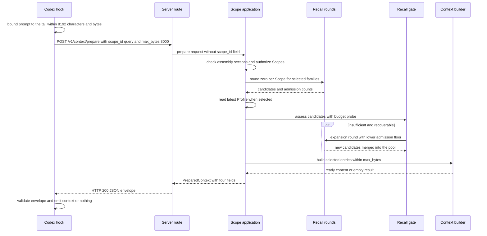

# Prepare Context and Recall

A host turns a user prompt into one bounded block of historical context by calling `POST /v1/context/prepare`. The Server recalls candidates from the requested Scope (and any referenced Scopes), optionally runs up to two more recall rounds when the result looks thin, then selects and renders the candidates within a byte budget. The host receives a small envelope and injects the `content` field as-is. This page traces that path and the branches where it yields nothing, degrades, or fails.

The core ideas are:

- The host bounds the query before sending it, and the Server enforces the same character limit.
- Recall runs in rounds. Round zero uses the caller's families. Later rounds only lower the admission floor for the same families.
- A pure gate decides whether to expand. A pure builder decides what fits. Neither performs I/O.
- The wire response carries four fields. Diagnostics and reuse proofs are opt-in and never change those four fields.

## Entry points

| Layer | Entry | Role |
| --- | --- | --- |
| Codex hook | `main` and `_recall_context` in `integrations/codex/plugins/powercontext/hooks/recall.py` | Reads the prompt, bounds the query, calls the Server, validates the envelope, and fails open. |
| Hook helpers | `bounded_recall_query` and `validate_prepared_context` in `integrations/codex/plugins/powercontext/hooks/prepared_context.py` | Define the query bound and the response contract a host enforces. |
| HTTP route | `prepare_context` in `src/powercontext/server/app.py` | Maps the transport request, applies access control, and calls the Scope application. |
| Scope application | `ScopedContextApplication.prepare` and `_prepare` in `src/powercontext/builtin/runtime/application.py` | Owns the Scope lock, the recall loop, the build, and the optional reuse proof. |
| Gate | `RecallSufficiencyGate`, `RecallExpander`, and `RecallSufficiencyPolicy` in `src/powercontext/builtin/runtime/recall_sufficiency.py` | Pure sufficiency verdict, expansion plan, and thresholds. |
| Builder | `PreparedContextBuilder` in `src/powercontext/builtin/runtime/prepared_context.py` | Pure selection, fitting, rendering, and budget probing. |
| Text renderer | `render_context_text` and `fit_context_text_item` in `src/powercontext/builtin/runtime/prepared_text.py` | Markdown rendering for the assembly path and its per-item fitting. |

A host can also reach the same preparation through the shared Python client (`prepare_context` in `src/powercontext/client/client.py`). The HTTP surface itself is described in [HTTP and MCP API](../architecture/http-and-mcp-api.md).

## Request contract and budgets

`PrepareContextRequest` in `src/powercontext/builtin/runtime/models.py` defines what a caller may ask for.

| Field | Constraint or default | Notes |
| --- | --- | --- |
| `query` | 1 to 8192 characters; must contain non-whitespace | The Server rejects longer queries with a validation error. |
| `max_bytes` | Default **8000**; minimum **512**; maximum **32768** | Byte budget for the rendered `content`. |
| `assembly` | Omitted by default; `null` is rejected | Selects Markdown sections, limits, and visible metadata. Up to 4 sections. |
| `bootstrap_receipt_id` | Optional, visible ASCII up to 64 characters | Lets the Runtime skip Memory already injected at session start. |
| `include_code`, `include_reuse`, `include_receipt` | Default `false`; strict booleans | Opt-in diagnostics and reuse. Sending `null` for `include_receipt` is treated as `false`. |

The Codex hook sends `max_bytes` of **8000**, taken from `MAX_CONTEXT_BYTES` in `hooks/prepared_context.py`. It adds `include_code` only when the plugin enables code context, and it adds `assembly` only when the user configured one. It never sends `include_receipt`, so automatic recall always gets the four-field envelope.

Two further budgets bound the recall work, not the output:

- A per-preparation **embedding wait budget** of `recall_embedding_timeout_seconds`, default **0.5** seconds, which the Runtime configuration limits to a maximum of 60 seconds.
- The **recall-gate expansion limit**, `recall_gate_max_rounds`, default **2** and capped at **2** by configuration.

## End-to-end flow

The sequence shows one successful preparation. Failure branches leave the sequence early and are described below.

Caption: a single prepare request from the Codex hook through recall, the gate, the builder, and back to the host as a validated envelope.

### 1. The host bounds the query

`bounded_recall_query` in `integrations/codex/plugins/powercontext/hooks/prepared_context.py` reduces a prompt to a deterministic query. A prompt within both 8192 characters and 8192 UTF-8 bytes is used after trimming. A longer prompt keeps its tail, because the tail holds the turn in hand. The function then trims that tail to the byte bound without splitting a character. The test `tests/test_recall_query_bound.py` checks the hook constants against the OpenAPI `query` limit and against shared fixture cases.

A host that forwards a long prompt unchanged would otherwise fail validation on the Server and lose recall entirely, so the bound is enforced on both sides.

### 2. The route maps the request and enforces access

`prepare_context` in `src/powercontext/server/app.py` converts the transport model into the Runtime model. `prepare_context_request` in `src/powercontext/server/mapping.py` drops `scope_id` from the body, since the route uses it to select the Scope. When access control is configured, the route passes an `authorize_scopes` callback that requires read permission on the target Scope and every referenced Scope.

### 3. The Scope application prepares under its own operation

`ScopedContextApplication.prepare` in `src/powercontext/builtin/runtime/application.py` runs inside the Scope operation. It first checks two things:

- When `assembly` is present and its `sections` list is empty, and neither `include_code` nor `include_reuse` is set, it returns an empty result without any recall or candidate read. With `include_receipt`, it still attaches a receipt.
- When `include_reuse` is set, the Scope must have no referenced Scopes. Otherwise the call fails with `context-reuse-cross-scope-unsupported`.

Only after these checks does it bind the atomic-memory execution context and call `_prepare`.

### 4. Round zero recalls the selected families

`_prepare_build` sets the family set. Without `assembly`, it uses Memory, Experience, and Topic Memory. With `assembly`, it uses exactly the section families. Scope IDs are the target Scope followed by its referenced Scopes.

Round zero runs `_recall_round` once per Scope. For each Scope it:

- Searches Atomic Memory with a Memory limit of **16** (`memory_candidate_limit`), plus any Memory identities the bootstrap receipt already excluded. Atomic Memory search runs in `auto` mode and its embedding wait is charged to the shared `_EmbeddingBudget`.
- Reads Experience with a limit of **8** (`experience_candidate_limit`).
- Searches Topic Memory for the current Scope with a limit of **8** (`topic_memory_candidate_limit`). Topic search reuses the Memory query vector when both use the same embedding model and the query is within Topic search limits. Otherwise it embeds its own query, and it falls back to FTS when the remaining embedding budget runs out.

Profile snapshots are read separately, using the latest committed snapshot per Scope, and only when the `profile` family is selected.

Each round is bounded per family before it reaches the gate. Candidates from different Scopes stay separate for fusion, so the gate applies its "first fused hit" rule per Scope.

### 5. The recall-sufficiency gate decides whether to expand

When `recall_gate_enabled` is true, `RecallSufficiencyPolicy.from_runtime_config` builds the policy. When it is false, the policy is `None`, and the default path allocates no effort trace and runs round zero only.

The gate receives a flat candidate projection and a budget view. It returns one verdict, checked in this order:

1. `no-content`: nothing was retrieved and no selected family had candidates, so there is nothing to recall. The verdict is sufficient.
2. `budget-floor`: the request budget, not recall, limits delivery, as defined by the budget-bound rule below. The verdict is sufficient.
3. `rerank-enabled`: reranking is on and expansion with rerank is not allowed. The verdict is sufficient.
4. `thin-candidates`: fewer than `min_candidates` (default **2**) candidates. Not sufficient.
5. `thin-families`: more than one family was expected but fewer families returned candidates. Not sufficient.
6. `weak-top-1`: the top vector relevance is below `min_top_score` (default **0.35**), or the top gap is below `min_top_gap` (default **0.02**) while the top relevance is under the strong-top threshold of 0.7. Not sufficient.
7. `weak-lexical`: the best candidate covers less than `min_lexical_overlap` (default **0.5**) of the query terms. Not sufficient.
8. `sufficient`: none of the above.

The gate reads only vector relevance for score thresholds. Fused rank scores are not compared against those thresholds.

When the verdict is not sufficient, the expander plans the next round. Round 1 uses the `admission` action with a semantic floor of **0.15**. Round 2 uses the `policy-floor` action with a floor of **0.10**. Each plan changes only the admission floor for the families the caller already selected. It never changes a limit, a search mode, or a rerank candidate bound. The loop runs while the verdict is not sufficient, families remain recoverable, and fewer than `max_rounds` expansions have run. If the verdict is still not sufficient at the cap and the reason is not `weak-top-1`, the reason becomes `at-max-rounds`.

Expansion merges new hits by identity. An earlier candidate is never removed, and each committed round keeps the latest round's order within the family ceilings. Every expansion failure is caught. The loop keeps the last committed candidate set, records `expansion-failed`, and lets the preparation succeed.

Before each assessment, the Runtime calls `probe_budget` on the same selection code the builder uses. Round zero probes and assesses its candidates in `_prepare` (`src/powercontext/builtin/runtime/application.py` lines 1684–1699), and each expansion round probes and assesses its staged candidates (lines 1801–1816 of the same file). The probe reports delivered items, truncated items, dropped items, and unused bytes. `RecallBudgetView.budget_bounded` in `src/powercontext/builtin/runtime/recall_sufficiency.py` (lines 248–262) turns those counters into the budget-bound signal, and the rule depends on the size of the request budget:

- At the 512-byte floor (`BUDGET_FLOOR_BYTES`), fitting pressure is enough: an item was dropped or truncated, or delivered content used all headroom.
- Above the floor, the budget is binding only when headroom is exhausted and an item was dropped or truncated. Exhausted headroom by itself does not count.

So fitting pressure alone is not sufficient for every budget. The gate evaluates `no-content` before the budget check, and the budget check runs only when a budget view was supplied (`assess` in `src/powercontext/builtin/runtime/recall_sufficiency.py`, lines 497–501). That is how the gate separates a budget-limited result from a recall-limited one.

### 6. The builder selects and renders

After the loop, `_prepare_build` attaches Atomic Memory lineage, removes candidates whose Atomic Memory revision is no longer current, and calls `build_scopes_result` once. The family ceilings are enforced here as invariants: if a candidate list still exceeds Memory **16**, Topic Memory **8**, or Experience **8** at this point, the builder raises a `PreparedContextInvariantError`. The recall loop applies these ceilings before the builder runs, so this is a guard, not a normal path.

The builder has two rendering modes.

- **Default (no `assembly`)**: entries are interleaved Memory, Topic Memory, and Experience. At most **8** entries (`entry_limit`) and at most **2** Experience entries (`experience_entry_limit`) are kept. Each entry body is capped at **2000** UTF-8 bytes (`max_entry_content_bytes`). The output is a JSON envelope with `trust` set to `untrusted_history` and a `BEGIN`/`END` marker pair. If the rendered text exceeds `max_bytes`, the builder raises `output-budget`. This guard is unreachable by construction on the assembly path.
- **Assembly**: `render_context_text` renders one Markdown section per requested family in section order, with a trust notice, and each item carries its scope, artifact, entry identity, optional confidence and recall rank, and truncation flag. The section limits govern selection. `context_assembly_max_entries` (default **8**) caps the sum of section limits.

Both modes use the same fitting rule. An entry that does not fit whole is shortened to the longest prefix that fits, but only down to a minimum of **64** bytes (`_MIN_TRUNCATED_CONTENT_BYTES`). Anything shorter is dropped and counted as `dropped_below_min_bytes`. An entry for which no shortened rendering fits is counted as `dropped_no_fitting_truncation`.

If nothing was selected, the builder returns `empty()`, which is a context with status `empty`.

### 7. The envelope and optional extras

`PreparedContext` in `src/powercontext/builtin/runtime/models.py` has four wire fields: `schema` (`powercontext.prepared-context.v1`), `status` (`ready` or `empty`), `content`, and `content_bytes`. An empty context must have `content` null and `content_bytes` 0. A ready context must have non-blank content whose UTF-8 length equals `content_bytes`.

The route returns only those four fields by default. Two options add more:

- `include_receipt` attaches a `receipt` built from bounded summaries. If the receipt is incomplete or its serialized form exceeds **8192** bytes, the Server removes it and returns the four fields, recording a content-free diagnostic. The receipt never contains the query or the evidence bodies.
- `include_reuse` changes the envelope to `PreparedContextWithReuse`, which holds `context` plus a short-lived `reuse` binding. `_bind_reuse_roots` binds the final selected origins, not every recalled candidate, to their observed lifecycle versions. A reuse binding is validated later by re-checking those exact revisions, without recall or model calls.

## Branches

### Empty result

- **Status returned**: HTTP 200 with `status` `empty`, `content` null, and `content_bytes` 0.
- **When**: the sections list is empty, the candidate set is empty after gate and selection, or every candidate is skipped as a duplicate or blank, or dropped by the byte budget.
- **Host behavior**: `_recall_context` in the Codex hook emits an `empty` event and returns no context. Nothing is injected, and the preparation is not an error.

### Insufficient recall

- **Status returned**: no error. The envelope is `ready` if any candidate was selected, otherwise `empty`.
- **Trace**: the gate reason (`thin-candidates`, `thin-families`, `weak-top-1`, `weak-lexical`, or `at-max-rounds`) is recorded in the in-process `RecallEffort` trace. It is delivered to the Runtime's recorder or an explicit sink, and is not part of the HTTP envelope.
- **Behavior**: up to two expansion rounds run. Expansion can add candidates from families the caller selected, and it never adds a family or raises a limit. When recall is still thin after the cap, the result is whatever the builder selects, which may be `empty`.

### Search failure and degradation

There are three distinct outcomes.

1. **Embedding timeout or unavailability with lexical fallback.** In `auto` mode, if the query embedding times out or the provider is unavailable and FTS is available, Atomic Memory search falls back to text retrieval. The preparation still returns `ready` or `empty`. The degradation reason is `inference_timeout` or `inference_unavailable`, and a timeout wins when both occur. With `include_receipt`, the receipt records the fallback reason for that search.
2. **Embedding failure with no lexical fallback.** If the search cannot fall back, the error propagates out of `_prepare`. The route then maps it to HTTP **503** with code `inference_timeout` or `inference_unavailable`. An unhandled exception from a search, a candidate read, or an invariant falls through to HTTP **500** with code `internal_error`. The route returns no `PreparedContext` in these cases.
3. **Expansion failure inside the gate loop.** The error is caught, the last committed candidates are kept, the reason becomes `expansion-failed`, and the preparation succeeds with the earlier candidates.

On the host, `_recall_context` maps failures to a fail-open result. An HTTP **503** (or a timeout or socket error) records the `server_unavailable` outcome. A **401** records `authentication_failed`. A **404** without an error code on the prepare path records `version_mismatch`. A **409**, a **422**, or any other unexpected status, and a response that fails `validate_prepared_context`, records `invalid_response`. In every case the hook returns no context, so the agent turn continues without injected history.

### Budget overflow

Budget overflow is not an HTTP error.

- **Gate**: when the probe shows budget-bound pressure, the gate returns `budget-floor` and treats the result as sufficient, so no expansion runs. At the 512-byte floor, a dropped or truncated item, or delivered content that used all headroom, is enough. Above the floor, the budget qualifies only when headroom is exhausted and an item was dropped or truncated. A 512-byte request with no candidates is not budget-bound, because recall could still recover a short item.
- **Assembly path**: items that do not fit whole are truncated down to 64 bytes or dropped. The preparation returns `ready` if anything was delivered, and the omission counts (`truncated_items`, `dropped_below_min_bytes`, `dropped_no_fitting_truncation`) are reported only through the receipt or the trace.
- **Default path**: the same fitting rule applies per entry. If the final text would still exceed `max_bytes`, the builder raises the `output-budget` invariant, which surfaces as an internal error. The builder's fitting is designed so this does not happen in normal operation.
- **Host**: the Codex validator rejects a ready response whose `content_bytes` is above **8000**. Because the hook always requests 8000, a valid response stays inside the host's bound.

## Configuration and operations

| Setting | Default | Range or note | Source |
| --- | --- | --- | --- |
| `recall_gate_enabled` | `false` | Off means round zero only. | `config.py` |
| `recall_gate_max_rounds` | `2` | `0` to `2` | `config.py` |
| `recall_gate_min_candidates` | `2` | At least `1` | `config.py` |
| `recall_gate_min_top_score` | `0.35` | `0.0` to `1.0` | `config.py` |
| `recall_gate_min_top_gap` | `0.02` | `0.0` to `1.0` | `config.py` |
| `recall_gate_min_lexical_overlap` | `0.5` | `0.0` to `1.0` | `config.py` |
| `recall_gate_round1_min_semantic_similarity` | `0.15` | Must not exceed the round-zero floor | `config.py` |
| `recall_gate_round2_min_semantic_similarity` | `0.10` | Must not exceed round 1 | `config.py` |
| `recall_gate_allow_with_rerank` | `false` | Expansion is skipped when reranking is on unless this is set. | `config.py` |
| `recall_embedding_timeout_seconds` | `0.5` | Greater than `0` and at most `60` | `config.py` |
| `context_assembly_max_entries` | `8` | At least `1` | `config.py` |

Operationally, the Server-side outcomes are visible in three places: the HTTP status and error code, the content-free `receipt` when requested, and the Runtime's recall-effort recorder or sink. The trace carries aggregate counts, a reason code, and per-family admission totals. It carries no query text, entry identity, or per-entry attribution.

## Tests that matter

- `tests/test_recall_query_bound.py` checks that the hook's query bound matches the OpenAPI `query` limit and keeps the end of a long prompt.
- `tests/builtin/runtime/test_recall_sufficiency.py` covers each gate verdict in its precedence order, per-Scope fusion, lexical overlap, and the expansion vocabulary.
- `tests/builtin/runtime/test_prepared_context_degradation.py` checks that a timeout outranks an unavailable provider, that the transport response keeps the four fields hosts validate, and that legacy request fields are rejected.
- `tests/builtin/runtime/test_prepared_context.py` covers the builder's selection and rendering.
- `tests/e2e/test_recall_sufficiency_gate.py` and `tests/e2e/test_recall_embedding_timeout.py` exercise the gate and timeout behavior end to end.
- `tests/e2e/test_prepared_context_receipt.py` covers receipt construction and its byte limit.

## Related pages

- [Atomic Memory](atomic-memory.md) describes the Memory family whose search, revisions, and lifecycle this preparation depends on.
- [Memory and Handoff](memory-and-handoff.md) covers the handoff workflow that sits alongside Memory recall.
- [Context Protection](../concepts/context-protection.md) covers the broader context-protection concept behind the untrusted-history framing.
- [HTTP and MCP API](../architecture/http-and-mcp-api.md) describes the route surface around `POST /v1/context/prepare`.
