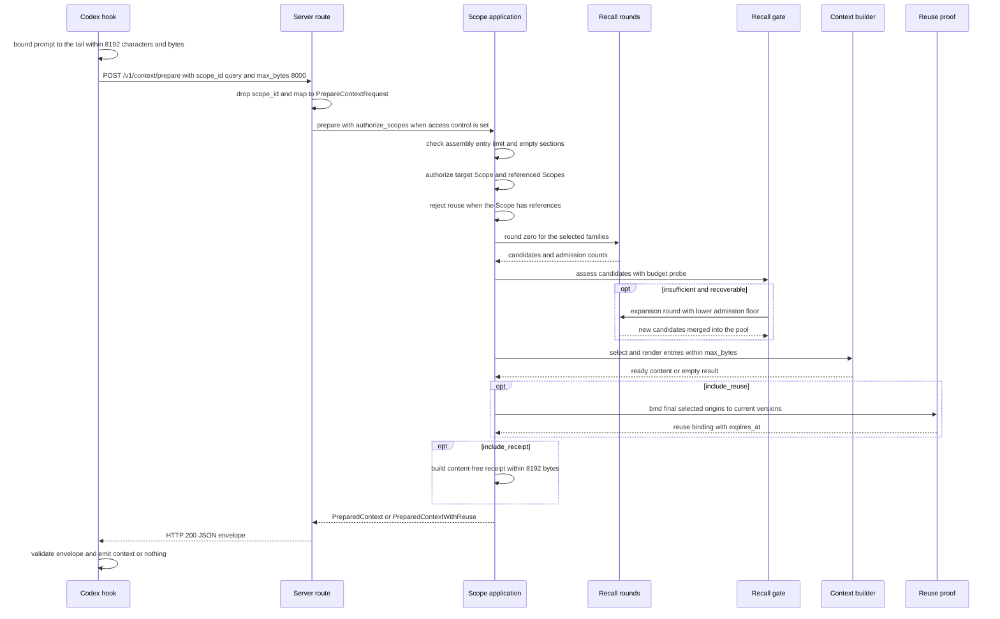
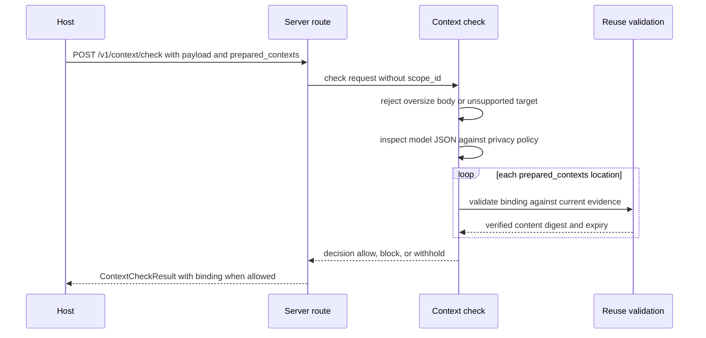

# Prepare Context and Recall

A host turns a user prompt into one bounded block of historical context by calling `POST /v1/context/prepare`. The Server authorizes the target Scope, recalls candidates from it (and from any referenced Scopes), optionally runs up to two more recall rounds when the result looks thin, then selects and renders the candidates within a byte budget. The host receives a small envelope and injects its `content` field as-is. When the caller asks for a reuse proof, a later `POST /v1/context/check` admits the final model bytes against that proof without recalling anything. This page traces those paths and the branches where preparation yields nothing, reuses earlier evidence, degrades, is rejected, or fails.

Source references use commit b8b18909 and bounded line ranges, for example `repo://src/powercontext/server/app.py#L4074-L4105`.

The core ideas are:

- The host bounds the query before sending it, and the Server enforces the same character limit.
- Recall runs in rounds. Round zero uses the caller's families. Later rounds only lower the admission floor for the same families.
- A pure gate decides whether to expand. A pure builder decides what fits. Neither performs I/O.
- The default wire response carries four fields: `schema`, `status`, `content`, and `content_bytes`. The `receipt` (with `include_receipt`) and the `context` plus `reuse` pair (with `include_reuse`) are opt-in. Neither opt-in changes how the four fields are computed.
- A reuse binding is not a cache. It is a signed proof that a later check re-verifies against current Atomic Memory and code evidence.

## Entry points

| Layer | Entry | Role |
| --- | --- | --- |
| Codex hook | `main` and `_recall_context` in `integrations/codex/plugins/powercontext/hooks/recall.py` | Reads the prompt, bounds the query, calls the Server, validates the envelope, and fails open. |
| Hook helpers | `bounded_recall_query` and `validate_prepared_context` in `integrations/codex/plugins/powercontext/hooks/prepared_context.py` | Define the query bound and the response contract a host enforces. The Claude Code hook uses the same module. |
| HTTP route | `prepare_context` in `src/powercontext/server/app.py`, registered as `PREPARE_CONTEXT` | Maps the transport request, applies access control, and calls the Scope application. |
| HTTP route | `check_context` in `src/powercontext/server/app.py`, registered as `CHECK_CONTEXT` | Admits final model bytes against prepared-context bindings (`POST /v1/context/check`). |
| Scope application | `ScopedContextApplication.prepare`, `_prepare`, and `_prepare_build` in `src/powercontext/builtin/runtime/application.py` | Owns the Scope operation, the recall loop, the build, and the optional receipt and reuse proof. |
| Gate | `RecallSufficiencyGate`, `RecallExpander`, and `RecallSufficiencyPolicy` in `src/powercontext/builtin/runtime/recall_sufficiency.py` | Pure sufficiency verdict, expansion plan, and thresholds. |
| Builder | `PreparedContextBuilder` in `src/powercontext/builtin/runtime/prepared_context.py` | Pure selection, fitting, rendering, and budget probing. |
| Text renderer | `render_context_text` and `fit_context_text_item` in `src/powercontext/builtin/runtime/prepared_text.py` | Markdown rendering for the assembly path and its per-item fitting. |
| Reuse proof | `prepare_reuse` and `validate_reuse` in `src/powercontext/builtin/runtime/context_reuse.py` | Issue and re-verify the short-lived binding. |
| Check | `check_context` in `src/powercontext/builtin/runtime/context_check.py` | Admits final bytes, decides `allow`, `block`, or `withhold`, and seals a new binding. |

A host can also reach preparation through the shared Python client (`prepare_context` in `src/powercontext/client/client.py`). The HTTP surface itself is described in [HTTP and MCP API](../architecture/http-and-mcp-api.md).

## Request contract and budgets

`PrepareContextRequest` in `src/powercontext/builtin/runtime/models.py` (`repo://src/powercontext/builtin/runtime/models.py#L352-L386`) defines what a caller may ask for. The wire body is `scope_id` plus these fields; the route removes `scope_id` before the Runtime model is built.

| Field | Constraint or default | Notes |
| --- | --- | --- |
| `query` | 1 to 8192 characters; must contain non-whitespace | The Server rejects longer queries with a validation error. |
| `max_bytes` | Default **8000**; minimum **512**; maximum **32768** | Byte budget for the rendered `content`. |
| `assembly` | Omitted by default; `null` is rejected | Selects Markdown sections, limits, and visible metadata. Up to 4 sections, each `limit` from 1 to 8. |
| `bootstrap_receipt_id` | Optional, visible ASCII up to 64 characters | Lets the Runtime skip Memory already injected at session start. |
| `include_code`, `include_reuse`, `include_receipt` | Default `false`; strict booleans | Opt-in code context, reuse proof, and receipt. Sending `null` for `include_receipt` is treated as `false`. |

When `assembly` is supplied without `sections`, the defaults are a `memory` section with `limit` 6 and an `experience` section with `limit` 2 (`ContextAssembly` in the same file). An `experience` section cannot exceed 2 entries. `show` accepts `confidence` and `recall_rank`, at most 2 unique values.

The Codex hook sends `max_bytes` of **8000**, taken from `MAX_CONTEXT_BYTES` in `hooks/prepared_context.py`. It adds `include_code` only when the plugin enables code context, adds `assembly` only when the user configured one, and adds `bootstrap_receipt_id` only when a session-start receipt exists (`repo://integrations/codex/plugins/powercontext/hooks/recall.py#L268-L289`). It never sends `include_receipt` or `include_reuse`, so automatic recall always gets the four-field envelope.

Two further budgets bound the recall work, not the output:

- A per-preparation **embedding wait budget** of `recall_embedding_timeout_seconds`, default **0.5** seconds, which the Runtime configuration limits to a maximum of 60 seconds (`repo://src/powercontext/builtin/runtime/application.py#L496-L510`, `repo://src/powercontext/builtin/runtime/config.py#L194`).
- The **recall-gate expansion limit**, `recall_gate_max_rounds`, default **2** and capped at **2** by configuration (`repo://src/powercontext/builtin/runtime/config.py#L179`).

## End-to-end flow

Caption: one successful prepare request from the Codex hook through authorization, recall, the gate, the builder, the optional reuse proof and receipt, and back to the host as an envelope. Failure branches leave the sequence early and are described below.

<!-- openwiki: broken internal link [#4-check-admits-final-bytes-against-the-reuse-proof] heading anchor "4-check-admits-final-bytes-against-the-reuse-proof" does not exist in /openwiki/workflows/prepare-and-recall.md. Fix the href or restore the target, then delete this comment. -->
A later turn that sends the final model bytes uses the check path, shown in the sequence under [Check](#4-check-admits-final-bytes-against-the-reuse-proof):

Caption: a before-send check re-verifies each prepared-context binding against the exact bytes the host will send, and seals a short-lived binding only when every check passes.

### 1. The host bounds the query

`bounded_recall_query` in `integrations/codex/plugins/powercontext/hooks/prepared_context.py` (`repo://integrations/codex/plugins/powercontext/hooks/prepared_context.py#L74-L92`) reduces a prompt to a deterministic query. A prompt within both 8192 characters and 8192 UTF-8 bytes is used after trimming. A longer prompt keeps its tail, because the tail holds the turn in hand. The function then trims that tail to the byte bound without splitting a character. The test `tests/test_recall_query_bound.py` checks the hook constants against the OpenAPI `query` limit and against shared fixture cases. The Claude Code hook calls the same helper (`integrations/claude-code/plugins/powercontext/hooks/user_prompt_submit.py`).

A host that forwards a long prompt unchanged would otherwise fail validation on the Server and lose recall entirely, so the bound is enforced on both sides.

### 2. The route maps the request and enforces access

`prepare_context` in `src/powercontext/server/app.py` (`repo://src/powercontext/server/app.py#L4074-L4105`) is registered on `PREPARE_CONTEXT` (`repo://src/powercontext/server/app.py#L1677`). It passes the transport request through `_with_plugin_sections` and then `mapping.prepare_context_request` (`repo://src/powercontext/server/mapping.py#L748-L749`), which dumps the body without `scope_id` and validates it as the Runtime `PrepareContextRequest`. The body's `scope_id` selects the Scope.

- When `include_reuse` is set, the route adds a `binding_identity` derived from the current trusted authentication, so bindings are partitioned by the principal who received them.
- When access control is not configured, the route calls `prepare` with no `authorize_scopes` callback.
- When access control is configured, the route passes an `authorize_scopes` callback that requires `SCOPE_READ` on the target Scope and every referenced Scope (`repo://src/powercontext/server/app.py#L4081-L4102`).

Plugin families inside `assembly` are filled before the Runtime runs (`repo://src/powercontext/server/app.py#L4108-L4137`). For each non-built-in section the route calls the plugin's `search_artifacts` with the section's `limit` and `max_bytes`. A plugin error with status below 500 is re-raised. A plugin error with status 500 or above leaves that section empty and marks it `search_failed`, which the receipt records. Built-in families are passed through unchanged.

### 3. The Scope application checks and authorizes

`ScopedContextApplication.prepare` in `src/powercontext/builtin/runtime/application.py` (`repo://src/powercontext/builtin/runtime/application.py#L1134-L1169`) runs inside the Runtime's Scope operation (`repo://src/powercontext/builtin/runtime/application.py#L4557-L4574`). It checks in this order:

1. When `assembly` is present and the sum of its section `limit` values exceeds `context_assembly_max_entries` (default **8**), it raises `context-assembly-entry-limit`, which the HTTP layer maps to 422 `invalid_request`.
2. When `assembly` is present with an empty `sections` list, and neither `include_code` nor `include_reuse` is set, it returns an empty result without any recall or candidate read. With `include_receipt`, it still attaches a receipt.
3. When `authorize_scopes` is supplied, it authorizes the target Scope and `scope.context_references`.
4. When `include_reuse` is set, the Scope must have no referenced Scopes. Otherwise the call fails with `context-reuse-cross-scope-unsupported` (`repo://src/powercontext/builtin/runtime/application.py#L1171-L1173`).

Only after these checks does it bind the atomic-memory execution context and call `_prepare`.

### 4. Round zero recalls the selected families

`_prepare_build` (`repo://src/powercontext/builtin/runtime/application.py#L1350-L1529`) sets the family set. Without `assembly`, it uses Memory, Experience, and Topic Memory. With `assembly`, it uses exactly the section families (`repo://src/powercontext/builtin/runtime/application.py#L1374-L1384`). Scope IDs are the target Scope followed by its referenced Scopes.

When `bootstrap_receipt_id` is set and the Runtime has a bootstrap receipt store, the Runtime first deletes receipts older than the retention window and reads the Memory identities already injected for that receipt. Those identities are excluded from round zero and are added to the Memory limit, so the bootstrap context does not return twice (`repo://src/powercontext/builtin/runtime/application.py#L1379-L1394`).

Round zero calls `_recall_round` once for the whole preparation. That method iterates the Scope IDs internally, and for each Scope it calls `_recall_scope` (`repo://src/powercontext/builtin/runtime/application.py#L1934-L2052`, `repo://src/powercontext/builtin/runtime/application.py#L2054-L2151`). For each Scope it:

- Searches Atomic Memory with a Memory limit of **16** (`memory_candidate_limit`), plus any identities excluded by the bootstrap receipt. The search runs in `auto` mode, and its embedding wait is charged to the shared `_EmbeddingBudget`.
- Reads Experience with a limit of **8** (`experience_candidate_limit`) through `_recall_experience` (`repo://src/powercontext/builtin/runtime/application.py#L2153-L2193`).

Topic Memory is searched once, for the target Scope only, with a limit of **8** (`topic_memory_candidate_limit`) (`repo://src/powercontext/builtin/runtime/application.py#L2195-L2249`). Topic search reuses the Memory query vector when both use the same embedding model and the query is within Topic search limits. Otherwise it embeds its own query, and it falls back to FTS when the remaining embedding budget runs out.

Profile snapshots are read separately, using the latest committed snapshot per Scope, and only when the `profile` family is selected (`repo://src/powercontext/builtin/runtime/application.py#L1568-L1585`). Code context is fetched only when `include_code` is set. A code query that raises `CodeError` records a failed `code` search and contributes no candidates; it does not fail the preparation (`repo://src/powercontext/builtin/runtime/application.py#L1630-L1664`).

Each round is bounded per family before it reaches the gate. Candidates from different Scopes stay separate for fusion, so the gate applies its "first fused hit" rule per Scope.

### 5. The recall-sufficiency gate decides whether to expand

When `recall_gate_enabled` is true, `RecallSufficiencyPolicy.from_runtime_config` builds the policy and returns `None` otherwise (`repo://src/powercontext/builtin/runtime/recall_sufficiency.py#L201-L231`). When the policy is `None`, the default path allocates no effort trace and runs round zero only (`repo://src/powercontext/builtin/runtime/application.py#L1415-L1420`).

When a policy is set, `_gated_recall_effort` (`repo://src/powercontext/builtin/runtime/application.py#L1666-L1932`) runs. It probes and assesses round zero first (`repo://src/powercontext/builtin/runtime/application.py#L1743-L1760`). The gate receives a flat candidate projection and a budget view, and returns one verdict. `RecallSufficiencyGate.assess` checks, in this order (`repo://src/powercontext/builtin/runtime/recall_sufficiency.py#L479-L516`):

1. `no-content`: nothing was retrieved and no selected family had candidates, so there is nothing to recall. The verdict is sufficient.
2. `budget-floor`: the request budget, not recall, limits delivery, as defined by the budget-bound rule below. The verdict is sufficient.
3. `rerank-enabled`: reranking is on and expansion with rerank is not allowed. The verdict is sufficient.
4. `thin-candidates`: fewer than `min_candidates` (default **2**) candidates. Not sufficient.
5. `thin-families`: more than one family was expected but fewer families returned candidates. Not sufficient.
6. `weak-top-1`: the top vector relevance is below `min_top_score` (default **0.35**), or the top gap is below `min_top_gap` (default **0.02**) while the top relevance is under the strong-top threshold of 0.7. Not sufficient.
7. `weak-lexical`: the best candidate covers less than `min_lexical_overlap` (default **0.5**) of the query terms. Not sufficient.
8. `sufficient`: none of the above.

The gate reads only vector relevance for score thresholds. Fused rank scores are not compared against those thresholds.

When the verdict is not sufficient, the expander plans the next round (`repo://src/powercontext/builtin/runtime/recall_sufficiency.py#L519-L531`). Round 1 uses the `admission` action with a semantic floor of **0.15**. Round 2 uses the `policy-floor` action with a floor of **0.10**. Each plan changes only the admission floor for the families the caller already selected. It never changes a limit, a search mode, or a rerank candidate bound. The loop (`repo://src/powercontext/builtin/runtime/application.py#L1760-L1800`) runs while the verdict is not sufficient, families remain recoverable, and fewer than `max_rounds` expansions have run. If the verdict is still not sufficient at the cap and the reason is not `weak-top-1`, the reason becomes `at-max-rounds` (`repo://src/powercontext/builtin/runtime/application.py#L1893-L1899`).

Expansion merges new hits by identity. An earlier candidate is never removed, and each committed round keeps the latest round's order within the family ceilings. Every expansion failure is caught (`repo://src/powercontext/builtin/runtime/application.py#L1909-L1918`). The loop keeps the last committed candidate set, records `expansion-failed`, and lets the preparation succeed.

Before each assessment, the Runtime calls `probe_budget` on the same selection code the builder uses. Round zero probes and assesses its candidates at `repo://src/powercontext/builtin/runtime/application.py#L1743-L1760`, and each expansion round probes and assesses its staged candidates at `repo://src/powercontext/builtin/runtime/application.py#L1860-L1876`. The probe reports delivered items, truncated items, dropped items, and unused bytes (`repo://src/powercontext/builtin/runtime/prepared_context.py#L401-L437`). `RecallBudgetView.budget_bounded` turns those counters into the budget-bound signal, and the rule depends on the size of the request budget (`repo://src/powercontext/builtin/runtime/recall_sufficiency.py#L248-L262`):

- At the 512-byte floor (`BUDGET_FLOOR_BYTES`), fitting pressure is enough: an item was dropped or truncated, or delivered content used all headroom.
- Above the floor, the budget is binding only when headroom is exhausted and an item was dropped or truncated. Exhausted headroom by itself does not count.

So fitting pressure alone is not sufficient for every budget. The gate evaluates `no-content` before the budget check, and the budget check runs only when a budget view was supplied (`repo://src/powercontext/builtin/runtime/recall_sufficiency.py#L497-L501`). That is how the gate separates a budget-limited result from a recall-limited one.

### 6. The builder selects and renders

After the loop, `_prepare_build` removes Memory candidates whose Atomic Memory revision is no longer current (`_available_atomic_candidates`, `repo://src/powercontext/builtin/runtime/application.py#L1616-L1628`) and calls `build_scopes_result` once (`repo://src/powercontext/builtin/runtime/application.py#L1479-L1494`). The family ceilings are enforced again as invariants: if a candidate list still exceeds Memory **16**, Topic Memory **8**, or Experience **8** at this point, the builder raises `PreparedContextInvariantError` (`repo://src/powercontext/builtin/runtime/prepared_context.py#L364-L370`). The recall loop applies these ceilings before the builder runs, so this is a guard, not a normal path.

The builder's class limits are `memory_candidate_limit` 16, `topic_memory_candidate_limit` 8, `experience_candidate_limit` 8, `entry_limit` 8, `topic_memory_entry_limit` 8, `experience_entry_limit` 2, and `max_entry_content_bytes` 2000 (`repo://src/powercontext/builtin/runtime/prepared_context.py#L281-L288`).

The builder has two rendering modes.

- **Default (no `assembly`)**: `_select_entries` (`repo://src/powercontext/builtin/runtime/prepared_context.py#L439-L518`) interleaves Memory, Topic Memory, and Experience (`_interleave`, `repo://src/powercontext/builtin/runtime/prepared_context.py#L929-L945`). At most **8** entries (`entry_limit`) and at most **2** Experience entries (`experience_entry_limit`) are kept. Each entry body is capped at **2000** UTF-8 bytes. `_render` produces a JSON envelope with `trust` set to `untrusted_history` between `BEGIN` and `END` markers (`repo://src/powercontext/builtin/runtime/prepared_context.py#L970-L977`). If the rendered text exceeds `max_bytes`, the builder raises `output-budget` (`repo://src/powercontext/builtin/runtime/prepared_context.py#L388-L391`). This guard is unreachable by construction on the assembly path.
- **Assembly**: `_select_text` (`repo://src/powercontext/builtin/runtime/prepared_context.py#L519-L615`) walks the sections in order and calls `render_context_text` (`repo://src/powercontext/builtin/runtime/prepared_text.py#L54-L66`). It renders one Markdown section per requested family in section order, with a trust notice. Each item carries its scope, artifact, entry identity, optional confidence and recall rank, and truncation flag. The section limits govern selection, and `context_assembly_max_entries` caps the sum of section limits. Unfilled earlier sections leave their capacity to later ones.

Both modes use the same fitting rule. An entry that does not fit whole is shortened to the longest prefix that fits, with the lower bound described in the branches below. Omissions are counted by reason and reported only through the receipt or the trace.

If nothing was selected, the builder returns `empty()`, a context with status `empty` (`repo://src/powercontext/builtin/runtime/prepared_context.py#L299-L301`).

### 7. The receipt

`_attach_receipt` in `application.py` (`repo://src/powercontext/builtin/runtime/application.py#L1313-L1348`) runs only when `include_receipt` is set. It builds a `PreparedContextReceipt` from bounded summaries. The receipt has these fields, named as the schema spells them: `schema`, `receipt_id`, `policy_id`, `query_digest`, `content_digest`, `requested_max_bytes`, `used_bytes`, `truncated`, `non_deterministic`, `retrieval`, `selected`, `omitted`, and `stages` (`repo://src/powercontext/builtin/runtime/receipt.py#L154-L172`). The receipt stores a digest of the query and of the content, never the query text or evidence bodies.

Three failure branches keep the envelope intact:

- If receipt assembly raises, the Runtime logs `context.receipt.omitted` and returns the context without a receipt (`repo://src/powercontext/builtin/runtime/application.py#L1313-L1348`).
- If the serialized receipt exceeds **8192** bytes, `ReceiptEvidence.build` raises `receipt-byte-limit` (`repo://src/powercontext/builtin/runtime/receipt_builder.py#L296-L297`). The transport layer drops it again on the wire (`repo://src/powercontext/server/mapping.py#L915-L940`).
- If the receipt fails the transport model validation, the transport drops it with `receipt-schema-invalid`. Both drops return the four-field envelope.

### 8. The optional reuse proof

When `include_reuse` is set, `_prepared_result` (`repo://src/powercontext/builtin/runtime/application.py#L1289-L1311`) calls `prepare_reuse` instead of returning the plain context. `_bind_reuse_roots` (`repo://src/powercontext/builtin/runtime/application.py#L1531-L1566`) binds the final selected origins, not every recalled candidate, to their observed lifecycle versions and a digest of the text.

`prepare_reuse` (`repo://src/powercontext/builtin/runtime/context_reuse.py#L261-L302`) does the following:

- Requires an Atomic Memory application. Without one it fails with `context-reuse-unsupported`.
- Rejects selected origins that belong to another Scope (`context-reuse-cross-scope-unsupported`) or to a family other than `atomic-memory` (`context-reuse-family-unsupported`).
- Reads the Memory dependency snapshot for the selected roots and fails the preparation if the snapshot is over the dependency limit or the code dependencies have changed.
- Seals a binding that carries the content digest, `content_bytes`, `ordered_roots`, the dependency snapshot, the cited code files, `expires_at`, and `trust` set to `historical-data`. The retention is **5 minutes** (`repo://src/powercontext/builtin/runtime/context_reuse.py#L51`).

The response becomes `PreparedContextWithReuse`, which holds `context` (the four-field envelope, plus `receipt` when requested) and `reuse`. `reuse` carries `schema` (`powercontext.context-reuse.v1`), `constraints`, `expires_at`, and `binding` (`repo://src/powercontext/builtin/runtime/models.py#L426-L448`).

A reuse binding is not used by the normal host. The Codex hook never sends `include_reuse`, so its envelope stays the four-field shape.

### 9. Check admits final bytes against the reuse proof

`POST /v1/context/check` is registered on `CHECK_CONTEXT` (`repo://src/powercontext/server/app.py#L1678`). The route parses the request without `scope_id` (the body's `scope_id` selects the Scope), binds the check to the same authentication identity used for reuse, and passes an `authorize_scopes` callback that requires `SCOPE_READ` on the target Scope (`repo://src/powercontext/server/app.py#L4156-L4196`). The optional `x-powercontext-resolve-target` header is a privileged path: it is allowed only for a service principal, with access control configured and phase `before_send`, and it requires `GATEWAY_INVOKE`. Otherwise it raises `AccessDeniedError`.

`check_context` in `context_check.py` (`repo://src/powercontext/builtin/runtime/context_check.py#L345-L441`) decides the result in this order:

1. It rejects a body above the phase limit or above `MAX_CHECK_BODY_BYTES` (1 MiB) with `ContextCheckTooLargeError`, which the HTTP layer maps to 413 `context_payload_too_large`.
2. When `target_profile` is not configured, it withholds with `target_unsupported`.
3. It inspects the model JSON with the privacy policy. When the policy is enforcing and the assessment is not `allow` or its coverage is incomplete, it returns that decision (`block`, or `withhold` when the decision was `allow`) with its reason codes.
4. For `before_send`, `_validate_prepared` (`repo://src/powercontext/builtin/runtime/context_check.py#L280-L343`) requires `prepared_contexts` when the target profile requires them, locates each binding in the JSON body, checks that the located bytes match the verified `content_bytes` and digest, requires `trust` to be `historical-data`, and runs `validate_reuse` on each binding. Any `ContextBindingError` or `ContextReuseError` returns `withhold` with `context-refresh-required`.
5. For `before_release`, `_correlate` opens the request binding sealed at send time, checks its identity, scope, target profile, policy fingerprint, and phase, and re-validates every retained binding.
6. On `allow`, it seals a new binding valid for 60 seconds, capped by the earliest reuse expiry. A `before_send` binding also gets a correlation window of 300 seconds. If the seal fails, it withholds with `binding-capacity-exceeded`.

The check never recalls and never calls a model. Reuse validation is the same comparison described in [Branches](#branches), using the same `validate_reuse` function (`repo://src/powercontext/builtin/runtime/context_reuse.py#L304-L355`), which re-reads the dependency snapshot and code file digests. A reuse binding whose recorded dependencies changed fails with `context-reuse-source-changed`, and the check then withholds with `context-refresh-required`.

### Envelope and optional extras

`PreparedContext` in `src/powercontext/builtin/runtime/models.py` (`repo://src/powercontext/builtin/runtime/models.py#L388-L408`) has four wire fields: `schema` (`powercontext.prepared-context.v1`), `status` (`ready` or `empty`), `content`, and `content_bytes`. It also carries `receipt` when one was attached. An empty context must have `content` null and `content_bytes` 0. A ready context must have non-blank content whose UTF-8 length equals `content_bytes`.

The route returns only those four fields by default (`repo://src/powercontext/server/mapping.py#L915-L940`). The optional `receipt` and `reuse` fields are described above.

## Branches

### No artifact matches (empty pack)

- **Status returned**: HTTP 200 with `status` `empty`, `content` null, and `content_bytes` 0.
- **When**: the sections list is empty, or no family returns a candidate. In the second case round zero and any expansion find nothing, so the gate reports `no-content` when no selected family had candidates, and the builder finds nothing to select.
- **Also empty**: every candidate is skipped as a duplicate or blank, or dropped by the byte budget. A ready result with zero delivered items is not produced.
- **Host behavior**: `_recall_context` in the Codex hook emits an `empty` event and returns no context (`repo://integrations/codex/plugins/powercontext/hooks/recall.py#L500-L515`). Nothing is injected, and the preparation is not an error.

### Context is reused

Two mechanisms reuse earlier evidence. They are different and should not be conflated.

- **Bootstrap receipt**: when the host sends `bootstrap_receipt_id`, Memory identities already injected at session start are excluded from round zero (see [step 4](#4-round-zero-recalls-the-selected-families)). The Memory limit grows by the number excluded for that Scope, so the turn still receives up to 16 new Memory candidates. Nothing is injected twice.
- **Reuse proof**: when the caller sends `include_reuse`, the response carries a `reuse` binding (see [step 8](#8-the-optional-reuse-proof)). A later check validates that binding against the current Atomic Memory dependency snapshot and cited code digests, without recall or model calls. If the evidence is unchanged the check admits the bytes. If it changed, the check withholds with `context-refresh-required`, and the caller must prepare again.

### Insufficient recall

- **Status returned**: no error. The envelope is `ready` if any candidate was selected, otherwise `empty`.
- **Trace**: the gate reason (`thin-candidates`, `thin-families`, `weak-top-1`, `weak-lexical`, or `at-max-rounds`) is recorded in the in-process `RecallEffort` trace. It is delivered to the Runtime's recorder or an explicit sink, and is not part of the HTTP envelope.
- **Behavior**: up to two expansion rounds run. Expansion can add candidates from families the caller selected, and it never adds a family or raises a limit. When recall is still thin after the cap, the result is whatever the builder selects, which may be `empty`.

### Check rejects

The check returns HTTP 200 with a `ContextCheckResult` whose `decision` is `allow`, `block`, or `withhold`. The result carries `reason_codes`, `coverage`, and `policy_version`. Errors are returned as HTTP errors only for malformed input, invalid locations, or oversize bodies.

- **`block`**: the privacy policy blocks the model JSON. The check returns `decision` `block` with the policy's reason codes and HTTP 200. It is not an HTTP error. The `inference_privacy_block` and `inference_privacy_withhold` error codes (403 and 503) apply to `InferencePrivacyError` raised on the model-call path, not to this result.
- **`withhold` with `context-refresh-required`**: a binding is missing, unverifiable, stale, or no longer matches the located bytes. The host must prepare again.
- **`withhold` with `target_unsupported`**: the target profile is not configured.
- **`withhold` with `binding-capacity-exceeded`**: the sealed binding does not fit its limit.
- **422 `invalid_request`**: malformed locations, unsplit markers, or a missing required binding (`context-binding-required`), or any other invalid request.
- **413 `context_payload_too_large`**: the body exceeds the phase limit or 1 MiB.

### Search failure and degradation

There are three distinct outcomes.

1. **Embedding timeout or unavailability with lexical fallback.** In `auto` mode, if the query embedding times out or the provider is unavailable and FTS is available, Atomic Memory search falls back to text retrieval (`repo://src/powercontext/builtin/runtime/atomic_memory.py#L1065-L1101`). The fallback reason comes from `_fallback_reason`, which returns `inference_timeout` for a timeout and `inference_unavailable` otherwise (`repo://src/powercontext/builtin/runtime/atomic_memory.py#L207-L213`). The preparation still returns `ready` or `empty`. A timeout outranks an unavailable provider in the preparation's single degradation reason (`repo://src/powercontext/builtin/runtime/application.py#L477-L494`). With `include_receipt`, the receipt records the fallback reason for that search in `searches`.
2. **Embedding failure with no lexical fallback.** If the search cannot fall back (the mode is not `auto`, or FTS is unavailable), the error propagates out of `_prepare`. Atomic Memory search raises it after recording a failed search (`repo://src/powercontext/builtin/runtime/application.py#L2092-L2104`). The route then maps it to HTTP **503** with code `inference_timeout` or `inference_unavailable` (`repo://src/powercontext/server/app.py#L7252-L7266`). An unhandled exception from a search, a candidate read, or an invariant falls through to HTTP **500** with code `internal_error` (`repo://src/powercontext/server/app.py#L7249`, `repo://src/powercontext/server/app.py#L1562-L1571`). The route returns no `PreparedContext` in these cases. A reuse or invalid-request error inherits from `InvalidRuntimeRequestError` and maps to 422 `invalid_request`.
3. **Expansion failure inside the gate loop.** The error is caught, the last committed candidates are kept, the reason becomes `expansion-failed`, and the preparation succeeds with the earlier candidates (`repo://src/powercontext/builtin/runtime/application.py#L1909-L1918`).

On the host, `_recall_context` maps failures to a fail-open result (`repo://integrations/codex/plugins/powercontext/hooks/recall.py#L453-L500`). The outcome classification is in `_http_failure_outcome` (`repo://integrations/codex/plugins/powercontext/hooks/recall.py#L110-L119`). An HTTP **503** (or a timeout or socket error) records the `server_unavailable` outcome. A **401** records `authentication_failed`. A **404** without an error code on the prepare path records `version_mismatch`. A **409**, a **422**, or any other unexpected status, and a response that fails `validate_prepared_context`, records `invalid_response`. In every case the hook returns no context, so the agent turn continues without injected history.

### Budget overflow

Budget overflow is not an HTTP error.

- **Gate**: when the probe shows budget-bound pressure, the gate returns `budget-floor` and treats the result as sufficient, so no expansion runs. At the 512-byte floor, a dropped or truncated item, or delivered content that used all headroom, is enough. Above the floor, the budget qualifies only when headroom is exhausted and an item was dropped or truncated. A 512-byte request with no candidates is not budget-bound, because recall could still recover a short item.
- **Fitting rule, default path**: an entry is first measured at its own length capped at 2000 bytes. If the whole entry does not fit, the builder binary-searches the longest prefix that fits, starting at a minimum of **64** bytes (`_MIN_TRUNCATED_CONTENT_BYTES`, `repo://src/powercontext/builtin/runtime/prepared_context.py#L60`). A source shorter than 64 bytes that does not fit whole is dropped as `dropped_below_min_bytes`. An entry for which no truncation of at least 64 bytes fits is dropped as `dropped_no_fitting_truncation` (`repo://src/powercontext/builtin/runtime/prepared_context.py#L873-L927`).
- **Fitting rule, assembly path**: `fit_context_text_item` (`repo://src/powercontext/builtin/runtime/prepared_text.py#L103-L136`) searches the longest display prefix that fits. If no prefix fits, the item is dropped as `dropped_no_fitting_truncation`. If the longest fitting prefix is shorter than 64 bytes, the item is dropped as `dropped_below_min_bytes`. The preparation returns `ready` if anything was delivered, and the omission counts (`truncated_items`, `dropped_below_min_bytes`, `dropped_no_fitting_truncation`) are reported only through the receipt or the trace.
- **Default path ceiling**: the fitting rule keeps the envelope within `max_bytes`. If the final text would still exceed it, the builder raises the `output-budget` invariant, which surfaces as an internal error. The builder's fitting is designed so this does not happen in normal operation.
- **Host**: the Codex validator rejects a ready response whose `content_bytes` is above **8000** (`repo://integrations/codex/plugins/powercontext/hooks/prepared_context.py#L36-L67`). Because the hook always requests 8000, a valid response stays inside the host's bound.

## Configuration and operations

| Setting | Default | Range or note | Source |
| --- | --- | --- | --- |
| `recall_gate_enabled` | `false` | Off means round zero only. | `config.py` |
| `recall_gate_max_rounds` | `2` | `0` to `2` | `config.py` |
| `recall_gate_min_candidates` | `2` | At least `1` | `config.py` |
| `recall_gate_min_top_score` | `0.35` | `0.0` to `1.0` | `config.py` |
| `recall_gate_min_top_gap` | `0.02` | `0.0` to `1.0` | `config.py` |
| `recall_gate_min_lexical_overlap` | `0.5` | `0.0` to `1.0` | `config.py` |
| `recall_gate_round1_min_semantic_similarity` | `0.15` | Must not exceed the round-zero floor | `config.py` |
| `recall_gate_round2_min_semantic_similarity` | `0.10` | Must not exceed round 1 | `config.py` |
| `recall_gate_allow_with_rerank` | `false` | Expansion is skipped when reranking is on unless this is set. | `config.py` |
| `recall_embedding_timeout_seconds` | `0.5` | Greater than `0` and at most `60` | `config.py` |
| `context_assembly_max_entries` | `8` | At least `1` | `config.py` |

Operationally, the Server-side outcomes are visible in four places: the HTTP status and error code, the content-free `receipt` when requested, the `reuse` binding when requested, and the Runtime's recall-effort recorder or sink. The trace carries aggregate counts, a reason code, and per-family admission totals. It carries no query text, entry identity, or per-entry attribution.

## Tests that matter

- `tests/test_recall_query_bound.py` checks that the hook's query bound matches the OpenAPI `query` limit and keeps the end of a long prompt.
- `tests/builtin/runtime/test_recall_sufficiency.py` covers each gate verdict in its precedence order, per-Scope fusion, lexical overlap, and the expansion vocabulary.
- `tests/builtin/runtime/test_prepared_context_degradation.py` checks that a timeout outranks an unavailable provider, that the transport response keeps the four fields hosts validate, and that legacy request fields are rejected.
- `tests/builtin/runtime/test_prepared_context.py` covers the builder's selection and rendering.
- `tests/e2e/test_recall_sufficiency_gate.py` and `tests/e2e/test_recall_embedding_timeout.py` exercise the gate and timeout behavior end to end.
- `tests/e2e/test_prepared_context_receipt.py` covers receipt construction and its byte limit.

## Related pages

- [Atomic Memory](atomic-memory.md) describes the Memory family whose search, revisions, and lifecycle this preparation depends on.
- [Memory and Handoff](memory-and-handoff.md) covers the handoff workflow that sits alongside Memory recall.
- [Context Protection](../concepts/context-protection.md) covers the broader context-protection concept behind the untrusted-history framing.
- [HTTP and MCP API](../architecture/http-and-mcp-api.md) describes the route surface around `POST /v1/context/prepare` and `POST /v1/context/check`.
