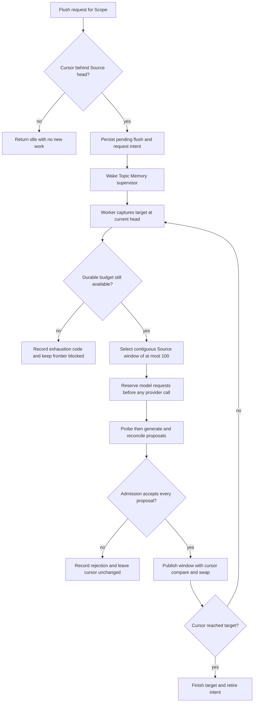

# Topic Memory Lifecycle

Topic Memory is the Artifact family that keeps one evolving topic per Scope as a `title`, a `summary`, and a
progressively disclosed `detail`. This page follows the lifecycle as implemented at repository commit `b8b18909`: how
a flush or a Source change becomes work, how a Worker turns a contiguous Source window into published revisions, how the
durable budget and recovery blocks stop runaway work, and how search and exact reads consume the result.

For the general Source model, see [Sources and processing](../concepts/sources-and-processing.md). For the family
model, see [Artifact families](../concepts/artifact-families.md). For operator checks, see
[Troubleshooting](../operations/troubleshooting.md).

## Responsibilities and owners

| Concern | Owner |
| --- | --- |
| Flush acceptance and wake-up | `request_topic_memory_flush` in `builtin/runtime/relational.py`, called from the scoped application facade |
| Pending flush and invocation intent | `ArtifactProcessingPendingRepository` and `ArtifactProcessingIntentRepository` in `builtin/persistence/` |
| Target capture and cursor advance | `TopicMemoryScopeProcessor` in `builtin/runtime/topic_memory_scope.py` |
| Window selection, generation, admission, publication | `TopicMemoryProcessor` and `TopicMemoryAtomicPublisher` in `builtin/runtime/topic_memory_processing.py` |
| Durable work budget and frontier exhaustion | `TopicMemoryWorkBudget` and `exhausted_reason` in `builtin/persistence/topic_memory_budget.py` |
| Block observation and explicit retry | `builtin/persistence/topic_memory_recovery.py`, exposed by `TopicMemoryRecoveryService` in `builtin/runtime/topic_memory_recovery.py` |
| Head storage, active projections, exact reads | `TopicMemoryRepository` in `builtin/persistence/topic_memory.py` |
| Search mode selection and embedding fallback | `TopicMemorySearcher` in `builtin/runtime/topic_memory_search.py` |
| Topic fusion policy and RRF | `builtin/artifacts/topic_memory/search.py`, `builtin/artifacts/topic_memory/fusion.py`, and `artifacts/fusion.py` |

## Flush and processing decisions

Capturing a Source does not create a topic by itself. Work starts when a flush request or the automatic discovery path
marks the Topic binding as needing a run, and then a Worker claims a target at the Source head. The flowchart shows the
decision points for one flush through target completion.

Caption: Decision logic from one flush through target completion; budget exhaustion and admission rejection are the two
exits that publish nothing.

### Flush acceptance

The scoped application `flush` requires topic processing to be available, then calls the runtime flush hook inside the
scoped operation and Scope lock. `request_topic_memory_flush` locks the Source journal head, compares the Topic cursor
with that head, and returns `False` (reported as `idle`) when the cursor is already current. Otherwise it upserts the
pending row with an incremented flush generation and requests an intent generation in the same transaction. The
supervisor wake-up runs after commit and is best effort: a wake failure is logged and does not reverse acceptance.
`accepted` therefore means durable work was recorded, not that any topic changed.

Evidence: [relational.py](repo://src/powercontext/builtin/runtime/relational.py#L1017-L1031),
[application.py](repo://src/powercontext/builtin/runtime/application.py#L4078-L4100),
[processing.py](repo://src/powercontext/builtin/persistence/processing.py#L179-L205).

### Automatic admission

Automatic work is driven by dirty marks rather than only by a flush. Source capture marks the source-processing bindings
dirty through the intent repository, and the processing discovery provider marks a binding dirty when the Source head is
ahead of the cursor and the intent is clean. The optional schedule `topic_memory_schedule_seconds` must be positive when
set; when it is unset, new automatic admission is disabled but already accepted work is not discarded. Composition maps
the `topic-memory` family to this interval.

Evidence: [sources.py](repo://src/powercontext/builtin/persistence/sources.py#L240-L260),
[processing_discovery.py](repo://src/powercontext/builtin/runtime/processing_discovery.py#L38-L75),
[config.py](repo://src/powercontext/builtin/runtime/config.py#L258-L268),
[composition.py](repo://src/powercontext/builtin/runtime/composition.py#L1018-L1030).

## Target capture and the scope processor

`TopicMemoryScopeProcessor.process` validates the assignment (binding, family `topic-memory`, claimed generation,
supervisor group), then runs at most two target passes. Each pass calls `_target`, which fences the lease, locks the
Source head before the intent, and refuses a replayed or unaccepted invocation. A new target records the Source head as
`source_through`, the captured flush generation, and the observed dirty generation. An existing target from an earlier
request generation is finished first; the processor never extends an active target to a newer head.

`_process_target` then loops over bounded windows. Each window is at most `MAX_TOPIC_MEMORY_WINDOW_SOURCES` (100), and
the processor's `source_window_limit` can only lower that value. The loop ends when the cursor reaches the target, at
which point `_finish_target` verifies the cursor, marks the flush generation handled, deletes the pending row only when
it is covered by the target, acknowledges the intent, and deletes the target row. A cursor generation conflict or a
leadership loss is returned as a completion outcome instead of publishing.

Evidence: [topic_memory_scope.py](repo://src/powercontext/builtin/runtime/topic_memory_scope.py#L95-L170),
[topic_memory_scope.py](repo://src/powercontext/builtin/runtime/topic_memory_scope.py#L171-L230),
[topic_memory_scope.py](repo://src/powercontext/builtin/runtime/topic_memory_scope.py#L275-L340),
[topic_memory_processing.py](repo://src/powercontext/builtin/runtime/topic_memory_processing.py#L141-L142).

### Window selection

`TopicMemoryWindowSelector` chooses the largest contiguous prefix of the Source journal whose Probe request fits an input
budget of 80 percent of the configured context window. It reads the Sources, projects them into evidence, and grows the
prefix one Source at a time until the estimated request exceeds the limit. Two edge cases matter for recovery: a
projection failure at the frontier returns the next position so a singleton Worker can persist the rejection while
earlier healthy Sources still advance; lineage-only entries keep the Journal window contiguous.

Evidence: [topic_memory_processing.py](repo://src/powercontext/builtin/runtime/topic_memory_processing.py#L257-L312).

## Generation, admission, and publication

`TopicMemoryProcessor.process` runs one window inside a durable work budget context. It reads the window, projects the
evidence, generates proposals, prepares operations, and calls the atomic publisher. Generation first runs Probe batches
over the evidence (splitting a single oversized Source into fragments), then either a global evolve step or a planner
path, followed by coordination against historical candidates. Related candidate sets go through a reconcile stage; a
single proposal with no historical link skips it. A reduction stage compacts intermediate lists when they exceed the
item or token limits.

Content admission runs before any publication. `TopicMemoryContentAdmission` rejects recognizable numbered placeholder
bodies with `invalid_topic_placeholder` and internal coordination boilerplate with `invalid_topic_coordination_content`.
A rejected proposal fails the whole window: the processor records the code on the budget row, and the cursor and heads
stay where they were.

`TopicMemoryAtomicPublisher.publish` is the only place a window is committed. Inside one database transaction it:

1. requires the lease fence and locks the Source head;
2. loads the cursor for update and requires the expected sequence and generation to match the assignment;
3. revalidates the exact Source window and checks that every cited Source belongs to it;
4. runs the commit authorizer and completes the work budget;
5. saves the cursor to `source_through` with a generation check;
6. publishes revisions for proposals that target existing heads and creates new Topics for the rest.

Because the cursor advance and the artifact writes share the transaction, a window is either fully visible or not
visible at all. The commit hook for a non-final window only re-checks the target; the final window finishes it.

Evidence: [topic_memory_processing.py](repo://src/powercontext/builtin/runtime/topic_memory_processing.py#L313-L452),
[topic_memory_processing.py](repo://src/powercontext/builtin/runtime/topic_memory_processing.py#L520-L560),
[topic_memory_processing.py](repo://src/powercontext/builtin/runtime/topic_memory_processing.py#L657-L700),
[admission.py](repo://src/powercontext/builtin/artifacts/topic_memory/admission.py#L200-L232).

### Stage ceilings and coordination

Each structured stage input must fit the stage's token limit before any provider request. `_reserve_stage` reserves
`max_requests` requests plus their token capacity from the durable budget before the model is called. Proposal lists are
capped at `MAX_TOPIC_MEMORY_STAGE_ITEMS` (20). When a component's historical candidate set exceeds that cap, the processor
raises `related_history_limit`, which is treated as recoverable. The processor's defaults are 20 history candidates, an
RRF history threshold of 70 (configurable from 0 to 100), and a minimum of 5 history candidates.

Evidence: [topic_memory_processing.py](repo://src/powercontext/builtin/runtime/topic_memory_processing.py#L462-L505),
[topic_memory_processing.py](repo://src/powercontext/builtin/runtime/topic_memory_processing.py#L555-L600),
[topic_memory_processing.py](repo://src/powercontext/builtin/runtime/topic_memory_processing.py#L1036-L1135),
[generation.py](repo://src/powercontext/builtin/artifacts/topic_memory/generation.py#L28-L32),
[config.py](repo://src/powercontext/builtin/runtime/config.py#L264-L268).

## Work budget and exhaustion

The durable budget is keyed by Scope, binding, and `source_after`, so it belongs to one unadvanced frontier. A fresh
attempt increments the attempt count and supersedes older same-term work. Charges are committed before model I/O, and
failed or ambiguous work is never refunded.

| Ceiling | Value | Effect when reached |
| --- | --- | --- |
| `MAX_TOPIC_MEMORY_WORK_ATTEMPTS` | 3 | `window_attempt_limit`, or the recurring recorded code when one exists |
| `MAX_TOPIC_MEMORY_WORK_REQUESTS` | 512 | `window_provider_budget_exceeded` |
| `MAX_TOPIC_MEMORY_WORK_TOKENS` | 64,000,000 | `window_provider_budget_exceeded` |

`exhausted_reason` decides the frontier state. A recorded code outside the recoverable set (today `source_complexity_limit`)
ends the frontier immediately, because the window's own input decides it. The recoverable codes
`related_history_limit`, `invalid_topic_placeholder`, and `invalid_topic_coordination_content` are kept for diagnosis but
do not end the frontier; they keep spending the attempt and provider ceilings, so retries stay bounded. `begin` and
`reserve` commit the terminal marker before they raise the exhaustion code; they never roll it back. The Worker guard
`require_topic_memory_work_available` refuses to read or project input for an exhausted frontier.

Evidence: [topic_memory_budget.py](repo://src/powercontext/builtin/persistence/topic_memory_budget.py#L28-L85),
[topic_memory_budget.py](repo://src/powercontext/builtin/persistence/topic_memory_budget.py#L144-L240),
[topic_memory_budget.py](repo://src/powercontext/builtin/persistence/topic_memory_budget.py#L241-L316),
[topic_memory_processing.py](repo://src/powercontext/builtin/runtime/topic_memory_processing.py#L149-L152).

Exhaustion also changes Worker behavior. `_generation_failure` converts a generation error into a supervisor block only
when the observed block carries the same error code; otherwise the error is re-raised. The Supervisor then stops
launching Workers for that Scope while other Scopes continue.

Evidence: [topic_memory_scope.py](repo://src/powercontext/builtin/runtime/topic_memory_scope.py#L55-L95),
[topic_memory_scope.py](repo://src/powercontext/builtin/runtime/topic_memory_scope.py#L120-L170).

## Recovery: status, block, and retry

`observe_topic_memory_block` records the first observation of an exhausted frontier as a block row. It returns nothing
while an active final attempt can still publish, unless the dispatcher or a failed Worker has attested that the Worker
stopped. It serializes with capture, begin, publication, and retry by locking the Source head, cursor, budget, and
target in one transaction, and it reuses an existing block for the same attempt. Imported legacy rows keep their
observation time rather than an invented failure time.

`TopicMemoryRecoveryService.status` reports one of three states: `blocked` when a block exists, `idle` when the cursor
has reached the head and no target remains, and `pending` otherwise. `retry` grants one new allowance: it deletes the
exhausted budget row for the current attempt, requests a new pending flush and invocation intent, and stamps the block
with `retried_at` and the new request generation. Retrying an already retried block returns it unchanged. A block that no
longer owns the current frontier raises a conflict instead of retrying, which the public API maps to HTTP 409.

Evidence: [topic_memory_recovery.py (persistence)](repo://src/powercontext/builtin/persistence/topic_memory_recovery.py#L50-L115),
[topic_memory_recovery.py (persistence)](repo://src/powercontext/builtin/persistence/topic_memory_recovery.py#L161-L200),
[topic_memory_recovery.py (runtime)](repo://src/powercontext/builtin/runtime/topic_memory_recovery.py#L35-L84).

## Progressive detail and storage

Topic content has three disclosed layers: `title`, `summary`, and `detail`. A search hit carries the exact `artifact`
reference, title, summary, an optional snippet, score, and `matched_by`. Only the exact read returns the full `detail`
and direct `source_refs`. `TopicMemoryRepository` stores a complete searchable revision inside one caller transaction:
`publish_create` creates revision 1 and activates every configured channel, `publish_revision` CAS-checks the current
head before replacing its active projection, and `publish_copy` copies an exact revision into another Scope.

`get_exact` and `get_exact_many` read immutable revisions even after the head advances, verifying the family and
publication evidence in bounded batches. `initialize` fails closed on a missing publication, an active row that is not
the head, a head that is not active, or a head without active chunks.

Evidence: [topic_memory.py (persistence)](repo://src/powercontext/builtin/persistence/topic_memory.py#L101-L140),
[topic_memory.py (persistence)](repo://src/powercontext/builtin/persistence/topic_memory.py#L316-L335),
[topic_memory.py (persistence)](repo://src/powercontext/builtin/persistence/topic_memory.py#L375-L420).

## Search over current heads

`TopicMemorySearcher.search` plans the mode with `plan_topic_search`, rejects a vector or hybrid search when the embedding
model's profile differs from the index profile, and enforces the analyzed-term limit for text. When an embedding is
unavailable, times out, or returns the wrong vector count, a plan that allows fallback runs FTS instead and records
`inference_unavailable` or `inference_timeout`. A matching cached query vector is reused without a new provider request.
Public execution must return complete exact Artifacts for each hit.

Topic mode channels are fixed: `fts` uses `topic_fts` and `detail_fts`, `vector` uses `topic_vector` and `detail_vector`,
and `hybrid` uses all four. The dedicated Topic search covers only current heads in the caller's Scope and does not accept
a caller-selected mode.

Evidence: [topic_memory_search.py](repo://src/powercontext/builtin/runtime/topic_memory_search.py#L47-L140),
[topic_memory_search.py](repo://src/powercontext/builtin/runtime/topic_memory_search.py#L141-L210),
[search.py (topic)](repo://src/powercontext/builtin/artifacts/topic_memory/search.py#L35-L39),
[search.py (topic)](repo://src/powercontext/builtin/artifacts/topic_memory/search.py#L117-L160).

## RRF fusion parameters

Topic fusion uses the shared Reciprocal Rank Fusion implementation in `artifacts/fusion.py`. The only supported method is
`rrf`, and its parameters are strict: `rank_constant` (a strict integer, default `60`, minimum `1`) and `weights` (a map
from channel name to a finite, non-negative number, default empty). A missing weight defaults to `1.0` for an enabled
channel, and a weight of `0` removes that channel from both numerator and denominator. Enabled channels must have a
positive total weight, and unknown or inactive weight keys are rejected even at weight `0`.

For each candidate `x`, the raw score is the sum of `w_c / (rank_constant + rank_c(x))` over the channels that contain
it. The normalized score divides that by `upper`, the sum of `w_c / (rank_constant + 1)` over every enabled channel with
a positive weight, so empty enabled channels still count toward the denominator. Topic fusion keeps the first occurrence
of each artifact identity within a channel and preserves rank gaps. Equal fused scores are ordered by the UTF-8 artifact
ID and then by descending revision. Raw sums that would overflow, underflow, or become subnormal are recomputed with
`Decimal`, and only the final normalized ratio is exposed as a public score.

When `fusion` is omitted, the Topic route uses the default RRF parameters. An explicit `fusion` object replaces the
defaults and applies its own weights, with omitted enabled channels kept at weight `1`.

Evidence: [fusion.py](repo://src/powercontext/artifacts/fusion.py#L43-L50),
[fusion.py](repo://src/powercontext/artifacts/fusion.py#L83-L130),
[fusion.py](repo://src/powercontext/artifacts/fusion.py#L169-L195),
[topic fusion](repo://src/powercontext/builtin/artifacts/topic_memory/fusion.py#L67-L135),
[topic search policy](repo://src/powercontext/builtin/artifacts/topic_memory/search.py#L77-L101),
[search-fusion.md](repo://docs/en/docs/workflows/search-fusion.md).

## Failure and recovery semantics

- A flush with no cursor gap returns `idle`; a flush that persists work returns `accepted` even if the wake-up fails.
- A window that fails admission leaves the cursor, heads, and search projections unchanged, and the frontier remains
  pending with the rejection code on the budget row.
- Budget exhaustion blocks only the Scope frontier. Later Sources wait; other Scopes continue.
- Retry requires the Scope admin role and does not reset attempt history. Repeating the same block ID returns the
  original acceptance.
- Leadership loss or a cursor generation conflict is reported as a completion outcome rather than publishing.

## Tests that anchor the behavior

- `tests/test_topic_memory_recovery_cli.py` checks that the status, block, and retry CLI preserve exact block identity
  and diagnostics for imported and new blocks, and that retry requires an explicit observed block ID.
- `tests/test_topic_memory_server.py` checks the public HTTP shapes, rejection of a caller-selected search mode, the 503
  mapping when topic processing is missing, redaction of provider context on fallback failure, and that the composed FTS
  runtime fails closed only for missing Topic processing.

Evidence: [test_topic_memory_recovery_cli.py](repo://tests/test_topic_memory_recovery_cli.py#L25-L100),
[test_topic_memory_server.py](repo://tests/test_topic_memory_server.py#L143-L215),
[test_topic_memory_server.py](repo://tests/test_topic_memory_server.py#L338-L372).

## Related pages

- [Prepare and recall](prepare-and-recall.md) describes how Topic Memory is assembled into prepared context.
- [Artifact families](../concepts/artifact-families.md) explains where Topic Memory sits among the families.
- [Sources and processing](../concepts/sources-and-processing.md) covers the Source journal and dirty-intent model.
- [Troubleshooting](../operations/troubleshooting.md) covers operator checks for missing or blocked topics.
