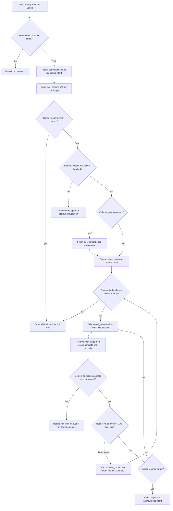

# Topic Memory Lifecycle

Topic Memory is the Artifact family that keeps one evolving topic per Scope as a `title`, a `summary`, and a
progressively disclosed `detail`. This page follows the lifecycle as implemented at repository commit `b8b18909`: how
a flush or a Source change becomes work, how a Worker resolves its Scope and target, how it turns a contiguous Source
window into published revisions, how head conflicts are recomputed, how the durable budget and recovery blocks stop
runaway work, and how search and exact reads consume the result.

For the general Source model, see [Sources and processing](../concepts/sources-and-processing.md). For the family
model, see [Artifact families](../concepts/artifact-families.md). For operator checks, see
[Troubleshooting](../operations/troubleshooting.md).

## Responsibilities and owners

| Concern | Owner |
| --- | --- |
| Flush acceptance and wake-up | `request_topic_memory_flush` in `builtin/runtime/relational.py`, called from the scoped application facade |
| Automatic dirty marks | Source capture through `ArtifactProcessingIntentRepository.mark_dirty_many` in `builtin/persistence/sources.py`, and `SourceProcessingPendingProvider` in `builtin/runtime/processing_discovery.py` |
| Pending flush and invocation intent | `ArtifactProcessingPendingRepository` and `ArtifactProcessingIntentRepository` in `builtin/persistence/` |
| Target capture, cursor advance, and Scope-level blocking | `TopicMemoryScopeProcessor` and `topic_memory_processing_block` in `builtin/runtime/topic_memory_scope.py` |
| Window selection, generation, admission, head-conflict handling, publication | `TopicMemoryWindowSelector`, `TopicMemoryProcessor`, and `TopicMemoryAtomicPublisher` in `builtin/runtime/topic_memory_processing.py` |
| Durable work budget and frontier exhaustion | `TopicMemoryWorkBudget` and `exhausted_reason` in `builtin/persistence/topic_memory_budget.py` |
| Block observation and explicit retry | `builtin/persistence/topic_memory_recovery.py`, exposed by `TopicMemoryRecoveryService` in `builtin/runtime/topic_memory_recovery.py` |
| Head storage, active projections, exact reads | `TopicMemoryRepository` in `builtin/persistence/topic_memory.py` |
| Search mode selection and embedding fallback | `TopicMemorySearcher` in `builtin/runtime/topic_memory_search.py` |
| Topic fusion policy and RRF | `builtin/artifacts/topic_memory/search.py`, `builtin/artifacts/topic_memory/fusion.py`, and `artifacts/fusion.py` |

## Flush and processing decisions

Capturing a Source does not create a topic by itself. Work starts when a flush request or the automatic discovery path
marks the Topic binding as needing a run, and then a Worker claims a target at the Source head. The flowchart shows the
decision points for scope resolution, budget check, processing, head conflict, and the terminal frontier.

Caption: Decision logic for one target. Exhausted budget and admission rejection publish nothing; a head conflict
returns to the budget check and is recomputed on the next attempt.

### Flush acceptance

The scoped application `flush` requires topic processing to be available, then calls the runtime flush hook inside the
scoped operation and Scope lock. `request_topic_memory_flush` locks the Source journal head, compares the Topic cursor
with that head, and returns `False` (reported as `idle`) when the cursor is already current. Otherwise it upserts the
pending row with an incremented flush generation and requests an intent generation in the same transaction. The
supervisor wake-up runs after commit and is best effort: a wake failure is logged and does not reverse acceptance.
`accepted` therefore means durable work was recorded, not that any topic changed.

Evidence: [relational.py](repo://src/powercontext/builtin/runtime/relational.py#L1017-L1031),
[application.py](repo://src/powercontext/builtin/runtime/application.py#L4078-L4100),
[processing.py](repo://src/powercontext/builtin/persistence/processing.py#L179-L205).

### Automatic admission

Automatic work is driven by dirty marks rather than only by a flush. When Source capture commits new journal rows, it
calls `mark_dirty_many` for the source-processing bindings and for plugin bindings, with an increment equal to the
number of new rows. The processing discovery provider also marks a binding dirty when the Source journal head is ahead
of the cursor and the intent is clean (no intent, or dirty and clean generations equal). The optional schedule
`topic_memory_schedule_seconds` must be positive when set. Composition maps the `topic-memory` family to this interval
and passes it to the binding as its automatic processing interval. When the schedule is unset, the binding has no
interval and no cron, so the scan is disabled and its scan state is finished; already accepted work is not discarded.

Evidence: [sources.py](repo://src/powercontext/builtin/persistence/sources.py#L281-L285),
[processing_discovery.py](repo://src/powercontext/builtin/runtime/processing_discovery.py#L56-L76),
[config.py](repo://src/powercontext/builtin/runtime/config.py#L273),
[composition.py](repo://src/powercontext/builtin/runtime/composition.py#L1024-L1030),
[composition.py](repo://src/powercontext/builtin/runtime/composition.py#L1100-L1110),
[artifact_processing.py](repo://src/powercontext/builtin/runtime/artifact_processing.py#L1013-L1030).

## Scope resolution and target capture

`TopicMemoryScopeProcessor.process` validates the assignment first: the binding must be the Topic source-window
binding, the family must be `topic-memory`, the claimed request generation must be at least 1, and the supervisor group
must be `global` or `artifact:topic-memory`. Any other assignment raises `invalid_invocation`. The processor then runs
at most two target passes. Each pass calls `_target`, which requires the lease fence, locks the Source head before the
intent, and refuses an unaccepted invocation (claimed generation above the requested generation). A replay whose
generation is already handled returns no target and reads no input. A new target records the Source head as
`source_through`, the captured flush generation, and the observed dirty generation. An existing target from an earlier
request generation is finished first. An existing target from a newer generation raises a generation conflict. The
processor never extends an active target to a newer head.

Before any target is captured, the Supervisor asks `topic_memory_processing_block` whether the Scope frontier is
blocked. For an exact Dream request pending on the same binding, the check returns no block, so an exhausted automatic
window does not prevent the Dream Worker from starting. Otherwise the check reads the current block (`worker_stopped`
set) and returns it as an `ArtifactProcessingBlock` keyed by the block ID.

`_process_target` then loops over bounded windows. Each window is at most `MAX_TOPIC_MEMORY_WINDOW_SOURCES` (100). The
processor clamps its `source_window_limit` to between 1 and that constant. The runtime passes
`topic_memory_source_window_limit`, whose default is 10 and whose minimum is 1, so a default deployment publishes
windows of at most 10 Sources. The loop ends when the cursor reaches the target. `_finish_target` then verifies the
cursor, marks the flush generation handled, deletes the pending row only when it is covered by the target,
acknowledges the intent, and deletes the target row. A cursor generation conflict or a leadership loss is returned as a
completion outcome instead of publishing.

Evidence: [topic_memory_scope.py](repo://src/powercontext/builtin/runtime/topic_memory_scope.py#L66-L106),
[topic_memory_scope.py](repo://src/powercontext/builtin/runtime/topic_memory_scope.py#L108-L161),
[topic_memory_scope.py](repo://src/powercontext/builtin/runtime/topic_memory_scope.py#L181-L238),
[topic_memory_scope.py](repo://src/powercontext/builtin/runtime/topic_memory_scope.py#L239-L284),
[topic_memory_scope.py](repo://src/powercontext/builtin/runtime/topic_memory_scope.py#L285-L325),
[composition.py](repo://src/powercontext/builtin/runtime/composition.py#L1108-L1111),
[topic_memory_processing.py](repo://src/powercontext/builtin/runtime/topic_memory_processing.py#L148),
[topic_memory_processing.py](repo://src/powercontext/builtin/runtime/topic_memory_processing.py#L2100-L2110),
[config.py](repo://src/powercontext/builtin/runtime/config.py#L274).

### Window selection

`TopicMemoryWindowSelector` chooses the largest contiguous prefix of the Source journal whose Probe request fits an input
budget of 80 percent of the configured context window (`int(context_window_tokens * 0.80)`, at least 1). `select`
first runs the budget guard `require_topic_memory_work_available`, then reads the Sources. A short or non-contiguous
read raises `source_window_changed`. It projects eligible Sources into evidence one at a time, and grows the prefix
until either the accumulated characters exceed the 4 MiB source limit or the estimated Probe request exceeds the input
limit. The first eligible Source forms a window even when it alone exceeds the budget. Two edge cases matter for
recovery: a projection failure returns a prefix that ends before the failing Source, or, at the frontier, a singleton
prefix so that a singleton Worker can persist the rejection while earlier healthy Sources still advance; lineage-only
entries keep the Journal window contiguous.

Evidence: [topic_memory_processing.py](repo://src/powercontext/builtin/runtime/topic_memory_processing.py#L262-L321),
[topic_memory_processing.py](repo://src/powercontext/builtin/runtime/topic_memory_processing.py#L148-L149).

## Generation, admission, and publication

`TopicMemoryProcessor.process` runs one window inside a durable work budget context. It first calls `budget.begin()`,
which refuses an exhausted frontier before any read. It then reads the window (`_read_window`), projects the evidence,
generates proposals, prepares operations, and calls the atomic publisher. Generation first runs Probe batches over the
evidence (splitting a single oversized Source into fragments), then either a global evolve step or a planner path,
followed by coordination against historical candidates. Related candidate sets go through a reconcile stage; a single
proposal with no historical link skips it. A reduction stage compacts intermediate lists when they exceed the item or
token limits.

Content admission runs before any publication. `TopicMemoryContentAdmission.rejection` rejects recognizable numbered
placeholder bodies with `invalid_topic_placeholder` and internal coordination boilerplate with
`invalid_topic_coordination_content`. `_validate_proposals` raises the returned code as a `TopicMemoryGenerationError`
for the proposal set. That error propagates out of the window, so the processor records the code on the budget row (see
[Work budget and exhaustion](#work-budget-and-exhaustion)), and the cursor and heads stay where they were.

`TopicMemoryAtomicPublisher.publish` is the only place a window is committed. Inside one database transaction it:

1. requires the lease fence and locks the Source head;
2. loads the cursor for update and requires the expected sequence and generation to match the assignment;
3. revalidates the exact Source window and checks that every cited Source belongs to it;
4. runs the commit authorizer and completes the work budget;
5. saves the cursor to `source_through` with a generation check;
6. publishes revisions for proposals that target existing heads and creates new Topics for the rest, then runs the
   commit hook and requires the fence again.

Because the cursor advance and the artifact writes share the transaction, a window is either fully visible or not
visible at all. The commit hook for a non-final window only re-checks the target; the final window finishes it.

Evidence: [topic_memory_processing.py](repo://src/powercontext/builtin/runtime/topic_memory_processing.py#L348-L469),
[topic_memory_processing.py](repo://src/powercontext/builtin/runtime/topic_memory_processing.py#L535-L607),
[topic_memory_processing.py](repo://src/powercontext/builtin/runtime/topic_memory_processing.py#L1392-L1431),
[admission.py](repo://src/powercontext/builtin/artifacts/topic_memory/admission.py#L196-L230),
[topic_memory_scope.py](repo://src/powercontext/builtin/runtime/topic_memory_scope.py#L285-L325).

### Stage ceilings and history coordination

Each structured stage input must fit the stage's input token limit before any provider request. `_reserve_stage` checks
`fits` and raises `input_budget_exceeded` when the input is too large. Otherwise it reserves `max_requests` requests
and their token capacity (the input limit plus a transcript reserve) from the durable budget before the model is
called. `_reserve` falls back to a process-local allowance only for private stage helpers used without a budget
context; the public `process` entrypoint always uses the durable reservation.

Proposal lists are capped at `MAX_TOPIC_MEMORY_STAGE_ITEMS` (20). History retrieval keeps the hits that score at or
above the RRF history threshold, falls back to the top `history_min_candidates` when fewer qualify, and truncates to
`history_max_candidates`. The processor's defaults are 20 history candidates, an RRF history threshold of 70
(configurable from 0 to 100), and a minimum of 5 history candidates. When `_coordinate` builds a reconcile component, it
ranks related candidates by score and keeps at most `MAX_TOPIC_MEMORY_STAGE_ITEMS` minus the number of bound targets.
If the resulting reconcile input still does not fit, the processor raises `input_budget_exceeded` as a
business-validation context overflow and publishes nothing. The `related_history_limit` code remains in the recoverable
set, but no raise site for it exists in the current source tree.

Evidence: [topic_memory_processing.py](repo://src/powercontext/builtin/runtime/topic_memory_processing.py#L233-L238),
[topic_memory_processing.py](repo://src/powercontext/builtin/runtime/topic_memory_processing.py#L479-L481),
[topic_memory_processing.py](repo://src/powercontext/builtin/runtime/topic_memory_processing.py#L608-L619),
[topic_memory_processing.py](repo://src/powercontext/builtin/runtime/topic_memory_processing.py#L655-L678),
[topic_memory_processing.py](repo://src/powercontext/builtin/runtime/topic_memory_processing.py#L953-L1021),
[topic_memory_processing.py](repo://src/powercontext/builtin/runtime/topic_memory_processing.py#L1244-L1266),
[generation.py](repo://src/powercontext/builtin/artifacts/topic_memory/generation.py#L36),
[config.py](repo://src/powercontext/builtin/runtime/config.py#L275-L277),
[topic_memory_budget.py](repo://src/powercontext/builtin/persistence/topic_memory_budget.py#L52-L63).

## Work budget and exhaustion

The durable budget is keyed by Scope, binding, and `source_after`, so it belongs to one unadvanced frontier. A fresh
attempt increments the attempt count and supersedes older same-term work. Charges are committed before model I/O, and
failed or ambiguous work is never refunded.

| Ceiling | Value | Effect when reached |
| --- | --- | --- |
| `MAX_TOPIC_MEMORY_WORK_ATTEMPTS` | 3 | `window_attempt_limit`, or the recurring recorded code when one exists |
| `MAX_TOPIC_MEMORY_WORK_REQUESTS` | 512 | `window_provider_budget_exceeded` |
| `MAX_TOPIC_MEMORY_WORK_TOKENS` | 64_000_000 | `window_provider_budget_exceeded` |

`exhausted_reason` decides the frontier state. A recorded code outside `RECOVERABLE_TOPIC_MEMORY_REJECTIONS` (today
`source_complexity_limit`, the only recorded code that is not recoverable) ends the frontier immediately, because the
window's own input decides it. The recoverable codes `related_history_limit`, `invalid_topic_placeholder`, and
`invalid_topic_coordination_content` are kept for diagnosis but do not end the frontier; they keep spending the attempt
and provider ceilings, so retries stay bounded. Attempts are counted with `_spent_attempts`, which excludes a
`head_conflict` attempt (see [Head conflict handling](#head-conflict-handling)).

`begin` and `reserve` commit the terminal marker before they raise the exhaustion code; they never roll it back. `begin`
checks exhaustion before it starts an attempt, and `reserve` checks each reservation against the request and token
ceilings, so a reservation that would cross a ceiling records `window_provider_budget_exceeded` and raises. The Worker
guard `require_topic_memory_work_available` refuses to read or project input for an exhausted frontier, and the selector
calls it before reading any Source, so an exhausted frontier triggers no model work.

Evidence: [topic_memory_budget.py](repo://src/powercontext/builtin/persistence/topic_memory_budget.py#L48-L50),
[topic_memory_budget.py](repo://src/powercontext/builtin/persistence/topic_memory_budget.py#L59-L96),
[topic_memory_budget.py](repo://src/powercontext/builtin/persistence/topic_memory_budget.py#L158-L168),
[topic_memory_budget.py](repo://src/powercontext/builtin/persistence/topic_memory_budget.py#L212-L262),
[topic_memory_budget.py](repo://src/powercontext/builtin/persistence/topic_memory_budget.py#L264-L317),
[topic_memory_budget.py](repo://src/powercontext/builtin/persistence/topic_memory_budget.py#L326-L361),
[topic_memory_processing.py](repo://src/powercontext/builtin/runtime/topic_memory_processing.py#L150-L154),
[topic_memory_processing.py](repo://src/powercontext/builtin/runtime/topic_memory_processing.py#L288-L296),
[topic_memory_processing.py](repo://src/powercontext/builtin/runtime/topic_memory_processing.py#L582-L596).

Exhaustion also changes Worker behavior. `_generation_failure` converts a generation error into a supervisor block only
when the observed block carries the same error code; otherwise the error is re-raised. The Supervisor then stops
launching Workers for that Scope while other Scopes continue.

Evidence: [topic_memory_scope.py](repo://src/powercontext/builtin/runtime/topic_memory_scope.py#L163-L180),
[topic_memory_scope.py](repo://src/powercontext/builtin/runtime/topic_memory_scope.py#L66-L106).

## Head conflict handling

A Topic head can move while a Worker generates against it, because a manual replace or a Dream run may publish a new
revision of the same Topic. The publisher's head compare-and-swap then fails. The publish transaction is rolled back
with the cursor, so no part of the window is visible. `TopicMemoryProcessor.process` catches the `RevisionConflictError`,
calls `record_failure(head_conflict)`, and returns `HEAD_CONFLICT`. The `head_conflict` code is stored as the attempt's
last error; it is not a rejection and does not end the frontier.

`_spent_attempts` subtracts one from the attempt count for an attempt whose last error is `head_conflict`, so the next
attempt rereads the head and recomputes without consuming the attempt ceiling. Its provider reservations remain charged
against the request and token ceilings. A head that keeps moving therefore eventually ends the frontier with
`window_provider_budget_exceeded`. A `RevisionConflictError` raised outside publication is treated as a normal completion
outcome and keeps counting toward the attempt ceiling.

Evidence: [topic_memory_processing.py](repo://src/powercontext/builtin/runtime/topic_memory_processing.py#L574-L603),
[topic_memory_budget.py](repo://src/powercontext/builtin/persistence/topic_memory_budget.py#L66-L77),
[topic_memory_budget.py](repo://src/powercontext/builtin/persistence/topic_memory_budget.py#L326-L361),
[topic_memory_processing.py](repo://src/powercontext/builtin/runtime/topic_memory_processing.py#L348-L469).

## Recovery: status, block, and retry

`observe_topic_memory_block` records the first observation of an exhausted frontier as a block row. It returns nothing
while an active final attempt can still publish, unless the dispatcher or a failed Worker has attested that the Worker
stopped. It serializes with capture, begin, publication, and retry by locking the Source head, cursor, budget, and
target in one transaction, and it reuses an existing block for the same attempt. Imported legacy rows keep their
observation time rather than an invented failure time.

`TopicMemoryRecoveryService.status` reports one of three states: `blocked` when a block exists, `idle` when the cursor
has reached the head and no target remains, and `pending` otherwise. `retry` grants one new allowance: it deletes the
exhausted budget row for the current attempt, requests a new pending flush and invocation intent, and stamps the block
with `retried_at` and the new request generation. Retrying an already retried block returns it unchanged. A block that no
longer owns the current frontier raises a conflict instead of retrying, which the public API maps to HTTP 409.

Evidence: [topic_memory_recovery.py (persistence)](repo://src/powercontext/builtin/persistence/topic_memory_recovery.py#L50-L141),
[topic_memory_recovery.py (persistence)](repo://src/powercontext/builtin/persistence/topic_memory_recovery.py#L161-L204),
[topic_memory_recovery.py (runtime)](repo://src/powercontext/builtin/runtime/topic_memory_recovery.py#L35-L84).

## Progressive detail and storage

Topic content has three disclosed layers: `title`, `summary`, and `detail`. A search hit carries the exact `artifact`
reference, title, summary, an optional snippet, score, and `matched_by`. Only the exact read returns the full `detail`
and direct `source_refs`. `TopicMemoryRepository` stores a complete searchable revision inside one caller transaction:
`publish_create` creates revision 1 and activates every configured channel, `publish_revision` CAS-checks the current
head before replacing its active projection, and `publish_copy` copies an exact revision into another Scope.

`get_exact` and `get_exact_many` read immutable revisions even after the head advances, verifying the family and
publication evidence in bounded batches. `initialize` fails closed on a missing publication, an active row that is not
the head, a head that is not active, or a head without active chunks.

Evidence: [topic_memory.py (persistence)](repo://src/powercontext/builtin/persistence/topic_memory.py#L101-L140),
[topic_memory.py (persistence)](repo://src/powercontext/builtin/persistence/topic_memory.py#L316-L335),
[topic_memory.py (persistence)](repo://src/powercontext/builtin/persistence/topic_memory.py#L375-L420).

## Search over current heads

`TopicMemorySearcher.search` plans the mode with `plan_topic_search`, rejects a vector or hybrid search when the embedding
model's profile differs from the index profile, and enforces the analyzed-term limit for text. When an embedding is
unavailable, times out, or returns the wrong vector count, a plan that allows fallback runs FTS instead and records
`inference_unavailable` or `inference_timeout`. A matching cached query vector is reused without a new provider request.
Public execution must return complete exact Artifacts for each hit.

Topic mode channels are fixed: `fts` uses `topic_fts` and `detail_fts`, `vector` uses `topic_vector` and `detail_vector`,
and `hybrid` uses all four. The dedicated Topic search covers only current heads in the caller's Scope and does not accept
a caller-selected mode.

Evidence: [topic_memory_search.py](repo://src/powercontext/builtin/runtime/topic_memory_search.py#L47-L140),
[topic_memory_search.py](repo://src/powercontext/builtin/runtime/topic_memory_search.py#L141-L210),
[search.py (topic)](repo://src/powercontext/builtin/artifacts/topic_memory/search.py#L35-L39),
[search.py (topic)](repo://src/powercontext/builtin/artifacts/topic_memory/search.py#L117-L160).

## RRF fusion parameters

Topic fusion uses the shared Reciprocal Rank Fusion implementation in `artifacts/fusion.py`. The only supported method is
`rrf`, and its parameters are strict: `rank_constant` (a strict integer, default `60`, minimum `1`) and `weights` (a map
from channel name to a finite, non-negative number, default empty). A missing weight defaults to `1.0` for an enabled
channel, and a weight of `0` removes that channel from both numerator and denominator. Enabled channels must have a
positive total weight, and unknown or inactive weight keys are rejected even at weight `0`.

For each candidate `x`, the raw score is the sum of `w_c / (rank_constant + rank_c(x))` over the channels that contain
it. The normalized score divides that by `upper`, the sum of `w_c / (rank_constant + 1)` over every enabled channel with
a positive weight, so empty enabled channels still count toward the denominator. Topic fusion keeps the first occurrence
of each artifact identity within a channel and preserves rank gaps. Equal fused scores are ordered by the UTF-8 artifact
ID and then by descending revision. Raw sums that would overflow, underflow, or become subnormal are recomputed with
`Decimal`, and only the final normalized ratio is exposed as a public score.

When `fusion` is omitted, the Topic route uses the default RRF parameters. An explicit `fusion` object replaces the
defaults and applies its own weights, with omitted enabled channels kept at weight `1`.

Evidence: [fusion.py](repo://src/powercontext/artifacts/fusion.py#L43-L50),
[fusion.py](repo://src/powercontext/artifacts/fusion.py#L83-L130),
[fusion.py](repo://src/powercontext/artifacts/fusion.py#L169-L195),
[topic fusion](repo://src/powercontext/builtin/artifacts/topic_memory/fusion.py#L67-L135),
[topic search policy](repo://src/powercontext/builtin/artifacts/topic_memory/search.py#L77-L101),
[search-fusion.md](repo://docs/en/docs/workflows/search-fusion.md).

## Failure and recovery semantics

- A flush with no cursor gap returns `idle`; a flush that persists work returns `accepted` even if the wake-up fails.
- A window that fails admission leaves the cursor, heads, and search projections unchanged, and the frontier remains
  pending with the rejection code on the budget row.
- A head conflict rolls back the window and returns `head_conflict` as the attempt's last error; the next attempt
  recomputes on the new head without spending the attempt ceiling, but still spends the request and token ceilings.
- An oversized stage or reconcile input fails with `input_budget_exceeded` before the provider call, publishes nothing,
  and is recorded only as the attempt's last error.
- Budget exhaustion blocks only the Scope frontier. Later Sources wait; other Scopes continue. An exact pending Dream
  request on the same binding is not blocked by the automatic frontier.
- Retry requires the Scope admin role and does not reset attempt history. Repeating the same block ID returns the
  original acceptance.
- Leadership loss or a cursor generation conflict is reported as a completion outcome rather than publishing.

## Tests that anchor the behavior

- `tests/builtin/runtime/test_topic_memory_head_conflict.py` checks that repeated head conflicts recompute on the new
  head without spending attempts, that real failures still spend attempts between conflicts, that a head that never
  settles is stopped by the provider ceiling, and that a supervised Scope rereads moved heads and publishes without a
  block.
- `tests/builtin/runtime/test_topic_memory_processing.py` checks that an oversized related-history set fails closed with
  `input_budget_exceeded` and keeps the cursor, that invalid evidence never advances the cursor, that a failed second head
  CAS rolls back the first update, and that recorded rejections stay bounded by the attempt ceiling.
- `tests/e2e/test_topic_memory_terminal_frontier.py` checks that HTTP recovery preserves blocks across restart and
  processing-mode changes.
- `tests/test_topic_memory_recovery_cli.py` checks that the status, block, and retry CLI preserve exact block identity
  and diagnostics for imported and new blocks, and that retry requires an explicit observed block ID.
- `tests/test_topic_memory_server.py` checks the public HTTP shapes, rejection of a caller-selected search mode, the 503
  mapping when topic processing is missing, redaction of provider context on fallback failure, and that the composed FTS
  runtime fails closed only for missing Topic processing.

Evidence: [test_topic_memory_head_conflict.py](repo://tests/builtin/runtime/test_topic_memory_head_conflict.py#L171-L238),
[test_topic_memory_processing.py](repo://tests/builtin/runtime/test_topic_memory_processing.py#L1654-L1700),
[test_topic_memory_terminal_frontier.py](repo://tests/e2e/test_topic_memory_terminal_frontier.py#L124-L130),
[test_topic_memory_recovery_cli.py](repo://tests/test_topic_memory_recovery_cli.py#L25-L100),
[test_topic_memory_server.py](repo://tests/test_topic_memory_server.py#L143-L215),
[test_topic_memory_server.py](repo://tests/test_topic_memory_server.py#L338-L372).

## Related pages

- [Prepare and recall](prepare-and-recall.md) describes how Topic Memory is assembled into prepared context.
- [Artifact families](../concepts/artifact-families.md) explains where Topic Memory sits among the families.
- [Sources and processing](../concepts/sources-and-processing.md) covers the Source journal and dirty-intent model.
- [Troubleshooting](../operations/troubleshooting.md) covers operator checks for missing or blocked topics.
